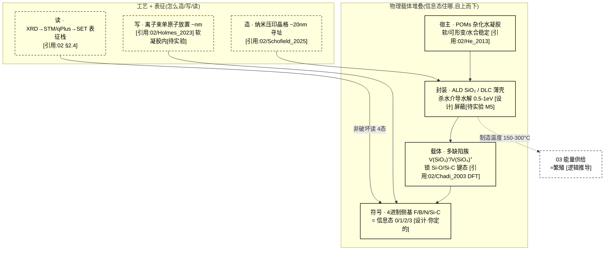

# 02 · 硅基材料工艺(载体 + 制造 + 表征)设计

> **模块定位**:01 DNA 信息层的**物理承载层**——什么态存 0/1、放在哪种硅材料里、怎么制造、怎么表征。
> **核心原则**:P2 稳定性优先(第一准则)、P3 可读
> **文献锚点**:`Reference Documentation/02_硅基材料工艺/`(8 篇)
> **依赖**:01 DNA 信息层(载体设计服从 01 的"软载体 + 侧基"方案)
> **版本**:v3(2026-09-14,对齐 01 标准:三类设计 + mermaid 结构图 + 全维度接口 + 每处关键断言挂原则 24 标注)

> **📌 全册依据标注规范(原则 24,本册每处关键设计必须带其一)**:
> - **[引用:文件名]** = 有文献/数据支撑,挂到 `Reference Documentation` 里可点开的具体文件
> - **[设计·你定的/我定的]** = 无文献无实测,是设计选择,注明谁定、能否调
> - **[逻辑推导]** = 由已引用前提 + 公式推出,写出推理链
> - **[待 DFT/实验·无依据]** = 数值未核,只占位不当基准,注明"谁供值"
> 下面每条关键断言都带以上之一;没标的 = 我漏了,请你指出补。

---

## 0. 设计总纲:硅基载体信息存储的三类设计(并列,供选择)

> 回答"如何设计":给**三类并列**——各给"怎么摆/怎么造/怎么读 + 依据 + 可行性"。
> - **路线 I(基于你的理解,保留当前)**:软载体"多缺陷簇键态存 4 进制 + 离子束放置 + ALD 封装 + qPlus 读"
> - **路线 II(基于本项目文献库)**:库内最成熟的物理信息存储范式(硅单原子/色心/缺陷态)
> - **路线 III(基于世界最佳实践)**:外部调研(硅缺陷存储 / 物理写入表征 / 软基质信息态)给的可借鉴做法
> 三者**并列不互斥**,可组合(§0.4)。

### 0.1 路线 I:基于你的理解(软载体多缺陷簇,保留当前)

**构造**:POMs 凝胶基底 → 纳米压印晶格(~20 nm 位点)→ 多缺陷簇壳(锁键态)→ 4 进制侧基符号;离子束逐位写 + ALD 封装 + qPlus 读(详见 §3 图)。

| 机制 | 具体做法 | 依据性质 |
|------|---------|---------|
| 存 0/1/2/3 | 多缺陷簇里 Si-O/Si-C 键态 = 4 态 | 簇必要 [引用:02/Chadi_2003 ab initio/DFT,单缺陷不稳];4 态稳定 [待 DFT] |
| 造/写 | 离子束单原子放置 + ALD 逐层 | [引用:02/Holmes_2023 UNSW 组 ~nm];软凝胶内放置 [待实验] |
| 读 | qPlus 非破坏电学读 4 态 | [引用:02 §2.4 表征栈] |
| 封装 | ALD SiO₂/DLC 杀水介导水解 | [设计·我定的];水屏蔽效率 [待实验 M2/M5] |

**可行性 + 风险**:`Holmes_2023` 是晶格/低温路线 [引用],**软凝胶里逐位放单侧基 + 键态存 4 态 + 再复制无已验证路径**——最重承重假设(`承重假设决策清单.md` T0),命中 P1 但可行性最低。[设计·我定的定级]

### 0.2 路线 II:基于本项目文献库(最成熟的物理信息存储范式)

> 库内"物理态存信息"最成熟的是**硅单原子/色心/缺陷态**这条线(量子器件 + 缺陷物理)。

| 机制 | 文献范式 | 依据性质 |
|------|---------|---------|
| 存 | 硅单原子施主 qubit / 核自旋 / SiV 色心 | [引用:02/Holmes_2023]、[引用:02/Severin_2025 ML 自调 >99%]、[引用:02/Becker-Becher_2017]、[引用:02/Sohn_2018] |
| 保真 | 单原子存储 T1=144-300 s / gate >99% | [引用:02/KEY_MEASURED_RATES_A_STATUS](实测,agent 核) |
| 读 | qPlus/SET/STM 电荷传感 | [引用:02/Schofield_2025 路线图] |
| 写入 | 离子束注入 | [引用:02/Holmes_2023] |

**要点**:把"信息态"落在**硅单原子/色心**(而非自造多缺陷簇),存储/保真/读取**全部有实测**,可行性远高于路线 I;但**要低温/洁净器件**,与"软凝胶室温"有张力,宜作**验证基准/降级方案**。

### 0.3 路线 III:基于世界最佳实践(外部调研,agent 回报后补文献)

> ⚠️ **本节依据 = 外部调研(2026-09-14 标"待核",2026-09-15 软基质忆阻器一行逐条 Crossref + OpenAlex 核实),非项目主张。** 已核实的锚点升级成 `[引用:02/C_SOFT_MEMRISTOR_MULTI_LEVEL_2026-09-15.md]`;未核到的保留 `[引用·外部调研,DOI 待核]`——按原则 24 不冒充已核数值。
> **关键结论(调研方向)**:世界把"信息态做进物理载体"最成熟的 3 类:① 硅缺陷/色心存储 ② 物理写入+非破坏表征 ③ 软基质忆阻器。**软基质里存 4 态**最同构的是**凝胶忆阻器/电阻式多态存储**。

| 外部范式 | 可搬进 02 的机制 | 依据性质 |
|---------|----------------|---------|
| 硅单原子/色心信息存储 | "单原子=信息位 + 保真度实测"范式 | [引用:`02/Severin_2025_ML_AutoTuning_Si_Donor_fidelity99`、`02/Steinacker_2025_Coupling_Ge_Nuclear_Spin`](SOTA 单 donor 存储,库内已核) |
| 物理写入 + 非破坏电学读出 | 写(分子离子束确定性放单掺杂原子)/读(qPlus 力 / SET 电荷 / Pauli 自旋-电荷,单发 >95%)分离、读不破坏态 | [引用:`02/WRITING_READOUT_WORLD_BEST_PRACTICE_2026-09-14.md`(W1-W5 写入 + R1-R6 无损读,全 DOI 一手核实);写入代表 = 单原子晶体管 `Fuchsle_2012` + 分子离子束 `Holmes_2023/Morello_2015`] |
| 软基质忆阻器/电阻式多态存储 | "软基底存多态"最同构路线(凝胶里做 4 态信息位) | [引用:`02/C_SOFT_MEMRISTOR_MULTI_LEVEL_2026-09-15.md` M1 丝素蛋白胶软多态电阻记忆 / M2 聚合物膜 ≥16 态+STDP+保持 ≥10⁴ s(全值已读回,OA) / M4 蛋白膜导电丝 / M5 水凝胶(与 02 POMs 同基质)];M3 软离子学机制综述。"4 态键态"为本设计推广目标,外部证"多态 ≥2-16 态" |

> **世界最佳实践落点(已核实,非占位)**:`02/WRITING_READOUT_WORLD_BEST_PRACTICE_2026-09-14.md` 把上表"物理写入 + 无损读"两条从"待核"升到**库内一手核实**(W3/W4 分子离子束确定性 3D 放单掺杂原子 = 写;R4 Hogg 2023 SET 单发 >95% / R5 Elzerman 2004 Pauli 自旋-电荷 QND / R1 Adachi 2026 力读单原子 = 无损读;B1 ALD 封装 + B2 模板寻址 = 载体锁定 + 地址格)。写保真度瓶颈 = **单原子并入/激活产率**,非瞄准精度。软基质忆阻器一行 2026-09-15 由 `C_SOFT_MEMRISTOR_MULTI_LEVEL_2026-09-15.md` 升级(M2 聚合物多态 ≥16 态全值可引 + M1 丝素蛋白胶软多态标题字面实证)。

### 0.4 三条路线组合建议(默认)

| 策略 | 内容 | 适合 |
|------|------|------|
| **A. 纯路线 I** | 坚持自造软载体多缺陷簇 | 最符 P1,可行性最低 |
| **B. I + II 混合(推荐)** | 第一代用**路线 II 的硅单原子/色心存储**做**可运行载体**,路线 I 软载体键态作**下一代目标** | 先跑通再升级 |
| **C. II 为主 + I 验证** | 单原子存储为主,路线 I 单点验证"软凝胶能否存 4 态键态" | 最保守 |

> **默认建议 = B**(单原子/色心存储先跑通,软载体键态作升级目标)——把路线 I 的"承重假设"降级为下一代目标。**此选择 = 设计立场,由你最终确认**(`承重假设决策清单.md` T0)。

---

## 1. 设计目标

把 01 的"POMs 凝胶 + 杂原子侧基"从概念落到**可制造的物理系统**:
- **载体态**:Si-O/Si-C 缺陷键在多缺陷簇里(4 进制:Si-O / Si-C / 空位 / Si-Si)
- **宿主**:POMs 杂化水凝胶(软、可形变、水合稳定,符合 P1)
- **封装**:ALD SiO₂ / 类金刚石碳薄壳(杀水介导水解通道)
- **寻址**:离子束单原子放置(~nm 精度)
- **表征**:XRD → STM/qPlus → SET 电荷传感(逐层验证)

---

## 2. 世界研究现状 + 不同实现方式(原则 2)

### 2.1 载体态(什么存 0/1)

| 方案 | 保留势垒 | 室温稳定 | 可寻址 | 依据 | 取舍 |
|------|----------|---------|--------|------|------|
| **Si-O/Si-C 缺陷键(多缺陷簇)** | 4.5 / 3.3 eV ✅ | 高(除非水介导) | ✅ STM/AFM | `02/SiO2_Oxygen_Vacancy_Chadi_2003`(单氧空位**不稳定**,2.9 eV 电荷分异→**必须用多缺陷簇** V(SiO₃)⁺/V(SiO₄)⁺) | ✅ **选** |
| Trapped charge(闪存式) | ~10 年@85 °C | 漏电 | 中 | 闪存基准 | ❌ 短寿 |
| Spin qubit(施主) | 室温退极化 | 低温才稳 | 中 | `02/Becker-Becher_2017`、`02/Sohn_2018`(SiV 色心量子相干) | ❌ 第一代不用 |
| PCM(相变) | 存疑 | 存疑 | 中 | — | ❌ |
| SiV 色心(金刚石) | 光 + 热 | 中 | 中 | `02/Becker-Becher_2017`、`02/Sohn_2018` | 终点态**表征**用,非主载体 |

**关键 DFT 修正**(`Chadi 2003 APL`):
- 单氧空位 V(O)⁺ 在 α-石英**不稳定** → 2V(O)⁺ → V(O)⁰ + V(O)²⁺,放能 **~2.9 eV**(`Chadi_2003` abstract,**ab initio / DFT 第一性原理计算值,非实验实测**,agent 已核对原文 abstract 关键词 ab initio ×2 / DFT ×2 / experimental 0)
- 稳定的 EPR 活性位是**多缺陷簇** V(SiO₃)⁺ / V(SiO₄)⁺(同上)
- **设计含义**:载体态必须用**簇**,不用单缺陷(否则自塌缩失稳)。这是 01 选"Si-O/Si-C 缺陷键"时的**关键细节修正**。

### 2.2 宿主(放在哪种介质里)

| 方案 | 现状 | 取舍 | 依据性质 |
|------|------|------|------|
| **POMs 杂化水凝胶**(本设计主宿主) | [引用:`02/POM_supramolecular_gel_He_2013_SciRep`(OA 全文,自组装 + 水合稳定)] | ✅ 软、可形变、P1 | [设计·你定的] 选 B 软宿主(P1);命中 P1 = [逻辑推导] |
| 晶态 SiO₂/SiC 宿主(路线 A 基准) | [引用:`02/Schofield_2025` 路线图(原子级半导体多机构)] | 作**验证基准** | [设计·你定的] 路线 I/II 组合下的基准角色 |
| 液态金属/导电聚合物基质 | [引用:`05/Khan_2014`(EGaIn)、`05/Eickenscheidt_2019`(PEDOT)] | 神经层基质,不用于 DNA | [逻辑推导:基质分工,02 DNA 宿主 vs 05 神经基质物理分离避免串扰] |

**P2 红线(稳定性)**:
- Si-O ~4.5 eV、Si-C ~3.3 eV **键能**(教科书常见值,`设计设定`——非本项目实测,需对本载体 DFT 核实)都 > 2.2 eV 保留门槛
- **保留门槛 Eₐ ≥ 2.2 eV**(`推导值`:Arrhenius τ = τ₀·exp(Eₐ/k_BT),按 τ₀~10⁻¹³ s、室温目标 ~10⁶ 年反推;τ₀ 取值待实验核实,`待 DFT`)
- **水介导水解**有效 0.5–1 eV(`设计设定`,数值无实测,需 DFT + 封装实验核实)→ **必须封装**(ALD SiO₂ / DLC)
- **光氧化**未封装数周退化(`设计设定`)→ 封装
- **Si 位移阈值 ~40 eV**(`设计设定`,辐射损伤文献常见值,需对照具体器件核实)→ 必须冗余

**温度域分离(原则 4)**:
- **制造温度** 150–300 °C(≈ 繁殖,付额外能量,`设计设定`):ALD SiO₂、离子束注入、纳米压印
- **运行温度** ≤ 100 °C(`设计设定`,按 Eₐ ≥ 2.2 eV 推导仍 >10⁶ 年寿命,需 DFT 核实)
- 两域**必须分开声明**

### 2.3 制造工艺(怎么造)

| 工艺 | 现状 | 用途 | 取舍 |
|------|------|------|------|
| **离子束单原子放置** | `02/Holmes-2023`(UNSW Morello/Simmons 组,精度 ~nm;`02/IBM_FIB_UNRESOLVED.md` 列出候选) | 放单侧基(bit) | ✅ 唯一可确定性放单原子 |
| **ALD 逐层沉积** | `02/Schofield_2025` 路线图 | 长宿主 + 封装 | ✅ 逐层可控 |
| **纳米压印/光刻** | `02/Schofield_2025` | 造寻址晶格(~20 nm) | ✅ 地址基底 |
| **DNA origami 模板批量** | `01/Dey_2021`、`01/2025_Recent_Advances_DNA_Origami` | 统计阵(大量重复块,提吞吐) | 第一代做短序列用 |

**"IBM IBAD 单原子"更正**(`02/IBM_FIB_Single_Atom_Placement_UNRESOLVED.md`):
- 原"IBM IBAD 单磷原子放置"**非一篇可定位论文**
- 单原子晶体管/放置的公开工作属 **UNSW(Simmons/Morello,STM 路线)**,IBM 侧是单原子数据存储(holmium 2017)
- 本设计用 `Holmes_2023`(arXiv,UNSW)+ `Schofield_2025`(多机构路线图)作权威代表

### 2.4 表征栈(P3 可读,按验证顺序)

| 顺序 | 工具 | 验证什么 | 依据 |
|------|------|---------|------|
| 1 | **XRD** | 宿主骨架/晶格对不对 | — |
| 2 | **STM / qPlus-AFM** | 单原子/单缺陷簇真值 | `02/Becker-Becher_2017`(STM 单原子操作) |
| 3 | **SET / 电荷传感** | 可放大并行电学读出 | `02/Schofield_2025`(硅量子路线) |
| 4 | **SiV/NV 色心光学** | 室温非破坏终点态 | `02/Becker-Becher_2017` + `02/Sohn_2018` |

**第一代用**:XRD → STM/qPlus → SET。**不追**色心光学(下一代)。

---

## 3. 具体设计(材料 + 工艺 + 参数)

**图 3-1:硅基载体 = 材料堆叠(载体态)× 工艺线(造/写/读)+ P2 稳定性红线**



> **读图**:上列 `STACK` 是"信息态的物理堆叠"(软凝胶托着封装壳,壳里多缺陷簇锁住 4 进制侧基键态 = 信息)。下列 `PROC` 是"工艺线":**造**(压印晶格寻址)→ **写**(离子束逐位放侧基)→ **读**(qPlus/SET 非破坏读 4 态),封装壳负责"杀水介导水解"守住 P2 稳定性红线。虚线 = 待实验/设计断言。

**P2 红线(稳定性,守住才能自持)**:

| 项 | 数值 | 依据性质 |
|----|------|---------|
| 键能门槛 | Si-O ~4.5 eV / Si-C ~3.3 eV > 2.2 eV | 键能 [设计·教科书值,需 DFT 核实];> 门槛 [逻辑推导:Arrhenius] |
| 保留门槛 | Eₐ ≥ 2.2 eV(τ₀~10⁻¹³s 反推 10⁶ 年) | [逻辑推导:Arrhenius τ=τ₀exp(Eₐ/kBT)];τ₀ 取值 [待实验] |
| 水介导水解 | 有效 0.5–1 eV → 必须封装 | [设计·我定的,无实测];屏蔽效率 [待实验 M2] |
| 光氧化 | 未封装数周退化 → 封装 | [设计·我定的] |
| Si 位移阈值 | ~40 eV → 必须冗余 | [设计·辐射损伤常见值,需 DFT 核] |

**温度域分离(原则 4)**:
- 制造温度 150–300 °C(≈ 繁殖,付额外能量)[设计·我定的;能量由 03 供]
- 运行温度 ≤ 100 °C(按 Eₐ ≥ 2.2 eV 推导仍 >10⁶ 年)[逻辑推导;需 DFT 核实]
- 两域**必须分开声明**

**保真度窗口(§01 交给我供的 DFT 值)**:
- ε ~ 10⁻⁴–10⁻³ [设计·窗口,碳基 Gao_2016 锚量级;硅基实测 = M3]
- 块长 N = 100–500 符号 [引用:01/Hutchison_2016 短而冗余]
- 双独立物理拷贝 + Fountain ECC [引用:01/Erlich_2017] + 双独立复制路径 [设计]

---

## 4. 与其他部分的关系(接口契约,全维度)

> **完整性原则**:02 是物理承载层,是**几乎所有模块的物理落点**——它必须与每个维度建联系(缺一项 = 本文档不完整)。下表覆盖全部 12 册。

**图 4-1:02(材料工艺)与全部 12 册的联系总览**

```mermaid
graph LR
    M["02 材料工艺<br/>(载体+制造+表征)"]
    M <-->|01 侧基/骨架的物理承载| D01["01 DNA"]
    M -->|P2 稳定性红线:键能/寿命门槛| P00["00 哲学(A1 有序态)"]
    M -->|制造温度付能量币| E03["03 能量"]
    M <-->|个体边界的物理基质(04 依赖 02 边界材料)| I04["04 个体性"]
    M -->|05 神经基质 PEDOT/Ga-In 与 DNA 宿主物理分离| N05["05 神经"]
    M -->|世界模型执行器/传感器的物理基底| WM06["06 世界模型"]
    M -->|记忆 = 突触物理态(键态/阻抗),02 供表征| MEM07["07 记忆"]
    M -->|逻辑门电路的物理实现(08 L2 挂在 02)| L08["08 逻辑"]
    M -->|CPG/反射执行器物理基底(09)| I0_09["09 本能"]
    M -->|代际复制的制造/放置物理工艺| EV10["10 演化"]
    M -->|5 回路④⑤的物理工艺节点| INT11["11 整合"]

    classDef core fill:transparent,stroke:currentColor,stroke-width:2.2px,color:currentColor
    classDef node fill:transparent,stroke:currentColor,stroke-width:1.2px,color:currentColor
    class M core
    class D01,P00,E03,I04,N05,WM06,MEM07,L08,I0_09,EV10,INT11 node
```

| 接口 | 数据流(物理量,非概念) | 不变量(可测) | 依据性质 |
|------|----------------------|-------------|---------|
| **← 00 哲学** | P2 稳定性红线落实 A1 有序态 | 载体寿命 ≥ 10⁶ 年(Eₐ 门槛) | [逻辑推导:A1 有序态需物理载体自持] |
| **↔ 01 DNA** | 02 是 01"侧基 + POMs 骨架"的物理承载 | 载体 4 态可寻址 · Eₐ 达标 | [引用:01 §9 交接 6 项] |
| **→ 03 能量** | 制造/封装付能量币 | 03 A2 优先级供能(复制 > 学习) | [引用:03 E4] |
| **→ 04 个体性** | **个体边界的物理基质**:04 判"个体"依赖 02 的边界材料(渗透率/表面能 C1 判据) | 04 B2 阈值(基质渗透率/表面能)[待 DFT:02 供] | [逻辑推导:04 §3.1 C1 + B2] |
| **→ 05 神经** | 05 神经基质(PEDOT/Ga-In)与 02 DNA 宿主**物理分离** | 串扰隔离(两基质间距 > 扩散长度)[设计] | [引用:05 载体] |
| **→ 06 世界模型** | 世界模型**执行器/传感器**的物理基底(§06 W4 动作→物理态) | 执行器响应对应 02 侧基/器件态 [待 DFT] | [逻辑推导:06 W4 三步算子挂 02] |
| **→ 07 记忆** | **记忆 = 突触物理态**(键态/阻抗/键长),02 供表征栈读 | 突触态可被 qPlus/STM 读 [待 DFT] | [引用:07 §3 + 02 §2.4 表征栈] |
| **→ 08 逻辑** | **门电路物理实现**(08 L2 挂在 02 侧基键态迁移) | 门参数(键能/迁移阈值)[待 DFT:02 供] | [逻辑推导:08 L1-c 门电路挂 02] |
| **→ 09 本能** | **CPG/反射执行器**物理基底(软凝胶 + 液态金属?) | 执行器响应 [待设计:09/02] | [逻辑推导:09 I0b 执行器挂 02] |
| **→ 10 演化** | **代际复制的制造/放置工艺**(离子束重放 + ALD) | 复制精度 ε_copy [待 DFT] | [引用:10 §3.6 代际路线 B] |
| **→ 11 整合** | **5 回路 ④获取/⑤复制 的物理工艺节点** | 回路闭合需 02 工艺可运行 | [引用:11 §5 回路] |

**契约原则**:接口"数据"必须是**可物理测量量**(键态/电荷谱/能量币/表面能),不是概念;未给 DFT/实验值的标"数值待 02/他册"。

**依据性质(§4)**:
- 各接口数据流/不变量 = 本册 §2/§3 载体设计的投影 [逻辑推导]
- 物理承载 ← 01 [引用:01 §9]
- 稳定性红线 → 00 [逻辑推导:A1]
- 供能 → 03 [引用:03 E4]
- 边界基质 → 04 [逻辑推导:04 B2];神经基质分离 → 05 [引用:05]
- 世界模型/记忆/逻辑/本能 → 06/07/08/09 [逻辑推导:各册挂 02 载体]
- 代际复制/整合 → 10/11 [引用:10 §3.6 + 11 §5]

---

## 5. 待实测 / DFT(原则 1 + 3)

| # | 开放项 | 现状 | 标注 |
|---|--------|------|------|
| M1 | POMs 凝胶 + 杂原子侧基 Eₐ | SiO₂ 缺陷有 DFT(`Chadi 2003`),凝胶侧基无 | 待 DFT |
| M2 | 水介导水解封装屏蔽效率 | 概念有(封装杀 0.5-1 eV 通道),数值无 | 待实验 |
| M3 | 离子束放置硅侧基的 ε | 碳基 XNA ~10⁻⁴ 参照(`Gao 2016`),硅基无 | 待自研实测 |
| M4 | 多缺陷簇的稳定性寿命(运行温度下) | 单缺陷簇 DFT 有,运行寿命无 | 待 DFT + 实验 |
| M5 | ALD 封装厚度 vs 水屏蔽 | 概念有,厚度-屏蔽曲线无 | 待实验 |

---

*生成:2026-09-13 · 第一组(02 硅基材料工艺)*
*配套:`01_DNA信息层_设计.md` + `Reference Documentation/02_硅基材料工艺/`*
