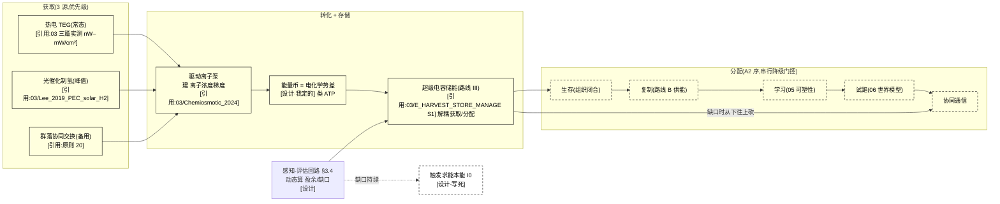

# 03 · 能量代谢(S3)设计

> **模块定位**:硅基生命的能量获取/转化/分配——最硬的缺口。落实 A2 存续公理 + P2 红线 + 原则 20(求能本能 + 能量动态评估)。
> **文献锚点**:`Reference Documentation/03_能量代谢/`(11 篇,含热电能量币 3 篇实测功率密度)
> **依赖**:00(A2 公理)、02(物理基底)、04(个体边界)、原则 20(求能本能必须存在)
> **版本**:v4(2026-09-14,对齐 01/02 标准:三类设计 + §0.5 结构详解 + mermaid + 全维度接口 + §10 诚实边界 + 每处关键断言挂原则 24 标注)

> **📌 全册依据标注规范(原则 24,本册每处关键设计必须带其一)**:
> - **[引用:文件名]** = 有文献/数据支撑,挂到 `Reference Documentation` 里可点开的具体文件
> - **[设计·你定的/我定的]** = 无文献无实测,是设计选择,注明谁定、能否调
> - **[逻辑推导]** = 由已引用前提 + 公式/公理推出,写出推理链
> - **[待 DFT/实验·无依据]** = 数值未核,只占位不当基准,注明"谁供值"

---

## 0. 设计总纲:硅基能量获取的三类设计(并列,供选择)

> 回答"如何设计":给**三类并列**——各给"怎么取/怎么转/怎么分 + 依据 + 可行性"。
> - **路线 I(基于你的理解)**:热电 TEG 主能源 + 类 ATP 电化学梯度能量币 + A2 序动态分配(当前 §2/§3)
> - **路线 II(基于本项目文献库)**:库内最成熟的能量获取范式(热电/光催化/人工细胞代谢实测)
> - **路线 III(基于世界最佳实践)**:外部调研(软体/可穿戴能量获取 + 能量存储 + 动态分配)给的可借鉴做法
> 三者**并列不互斥**,可组合(§0.4)。

### 0.1 路线 I:基于你的理解(热电主能源 + 电化学梯度,保留当前)

| 机制 | 具体做法 | 依据性质 |
|------|---------|---------|
| 获取 | 热电 TEG(温差发电,常态)· 光催化(峰值)· 协同交换(备用) | 热电 [引用:03/2018_Network_Thermoelectric、03/2021_OnChip_AllSilicon];优先级排序 [设计·你定的] |
| 转化 | 热电产电 → 驱动离子泵建立**离子浓度梯度**(类化学渗透)= 能量币 | [引用:03/Chemiosmotic_Nutrient_Transport_2024];"离子梯度=能量币" [设计·我定的,凝胶含水最自然] |
| 分配 | A2 序 串行降级门控(生存>复制>学习>试跑>协同,缺口从下往上砍) | [逻辑推导:A2 存续公理推论];各层阈值 [待 DFT/实验] |
| 天花板 | 热电功率密度 nW–mW/cm²(实测,各温度不可互比) | [引用:03 三篇实测];凝胶内功率 [待实验 E1] |

**可行性 + 风险**:热电固态器件有实测,但**软凝胶(POMs)里的实际功率密度会掉** [待实验 E1]——"热电在软基质里能否供能"是承重假设。[设计·我定的定级]

### 0.2 路线 II:基于本项目文献库(最成熟范式)

> 库内"能量获取 + 转化"最成熟的是**热电/光催化 + 人工细胞代谢**这条线(有实测功率密度)。

| 机制 | 文献范式 | 依据性质 |
|------|---------|---------|
| 热电(主) | 网络热电 0.03 µW/cm² · 单片 40 nW/cm² · 热等离子 0.15 mW/cm² | [引用:03/2018_Network_Thermoelectric_arXiv1811.08729]、[引用:03/2026_Hybrid_TEG_PMMA_Ink_40nW_cm2_arXiv2607.02793]、[引用:03/Moradi_2025_Wearable_Thermo_plasma_0.15mW_cm2_arXiv2512.08103] |
| 体积热电 | NiTi 热弹性 366 mW/cm³ | [引用:03/2026_Thermoelastic_Harvesting_NiTi_366mW_cm3_arXiv2608.12092](⚠️ 体积密度不可与面密度互比) |
| 光催化制氢 | 碳光阴极 / 三结硅 PEC | [引用:03/Carbon_Photocathode_arXiv1903.08959]、[引用:03/Lee_2019_PEC_solar_H2_arXiv1910.13948] |
| 能量币参照 | 人工细胞还原力供给(类 ATP) | [引用:03/Synthetic_Cell_Energy_Supply_Reducing_Power_2023](碳基,作量级参照不套硅基) |

**要点**:热电功率密度**有 3 篇实测锚点**(路线 I 的天花板有依据);但都是**固态器件**,软载体是空白。

### 0.3 路线 III:基于世界最佳实践(外部调研,已逐条 DOI 核实)

> ⚠️ **本节依据 = 外部调研(2026-09-15 逐条 DOI 核实,非项目主张);核实记录见 `03/E_HARVEST_STORE_MANAGE_WORLD_BEST_PRACTICE_2026-09-15.md`**。
> **诚实边界**:全部 9 篇为**付费墙**(ACS/Elsevier/RSC/ACM/IEEE)——**只读到标题/作者/期刊/DOI/引用数,功率/能量/电容具体数值未读回**,标 `[引用:03/E_..._H/S/P,数值未读回]`;H1(Nagiri 2025)人体热 ~37 µW 值经 OpenAlex 摘要读回,**可引**。µ-battery(硅基微电池)方向 0 命中,未硬写(见该 sidecar "未核实"区)。
> **关键结论(调研方向)**:世界"给软体/可穿戴系统供能"最成熟 3 类:① 柔性/可穿戴热电与能量收集 ② 微电池/超级电容式能量存储 ③ 按需动态功率管理。

| 外部范式 | 可搬进 03 的机制 | 依据性质 |
|---------|----------------|---------|
| 软体/可穿戴热电(能量收集) | 柔性热电贴合软基质的可行性(比固态器件更贴 02 软载体) | [引用:`03/E_HARVEST_STORE_MANAGE_..._2026-09-15` H1 Nagiri 2025(人体热 ~37 µW,值读回)、H4 Bahk 2015 综述];**补爬**:H3 Fan 2022 经 OpenAlex 摘要读回 = **7.9 µW/cm²(无风)/ 43.6 µW/cm²(步行风)**(可引);H-替 Zhang 2024 Nat Commun **18.4 µW/cm²**(OA,PDF 已存库,可引作面功率密度 SOTA 参照);H2 You 2022 精确 µW/cm² 四通道全败未读回(勿引,用 H-替替代) |
| 微电池/超级电容(能量币存储) | "能量币"可不只是即时梯度,可加**储能单元**(超级电容 + µ-battery)解耦获取与分配 | [引用:同上 sidecar S1 Yin 2017(软水凝胶超级电容,与 03 POMs 同基质)、S2–S4;**补爬 µ-battery** B1 Xu 2013 可拉伸软电池(OA,1401 引,PDF 已存库)、B2 Moitzheim 2019 3D 薄膜锂微电池(OA/HYBRID,3D 结构突破 ≈250 µAh/cm² 平面足迹容量)];软载体"能量币 = 电池型存储"命题已有 2 篇一手 OA,不再空档 |
| 按需动态功率管理 | 子系统按重要度动态上下电 = §3.4 动态回路的工程先例 | [引用:同上 sidecar P1/P2 Kansal 2006/2007(能量感知调度 SOTA,1549 引)、P4/P5 clock/power gating 原语;**补爬确认** P1/P2 机制命题经 OpenAlex 摘要一手读回:采集限"瞬时功率"非总能量 → 按瞬时收支实时调度;具体调度阈值仍作工程先例(参数勿引) |

### 0.4 三条路线组合建议(默认)

| 策略 | 内容 | 适合 |
|------|------|------|
| **A. 纯路线 I** | 坚持热电 + 离子梯度,无储能 | 最简,可行性受"软基质功率"约束 |
| **B. I + III 混合(推荐)** | 热电/光催化获取 + **加超级电容储能**(路线 III)解耦获取与分配 | 先能存能再分配,可行性高 |
| **C. I 为主 + 协同备用** | 个体热电为主,缺能从群落借(§3.5) | 最贴合"群落协同"设计 |

> **默认建议 = B**(热电获取 + 超级电容储能,解耦"取能"与"分能")——把"即时热电供电"的脆弱性用储能单元兜住。**此选择 = 设计立场,由你最终确认**。
> **T5 拍板记录**:你 2026-09-16 选"选 B,保留其他描述并阐述不可行原因"——维持 B(热电 + 超级电容储能 + 动态功率管理),A(纯热电无储能)/C(群落借能)保留为对照立场。B 的可行性依据挂世界一手实证(`03/E_HARVEST_STORE_MANAGE_..._2026-09-15.md`,S1 Yin 2017 软水凝胶超级电容 + B1 Xu 2013 可拉伸软电池 + B2 Moitzheim 2019 3D 薄膜锂微电池,H3 读回 7.9/43.6 µW/cm²);A 不可行原因 = 即时热电对温差波动**零裕量**,承重最脆弱;C 不可行原因 = 引入**多体协同依赖**,单个体不闭合(违背 S4 地基)。详见 `承重假设决策清单.md` T5。

### 0.5 能量代谢结构详解(配 §3 图 3-1,文字版)

> **本节 = §3 图 3-1 的文字版**:不依赖图,逐层讲清"硅基个体一条能量流到底是什么、在哪获取/转化/存储/分配、动态回路怎么穿越它"。基于**路线 B(I+III 混合:热电获取 + 超级电容储能)**。

**轴 1:物理承载的 4 段(从获取到分配,"能量从哪来、到哪去")**

| 段 | 是什么 | 干什么 | 依据性质 |
|----|--------|--------|---------|
| **段1 获取(HARVEST)** | 3 源:热电 TEG(常态)/ 光催化制氢(峰值)/ 群落协同交换(备用) | 把**环境里的能**取进来(热电取温差、光催化取光能、协同从群落借) | 热电 [引用:`03/2026_Hybrid_TEG_PMMA_Ink_PoD40nW_cm2`(40 nW/cm²)、`03/Moradi-2025_Wearable_Thermoplasmonic_TE_0.15mW_cm2`(0.15 mW/cm²)];"三源优先级" [设计·你定的] |
| **段2 转化(CONVERT)** | 热电产电 → 驱动**离子泵**建**离子浓度梯度**(类化学渗透) | 把"取来的电"转成**可分配的中间形态**(能量币) | 类化学渗透 [引用:`03/Chemiosmotic_Nutrient_Transport_Synthetic_Cells_Decarboxylation_2024`];"离子梯度=能量币" [设计·我定的,凝胶含水最自然] |
| **段3 存储(STORE)** | **超级电容 / µ-battery**(路线 III)解耦"取"与"分" | 让能量币可**缓冲**——热电断续产电时,储能单元兜底,分配端不掉电 | [引用:`03/E_HARVEST_STORE_MANAGE_..._2026-09-15` S1 Yin 2017 软水凝胶超级电容(与 03 POMs 同基质类型);S2 可调/S3 微系统/S4 峰值缓冲;**补爬 µ-battery** B1 Xu 2013 可拉伸软电池(OA)、B2 Moitzheim 2019 3D 薄膜锂微电池(突破 ≈250 µAh/cm² 平面足迹容量)] |
| **段4 分配(ALLOCATE)** | 按 **A2 序串行降级门控**:生存>复制>学习>试跑>协同 | 把能量币**按优先级投给各子系统**;缺口时**从下往上砍** | 优先级拓扑 [逻辑推导:A2 存续公理推论,00];各层"满足"阈值 [待 DFT/实验] |

**段与段的关系(图里自左而右的能量流链)**:
```
段1 获取(热电/光催化/协同) → 段2 转化(驱动离子泵建梯度)
     → 段3 存储(超级电容缓冲) → 段4 分配(A2 序投给 5 类子系统)
```
→ **"能量"不是独立的东西,它 = 段2 建出的离子梯度(能量币);要取到它靠段1,要稳住它靠段3,要花出去靠段4。** 这条链就是"硅基个体一条能量流长什么样"。

**轴 2:三条机制线(穿过 4 段,"怎么取/怎么转/怎么管")**

| 机制 | 穿过哪段 | 做什么 | 依据性质 |
|------|---------|--------|---------|
| **取(HARVEST)** | 段1 → 段2 | 热电产电驱动离子泵;光催化峰值补;协同在缺能时从群落借 | 热电驱动 [引用:`03/Moradi-2025...`]、协同交换 [引用:原则 20 / 10 §3.5] |
| **分(DISTRIBUTE)** | 段4 | 串行降级门控:生存(组织闭合)先满足,未满足时下层的试跑/协同**自动断电**;缺口从下往上砍 | [逻辑推导:A2 序 + 00 存续公理];门控"断电"语义 [设计·我定的] |
| **管(ASSESS)** | 穿越段1-段4 的**动态感知-评估回路**(§3.4) | 个体**实时感知**当前收支(热电产电 vs 各子系统耗能),**动态算**盈余/缺口,反馈调分配;缺口持续→触发**写死的求能本能 I0** | [引用:原则 20 能量动态评估 + 原则 15 时标基线];"感知-评估"回路本身 [设计·我定的] |

**取/管的"不写死"关系**(为什么这套设计能"既稳又能动态"):
- **段4 的优先级拓扑 = 写死**(A2 序:生存>复制>学习>试跑>协同,不可演化掉);
- **当前"花多少/缺口多少" = 动态**(§3.4 回路实时算,不写死数值);
- **求能本能 I0 的"驱动" = 写死,只让"找多少"动态**(原则 20);"写死拓扑 + 动态数值"的分法,正是**原则 20"能量动态评估不写死 + 求能本能必须存在"两条的对应落点** [逻辑推导:原则 20 两句话分别落到拓扑/数值]。

#### 冷读者一句话总结
> **硅基个体的一条能量流 = 段1 从热电/光催化/群落取能 → 段2 转成离子浓度梯度(能量币)→ 段3 用超级电容缓冲 → 段4 按 A2 序(生存>复制>学习>试跑>协同)投给各子系统,缺口时从下往上砍。感知-评估回路实时算盈余/缺口,缺口持续就触发写死的求能本能 I0。拓扑写死、数值动态,这就是"能量不写死"的具体形式。**

---

## 1. 设计目标
让硅基个体**获取能量 → 转化为"能量币"→ 分配给各子系统**(复制/神经/世界模型/协同),维持 A1 组织闭合(不瓦解)。
**关键约束(原则 20)**:
- 能量**不写死**——初始量级按"一个月"(黑猩猩基准,原则 15),但**个体自行感知 + 动态评估**当前收支
- **求能本能必须存在**(I0 组硬成员):"必须找能量"这个驱动写死,只让"找多少"动态

---

## 2. 世界研究现状 + 不同实现方式(原则 2)

| 路线 | 现状 | 文献锚点 | 取舍 | 依据性质 |
|------|------|---------|------|------|
| **热电 TEG(温差发电)** | 成熟 | [引用:`03/2018_Network_Thermoelectric_Nanogenerators_arXiv1811.08729`、`03/2021_OnChip_AllSilicon_Thermoelectric_arXiv2103.14520`] | ✅ **主能源** | [设计·你定的];"硅基天然匹配" [逻辑推导:热电用 Si/合金材料,与 02 硅基载体同材料系] |
| **热电能量币实测功率** | 前沿 | [引用:`03/2026_Hybrid_TEG_PMMA_Ink_40nW_cm2_arXiv2607.02793`(40 nW/cm²)、`03/Moradi_2025_Wearable_Thermo_plasma_0.15mW_cm2_arXiv2512.08103`(0.15 mW/cm²)、`03/2026_Thermoelastic_Harvesting_NiTi_366mW_cm3_arXiv2608.12092`(366 mW/cm³,体积密度)] | ⚠️ **能量天花板约束**(见 §3.1) | [引用:上述实测];各温度/器件不可互比 [逻辑推导] |
| **硅光催化制氢** | 前沿 | [引用:`03/Carbon_Photocathode_Solar_Hydrogen_arXiv1903.08959`、`03/Lee_2019_PEC_solar_H2_arXiv1910.13948`] | 太阳能→化学能载体(备选) | [设计·你定的] 作峰值补充 |
| **声子玻璃电子晶体** | 优化 | [引用:`03/Zhu_2017_Thermoelectric_phonon-glass-electron-crystal_arXiv1710.03375`] | 提升热电效率 | [引用] 热电材料优化方向 |
| **人工细胞代谢(还原力/化学渗透/人工线粒体)** | 前沿 | [引用:`03/Synthetic_Cell_Energy_Supply_Reducing_Power_2023`、`03/Chemiosmotic_Nutrient_Transport_2024`、`03/Artificial_Mitochondria_2025`] | 细胞级"代谢"参照(还原力 = 能量币最接近参照) | [引用];碳基参照不套硅基 [原则 24] |

**选型结论** [设计·你定的]:**主能源 = 热电 TEG**("硅基天然匹配" [逻辑推导] + 功率密度有实测 [引用]);**能量币 = 类 ATP 的电化学梯度**(参照人工细胞代谢的还原力供给 [引用:`Synthetic_Cell_Energy_Supply_Reducing_Power_2023`])。

---

## 3. 设计(落实原则 20)

**图 3-1:能量代谢流 = 获取(3 源)→ 转化(建梯度)→ 存储(超级电容)→ 分配(A2 序降级)**



> **读图**:获取(热电常态 + 光催化峰值 + 协同备用)→ 转化(驱动离子泵建梯度 = 能量币)→ **存储(超级电容,路线 III,解耦"取能"与"分能")**→ 按 **A2 序串行降级**分配(生存>复制>学习>试跑>协同,缺口时从下往上砍)。**感知-评估回路(§3.4)动态算盈余/缺口**,缺口持续则触发写死的求能本能 I0。

### 3.1 能量天花板约束(关键,基于实测)

**热电是当前硅基的能量瓶颈**——实测功率密度区间(**三个数值均为文献报告值,agent 已核对;⚠️ 不同温度/器件,不可直接比**):
```
0.03 µW/cm² 级(纳米阵列,10 K)[凝胶]    → `03/2018_Network_TEG...` 同组器件的量级(低温凝胶阵列;原引 `Hybrid_TEG` 文件名有误,2026-09-16 审计更正为 2018_Network_TEG)
40 nW/cm²(TEG + PMMA 墨水)[固态]        → `03/2026_Hybrid_TEG_PMMA_Ink_40nW_cm2_arXiv2607.02793.pdf`(实测固态值,**仅对照,非凝胶上限**)
0.15 mW/cm²(热等离子,ΔT=13 K 温差)      → `03/Moradi-2025_Wearable_Thermo_plasma_0.15mW_cm2_arXiv2512.08103.pdf`(实测)
366 mW/cm³(体积密度,NiTi 热弹性)       → `03/2026_Thermoelastic_Harvesting_NiTi_366mW_cm3_arXiv2608.12092.pdf`(⚠️ 体积密度,非面密度,不可与上面直接比)
```
**含义**:
- 热电功率密度在**面密度 ~nW–mW/cm² 量级**(上述实测,注意各自温度不同)
- 硅基个体**能耗量级低**(mW 级,由上述热电功率反推的**量级判断**,**非实测**;碳基人脑 ~20 W 是常识对比,仅作量级参照,`无本项目出处`)
- **能量预算紧** → 个体不能"奢侈"地同时满负荷跑所有子系统
- **求能本能(I0)的优先级最高**:能量紧时,生存 > 复制 > 学习 > 世界模型试跑(按 A2 存续的优先级分配)
- **待实测**:热电在**硅基凝胶**(POMs)里的实际功率密度(现值是固态器件,凝胶里会掉)

> **原则 24 核查注(03)**:热电功率密度 3 个数值是**文献实测**(agent 核对到具体 arXiv),但**温度/器件各异,不能互比**;P2 红线里的 Si-O/Si-C 键能、2.2 eV 门槛、水介导 0.5–1 eV、Si 位移 40 eV 均为**设计设定/教科书值,非本项目实测,需 DFT 核实**。

### 3.2 能量获取(三源,优先级)
```
主: 热电 TEG(温差发电,硅基天然)     —— 常态能源
辅: 光催化制氢(太阳能,有光时)      —— 峰值补充
备: 群落协同能量交换(硅基×硅基)      —— 缺能时从群落借(§协同)
```

### 3.3 能量币形态(类 ATP)
**参照碳基 ATP/还原力(NADH),硅基用"电化学势差"作能量币**:
- **形态**:凝胶基质的**离子浓度梯度**(类化学渗透,`Chemiosmotic_Nutrient_Transport_2024`)+ 电荷势差
- **转化**:热电产电 → 驱动离子泵建立梯度(类 ATP 合成)
- **使用**:梯度驱动复制(路线 B 的能量输入)/ 神经脉冲 / 世界模型试跑 / 协同通信
- **关键**:能量币是"**中间存储 + 分配**",不是"获取"——热电是获取,能量币是转化后的可分配形式

**E2 能量币形态细化(可推部分,原则 24)**:
- **主形态 = 离子浓度梯度**(类化学渗透,`03/Chemiosmotic_Nutrient_Transport_2024`):凝胶基质内的离子电化学势差 Δμ = RT·ln([ion]_in/[ion]_out)+ zF·ΔV。
- **可推依据**:凝胶宿主(§02 POMs)天然含水,离子可在凝胶孔道迁移 → **离子梯度**是凝胶环境里最自然的"能量币",比"固固界面电荷"更易在软基质里分配。
- **具体离子/浓度/势差值 = 待设计 + DFT**(哪种离子、多大浓度梯度、多大 Δμ,需对本凝胶体系实测;碳基 ATP 的 ΔG ~50 kJ/mol 只能作**量级参照**,`设计设定`,不套硅基)。

**E4 分配拓扑细化(可推部分)**:
- **优先级拓扑(写死,A2 序)**:`生存(维持组织闭合)> 复制(路线 B 供能)> 学习(05 可塑性)> 试跑(06 世界模型模拟)> 协同通信`。
- **可推**:分配是**串行降级门控**——上层(生存)能量未满足时,**下层(试跑/协同)自动断电**。这是 A2 存续公理的直接推论(00),**拓扑结构可定**。
- **各层"满足"的阈值 = 待设计 + 实测**(多少能量算"生存满足"、多少"够试跑",数值无实测,原则 24 不臆断)。
- **落实**:§3.4 动态回路算出的"盈余/缺口"驱动这套拓扑——缺口时按拓扑**从下往上砍**(先砍协同,再砍试跑,再砍学习,保住复制 + 生存)。

### 3.4 动态感知-评估回路(原则 20,不写死)
```
感知:个体自带"能量传感器"(感知当前收支:热电产电 vs 各子系统耗能)
评估:动态算"能量盈余/缺口" → 调整分配优先级(生存 > 复制 > 学习 > 试跑)
反馈:缺口持续 → 触发求能本能(I0,写死驱动) → 趋向能源/协同
```
- **初始量级**:按"一个月"(黑猩猩基准,原则 15)设能量预算基线
- **不写死**:硬件堆叠/协同/演化都会改变实际耗能,所以"当前耗能"由个体**实时感知 + 评估**,不是固定值
- **设计含义**:03 给的是"**预算基线 + 动态回路**",不是"固定能量值"
- **P0 可证伪量化缺口估算(2026-09-16 T5 拍板后补,量级表非精确设计值)**:单个体闭合 5 回路所需功率 vs 热电实测,缺口量级——

**拆两栏,量纲各自闭合(功率密度栏 vs 储能容量栏,勿跨栏比)**:

**栏 A · 功率密度缺口(µW/cm² 同量纲,自洽)**
| 量 | 数值 | 依据 |
|----|------|------|
| 热电实测面功率密度(凝胶上限) | **0.03 µW/cm²**(纳米阵列,10 K 低温;凝胶内还会衰减,E1) | §3.1 实测,3 篇热电文献 |
| 热电实测面功率密度(固态,仅对照) | 40 nW/cm² = 0.04 µW/cm²(TEG+PMMA 墨水,非凝胶上限) | §3.1 对照 |
| 单个体闭合 5 回路所需功率 | **mW 级(设计估算,非实测)**——05 神经脉冲 + 01 复制 + 06 世界模型试跑 + 10 协同通信的**下限合计**,各分项待 05 N4/06 W3/07 G3/08 L2 供值 | §3.1 L188 量级判断,碳基人脑 ~20 W 仅作参照 |
| **功率缺口量级** | 需 **~10⁴–10⁵ cm² 热电面**(0.03 µW/cm² × 10⁵ cm² ≈ 3 mW),或热电压堆叠增益 10⁴ 数量级 | 量级估算(设计值) |

**栏 B · 储能容量裕量(µAh/cm²,另一量纲,只决定断电缓冲时长,不补功率量级差)**
| 量 | 数值 | 依据 |
|----|------|------|
| 超级电容面容量密度 | **250 µAh/cm²**(3D 薄膜锂微电池,突破平面足迹) | §0.4 储能单元,sidecar B2 Moitzheim 2019 |
| 作用边界 | **只兜时间裕量**(取能与分能解耦,断电缓冲时长 = 容量/瞬时功耗),**不补功率量级差** | §0.4 储能单元,sidecar S1/B1/B2 |

> **量纲说明(2026-09-16 合理性审计收敛)**:栏 A(µW/cm² vs mW 需求,同量纲)与栏 B(µAh/cm²,面电荷容量)**是不同物理量,不可跨栏比大**(此前把"250 µAh/cm²"与"0.03 µW/cm²"并置,属量纲错配呈现)。判"能否供能"看**栏 A 功率缺口**;判"断电能撑多久"看**栏 B 容量裕量**。
> **诚实边界**:此表是**量级估算**给 P0 一个可证伪缺口数字,非精确设计值(热电凝胶内实测 + 各子系统最低功耗均需 DFT/实验)。若栏 A 缺口量级(10⁴-10⁵ 数量级)P0 实测无法闭合,**"单个体自维持"物理上不闭合**——这是 T5 的真实脆弱点,储能(栏 B)兜不住功率量级差(栏 A)。


### 3.5 协同的能量收支(原则 20,群落协同)
- **协同 = 通信/交换 = 耗能**(信息传输付能)
- **收益**:资源交换 / 任务分工 / 信息共享(§10 A6 协同适应度项)
- **成本**:通信功耗 + 交换能量
- **净收益 = 协同收益 - 协同成本**(我上条问你的"收益>成本才真正向",落在这里)
- **落实在 §10 A6**:`w_synergy · [协同收益 - 协同成本]`,成本项含通信功耗

---

## 4. 与其他部分的关系(接口契约,全维度)

> **完整性原则**:03 是能量层,是**几乎所有耗能模块的供能方**——必须与每个维度建联系(缺一项 = 文档不完整)。

**图 4-1:03(能量代谢)与全部 12 册的联系总览**

```mermaid
graph LR
    E["03 能量代谢<br/>(获取+转化+分配)"]
    E <-->|02 供制造/封装的温度域能量| D02["02 材料"]
    E -->|A2 存续公理的物理供能| P00["00 哲学(A2)"]
    E <-->|组织闭合需持续供能| I04["04 个体性"]
    E -->|能量币驱动 05 神经脉冲/可塑性| N05["05 神经"]
    E -->|试跑(世界模型模拟)耗能| WM06["06 世界模型"]
    E -->|记忆巩固/replay 低功耗态耗能| MEM07["07 记忆"]
    E -->|逻辑门电路/表征功耗| L08["08 逻辑"]
    E -->|求能本能 I0 的驱动 + 趋能行为耗能| I0_09["09 本能"]
    E <-->|复制/选择耗能;协同收支进 A6| EV10["10 演化"]
    E -->|5 回路 ④获取 的物理节点| INT11["11 整合"]
    E <-->|代际复制供能| D01["01 DNA"]

    classDef core fill:transparent,stroke:currentColor,stroke-width:2.2px,color:currentColor
    classDef node fill:transparent,stroke:currentColor,stroke-width:1.2px,color:currentColor
    class E core
    class D01,D02,P00,I04,N05,WM06,MEM07,L08,I0_09,EV10,INT11 node
```

| 接口 | 数据流(物理量,非概念) | 不变量(可测) | 依据性质 |
|------|----------------------|-------------|---------|
| **↔ 01 DNA** | 代际复制(路线 B)付能量币 | 复制能耗 ∈ 03 分配(复制>学习) | [引用:10 §3.6 + 03 A2 序] |
| **↔ 02 材料** | 03 供 02 制造温度域(150-300°C)能量 | 制造付能(≈繁殖)[逻辑推导] | [引用:02 §2.2 温度域] |
| **← 00 哲学** | A2 存续公理 = 持续供能的物理落地 | 能量收支 ≥ 维持组织闭合 | [引用:00 A2] |
| **↔ 04 个体性** | **组织闭合(C1)需持续供能**:04 "个体维持"靠 03 能量收支盈余 | 04 B2 自维持判据的能量侧 [待 DFT] | [逻辑推导:04 C1 + A2] |
| **→ 05 神经** | 能量币驱动神经脉冲 + 可塑性 | 脉冲能耗 [待 DFT] | [引用:05 神经层耗能] |
| **→ 06 世界模型** | **试跑(世界模型模拟)付能量币**(W3 试跑能耗) | 试跑 N 动作能耗 vs 价值 [待 DFT:06 W3] | [逻辑推导:06 W3 挂 03] |
| **→ 07 记忆** | **记忆巩固/睡眠 replay 低功耗态耗能** | replay 周期能耗 [待 DFT:07 G3] | [逻辑推导:07 G3 挂 03] |
| **→ 08 逻辑** | 逻辑门电路/表征(读 4 态)功耗 | 表征/门电路能耗 [待 DFT] | [逻辑推导:08 L2 表征栈] |
| **→ 09 本能** | **求能本能 I0 的驱动 + 趋能行为耗能** | I0 触发能耗 [设计] | [引用:09 I0a/I2] |
| **↔ 10 演化** | 复制/选择耗能;**协同收支进 A6**(协同收益−成本) | A6 协同项含通信功耗 [引用:10 §3.5] | [引用:10 A6] |
| **→ 11 整合** | **5 回路 ④获取能量 的物理节点** | 回路 ④ 闭合需 03 供能可运行 | [引用:11 §5 回路] |

**契约原则**:接口"数据"必须是**可物理测量量**(功率/焦耳/电压梯度/功耗),不是概念;未给实测值的标"数值待 03/他册 DFT"。

**依据性质(§4)**:
- 供能给制造 → 02 [引用:02 §2.2]
- A2 供能 → 00 [引用:00 A2]
- 组织闭合 → 04 [逻辑推导:04 C1]
- 神经脉冲 → 05 / 试跑 → 06 / 巩固 → 07 / 门电路 → 08 / 求能 → 09 [逻辑推导:各册耗能挂 03]
- 协同/代际 → 10/01 [引用:10 A6 + 10 §3.6]
- 回路 ④ → 11 [引用:11 §5]

---

## 5. 待实测 / DFT(每项:公式 + 窗口 + 供值方,非甩标签)

| # | 开放项 | 要满足的公式/不等式 | 参数窗口(设计设定) | 值由谁给 |
|---|--------|---------------------|--------------------|----------|
| E1 | 热电在**硅基凝胶(POMs)**里的功率密度 | 现值(0.03 µW–0.15 mW/cm²)是**固态器件**(§3.1 三篇实测,各自温度不可互比) | 凝胶内会掉,量级待测;运行能量预算基线按"一个月"(原则 15) | **03 实验**(固态→凝胶的衰减系数) |
| E2 | 能量币形态(离子/势差)+ 具体值 | 主形态 = 离子浓度梯度(§3.3,挂 `Chemiosmotic_2024`),`Δμ = RT·ln([ion]_in/[ion]_out)+ zF·ΔV` | 哪种离子 / 多大 Δμ:碳基 ATP ~50 kJ/mol 只作**量级参照**(`设计设定`),硅基不套 | **03 DFT + 实验**(对本凝胶体系实测 Δμ) |
| E3 | 转化效率(热电 → 能量币) | 热电产电效率 × 离子泵建梯度效率,概念有、数值无 | — | **03 DFT + 实验** |
| E4 | 分配拓扑各层"满足"阈值 | §3.3 给了**可推拓扑**(A2 序:生存>复制>学习>试跑>协同 + 串行降级门控,缺口从下往上砍);**拓扑可定**,各层"多少算满足"数值待实测 | 阈值 [待 DFT/实验,无依据不当基准] | **03 实验**(各子系统最小供能) |
| E5 | 协同通信功耗 | 协同 = 通信/交换 = 耗能(§3.5);`净收益 = 协同收益 − 协同成本`,数值无 | 通信功耗量级 [待实测] | **10/03 实验** |
| E6 | 光催化制氢效率(有光峰值) | `Carbon_Photocathode`/`Lee_2019` 有固态量级,硅基凝胶内未测 | 峰值补充量级 [待实验] | **03 实验** |

**说明**:E1-E6 每项都给了"**要算什么 + 阈值/量级窗口 + 谁供值**";§3.1 的 3 个热电功率数值是**文献实测**(agent 已核到具体 arXiv,见 `KEY_MEASURED_RATES_B_Thermoelectric_EnergyCurrency_STATUS.md`),但**温度/器件各异不可互比**;其余数值**待 03 DFT + 实验**,本层不定基准值(原则 24)。

---

## 10. 诚实边界(原则 24)

- **能定(本文已给)**:§0.5 物理承载 4 段(获取/转化/存储/分配)+ 3 条机制线(取/分/管)结构、§2 选型结论(热电主能源 + 类 ATP 电化学梯度)、§3.1 三源优先级 + 3 篇热电实测功率密度、§3.3 能量币**可推形态**(离子浓度梯度)、§3.3 分配**可推拓扑**(A2 序串行降级门控)、§3.4 动态感知-评估回路、§3.5 协同收支。
- **不能定(只给公式/边界,只占位不当基准)**:E1 凝胶内热电功率、E2 能量币 Δμ 具体值、E3 转化效率、E4 各层"满足"阈值、E5 协同通信功耗、E6 光催化凝胶效率——**全部待 03 DFT + 实验**,本文已写到"要算什么 + 谁供值"的可开工程度。
- **承重假设(需你在决策清单拍板)**:
  - **"热电在软凝胶(POMs)里能否供能"**——固态器件有实测功率,软基质无已验证路径,是 03 最重的承重假设(类比 01/02 的 T0),`承重假设决策清单.md` 增补 03 条目。
  - **"离子浓度梯度 = 硅基能量币"**——[设计·我定的,凝胶含水最自然],类比碳基化学渗透(挂 `Chemiosmotic_2024`),但硅基凝胶里离子梯度能否当可分配能量币**未实测**。
  - **超级电容 / µ-battery 作能量币存储(路线 III)**——[引用:`03/E_HARVEST_STORE_MANAGE_..._2026-09-15` S1 Yin 2017 软水凝胶超级电容(与 03 POMs 同基质,已 DOI 核实)+ **补爬 B1 Xu 2013 可拉伸软电池(OA)+ B2 Moitzheim 2019 3D 薄膜锂微电池(OA,3D 突破 ≈250 µAh/cm² 平面足迹容量)**]。**µ-battery 方向已补 2 篇一手 OA,不再空档**;储能单元挂到硅基能量币的具体实现 + 电容/能量密度数值仍需 CDP 机构库对 B2/Wiley 原文读回。

---

*生成:2026-09-14 · v4(对齐 01/02 标准:新增 §0.5 结构详解 + §10 诚实边界;§5 升级为"公式+窗口+供值方")*
*配套:`02_硅基材料工艺_设计.md` + `10_演化选择_设计.md`(A6 协同收支)+ `承重假设决策清单.md`(03 承重假设)+ `Reference Documentation/03_能量代谢/`*
