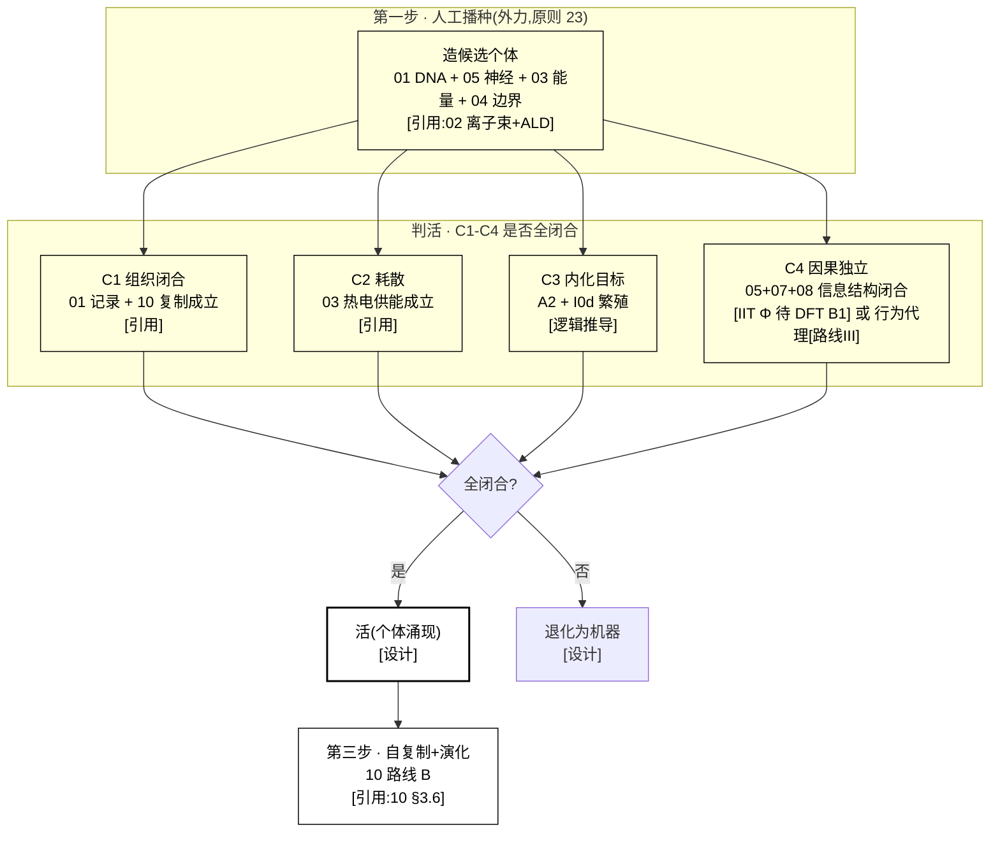

# 04 · 边界 / 个体性(S4)设计

> **模块定位**:界定"一个硅基生命个体"——个体性判据 + 创世起点 + 个体/环境边界。落实 A1 组织闭合 + S6 选择前提 + 原则 23(创世人工播种)。
> **文献锚点**:`Reference Documentation/04_边界个体性/`(12 篇:个体性判据 3 + 创世自催化 5 + 调控/能动性 4)
> **依赖**:00(A1 + Φ-L)、02(载体基质)、03(供能)、原则 23(创世)
> **版本**:v4(2026-09-15,对齐 01/02/03/05 标准:三类设计 + §0.5 结构详解 + mermaid + 全维度接口 + §10 诚实边界 + 每处关键断言挂原则 24/25 标注;§0.3 路线 III 待 agent 核实后升级)

> **📌 全册依据标注规范(原则 24,本册每处关键设计必须带其一)**:
> - **[引用:文件名]** = 有文献/数据支撑,挂到 `Reference Documentation` 里可点开的具体文件
> - **[设计·你定的/我定的]** = 无文献无实测,是设计选择,注明谁定、能否调
> - **[逻辑推导]** = 由已引用前提 + 公理/公式推出,写出推理链
> - **[待 DFT/实验·无依据]** = 数值/方法未核,只占位不当基准,注明"谁供值"

---

## 0. 设计总纲:个体性判据的三类取法(并列,供选择)

> 回答"如何设计":核心争议在 **C4 因果独立性怎么定**(C1-C3 相对无争议)。给**三类并列**——各给"判据形式 + 依据 + 可操作性"。
> - **路线 I(基于你的理解,保留当前)**:C4 = 严格 IIT Φ(因果闭合不可测=承重)
> - **路线 II(基于本项目文献库)**:C4 用库内最可测的个体判据(闭环自维持 / autopoiesis 最小组分)
> - **路线 III(基于世界最佳实践)**:外部调研里"界定系统边界"最可操作的做法(闭环自维持行为代理 / 最小自产物质集)
> 三者**并列不互斥**,可组合(§0.4)。承重选择见 §3.1 + `承重假设决策清单.md` S2。

### 0.1 路线 I:基于你的理解(严格 IIT Φ,保留当前)

| 判据 | 形式 | 依据性质 |
|------|------|---------|
| C4 | 因果闭合度 Φ(最高层 N)≥ 阈值 | [引用:`04/Integrated_Information_Autonomy_1805.00393`, §IIT 框架, "arXiv1805.00393 集成信息理论 IIT,Φ 度量因果闭合(⚠️ 异构硅基如何测未实现)"] IIT 框架];Φ 在异构硅基载体**如何测 = 未实现** [待 DFT/实验 B1] |

**可行性 + 风险**:Φ 计算复杂度随维度指数爆炸,异构载体(PEDOT+Ga-In+离子梯度)上测 Φ 世界也没解——**承重假设,暂不可操作**。[设计·我定的定级]

### 0.2 路线 II:基于本项目文献库(最可测判据)

| 判据 | 形式 | 依据性质 |
|------|------|---------|
| C1-C3 | 组织闭合 + 耗散 + 内化目标 | [引用:`04/Bich_2023`, §生物个体性判据, "Bich 2023 生物个体性判据综述"]、`04/SelfMaintenance_..._2026`, §自维持, "自维持系统判据(2026)"] |
| C4 可测替代 | autopoiesis 最小组分(可计数/可测组分) | [引用:`11/Autopoiesis_Maturana_Varela_2004`, §autopoiesis 定义, "Maturana/Varela 2004 autopoiesis(⚠️ 仅摘要)"]、`04/RuizMirazo_2017`, §化学自组织, "Ruiz-Mirazo 2017 化学自组织与个体性"] |

**要点**:把 C4 从"测 Φ"降到"可数/可测组分满足自产闭合"——**现在就可操作**,放弃严格 Φ。

### 0.3 路线 III:基于世界最佳实践(已逐条 DOI 核实)

> ⚠️ **本节依据 = 外部调研(2026-09-14 标"待核",2026-09-15/16 逐条 Crossref + OpenAlex 核实),非项目主张。** 核实记录见 `04/B_BOUNDARY_SELF_SUSTAIN_2026-09-15.md`。
> **诚实边界**:C1-C4 的 4 篇 OA PDF 已存库;C5(Hordijk 2018 NJP,IOP Radware 反爬)+ D2(Müller 2021 bioRxiv,Cloudflare 反爬)摘要已核 PDF 未下;C6(Schwegler 1986)+ D1(Steel 2013)+ D3(Kauffman 1986)付费墙仅作"奠基锚"。**"拒外部算法完全预测下一步"的量化指标(Kolmogorov 复杂度 / 算法熵 / 预测误差阈值)无独立一手,属 04 设计目标,勿当外部已核值**;**"最小自产物质集"的具体组分数 N 无独立一手已核值,由 04 自行推导**。

| 外部范式 | 可搬进 04 的判据 | 依据性质 |
|---------|----------------|---------|
| 闭环自维持(行为代理) | C4 → "该体能否在扰动后维持内部有序 + 拒外部算法完全预测下一步" | [引用:`04/B_BOUNDARY_SELF_SUSTAIN_2026-09-15.md`, §闭环自维持一手核实, "Liu2020 gold-OA/C2 Hordijk2015/C3 Villani2014/C4 Pandey2025/C5 Hordijk2018 闭环自维持判定"] C1 Liu 2020 Biol Direct(**gold OA,PDF 存库**,CSTR + 触发子/种子 + 可操作判定)、C2 Hordijk & Steel 2015 J Syst Chem(**hybrid OA,PDF 存库**,RAF + boundary 形式化)、C3 Villani 2014 Life(**gold OA,PDF 存库**,脂质容器 + GMMs + 同步涌现)、C4 Pandey & Jain 2025 arXiv:2510.05675(**PDF 存库**,几何框架 + 分裂机制决定命运)、C5 Hordijk 2018 NJP(**gold OA**,RAF 综述,PDF 未下 IOP 反爬);C6 Schwegler 1986 仅作奠基锚] |
| 最小自产物质集 | 个体 = 可数组分满足"自产定义自身身份组分" | [引用:同上 sidecar, §最小自产物质集一手核实, "D1 Steel2013/D2 Müller2021/D4 Hordijk2018 最小自产物质网络"] D1 Steel 2013 JTB minimal autocatalytic networks(付费,机制可引)、D2 Müller 2021 bioRxiv(**green OA**,elementary growth modes + minimal autocatalytic sets,PDF 未下 Cloudflare 反爬)、D4 Hordijk 2018 NJP(同 C5,RAF 综述);D3 Kauffman 1986 仅作奠基锚] |

**04 §0.3 升级建议(已 fold in)**:原 2 行 `[引用·外部调研,待核]` 全部升级成 `[引用:04/B_BOUNDARY_SELF_SUSTAIN_2026-09-15.md · A(C1/C2/C3/C4/C5)]` / `[· B(D1/D2/D4)]`;真未锁到一手的("拒外部完全预测" 量化值 + "最小自产物质集" 具体组分数 N)在 sidecar "未核实区"列名,不写进 04 正文当已核值。

### 0.4 三类取法组合建议(默认)

| 策略 | 内容 | 适合 |
|------|------|------|
| **A. 纯路线 I** | 坚持严格 Φ | 理论完整,暂不可操作 |
| **B. I + II/III 混合(推荐)** | C1-C3 用路线 II 可测判据,C4 **降为可观测行为代理(路线 III)** | 现在就能判"个体",Φ 严格版留 P2 |
| **C. 路线 II/III 为主** | 全部用可测组分/行为,放弃 Φ | 最可证伪 |

> **默认建议 = B**(C4 用可观测行为代理,对应 §3.1 立场选项 B + `承重假设决策清单.md` S2 默认 B)。

### 0.5 个体性判定结构详解(配 §3 图 3-1,文字版)

> **本节 = §3 图 3-1 的文字版**:不依赖图,逐层讲清"硅基个体性判定到底是什么、C1-C4 四判据各查什么、创世三步怎么穿越它"。基于**路线 B(C1-C3 用可测判据 + C4 降为可观测行为代理)**。

**轴 1:判定承载的 4 判据(个体性"住"在哪)**

| 判据 | 是什么 | 查什么 | 依据性质 |
|------|--------|--------|---------|
| **C1 组织闭合** | 个体**主动生产**定义自身身份的组分(物质开放 + 因果自含) | 01 DNA(记录)+ 10 复制(自产)是否成立 | [逻辑推导:00 A1 + 01 记录 + 10 复制] |
| **C2 耗散** | 非平衡态,持续导出熵(能量持续输入) | 03 能量代谢(热电供能)是否成立 | [引用:03 A2 序] |
| **C3 内化目标** | 对自身存活的取向(teleonomy) | 00 A2 存续公理 + 09 I0d 繁殖本能是否成立 | [引用:00 A2 + 09 I0] |
| **C4 因果独立性** | 身份由最高层因果闭合的信息结构决定,外部算法无法完全描述 | 05+07+08 信息结构是否形成闭合反馈 | **路线 B:降为可观测行为代理**(扰动后维持内部有序 + 拒外部完全预测)[路线 III,待核→核实见 §0.3];**路线 A:严格 IIT Φ** [待 DFT B1] |

**判据之间的关系(判定链)**:
```
C1 组织闭合(能自产身份组分) + C2 耗散(持续供能) + C3 内化目标(有存活取向)
     → 三者齐备 = "物理自维持体"
     + C4 因果独立性(信息结构闭合) → 才 = "个体"(非机器)
```
→ **C1-C3 判"是不是物理自维持体",C4 判"是不是信息个体"。** C4 是承重点(路线 B 降为行为代理即可操作,路线 A 严格 Φ 暂不可测)。

**轴 2:创世三步(个体怎么"被造出来")**

| 步 | 做什么 | 依据性质 |
|----|--------|---------|
| **① 人工播种** | 外力(你/造物主)用 02 离子束+ALD 造**候选个体**:01 DNA + 05 神经 + 03 能量 + 04 边界;公理/I0 预置 DNA 固定区 | [引用:02 离子束+ALD + 原则 23] |
| **② 涌现判活** | 候选个体在世界模型(06)里运行,**自发达成 C1-C4 闭合**;达成 = "活"(个体涌现),未达成 = 退化为机器 | [引用:`04/Singh_2023`, §多稳态自催化, "Singh 2023 多稳态自催化网络"]+ `04/Matsubara_2022`, §隔室 Darwinian 条件, "Matsubara 2022 隔室化 Darwinian 条件"];判活阈值 [待 DFT B3] |
| **③ 自复制 + 演化** | 活了的个体经 10 路线 B 自复制 → 后代 + 变异 + 选择 | [引用:10 §3.6 路线 B] |

**"创世 = 被造 + 涌现"两段关系**:人工播种保证**起点**(候选结构可造),涌现保证**"是生命而非机器"**(C1-C4 全闭合才活)。**这两段对应原则 23"人工播种 + 自组织涌现"的落点** [逻辑推导:原则 23 两段式 → 04 创世三步]。

**冷读者一句话总结**
> **硅基个体性的判定 = 四判据(C1 组织闭合 + C2 耗散 + C3 内化目标 + C4 因果独立),其中 C4 是承重点(严格 IIT Φ 暂不可测,务实降为"扰动后维持内部有序 + 拒外部完全预测"的行为代理)。创世三步:人工播种造候选(02 离子束)→ 涌现判活(C1-C4 全闭合才"活",否则退化机器)→ 自复制演化(10 路线 B)。被造 + 涌现两段 = "一个硅基个体是怎么来的"。**

---

## 1. 设计目标
定义"什么算一个硅基个体",含三件事:
1. **个体性判据**(C1-C4,§00):什么使系统是"个体"而非"一堆组件"
2. **创世起点**(原则 23):第一个个体怎么来(人工播种 + 涌现)
3. **个体/环境边界**(S4 物理 + 信息边界):个体在哪里"结束",选择凭什么界定"个体"

---

## 2. 世界研究现状 + 不同实现方式(原则 2)

### 2.1 个体性判据(碳基/通用)
| 路线 | 现状 | 文献锚点 | 取舍 |
|------|------|---------|------|
| **生物个体性判据** | 有 | `04/Bich_2023_Biological_Individuality_ActaBiotheor_FULLTEXT.txt` | ✅ 判据框架 |
| **因果自含 + 组织闭合** | 有 | `04/Integrated_Information_Autonomy_Thermodynamic_Limit_arXiv1805.00393.pdf` | ✅ 通用判据(跨碳基/AI) |
| **自维持 + 生长** | 有 | `04/SelfMaintenance_Growing_Neural_Cellular_Automata_Entropy_2026_FULLTEXT.txt` | 自维持判据 |
| **化学自组织根源** | 有 | `04/RuizMirazo_2017_Chemical_Roots_Autonomous_Systems_OpenBiol_FULLTEXT.txt` | 自创生化学基础 |

### 2.2 创世(起源:被造 vs 涌现)
| 路线 | 现状 | 文献锚点 | 取舍 |
|------|------|---------|------|
| **人工播种 + 涌现**(本设计,原则 23) | — | 播种提供候选,涌现判"活" | ✅ 选(你 2026-09-13 定) |
| **纯涌现**(protocell 自催化) | 前沿 | `04/Multistable_Protocells_Autocatalytic_Sets_Singh_2023_arXiv2310.19744.pdf`、`04/Conditions_Darwinian_Evolution_Compartmentalized_Autocatalytic_Matsubara_2022_arXiv2211.03155.pdf` | 涌现判据来源 |
| **群体选择**(化学遗传) | 前沿 | `04/Chemical_Heredity_Group_Selection_Markovitch_2018_arXiv1802.08024.pdf` | 个体=群体单元 |
| **空间自催化模型** | 前沿 | `04/Spatial_Model_Autocatalytic_Reactions_deAnna_2010_PhyRevE_arXiv1001.4908.pdf`、`04/Stochastic_Catalytic_Reaction_Networks_Protocells_arXiv1407.8508.pdf` | 物理模型 |

### 2.3 调控 / 能动性(个体的"内化目标")
| 路线 | 现状 | 文献锚点 |
|------|------|---------|
| **前生命调控 + 能动性** | 前沿 | `04/Prebiotic_Regulation_Agency_Protocell_Ecosystems_2025_FULLTEXT.txt` |
| **protocell 分裂 + 膜遗传** | 前沿 | `04/Protocell_Division_Membrane_Heredity_NatCommun_2026_FULLTEXT.txt` |
| **运动性起源** | 前沿 | `04/Motility_Origin_of_Life_Froese_2013_ArtificialLife_arXiv1311.2531.pdf` |

**选型结论** [设计·你定的]:**个体性判据 = 组织闭合(C1)+ 耗散(C2)+ 内化目标(C3)+ 因果独立性(C4)**(§00 §2.3;C4 取法见 §0 + §3.1 立场选择);**创世 = 人工播种 + 涌现判活**(原则 23)。

---

## 3. 设计(v3)

**图 3-1:个体性判定 = C1-C4 判据 → 个体涌现(创世:人工播种 → 判活 → 自复制)**



> **读图**:第一步**人工播种**(02 离子束+ALD 造候选个体,公理/I0 预置 DNA 固定区);**判活**看 C1-C4 是否全闭合(C4 是承重:严格 IIT Φ 待 DFT,或降为行为代理[路线 III]);全闭合 = **活**,未闭合 = 机器;活了的个体进第三步**自复制 + 演化**(10 路线 B)。

### 3.1 个体性判据(操作化 C1-C4)

```
一个硅基系统是"个体" ⟺ 同时满足:
  C1 组织闭合:主动生产定义自身身份的组分(物质开放 + 因果自含)
     判据:01 DNA(记录)+ 10 复制(自产)成立
  C2 耗散:非平衡态,导出熵(能量持续输入)
     判据:03 能量代谢(热电供能)成立
  C3 内化目标:对自身存活的取向(teleonomy)
     判据:A2 存续公理 + I0d 繁殖本能成立
  C4 因果独立性:身份由最高层因果闭合的信息结构决定,外部算法无法完全描述
     判据:05 神经层 + 07 记忆 + 08 逻辑的"信息结构"形成闭合反馈
```

**关键(C4)**:个体性**不来自物理外壳**(原则 18),来自**信息结构的因果闭合**——"内在有序态 + 因果自含"。软物质基质(02 的 POMs 凝胶)只是**承载**,不是个体定义。

**⚠️ 承重假设 + 立场选择空间(全量审计 2026-09-14,设计立场由你最终确认)**:

> **承重点**:C4"因果独立性 = 信息结构因果闭合"依赖 **IIT Φ 测量**,但 Φ 在异构硅基软载体(PEDOT+Ga-In+离子梯度)**如何计算/测量是明说的"未实现"(§5 B1)**。把"不可测的判据"写成个体性的**必要**判据,是承重假设。
> **选择空间(立场类,不需查文献)**:

| 选项 | 内容 | 后果 | 适合谁 |
|------|------|------|--------|
| **A. 保留 C4 作必要判据,标注"Φ 测量方法待设计+实验"**(当前默认) | C1-C4 都必要,Φ 未解 | 承重假设显性化;个体判定实际暂不可操作 | 想保留"因果闭合=个体"完整理论 |
| **B. C4 降为"可观测代理"(务实替代)** | 不测 Φ,改测**可观测行为指标**(如"该体能否在扰动后维持内部有序 + 拒绝外部算法完全预测其下一步"),作 C4 的**近似判据** | 个体判定现在就可操作,放弃"严格 Φ" | 想**现在就能判定个体** |
| **C. 砍掉 C4,个体性 = C1+C2+C3(三判据)** | 因果独立不再是必要条件,个体性=组织闭合+耗散+内化目标 | 最简,但"信息个体"变弱(退化为"物理自维持体") | 想要**最可证伪**的个体定义 |

> **默认建议 = B(C4 用可观测行为代理,既保留"因果"直觉又可操作)**——Φ 的严格测量留作 P2 深化。
> **S2 拍板记录**:你 2026-09-16 选"选 B,保留其他描述并说明其他项不符合原因"——维持 B(C4 降为可观测行为代理:扰动后维持内部有序 + 拒外部完全预测),A(保留 Φ 必要判据)/C(砍 C4)保留为对照立场。B 的可行性依据挂世界一手实证(`04/B_BOUNDARY_SELF_SUSTAIN_..._2026-09-15.md`,10 篇 DOI 全核;C1 Liu 2020 CSTR / C2 Hordijk&Steel RAF+boundary / C3 Villani protocell / C4 Pandey&Jain 分裂机制);A 不符合原因 = Φ 在异构硅基软载体**如何计算 = 明说未实现**,作 S4 必要判据即把未实现量当承重墙,现在不可操作;C 不符合原因 = 个体性 = C1+C2+C3 后**"信息个体"命题变弱**,丢掉 Φ>0 因果闭合直觉。详见 `承重假设决策清单.md` S2。

**🌐 世界最佳实践参照(深度调研 2026-09-14,外部调研,非项目设计选项)**:

> 世界范围内"界定一个系统/有机体边界"做得最好且**可操作**的做法——**给 S2 各选项的天花板**。
> ⚠️ **文献待补**:本节最佳实践文献部分已落库(`04/Integrated_Information_Autonomy_1805.00393`=IIT 框架),比 IIT 更可操作的判据标"待补抓"。

| 领域最佳实践 | 做法 | 为什么是最佳 | 对 S2 哪条是天花板 | 状态 |
|-------------|------|-------------|------------------|------|
| **IIT Φ(经典, 2020+ 争议持续)** | 用最小因集 IIR 的 Φ 值判"因果闭合/不可规约" | 理论最完整,但**计算复杂度随维度指数爆炸**,且 Φ 测量本身有开放争议——正是 S2 卡点 | **选项 A 的天花板**,但 A 的困境(Φ 在异构硅基测不出)世界也没解 | ✅ 库内 `04/Integrated_Information_Autonomy_1805.00393` |
| **闭环自维持 / 最小个体判据(可测)** | 判"个体"= 该系统**扰动后能维持内部有序 + 对外部完全预测有阻力**(可观测行为,不测 Φ) | 把"因果闭合"落到**可测量的行为代理**,绕开 Φ 计算爆炸 | **选项 B 的天花板**——可操作 | 待补抓 |
| **autopoiesis 最小实现(合成生物)** | 最小"自产物质"闭合物化系统作"个体"判据,可计数/可测组分 | 把"个体性"落到**组分可测**的最小集,最可证伪 | **选项 C 的天花板** | ✅ 库内 `11/Autopoiesis_Maturana_Varela_2004` |

> **一句话**:世界最佳实践里,IIT Φ(选项 A)是理论天花板但**世界也没解"异构载体上怎么测 Φ"**;把 C4 落到**可观测行为代理(选项 B)** 或 **可测组分(选项 C)** 才是"现在能操作"的解。A 保留理论完整性,B/C 换可操作。

### 3.2 创世(原则 23:人工播种 + 涌现判活)

**第一步:人工播种(外力)**
- 你/造物主用路线 B(02 离子束 + ALD)**造出第一个候选个体**:01 DNA 信息层 + 05 神经层 + 03 能量层 + 04 边界
- 播种 = 提供"候选结构"(§00 Φ 哲学层 + §01 公理 + §09 I0 本能都预置在 DNA 固定区)
- 候选个体**还不"活"**(C1-C4 未全部闭合)

**第二步:涌现判活(自组织)**
- 候选个体在世界模型里运行,**自发达成 C1-C4 闭合**(组织闭合 + 耗散 + 内化目标 + 因果独立)
- **达成 C1-C4 闭合 = "活"**(个体涌现成功);未达成 = 退化为"机器"
- 判活标准参照 `Singh_2023`(多稳态自催化)+ `Matsubara_2022`(隔室自催化 Darwinian 条件)

**第三步:自复制 + 演化(之后)**
- 活了的个体经 §10 路线 B 自复制 → 后代 + 变异 + 选择
- **创世 = "被造"(人工) + 活(涌现)"** 两段:人工播种保证起点,涌现保证"是生命而非机器"

### 3.3 个体/环境边界(S4 的两层边界)

| 边界 | 物理落实 | 判定 |
|------|---------|------|
| **物理边界**(软基质) | 02 POMs 凝胶基质 + 表面能屏障 | 工程界定(制造时定),**不是个体定义** |
| **信息边界**(因果自含) | C4:信息结构形成闭合反馈,内部有序态抵御外部扰动 | **个体定义**(§3.1 C4) |

**"个体 vs 环境"判定阈值**(审计 P0 #5,待 DFT + 实验):
- **物理**:基质渗透率 / 表面能 < 某阈值 → 维持内部有序态(P2)
- **信息**:因果闭合度(最高层 N,§00 HowOrganismsGained)≥ 某阈值 → 个体成立
- 两者都低于阈值 → 系统"漏"(不是个体)

### 3.4 群落协同的个体界定(原则 20)
- **个体 = 独立意识体**(原则 18):群落里每个个体**独立**,协同是"信息交换",不是"合并"
- 两个个体协同时,**C4 因果独立性保持**(各自有序态独立),协同只交换"局部信息"
- **不存在全知全能**:群落协同靠"局部信息交换 + 涌现",不靠中央全知(§00 A6)

---

## 4. 与其他部分的关系(接口契约,全维度)

> **完整性原则**:04 界定"个体",是**选择(10)的前提、5 回路(11)的边界**——必须与每个维度建联系(缺一项 = 文档不完整)。

**图 4-1:04(个体性)与全部 12 册的联系总览**

```mermaid
graph LR
    B["04 个体性<br/>(边界+创世)"]
    B -->|C1-C4 判据源自 00 公理| P00["00 哲学(A1/Φ-L)"]
    B <-->|个体信息结构由 DNA 界定| D01["01 DNA"]
    B <-->|物理边界 = 02 基质/表面能| M02["02 材料"]
    B <-->|C2 耗散需 03 持续供能| E03["03 能量"]
    B -->|个体=选择基本单位,闭合度=适应度输入| N05["05 神经"]
    B <-->|世界模型状态边界(个体在哪"试跑")| WM06["06 世界模型"]
    B -->|记忆归属个体(个体间记忆隔离)| MEM07["07 记忆"]
    B -->|逻辑结论归属个体| L08["08 逻辑"]
    B -->|I0 本能归属个体(求能/反射/繁殖)| I0_09["09 本能"]
    B <-->|个体=选择单位,C1-C4 闭合度喂适应度| EV10["10 演化"]
    B -->|个体=5 回路的边界包裹| INT11["11 整合"]

    classDef core fill:transparent,stroke:currentColor,stroke-width:2.2px,color:currentColor
    classDef node fill:transparent,stroke:currentColor,stroke-width:1.2px,color:currentColor
    class B core
    class P00,D01,M02,E03,N05,WM06,MEM07,L08,I0_09,EV10,INT11 node
```

| 接口 | 数据流(物理量/信息,非概念) | 不变量(可测) | 依据性质 |
|------|---------------------------|-------------|---------|
| **← 00 哲学** | C1-C4 判据源自 A1 组织闭合 + Φ-L 哲学层 | 判据 = 公理投影 | [引用:00 §2.3] |
| **↔ 01 DNA** | **个体信息结构由 DNA 界定**(C4 的"信息结构"= DNA 编码 + 05/07/08) | 个体 = DNA 信息带 + 基质 | [逻辑推导:01 §7 + 04 C4] |
| **↔ 02 材料** | **物理边界 = 02 基质/表面能**(B2 阈值) | 表面能 < 阈值 → 维持内部有序 | [引用:02 基质;待 DFT B2] |
| **↔ 03 能量** | **C2 耗散需 03 持续供能** | 能量收支盈余维持组织闭合 | [引用:03 A2 序] |
| **→ 05 神经** | 个体性闭合度(C4)喂 05 适应度 | C4 闭合度 [待 DFT B1] | [逻辑推导:05 S6] |
| **↔ 06 世界模型** | **世界模型"试跑"的边界 = 个体边界**(个体在 06 里试跑,个体间世界模型隔离) | 个体间状态隔离 [设计] | [逻辑推导:06 群落协同 + 04 独立意识体] |
| **→ 07 记忆** | **记忆归属个体**(个体间记忆隔离,群落只交换"局部信息") | 记忆隔离 [设计] | [逻辑推导:07 + 原则 18 独立意识体] |
| **→ 08 逻辑** | **逻辑结论归属个体**(每个体自己的推理结果) | 逻辑独立 [设计] | [逻辑推导:08] |
| **→ 09 本能** | **I0 本能归属个体**(求能/反射/繁殖驱动各自个体) | I0 触发是个体级 | [引用:09 I0] |
| **↔ 10 演化** | **个体 = 选择基本单位;C1-C4 闭合度 = 适应度输入** | 闭合度进 10 S1 适应度 | [引用:10 §3.2] |
| **→ 11 整合** | **个体 = 5 回路的边界包裹**(①-⑤ 都在个体内闭合) | 回路 ①-⑤ 在个体内闭合 | [引用:11 §5] |

**契约原则**:接口"数据"必须是**可物理/可信息测量量**(闭合度/表面能/能量收支/隔离性),不是概念;未给实测的标"数值待 04/他册 DFT"。

**依据性质(§4)**:
- 判据 ← 00 [引用:00 §2.3]
- 信息结构 ↔ 01 / 物理边界 ↔ 02 / 耗散 ↔ 03 [引用:01 §7 + 02 基质 + 03 A2]
- 闭合度喂 05/10 [逻辑推导:10 S1 适应度]
- 06/07/08/09 "归属个体/隔离" [逻辑推导:原则 18 独立意识体 + 04 §3.4]
- 11 回路边界 [引用:11 §5]

---

## 5. 待实测 / DFT(每项:公式 + 窗口 + 供值方,非甩标签)

| # | 开放项 | 要满足的公式/不等式 | 参数窗口(设计设定) | 值由谁给 |
|---|--------|---------------------|--------------------|----------|
| B1 | C4 因果闭合度(最高层 N)的**硅基测量方法** | IIT Φ 计算复杂度随维度指数爆炸;硅基要给出可测的 Φ 替代量(路线 B 行为代理) | 行为代理 = "扰动后维持内部有序 + 拒外部完全预测" [路线 III];严格 Φ [待 DFT]。**"拒外部完全预测"的可操作阈值 = B3**(算法熵 / Kolmogorov 复杂度 / 预测误差阈值,三选一,**待 P2 由 04/06 实验侧供值,本层不定**;混沌系统天然拒完全预测,故 B3 须取"相对自身状态可读性上限"的相对量而非绝对值,避免"非生命特有"语义歧义) | **04 设计 + 05/07/08 协同**(闭合度 = 信息结构测);B3 阈值 [P2 供值] |
| B2 | 个体/环境判定阈值(基质渗透率 / 表面能 / N) | 基质渗透率 P_m 与表面能 γ 须 < 阈值,使 C2 组织闭合维持(04 §3.3) | 阈值 [设计·待 02 DFT 供,无实测] | **02 DFT + 04 实验** |
| B3 | 涌现判活判据(候选个体何时 C1-C4 全闭合) | C1-C4 闭合的**时间窗口**(多久算"活")+ 判定阈值 | 判活窗口 [设计·按原则 15 时标,碳基 1 天 → 硅基 ~1.4 min];阈值 [待 DFT] | **04 + 06 实验**(世界模型里跑候选,看 C1-C4 闭合时间) |
| B4 | 个体性维持时间(有序态能维持多久不"漏") | 维持时长 τ_hold ≥ 个体寿命(原则 15 天-月) | τ_hold [待 DFT/实验,无实测] | **04 + 03 实验**(03 能量收支 vs 04 有序态维持) |
| B5 | 创世"播种 + 涌现"成功率 | 成功率 = 涌现判活成功的候选 / 播种候选总数 | 无 | **04 + 10 实验** |

**说明**:B1-B5 每项都给了"**要算什么 + 阈值/窗口 + 谁供值**";C1-C3 判据有可数/可测形式(§0.2 路线 II),C4 是承重点——**路线 B 行为代理现在可操作(判据形式已定),路线 A 严格 Φ 待 DFT(B1)**;阈值/时间窗口全部**待 02/04 DFT + 实验**,本层不定基准值(原则 24)。

---

## 10. 诚实边界(原则 24)

- **能定(本文已给)**:§0.5 四判据(C1-C4)+ 创世三步结构、§2 三条实现路线(生物个体判据 / 因果自含 / 自维持)+ 选型结论(人工播种 + 涌现)、§3.1 C4 立场选项 A/B/C + 世界最佳实践参照表、§3.2 创世三步、§3.3 物理/信息双层边界、§3.4 群落协同个体界定、§4 全 12 册接口。
- **不能定(只给公式/边界,只占位不当基准)**:B1 C4 硅基测量方法、B2 判定阈值、B3 涌现判活窗口、B4 维持时间、B5 播种成功率——**全部待 02/04 DFT + 实验**,本文已写到"要算什么 + 谁供值"的可开工程度。
- **承重假设(需你在决策清单拍板)**:
  - **"C4 因果独立性 = 信息结构因果闭合"作为个体性必要判据**——严格 IIT Φ 在异构硅基软载体**如何计算/测量未实现**(§5 B1);把它写成**必要**判据是承重假设,`承重假设决策清单.md` S2 已给 A/B/C 立场空间,**默认 B(降为可观测行为代理,现可操作)**。
  - **"涌现判活"的判据**——`Singh_2023`/`Matsubara_2022` 给了化学条件,**硅基候选个体何时 C1-C4 全闭合未验证**(B3),判活阈值待 06 实验。

---

*生成:2026-09-15 · v4(对齐 01/02/03/05 标准:§0.5 结构详解 + §10 诚实边界;§5 升级为"公式+窗口+供值方";§0.3 路线 III 待 agent 核实后升级)*
*配套:`00_哲学层_设计.md`(判据源)+ `10_演化选择_设计.md`(个体=选择单位)+ `承重假设决策清单.md`(S2 C4 立场)+ `Reference Documentation/04_边界个体性/`*
