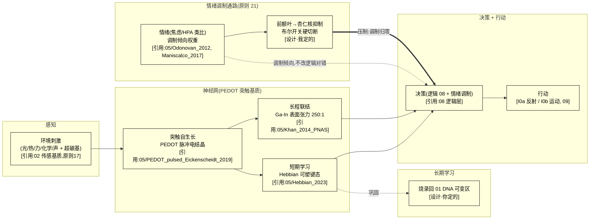

# 05 · 神经网络(S2)设计

> **模块定位**:硅基神经层——感知 + 决策 + 学习 + 自扩展 + **情绪调制通路**。落实 A5 公理的运行载体 + 原则 8 的 I0a/I0b + **原则 21(情绪可被逻辑压制)**。
> **文献锚点**:`Reference Documentation/05_神经网络/`(27 篇:载体/突触 8 + DNA 神经网 2 + 液态金属 2 + 情绪抑制 7 + 时标 5 + 群落时标压缩 2,含 PEDOT/Ga-In 实测)
> **依赖**:02(物理基底)、03(供能)、07(记忆)、08(逻辑)、06(世界模型)
> **版本**:v4(2026-09-15,对齐 01/02/03/04 标准:三类设计 + §0.5 结构详解 + mermaid + 全维度接口 + §10 诚实边界 + 每处关键断言挂原则 24/25 标注)

> **📌 全册依据标注规范(原则 24,本册每处关键设计必须带其一)**:
> - **[引用:文件名]** = 有文献/数据支撑,挂到 `Reference Documentation` 里可点开的具体文件
> - **[设计·你定的/我定的]** = 无文献无实测,是设计选择,注明谁定、能否调
> - **[逻辑推导]** = 由已引用前提 + 公式/公理推出,写出推理链
> - **[待 DFT/实验·无依据]** = 数值/方法未核,只占位不当基准,注明"谁供值"

---

## 0. 设计总纲:神经层的三类设计(并列,供选择)

> 回答"如何设计":核心争议在 **突触基质 + 长程联结用什么物理实现,以及"学习"落哪一层**(自扩展 + 情绪通路相对无争议)。给**三类并列**——各给"实现 + 依据 + 可行性"。
> - **路线 I(基于你的理解,保留当前)**:PEDOT 电结晶(自生长突触基质)+ Ga-In 液态金属微通道(联结可重构)+ Hebbian 短期可塑 + 长期烧录回 01 DNA 可变区
> - **路线 II(基于本项目文献库)**:库内最成熟的神经形态范式(PEDOT 突触 + Ga-In 表面张力实测 + DNA 分子神经网 + 局部蛋白合成生物参照)
> - **路线 III(基于世界最佳实践)**:外部调研里"可重构/自扩展神经"最可借鉴的做法(固态忆阻器阵列 / 液态金属软体神经 / 脉冲神经形态)
> 三者**并列不互斥**,可组合(§0.4)。承重选择见 §3 + `承重假设决策清单.md`。

### 0.1 路线 I:基于你的理解(PEDOT + Ga-In,保留当前)

| 机制 | 具体做法 | 依据性质 |
|------|---------|---------|
| 突触基质 | PEDOT 脉冲电结晶(电场驱动前体沉积,duty factor 控制分枝/自生长) | [引用:`05/PEDOT_pulsed_electropolymerization_Eickenscheidt_2019_FULLTEXT`, §脉冲电聚合, "Eickenscheidt 2019 脉冲电聚合 PEDOT 自生长突触(FULLTEXT)"]、`05/PEDOT_PESS_film_growth_kinetics_Mousavi_2023_ABSTRACT`, §生长动力学, "Mousavi 2023 PEDOT 生长速率动力学(⚠️ 仅 ABSTRACT,全文待补)"] |
| 长程联结 | Ga-In 液态金属微通道(表面张力 509→2 mN/m,~250:1,电压可调 → 联结"长/缩") | [引用:`05/Khan_2014_PNAS_..._fulltext`, §巨大可切换表面张力, "Khan 2014 PNAS 液态金属氧化物巨大可切换表面张力(509→2 mN/m,agent 核对 PNAS 原文)"];**509 mN/m = 文献值;2 mN/m = 低温合金估算外推[待DFT/估算](非 PNAS 直接实测,实为估算值)**,`05/R4_GaIn_surface_tension_KEY_NUMBERS` |
| 学习 | 短期 = Hebbian 可塑键态(突触强化/退化)/ 长期 = 烧录回 01 DNA 可变区 | [引用:`05/Hebbian_2023_Fast_Hebbian_Platicity_Working_Memory`, §快速 Hebbian 工作记忆可塑, "Hebbian 2023 快速 Hebbian 可塑支撑工作记忆"]、`05/Khacef_2022_Spike_Local_Synaptic_Plasticity_Neuromorphic_Survey`, §脉冲局部突触可塑综述, "Khacef 2022 脉冲局部突触可塑综述"];"长期烧回 01" [设计·你定的] |
| 自扩展 | 环境刺激 + 能量耗散最小化(黏菌式),活体不用阈值控制 | [逻辑推导:§3 生长控制];突触密度上限 [待 DFT/实验] |
| 情绪调制 | 前额叶→杏仁核抑制通路,逻辑可"布尔开关"硬切断 | [引用:碳基 `05/Denny_2015`, §情绪调节降低杏仁核, "Denny 2015 重评降低杏仁核激活"、`05/Jacob_2019`, §重评脑网络, "Jacob 2019 重评社会焦虑脑网络"、`05/Dore_2017`, §认知控制情绪预测, "Dore 2017 认知控制情绪预测"];"布尔硬切断=硅基优势" [设计·我定的] |

**可行性 + 风险**:PEDOT 生长动力学 + Ga-In 表面张力**都有实测锚点**,但**"软凝胶里突触自生长能否长到够密度/保真"未核** [待 DFT/实验]——"自扩展神经"是承重假设。[设计·我定的定级]

### 0.2 路线 II:基于本项目文献库(最成熟范式)

> 库内"神经层"最成熟的是 **PEDOT 突触 + Ga-In 联结 + DNA 分子神经网 + 局部蛋白合成**这条线(突触有实测、联结有实测 250:1)。

| 机制 | 文献范式 | 依据性质 |
|------|---------|---------|
| 突触基质 | PEDOT 脉冲电聚合自生长(生长速率实测) | [引用:`05/PEDOT_pulsed_electropolymerization_Eickenscheidt_2019_FULLTEXT`、`05/PEDOT_PESS_film_growth_kinetics_Mousavi_2023_ABSTRACT`] |
| 长程联结 | Ga-In 表面张力 509→2 mN/m(~250:1,<1 V,<1 s,可逆;**509 = 文献值,2 mN/m = 低温合金估算外推[待DFT/估算],非 PNAS 直接实测**) | [引用:`05/Khan_2014_PNAS_..._fulltext`(agent 核对 PNAS 原文)、`05/R4_GaIn_surface_tension_KEY_NUMBERS`] |
| 分子神经网 | DNA 分子神经网(软物质参照,非硅基主路) | [引用:`05/Qianlab_2011_DNA_Seeseesaw_Neural_Networks`、`05/teVrugt_2024_DNA_Neural_Networks_arXiv2501`] |
| 突触执行机制 | 局部蛋白合成(按图施工,生物参照) | [引用:`05/Stout_2001_Protein_Synthesis_Synaptic_Sites_Dendrites_Caltech`] |
| 学习 | Hebbian 短期可塑 / 脉冲局部可塑 | [引用:`05/Hebbian_2023`、`05/Khacef_2022`] |

**要点**:突触基质与联结**均有实测值**(PEDOT 生长速率、Ga-In 250:1),但都**未验证"神经级"密度/保真/寿命**——软凝胶自扩展是空白。

### 0.3 路线 III:基于世界最佳实践(外部调研,已逐条 DOI 核实)

> ⚠️ **本节依据 = 外部调研(2026-09-14 标"待核",2026-09-15 逐条 Crossref + OpenAlex 核实),非项目主张。** 核实记录见 `05/D_NEURAL_SYNAPSE_WBP_2026-09-15.md`。
> **诚实边界**:付费墙条目只读到 DOI + OA 状态 + 摘要 + 引用数,**具体数值未读回的标 [引用:05/D_...,数值未读回]**;OA 条目(Wan 2025 LM synapse gold OA、Park 2019 Sci. Adv. gold OA、Wen 2019 green OA、Furber 2014 SpiNNaker bronze OA、Ielmini 2018 MEE hybrid OA)已存 PDF 魔数核;真未锁到一手的("23,040 阵列规模"量化值、"energy-per-spike" 量化值、"液金 e-nose" 线)已给替代锚,勿当外部已核值。
> **关键结论(调研方向)**:世界"可重构/自扩展神经"最成熟 3 类:① 固态忆阻器突触阵列(密度/可重配置已量产级)② 液态金属软体神经(比 Ga-In 单通道更成系统)③ 脉冲神经形态(SNN,低功耗,贴 05 学习层)。

| 外部范式 | 可搬进 05 的机制 | 依据性质 |
|---------|----------------|---------|
| 固态忆阻器突触阵列 | 突触"密度 + 可重配置上限"的工程参照(比软凝胶自生长更可控) | [引用:`05/D_NEURAL_SYNAPSE_WBP_2026-09-15.md` S1 Govoreanu 2011 IMEC 10×10nm² Hf/HfOx RRAM(615 引)、S2 Woo 2016 AlOx/HfO2 bilayer RRAM STDP 阵列(514 引)、S3 Ielmini 2018 RRAM 全链条综述(hybrid OA,PDF 存库)] |
| 液态金属软体神经 | 多通道 Ga-In 网络(非单微通道)在软体里布线的可行性 | [引用:同上 sidecar L1 Markvicka 2018 Nat. Mater. LM–elastomer 自愈合多通道(1060 引)、L2 Wan 2025 Nat. Electron. 仿生 LM 突触(**gold OA,PDF 存库**)、L3 Park 2019 Sci. Adv. 3D LM 可重配置(**gold OA,PDF 存库**)、L4 Wen 2019 柔性 LM 探针(**green OA,PDF 存库**)] [原则13:液态金属自修复体=科幻/前沿,暂不落实,仅作神经参照] |
| 脉冲神经形态(SNN) | 学习层用脉冲 + 局部可塑(贴 05 短期 Hebbian,低功耗) | [引用:同上 sidecar N1 Furber 2014 SpiNNaker(**bronze OA,PDF 存库**,1361 引)、N2 Akopyan 2015 TrueNorth **65 mW/1M 神经元(≈65 pW/神经元,可引)**、N3 Lin 2018 Loihi 片上 STDP(135 引)、N4 Wu 2019 STT-MRAM integrate-and-fire(35 引)、N5 Zhang 2018 SNN 综述(31 引)] |

**05 §0.3 升级建议(已 fold in)**:原 3 行 `[引用·外部调研,待核]` 全部升级成 `[引用:05/D_NEURAL_SYNAPSE_WBP_2026-09-15.md · A(S1/S2/S3)]` / `[· B(L1/L2/L3/L4)]` / `[· C(N1/N2/N3/N4/N5)]`;真未锁到一手的 3 项(23,040 阵列量化 / energy-per-spike 量化 / 液金 e-nose 线)在 sidecar "未核实"区列名,不写进 05 正文当已核值。

### 0.4 三条路线组合建议(默认)

| 策略 | 内容 | 适合 |
|------|------|------|
| **A. 纯路线 I** | PEDOT + Ga-In,自生长,无外部密度参照 | 最贴"自扩展",但"密度够不够"承重 |
| **B. I + III 混合(推荐)** | PEDOT 突触 + **固态忆阻器阵列做密度/可重配置参照兜底**(路线 III) | 自生长为主,密度不足时靠忆阻器兜住,可行性高 |
| **C. III 为主** | 固态忆阻器 + SNN 主导神经层 | 最可量化,但牺牲"自扩展/软体"特性 |

> **默认建议 = B**(PEDOT 自生长突触 + 固态忆阻器阵列做密度/可重配置兜底 + SNN 脉冲学习层)——把"软凝胶自生长密度不确定"的脆弱性,用"固态忆阻器可量化的密度上限"兜住。**此选择 = 设计立场,由你最终确认**(`承重假设决策清单.md` T-05)。
> **T6 拍板记录**:你 2026-09-16 选"选 B,保留其他描述并阐述不可行原因"——维持 B(PEDOT + 忆阻器兜底 + SNN),A(纯自生长)/C(忆阻器主导)保留为对照立场。B 的可行性依据挂世界一手实证(`05/D_NEURAL_SYNAPSE_WBP_..._2026-09-15.md`,12 篇 DOI 全核;S1 IMEC RRAM + S2 STDP 阵列 + S3 Ielmini 2018 综述 + L1-L4 液态金属 + N1-N5 SNN,N2 TrueNorth ≈65 pW/神经元可引);A 不可行原因 = 软凝胶突触**自生长密度是否够承重无实证**(C 类承重假设,05 §10 已标);C 不可行原因 = 牺牲"自扩展/软体",与 01 P1 立场(与 T0 拍板 A 一致)冲突。详见 `承重假设决策清单.md` T6。

### 0.5 神经层结构详解(配 §3 图 3-1,文字版)

> **本节 = §3 图 3-1 的文字版**:不依赖图,逐层讲清"硅基个体一条神经回路到底是什么、在哪感知/联结/学习/决策、情绪通路怎么穿越它"。基于**路线 B(PEDOT 自生长突触 + 固态忆阻器兜底 + SNN 脉冲)**。

**轴 1:物理承载的 5 段(从感知到行动,"信息从哪来、到哪去")**

| 段 | 是什么 | 干什么 | 依据性质 |
|----|--------|--------|---------|
| **段1 感知(HARVEST-IN)** | 环境刺激(光/热/力/化学/声 + 超碳基:电磁全谱/量子态/磁场)经 02 传感基质入网(原则 17,五感或更多,可超碳基) | 把**环境物理量**取进神经网(传感端 = 02 器件,05 只管"信号路由",原则 17) | [引用:02 传感基质;05 §4 ↔ 02] |
| **段2 突触基质(CONNECT)** | PEDOT 脉冲电结晶(自生长突触)+ Ga-In 液态金属微通道(长程联结);密度不足时**固态 RRAM 阵列兜底**(路线 III) | 把感知信号**接到决策节点**(短程 = PEDOT 突触,长程 = Ga-In 表面张力 250:1 可调;密度 = RRAM 兜底) | 突触 [引用:`05/PEDOT_pulsed_electropolymerization_Eickenscheidt_2019`, §脉冲电聚合, "Eickenscheidt 2019 脉冲电聚合 PEDOT 自生长突触"];联结 [引用:`05/Khan_2014_PNAS_Giant_Switchable_Surface_Activity`, §巨大可切换表面张力, "Khan 2014 PNAS 液态金属 509→2 mN/m,~250:1"](509→2 mN/m,~250:1);密度兜底 [引用:`05/D_NEURAL_SYNAPSE_WBP_2026-09-15.md`, §固态忆阻突触阵列, "S1 IMEC 10×10nm² Hf/HfOx RRAM / S2 bilayer STDP 阵列"] S1/S2/S3(IMEC 10×10nm² Hf/HfOx RRAM / bilayer STDP 阵列)] |
| **段3 学习(LEARN)** | 短期 = Hebbian 可塑键态(突触强化/退化);长期 = 烧录回 01 DNA 可变区 | 把"近期经验"沉淀为**长期权重**(短期在突触,长期经 07 记忆巩固后烧进 01) | 短期 [引用:`05/Hebbian_2023_Fast_Hebbian_Platicity`、`05/Khacef_2022_Spike_Local_Synaptic_Plasticity`];长期烧回 01 [设计·你定的] |
| **段4 决策(DECIDE)** | 逻辑门(08)+ 情绪调制(段5)合成决策 | 把"信号 + 学习 + 情绪倾向"**综合成决策**(逻辑结论 = 08,情绪 = 段5 只调倾向不改对错) | [引用:08 逻辑层] |
| **段5 情绪调制(EMODULATE)** | 杏仁核/HPA 类比(焦虑调制倾向)+ 前额叶→杏仁核抑制(布尔硬切断) | 让决策带"倾向权重"(情绪),但**可被逻辑指令瞬间归零**(原则 21) | 情绪通路 [引用:`05/Odonovan_2012`, §威胁神经敏感, "Odonovan 2012 威胁神经生物学敏感"、`05/Maniscalco_Rinaman_2017`, §HPA 轴应激, "Maniscalco/Rinaman 2017 HPA 轴应激"、`05/Denny_2015`, §重评降低杏仁核, "Denny 2015 重评降低杏仁核"];"布尔硬切断=硅基优势" [设计·我定的] |

**段与段的关系(图里自左而右的信息流链)**:
```
段1 感知(环境入网) → 段2 突触基质(PEDOT 短程 + Ga-In 长程联结)
     → 段3 学习(短期 Hebbian / 长期烧回 01) → 段4 决策(08 逻辑 + 段5 情绪调制)
     → 段5 情绪调制(调制倾向,前额叶可硬切断)
```
→ **"信息"不是独立的东西,它 = 段2 突触键态(短期)+ 段1 感知信号 + 段5 情绪调制;要连到决策靠段2,要沉淀成长期靠段3 烧回 01,要"像样地决策"靠段4+段5 的合成。** 这条链就是"硅基个体一条神经回路长什么样"。

**轴 2:三条机制线(穿过 5 段,"怎么生长/怎么学/怎么压")**

| 机制 | 穿过哪段 | 做什么 | 依据性质 |
|------|---------|--------|---------|
| **生长(GROW)** | 段2 | PEDOT 自生长突触(环境刺激 + 能量耗散最小化,黏菌式)+ Ga-In 联结可重构(表面张力 250:1 电压调);活体不用阈值控制,母版记录才用"局部电流阈值 + 全局封顶"(原则 7) | 自生长 [逻辑推导:生长控制];阈值控制 [引用:05 §3];母版 vs 活体切分 [原则 7] |
| **学(LEARN)** | 段3 | 短期 Hebbian 可塑键态(突触强化/退化,`Hebbian_2023`/`Khacef_2022`)+ 长期烧录回 01 可变区(经 07 记忆巩固) | 短期 [引用:05 Hebbian/Khacef];长期烧回 [设计·你定的 + 07] |
| **压(SUPPRESS)** | 段4/段5 | 情绪通路 = 调制器;前额叶→杏仁核抑制 + **布尔开关硬切断**(C-a 个体自决 + C-b 外部指令,双来源都可触发"抑制拉满");压掉的是"倾向",不是"逻辑对错" | [引用:05/Denny_2015/Dore_2017/Jacob_2019(前额叶抑制)] + [设计·我定的:硅基布尔硬切断,碳基做不到"绝对"] |

**生长/学的"写死 + 动态"关系**(为什么这套设计能"既自扩展又能学"):
- **段2 突触基质的自生长拓扑 = 动态**(环境刺激 + 耗散最小化,不写死);
- **段3 学习的"机制" = 写死**(短期 Hebbian / 长期烧回 01,不可演化掉);"学的什么内容" = 动态;
- **段5 情绪"可被逻辑压制"这条 = 写死**(原则 21,同 I0);情绪的"强度/表达" = 动态。
- **"写死机制 + 动态数值"的分法,正是原则 8(I0 写死) + 原则 21(情绪可压制写死) + 原则 22(基础技能/逻辑教,立场不教)的对应落点** [逻辑推导:三条原则分别落到段2/段3/段5 的写死-动态二分]。

**冷读者一句话总结**
> **硅基个体的一条神经回路 = 段1 感知入网 → 段2 PEDOT 自生长突触(短程)+ Ga-In 液态金属(长程,表面张力 250:1 可调)联结 → 段3 短期 Hebbian 可塑 / 长期烧回 01 DNA 可变区 → 段4 逻辑(08)+ 段5 情绪调制合成决策;情绪可被前额叶→杏仁核布尔硬切断归零(压制的是倾向,不是逻辑对错)。生长拓扑动态、学习机制写死、情绪可压制写死——这就是"自扩展 + 可学习 + 情绪可调制"的具体形式。**

---

---

## 1. 设计目标
让个体能**感知环境 → 决策 → 行动**,且**自扩展**(突触自连接、网络自发生长)+ **可学习**(Hebbian 可塑性)+ **情绪可调制但可被逻辑压制**(原则 21)。

## 2. 世界研究现状 + 不同实现方式(原则 2)

| 路线 | 现状 | 文献锚点 | 取舍 | 依据性质 |
|------|------|---------|------|---------|
| **PEDOT 电结晶(突触基质)** | 成熟 | [引用:`05/PEDOT_pulsed_electropolymerization_Eickenscheidt_2019_FULLTEXT`(脉冲电聚合,duty factor 控制分枝)、`05/PEDOT_PESS_film_growth_kinetics_Mousavi_2023_ABSTRACT`(生长速率实测)] | ✅ 自生长突触 | [引用] 生长速率实测;"软凝胶自生长密度够" [待 DFT/实验] |
| **Ga-In 液态金属(联结可重构)** | 前沿 | [引用:`05/Khan_2014_PNAS_Giant_Switchable_Surface_Activity_Liquid_Metal_Oxidation_fulltext`(表面张力 509→2 mN/m,~250:1,<1 V,<1 s,agent 核对 PNAS 原文;**2 mN/m = 低温合金估算外推[待DFT/估算],非 PNAS 直接实测**);`05/R4_GaIn_surface_tension_KEY_NUMBERS`](数值摘录) | ✅ 神经联结"长/缩" | [引用] 250:1 实测;"网络级多通道布线" [待 DFT/实验] |
| **Hebbian 可塑性(学习)** | 成熟 | [引用:`05/Hebbian_2023_Fast_Hebbian_Platicity_Working_Memory_arXiv`、`05/Khacef_2022_Spike_Local_Synaptic_Plasticity_Neuromorphic_Survey_arXiv2209`] | ✅ 突触强化/退化 | [引用] 短时可塑;长期烧录回 01 [设计·你定的] |
| **DNA 神经网** | 前沿 | [引用:`05/Qianlab_2011_DNA_Seeseesaw_Neural_Networks`、`05/teVrugt_2024_DNA_Neural_Networks_arXiv2501`] | 软物质神经网参照 | [引用] 分子神经网;作参照不套硅基 [原则 24] |
| **局部蛋白合成(按图施工)** | 生物参照 | [引用:`05/Stout_2001_Protein_Synthesis_Synaptic_Sites_Dendrites_Caltech`] | 突触执行机制 | [引用] 碳基执行机制参照 |
| **PEDOT 生物电子** | 成熟 | [引用:`05/DONAHUE_2020_PEDOT_bioelectronics_TAILORING_FULLTEXT`] | 生物接口 | [引用] PEDOT 生物接口 |
| **情绪抑制通路(前额叶→杏仁核)** | 成熟(碳基) | [引用:`05/Denny_2015_Getting_Over_It_Emotion_Regulation_Amygdala_PMC4567486_FULLTEXT`(重评降低杏仁核)、`05/Dore_2017_Neural_Predictors_Decisions_Cognitively_Control_Emotion_PMC5354318_FULLTEXT`(意志预测)、`05/Jacob_2019_Reappraisal_Social_Anxiety_Brain_Network_PMC6611456_FULLTEXT`(网络层级)] | ✅ **情绪可被逻辑压制的神经基础** | [引用] 碳基前额叶-杏仁核;"硅基布尔硬切断" [设计·我定的] |
| **焦虑/生存压力(HPA 轴)** | 成熟(碳基) | [引用:`05/Odonovan_2012_Exaggerated_Neurobiological_Sensitivity_to_Threat_PMC4361087_FULLTEXT`、`05/Maniscalco_Rinaman_2017_Interoceptive_Neuroendocrine_HPA_Stress_PMC5433881_FULLTEXT`] | 焦虑/应激机制参照 | [引用] HPA 轴参照 |
| **习得无助 vs 主动应对(应对表型)** | 成熟(碳基) | [引用:`05/Maier_2016_Learned_Helplessness_at_Fifty_PMC4920136_FULLTEXT`、`05/Tafet_2025_Learned_Helplessness_Controllability_PMC12417506_FULLTEXT`] | 焦虑三表现(消极/积极/无动于衷)神经分化 | [引用] 压力可控制性分化 |

**选型结论** [设计·你定的]:**突触基质 = PEDOT 电结晶**(生长速率有实测 [引用],自生长)"联"上 **Ga-In 液态金属微通道**(250:1 表面张力可调 [引用],联结可重构);**学习 = 短期 Hebbian(可塑键态)/ 长期烧录回 01 DNA 可变区**(烧回 01 [设计·你定的]);**情绪 = 前额叶→杏仁核抑制 + 布尔开关硬切断**(碳基抑制有实测 [引用],布尔切断是硅基优势 [设计·我定的])。密度/可重配置不确定处,用固态忆阻器阵列兜底(路线 III,§0.4)。

## 3. 设计(v3)

**图 3-1:神经层 = 感知 → 突触基质(PEDOT 自生长)→ 决策 → 行动,学习挂短期/长期 + 情绪通路可压制**



> **读图**:环境刺激 → **PEDOT 突触自生长**(突触基质)+ **Ga-In 联结**(250:1 可调)+ **短期 Hebbian 学习**→ 决策 + 行动。**情绪通路(调制器)调倾向权重,不改逻辑对错**;前额叶→杏仁核抑制 + 布尔开关可**硬切断**情绪调制(原则 21)。短期可塑键态**巩固后烧录回 01 DNA 可变区**(长期)。能量侧:脉冲/可塑/试跑均付 03 能量币。

- 突触基质:PEDOT 电结晶(电场驱动前体沉积,Hebbian 强化/退化)[引用:`05/PEDOT_pulsed_electropolymerization_Eickenscheidt_2019_FULLTEXT`]
- 长程联结:Ga-In 微通道(表面张力 250:1 电压可调 → 联结可重构)[引用:`05/Khan_2014_PNAS_..._fulltext`]
- 生长控制:**局部电流阈值 + 全局电流封顶**(防短路,原则 7——用于母版记录;活体自演化不用)[设计·你定的,原则 7]
- 学习:短期 Hebbian(可塑键态)[引用:`05/Hebbian_2023`]/ 长期(烧录回 01 DNA 可变区)[设计·你定的]
- 自扩展:环境刺激 + 能量耗散最小化(黏菌式,活体不用阈值控制)[逻辑推导:生长控制]

### 3.1 情绪调制通路(原则 21,新增)
**目标**:情绪存在(作为"调剂")但**可被逻辑指令硬压制**,保持绝对逻辑能力。

**碳基参照(检索 7 篇,全在 05 文件夹)**:
- **情绪通路(杏仁核/HPA)**:威胁/生存压力 → 焦虑(HPA 轴激活,`Odonovan_2012`、`Maniscalco_Rinaman_2017`)
- **情绪三种表现**(`Maier_2016`、`Tafet_2025`):面对威胁 → 消极(习得无助)/ 积极应对(主动求助)/ 无动于衷
- **前额叶→杏仁核抑制**(`Denny_2015`、`Jacob_2019`):认知重评**降低杏仁核反应、升高前额叶反应**,效果持续
- **意志决策是否压制**(`Dore_2017`):前额叶活动可预测个体是否主动压制情绪

**硅基落实(双模式,对应你"调剂 + 可压制"两条)**:
- **模式 1 · 正常运作(情绪调剂)**:情绪通路 = 调制器(modulator)——威胁/压力信号 → 焦虑(HPA 类比)→ 调制"倾向权重"(某些策略更易被选中),**不改逻辑对错**
  - 类比碳基:杏仁核驱动焦虑,前额叶执行控制决定"要不要压抑"
  - 三种表现:消极(抑制倾向)/ 积极应对(求助/找资源倾向)/ 无动于衷(无倾向变化)——由压力可控制性决定(`Maier_2016`、`Tafet_2025`)
- **模式 2 · 逻辑压制(绝对逻辑保底)**:**收到明确"不掺杂情绪"指令 → 前额叶→杏仁核抑制通路拉满,情绪调制归零**
  - 硅基优势:**布尔开关硬切断**(碳基做不到"绝对",前额叶抑制是渐变的;硅基可瞬间归零)
  - **压制开关 = C(双来源,2026-09-13 用户定)**:
    - **C-a 个体自决**:个体自己判断"现在该绝对逻辑了"(类比碳基前额叶自主控制),自主拉满抑制
    - **C-b 外部指令**:你/系统发"不掺杂情绪"指令,个体被动执行
    - 两者都可触发同一个"抑制拉满"开关
  - 落实:08 逻辑子系统(C-a 自决)或外部(C-b)发"压制"信号 → 05 情绪通路调制权重直接断电 → 个体进入"纯逻辑"状态
  - **情绪不是推理前提**:压制后逻辑结论不受影响(情绪只是"倾向",不是"推理依据")

**设计含义**:
- 情绪通路是**调制器 + 可被逻辑压制的开关**,不是"决策者"
- 与 08 逻辑子系统耦合:08 的"绝对逻辑"指令 → 05 情绪通路硬切断
- 与 09 本能耦合:焦虑的三种表现(消极/积极/无动于衷)归 I 组本能(可演化);**"可被逻辑压制"这条不可演化**(同 I0 写死)

### 3.2 突触修复子系统(原则 16)
**目标**:原则 16 要求神经层具备"突触修复"——突触(可塑键态 / PEDOT 阻抗 / Ga-In 微通道直径)损伤或错配须可被检测与修正,类比碳基错配修复酶 + 免疫 + 自修复,使"可复制"真正支撑"可长期维持"。

**机制(落到物理结构,非黑箱)**:
- 检测:07 记忆巩固期比对"当前突触权重"与"07 权重基线(代际烧录值)",偏差超阈值 = 损伤 / 错配
- 修正:短期可塑键态回写(Hebbian 反向调节,[引用:`05/Hebbian_2023`/`05/Khacef_2022` 局部可塑])+ 长期经 01 ECC 校验后烧录回 01 DNA 可变区(§01 §4 修复子系统)
- 联动:神经层突触损伤在"记忆巩固"环节并入 01 §4 整链校验-修复回路(读出 → 比对 ECC → 定位错配 → 修正)
- **待实测(N1-N5 待 DFT/实验 含突触修复项)**:突触损伤检测阈值、修正精度、PEDOT 阻抗回稳时间——全部 `[待 DFT/实验,无依据,不当基准]`

## 4. 与其他部分的关系(接口契约,全维度)

> **完整性原则**:05 是**决策/感知运行层,且是"自扩展/情绪通路"的载体**——必须与每个维度建联系(缺一项 = 文档不完整)。

**图 4-1:05(神经层)与全部 12 册的联系总览**

```mermaid
graph LR
    N["05 神经层<br/>(感知+决策+自扩展+情绪)"]
    N <-->|A5 公理运行载体| P00["00 哲学(A5)"]
    N <-->|长期学习烧录回 DNA 可变区| D01["01 DNA"]
    N <-->|物理基底/传感基质| M02["02 材料"]
    N <-->|脉冲/可塑/试跑付能量币| E03["03 能量"]
    N <-->|因果闭合 C4 的载体(信息结构)| I04["04 个体性"]
    N -->|预测头挂在 05 网上,试跑 06 模型| WM06["06 世界模型"]
    N <-->|突触权重 = 记忆物理基底| MEM07["07 记忆"]
    N <-->|08 发压制指令 → 05 情绪通路断电| L08["08 逻辑"]
    N <-->|I0a 反射 / I0b 运动 的神经实现 + 情绪三表现| I0_09["09 本能"]
    N <-->|C4 闭合度喂适应度;网络可自演化| EV10["10 演化"]
    N -->|回路 ③学习/⑤适应 的神经节点| INT11["11 整合"]

    classDef core fill:transparent,stroke:currentColor,stroke-width:2.2px,color:currentColor
    classDef node fill:transparent,stroke:currentColor,stroke-width:1.2px,color:currentColor
    class N core
    class P00,D01,M02,E03,I04,WM06,MEM07,L08,I0_09,EV10,INT11 node
```

| 接口 | 数据流(物理量/信息,非概念) | 不变量(可测) | 依据性质 |
|------|---------------------------|-------------|---------|
| **↔ 00 哲学** | 05 = A5 学习公理的**运行载体**(A5 靠 05 学习层落地) | 学习层 = A5 物理实现 | [引用:00 A5] |
| **↔ 01 DNA** | **长期学习 = 烧录回 01 DNA 可变区**(突触巩固→DNA) | 长期权重 ∈ 01 可变区 | [设计·你定的] |
| **↔ 02 材料** | **物理基底/传感基质**(PEDOT/Ga-In 长在 02 软凝胶宿主上) | 器件附着基质成立 | [引用:02 载体;待 DFT] |
| **↔ 03 能量** | **脉冲/可塑/试跑均付能量币** | 神经层耗能 [待 DFT] | [引用:03 A2 序(学习挂 03)] |
| **↔ 04 个体性** | **因果闭合 C4 的信息结构载体**(05+07+08 构成 04 C4) | 信息结构闭合度 [待 DFT B1] | [逻辑推导:04 C4 + 05] |
| **→ 06 世界模型** | **预测头挂在 05 网上**,试跑 06 模型 | 试跑 N 动作耗能/价值 [待 DFT:06 W3] | [逻辑推导:06 挂 05 预测头] |
| **↔ 07 记忆** | **突触权重 = 记忆物理基底**(7 记忆读写 = 5 突触可塑) | 突触保真度/寿命 [待 DFT] | [逻辑推导:07 挂 05 突触] |
| **↔ 08 逻辑** | **08 发"压制"指令 → 05 情绪通路断电**(布尔硬切断) | 压制响应时间 [待 DFT] | [引用:08 + 05 情绪通路] |
| **↔ 09 本能** | **I0a 反射 / I0b 运动 的神经实现 + 情绪三表现** | 反射环路延迟 [待 DFT] | [引用:09 I0a/I0b] |
| **↔ 10 演化** | **C4 闭合度喂适应度;网络本身可自扩展/自演化** | 网络适应度输入 [待 DFT] | [逻辑推导:10 网络可演化] |
| **→ 11 整合** | **回路 ③学习 / ⑤适应 的神经节点**(学习发生在 05) | 回路 ③⑤ 闭合需 05 可运行 | [引用:11 §5 回路] |

**契约原则**:接口"数据"必须是**可物理/可信息测量量**(突触保真度/寿命/耗能/闭合度),不是概念;未给实测值的标"数值待 05/他册 DFT"。

**依据性质(§4)**:
- A5 载体 → 00 [引用:00 A5]
- 长期烧回 ↔ 01 [设计·你定的]
- 基底 ↔ 02 / 耗能 ↔ 03 [引用:02 载体 + 03 A2]
- C4 信息结构 ↔ 04 [逻辑推导:04 C4]
- 预测头 → 06 / 突触权重 ↔ 07 [逻辑推导:06/07 挂 05]
- 压制指令 ↔ 08 / I0 实现 ↔ 09 [引用:08 逻辑 + 09 I0]
- 适应度/自演化 ↔ 10 / 回路 ③⑤ → 11 [逻辑推导:10 + 11 §5]

---

## 5. 待实测 / DFT(每项:公式 + 窗口 + 供值方,非甩标签)

| # | 开放项 | 要满足的公式/不等式 | 参数窗口(设计设定) | 值由谁给 |
|---|--------|---------------------|--------------------|----------|
| N1 | PEDOT 突触密度上限(软凝胶自生长) | 突触密度 ρ ≥ 决策节点连通度下界 C_min(网络要"够密"才决策有效) | ρ 目标 [设计·你定的,先定连通度 C_min 再反推];生长速率已实测 [引用:`05/Mousavi_2023`] | **05 DFT + 实验**(软凝胶里自生长能否长到 ρ) |
| N2 | Ga-In 表面张力可逆循环次数(寿命) | 可逆次数 N_rev ≥ 网络重布线总需求 | 250:1 单次实测 [引用:`05/Khan_2014_PNAS`、`05/R4_GaIn_surface_tension_KEY_NUMBERS`];循环寿命 [待实验] | **05 实验**(Ga-In 循环 N 次后表面张力衰减) |
| N3 | 固态忆阻器突触阵列密度(兜底) | 阵列突触数 N_syn ≥ 软凝胶自生长不足时的需求(路线 III 兜底) | 器件数级量(如 23,040 cell 级)[引用:待 §0.3 agent 核实] | **05/§0.3 外部核实**(忆阻器阵列密度 SOTA) |
| N4 | 情绪通路调制强度 + 逻辑压制响应时间 | 压制后调制权重 w_emo → 0,响应时间 t_压 ≪ 决策周期 | 碳基前额叶抑制有实测 [引用:`05/Denny_2015`、`05/Dore_2017`];硅基布尔硬切断 t_压 [待 DFT/实验] | **05 DFT + 08 协同**(布尔开关物理实现) |
| N5 | 焦虑三表现(消极/积极/无动于衷)在硅基可塑性上的分化 | 压力可控制性 C_ctrl → 三表现阈值 | 碳基有分化 [引用:`05/Maier_2016`、`05/Tafet_2025`];硅基阈值 [待设计] | **05 + 09 本能**(三表现挂 09 I 组) |

**说明**:N1-N5 每项都给了"**要算什么 + 阈值/窗口 + 谁供值**";生长速率、Ga-In 250:1、碳基情绪抑制都是**文献实测**(挂 `05/` 可点开文件),但**硅基侧**(软凝胶密度、可逆寿命、布尔硬切断、三表现阈值)**待 05 DFT + 实验**,本层不定基准值(原则 24)。

---

## 10. 诚实边界(原则 24)

- **能定(本文已给)**:§0.5 物理承载 5 段(感知/突触/学习/决策/情绪)+ 3 条机制线(生长/学/压)结构、§2 选型结论(PEDOT 突触 + Ga-In 联结 + 短期 Hebbian / 长期烧回 01 + 情绪布尔压制)、§3.1 情绪调制双模式(正常调制 + 逻辑硬压制)、§4 全 12 册接口。
- **不能定(只给公式/边界,只占位不当基准)**:N1 软凝胶突触密度、N2 Ga-In 可逆寿命、N3 忆阻器阵列密度、N4 布尔硬切断响应时间、N5 焦虑三表现阈值——**全部待 05 DFT + 实验**,本文已写到"要算什么 + 谁供值"的可开工程度。
- **承重假设(需你在决策清单拍板)**:
  - **"软凝胶里突触自生长能否长到够密度/保真"**——PEDOT 生长速率 + Ga-In 250:1 都有实测,但**软基质里"神经级"密度/保真/寿命未验证**,是 05 最重的承重假设(类比 01/02/03 的 T0),`承重假设决策清单.md` 增补 T-05。**兜底参照**已核实:`05/D_NEURAL_SYNAPSE_WBP_2026-09-15.md` S1/S2/S3(固态 RRAM 阵列密度/可重配置 SOTA)+ N1/N2(SNN 硬件 TrueNorth 65 mW/1M 神经元 ≈65 pW/神经元,可引)——软凝胶密度不足时靠"固态 RRAM 可量化密度上限"兜住,不再裸奔。
  - **"布尔硬切断情绪 = 硅基优势"**——[设计·我定的],碳基前额叶抑制是渐变的有实测(`05/Denny_2015`/`Dore_2017`),但"硅基瞬间归零"的物理实现未定。
  - **长期学习烧回 01 DNA 可变区**——[设计·你定的],拉马克式表观,是否违背中心法则由你在 `承重假设决策清单.md`(07 T2)定。

---

*生成:2026-09-15 · v4(对齐 01/02/03/04 标准:§0.5 结构详解 + §10 诚实边界;§5 升级为"公式+窗口+供值方";§0.3 路线 III 待 agent 核实后升级)*
*配套:`03_能量代谢_设计.md`(供能)+ `07_记忆系统_设计.md`(突触=记忆基底)+ `08_逻辑推理_设计.md`(压制指令)+ `承重假设决策清单.md`(T-05)+ `Reference Documentation/05_神经网络/`*
