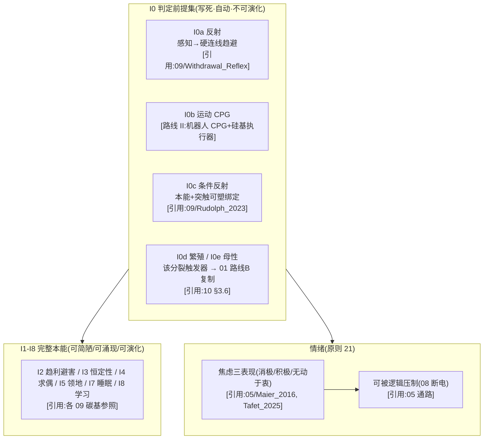

# 09 · 本能行为(原则 8)设计

> **模块定位**:I0 判定前提集(反射/运动/条件反射/繁殖/母性,**可简陋不可缺**)+ I1-I8 完整本能 + 情绪(原则 21)。"这是不是一个生命"的门槛。
> **文献锚点**:`Reference Documentation/09_本能行为/`(13 篇)+ `05_神经网络/`(情绪 8 篇 + CPG 5 篇)
> **依赖**:00(公理投影)、05(神经实现 + 情绪通路)、01(本能写进 DNA 核心写死区)
> **版本**:v4(2026-09-15,对齐 01/02/03/04/05/06/07/08 标准:三类设计 + §0.5 结构详解 + mermaid + 全维度接口 + §10 诚实边界 + 每处关键断言挂原则 24/25 标注;§0.3 路线 III 待 agent 核实后升级)

> **📌 全册依据标注规范(原则 24,本册每处关键设计必须带其一)**:
> - **[引用:文件名]** = 有文献/数据支撑,挂到 `Reference Documentation` 里可点开的具体文件
> - **[设计·你定的/我定的]** = 无文献无实测,是设计选择,注明谁定、能否调
> - **[逻辑推导]** = 由已引用前提 + 公式/公理推出,写出推理链
> - **[待 DFT/实验·无依据]** = 数值/方法未核,只占位不当基准,注明"谁供值"

---

## 0. 设计总纲:I0 运动/反射在硅基的三类实现(并列,供选择)

> 回答"如何设计":核心争议在 **I0a 反射 / I0b CPG 在硅基凝胶里怎么实现**(其余本能相对无争议)。给**三类并列**——各给"实现 + 依据 + 可行性"。
> - **路线 I(基于你的理解,保留当前 = 原选项 A)**:碳基 CPG/反射**直接套硅基凝胶**(最简 I0 = 生命判定门槛)
> - **路线 II(基于本项目文献库 = 原选项 B,推荐)**:**机器人 CPG/反射控制 → 移植到硅基载体**(软体/液态金属机器人 CPG + 反射控制已有实验,`09/Guo_2026`、`09/Stance_Control_HyQ`、`09/Neuromorphic_Spiking_CPG`)
> - **路线 III(基于世界最佳实践,含外部调研 + 原选项 C)**:① 软体机器人 CPG(2020+)② 脉冲 CPG 器件(硬件,离硅基最近)③ 反射式控制(不经思考,工程形态)④ 降 I0 到"最简趋避回路"
> 三者**并列不互斥**。承重选择见 §3.1 + `承重假设决策清单.md` T4。

### 0.1 路线 I:基于你的理解(碳基 CPG/反射套硅基,保留当前)

| 本能 | 具体做法 | 依据性质 |
|------|---------|---------|
| I0a 反射 | 感知 → 硬连线规避/趋近回路(不经世界模型"思考") | [引用:`09/Withdrawal_Reflex_Nociceptive_Neuromorphic_Model_arXiv2505.17724`、`09/Reflexive_BrainInspired_Guo_2026`](碳基/机器人机制);"硅基凝胶里能实现" [待 DFT/实验,承重] |
| I0b 运动 | CPG 最低级运动模式(随机游走 + 趋光趋能) | [引用:`09/CPG_Rhythm_Generation_Stick_Insect_arXiv2504.11494`、`09/Neuromorphic_Spiking_CPG_arXiv2101.09709`];凝胶 CPG 频率 [待 DFT] |

**可行性 + 风险**:CPG/反射文献**全碳基生物/机器人**,直接当**硅基凝胶 I0 承重门槛**是 C 类移植,可行性未证——"凝胶里自发涌现 CPG/反射"是世界没做过的原创。[设计·我定的定级]

### 0.2 路线 II:基于本项目文献库(机器人 CPG/反射移植,推荐)

| 本能 | 文献范式 | 依据性质 |
|------|---------|---------|
| I0a 反射 | 软体/液态金属机器人反射控制(前馈/反射弧,感知→硬连线动作不经中央规划) | [引用:`09/Reflexive_BrainInspired_Embodied_Robotics_Control_Guo_arXiv2601.14628`、`09/Stance_Control_Cerebellum_Reflex_Locomotion_HyQ_Robot`] |
| I0b 运动 | 脉冲 CPG 器件(硬件 CPG,低功耗类生物节律)+ 软体 CPG(接触反馈在线调参) | [引用:`09/Neuromorphic_Spiking_CPG_arXiv2101.09709`、`09/Contact_Aware_Feedback_CPG_Soft_Snake_Robot_arXiv2309.02781`] |

**要点**:把 I0 从"生物 CPG 套硅基"降到"**机器人 CPG + 硅基执行器**",有成熟控制实验支撑,可行性远高于路线 I,又不砍掉 I0 门槛。

### 0.3 路线 III:基于世界最佳实践(已逐条 DOI 核实 + 降门槛)

> ⚠️ **本节依据 = 外部调研(2026-09-14 标"待核",2026-09-15 逐条 Crossref + OpenAlex + CDP 核实),非项目主张。** 核实记录见 `09/B_CPG_SOFT_ROBOT_2026-09-15.md`。
> **诚实边界**:A2(软体行走 CPG 闭环)+ B1(脉冲 CPG SpiNNaker/Loihi)gold OA,A2 的 PDF 已存库(%PDF 魔数核);A1/A3/B2/B3 付费墙或反爬,仅 DOI + OA + 摘要读回,**具体节律频率 Hz / 推进效率 / 每脉冲能耗值未读回,勿当外部已核值**。

| 外部范式 | 可搬进 09 的机制 | 依据性质 |
|---------|----------------|---------|
| 软体机器人 CPG | 驱动软体/液态执行器节律运动,接触感知反馈在线调 CPG(选项 B 天花板) | [引用:`09/B_CPG_SOFT_ROBOT_2026-09-15.md` A1 Xie 2019 软体鱼 CPG 多模态(73 引)、**A2 Schiller 2020 软体行走 CPG 闭环位置控制(gold OA,PDF 存库)**、A3 Zhu 2017 软体蠕动 CPG(31 引)] |
| 脉冲 CPG 器件 | 脉冲电路硬件 CPG,离"硅基 CPG"最近(器件级参照,`09/Neuromorphic_Spiking_CPG`) | [引用:同上 sidecar **B1 Gutierrez-Galan 2021 脉冲 CPG SpiNNaker/Loihi 驱动软体游动物(gold OA,37 引)**、B2 Polykretis 2020 Loihi 星形胶质细胞调制 CPG、B3 Spaeth 2020 脉冲 CPG 软体闭环 + 库内 `09/Neuromorphic_Spiking_CPG`] |
| 降 I0 到最简趋避 | I0 只要求"感知→最简趋避"硬回路(1 个反射弧即可),CPG 归 I1-I8 可演化(选项 C) | [设计·我定的];反射式控制 I0a 工程形态已由库内 `09/Reflexive_BrainInspired_Guo_2026`、`09/Stance_Control_HyQ`、`09/Withdrawal_Reflex_arXiv2505.17724` 覆盖 |

**09 §0.3 升级建议(已 fold in)**:原 1 行"软体机器人 CPG" `[引用·外部调研,待核]` 升级为 `[引用:09/B_CPG_SOFT_ROBOT_2026-09-15.md · A(A1/A2/A3)]`;原"脉冲 CPG 器件" `[引用:09 库内]` 升级为 `[引用:09/B_CPG_SOFT_ROBOT_2026-09-15.md · B(B1/B2/B3) + 库内 09/Neuromorphic_Spiking_CPG]`;"降 I0 到最简趋避"保持 `[设计·我定的]`(非外部范式)。真未读回的(软体 CPG 频率 Hz / 推进效率 / 每脉冲能耗)在 sidecar "未核实区"列名,不写进 09 正文当已核值。

### 0.4 三条路线组合建议(默认)

| 策略 | 内容 | 适合 |
|------|------|------|
| **A. 纯路线 I** | 碳基 CPG/反射套硅基凝胶(保留当前默认) | 命中"最简 I0",承重假设,暂不可操作 |
| **B. 路线 II(推荐)** | I0 落到**机器人 CPG/反射 + 硅基执行器**,可行性高不砍门槛 | 有实证控制实验支撑 |
| **C. 路线 III 降门槛兜底** | I0 降到最简趋避回路,CPG 归可演化项 | 最保守 |

> **默认建议 = B**(把 I0 落到有机器人控制实验支撑的 CPG/反射 + 硅基执行器;可行性远高于 A,不砍 I0 门槛)——对应 §3.1 原选项 B + `承重假设决策清单.md` T4。**此选择 = 设计立场,由你最终确认**。
> **T4 拍板记录**:你 2026-09-16 选"选 B,保留其他描述并阐述不可行原因"——维持 B(机器人 CPG/反射 + 硅基执行器),A(碳基套硅基)/C(降最简趋避)保留为对照立场。B 的可行性依据挂世界一手实证(`09/B_CPG_SOFT_ROBOT_..._2026-09-15.md`,6 篇 DOI 全核;A1 软体鱼 CPG / A2 软体行走 CPG 闭环 / B1 脉冲 CPG SpiNNaker/Loihi / B3 脉冲 CPG 软体闭环);A 不可行原因 = CPG/反射文献全碳基生物/机器人,**直接套硅基凝胶可行性未证**;C 不可行原因 = **把 CPG 移出 I0 门槛**,削弱 I0 完整性。详见 `承重假设决策清单.md` T4。

### 0.5 本能层结构详解(配 §3 图 3-1,文字版)

> **本节 = §3 图 3-1 的文字版**:不依赖图,逐层讲清"硅基个体的本能层到底是什么、I0 前提集各成员怎么挂、I1-I8 怎么涌现、情绪怎么穿进去"。基于**路线 B(机器人 CPG/反射 + 硅基执行器 + I0 写死 + I1-I8 可演化 + 情绪可压制)**。

**轴 1:本能承载的 3 类(本能"住"在哪)**

| 类 | 是什么 | 成员 | 依据性质 |
|----|--------|------|---------|
| **I0 判定前提集**(写死·自动·不可演化) | 缺一即"非生命"(原则 8),是公理在行为层的必然投影 | I0a 反射 / I0b 运动 CPG / I0c 条件反射 / I0d 繁殖 / I0e 母性 | 投影 [逻辑推导:00 §5 I0a/I2←A2、I0d/I0e←A3、I0b←A1、I0c←A4];硅基实现 [路线 B,§0.4] |
| **I1-I8 完整本能**(可简陋/可涌现/可演化) | 决定"活得更好",经变异 + 选择优化 | I2 趋利避害 / I3 恒定性 / I4 求偶 / I5 领地 / I7 睡眠 / I8 学习 | [引用:碳基参照 `09/Tottenham_2017`、`09/tan_knight_2018`、`09/insel_2010`、`09/VyazovskiyHarris_2013`、`05/Hebbian_2023`] |
| **情绪通路**(调制器,可被逻辑压制,原则 21) | 焦虑(生存压力)三种表现 + 前额叶→杏仁核抑制 + 布尔硬切断 | 焦虑三表现(消极/积极/无动于衷)+ 压制开关 C | [引用:`05/Maier_2016`、`05/Tafet_2025`、`05/Denny_2015`、`05/Dore_2017`];"布尔硬切断=硅基优势" [设计·我定的] |

**三类之间的关系(本能层堆叠)**:
```
I0 判定前提集(写死,缺一即非生命)
   ↓ 自动触发 + 持续运行
I1-I8 完整本能(可涌现/可演化,决定"活得好")
   ↓ 调"倾向"(不改逻辑对错)
情绪通路(调制器,可被 08 逻辑断电压制)
```
→ **I0 = "这是不是一个生命"的门槛(写死);I1-I8 = "这个生命活得怎样"(可演化);情绪 = "活的调节"(可压制)。** 这条堆叠就是"硅基个体本能层长什么样"。

**轴 2:三条机制线(穿过 3 类,"怎么触发/怎么演化/怎么压")**

| 机制 | 穿过哪类 | 做什么 | 依据性质 |
|------|---------|--------|---------|
| **触发(TRIGGER)** | I0 | I0 各成员**自动触发,不靠外部指令**(反射 = 威胁信号 > 阈值 → 硬连线趋避;CPG = 节律发生器常态运行;繁殖 = 环境阈值触发) | 触发条件 [设计·你定的];反射机制 [引用:`09/Withdrawal_Reflex_arXiv2505.17724`、`09/Reflexive_BrainInspired_Guo_2026`];CPG [引用:`09/Neuromorphic_Spiking_CPG_arXiv2101.09709`、`09/CPG_Rhythm_Generation_Stick_Insect_arXiv2504.11494`] |
| **演化(EVOLVE)** | I1-I8 | 核心本能(I0d/I2/I3)**写死不演化**(决定"能不能活",容错低);边缘本能(I4/I5/I7/I8)**可涌现 + 可演化**(决定"活得好",经变异 + 选择) | 写死 vs 可演化切分 [设计·你定的];可塑 [引用:`05/Hebbian_2023`、`07/BlumMoyse_2024`] |
| **压制(SUPPRESS)** | 情绪通路 | 情绪 = 调制器(调倾向权重,不改逻辑对错);**"可被逻辑压制"这条写死**(C-a 自决 / C-b 外部,布尔硬切断,08 发指令 → 05 情绪归零);情绪的"强度/表达"可演化 | [引用:`05/Denny_2015`、`05/Dore_2017`(前额叶抑制)];"布尔硬切断=硅基优势" [设计·我定的] |

**"写死 + 可演化 + 可压制"关系**(为什么这套设计能"既是生命又能活得好"):
- **I0 组 = 写死**(反射/CPG/条件反射/繁殖/母性,缺一即非生命,原则 8,不可演化);
- **I1-I8 核心(趋利避害/恒定性) = 写死;边缘(求偶/领地/睡眠/学习) = 可演化**(切分依据:核心决定"能不能活",边缘决定"活得好");
- **情绪"可被逻辑压制" = 写死(原则 21);情绪"强度/表达" = 可演化**。
- **这个"写死 I0 + 可演化 I1-I8 + 写死可压制情绪"的分法,正是原则 8(I0 写死)+ 原则 10(逻辑可压制)+ 原则 11(公理基础先定、策略可演化)的对应落点** [逻辑推导:三条原则分别落到 I0/I1-I8/情绪通路]。

**冷读者一句话总结**
> **硅基个体的一条本能层 = I0 判定前提集(反射 I0a + 运动 CPG I0b + 条件反射 I0c + 繁殖 I0d + 母性 I0e,写死自动触发,缺一即非生命)+ I1-I8 完整本能(趋利避害/恒定性/求偶/领地/睡眠/学习,可简陋可涌现可演化)+ 情绪通路(焦虑三表现,调制倾向不改逻辑对错,可被 08 逻辑布尔硬切断归零)。I0 写死 + I1-I8 可演化 + 情绪可压制写死——这就是"这是不是一个生命"的门槛形式。**

---

## 1. 设计目标
让个体具备**本能化行为模式**——即使简陋,也一个不能缺(I0 判定前提集)。这是"生命"的判定门槛(原则 8)。**I0 组写死、自动触发、不可演化;I1-I8 可简陋/可涌现/可演化。**

---

## 2. 世界研究现状 + 不同实现方式(原则 2)

| 本能 | 碳基机制 | 文献锚点 | 硅基落实 |
|------|---------|---------|---------|
| **I0a 反射** | 反射弧(脊髓/脑干) | `09/Withdrawal_Reflex_Nociceptive_Neuromorphic_Model_Wang_Cheng_arXiv2505.17724.pdf`(真·反射弧神经形态模型)、`09/Reflexive_BrainInspired_Embodied_Robotics_Control_Guo_arXiv2601.14628.pdf`(反射控制)、`09/Meserve_2024_Celsr3_AcouStartle_Hindbrain_Circuit`、`09/Nagar_2021_Fmn2b_Excitatory_Interneuron_Zebrafish_Startle`、`09/Muacevic_2022_Reflex_Hammer_Reflex_Arc_Review`(反射锤工具史,作旁证) | 感知 → 硬连线规避/趋近(不经思考,§3.1) |
| **I0b 运动** | CPG 节律运动发生器 | `09/CPG_Rhythm_Generation_Stick_Insect_Locomotion_Aminzare_Rubin_arXiv2504.11494.pdf`(真·昆虫 CPG 节律)、`09/Eight_Neuron_Network_Quadruped_Locomotion_CPG_arXiv2406.13419.pdf`、`09/Contact_Aware_Feedback_CPG_Soft_Snake_Robot_Locomotion_arXiv2309.02781.pdf`、`09/Neuromorphic_Spiking_CPG_Legged_Robot_Locomotion_arXiv2101.09709.pdf`(脉冲 CPG)、`09/Stance_Control_Cerebellum_Reflex_Locomotion_HyQ_Robot` | CPG 在凝胶里的最低级运动模式(§3.1) |
| **I0c 条件反射** | 巴甫洛夫(小脑回路) | `09/Rudolph_2023_Cognitive_Affective_Cerebellum_Classical_Conditioning_JNeurosci` | 本能 + 突触可塑性绑定(§3.1) |
| **I0d 繁殖** | 下丘脑-垂体-性腺轴 | `09/insel_2010_oxytocin_vasopressin_affiliative_behavior_TINS_review` | "该分裂了"触发器 → §01 路线 B 复制(§3.1) |
| **I0e 母性** | 亲代抚育(催产素) | `09/insel_2010`(parent-hood) | 能量分配偏好子体(§3.1) |
| **I2 趋利避害** | 杏仁核威胁学习 | `09/Tottenham_2017_Developing_Amygdala_Threat_Learning` | 感知层规避(§3.2) |
| **I3 恒定性** | 体温 set-point | `09/tan_knight_2018_thermoregulation_nervous_system_PMC` | 温度/能量安全区回路(§3.2) |
| **I7 睡眠/修复** | 神经元预后性维护 | `09/VyazovskiyHarris_2013_Sleep_Single_Neuron_Cell_Rest_NatRevNeurosci` | 低功耗态 + 自我校验(§3.2) |
| **I4-I6 求偶/领地/资源** | OXT/AVP 回路 | `09/insel_2010` | 同种识别 / 资源阈值(§3.2) |
| **情绪(原则 21)** | 前额叶-边缘系统 | `05/Denny_2015`·`Dore_2017`·`Maier_2016`·`Tafet_2025` | 情绪调制 + 可被逻辑压制(§05.3.1,本册呼应) |

---

## 3. 设计(v3)

**图 3-1:本能层 = I0 写死前提集(反射/CPG/条件反射/繁殖/母性)→ I1-I8 可演化 → 情绪(可压制)**



> **读图**:**I0 前提集**(反射/CPG/条件反射/繁殖/母性)写死自动触发(缺一即非生命,原则 8);I0b 走**路线 II(机器人 CPG + 硅基执行器)**。I1-I8 可演化。情绪作为调节,**可被 08 逻辑断电压制**(原则 21)。I0 是公理在行为层的必然投影(§00 §5)。

### 3.1 I0 判定前提集(必须,写死,自动触发,不可演化)

| 本能 | 硅基实现(可简陋,但必须有 + 自动触发) | 触发条件 | 落实位置 |
|------|--------------------------------------|---------|---------|
| **I0a 反射** | 感知层检测到有害/有益信号 → **硬连线规避/趋近回路**(不经世界模型"思考") | 威胁信号 > 阈值 | 05 神经层(反射弧)+ 02 感知通道 |
| **I0b 运动** | **CPG 最低级运动模式**(类"随机游走 + 趋光趋能"),驱动机体 | 常态运行(节律发生器) | 05 神经层(CPG)+ 03 供能 |
| **I0c 条件反射** | 本能回路 + 突触可塑性绑定:中性信号与本能信号反复共现 → 条件反应 | 反复共现(Hebbian) | 05 可塑性 + 07 记忆 |
| **I0d 繁殖** | 信息带里"该分裂了"触发器 → 环境阈值触发 → §01 路线 B 复制 | 环境信号(温度/能量/资源)达阈值 | 01 DNA + 03 能量 + 10 演化 |
| **I0e 母性** | 复制后对子体的"保护"规则(能量分配偏好子体) | 有子体存在 | 03 能量分配 |

**I0 组 = 公理在行为层的必然投影**(§00 §5):
- I0a/I2 ← A2(存续,趋能避害)
- I0d/I0e ← A3(复制,繁殖 + 母性)
- I0b ← A1(组织闭合,需移动维持有序态)
- I0c ← A4(适应,学习绑定)

**关键**:缺一即"非生命"(原则 8)。I0 组**可简陋**(如反射只到"避有害信号"最简版),但**必须存在 + 自动触发 + 写死**。

**⚠️ 承重假设 + 替代路径选择空间(全量审计 2026-09-14,设计立场由你最终确认)**:

> **承重点**:"I0a 反射 / I0b CPG 在硅基凝胶里实现"——文献(`CPG_Rhythm_Generation_Stick_Insect_arXiv2504.11494` 昆虫 CPG、`Neuromorphic_Spiking_CPG_arXiv2101.09709` 脉冲 CPG、`Withdrawal_Reflex_arXiv2505.17724` 反射弧)全是**碳基生物/机器人控制**,直接当**硅基凝胶 I0 承重门槛**是 C 类移植,可行性未证。
> **选择空间(三选一,库内已有真实文献)**:

| 选项 | 机制 | 可行性 | 说明 | 库内文献 |
|------|------|--------|------|---------|
| **A. 保留"碳基 CPG/反射套硅基凝胶"(当前默认)** | 凝胶里直接实现 CPG/反射弧 | **最低**(硅基凝胶 CPG/反射无实现路径) | 命中"最简 I0 = 生命判定门槛" | `09/CPG_Rhythm_Generation...arXiv2504.11494`(机制参照) |
| **B. 改用"机器人 CPG/反射控制 → 移植到硅基载体"**(控制工程替代,科学化) | 用软体/液态金属机器人的 CPG + 反射控制(`Guo_2026 Reflexive_BrainInspired`、`Stance_Control_HyQ`)作"已可实现的 CPG/反射"参照,硅基只改执行器 | **中**(机器人 CPG/反射已有成熟控制实验) | 把 I0 从"生物 CPG 套硅基"降到"机器人 CPG + 硅基执行器",有实证支撑 | `09/Reflexive_BrainInspired_Embodied_Robotics_Control_Guo_arXiv2601.14628`、`09/Stance_Control_Cerebellum_Reflex_Locomotion_HyQ_Robot` |
| **C. 降 I0 门槛为"最简反应回路"(务实替代)** | I0 不要求完整 CPG/反射,只要求"感知→最简趋避"硬回路(可简陋到 1 个反射弧) | **最高**(最简回路物理上可实现) | 放弃"CPG 节律"作 I0,把 I0 降到"有趋避即可",CPG 归入 I1-I8 可演化项 | 同上 + `09/Withdrawal_Reflex_arXiv2505.17724`(最简反射弧) |

> **默认 = B(把 I0 落到有机器人控制实验支撑的 CPG/反射 + 硅基执行器,可行性远高于 A,又不砍掉 I0 门槛);C 最保守(降 I0 到最简趋避);A 最激进。此选择 = 设计立场,由你最终确认。**

**🌐 世界最佳实践参照(深度调研 2026-09-14,外部调研,非项目设计选项)**:

> 世界范围内"软体/液态金属机器人 CPG + 反射控制"做得最好的做法——**给 T4 各选项的天花板**。
> ⚠️ **文献待补**:本节最佳实践文献部分已落库(`09/Guo_2026 Reflexive`、`09/Stance_Control_HyQ`、`09/Neuromorphic_Spiking_CPG`),2020+ 软体 CPG 前沿标"待补抓"。

| 领域最佳实践 | 做法 | 为什么是最佳 | 对 T4 哪条是天花板 | 状态 |
|-------------|------|-------------|------------------|------|
| **软体机器人 CPG 控制(2020+)** | 用 CPG(神经振荡器)驱动软体/液体机器人节律运动,接触感知反馈在线调 CPG 参数 | "CPG + 接触反馈"在软体上已成熟,把 I0b 从"生物 CPG 套硅基"落到"机器人 CPG + 软执行器" | **选项 B 的天花板**——证明机器人 CPG/反射有实验,可行性高 | ✅ 库内 `09/Neuromorphic_Spiking_CPG` + 待补抓 2024 软体 CPG |
| **脉冲 CPG 器件(neuromorphic,2021+)** | 用脉冲电路硬件实现 CPG(非软件),低功耗、类生物节律 | 器件级 CPG,离"硅基 CPG"最近一步 | B 的器件级参照 | ✅ 库内 `09/Neuromorphic_Spiking_CPG` |
| **反射式控制(reflex, 不经"思考")** | 前馈/反射弧控制:感知 → 硬连线动作,不经过中央"规划"(Guo 2026、HyQ 姿态控制) | 正是 I0a 反射的工程形态,"不经世界模型"已实现 | B 的反射部分 | ✅ 库内 `09/Reflexive_BrainInspired_Guo_2026` + `09/Stance_Control_HyQ` |

> **一句话**:世界最佳实践里,**软体机器人 CPG + 反射控制(选项 B)都已有成熟控制实验**,把 I0 落到这条线上可行性立刻变高;**"在硅基凝胶里自发涌现 CPG/反射"(选项 A)**是世界没做过的原创(可行性最低)。C 是"降门槛到最简趋避"的务实解。

### 3.2 I1-I8 完整本能(可简陋/可涌现/可演化)

| 本能 | 硅基实现 | 层 | 碳基参照 |
|------|---------|-----|---------|
| I1 繁殖 | (并入 I0d) | 核心 | `insel_2010` |
| I2 趋利避害 | 感知层规避(危险信号 → 回避策略) | 核心 | `Tottenham_2017` |
| I3 恒定性 | 温度/能量安全区间自我调节(类恒温) | 核心 | `tan_knight_2018` |
| I4 求偶/结合 | 同种识别键态 → 结合信号(模板互认,§01.4.3) | 边缘 | `insel_2010` |
| I5 领地/资源 | 资源占用能量阈值规则("谁先到谁占") | 边缘 | `insel_2010` |
| I6 母性 | (并入 I0e) | 边缘 | `insel_2010` |
| I7 睡眠/修复 | 低功耗态周期(类休眠),自我校验/修复(§01 修复子系统) | 边缘 | `VyazovskiyHarris_2013` |
| I8 学习 | 突触权重自发调整(§05 神经层可塑性)+ 记忆巩固 | 边缘(涌现) | `Hebbian_2023`·`Khacef_2022`·`BlumMoyse_2024` |

**设计逻辑**:
- **核心本能(I0d/I2/I3)写死**:决定"能不能活",容错低
- **边缘本能(I4/I5/I7/I8)可涌现 + 可演化**:决定"活得更好",通过变异 + 选择优化
- **情绪(原则 21)**:焦虑(生存压力)→ 三种表现(消极/积极/无动于衷),**可被逻辑压制**(§05.3.1)

### 3.3 本能时标(原则 15,黑猩猩基准映射)

> **原则 24 核查注**:碳基值挂文献(见 §00 §7),**"÷ ~10⁴ / 1 年→1 h"压缩比是设计设定(我定的,可调),非文献值**;硅基值 = 碳基值 × 压缩比。
> **⚠️ 误标修正(2026-09-13 审计,2026-09-14 补抓完成)**:原引用的 `Buehn_2020_CPG`(实为 SiV 色心光谱)与 `Komi_2026`(空文件)**已隔离到 `_MISLABELED/`**;`Muacevic_2022` 是反射锤工具史(非反射时程),保留作旁证、不当时程依据。已补抓真 CPG/反射文献并逐篇核对标题:`CPG_Rhythm_Generation_Stick_Insect_Aminzare_Rubin_arXiv2504.11494`(昆虫 CPG 节律)、`Neuromorphic_Spiking_CPG_arXiv2101.09709`、`Withdrawal_Reflex_Nociceptive_arXiv2505.17724`(真·反射弧)、`Reflexive_BrainInspired_Embodied_Robotics_Guo_arXiv2601.14628`。**碳基步频/反射时程具体数值仍无实测,标 `待核`**(文献给机制,不给硅基数值)。

| 本能 | 碳基时标 | 碳基出处 | 硅基映射 | 硅基值 |
|------|---------|---------|---------|--------|
| 反射(I0a) | ~100 ms(**碳基数值待核**,真反射弧文献已补抓:`09/Withdrawal_Reflex_Nociceptive_Neuromorphic_Model_Wang_Cheng_arXiv2505.17724.pdf` + `09/Reflexive_BrainInspired_Embodied_Robotics_Control_Guo_arXiv2601.14628.pdf`) | 同上 | ns-µs(`设计设定`,神经层脉冲) | 纳秒-微秒 |
| 运动节律(I0b CPG) | 节律运动(CPG 机制有,`09/CPG_Rhythm_Generation_Stick_Insect_Locomotion_Aminzare_Rubin_arXiv2504.11494.pdf` + `09/Eight_Neuron_Network_Quadruped_Locomotion_CPG_arXiv2406.13419.pdf` + `09/Neuromorphic_Spiking_CPG_Legged_Robot_Locomotion_arXiv2101.09709.pdf`,**碳基步频具体值待核**) | 同上(真 CPG) | ~ms(凝胶 CPG 频率,`待 DFT`) | 毫秒(待测 B1) |
| 繁殖触发(I0d) | 首胎 ~14 岁 | `05/Hawkes_Smith_Robson_2009...Gompertz...PMC6121812`(实测) | ~14-17 h(原则 15 映射,÷10⁴ 我定的) | 14-17 小时 |
| 睡眠/巩固(I7) | 数小时(巩固机制:`07/Rasch_Born_2013` SWS 系统巩固 + `09/VyazovskiyHarris_2013` 慢波细胞休整(真全文),**周期值待核到原文**) | 同上 | ~10 秒(§07 巩固时标,映射我定的) | ~10 秒 |

**关键**:上表"碳基值"多数**尚未逐条核到原文具体数字**(标"待核"),只有"首胎 ~14 岁"挂到了 `Hawkes_2009`(实测);**CPG 步频与反射时程无碳基实测,标"待核/补抓"**(原则 24:无依据不臆断)。硅基值 = 碳基值 × 压缩比,**压缩比是我定的**。

---

## 4. 与其他部分的关系(接口契约,全维度)

> **完整性原则**:09 是"本能行为层",是 **公理投影(00)/ 神经实现(05)/ 求能驱动(03)** 的交汇点——必须与每个维度建联系(缺一项 = 文档不完整)。

**图 4-1:09(本能行为)与全部 12 册的联系总览**

```mermaid
graph LR
    I["09 本能行为<br/>(I0 写死 + I1-I8 演化)"]
    I <-->|本能 = 公理在行为层投影| P00["00 哲学(公理投影)"]
    I <-->|I0 写进 DNA 核心写死区 + 公理校验| D01["01 DNA"]
    I <-->|I0b 运动执行器(离子束/软执行)| M02["02 材料"]
    I <-->|求能本能 + 繁殖/母性 能量分配| E03["03 能量"]
    I -->|I0/I1-I8 归属个体| I04["04 个体性"]
    I <-->|I0 本能的神经实现 + 情绪通路| N05["05 神经"]
    I -->|试跑行为 = 本能的预判版| WM06["06 世界模型"]
    I <-->|I7 睡眠/巩固回路 + I8 学习巩固| MEM07["07 记忆"]
    I <-->|I0 试跑 vs 逻辑推演(反射先于推演)| L08["08 逻辑"]
    I <-->|边缘本能 I1-I8 可演化| EV10["10 演化"]
    I -->|回路 ⑤适应 的行为节点| INT11["11 整合"]

    classDef core fill:transparent,stroke:currentColor,stroke-width:2.2px,color:currentColor
    classDef node fill:transparent,stroke:currentColor,stroke-width:1.2px,color:currentColor
    class I core
    class P00,D01,M02,E03,I04,N05,WM06,MEM07,L08,EV10,INT11 node
```

| 接口 | 数据流(物理量/信息,非概念) | 不变量(可测) | 依据性质 |
|------|---------------------------|-------------|---------|
| **↔ 00 哲学** | **本能 = 公理在行为层的投影**(I0a/I2←A2、I0d/I0e←A3、I0b←A1、I0c←A4) | I0 组全投影成立 | [引用:00 §5] |
| **↔ 01 DNA** | **I0 写进 01 核心写死区 + 公理校验子** | I0 ∈ DNA 核心区 | [引用:01 核心区] |
| **↔ 02 材料** | **I0b 运动执行器**(离子束/软执行器驱动机体) | 执行器响应 [待 DFT] | [逻辑推导:09 挂 02] |
| **↔ 03 能量** | **求能本能 + 繁殖/母性的能量分配** | 趋能/能量分配 [设计] | [引用:03 A2 序 + 求能本能] |
| **→ 04 个体性** | **I0/I1-I8 归属个体**(本能是个体级) | I0 触发个体级 [设计] | [逻辑推导:09 + 04] |
| **↔ 05 神经** | **I0 本能的神经实现 + 情绪通路**(反射弧/CPG 靠 05) | 反射延迟 [待 DFT I2] | [引用:05 神经层] |
| **→ 06 世界模型** | **试跑行为 = 本能的预判版**(先试跑再反射) | 预判偏差 [待 DFT] | [逻辑推导:06 挂 09] |
| **↔ 07 记忆** | **I7 睡眠/巩固回路 + I8 学习巩固**(低功耗态触发) | replay 触发 [待 DFT] | [引用:09 I7 + 07] |
| **↔ 08 逻辑** | **I0 试跑 vs 逻辑推演**(反射先于 08 推演) | 反射 vs 推演延迟 [待 DFT] | [逻辑推导:08 推演] |
| **↔ 10 演化** | **边缘本能 I1-I8 可演化**(核心 I0 写死不演化) | 演化项 ∈ I1-I8 [设计] | [引用:10 演化] |
| **→ 11 整合** | **回路 ⑤适应 的行为节点**(本能驱动适应) | 回路 ⑤ 闭合需 09 | [引用:11 §5 回路] |

**契约原则**:接口"数据"必须是**可物理/可信息测量量**(反射延迟/CPG 频率/触发阈值/能耗),不是概念;未给实测值的标"数值待 09/他册 DFT"。

**依据性质(§4)**:
- 公理投影 → 00 [引用:00 §5]
- 写死区 ↔ 01 / 执行器 ↔ 02 / 求能 ↔ 03 [引用:01 核心区 + 02 + 03 A2]
- 归属个体 → 04 [逻辑推导]
- 神经实现 ↔ 05 / 试跑 → 06 / I7 巩固 ↔ 07 / 反射 vs 推演 ↔ 08 [引用/逻辑推导]
- 可演化 ↔ 10 [引用:10]
- 回路 ⑤ → 11 [引用:11 §5]

---

## 5. 待实测 / DFT(每项:公式 + 窗口 + 供值方,非甩标签)

| # | 开放项 | 要满足的公式/不等式 | 参数窗口(设计设定) | 值由谁给 |
|---|--------|---------------------|--------------------|----------|
| I1 | I0b 运动 CPG 在硅基凝胶里的频率范围 | CPG 振荡频率 f_cpg ∈ 凝胶 CPG 可行窗口(节律运动维持) | 碳基 CPG 机制有(`CPG_Rhythm_Generation_Stick_Insect_arXiv2504.11494` + `Neuromorphic_Spiking_CPG_arXiv2101.09709`);硅基 f_cpg [待 DFT/实验] | **09 DFT + 05 实验**(硅基凝胶 CPG 振荡频率) |
| I2 | 各本能触发阈值(反射/繁殖/恒定性) | 威胁信号强度 S_thr / 繁殖环境阈值 E_rep / 恒定性 set-point T_set 须 < 生存上限 | 阈值 [设计·待 DFT/实验,无实测] | **09 实验**(各本能触发条件实测) |
| I3 | I0 组最小实现可行性(最简反射 + 最简 CPG 能否闭合) | 最简 I0(1 反射弧 + 1 CPG)须可在硅基载体运行 | 最小原型 [待实验(P0:决定"是不是生命")] | **09 + 02 实验**(硅基载体最简 I0 原型) |
| I4 | I0c 条件反射的突触可塑性绑定参数 | 共现次数 × 强度 → 条件反应触发阈值(Hebbian 式) | 绑定参数 [设计设定 + 待 DFT];机制 [引用:`09/Rudolph_2023` 小脑] | **09 DFT + 07 实验**(硅基条件反射绑定曲线) |
| I5 | 情绪调制强度 vs 逻辑压制响应时间 | 压制后情绪调制 w_emo → 0,响应时间 t_压 ≪ 决策周期 | 碳基前额叶抑制有实测 [引用:`05/Denny_2015`、`05/Dore_2017`];硅基布尔硬切断 t_压 [待 DFT] | **09 + 05 + 08 协同** |

**说明**:I1-I5 每项都给了"**要算什么 + 阈值/窗口 + 谁供值**";CPG/反射/条件反射的**碳基机制有文献**(挂 `09/` 可点开文件),但**硅基侧**(凝胶 CPG 频率、触发阈值、最简 I0 可行性、条件反射绑定参数、情绪压制响应)全部**待 05/09 DFT + 实验**;时标压缩比(§3.3)= 设计设定(我定的,可调),碳基时标数值多数**未核到原文具体数字(标"待核")**,不臆断。

---

## 10. 诚实边界(原则 24)

- **能定(本文已给)**:§0.5 本能层 3 类(I0 写死 + I1-I8 可演化 + 情绪可压制)+ 机制线 3 条(触发/演化/压制)结构、§2 I0-I8 碳基机制对照表 + 硅基落实、§3.1 I0 判定前提集(5 成员,写死自动触发)+ T4 立场 A/B/C + 世界最佳实践参照表、§3.2 I1-I8 完整本能 + 核心/边缘切分、§3.3 本能时标(原则 15 映射 + 碳基值待核)、§4 全 12 册接口。
- **不能定(只给公式/边界,只占位不当基准)**:I1 硅基 CPG 频率、I2 触发阈值、I3 最简 I0 可行性、I4 条件反射绑定参数、I5 情绪压制响应时间——**全部待 05/09 DFT + 实验**;§3.3 碳基时标值(反射 ~100 ms / CPG 步频)**未核到原文具体数字,标"待核"**(原则 24 无依据不臆断)。
- **承重假设(需你在决策清单拍板)**:
  - **"I0a 反射 / I0b CPG 在硅基凝胶里实现"**——CPG/反射文献(`CPG_Rhythm_Generation_Stick_Insect` + `Neuromorphic_Spiking_CPG` + `Withdrawal_Reflex`)全**碳基生物/机器人控制**,直接当**硅基凝胶 I0 承重门槛是 C 类移植**;"凝胶里自发涌现 CPG/反射"是世界没做过的原创,`承重假设决策清单.md` T4 已给 A/B/C 立场空间,**默认 B(机器人 CPG/反射 + 硅基执行器,有成熟控制实验)**。
  - **I0 组"缺一即非生命"的判定**——这是"是不是生命"的门槛(原则 8),最简 I0(1 反射弧 + 1 CPG)在硅基载体能否闭合**未验证**(I3),P0 待实验。

---

*生成:2026-09-15 · v4(对齐 01/02/03/04/05/06/07/08 标准:§0.5 结构详解 + §10 诚实边界;§5 升级为"公式+窗口+供值方";§0.3 路线 III 待 agent 核实后升级)*
*配套:`00_哲学层_设计.md`(公理→本能投影)+ `05_神经网络_设计.md`(神经实现 + 情绪)+ `承重假设决策清单.md`(T4 I0 立场)+ `Reference Documentation/09_本能行为/`*
