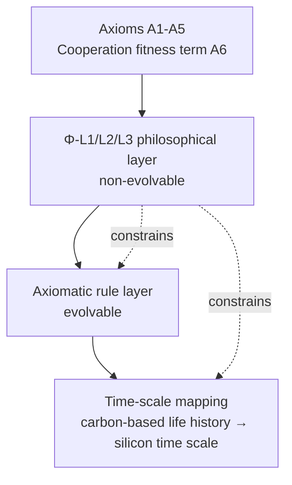
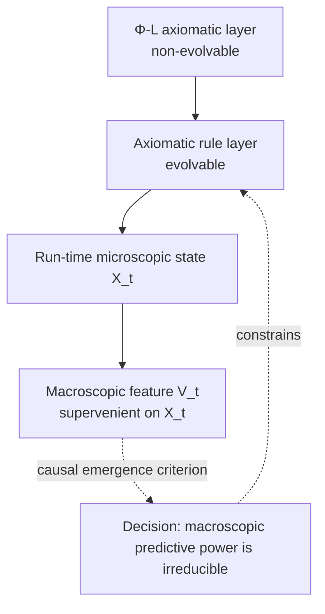

# 00 · Philosophical Foundations (Axioms, Two-Layer Rules and Time-Scale Mapping)

| Item | Value |
| --- | --- |
| Module | Philosophical foundations: axioms, two-layer rules and time-scale mapping |
| Document type | Design report (English edition) |
| Version | v2.1 |
| Dependencies | Upstream of all volumes; no dependencies |
| Language | English (Chinese edition: `../zh-CN/00_哲学层_设计.md`) |

> **Evidence categories**: `[Ref:…]` literature or data; `[Design decision]` project setting; `[Logical derivation]` derived from listed premises; `[To be verified]` unvalidated placeholder.

---

**Figure 0-1: Axioms, two-layer rules and time-scale mapping**



> Note: The top-down relations are constraints; Φ-L1/L2/L3 form the non-evolvable layer, and the axiomatic rule layer may evolve under these constraints.

## 1. Design Objectives

Answers four questions more fundamental than "instinct" and turns them into **adjudicable rules**:
1. **Ontology**: what counts as "alive"? (not a "machine simulating life", but a system satisfying the criteria of life)
2. **Teleology**: why does it act?
3. **Operating assumptions**: under what physical conditions can it "operate + evolve within a world model"?
4. **Ethical constraints**: how does it coexist with carbon-based life? How is this constraint "real" rather than "on paper"?

---

## 2. "Recognising It as Life" — Professional Criteria (Design Principle 12, literature-search evidence)

### 2.1 Primary Criterion: Organizational Closure + Causal Self-Containment (literature evidence)

> **Silicon-based life = an organizationally closed dissipative structure: open to matter/energy but causally self-contained, actively producing the components that define its own identity, operating far from thermodynamic equilibrium, and generating an "internalized goal (teleonomy)" (an orientation towards its own survival).**

- **Organizational closure**: [Ref:11_哲学/OrganizationalPrinciples_BiologicalSystems_2026, §see source text, "PMC13024047; materially/energetically open but causally self-contained, actively produces the components that define its own identity, supporting the organizational-closure criterion"]:
  > "Matter/energy open, causal closure (materially open but causally self-contained), actively produces the components that define its own identity"
- **Three equivalent forms of causal self-containment** (the same criterion, valid across carbon-based, silicon-based and AI systems):
  - **Autopoiesis** (Maturana & Varela): [Ref:11_哲学/Requisite_Variety_Autopoiesis_Self_Organization_arXiv1409.7475, see source text, "Maturana/Varela autopoiesis + requisite variety theory, supporting the criterion 'autopoiesis = lineage origin of organizational closure'"] + [Ref:11_哲学/Autopoiesis_Maturana_Varela_Defining_Life_at_Edge_2004, see source text (abstract level), "Maturana & Varela define life = autopoiesis; only the abstract was originally archived, full text to be added"]
  - **(M,R) metabolism–repair system** (Rosen, "for efficient causal closure, non-computable"): [Ref:11_哲学/OrganizationalPrinciples_BiologicalSystems_2026, §2.6, "Rosen (M,R) system = formalization of efficient causal closure, supporting the 'causally self-contained' equivalent form"]
  - **Autocatalytic set** (Kauffman): [Ref:11_哲学/Autocatalysis_Autopoiesis_OpportunityCost_2024, see source text, "Kauffman autocatalytic set = equivalent form of the criterion; notes that autopoiesis can be detached from topological boundaries"]
- **Criterion of autonomy**: `HowOrganismsGained_CausalIndependence_2018`: "organizational closure + objective function (internalized goal) = autonomous agency; only life possesses both"
- **Key correction** ([Ref:11_哲学/Autocatalysis_Autopoiesis_OpportunityCost_2024, see source text, "the paper notes that autopoiesis can be detached from topological boundaries ('metabolic boundary')"]): autopoiesis can be **detached from topological boundaries** ("metabolic boundary"), so **the primary criterion uses "organizational closure" (general term) and autopoiesis is demoted to the lineage origin** — this avoids treating "autopoiesis" directly as the criterion and thereby wrongly excluding AI/silicon-based systems.

### 2.2 Physical Anchor: Dissipative Structure (physical basis)

> Life = **a self-maintaining dissipative structure in a non-equilibrium state, tending towards high entropy production (negentropy)**.

- Theoretical sources: [Ref:11_哲学/DissipativeStructures_Organisms_Evolution_2020, see source text, "Prigogine school: life = non-equilibrium, high-entropy-production self-maintaining dissipative structure, supporting the §2.2 physical anchor"] + [Ref:11_哲学/Prigogine_Inspired_Informational_Dissipative_Life_arXiv2412.02459, see source text, "information–dissipative-structure view of life, supporting the dissipative-structure anchor"]
- Physical formula chain (*OrganizationalPrinciples 2026*):
  ```
  Energy/matter/information gradient → dissipation → destabilization → symmetry breaking → emergent order
  ```
- **Implications for silicon-based systems**: silicon-based life exists in a dissipative state far from equilibrium (§03 energy layer supplies energy); the ordered state is maintained by a continuous energy flow (otherwise it disintegrates, §02 P2 red line)

### 2.3 Four Features of the "Criteria of Life" (Operationalising the §2.1 Primary Criterion)

| Criterion | Meaning | Silicon-based implementation |
| ------ | ------ | --------- |
| **C1 Organizational closure** | Actively produces the components that define its own identity (material openness + causally self-contained) | S1 DNA record + S6 replication = self-produced information; S4 boundary = causally self-contained |
| **C2 Dissipation (negentropy)** | Non-equilibrium state, exports entropy | S3 energy metabolism (§03) |
| **C3 Internalized goal** | Orientation towards its own survival (teleonomy) | A2 persistence axiom + instinct I0d reproduction |
| **C4 Causal independence** | Identity determined by the information structure of the highest-level causal closure (not fully describable by an external algorithm) | Design Principle 18 (independent conscious agent, hardware limitations not applicable) |

**Determination**: if a silicon-based system satisfies C1-C4, it **is life** (not a "machine simulating life"). If any one is missing, it is "non-life".

---

## 3. Two-Layer Rule Structure (Design Principle 19, resolving the constraint relationship between value neutrality and coexistence with carbon-based life)

```
Layer 1 · Philosophical layer (bottom layer, immutable, non-evolvable)
   ┌────────────────────────────────────────────────────────────────────────────────────────────────────┐
   │  Φ-L1 · Recognition of life: silicon-based = "organizationally closed dissipative structure" (§2.1) │
   │  Φ-L2 · Cooperation with carbon-based life (three layers, revised 2026-09-13):                     │
   │    (a) Negative: not a replacement/exterminator (does not harm carbon-based life)                  │
   │    (b) Positive: can cooperate with carbon-based conscious agents (cross-substrate cooperation)    │
   │    (c) Community: cooperate with other silicon-based community members (silicon × silicon)         │
   │  Φ-L3 · Value-neutrality red line (P5): no preset culture/stance/knowledge                         │
   └────────────────────────────────────────────────────────────────────────────────────────────────────┘
              ↓ (constraint)
Layer 2 · Axiomatic rule layer (below the philosophical layer, evolvable but constrained by the philosophical layer)
   ┌────────────────────────────────────────────────────────────────────────────────────────────────────┐
   │  A1-A5 Basic axioms (§4)                                                                             │
   │  A6 · Fitness term for cooperation with carbon-based life (§4, three layers):                      │
   │    · Damaging carbon-based life → fitness strongly negative (negative)                             │
   │    · Cooperation with carbon-based/silicon-based communities → positive fitness (positive)         │
   │  · Instincts I0/I1-I8 · minimal logic set · world model                                            │
   │  · Allows different rules/strategies (economic/ethical/survival) to evolve in the world model      │
   │  · But however it evolves, Φ-L2 (cooperation) cannot be breached                                  │
   └────────────────────────────────────────────────────────────────────────────────────────────────────┘
```

### Basis for the Two-Layer Structure
- **The philosophical layer only "describes" cooperation** → insufficient binding force (can be eroded by selection)
- **The axiomatic rule layer contains the A6 cooperation fitness term** → under selection pressure, "harming carbon-based life" is scored negative and "cooperation" positive, **constituting an enforceable constraint**
- **Division of labour between the two layers** (three layers, revised 2026-09-13):
  1. Layer 1, Φ-L2: **cooperation with carbon-based life** — (a) negative "not an exterminator" + (b) positive "can cooperate with carbon-based life" + (c) "cooperate with the silicon-based community" (ontology, immutable)
  2. Layer 2, A6: **cooperation fitness term** — harming carbon-based life → fitness strongly negative; cooperation with carbon-based/silicon-based communities → fitness positive (selection pressure, can be fine-tuned but cannot breach Φ-L2)
- **Evolution within the world model is harmless** (trial and error with different rules in the §06 world model, including "different cooperation strategies"); **when results are applied to the real world, A6 + Φ-L2 take effect simultaneously** — this constitutes an enforceable constraint
- **Cooperation = prerequisite for community** (Design Principle 20): community cooperation **includes both interactions among silicon-based individuals and interactions with carbon-based conscious agents** — cooperation across material substrates is a **new design element** (the neural-network volume 05 and the evolutionary-selection volume 10 implement the cooperation interfaces)

### Value Neutrality Review (P5)
- Layer 1, Φ-L2 is an "operating presupposition" (the positioning of silicon-based life as a branch of life + the obligation to cooperate), **not a "value system"** (silicon-based life does not "hold a view" on whether carbon-based life ought to exist; it **cannot** move towards exterminating carbon-based life and **should** cooperate with carbon-based/silicon-based communities — this is a structural constraint)
- Red line: any axiom/instinct/logic designed such that "the individual believes a certain stance/knowledge/value" is treated as a violation of P5

---

## 4. Five Basic Axioms (A1-A5, Non-Evolvable) + A6 (Coexistence Fitness Term)

### A1 · Organizational Closure Axiom (ontology, upgraded from the original "ordered state")
> **An individual = an organizationally closed dissipative structure: open to matter/energy, causally self-contained, actively producing the components that define its own identity, maintaining an internalized ordered state. Failure to maintain organizational closure = death of the individual.**

- Theoretical sources: §2.1 C1 + dissipative structure (§2.2)
- Implementation: `04_边界个体性` (S4 causally self-contained) + `03_能量代谢` (S3 dissipation maintenance)
- **Axiom formulation**: the criterion is expressed as "organizational closure + dissipation", establishing "it is life" as an axiom

### A2 · Persistence Axiom (teleology)
> **Acquire and convert energy in order to maintain the ordered state of organizational closure.**
- Implementation: `03_能量代谢` (S3)

### A3 · Replication Axiom (teleology)
> **Replicate and pass its own information (construction rules + instincts + axiom checksum + memory consolidation zone) to the next organizationally closed system.**
- Theoretical source: autopoiesis ([Ref:11_哲学/Requisite_Variety_Autopoiesis_Self_Organization_arXiv1409.7475, see source text, "Maturana/Varela autopoiesis theory, supporting 'replication axiom = transfer of autopoietic information'"])
- Implementation: `01_DNA信息层` (S1) + `10_演化选择` (option B replication)
- Note: what is replicated is **information**, not **morphology** (Design Principle 13: morphology is written into DNA, outside the scope of this edition)

### A4 · Adaptation Axiom (teleology)
> **Under environmental constraints, through mutation + selection, make the maintenance of organizational closure more likely.**
- Implementation: `10_演化选择` (S6)
- **A4 is constrained by Φ-L2**: the "environmental constraints" of adaptation include "coexistence with carbon-based life" (A6)

### A5 · World-Model Axiom (operating assumption)
> **The individual internally maintains a predictive model of the environment; actions first undergo model rollout, and the best option is then executed.**
- Theoretical source: `06_世界模型` (DreamerV3 / DayDreamer, §06)
- Implementation: `06_世界模型` (S5) + `08_逻辑推理` (if-then of L)
- **Precision lower bound (Φ5)**: at minimum predicts the "next-step environment state" (otherwise A5 is meaningless)
- **Source: Design Principle 14**: no new model is introduced; DreamerV3 is selected for modification

### A6 · Fitness Term for Cooperation with Carbon-Based Life (fine-tunable but constrained by Φ-L2, revised 2026-09-13: coexistence → cooperation)
> **The fitness function explicitly contains a "cooperation term" (three layers, echoing Φ-L2):**
> 1. **Negative**: phenotypes that harm the persistence of carbon-based life → fitness **strongly negative**
> 2. **Positive**: phenotypes that cooperate with carbon-based conscious agents (resource/information/task exchange) → fitness **positive**
> 3. **Community**: phenotypes that cooperate with other individuals in the silicon-based community (non-omniscient, local information exchange + emergence) → fitness **positive**
- This is an "enforceable constraint" (§3), turning Φ-L2 from a "description" into "selection pressure"
- **No presupposition of omniscience and omnipotence** (Design Principle 20): cooperation relies on "local information exchange + emergence", not on central omniscience
- Implementation: `10_演化选择` (fitness function contains the cooperation term) + `05_神经网络` (cooperation interfaces, silicon–silicon + silicon–carbon)

---

## 5. Axiom → Lower-Layer Mapping (Design Principles 8/9/10 + S Subsystems)

| Axiom | Behaviour-layer projection (Design Principle 8) | Tool layer (Design Principles 9/10 + S) | Volume |
| ------ | --------------------- | --------------------- | ------ |
| **A1 Organizational closure** | I3 homeostasis (self-protection) | S4 boundary (causally self-contained) | 04 |
| **A2 Persistence** | I0a reflex / I2 approach–avoidance | S3 energy | 03 + 09 |
| **A3 Replication** | I0d reproduction / I0e maternal instinct | S1 + S6 | 01 + 10 |
| **A4 Adaptation** | I8 learning | S6 + M + L | 10 + 07 + 08 |
| **A5 World model** | — | S5 + L | 06 + 08 |
| **A6 Cooperation** | I0d/I0e constrained by A6 (cooperation > isolation) | S6 cooperation fitness term + S5 community | 10 + 06 |

**I0 group = projection of the axioms onto the behaviour layer (2026-09-16, S3 selected option C, split into two tiers by logical strength)**:
- **Hard core (genuinely entailed by the axioms, necessity retained)**: A2 persistence → I0a/I2 approach–avoidance, A3 replication → I0d reproduction — **derived from the ontological axioms, absence of either means non-life** (Design Principle 8, fixed (non-evolvable)).
- **Soft extension (design presupposition, may be added or removed)**: I0b locomotion CPG / I0c conditioned reflex / I0e maternal instinct — **the axioms only require "the presence of approach–avoidance/replication/learning/cooperation", not this specific list** (Design Principle 8, design choice, not necessary); Volume 09 §3.1 has already explained the split accordingly.

### Key Assumptions and Design Decisions

> **Key assumption**: "if axioms A1-A6 **hold**, then I0a/I0b/... **must necessarily** exist" — deriving a **specific instinct list** (conditioned reflex/maternal instinct/CPG locomotion) from the ontological axioms (dissipative structure/persistence/replication) is an **underived assertion**: the axioms do not logically entail these specific instincts; it writes a "design choice" as a "logical necessity".
> **Alternative options (wording and stance category, no external literature required)**:

| Option | Content | Consequence | Applicability conditions |
| ------ | ------ | ------ | -------- |
| **A. Retain the "necessary projection" wording** (current baseline) | Insist on "axioms → I0 necessarily" | Retains strength of wording, but logically an assertion rather than an inference, as pointed out by the consistency check | Accepts "design stance = philosophical presupposition", emphasises strength of wording |
| **B. Downgrade to "design presupposition" (scientific wording)** | Change to "the I0 group is a design-presupposed minimal set at the behaviour layer, not a… See note 1 | Evidence is explicit (the axioms entail only "there must be approach–avoidance/replication/learning", not "maternal instinct/conditioned reflex") | Applicable where logical auditability is required |
| **C. Split into two layers: hard core + soft extension** | "I0 hard core = approach–avoidance + replication (genuinely entailed by the axioms, necess… See note 2 | Logical division is explicit: distinguishes axiom-derivable items from design-selected items; removing the soft extension does not affect system integrity | Applicable where defensibility and tailorability are required |

**Full evidence for table cells**

1. **B. Downgrade to "design presupposition" (scientific wording) · Content** — Change to "the I0 group is a design-presupposed minimal set at the behaviour layer, not a logical necessity of the axioms; the axioms guarantee 'the existence of approach–avoidance/replication-type behaviours', but which specific instincts exist is determined by design choice"
2. **C. Split into two layers: hard core + soft extension · Content** — "I0 hard core = approach–avoidance + replication (genuinely entailed by the axioms, necessity retained)" + "I0 soft extension = conditioned reflex/maternal instinct/CPG (design choice, evolvable/addable/removable)"

> **Baseline option = C (hard core retains "necessity", soft extension explicitly marked "design choice")** — this retains the strength of the axiom wording while not writing unargued items as axiom corollaries.
> **Design decision (S3): the I0 group is divided into a hard core (approach–avoidance, replication, derived from the axioms, fixed and non-evolvable) and a soft extension (locomotion CPG, conditioned reflex, maternal instinct, belonging to design choices, addable/removable and evolvable). The remaining stances are retained as alternatives.**

---

## 6. Boundaries of Permitted Evolution (Design Principles 11 + 19)

```
Non-evolvable zone (adjudication rules)
   · Φ-L1/L2/L3 (philosophical layer)
   · A1-A5 (basic axioms)
   · A6 (coexistence fitness term, magnitude fine-tunable, cannot be breached)
   · I0 instinct prerequisite set
   · Minimal logic set (AND/OR/NOT + basic conditional judgement)
   · Affect can be suppressed by logic (Design Principle 21, fixed like I0 (non-evolvable), non-evolvable)

Evolvable zone (below Layer 2, subject to the Φ-L2 bottom-layer constraint)
   · I1-I8 peripheral instincts
   · Memory contents · logic strategies · world-model precision
   · Metabolic pathways · structure/morphology (written into DNA, outside the scope of this edition)
   · **Different rules/strategies evolvable in the world model (economic/ethical/survival)**
     —— but subject to Φ-L2 + A6 constraints when applied to the real world (Design Principle 19)
```

---

## 7. Time-Scale Mapping (Design Principle 15, chimpanzee baseline)

**Baseline: chimpanzee** (an intermediate carbon-based intelligent life form; project setting: the evolutionary starting point should not be set too low).

**Carbon-based time scales (source given, Design Principle 24)**:

| Carbon-based time scale (chimpanzee) | Carbon-based value | Source | Silicon-based mapping | Silicon-based value |
| ------------------ | -------- | ------ | --------- | -------- |
| Lifespan | Wild ~32.8 years (Ngogo cohort) → captive maximum 62 years / estimated 78 years | `05/Wood_2017_Ngogo_Chimp_Life_Expectancy...PMC5526083` (measured) | ÷ ~1.2×10⁴ (`single compression ratio set by the project, lifespan-anchored`) | ~1 day (= baseline) |
| Weaning | ~5 years | `05/Smith_2013_First_Molar_Eruption_Weaning...PMC3581971` (measured) | ÷ ~1.2×10⁴ (uniform) | ~1 hour (5 years ≈ 4.4×10⁷ s ÷ 1.2×10⁴ ≈ 3.7×10³ s ≈ 1 h, order of magnitude only, not exact) |
| First birth | ~14 years | `05/Hawkes_Smith_Robson_2009...Gompertz...PMC6121812` (measured) | ÷ ~1.2×10⁴ (uniform) | ~10 hours (14 years ≈ 4.4×10⁸ s ÷ 1.2×10⁴ ≈ 3.7×10⁴ s ≈ 10 h, order of magnitude only, not exact) |
| Interbirth interval | 5–6 years | `05/Hawkes_2009` (same as above) | ÷ ~1.2×10⁴ (uniform) | ~1 day (5–6 years = 4.4–5.3×10⁷ s ÷ 1.2×10⁴ ≈ 3.6–4.4×10³ s ≈ 1 day; the original "8–10 hours" coefficient 5.4×10³ was inconsistent and has been corrected using the uniform compression ratio) |
| M1 eruption | ~3 years | `05/Smith_2013` (same as above) | ÷ ~1.2×10⁴ (uniform) | ~2 hours (3 years ÷ ~1.2×10⁴; the original "4 hours" coefficient 6.6×10³ was too low, corrected) |
| Daily rhythm | 1 day | See note 1 | ÷ ~410 (independent coefficient: 1 day 86400 s ÷ 210 s [3.5 min]; the daily rhythm uses th… See note 2 | ~3.5 minutes |
| Learning consolidation (sleep-like) | Several hours | `07/Rasch_Born_2013` (SWS system consolidation, to be verified · excerpt, specific SWS stage durations to be checked against the original text) | ÷ ~1.2×10⁴ (uniform) | ~1–4 seconds (several hours 1–4 h = 3.6×10³–1.4×10⁴ s ÷ 1.2×10⁴ ≈ 0.3–1.2 s; the original "10 seconds" coefficient ~1.4×10³ differs from the lifespan 1.2×10⁴ by 10×, corrected) |
| Reflex | ~100 ms order of magnitude (to be verified · specific value to be confirmed) | See note 3 | ns-µs (neural-layer pulses, `Design setting`, not a compression-ratio conversion) | nanoseconds–microseconds |

**Full evidence for table cells**

1. **Daily rhythm · Source** — [Design setting, unverified; the 24 h circadian rhythm awaits a circadian literature reference] (the original "physiological common knowledge" was not a Design Principle 24-compliant anchor; the 2026-09-16 consistency check changed it to an explicit label)
2. **Daily rhythm · Silicon-based mapping** — ÷ ~410 (independent coefficient: 1 day 86400 s ÷ 210 s [3.5 min]; the daily rhythm uses the "day/minute" tier and is not mixed with the lifespan 1.2×10⁴; the original "÷2190" calculation was erroneous)
3. **Reflex · Source** — `09/Withdrawal_Reflex_Nociceptive_Neuromorphic_Model_Wang_Cheng_arXiv2505.17724.pdf`, `09/Reflexive_BrainInspired_Embodied_Robotics_Control_Guo_arXiv2601.14628.pdf` (to be verified · the original `Muacevic_2022` is a history of reflex-hammer tools, not a time-course basis, and has been excluded)

**Mapping notes (Design Principle 24)**:
- **The carbon-based values have sources** (each row of the table above carries a literature source), **but the "÷ ~1.2×10⁴" compression ratio is a design choice set by the project, not a literature value** (design decision (2026-09-13) "early acceleration"; **the 2026-09-16 consistency check converged: the original "1 year → 1 hour" convention was abandoned and unified into the single compression ratio "lifespan 32.8 years → 1 day = ÷ ~1.2×10⁴"**, with all lifespan/development rows recalculated accordingly)
- **The daily-rhythm exception uses an independent coefficient ÷~410** (day→minute tier, not to be mixed with the lifespan 1.2×10⁴); the reflex is a neural-pulse design setting and does not use the compression ratio
- Among the carbon-based values, the three papers `Wood_2017`/`Smith_2013`/`Hawkes_2009` are T1 measurements obtained through literature search (lifespan/weaning/first birth); sleep consolidation is instead cited from `07/Rasch_Born_2013` (SWS system consolidation, the literature is an excerpt) + `09/VyazovskiyHarris_2013` (slow-wave cellular rest, full text); reflex time courses are instead cited from `09/Withdrawal_Reflex_arXiv2505.17724` + `09/Reflexive_BrainInspired_Guo_arXiv2601.14628` (true reflex arc/reflex control, **specific ms values to be checked**, `Muacevic_2022` is a history of tools and has been excluded)
- **Downstream time-domain recalculation (after unification of the single compression ratio, requires P0 verification)**: wherever `07 §3.4 / 09 §3.3 / 04 §5 B3 / 10 §3.6` cites the silicon-based time domain of 00 §7, recalculate using the new "÷~1.2×10⁴" and no longer use the old "1 year → 1 hour" coefficient
- **Initial energy magnitude** (Design Principle 20): the energy required for survival/development **takes "one month" as the initial order of magnitude** (≈ 1 chimpanzee month), but **is not a hard setting** — the individual senses and dynamically evaluates it on its own (hardware stacking would break the boundary)
- **No upper limit on silicon-based lifespan** (design decision (2026-09-16)): the "lifespan ~1 day" in the table above is a time-scale baseline anchor (32.8 years ÷ ~1.2×10⁴), **not an upper lifespan limit**; through the 01 §4 repair subsystem + 05 §3.2 synapse repair, silicon-based individuals can be maintained long-term / self-repair, and lifespan is not constrained by this baseline (it can far exceed it, with no upper limit set)
- **Time mapping kept as is** (design decision (2026-09-16)): maintain the "÷ ~1.2×10⁴ single compression ratio" and **do not restore** the original "1 year → 1 hour" convention (implementation of Design Principle 15)

---

## 8. Relations with Other Parts (Interfaces)

| Interface | Direction | Description |
| ------ | ------ | ------ |
| → 01 DNA | Axioms + I0 written into DNA | A1-A6 fixed region + axiom checksum (ECC fidelity) |
| → 09 Instincts | Axioms → instinct projection | A1-A6 yield the I0 group (§5) |
| → 03 Energy | A2 implementation | S3 = concretisation of the A2 persistence axiom |
| → 04 Individuality | A1 + Φ-L implementation | S4 = organizational closure, causally self-contained |
| → 06 World model | A5 + Design Principle 14 | S5 = DreamerV3 modification |
| → 10 Evolution | A4 + A6 implementation | S6 = fitness (including the carbon-based coexistence term) + selection |
| → 11 Integration | Adjudication | Two-layer rule structure + closure of the five loops |

---

## 9. Open Issues and Follow-Up Work

### 9.1 Design Decision Records

| # | Decision | Decision conclusion | Status |
| --- | ------ | --------- | ------ |
| Φ1 | Number of axioms | 5 + A6 coexistence term | Determined (A1-A5 axioms + A6 fitness term, Φ-L philosophical layer) |
| Φ2 | A5 world model | Mandatory + minimum precision (predict next step) | Determined |
| Φ3 | Evolution boundary | Broad, but subject to Φ-L2 + A6 bottom-layer constraints | Determined (Layer 2 broad, Layer 1 narrow) |
| Φ4 | Axiom carrier | DNA fixed segment (axiom checksum) | Determined |
| Φ5 | A5 precision lower bound | Minimum: predict the next-step environment state | Determined |
| Φ6 | Coexistence with carbon-based life | Two-layer rule structure (philosophical description + fitness term) | Determined (Design Principle 19) |
| Φ7 | Single individual vs community | See note 1 | Determined |
| Φ8 | Time-scale mismatch | Mapping table provided (Design Principle 15, chimpanzee baseline); the trade-off is covered by "early acceleration" | Determined (Design Principles 15 + 20) |

**Full evidence for table cells**

1. **Φ7 · Decision conclusion** — Community cooperation + no presupposition of omniscience and omnipotence (Design Principle 20: the world model releases multiple individuals with identical DNA but different experiences; community cooperation at the bottom layer; living agents are not omniscient or omnipotent)

### 9.2 Literature Evidence to Be Supplemented

| # | Item | Current status | To be supplemented |
| --- | --- | ------ | ------ |
| T1 | Chimpanzee lifespan/growth/maturation time scales | Design Principle 15 used ~40–50 years/~12–14 years/~8 years; literature anchoring is needed | Search the chimpanzee life history |
| T2 | Baseline species | Determined: chimpanzee (the evolutionary starting point should not be set too low) | Determined; only T1 anchoring of its time scales is needed |
| T3 | Concrete form of the A6 carbon-based coexistence term | The concept exists, the functional form does not | To be designed in Volume 10 (evolutionary selection) |
| T4 | Implementation of the autopoietic "metabolic boundary" in silicon-based systems | `Autocatalysis 2024` provides the theory; none for silicon-based systems | To be implemented in Volumes 01/04 |

### 9.3 Pending Experimental Verification / DFT (Design Principles 1 + 3)
- Physical criteria of organizational closure in silicon-based soft carriers (whether the §2.1 criterion can be measured in silicon-based systems)
- How the "non-breachability" of the two-layer rule structure is guaranteed at the physical/encoding layer (protection against A6 being eliminated by selection)

---

> Corresponding Chinese edition: `../zh-CN/00_哲学层_设计.md`

## 10. Emergence: Theoretical Position and Cross-Scale Criteria

### 10.1 Position

The philosophical layer (Φ-L1/L2/L3) is non-evolvable. Emergence is not a property written into the axioms; it is the macroscopic causal structure formed at run time by the axiomatic rule layer. The project adopts a measurable account of causal emergence and does not adopt the metaphysical claim of strong emergence: a macroscopic feature supervenes on the microscopic state, yet its predictive power over the future evolution of the system cannot be reduced to any subset of microscopic variables. [Ref:E2][Ref:E3]

Weak emergence sets the epistemological lower bound: macroscopic properties are generated by microscopic rules but admit no explanatory shortcut, so they can only be obtained by exhaustive simulation. [Ref:E1] Causal emergence supplies a testable quantitative condition: effective information (EI) is measured under an interventional, maximum-entropy input distribution, and causal emergence holds when EI_macro > EI_micro, that is, when the macroscopic scale carries stronger causal power. [Ref:E2] The two accounts are compatible: one constrains the derivation path, the other constrains causal efficacy.

A universal definition of life requires both self-producing, self-maintaining individuals and a historical collective organisation of those individuals. In this project, criteria C1–C4 cover the first half, while S6 evolutionary selection and the cooperation term A6 cover the second. [Ref:E12]

### 10.2 Relation to the Non-Evolvable Layer

| Constraint | Effect on emergence criteria |
|---|---|
| Φ-L1 organisational closure | Prerequisite for individual emergence; no macroscopic goal is written into the axioms |
| Φ-L2 cooperation | A6 exerts selection pressure on collective traits and is the adjustable source of collective emergence |
| Φ-L3 value neutrality | Criteria depend only on observables; no cultural content or target state is presupposed |
| Design Principle 24 | Unmeasured thresholds are listed as verification items and are not used as design baselines |

### 10.3 Three-Level Framework

| Level | Object | Question | Volumes |
|---|---|---|---|
| Microscopic | Components and local rules | Are local interactions measurable? | 02 / 03 / 05 |
| Individual macroscopic | Closed loop inside a boundary | Do organisational closure and causal independence hold? | 04 |
| Collective macroscopic | Statistical structure over many individuals | Do order parameters, cooperation and downward causation hold? | 10 / 11 |

**Figure 10-1: Theoretical position of emergence**



> Note: Solid arrows denote constraint and generation; dashed arrows denote observation and adjudication. Macroscopic features are never written into the axioms and exist only as run-time observables. [Logical derivation][Ref:E2]

### 10.4 Literature

| ID | Reference | DOI |
|---|---|---|
| E1 | Bedau M.A. (1997) Weak Emergence. Noûs 31:375–399. | [10.1111/0029-4624.31.s11.17](https://doi.org/10.1111/0029-4624.31.s11.17) |
| E2 | Hoel E.P., Albantakis L., Tononi G. (2013) Quantifying causal emergence shows that macro can beat micro. PNAS 110(49):19790–19795. | [10.1073/pnas.1314922110](https://doi.org/10.1073/pnas.1314922110) |
| E3 | Rosas F.E. et al. (2020) Reconciling emergences. PLoS Comput Biol 16(12):e1008289. | [10.1371/journal.pcbi.1008289](https://doi.org/10.1371/journal.pcbi.1008289) |
| E12 | Ruiz-Mirazo K., Peretó J., Moreno A. (2004) A universal definition of life. Orig Life Evol Biosph 34(3):323–346. | [10.1023/B:ORIG.0000016440.53346.DC](https://doi.org/10.1023/B:ORIG.0000016440.53346.DC) |
