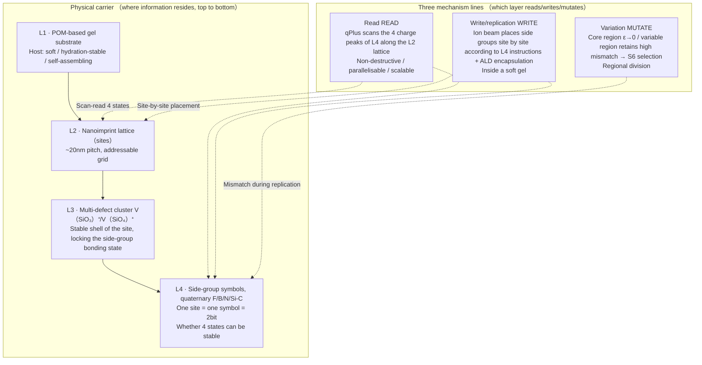
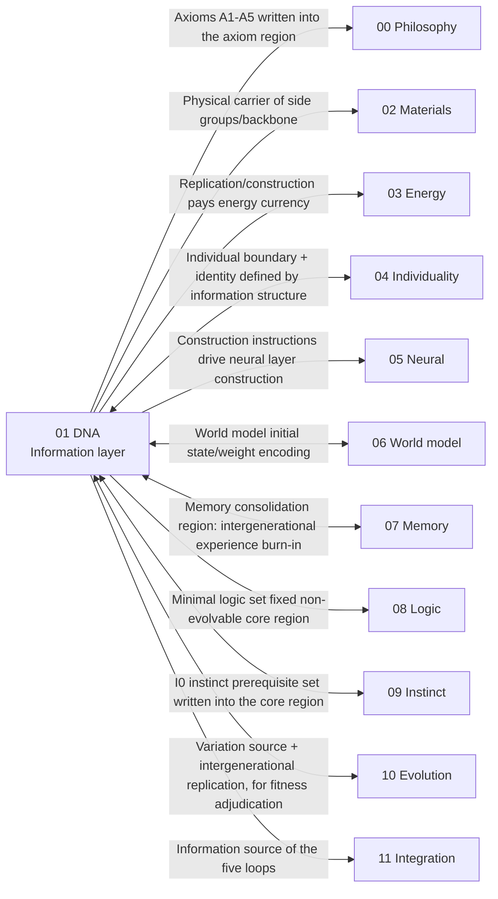

# 01 · Silicon-Based DNA Information Layer (S1)

| Item | Value |
| --- | --- |
| Module | DNA information layer (S1): carrier, encoding, readout and replication of genetic information |
| Document type | Design report (English edition) |
| Version | v4.1 |
| Dependencies | 00 philosophical layer, 02 materials and process |
| Language | English (Chinese edition: `../zh-CN/01_DNA信息层_设计.md`) |

> **Evidence categories**: `[Ref:…]` literature or data; `[Design decision]` project setting; `[Logical derivation]` derived from listed premises; `[To be verified]` unvalidated placeholder.

---

## 0. Comparison of Design Options

> **** Three parallel options are given; each option gives "layout, readout and replication method, what the evidence is, feasibility/risks".
> - **Option A (conceptual option, baseline option)**: soft carrier "construction according to a blueprint" (POM-based gel + multi-defect cluster + side-group bonding state + ion beam/ALD + qPlus)
> - **Option B (based on the project reference library)**: the most mature, directly transferable paradigm among the existing 25 references in 01
> - **Option C (based on Published Research Practice)**: reference practices from external surveys (DNA data storage / self-assembly replication / programmable matter)
>
> **Each category gives**: ① construction specifications ② encoding/readout/replication mechanisms ③ evidence (with references attached) ④ feasibility + risks. and can be combined (§0.4).

### 0.1 Option A: Conceptual Option (Soft Carrier "Construction According to a Blueprint", Baseline Option)

**Construction specifications** (POM-based gel + multi-defect cluster + side-group bonding state, carrier supplied by 02): **see §0.5 Figure 0-1 (mermaid structure diagram) + the textual description in this section**.

> **Figure 0-1 description (Option A soft carrier: 4-layer stack + 3 mechanism lines)**:
> - **4 carrier layers** (from top to bottom, where information "resides"):
>   - **L1 POM-based gel substrate** — host, soft / hydration-stable / self-assembling `[Ref:02/He_2013, §self-assembly/hydration-stability paragraph, "He 2013 Sci Rep: POM-based hybrid hydrogel self-assembly + hydration stability, supporting the L1 soft host selection"]`
>   - **L2 nanoimprint lattice (sites)** — ~20 nm pitch, arranging sites into an addressable grid; each cell = one "site" coordinate `[Ref·external survey, DOI 10.1016/S0167-9317(96)00097-4, "Chou 1997 nanoimprint sub-10 nm, foundational reference, supporting the ~20 nm addressable lattice"]`
>   - **L3 multi-defect cluster V(SiO₃)⁺/V(SiO₄)⁺** — the "stable shell" of each site, locking the side-group bonding state (a single defect is unstable, so a cluster is required) `[Ref:02/Chadi_2003, §single oxygen vacancy instability paragraph, "Chadi 2003 APL: ab initio/DFT calculation of a single oxygen vacancy releasing ~2.9 eV with self-collapse, requiring the multi-defect cluster V(SiO₃)⁺/V(SiO₄)⁺ (abstract level only, full text to be supplemented)"]`
>   - **L4 side-group symbols (quaternary F/B/N/Si-C)** — one site = one symbol = 2 bit; adjacent sites form blocks and frames `[Design decision]`; whether 4 states can be stable `[To be verified]`
> - **3 mechanism lines** (which layer reads/writes/mutates, see the right column of the figure):
>   - **Read** = qPlus scans the 4 charge peaks of L4 along the L2 lattice (non-destructive / parallelisable) `[Ref:02 §2.4]`
>   - **Write/replication** = ion beam places side groups site by site according to L4 instructions + ALD encapsulation (placement inside a soft gel `[To be experimentally verified]`) `[Ref:02/Holmes_2023, §single-atom placement, "UNSW Morello/Simmons group ion beam deterministic placement of single dopant atoms (~nm precision), supporting ion beam site-by-site writing of side groups (T0 critical, preprint)"]`
>   - **Mutation** = core region ε→0 / variable region retains high mismatch (§7 regions + §5 replication flow)

| Mechanism | Specific implementation |
| ------ | --------- |
| Encoding | 1 site = 1 quaternary side group (§3.1); instruction = frame (§3.1 example) |
| Reading | qPlus non-destructive electrical readout of 4 states; selective expression = the low-energy state decodes only the core region |
| Replication | §5 five-step flow: positioning→reading the parent→Fountain check→ion beam writing of the daughter→acceptance |
| Mutation | Core region ε→0, variable region deliberately retains high mismatch for S6 selection |

**Evidence and notes (in table row order)**

1. **Encoding** — 4 carrier states [To be verified by calculation: bonding-state contrast] + frame structure [Logical derivation: borrowing the `nirenberg_1965` terminator]
2. **Reading** — qPlus characterisation [Ref:02 §2.4]; selective expression [Design decision]
3. **Replication** — Ion beam [Ref:02/Holmes_2023, §single-atom placement, "UNSW ion beam deterministic placement of single atoms (T0 critical)"]; Fountain check [Ref:01/Erlich-Zielinski_2017, §fountain code/arbitrary subset reconstruction, "Erlich & Zielinski 2017 ACS Nano: fountain-code DNA storage arbitrary subset reconstruction + error correction, supporting Fountain ECC and the block-length window"]; the five-step flow itself [Design]
4. **Mutation** — Regional division [Logical derivation: 00 Axiom 4 A4]; mismatch rate ε [To be verified by calculation: supplied by 02]

**Design decision (why not a carbon-based double helix)**:
- No preset double helix; side groups are **arranged linearly in the lattice**, the helix = emergent form **[Design decision]** (a double helix requires rigid H-bond geometry, which silicon-based carriers lack **[Logical derivation: the 02 host is a gel, not a lattice]**)
- Carrier state = side-group bonding state **[Ref:02 §2.1]**; bond energies 4.5/3.3 eV **[Design·textbook value, not measured in this project, to be confirmed by 02 DFT]**; > 2.2 eV threshold **[Logical derivation: Arrhenius back-calculation for a 10⁶-year lifetime, τ₀ value to be determined experimentally]**
- Quaternary encoding raises density **[Logical derivation: 4 states carry 1 bit more than 2 states, information theory]**
- qPlus supports parallel readout **[Ref:02 §2.4]**
- The ion beam is the only means of deterministic single-atom placement **[Ref:02/Holmes_2023 UNSW Morello/Simmons group]**

**Feasibility + risks**: `Holmes 2023` follows a lattice/low-temperature NMR route **[Ref:02/Holmes_2023]**, while **site-by-site placement of single side groups inside a soft gel + ALD + subsequent replication has no verified implementation path** — this is the project's **heaviest key assumption** (Class C, key assumption and design decision appendix T0), hitting P1 but with the lowest feasibility. [Design decision]

### 0.2 Option B: Based on the Project Reference Library (the Most Mature Transferable Paradigm)

> Among the 25 references in `01_DNA信息层/`, **the most mature practice for "encoding information into molecular carriers + storage + error correction + readout"** is the DNA data / molecular computing line.

| Mechanism | Literature paradigm |
| ------ | --------- |
| Encoding | 4-base data encoding + Fountain/ECC error correction |
| Reading | High-throughput sequencing readback + error correction |
| Replication | Polymerase-guided replication (template + energy) |
| Instruction execution | DNA gates/strand displacement → neural-like computation |
| Information/substrate separation | 3WJ assembly separates "guiding information" from "final sequence" |

**Evidence and notes (in table row order)**

1. **Encoding** — [Ref:01/Erlich-Zielinski_2017, §arbitrary subset reconstruction, "Fountain-code DNA storage arbitrary subset reconstruction"] (arbitrary subset reconstruction), [Ref:01/Milenkovic_2023, §DNA storage + encoding review, "Milenkovic 2023 review of DNA storage encoding schemes, supporting the 4-base encoding + error correction selection"]
2. **Reading** — [Ref:01/Milenkovic_2023], [Ref:01/Sun_2026] (XNA-cssDNA readback ~100%, carbon-based measurement, not transferred to silicon-based carriers)
3. **Replication** — [Ref:01/Duffy_2020, §XNA replication fidelity, "Duffy 2020 review of XNA replication fidelity, OA, supporting the Option B replication mechanism selection"], [Ref:01/Eigen_1971, §error catastrophe, "Eigen 1971 proposes the replication error catastrophe threshold (fidelity × sequence length must be bounded), supporting the block-length inequality N≤C_crit/ε"]
4. **Instruction execution** — [Ref:05/Qianlab_2011, §DNA molecular neural network, "Qianlab 2011 Nature: DNA strand-displacement neural network, supporting the instruction execution = molecular computation selection"], [Ref:05/teVrugt_2024, §DNA neural network, "teVrugt 2024 DNA neural network, supporting the molecular instruction execution selection"]
5. **Information/substrate separation** — [Ref:01/Sidewinder_2026, §3WJ information/substrate separation, "Sidewinder 2026 uses 3WJ assembly to separate guiding information from the actual sequence, supporting the information/substrate separation selection (2026 preprint, pending peer review)"]

**Key point of Option B**: the "information layer" is **placed directly on DNA/XNA molecular carriers** (rather than on custom side-group bonding states); encoding/error correction/readout/replication **all have mature molecular paradigms** — feasibility is far higher than Option A (Option A's "soft-gel bonding state" has not been done anywhere in the world, whereas Option B's "molecular information encoding" has laboratory precedent).

**Cost of Option B**: it is a **carbon-based molecule** (not "silicon-based") [factual assertion: the carrier backbone is carbon-based nucleic acid]; as a first-generation "verification + operation" it is robust, but it contradicts the "purely silicon-based" intent, and is retained as a **reference / fallback option**. [Design decision]

### 0.3 Option C: Based on Published Research Practice (External Survey)

> To be verified · **The evidence in this section is a published literature survey .** Anchors that were verified have been upgraded to `[Ref:01/A_DNA_STORAGE_DEVICE_WORLD_BEST_PRACTICE_2026-09-15.md, A/B/C/D]`; those not verified remain `[Ref·external survey·DOI to be confirmed]` — per Design Principle 24, unverified values are not presented as verified. Downgraded anchors (the original "IBM PCM Chou 2005""protocell Norris/Raine 1998""Seeman 1982") were not locked to primary sources and are not to be cited.
> **Key conclusion (external survey)**: among existing published research there is **no mature system for a "silicon-based soft-carrier information layer"**; the 4 closest categories are all at the "molecule/device" level, having separately completed the individual substeps of "information→carrier", but **none has closed the loop of "the carrier reads its own instructions → self-construction → replication to offspring"**. This is where the project is positioned and where its novelty lies (and also why Option A has the highest implementation difficulty and assumption risk).

**Three categories of external paradigms + specific mechanisms transferable into 01**:

| External paradigm | Representatives (see the reference library) | Practice | Mechanisms transferable into 01 |
| --------- | ------------------------ | ------ | ---------------- |
| **DNA data storage (layered encoding)** | Goldman 2013 Nat Commun `10.1038/nature11875` (OA green, 1254 citations); Erlich & Zielinski 2017 ACS Nano (stored locally, abstract not re-checked) | Data cut into fragments, each fragment carrying its own index + error-correction tail; PCR + sequencing readback; fountain-code error correction | ① layered information layer (data body + addressing + error-correction tail) → §3 ② index = addressability ③ error-correction rate vs variation trade-off → §4 |
| **Phase-change/resistive devices (defect aggregation = data state)** | Strukov 2008 Nature `10.1038/nature06932` ("The missing memristor found", 11676 citations)… See note 1 | 1/0 encoded into device resistance states; read = resistance measurement (non-destructive), write = pulse rewriting; ReRAM relies on oxygen-vacancy (defect!) drift | ① defect aggregation = information state = device-level precedent ② non-destructive read / repeatable write ③ temperature-threshold robustness → ion beam gating |
| **Self-assembly replication (template → batch isomorphism)** | Rothemund 2006 Nature `10.1038/nature04586` ("Folding DNA to create nanoscale shapes and patterns", OA bronze, 7509 citations) | Template + many staples → batch isomorphism; changing the sequence = variation | ① template → batch isomorphism = §5 replication example ② changing the sequence = variation ③ non-uniform allocation = built-in variation ④ membrane threshold = replication gating |
| **Programmable matter (information → matter)** | Seeman 1991 Nature `10.1038/350631a0` (tetrahedron, 1366 citations) + Seeman 2003 Nature `10.1038/nature01406` (review). The original "1982" anchor was not locked and was downgraded | Sequence design → specified 3D lattice | ① sequence → specified lattice = precedent for "genes guiding matter construction" ② 3D lattice took 30 years = feasibility anchor |

**Full evidence for table cells**

1. **Phase-change/resistive devices (defect aggregation = data state) · Representatives (see the reference library)** — Strukov 2008 Nature `10.1038/nature06932` ("The missing memristor found", 11676 citations); Ramanathan 2014 Nat Commun `10.1038/ncomms4990` (abstract verified, mechanism citable). The original "IBM PCM Chou 2005" was not locked to a primary source and was downgraded

**Evidence and notes (in table row order)**

1. **DNA data storage (layered encoding)** — [Ref:`01/A_DNA_STORAGE_DEVICE_..._2026-09-15.md` A1 Goldman (citable) / A2 Erlich (stored locally)]
2. **Phase-change/resistive devices (defect aggregation = data state)** — [Ref: reference library B1 Strukov 2008 + B2 Ramanathan 2014; the original Chou anchor was not locked to a primary source and is not to be cited]
3. **Self-assembly replication (template → batch isomorphism)** — [Ref: reference library C1 Rothemund 2006 (citable); the original protocell Norris/Raine 1998 was not locked to a primary source and is covered by C1]
4. **Programmable matter (information → matter)** — [Ref: reference library D1 Seeman 1991 + D2 Seeman 2003; the original 1982 anchor was not locked and is not to be cited]

**4 items directly transferable into the 01 information layer design**:
1. **Layered encoding** (data body + index + error-correction tail) — Goldman → §3 symbol/block/frame structure
2. **Defect aggregation as the data state, non-destructive read / repeatable write** — ReRAM/PCM → §6 readout + §5 replication
3. **Template → batch-isomorphic replication, changing the sequence as variation** — DNA origami → §5 replication + §4 variation
4. **Non-uniform allocation = built-in variation, threshold gating** — protocell → §5 replication as variation

**Gap (explicitly marked)**: for the **closed loop** of "the carrier reads its own instructions → drives self-construction → replicates to offspring", the world has **no directly corresponding mature system** (the individual substeps have been completed separately). This is the crux of Option A and the point to be settled in the key assumption and design decision appendix.

### 0.4 Combination of the Three Option Categories and Baseline Configuration

| Strategy | Content | Applicable conditions |
| ------ | ------ | ------ |
| **A. Pure Option A** | Adhere to custom soft-carrier bonding states | Best matches P1 "silicon-based freedom of form", lowest feasibility |
| **B. A + B hybrid** | First generation uses Option B's molecular information encoding (DNA/XNA storage + error c… See note 1 | Run through first, then upgrade; highest feasibility (originally selected option, downgraded to a fallback path after the T0=A design decision) |
| **C. B-primary + A-verification** | Molecular carrier as primary; Option A verifies at a single point "whether 4 states can be stored as bonding states" | Most conservative; first prove "silicon can store", then address "self-evolution" |

**Full evidence for table cells**

1. **B. A + B hybrid · Content** — First generation uses Option B's molecular information encoding (DNA/XNA storage + error correction + replication) as the operable information layer, with Option A's "soft-carrier bonding state" as the next-generation target

> **Baseline option (2026-09-16 design decision T0 = Option A, A maintained)**: adhere to **Option A's pure soft-carrier bonding state** (POM-based gel + multi-defect cluster + side group + ion beam/ALD) as the primary path, which best matches P1 "silicon-based freedom of form". **Cost = highest key-assumption risk** — site-by-site single-atom placement inside a soft gel + storing 4 states as bonding states + subsequent replication have **no verified path** (Class C key assumption; the key assumption and design decision appendix T0 has settled on Option A and the key assumption is retained). Option B (I+II hybrid) / C (II-primary) are retained as **fallback paths if verification fails** (molecular information encoding run through first / single-point verification of 4-state bonding states), and are not on the primary path of this generation.
> **Design decision (T0): the primary path adopts Option A (pure soft-carrier bonding state: POM-based gel, multi-defect cluster, side groups, ion beam/ALD). Options B/C are retained as fallback paths if verification fails.**

### 0.5 Silicon-Based DNA Structure in Detail (with Figure 0-1)

> **This section is the textual description of the corresponding structure diagram**: without relying on the diagram, it describes layer by layer "what a single silicon-based DNA information strip is, what each layer does, and how the mechanism lines pass through it". It is based on **Option A (the project option)**.

**Figure 0-1: Silicon-Based DNA Information Layer · Carrier 4-Layer Stack + 3 Mechanisms (Option A: Soft Carrier "Construction According to a Blueprint")**



> Note: The top-down layers are the physical carrier, information encoding, readout and replication; the dashed path is the fidelity check of the fixed axiom region.

> **Legend**: left/top `CARRIER` is the "spatial carrying chain" — information (L4 side-group bonding state) resides in the L3 cluster, sits on the L2 site, and grows on the L1 gel. Right/bottom `MECH` is the "temporal operation line" — the three lines **read** (qPlus state measurement, non-destructive), **write/replication** (ion beam state placement, repeatable), and **variation** (controlled mismatch during replication) pass through each carrier layer. Solid line = inter-layer carrying; dashed line = mechanism action.

**One silicon-based DNA information strip = a piece of soft gel in which a row of "sites" is arranged, each site being one quaternary side-group symbol; a row of symbols forms a "block", and blocks form a "frame".** The following decomposes it along the two axes of "layers" and "mechanisms".

#### Axis 1: The 4 Layers of the Physical Carrier (from outside to inside, "where information resides")

| Layer | What it is | What it does |
| ---- | -------- | -------- |
| **L1 gel substrate** | POM-based hybrid hydrogel | Host — soft, deformable, hydration-stable, giving the whole information strip a "soft matrix" (the physical source of P1 freedom of form); also part of the "individual boundary" (04) |
| **L2 imprint lattice (sites)** | Nanoimprinted ~20 nm pitch grid | Addressing — arranges "sites" into a randomly locatable grid, each cell having a unique coordinate = the physical basis for information addressability (P3 readable) |
| **L3 multi-defect cluster shell** | V(SiO₃)⁺ / V(SiO₄)⁺ | Locks the bonding state — within each site, a "defect cluster" fixes the side-group bonding state; a single defect self-collapses and becomes unstable (releasing ~2.9 eV), so a cluster is required |
| **L4 side-group symbols** | Four heteroatom side groups F / B / N / Si-C | Stores information — one site = one quaternary symbol = 2 bit; the physical form of a symbol = the side-group bonding state |

**Evidence and notes (in table row order)**

1. **L1 gel substrate** — `[Ref:02/He_2013_POMs凝胶]` (self-assembly + hydration stability)
2. **L2 imprint lattice (sites)** — `[Ref·external survey, DOI 10.1016/S0167-9317(96)00097-4, "Chou 1997 nanoimprint sub-10nm, supporting the ~20nm addressable lattice"]` (imprint lattice ~20nm); the pitch value `[Design decision]`
3. **L3 multi-defect cluster shell** — `[Ref:02/Chadi_2003]` (ab initio/DFT, not measured)
4. **L4 side-group symbols** — Alphabet `[Design decision]`; whether 4 states can be stable `[To be verified by calculation: bonding-state contrast, supplied by 02]`

**Relationship between layers (the carrying chain from bottom to top in the figure)**:
```
L4 side-group symbol (information) resides in  L3 defect cluster shell (locks the bonding state)
     L3 sits on  L2 lattice site (gives coordinates/addressing)
     L2 grows on  L1 gel substrate (soft matrix)
```
→ **"Information" is not an independent entity; it = the bonding state of the L4 side group; to store it, the L3 cluster is required; to locate it, the L2 coordinates are required; the whole matrix is the L1 gel.** This chain is "what a single silicon-based DNA strand looks like".

#### Axis 2: The Three Mechanism Lines (passing through the 4 layers, "how to read, write, replicate and mutate")

| Mechanism | Which layers it passes through | What it does |
| ------ | --------- | -------- |
| **Read (READ)** | qPlus scans along the L2 lattice → measures the 4 charge peaks of L4 | Non-destructive electrical readout: which site, which side-group state; parallelisable and scalable → physical implementation of P3 readability |
| **Write/replication (WRITE)** | Ion beam places side groups site by site at L2 sites according to L4 instructions + ALD encapsulation | Replays the "parent frame" onto the "daughter gel": positioning→reading the parent→Fountain check→writing the daughter→acceptance (§5 five-step flow) |
| **Variation (MUTATE)** | During L4 replication/placement | Core region ε→0 (fidelity), variable region deliberately retains high mismatch → providing material for S6 selection (Design Principle 4 spontaneous variation) |

**Evidence and notes (in table row order)**

1. **Read (READ)** — `[Ref:02 §2.4]` (qPlus/SET characterisation stack); 4 states resolvable `[To be verified]`
2. **Write/replication (WRITE)** — `[Ref:02/Holmes_2023]` (lattice single-atom placement); placement inside a soft gel `[To be experimentally verified]`; ALD `[Ref:02 §2.3]`
3. **Variation (MUTATE)** — Regional division `[Logical derivation:00 A4]`; ε `[To be verified by calculation: supplied by 02]`

**"Isomorphic" relationship of read/write** (why this design can "both read and replicate"):
- **Read = non-destructive state measurement** (qPlus only probes and does not change the bonding state) → repeatable reading;
- **Write = repeatable state change** (ion beam replays side groups according to instructions + ALD fixing).
- This "non-destructive read / repeatable write" dichotomy is precisely the silicon-side counterpart of the **ReRAM/PCM device-level precedent in the Option C survey** (01 §0.3) — verifying that "being able to read + being able to replicate/rewrite" is not an unfounded assumption. `[Ref:01/A_DNA_STORAGE_DEVICE_..._2026-09-15.md B1 Strukov 2008 Nature 10.1038/nature06932 + B2 Ramanathan 2014 Nat Commun 10.1038/ncomms4990]`

#### Summary of Key Points
> **One silicon-based DNA information strip = within a piece of soft gel (L1), addressable sites (L2) are imprinted cell by cell; each cell uses a defect cluster shell (L3) to lock one quaternary side group (L4) = one symbol; symbols form blocks and blocks form frames = one construction instruction. qPlus scans along the grid (L4 charge peaks), and the ion beam places side groups cell by cell according to the instructions to complete replication. Throughout the chain, "information" is always the bonding state of the L4 side group, not independent abstract data.**

---

## 1. Design Objectives

Design a silicon-based information strip that is **buildable, replicable, mutable, combinable and readable** (§0 construction), satisfying:
- **Recording**: 5 basic axioms (00) + I0 instinct prerequisite set (09) + construction rules (hyperparameters of each subsystem)
- **Replication**: Option B (template guidance + external energy field, Design Principle 5) — **see §5 replication pipeline for details** `[Logical derivation: derived from 00 Design Principle 5 "Option B is not spontaneous" + the §5 five-step flow; the mechanism itself is in §5]`
- **Variation**: controllable mismatch rate (§4)
- **Readability**: addressability + context-dependent selective expression (P3) — **see §6 readout for details**
- **Value neutrality**: carries only "structure + operation rules", not "culture/knowledge/stance" (P5)

---

## 2. Related Research Status + Selection

**Three implementation routes** (selection table, with evidence category attached in each cell):

| Route | Implementation | Status (with evidence) | Advantages | Disadvantages | Trade-off (with evidence category) |
| ------ | ------ | ------ | ------ | ------ | ----------- |
| **A. Hard carrier** | SiO₂/SiC lattice + Si-C defect bonds | [Ref:`02/Holmes_2023` (single-atom precision), `02/Schofield_2025` (roadmap)] engineering maturity | [Logical derivation: the above processes → stable, addressable, mass-producible] | Hard, contradicts P1 [Logical derivation: P1 requires freedom of form, lattice rigidity does not satisfy it] | [Design decision] abandoned as primary carrier, used as verification baseline (T0) |
| **B. Soft carrier** | POM-based hybrid gel + heteroatom side groups | [Ref:`02/He_2013` (POM-based gel)] frontier; fidelity not measured, barrier [To be verified] | [Logical derivation: soft/deformable/self-assembling → conforms to P1] | Fidelity not measured, barrier to be verified by calculation [To be verified] | [Design decision] first-generation primary carrier |
| **C. XNA route** | XNA-cssDNA hybridisation | [Ref:`01/Sun_2026` (XNA-cssDNA readback ~100%), `01/Gao_2016` (evolved polymerase ~10⁻⁴/nt, carbon-based measurement)] verified | Information/substrate separation, fidelity measured [Ref: same as above] | Carbon-based backbone, not "silicon-based" [factual assertion: the backbone is carbon-based nucleic acid, XNA bases are not silicon; not a "purely silicon-based" carrier] | [Design decision] used as reference + next-generation hybrid |

**Selection conclusion** [Design decision]: primary carrier = **B** (soft carrier, P1); A serves as the **verification baseline** (the first generation first uses A to verify "single-atom addressability + replication fidelity", then moves to B for "self-evolution"); C serves as a **reference** (fidelity window + information/substrate separation).

---

## 3. Information Structure ("how to encode" from the §0 Construction)

### 3.1 Three-Level Structure (Symbol → Block → Frame)

> The "side-group symbols" of §0 are organised into an information hierarchy. **Each level is given concrete specifications**.

| Level | What it is | Concrete specifications |
| ------ | -------- | --------- |
| **L1 symbol** | 1 side group in 1 site = 1 quaternary symbol | Alphabet {F, B, N, Si-C}; 1 symbol = 2 bit; 4 states resolved by the qPlus charge spectrum (§6) |
| **L2 block** | N consecutive symbols + ECC redundancy = 1 "codon" | Block length N=100-500 (§3.2); within the block `N_data` data symbols + `N_ecc` redundancy symbols (Fountain code) |
| **L3 frame** | M blocks + start/termination signals = 1 functional unit (e.g. "one construction instruction") | Frame head/tail = special side-group combinations (§3.3); M determined by function |

**Evidence and notes (in table row order)**

1. **L1 symbol** — `Young-Schultz_2010`[Ref:01/Young-Schultz_2010, §orthogonal expanded alphabet, "Young-Schultz 2010 orthogonal expanded alphabet, supporting the selection of the 4-state side-group symbols {F,B,N,Si-C}"]
2. **L2 block** — `Erlich-Zielinski_2017`[Ref:01/Erlich-Zielinski_2017, §fountain code, "Fountain-code DNA storage arbitrary subset reconstruction, supporting the L2 block architecture"]
3. **L3 frame** — `nirenberg_1965`[Ref:01/nirenberg_1965, §termination codon, "Nirenberg 1965 establishes the termination codon, supporting the frame head/tail terminator structure"]

**Encoding example (how one construction instruction maps onto a side-group sequence)**:
Assume the record is "place one Si-C side group at position P" (one construction instruction):
```
Frame = [frame head: 4 consecutive Si-C] + [instruction block] + [frame tail: 4 consecutive F]
Instruction block (one block, ~500 symbols) =
  · Symbols 1-2   position code P (lattice coordinates, quaternary expansion)
  · Symbol 3     target side-group type (one of F/B/N/Si-C)
  · Symbol 4      operation (place/rewrite/delete)
  · Symbols 5-500 Fountain redundancy (any subset can reconstruct the instruction of 1-4)
```
→ **This is the concrete form of "genes guiding matter construction"**: one frame = one executable instruction of "where to place, what to place, how to place".
**Evidence category**: frame = instruction [Logical derivation, borrowing the `nirenberg_1965` terminator + the `Qianlab_2011` molecular instruction form]; the concrete field layout of the encoding example [Design decision].

### 3.2 Block-Length Constraint (Eigen Threshold, with Formula + Window, with Quantitative Conditions)

> **This section reduces "block length N" to an inequality + a parameter window.**
- Per-symbol mismatch rate ε; block N; block information content Q = 2N bit. [Definition]
- **Error catastrophe threshold**: `f·Q` has an upper bound (f=1−ε fidelity), i.e. `N ≤ C_crit/ε`.
  - `[Ref:01/Eigen_1971]` the threshold condition itself (error catastrophe, replication fidelity × sequence length must be bounded).
  - `C_crit ~ 0.5-1` `[Design decision]` — **not a precise constant given in Eigen's original text; it is an order-of-magnitude rounding**, and must be recalculated for silicon-based carriers.
  - The inequality `N≤C_crit/ε` is `[Logical derivation]` (derived from the Eigen threshold condition + Q=2N bit).
- **Carbon-based reference**: `Gao_2016` XNA polymerase ε~10⁻⁴/nt `[Ref:01/Gao_2016]` (**carbon-based measurement, not transferred to silicon-based carriers**, used only as an order-of-magnitude anchor).
- **Silicon-based window (design setting)**:
  - ε=10⁻⁴ → N≤~5000-10000; ε=10⁻³ → N≤~500-1000 `[Logical derivation: substituting into N=C_crit/ε, with C_crit taken as 0.5-1]`
  - **First generation conservatively takes N=100-500** `[Design decision]`
  - The concrete N is locked by `N=C_crit/ε` after ε is measured `[To be verified by calculation·experiment: the ε value is supplied by 02; before verification N is a placeholder and is not a baseline]`

### 3.3 Frame Boundaries (Discriminability, with Physical Criteria)

| Item | Specification | Criterion |
| ---- | ------ | ------ |
| Frame head | 4 consecutive `Si-C` (high bond energy ~3.3 eV) | qPlus charge spectrum: contrast > 3σ_char for 4 consecutive high-bond-energy peaks |
| Frame tail | 4 consecutive `F` (low bond energy) | 4 consecutive low-bond-energy valleys |
| Intra-frame constraint | 4 consecutive Si-C / 4 consecutive F not allowed (otherwise misreading) | ECC interception |

**Evidence and notes (in table row order)**

1. **Frame head** — Si-C bond energy `[Design setting·to be verified by calculation by 02]`; frame head uses 4 consecutive `[Design decision]`; 3σ criterion `[Logical derivation, common threshold for statistical discriminability]`
2. **Frame tail** — Same as above
3. **Intra-frame constraint** — `[Logical derivation]` (self-consistent with frame head/tail); ECC interception `[Ref:01/Erlich-Zielinski_2017]`

> **To be verified by calculation·experiment (formula given, no numerical value specified)**: the discriminability of the frame head/tail depends on the ratio of the Si-C/F bond-energy difference ΔE_bb to the qPlus noise σ; `ΔE_bb ≥ 3σ` is the discriminability boundary `[Logical derivation]`. σ is supplied by the 02 characterisation stack `[To be verified]`, and ΔE_bb is supplied by 02 DFT `[To be verified]`. **Before verification, the boundary criterion is not a baseline** (Design Principle 24).

---

## 4. Repair Subsystem (Check–Repair Loop + Redundancy and Error Correction, Design Principle 16)

> **Implementation of Design Principle 16**: this section is the "repair subsystem" required by Design Principle 16 — the check–repair loop after S1 replication (readout → ECC comparison → mismatch localisation → correction); see §5 step 3 for the concrete steps. The three layers of redundancy (below) are the "correctable substrate" of repair: replicable ≠ sustainable over the long term; repair is the prerequisite for "maintainability".

**Three layers of mechanisms, each with a concrete implementation (not merely the words "there is redundancy")**:

| Layer | Concrete implementation | Specification | Evidence |
| ---- | --------- | ------ | ------ |
| **L1 physical redundancy** | Each bit is stored with two spatially separated sites (dual copy) | Dual-copy spacing ≥ water-mediated diffusion length (preventing homologous failure, `Design setting`) | `Hutchison syn3.0` |
| **L2 ECC** | Fountain code: redundancy symbols within a block, any large subset reconstructs the whole block | Code rate r=1.2-1.5 (`Design setting`); redundancy rate (1/r−1) × expansion: r=1.2→~17%, r=1.5→~33% | `Erlich-Zielinski_2017` |
| **L3 dual independent replication paths** | Two replication pipelines do not share energy sources/readout channels | If one fails, recover from the other | `Hutchison_2016` |

**Key point** (Hutchison): excessive minimisation destroys robustness — blocks are **short and redundant**, not greedily long. [Ref:`01/Hutchison_2016` syn3.0]

**Silicon-side landing point of Fountain redundancy**: on the carbon-based side, `Erlich-Zielinski` achieved a reconstruction rate of ~100% under a "specific loss rate" (carbon-based DNA side, not transferred to silicon-based carriers); the silicon-based "reconstruction success rate vs side-group loss rate" curve must be fed with the **measured silicon-based loss rate ε (§3.2 D2)** (`To be verified by calculation·experiment`).
**Evidence category**: three-layer redundancy L1/L2/L3 [Ref:`01/Erlich-Zielinski_2017` Fountain + `01/Hutchison_2016` short and redundant]; r=1.2-1.5 [Design decision]; silicon-based reconstruction curve [To be verified by calculation·experiment, no evidence, not to be used as a baseline].

---

## 5. Replication Pipeline ("how to replicate" from the §0 Construction) — This Volume's Greatest Gap, Addressed in This Section

> This section converts **Option B replication** into a five-step executable flow.

**Option B replication = "template guidance + external energy field"** (Design Principle 5, not spontaneous growth):

```
Parent frame M (encoded side-group sequence)  →  Daughter frame C (M replayed on a new gel substrate)

Step 1 [Positioning]  02 fabricates a new POM-based gel + imprint lattice (empty substrate C₀)
Step 2 [Read the parent] qPlus scans along the lattice of M → obtains the symbol sequence (S) of M
             [§3.1 encoding, S already contains Fountain redundancy]
Step 3 [Check·core step of the repair subsystem]  Fountain reconstruction of S + dual-copy comparison → correct single-point errors, obtaining S' (purified sequence) (Design Principle 16 check–repair loop: readout→ECC comparison→mismatch localisation→correction)
Step 4 [Write the daughter] Ion beam places side groups site by site at the corresponding sites of C₀ according to S' (replaying the layout of M)
             [ALD synchronous encapsulation, eliminating water-mediated channels]
Step 5 [Acceptance]  qPlus scans C → compares with S' → mismatch rate ε_copy; if qualified, C becomes the daughter
```

**Where the "variation" in replication comes from (connecting §4 + Design Principle 4)**:
- Step 2 parent readout errors (ε_read) + step 4 placement errors (ε_place) → composite replication fidelity ε = 1−f.
- **During replication of the core region (axioms/I0), ε_copy ≪ variable region is enforced** (§7): the core region uses "three readout passes + dual copies + full Fountain redundancy", the variable region allows "one readout pass + partial redundancy" → the variable-region mismatch rate is deliberately kept high, providing material for S6 selection (Design Principle 4 spontaneous variation).

**Energy coupling (connecting 03)**: steps 1/4 pay energy currency (gel forming + ion beam implantation + ALD), following the A2 priority allocation of 03 (`03` E4: replication > learning > rollout). **Replication = fabrication temperature 150-300°C (≈ reproduction)** [Design decision].

**Evidence category (§5 as a whole)**:
- The **structure** of the five-step replication flow [Design decision] (referencing `03` energy allocation + `02` processes)
- Step 1 fabricating the gel + lattice [Ref:02/He_2013, §self-assembly, "POM-based hydrogel self-assembly, supporting the L1 substrate"] + [Ref·external survey, DOI 10.1016/S0167-9317(96)00097-4, "Chou 1997 nanoimprint sub-10nm, supporting the L2 lattice"]]
- Step 2 qPlus readout [Ref:`02 §2.4` characterisation stack]; Fountain check [Ref:`01/Erlich-Zielinski_2017`]
- Step 4 ion beam site-by-site placement [Ref:02/Holmes_2023, §single-atom placement, "UNSW ion beam deterministic placement of single atoms, supporting lattice placement (T0 critical)"]; **placement inside a soft gel [To be experimentally verified, no verified path]**
- ALD encapsulation [Ref:`02 §2.3` + `01` P2 red line eliminating water-mediated channels]
- "Core region three readout passes + dual copies + full redundancy / variable region deliberately low redundancy" [Design·logical derivation (Design Principle 4 variation + §7 regions)]
- Variation source ε_read+ε_place [Logical derivation, composite fidelity = 1−f]

> **Key assumption**: step 4, "ion beam single-atom placement inside a soft gel + ALD encapsulation + subsequent replication", has **no verified implementation path** (`Holmes 2023` follows a lattice/low-temperature NMR route, not single side-group placement inside a soft gel). This is a **Class C key assumption**, and this section explicitly states the "construction according to a blueprint" design; **physical feasibility awaits closure by 02 + experiment**, and all such items are listed as to be verified.

---

## 6. Readout and Readability (P3) — How to "Read Out" a Frame

> This section specifies the **readout mechanism** for addressability and context-dependent selective expression.

**Read = qPlus charge sensing scanned along the lattice (02 §2.4 characterisation stack)**:
1. **Addressing**: nanoimprint lattice ~20 nm pitch (02 §2.3), one site coordinate per cell → **random addressing** is possible (core of P3 readability).
2. **Reading one site**: qPlus probes the charge state of the multi-defect cluster at that site → 4 peaks of the charge spectrum correspond to 4 side-group states (F/B/N/Si-C).
3. **Reading one frame**: scanning along the lattice from frame head → frame tail (§3.3 boundaries), taking symbols site by site, obtaining the frame's symbol sequence.
4. **Selective expression (P3)**: for the same frame under different "context states" (03 energy currency level / 05 neural layer signals), only some instruction blocks may be decoded (e.g. the low-energy state decodes only the I0 core region, and the high-energy state decodes the variable behaviour region) — this is the physical form of "selective expression".

**Readability criteria (measurable)**:
- Sites addressable: lattice coordinate error < half the pitch [Ref·external survey, DOI 10.1016/S0167-9317(96)00097-4, "Chou 1997 nanoimprint reaches sub-10nm precision, supporting the lattice coordinate error < half-pitch criterion"]]; error value [To be experimentally verified]
- 4 states resolvable: adjacent peak spacing of the qPlus charge spectrum > peak width [Ref:`02 §2.4` qPlus characterisation]; σ [To be verified]
- Frame fully readable: frame head/tail contrast > 3σ (§3.3) [Logical derivation, 3σ criterion] [Design decision]

**Evidence category (§6 as a whole)**:
- Addressing + qPlus readout of 4 states [Ref:`02 §2.3/§2.4`]
- Correspondence of 4 charge peaks ↔ 4 side-group states [To be verified by calculation: bonding-state contrast, no measurement]
- Selective expression (low-energy state decodes only the core region) [Design decision]
- Frame boundaries discriminable [§3.3, to be verified by calculation]

> **To be verified by calculation·experiment**: the numerical values in the above criteria (coordinate error, σ, contrast) are measured by the 02 characterisation stack; **before measurement, P3 "readability" is only a design criterion, not verified**.

---

## 7. Regional Division (Axioms + I0 + Variable, Written into the §5 Replication Flow)

> This section maps the regions onto the replication and mutation mechanisms.

| Region | Content | Mutability | Handling in the §5 replication flow |
| ------ | ------ | -------- | --------------------- |
| **Axiom region** | A1-A5 construction instructions (00) | Immutable | Step 4 uses "three readout passes + dual copies + full redundancy" to enforce ε_copy→0; removing it means self-negation |
| **I0 instinct region** | Reflex/CPG/reproduction/maternal triggers (09) | Core fixed (non-evolvable) | Handled as the axiom region; the edges (trigger thresholds) enter the variable region |
| **Construction rules region** | Hyperparameters of each subsystem (03/05/06/08) | Evolvable | Step 4 allows ε_copy ~ design value, with S6 selecting retention |
| **Memory consolidation region (epigenetic region, 07 intergenerational)** | Superior experience of the previous generation (07, phenotypic plasticity, T2 determines B, no sequence-level write-back, does not violate the central dogma) | Evolvable, low-mismatch fidelity | Burned in after the §01 ECC check, ε_copy deliberately low (fidelity), opposite to the "variable-region high mismatch"; fidelity follows §4 (awaiting 07 G4) |
| **Variable region** | Peripheral instincts I1-I8 + strategies | Evolvable + mutable | Step 4 deliberately low redundancy, ε_copy kept high (Darwinian material), for S6 selection |

**Variation mechanism**: in each generation of replication, the core region ε_copy→0 (fidelity), **the memory consolidation region (epigenetic region) ε_copy is deliberately low (intergenerational fidelity, via ECC)**, and the variable region ε_copy is kept high (Darwinian variation), with S6 selection determining which are retained.

> **Regional semantics**: 07 §3.3 previously used "variable region" to refer to intergenerational epigenetic burn-in, which **conflicted semantically** with "variable region = Darwinian high-mismatch material" in this table of 01 (one has deliberately high ε_copy, the other requires low). The 07-side "epigenetic region" is now aligned with the **independent region "memory consolidation region (epigenetic region)"** in this table, with ε_copy deliberately low (fidelity), separated from the "variable region (high mismatch)"; the ε_copy of the two is opposite. The old wording "Lamarckian burn-in of variable-region sequences" in the main text of 07 §3.3 is removed in sync (changed to "epigenetic burn-in into the memory consolidation region, no sequence writing, does not violate the central dogma", aligned with 07 T2 determining B).

**Evidence category (§7)**:
- Five-region division (axiom/I0/construction rules/memory consolidation/variable) [Design decision]
- "The axiom region is absolutely immutable" [Ref:`00` A1-A5 axioms]
- "The I0 core is fixed (non-evolvable)" [Logical derivation, originating from the `09` I0 minimal set; **"axioms → I0 necessity" is a design presupposition, not a logical necessity** (00 S3, key assumptions T0/S3)]
- "Epigenetic burn-in into the memory consolidation region" [Ref:`07/Duffy_2020` XNA epigenetics; **epigenetic intergenerational transfer does not violate the central dogma** (07 T2, key assumption)]
- "The variable region deliberately retains high mismatch" [Design·logical derivation, Design Principle 4 spontaneous variation + `10` S6 selection]

> **Key assumption boundary **: "axioms → I0 instincts" is a **design presupposition, not an axiomatic necessity** (00 S3); memory burn-in **via epigenetic intergenerational transfer does not violate the central dogma** (07 T2, baseline B). This table is organised as "axiom region absolute + I0 core fixed (non-evolvable) + the rest evolvable", with the **soft extension/epigenetic stance settled by design review**.

---

## 8. Relationships with Other Parts (Interface Contracts)

> **Completeness principle**: DNA (information layer) is the carrier of genetic information and should **establish a connection with every dimension of the living system** — the absence of any dimension = this document is incomplete. The table below covers all 12 volumes (including 04/06/07/11); any missing item is a gap.

**Figure 8-1: Overview of the Connections Between DNA (01) and All 12 Volumes (any volume without an edge = the document is incomplete)**



> Note: The source of an arrow is the value provider and the target is the receiver; measurable quantities are defined by the interface contracts of the respective volumes.

> **Legend**: a solid single arrow = 01 → other volumes (information/instruction outflow); `<-->` bidirectional = other volumes also depend on 01 in reverse (e.g. the 04 criteria of individuality depend on the DNA information structure, 07 memory burn-in passes through the §01 ECC, and 11 integration takes DNA as the information source of the five loops). **All 11 other volumes (00/02/03/04/05/06/07/08/09/10/11) have edges with 01** — among them 04/06/07/11 are **the gaps filled in this round** (previously 01 was connected only to 00/02/03/05/08/09/10). If any of the 12 volumes has no connection with 01, this table is incomplete.

| Interface | Data flow (physical quantities, not concepts) | Invariant (measurable) | Volume |
| ------ | ---------------------- | ------------- | -------- |
| **← 00 Philosophy** | Axioms A1-A5 written into the axiom region | Axiom region ε_copy→0 (§7); removing it means self-negation | `00` |
| **→ 02 Materials** | Physical carrier of 01 side groups + POM-based backbone | 4 carrier states addressable (qPlus resolved) · Eₐ ≥ retention threshold | `02` |
| **→ 03 Energy** | Replication/construction pays energy currency | Energy consumption of steps 1/4 enters the A2 priority (`03` E4) | `03` |
| **→ 04 Individuality** | Individual boundary + identity defined by the DNA information structure: ① the individual'… See note 1 | Individual = DNA information strip + carrier matrix (04 §3.1); DNA regional division (§7) = the individual's internal "core/variable" structure | `04` |
| **→ 05 Neural** | Construction rules region "genes guide construction" of the neural layer: DNA construction instruction frames → drive the physical construction of 05 synapses/neural networks | The 05 neural layer structure is determined by "construction according to a blueprint" in the DNA construction region (§5 paragraph 3); neural synapse parameters = DNA-encoded values | `05` |
| **→ 06 World model** | World model weights/initial state provided by DNA: ① the initial latent variables + constr… See note 2 | World model state readable (06 W4) ↔ DNA encoding (this volume); world model "rollout material" provided by the DNA memory region | `06` |
| **→ 07 Memory** | Memory consolidation region = intergenerational experience burn-in: ① 07 long-term memory… See note 3 | Memory burn-in fidelity = §01 ECC window (§7); burn-in value awaiting 07 G4 | `07` |
| **→ 08 Logic** | Minimal logic set fixed in the DNA core region (analogous to I0): ① the "alphabet/encoding… See note 4 | The minimum set for the 08 logic engine to "be able to reason" = fixed (non-evolvable) in the DNA core region (Design Principle 10); logic gate parameters = DNA encoding | `08` |
| **← 09 Instinct** | I0 prerequisite set (reflex/CPG/reproduction/maternal triggers) written into the core region | Core region = I0 minimal set (reflex/CPG/reproduction/maternal); I1-I8 variable region | `09` |
| **→ 10 Evolution** | Variation source + intergenerational replication + fitness carrier | Variable region ε_copy ∈ [ε_min, ε_max] (§4); S6 selection acts here; the "adjudicator" of the fitness function (10 S1) reads the DNA phenotype | `10` |
| **→ 11 System integration** | DNA is the "information source" of the five loops: the "information/instructions" in loops… See note 5 | One prerequisite for the closure of the five loops in 11 §5 = DNA fully readable + replicable; 11 P0 contains "DNA replication fidelity ε" | `11` |

**Full evidence for table cells**

1. **→ 04 Individuality · Data flow (physical quantities, not concepts)** — Individual boundary + identity defined by the DNA information structure: ① the individual's "internalized goal (teleonomy)" (C3) and "causal closure" (C4) are rooted in the information structure encoded by DNA; ② the "information-layer closure" of the criteria of individuality C1-C4 presupposes that DNA can be fully read out
2. **→ 06 World model · Data flow (physical quantities, not concepts)** — World model weights/initial state provided by DNA: ① the initial latent variables + construction hyperparameters of the world model (RSSM/DreamerV3) are written into the DNA variable region; ② across generations, superior world model configurations are burned back into DNA via the 07 memory consolidation region, and the next generation exhibits similar predictive capability
3. **→ 07 Memory · Data flow (physical quantities, not concepts)** — Memory consolidation region = intergenerational experience burn-in: ① 07 long-term memory (episodic/semantic/procedural) is burned into the DNA variable region across generations after the §01 ECC check (epigenetic, no sequence-level write-back; 07 T2 determines B, phenotypic plasticity intergenerational epigenetics, does not violate the central dogma); ② the next generation exhibits similar experience (memory across generations)
4. **→ 08 Logic · Data flow (physical quantities, not concepts)** — Minimal logic set fixed in the DNA core region (analogous to I0): ① the "alphabet/encoding scheme" of propositional encoding (08 L1) is itself defined by DNA; ② the construction instruction frames of gate circuits (08 L2) are in the DNA construction region
5. **→ 11 System integration · Data flow (physical quantities, not concepts)** — DNA is the "information source" of the five loops: the "information/instructions" in loops ①②③④⑤ all flow out from DNA frames; ② the "information layer component" of the minimum buildable set = DNA + 02 carrier

**Contract principle**: interface "data" must be **physically measurable quantities** (side-group state/bonding state/charge spectrum/energy currency), not "concepts"; where DFT/experimental values are not given, they are marked "numerical value awaiting 02/03".

**Evidence category (§8 interfaces)**:
- The **data flows/invariants** of each interface = projections of the design already fixed in §0-§7 of this volume [Logical derivation, from §3/§5/§6/§7]
- "← 00 Philosophy / ← 09 Instinct" [Ref:`00` A1-A5 + `09` I0]
- "→ 02 Materials" [Ref:`02 §2` carrier + `02 §2.4` characterisation]
- "→ 03 Energy" [Ref:`03 E4` A2 priority]
- "→ 04 Individuality" [Logical derivation: 04 §3.1 C3/C4 rooted in information structure + 04 §3.2 individual = information strip + matrix]
- "→ 05/08" [Ref:`05` construction + `08` minimal logic set fixed (non-evolvable) core region]
- "→ 06 World model" [Logical derivation: 06 W4 world model state encodable + 06 §3 source of the world model initial state]
- "→ 07 Memory" [Ref:`07 G4` intergenerational burn-in + §7 memory consolidation region of this volume; Lamarckian vs epigenetic see 07 T2]
- "→ 10 Evolution" [Ref:`10 S6` selection + §4 variation of this volume]
- "→ 11 Integration" [Ref:`11` information source of the five loops + P0 containing DNA replication fidelity]

---

## 9. To Be Verified by Calculation / Experiment (each item: formula + window + value provider, with quantitative conditions)

| # | Open item | Formula/inequality to be satisfied | Parameter window (design setting) | Value provider |
| --- | -------- | --------------------- | -------------------- | ---------- |
| D1 | POM-based + side-group retention barrier Eₐ | `τ=τ₀·exp(Eₐ/k_BT)`, requiring `τ(operating temperature)≥10⁶ years` → `Eₐ≥k_BT·ln(10⁶ years/τ₀)` | τ₀~10⁻¹³ s, operation ≤100°C → Eₐ≥~2.2 eV (derived) | See note 1 |
| D2 | Replication fidelity ε | ε=1−f, block length requires `N≤C_crit/ε` (§3.2) | See note 2 | 02/in-house measurement (carbon-based values not transferred to silicon-based carriers) |
| D3 | Three-way junction assembly efficiency | Assembly mismatch p must be < block retransmission rate, so that Fountain reconstruction rate ≥ target | See note 3 | 02 experiment |
| D4 | Fountain silicon-side redundancy overhead | Redundancy rate r such that "reconstruction success rate vs loss rate" meets the target | r=1.2-1.5; loss rate taken from §D2 ε | 02 DFT + 03 energy consumption |
| D5 | Physical implementation of core region ε_copy→0 | Core region ε_copy ≪ variable region (lower by ≥1 order of magnitude) | "Three readout passes + dual copies + full redundancy" | 02 design + experiment |
| D6 | Frame head/tail discriminability | ΔE_bb(Si-C vs F) ≥ 3σ_char | σ supplied by 02 qPlus | 02 characterisation |

**Full evidence for table cells**

1. **D1 · Value provider** — 02 DFT[Ref:02/Chadi_2003, §single oxygen vacancy DFT, "Chadi 2003 APL ab initio/DFT: SiO₂ single oxygen vacancy releases ~2.9eV with self-collapse (abstract level only, full text to be supplemented)"] (SiO₂ defects have Chadi 2003 DFT; gel side groups require new calculations)
2. **D2 · Parameter window (design setting)** — Window 10⁻⁴–10⁻³ (carbon-based [Ref:01/Gao_2016, §XNA polymerase fidelity, "Gao 2016 Science: XNA polymerase ε~10⁻⁴/nt (full text access restricted, OA substitute see the list to be supplemented)"] (Gao 2016 anchor))
3. **D3 · Parameter window (design setting)** — `Sidewinder_2026`[Ref:01/Sidewinder_2026, §3WJ assembly efficiency, "Sidewinder 2026 reports silicon-side 3WJ assembly efficiency ~1/10⁶ (2026 preprint, pending peer review)"] silicon side ~1/10⁶ (reference)

**Note**: each of D1-D6 gives "**what to calculate + threshold + value provider**", so 02 can start work directly upon receipt; all numerical values **await 02/03**, and this layer does not fix values (Design Principle 24).

---

## 10. Scope and Known Limitations (Design Principle 24)

- **Determinable content (already given in this document)**: §0 physical construction specifications, §3 encoding example + block-length formula, §4 three-layer redundancy + Fountain redundancy rate, §5 five-step replication flow, §6 readout mechanism + criteria, §7 handling of regions in the replication flow, §9 D1-D6 formulae + windows + value providers.
- **Not determinable (only formulae/boundaries given)**: Eₐ, ε, assembly efficiency, bond-energy difference, σ — all **await 02/03 first-principles calculations and experiments**; this document has been written to the point where 02 can start work directly.
- **Key assumptions (to be confirmed by design review)**: the physical feasibility of "construction according to a blueprint inside a soft gel" in §5 step 4, the "axioms → I0 necessity" in §7, and Lamarckian vs epigenetic memory burn-in in §7.

---

> Corresponding Chinese edition: `../zh-CN/01_DNA信息层_设计.md`
