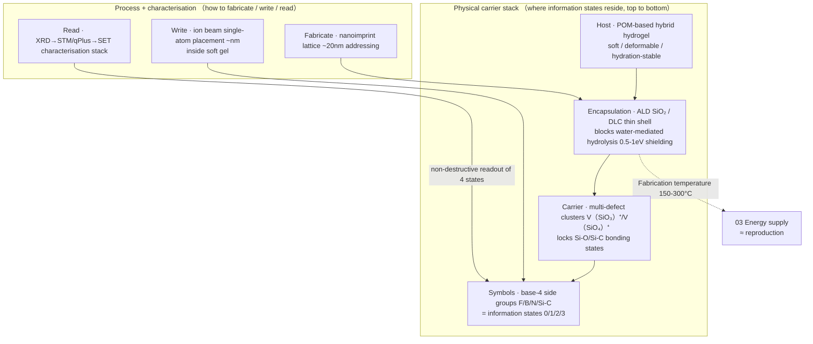
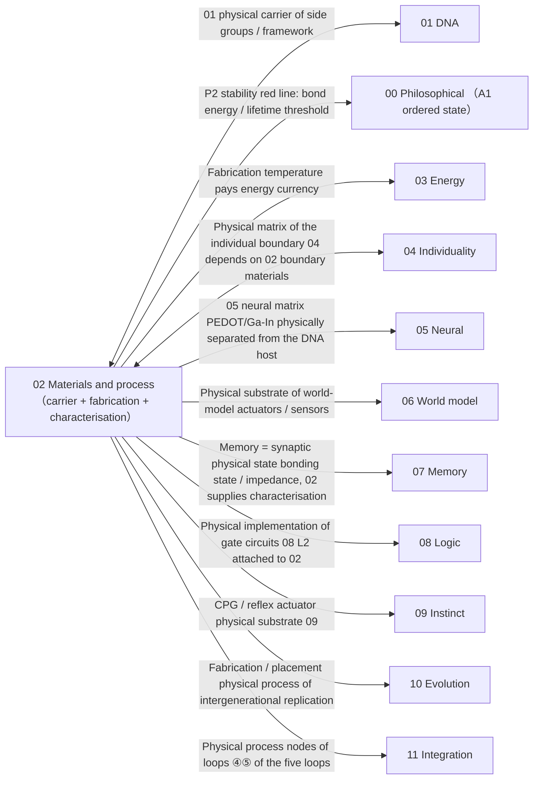

# 02 · Silicon Materials and Process (Carrier + Fabrication + Characterisation)

| Item | Value |
| --- | --- |
| Module | Silicon materials and process: carrier, fabrication and characterisation |
| Document type | Design report (English edition) |
| Version | v3.1 |
| Dependencies | 01 DNA information layer |
| Language | English (Chinese edition: `../zh-CN/02_硅基材料工艺_设计.md`) |

> **Evidence categories**: `[Ref:…]` literature or data; `[Design decision]` project setting; `[Logical derivation]` derived from listed premises; `[To be verified]` unvalidated placeholder.

---

## 0. Comparison of Design Options

> Design question: three parallel options are given; each option provides "how to arrange / how to fabricate / how to read + evidence + feasibility".
> - **Option A (conceptual option, baseline option)**: soft carrier "multi-defect cluster bonding state stores base-4 + ion beam placement + ALD encapsulation + qPlus readout"
> - **Option B (based on the project reference library)**: the most mature physical information storage paradigm in the reference library (single silicon atoms / colour centres / defect states)
> - **Option C (based on published research practice)**: transferable approaches given by an external survey (silicon defect storage / physical writing and characterisation / soft-matrix information states)
> ; they can be combined (§0.4).

### 0.1 Option A: Conceptual Option (Soft-Carrier Multi-Defect Cluster, Baseline Option)

**Construction**: POM-based gel substrate → nanoimprint lattice (~20 nm sites) → multi-defect cluster shell (bonding state locked) → base-4 side-group symbols; ion beam bit-by-bit writing + ALD encapsulation + qPlus readout (see the figure in §3).

| Mechanism | Specific approach | Evidence category |
| ------ | --------- | --------- |
| Store 0/1/2/3 | Si-O/Si-C bonding states in the multi-defect cluster = 4 states | Cluster necessary [Ref:02/Chadi_2003 ab initio/DFT, single defect unstable]; 4-state stability [To be verified] |
| Fabricate/write | Ion beam single-atom placement + ALD layer by layer | [Ref:02/Holmes_2023 UNSW group ~nm]; placement inside soft gel [To be verified: pending experiment] |
| Read | qPlus non-destructive electrical readout of 4 states | [Ref:02 §2.4 characterisation stack] |
| Encapsulation | ALD SiO₂/DLC blocks water-mediated hydrolysis | [Design decision]; water-shielding efficiency [To be verified: pending experiment M2/M5] |

**Feasibility + risk**: `Holmes_2023` is a lattice/low-temperature route [Ref]; **bit-by-bit placement of single side groups in a soft gel + storing 4 states in bonding states + subsequent replication have no verified path** — the heaviest key assumption (appendix on key assumptions and design decisions T0), hits P1 but has the lowest feasibility. [Design decision]

### 0.2 Option B: Based on the Project Reference Library (Most Mature Physical Information Storage Paradigm)

> In the reference library, the most mature line for "storing information in physical states" is **single silicon atoms / colour centres / defect states** (quantum devices + defect physics).

| Mechanism | Literature paradigm |
| ------ | --------- |
| Store | Single silicon atom donor qubit / nuclear spin / SiV colour centre |
| Fidelity | Single-atom storage T1=144-300 s / gate >99% |
| Read | qPlus/SET/STM charge sensing |
| Write | Ion beam implantation |

**Evidence and notes (in table row order)**

1. **Store** — [Ref:02/Holmes_2023, §single-atom placement, "UNSW ion beam deterministic placement of single atoms (T0 critical, preprint)"], [Ref:02/Severin_2025_ML_AutoTuning_Si_Donor_fidelity99, §measured fidelity, "Severin 2025 ML auto-tuning of silicon donors, fidelity >99% (2025 preprint)"], [Ref:02/Becker-Becher_2017, §STM single-atom manipulation/characterisation, "Becker-Becher 2017 single-atom STM manipulation + defect characterisation"], [Ref:02/Sohn_2018, §SiV colour-centre quantum coherence, "Sohn 2018 SiV colour-centre quantum coherence, supporting characterisation of colour-centre endpoint states"]
2. **Fidelity** — [Ref:02/KEY_MEASURED_RATES_A_STATUS, §measured rate table, "internal measured-rate status document records single-atom storage T1=144-300s/gate>99% (internal record, not a paper; to be replaced by published measurements)"](measured, checked in the retrieval workflow)
3. **Read** — [Ref:02/Schofield_2025, §silicon quantum route, "Schofield 2025 atomic-scale semiconductor roadmap (silicon quantum route), supporting qPlus/SET/STM charge sensing"]
4. **Write** — [Ref:02/Holmes_2023, §single-atom placement, "UNSW ion beam deterministic placement of single dopant atoms (preprint, critical)"]

**Key point**: place "information states" in **single silicon atoms / colour centres** (rather than self-fabricated multi-defect clusters); storage / fidelity / readout **all have measured results**, and feasibility is far higher than Option A; but **low-temperature / clean devices are required**, which is in tension with "soft gel at room temperature", so it serves as a **verification benchmark / downgrade path**.

### 0.3 Option C: Based on Published Research Practice (External Survey, References Added After the Retrieval Workflow Report)

> To be verified · **The evidence in this section is the result of a survey of public literature, distinguished from the design claims of this project.** Verified anchors are upgraded to `[Ref:02/C_SOFT_MEMRISTOR_MULTI_LEVEL_2026-09-15.md]`; those not verified retain `[Ref·external survey·DOI to be verified]` — in accordance with Design Principle 24, unverified values are not presented as verified values.
> **Key conclusion (survey direction)**: the three most mature classes worldwide for "building information states into physical carriers": ① silicon defect / colour-centre storage ② physical writing + non-destructive characterisation ③ soft-matrix memristors. The most isomorphic to **storing 4 states in a soft matrix** is **gel memristors / resistive multi-level storage**.

| External paradigm | Mechanism transferable into 02 |
| --------- | ---------------- |
| Single silicon atom / colour-centre information storage | "Single atom = information bit + measured fidelity" paradigm |
| Physical writing + non-destructive electrical readout | Writing (molecular ion beam deterministic placement of single dopant atoms) / readout (qPlus force / SET charge / Pauli spin-charge, single-shot >95%) are separated; readout does not destroy the state |
| Soft-matrix memristor / resistive multi-level storage | "Storing multiple states in a soft substrate" is the route closest to this project's carrier (making 4-state information bits in a gel) |

**Evidence and notes (in table row order)**

1. **Single silicon atom / colour-centre information storage** — [Ref:`02/Severin_2025_ML_AutoTuning_Si_Donor_fidelity99`, §measured fidelity, "Severin 2025 single-donor storage fidelity >99% (2025 preprint, to be replaced by Morello 2015)""], `02/Steinacker_2025_Coupling_Ge_Nuclear_Spin`, §Ge nuclear spin coupling, "Steinacker 2025 Ge nuclear spin coupling (2025 preprint)"]
2. **Physical writing + non-destructive electrical readout** — [Ref:`02/WRITING_READOUT_WORLD_BEST_PRACTICE_2026-09-14.md`(W1-W5 writing + R1-R6 non-destructive readout); writing representative = single-atom transistor `Fuchsle_2012`[Ref·:02/Fuchsle_2012_Nature_single-atom_transistor, §single-atom transistor, "Fuchsle 2012 Nature Nanotechnology: single-atom transistor, empirical demonstration of deterministic single-atom placement (DOI 10.1038/nnano.2012.21; DOI to be verified; (restricted access), may serve as a critical external authoritative anchor for T0)"] + molecular ion beam `Holmes_2023`[Ref:02/Holmes_2023, §single-atom placement, "UNSW ion beam deterministic placement of single atoms (preprint)"]/`Morello_2015`[Ref·:02/Morello_2015_Nature_single_P_donor, §single-donor coherence, "Morello Nature: single ³⁰P donor nuclear spin coherence (DOI to be verified: nature11449/2012 retrieved, volume labelled nature16462/2015, year and DOI inconsistent and to be verified; (restricted access), may serve as a critical external authoritative anchor for T0)"]]
3. **Soft-matrix memristor / resistive multi-level storage** — [Ref:`02/C_SOFT_MEMRISTOR_MULTI_LEVEL_2026-09-15.md` M1 silk fibroin gel soft multi-level resistive memory / M2 polymer film ≥16 states + STDP + retention ≥10⁴ s (all values read back, OA) / M4 protein film conductive filaments / M5 hydrogel (same matrix as 02 POMs)]; M3 review of soft ionics mechanisms. "4-state bonding state" is the generalisation target of this option; external evidence shows "multi-level ≥2-16 states"

> **Landing point of published research practice (verified, not a placeholder)**: `02/WRITING_READOUT_WORLD_BEST_PRACTICE_2026-09-14.md` upgrades the two rows "physical writing + non-destructive readout" in the table above from "to be checked" to **checked in the reference library** (W3/W4 molecular ion beam deterministic 3D placement of single dopant atoms = writing; R4 Hogg 2023 SET single-shot >95% / R5 Elzerman 2004 Pauli spin-charge QND / R1 Adachi 2026 force readout of single atoms = non-destructive readout; B1 ALD encapsulation + B2 template addressing = carrier locking + address lattice). The writing fidelity bottleneck = **single-atom incorporation / activation yield**, not aiming precision. The soft-matrix memristor row was upgraded on 2026-09-15 by `C_SOFT_MEMRISTOR_MULTI_LEVEL_2026-09-15.md` (M2 polymer multi-level ≥16 states with all values citable + M1 silk fibroin gel soft multi-level, literal evidence from the title).

### 0.4 Option Combination and Baseline Configuration

| Strategy | Content | Applicable conditions |
| ------ | ------ | ------ |
| **A. Pure Option A** | Retain self-fabricated soft-carrier multi-defect clusters | Best match to P1, lowest feasibility |
| **B. A + B hybrid** | First generation uses single-silicon-atom / colour-centre storage of Option B as the runnable carrier, with the Option A soft-carrier bonding state as the next-generation target | Get it running first, then upgrade (originally selected option; downgraded to an alternative path after design decision T0=A) |
| **C. B-primary + A verification** | Single-atom storage as primary; Option A single-point verification of "whether a soft gel can store 4-state bonding states" | Most conservative |

> **Baseline option (2026-09-16 design decision T0 = Option A, A maintained)**: retain **pure soft-carrier bonding state of Option A** as the main path (aligned synchronously with `01 §0.4` + the appendix on key assumptions and design decisions T0 fixing A; now corrected). Option B (I+II hybrid, single atoms / colour centres run through first) / C (B-primary + A verification) are retained as **downgrade paths if verification fails**, and are not on the main path of this generation.
> **Design decision (T0)**: the original "baseline option = B (single atoms run through first)" of this volume was inconsistent with 01 §0.4 / the key list T0 (A fixed, pure soft carrier main path) — now the three places (01 §0.4 / 02 §0.4 / key list T0) are unified as **A (Option A main path, critical retention)**; B/C are downgraded to alternative positions.

---

## 1. Design Objectives

Bring the "POM-based gel + heteroatom side groups" of 01 from concept to a **manufacturable physical system**:
- **Carrier state**: Si-O/Si-C defect bonds in multi-defect clusters (base-4: Si-O / Si-C / vacancy / Si-Si)
- **Host**: POM-based hybrid hydrogel (soft, deformable, hydration-stable, conforming to P1)
- **Encapsulation**: ALD SiO₂ / diamond-like carbon thin shell (blocking water-mediated hydrolysis channels)
- **Addressing**: ion beam single-atom placement (~nm precision)
- **Characterisation**: XRD → STM/qPlus → SET charge sensing (layer-by-layer verification)

---

## 2. Related Research Status + Different Implementation Approaches (Design Principle 2)

### 2.1 Carrier State (What Stores 0/1)

| Option | Retention barrier | Room-temperature stability | Addressability | Evidence | Trade-off |
| ------ | ---------- | --------- | -------- | ------ | ------ |
| **Si-O/Si-C defect bonds (multi-defect cluster)** | 4.5 / 3.3 eV verified · | High (unless water-mediated) | Verified · STM/AFM | See note 1 | Verified · selected |
| Trapped charge (flash-memory type) | ~10 years @ 85 °C | Leakage | Medium | Flash-memory benchmark | Rejected: short lifetime |
| Spin qubit (donor) | Depolarises at room temperature | Stable only at low temperature | Medium | `02/Becker-Becher_2017`, `02/Sohn_2018` (SiV colour-centre quantum coherence) | Rejected: not used in the first generation |
| PCM (phase change) | Questionable | Questionable | Medium | — | Rejected |
| SiV colour centre (diamond) | Light + heat | Medium | Medium | `02/Becker-Becher_2017`, `02/Sohn_2018` | Used for endpoint-state characterisation, not as the main carrier |

**Full evidence for table cells**

1. **Si-O/Si-C defect bonds (multi-defect cluster) · Evidence** — `02/SiO2_Oxygen_Vacancy_Chadi_2003`[Ref:02/Chadi_2003, §single oxygen vacancy instability paragraph, "Chadi 2003 APL: single oxygen vacancy releases ~2.9 eV and self-collapses, requiring multi-defect clusters V(SiO₃)⁺/V(SiO₄)⁺ (abstract level only, full text to be supplemented)"](single oxygen vacancy unstable, 2.9 eV charge disproportionation → multi-defect clusters must be used V(SiO₃)⁺/V(SiO₄)⁺)

**Key DFT correction** (`Chadi 2003 APL`):
- Single oxygen vacancy V(O)⁺ is **unstable** in α-quartz → 2V(O)⁺ → V(O)⁰ + V(O)²⁺, releasing **~2.9 eV** ([Ref:02/Chadi_2003, §abstract DFT paragraph, "Chadi 2003 APL ab initio/DFT calculation gives single oxygen vacancy energy release ~2.9 eV (abstract-level calculated value, not a measured full text)"] abstract, **ab initio / DFT first-principles calculation value, not an experimental measurement**, the retrieval workflow has checked the original abstract keywords ab initio ×2 / DFT ×2 / experimental 0)
- The stable EPR-active sites are **multi-defect clusters** V(SiO₃)⁺ / V(SiO₄)⁺ (same as above)
- **Design implication**: the carrier state must use **clusters**, not single defects (otherwise self-collapse instability occurs). This is the **key detail correction** to 01's selection of "Si-O/Si-C defect bonds".

### 2.2 Host (Which Medium It Is Placed In)

| Option | Status | Trade-off | Evidence category |
| ------ | ------ | ------ | ------ |
| **POM-based hybrid hydrogel** (main host of this option) | See note 1 | Verified · soft, deformable, P1 | [Design decision] select B soft host (P1); hitting P1 = [Logical derivation] |
| Crystalline SiO₂/SiC host (Option A benchmark) | [Ref:`02/Schofield_2025` roadmap (multi-institution atomic-scale semiconductor)] | Serves as verification benchmark | [Design decision] benchmark role under the Option A/II combination |
| Liquid metal / conducting polymer matrix | [Ref:`05/Khan_2014` (EGaIn), `05/Eickenscheidt_2019` (PEDOT)] | Neural-layer matrix, not used for DNA | [Logical derivation: matrix division of labour, physical separation of the 02 DNA host vs the 05 neural matrix to avoid crosstalk] |

**Full evidence for table cells**

1. **POM-based hybrid hydrogel (main host of this option) · Status** — [Ref:`02/POM_supramolecular_gel_He_2013_SciRep`, §self-assembly/hydration stability paragraph, "He 2013 Sci Rep: POM-based hybrid hydrogel self-assembly + hydration stability, supporting the L1 soft host selection" (OA full text, self-assembly + hydration stability)]

**P2 red line (stability)**:
- Si-O ~4.5 eV, Si-C ~3.3 eV **bond energies** (common textbook values, `Design setting` — not measured in this project, to be verified by DFT for this carrier) are both > the 2.2 eV retention threshold
- **Retention threshold Eₐ ≥ 2.2 eV** (`derived value`: Arrhenius τ = τ₀·exp(Eₐ/k_BT), back-calculated from τ₀ ~10⁻¹³ s and a room-temperature target of ~10⁶ years; the τ₀ value is to be verified experimentally, `pending calculation and verification`)
- **Water-mediated hydrolysis** effective 0.5–1 eV (`Design setting`, no measured value, to be verified by DFT + encapsulation experiments) → **encapsulation is mandatory** (ALD SiO₂ / DLC)
- **Photo-oxidation** degrades over weeks without encapsulation (`Design setting`) → encapsulation
- **Si displacement threshold ~40 eV** (`Design setting`, common value in radiation-damage literature, to be verified against the specific device) → redundancy is mandatory

**Temperature-domain separation (Design Principle 4)**:
- **Fabrication temperature** 150–300 °C (≈ reproduction, paying additional energy, `Design setting`): ALD SiO₂, ion beam implantation, nanoimprint
- **Operating temperature** ≤ 100 °C (`Design setting`, derived from Eₐ ≥ 2.2 eV still giving >10⁶ years lifetime, to be verified by DFT)
- The two domains **must be declared separately**

### 2.3 Fabrication Process (How It Is Built)

| Process | Status | Use | Trade-off |
| ------ | ------ | ------ | ------ |
| **Ion beam single-atom placement** | See note 1 | Place single side groups (bit) | Verified · the only method that can deterministically place single atoms |
| **ALD layer-by-layer deposition** | `02/Schofield_2025` roadmap | Grow host + encapsulation | Verified · layer-by-layer controllable |
| **Nanoimprint / lithography** | [Ref·external survey, DOI 10.1016/S0167-9317(96)00097-4, "Chou 1997 nanoimprint sub-10nm, foundational literature"] | Fabricate addressing lattice (~20 nm) | Verified · address substrate |
| **DNA origami template batch** | See note 2 | Statistical array (large numbers of repeated blocks, raising throughput) | Used for short sequences in the first generation |

**Full evidence for table cells**

1. **Ion beam single-atom placement · Status** — `02/Holmes-2023`[Ref:02/Holmes_2023, §single-atom placement, "UNSW Morello/Simmons group ion beam deterministic placement of single dopant atoms (~nm precision), supporting bit-by-bit writing of side groups (T0 critical, preprint)"](UNSW Morello/Simmons group, precision ~nm; `02/IBM_FIB_UNRESOLVED.md` lists candidates)
2. **DNA origami template batch · Status** — `01/Dey_2021`[Ref:01/Dey_2021, §DNA origami statistical array, "Dey 2021 DNA origami template batch replication, supporting the statistical-array throughput improvement selection"], `01/2025_Recent_Advances_DNA_Origami`

**Correction to "IBM IBAD single atom"** (`02/IBM_FIB_Single_Atom_Placement_UNRESOLVED.md`):
- The original "IBM IBAD single phosphorus atom placement" is **not a locatable paper**
- The published work on single-atom transistors / placement belongs to **UNSW (Simmons/Morello, STM route)**; on the IBM side it is single-atom data storage (holmium 2017)
- This option uses `Holmes_2023` (arXiv, UNSW) + `Schofield_2025` (multi-institution roadmap) as authoritative representatives

### 2.4 Characterisation Stack (P3 Readability, in Verification Order)

| Order | Tool | What is verified |
| ------ | ------ | --------- |
| 1 | XRD | Whether the host framework / lattice is correct |
| 2 | STM / qPlus-AFM | Ground truth of single atoms / single defect clusters |
| 3 | SET / charge sensing | Scalable parallel electrical readout |
| 4 | SiV/NV colour-centre optics | Room-temperature non-destructive endpoint state |

**Evidence and notes (in table row order)**

1. **1** — —
2. **2** — `02/Becker-Becher_2017`[Ref:02/Becker-Becher_2017, §STM single-atom manipulation/characterisation, "Becker-Becher 2017 single-atom STM manipulation + defect characterisation, supporting the ground truth of step 2 of the characterisation stack"]
3. **3** — `02/Schofield_2025` (silicon quantum route)
4. **4** — `02/Becker-Becher_2017`[Ref:02/Becker-Becher_2017, §STM single-atom manipulation, "Becker-Becher 2017 single-atom manipulation"] + `02/Sohn_2018`[Ref:02/Sohn_2018, §SiV colour-centre quantum coherence, "Sohn 2018 SiV colour-centre quantum coherence, supporting characterisation of colour-centre endpoint states"]

**Used in the first generation**: XRD → STM/qPlus → SET. Colour-centre optics are **not pursued** (next generation).

---

## 3. Detailed Design (Materials + Process + Parameters)

**Figure 3-1: silicon carrier = material stack (carrier state) × process line (fabricate/write/read) + P2 stability red line**

> Note: From bottom to top: carrier stack, write, readout and encapsulation. Write and readout channels are separated so that readout does not disturb the bonding state.

> **Legend**: the `STACK` above is the "physical stack of information states" (the soft gel supports the encapsulation shell, and multi-defect clusters inside the shell lock the base-4 side-group bonding states = information). `PROC` below is the "process line": **fabricate** (imprint lattice addressing) → **write** (ion beam bit-by-bit placement of side groups) → **read** (qPlus/SET non-destructive readout of 4 states); the encapsulation shell is responsible for "blocking water-mediated hydrolysis" to hold the P2 stability red line. Dashed lines = pending experiment / design assertions.

**P2 red line (stability, which must be held for self-maintenance)**:

| Item | Value | Evidence category |
| ---- | ------ | --------- |
| Bond energy threshold | Si-O ~4.5 eV / Si-C ~3.3 eV > 2.2 eV | Bond energy [Design setting: textbook value, to be verified by DFT]; > threshold [Logical derivation: Arrhenius] |
| Retention threshold | Eₐ ≥ 2.2 eV (τ₀ ~10⁻¹³ s back-calculated to 10⁶ years) | [Logical derivation: Arrhenius τ=τ₀exp(Eₐ/kBT)]; τ₀ value [To be verified: pending experiment] |
| Water-mediated hydrolysis | Effective 0.5–1 eV → encapsulation mandatory | [Design decision]; shielding efficiency [To be verified: pending experiment M2] |
| Photo-oxidation | Degrades over weeks without encapsulation → encapsulation | [Design decision] |
| Si displacement threshold | ~40 eV → redundancy mandatory | [Design setting: common value in radiation-damage literature, to be verified by DFT] |

**Temperature-domain separation (Design Principle 4)**:
- Fabrication temperature 150–300 °C (≈ reproduction, paying additional energy) [Design decision]
- Operating temperature ≤ 100 °C (derived from Eₐ ≥ 2.2 eV still giving >10⁶ years) [Logical derivation; to be verified by DFT]
- The two domains **must be declared separately**

**Fidelity window (DFT values supplied by the §01 handover)**:
- ε ~ 10⁻⁴–10⁻³ [Design setting: window, anchored to the order of magnitude of carbon-based Gao_2016; silicon-based measurement = M3]
- Block length N = 100–500 symbols [Ref:01/Hutchison_2016 short and redundant]
- Two independent physical copies + Fountain ECC [Ref:01/Erlich_2017] + two independent replication paths [Design decision]

---

## 4. Relationships with Other Parts (Interface Contracts, Full-Dimensional)

> **Completeness principle**: 02 is the physical carrier layer and the **physical landing point of almost all modules** — it must establish a connection with every dimension (missing one item = this document is incomplete). The table below covers all 12 volumes.

**Figure 4-1: overview of the connections between 02 (materials and process) and all 12 volumes**

> Note: The source of an arrow is the value provider and the target is the receiver; measurable quantities are defined by the interface contracts of the respective volumes.

| Interface | Data flow (physical quantities, not concepts) | Invariant (measurable) | Evidence category |
| ------ | ---------------------- | ------------- | --------- |
| **← 00 Philosophical** | The P2 stability red line implements the A1 ordered state | Carrier lifetime ≥ 10⁶ years (Eₐ threshold) | [Logical derivation: the A1 ordered state requires a self-sustaining physical carrier] |
| **↔ 01 DNA** | 02 is the physical carrier of the 01 "side groups + POM-based framework" | 4 carrier states addressable · Eₐ meets the threshold | [Ref:01 §9 handover, 6 items] |
| **→ 03 Energy** | Fabrication / encapsulation pays the energy currency | 03 A2 priority energy supply (replication > learning) | [Ref:03 E4] |
| **→ 04 Individuality** | Physical matrix of the individual boundary: 04's determination of "individual" depends on 02's boundary materials (permeability / surface energy C1 criteria) | 04 B2 threshold (matrix permeability / surface energy) [To be verified: pending calculation and verification, value provided by 02] | [Logical derivation: 04 §3.1 C1 + B2] |
| **→ 05 Neural** | The 05 neural matrix (PEDOT/Ga-In) is physically separated from the 02 DNA host | Crosstalk isolation (spacing between the two matrices > diffusion length) [Design decision] | [Ref:05 carrier] |
| **→ 06 World model** | Physical substrate of world-model actuators / sensors (§06 W4 action → physical state) | Actuator response corresponds to 02 side-group / device states [To be verified] | [Logical derivation: the 06 W4 three-step operator attached to 02] |
| **→ 07 Memory** | Memory = synaptic physical state (bonding state / impedance / bond length), 02 supplies the characterisation stack for readout | Synaptic states can be read by qPlus/STM [To be verified] | [Ref:07 §3 + 02 §2.4 characterisation stack] |
| **→ 08 Logic** | Physical implementation of gate circuits (08 L2 attached to 02 side-group bonding-state migration) | Gate parameters (bond energy / migration threshold) [To be verified: pending calculation and verification, value provided by 02] | [Logical derivation: the 08 L1-c gate circuits attached to 02] |
| **→ 09 Instinct** | CPG / reflex actuator physical substrate (soft gel + liquid metal?) | Actuator response [To be verified: pending design, 09/02] | [Logical derivation: the 09 I0b actuator attached to 02] |
| **→ 10 Evolution** | Fabrication / placement process for intergenerational replication (ion beam replay + ALD) | Replication accuracy ε_copy [To be verified] | [Ref:10 §3.6 intergenerational Option B] |
| **→ 11 Integration** | Physical process nodes of loop ④ acquisition / ⑤ replication of the five loops | Loop closure requires the 02 process to be operable | [Ref:11 §5 loops] |

**Contract principle**: interface "data" must be **physically measurable quantities** (bonding states / charge spectra / energy currency / surface energy), not concepts; where no DFT / experimental value is given, mark "value pending 02 / other volumes".

**Evidence category (§4)**:
- Data flows / invariants of each interface = projection of the carrier design in §2/§3 of this volume [Logical derivation]
- Physical carrier ← 01 [Ref:01 §9]
- Stability red line → 00 [Logical derivation: A1]
- Energy supply → 03 [Ref:03 E4]
- Boundary matrix → 04 [Logical derivation: 04 B2]; neural matrix separation → 05 [Ref:05]
- World model / memory / logic / instinct → 06/07/08/09 [Logical derivation: each volume attached to the 02 carrier]
- Intergenerational replication / integration → 10/11 [Ref:10 §3.6 + 11 §5]

---

## 5. Pending Experimental Verification / DFT (Design Principles 1 + 3)

| # | Open item | Status | Label |
| --- | -------- | ------ | ------ |
| M1 | POM-based gel + heteroatom side-group Eₐ | DFT exists for SiO₂ defects (`Chadi 2003`), none for gel side groups | Pending calculation and verification |
| M2 | Water-mediated hydrolysis encapsulation shielding efficiency | Concept exists (encapsulation blocks the 0.5-1 eV channel), no values | Pending experiment |
| M3 | ε of ion beam placement of silicon side groups | Carbon-based XNA ~10⁻⁴ as reference (`Gao 2016`), none for silicon | Pending in-house measurement |
| M4 | Stability lifetime of multi-defect clusters (at operating temperature) | DFT exists for single defect clusters, no operating lifetime | Pending calculation and verification + experiment |
| M5 | ALD encapsulation thickness vs water shielding | Concept exists, no thickness-shielding curve | Pending experiment |

---

> Corresponding Chinese edition: `../zh-CN/02_硅基材料工艺_设计.md`
