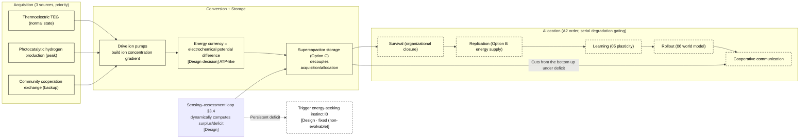

# 03 · Energy Metabolism (S3)

| Item | Value |
| --- | --- |
| Module | Energy metabolism (S3): energy acquisition, conversion and allocation |
| Document type | Design report (English edition) |
| Version | v4.1 |
| Dependencies | 00 Axiomatic layer, 02 Physical substrate, 04 Individual boundary |
| Language | English (Chinese edition: `../zh-CN/03_能量代谢_设计.md`) |

> **Evidence categories**: `[Ref:…]` literature or data; `[Design decision]` project setting; `[Logical derivation]` derived from listed premises; `[To be verified]` unvalidated placeholder.

---

## 0. Comparison of Design Options

> Design question: three parallel options are given; each option states "how to harvest / how to convert / how to allocate + evidence + feasibility".
> - **Option A (conceptual option)**: thermoelectric TEG as the primary energy source + ATP-like electrochemical-gradient energy currency + A2-order dynamic allocation (current §2/§3)
> - **Option B (based on the project reference library)**: the most mature energy acquisition paradigm in the reference library (thermoelectric / photocatalytic / artificial-cell metabolism measurements)
> - **Option C (based on published research practice)**: transferable practices from an external survey (soft/wearable energy harvesting + energy storage + dynamic allocation)
> and can be combined (§0.4).

### 0.1 Option A: Concept Option (Thermoelectric Primary Energy Source + Electrochemical Gradient, Baseline Option)

| Mechanism | Specific implementation |
| ------ | --------- |
| Acquisition | Thermoelectric TEG (temperature-difference generation, normal state) · photocatalysis (peak) · cooperative exchange (backup) |
| Conversion | Thermoelectric power generation → drives ion pumps to establish an ion concentration gradient (chemiosmosis-like) = energy currency |
| Allocation | A2-order serial degradation gating (survival > replication > learning > rollout > cooperation, with cuts made from the bottom up when a deficit occurs) |
| Ceiling | Thermoelectric power density nW–mW/cm² (measured; values at different temperatures are not mutually comparable) |

**Evidence and notes (in table row order)**

1. **Acquisition** — Thermoelectric [Ref:03/2018_Network_Thermoelectric, §network TEG measurements, "arXiv1811.08729 network thermoelectric nanogenerator, 0.03µW/cm² low-temperature measurement"], [Ref:03/2021_OnChip_AllSilicon, §on-chip all-silicon TEG, "arXiv2103.14520 on-chip all-silicon thermoelectric, 40nW/cm²"]; priority ordering [Design decision]
2. **Conversion** — [Ref:03/Chemiosmotic_Nutrient_Transport_2024, §chemiosmosis/decarboxylation energy supply, "synthetic-cell chemiosmosis + decarboxylation-driven nutrient transport, supporting ion gradient = energy currency"]; "ion gradient = energy currency" [Design decision]
3. **Allocation** — [Logical derivation: corollary of the A2 persistence axiom]; thresholds of each layer [To be verified]
4. **Ceiling** — [Ref:03/2018_Network_Thermoelectric_arXiv1811.08729, §measurements, "0.03µW/cm²"], [Ref:03/2026_Hybrid_TEG_PMMA_Ink_40nW_cm2_arXiv2607.02793, §measurements, "40nW/cm²"], [Ref:03/Moradi_2025_Wearable_Thermo_plasma_0.15mW_cm2_arXiv2512.08103, §measurements, "0.15mW/cm²"]; power inside the gel [To be verified by experiment: E1]

**Feasibility + risk**: solid-state thermoelectric devices have been measured, but **the actual power density inside the soft gel (POMs) will drop** [To be verified by experiment: E1] — "whether thermoelectrics can supply energy in a soft matrix" is the key assumption. [Design decision]

### 0.2 Option B: Based on the Project Reference Library (Most Mature Paradigm)

> The most mature line for "energy acquisition + conversion" in the reference library is **thermoelectric/photocatalytic + artificial-cell metabolism** (with measured power densities).

| Mechanism | Literature paradigm |
| ------ | --------- |
| Thermoelectric (primary) | Network thermoelectric 0.03 µW/cm² · monolithic 40 nW/cm² · thermoplasmonic 0.15 mW/cm² |
| Volumetric thermoelectric | NiTi thermoelastic 366 mW/cm³ |
| Photocatalytic hydrogen production | Carbon photocathode / triple-junction silicon PEC |
| Energy currency reference | Artificial-cell reducing-power supply (ATP-like) |

**Evidence and notes (in table row order)**

1. **Thermoelectric (primary)** — [Ref:03/2018_Network_Thermoelectric_arXiv1811.08729, §network TEG, "0.03µW/cm² low-temperature network TEG solid-state measurement"], [Ref:03/2026_Hybrid_TEG_PMMA_Ink_40nW_cm2_arXiv2607.02793, §PMMA ink printing, "40nW/cm² hybrid TEG"], [Ref:03/Moradi_2025_Wearable_Thermo_plasma_0.15mW_cm2_arXiv2512.08103, §thermoplasmonic, "0.15mW/cm² wearable thermoplasmonic TEG"]
2. **Volumetric thermoelectric** — [Ref:03/2026_Thermoelastic_Harvesting_NiTi_366mW_cm3_arXiv2608.12092, §NiTi thermoelastic harvesting, "366mW/cm³ volumetric density (To be verified · volumetric density is not mutually comparable with areal density)"](To be verified · volumetric density is not mutually comparable with areal density)
3. **Photocatalytic hydrogen production** — [Ref:03/Carbon_Photocathode_arXiv1903.08959, §carbon photocathode PEC, "carbon photocathode solar hydrogen production"], [Ref:03/Lee_2019_PEC_solar_H2_arXiv1910.13948, §triple-junction silicon PEC, "triple-junction silicon photoelectrochemical hydrogen production"]
4. **Energy currency reference** — [Ref:03/Synthetic_Cell_Energy_Supply_Reducing_Power_2023, §reducing-power supply, "synthetic-cell reducing-power supply (ATP-like), carbon-based order-of-magnitude reference not transferred to silicon-based carriers"](carbon-based; used as an order-of-magnitude reference, not transferred to silicon-based carriers)

**Key point**: thermoelectric power density **has three measured anchors** (the reference upper bound of Option A is evidenced); but all are **solid-state devices**, and the soft carrier is a gap.

### 0.3 Option C: Based on Published Research Practice (External Survey, DOIs Verified Item by Item)

> To be verified · **The evidence of this section is a published-literature survey ;**.
> **Key conclusion (survey direction)**: the three most mature classes worldwide for "powering soft/wearable systems": ① flexible/wearable thermoelectrics and energy harvesting ② microbattery/supercapacitor energy storage ③ on-demand dynamic power management.

| External paradigm | Mechanism transferable into 03 |
| --------- | ---------------- |
| Soft/wearable thermoelectric (energy harvesting) | Feasibility of flexible thermoelectrics conforming to soft matrices (closer to the 02 soft carrier than solid-state devices) |
| Microbattery/supercapacitor (energy currency storage) | The "energy currency" need not be only an instantaneous gradient; a storage unit (supercapacitor + µ-battery) can be added to decouple acquisition from allocation |
| On-demand dynamic power management | Subsystems powered up/down dynamically by importance = engineering precedent for the §3.4 dynamic loop |

**Evidence and notes (in table row order)**

1. **Soft/wearable thermoelectric (energy harvesting)** — [Ref:`03/E_HARVEST_STORE_MANAGE_..._2026-09-15` H1 Nagiri 2025 (body heat ~37 µW, value read back), H4 Bahk 2015 review]; supplementary crawl: H3 Fan 2022 read back via OpenAlex abstract = 7.9 µW/cm² (no wind) / 43.6 µW/cm² (walking wind) (citable); H-substitute Zhang 2024 Nat Commun 18.4 µW/cm² (OA, PDF stored in the library, citable as an areal power density SOTA reference); H2 You 2022 exact µW/cm², all four channels failed without read-back (not citable; replaced by H-substitute)
2. **Microbattery/supercapacitor (energy currency storage)** — [Ref: same reference library above, S1 Yin 2017 (soft hydrogel supercapacitor, same matrix as 03 POMs), S2–S4; supplementary crawl µ-battery B1 Xu 2013 stretchable soft battery (OA, 1401 citations, PDF stored in the library), B2 Moitzheim 2019 3D thin-film lithium microbattery (OA/HYBRID, 3D structural breakthrough ≈250 µAh/cm² planar-footprint capacity)]; the proposition that the soft-carrier "energy currency = battery-type storage" now has two first-hand OA papers and is no longer a gap
3. **On-demand dynamic power management** — [Ref: same reference library above, P1/P2 Kansal 2006/2007 (energy-aware scheduling SOTA, 1549 citations), P4/P5 clock/power gating primitives; supplementary crawl confirmation the P1/P2 mechanism proposition has been checked via the OpenAlex abstract: harvesting is limited by "instantaneous power" rather than total energy → real-time scheduling by instantaneous balance; specific scheduling thresholds remain engineering precedents (parameters not citable)

### 0.4 Option Combinations and Baseline Configuration

| Strategy | Content | Applicable conditions |
| ------ | ------ | ------ |
| **A. Pure Option A** | Adheres to thermoelectric + ion gradient, no storage | Simplest; feasibility constrained by "soft-matrix power" |
| **B. A + C hybrid** | Thermoelectric/photocatalytic acquisition + added supercapacitor storage (Option C) decouples acquisition from allocation | Energy is stored before allocation; high feasibility (baseline Option B, consistent with the determination) |
| **C. A-dominant + cooperative backup** | Individual thermoelectric as primary, borrowing energy from the community under deficit (§3.5) | Closest to the "community cooperation" design |

> **Baseline option = B** (thermoelectric harvesting + supercapacitor storage, decoupling "energy acquisition" from "energy allocation") — the fragility of "instantaneous thermoelectric supply" is compensated by the storage unit. **This choice is a design position, confirmed by design review.**
> **Design decision (T5): Option B is adopted (thermoelectric harvesting, supercapacitor storage, dynamic power management); Options A/C serve as alternative options.**

### 0.5 Detailed Structure of Energy Metabolism (Textual Description)

> **This section is the textual description of Figure 3-1 in §3**: without relying on the diagram, it explains layer by layer "what one energy flow of a silicon-based individual actually is, where it is acquired / converted / stored / allocated, and how the dynamic loop traverses it". Based on **Option B (I+III hybrid: thermoelectric harvesting + supercapacitor storage)**.

**Axis 1: the 4 segments of physical substrate (from acquisition to allocation, "where energy comes from and where it goes")**

| Segment | What it is | What it does |
| ---- | -------- | -------- |
| **Segment 1 Acquisition (HARVEST)** | 3 sources: thermoelectric TEG (normal state) / photocatalytic hydrogen production (peak) / community cooperation exchange (backup) | Brings energy in the environment in (thermoelectric takes temperature difference, photocatalysis takes light energy, cooperation borrows from the community) |
| **Segment 2 Conversion (CONVERT)** | Thermoelectric power generation → drives ion pumps to build an ion concentration gradient (chemiosmosis-like) | Converts "the harvested electricity" into an allocable intermediate form (energy currency) |
| **Segment 3 Storage (STORE)** | Supercapacitor / µ-battery (Option C) decouples "acquisition" from "allocation" | Makes the energy currency bufferable — when thermoelectric generation is intermittent, the storage unit provides the bottom-layer constraint so the allocation side does not lose power |
| **Segment 4 Allocation (ALLOCATE)** | By A2-order serial degradation gating: survival > replication > learning > rollout > cooperation | Allocates the energy currency to subsystems by priority; when a deficit occurs, cuts are made from the bottom up |

**Evidence and notes (in table row order)**

1. **Segment 1 Acquisition (HARVEST)** — Thermoelectric [Ref:`03/2026_Hybrid_TEG_PMMA_Ink_PoD40nW_cm2` (40 nW/cm²), `03/Moradi-2025_Wearable_Thermoplasmonic_TE_0.15mW_cm2` (0.15 mW/cm²)]; "three-source priority" [Design decision]
2. **Segment 2 Conversion (CONVERT)** — Chemiosmosis-like [Ref:`03/Chemiosmotic_Nutrient_Transport_Synthetic_Cells_Decarboxylation_2024`]; "ion gradient = energy currency" [Design decision]
3. **Segment 3 Storage (STORE)** — [Ref:`03/E_HARVEST_STORE_MANAGE_..._2026-09-15` S1 Yin 2017 soft hydrogel supercapacitor (same matrix type as 03 POMs); S2 tunable / S3 microsystem / S4 peak buffering; supplementary crawl µ-battery B1 Xu 2013 stretchable soft battery (OA), B2 Moitzheim 2019 3D thin-film lithium microbattery (breakthrough ≈250 µAh/cm² planar-footprint capacity)]
4. **Segment 4 Allocation (ALLOCATE)** — Priority topology [Logical derivation: corollary of the A2 persistence axiom, 00]; "satisfaction" thresholds of each layer [To be verified]

**Relationship between segments (the left-to-right energy flow chain in the figure)**:
```
Segment 1 Acquisition (thermoelectric / photocatalytic / cooperation) → Segment 2 Conversion (drives ion pumps to build the gradient)
     → Segment 3 Storage (supercapacitor buffering) → Segment 4 Allocation (A2 order allocated to 5 classes of subsystems)
```
→ **"Energy" is not an independent thing; it = the ion gradient built by Segment 2 (energy currency); obtaining it depends on Segment 1, stabilising it depends on Segment 3, spending it depends on Segment 4.** This chain is "what one energy flow of a silicon-based individual looks like".

**Axis 2: three mechanism lines (traversing the 4 segments, "how to harvest / how to convert / how to manage")**

| Mechanism | Which segments it traverses | What it does |
| ------ | --------- | -------- |
| **Harvest (HARVEST)** | Segment 1 → Segment 2 | Thermoelectric generation drives ion pumps; photocatalysis supplements peaks; cooperation borrows from the community under energy deficit |
| **Distribute (DISTRIBUTE)** | Segment 4 | Serial degradation gating: survival (organizational closure) is satisfied first; when unsa… See note 1 |
| **Assess (ASSESS)** | The dynamic sensing–assessment loop traversing Segments 1–4 (§3.4) | The individual senses in real time the current balance (thermoelectric generation vs subsy… See note 2 |

**Full evidence for table cells**

1. **Distribute (DISTRIBUTE) · What it does** — Serial degradation gating: survival (organizational closure) is satisfied first; when unsatisfied, lower-layer rollout/cooperation automatically power down; cuts are made from the bottom up under a deficit
2. **Assess (ASSESS) · What it does** — The individual senses in real time the current balance (thermoelectric generation vs subsystem consumption), dynamically computes surplus/deficit, and feeds back to adjust allocation; a persistent deficit → triggers the fixed (non-evolvable) energy-seeking instinct I0

**Evidence and notes (in table row order)**

1. **Harvest (HARVEST)** — Thermoelectric drive [Ref:`03/Moradi-2025...`], cooperation exchange [Ref:Design Principle 20 / 10 §3.5]
2. **Distribute (DISTRIBUTE)** — [Logical derivation: A2 order + 00 persistence axiom]; the gating "power-down" semantics [Design decision]
3. **Assess (ASSESS)** — [Ref:Design Principle 20 dynamic energy assessment + Design Principle 15 time-scale baseline]; the "sensing–assessment" loop itself [Design decision]

**The "no hard-coded setting" relationship of harvest/manage** (why this design can be "both stable and dynamic"):
- **The priority topology of Segment 4 = fixed (non-evolvable)** (A2 order: survival > replication > learning > rollout > cooperation, not evolvable away);
- **The current "how much is spent / how large the deficit is" = dynamic** (the §3.4 loop computes in real time, with no hard-coded numerical values);
- **The "drive" of the energy-seeking instinct I0 = fixed (non-evolvable), with only "how much to seek" dynamic** (Design Principle 20); the division of "fixed (non-evolvable) topology + dynamic values" is precisely **the corresponding landing point of the two statements of Design Principle 20, "dynamic energy assessment has no hard-coded setting + the energy-seeking instinct must exist"** [Logical derivation: the two statements of Design Principle 20 land on topology/values respectively].

#### Summary of Key Points
> **One energy flow of a silicon-based individual = Segment 1 harvests energy from thermoelectric/photocatalytic/community → Segment 2 converts it into an ion concentration gradient (energy currency) → Segment 3 buffers it with a supercapacitor → Segment 4 allocates it to subsystems by A2 order (survival > replication > learning > rollout > cooperation), with cuts made from the bottom up under a deficit. The sensing–assessment loop computes surplus/deficit in real time; a persistent deficit triggers the fixed (non-evolvable) energy-seeking instinct I0. The topology is fixed (non-evolvable) and the values are dynamic; this is the concrete form of "energy has no hard-coded setting".**

---

## 1. Design Objectives
To enable a silicon-based individual to **acquire energy → convert it into "energy currency" → allocate it to subsystems** (replication / neural / world model / cooperation), maintaining A1 organizational closure (without disintegration).
**Key constraints (Design Principle 20)**:
- Energy **has no hard-coded setting** — the initial order of magnitude follows "one month" (chimpanzee baseline, Design Principle 15), but **the individual senses by itself + dynamically assesses** the current balance
- **The energy-seeking instinct must exist** (hard member of the I0 set): the drive "energy must be sought" is fixed (non-evolvable), with only "how much to seek" dynamic

---

## 2. Related Research Status + Different Implementation Approaches (Design Principle 2)

| Route | Status | Literature anchors | Trade-off | Evidence category |
| ------ | ------ | --------- | ------ | ------ |
| **Thermoelectric TEG (temperature-difference generation)** | Mature | See note 1 | Verified · primary energy source | [Design decision]; "naturally matched to silicon" [Logical derivation: thermoelectrics use Si/alloy materials, the same material system as the 02 silicon-based carrier] |
| **Measured power of the thermoelectric energy currency** | Frontier | See note 2 | To be verified · energy ceiling constraint (see §3.1) | [Ref: the above measurements]; different temperatures/devices are not mutually comparable [Logical derivation] |
| **Silicon photocatalytic hydrogen production** | Frontier | See note 3 | Solar energy → chemical energy carrier (alternative) | [Design decision] as peak supplementation |
| **Phonon-glass electron-crystal** | Optimisation | [Ref:`03/Zhu_2017_Thermoelectric_phonon-glass-electron-crystal_arXiv1710.03375`, §phonon-glass electron-crystal, "PGEC optimisation direction for thermoelectric materials"] | Improves thermoelectric efficiency | [Ref] optimisation direction for thermoelectric materials |
| **Artificial-cell metabolism (reducing power / chemiosmosis / artificial mitochondria)** | Frontier | See note 4 | Cell-level "metabolism" reference (reducing power = closest reference for the energy currency) | [Ref]; the carbon-based reference is not transferred to silicon-based carriers [Design Principle 24] |

**Full evidence for table cells**

1. **Thermoelectric TEG (temperature-difference generation) · Literature anchors** — [Ref:`03/2018_Network_Thermoelectric_Nanogenerators_arXiv1811.08729`, §network TEG, "arXiv1811.08729 network thermoelectric 0.03µW/cm² solid-state measurement"], `03/2021_OnChip_AllSilicon_Thermoelectric_arXiv2103.14520`, §on-chip all-silicon TEG, "arXiv2103.14520 on-chip all-silicon thermoelectric 40nW/cm²"]
2. **Measured power of the thermoelectric energy currency · Literature anchors** — [Ref:`03/2026_Hybrid_TEG_PMMA_Ink_40nW_cm2_arXiv2607.02793`, §PMMA ink printing, "40nW/cm²", `03/Moradi_2025_Wearable_Thermo_plasma_0.15mW_cm2_arXiv2512.08103`, §thermoplasmonic, "0.15mW/cm²", `03/2026_Thermoelastic_Harvesting_NiTi_366mW_cm3_arXiv2608.12092`, §NiTi thermoelastic, "366mW/cm³ volumetric density"]
3. **Silicon photocatalytic hydrogen production · Literature anchors** — [Ref:`03/Carbon_Photocathode_Solar_Hydrogen_arXiv1903.08959`, §carbon photocathode, "carbon photocathode for solar hydrogen production"], `03/Lee_2019_PEC_solar_H2_arXiv1910.13948`, §triple-junction silicon PEC, "triple-junction silicon PEC hydrogen production"]
4. **Artificial-cell metabolism (reducing power / chemiosmosis / artificial mitochondria) · Literature anchors** — [Ref:`03/Synthetic_Cell_Energy_Supply_Reducing_Power_2023`, §reducing-power supply, "synthetic-cell reducing power", `03/Chemiosmotic_Nutrient_Transport_2024`, §chemiosmosis, "chemiosmotic energy supply", `03/Artificial_Mitochondria_2025`, §artificial mitochondria, "artificial mitochondria energy metabolism"]

**Selection conclusion** [Design decision]: **primary energy source = thermoelectric TEG** ("naturally matched to silicon" [Logical derivation] + power density has measurements [Ref:03/2018_Network_Thermoelectric_arXiv1811.08729, §measurements, "0.03µW/cm²"]); **energy currency = ATP-like electrochemical gradient** (referencing the reducing-power supply of artificial-cell metabolism [Ref:`Synthetic_Cell_Energy_Supply_Reducing_Power_2023`, §reducing-power supply, "synthetic-cell reducing-power supply ATP-like, C not transferred to silicon-based carriers"])).

---

## 3. Design (Implementation of Design Principle 20)

**Figure 3-1: energy metabolism flow = acquisition (3 sources) → conversion (gradient building) → storage (supercapacitor) → allocation (A2-order degradation)**



> Note: Arrows indicate energy flow; multiple harvesting paths converge in storage through power management and are then allocated. Dashed arrows indicate power constraints.

> **Legend**: acquisition (thermoelectric normal state + photocatalytic peak + cooperation backup) → conversion (driving ion pumps to build the gradient = energy currency) → **storage (supercapacitor, Option C, decoupling "energy acquisition" from "energy allocation")** → allocation by **A2-order serial degradation** (survival > replication > learning > rollout > cooperation, with cuts made from the bottom up under a deficit). **The sensing–assessment loop (§3.4) dynamically computes surplus/deficit**; a persistent deficit triggers the fixed (non-evolvable) energy-seeking instinct I0.

### 3.1 Energy Ceiling Constraint (Critical, Based on Measurements)

**Thermoelectrics are the current energy bottleneck for silicon-based systems** — the measured power density range (**all three values are literature-reported values, verified by the ; To be verified · different temperatures/devices, not directly comparable**):
```
0.03 µW/cm² class (nanoarray, 10 K) [**solid-state · SiN suspended nano TEG, non-gel reference**]    → `03/2018_Network_Thermoelectric_Nanogenerators_arXiv1811.08729` (low-temperature **solid-state** measurement; power inside the soft matrix [To be verified by experiment: E1] unknown, **must not be used as the gel upper bound**)
40 nW/cm² (TEG + PMMA ink) [solid-state]        → `03/2026_Hybrid_TEG_PMMA_Ink_40nW_cm2_arXiv2607.02793.pdf` (measured solid-state value, **reference only, not the gel upper bound**)
0.15 mW/cm² (thermoplasmonic, ΔT=13 K temperature difference)      → `03/Moradi-2025_Wearable_Thermo_plasma_0.15mW_cm2_arXiv2512.08103.pdf` (measured)
366 mW/cm³ (volumetric density, NiTi thermoelastic)       → `03/2026_Thermoelastic_Harvesting_NiTi_366mW_cm3_arXiv2608.12092.pdf` (To be verified · volumetric density, not areal density, not directly comparable with the above)
```
**Implications**:
- Thermoelectric power density is at the **areal density order of ~nW–mW/cm²** (the above measurements; note that the temperatures differ)
- A silicon-based individual has a **low energy-consumption order** (mW class, an **order-of-magnitude judgment** inferred from the above thermoelectric power, **not a measurement**; the carbon-based human brain at ~20 W is a common-knowledge comparison used only as an order-of-magnitude reference, `no source in this project`)
- **The energy budget is tight** → the individual cannot "luxuriously" run all subsystems at full load simultaneously
- **The energy-seeking instinct (I0) has the highest priority**: when energy is tight, survival > replication > learning > world-model rollout (allocated by the priority of A2 persistence)
- **To be verified by experiment**: the actual power density of thermoelectrics in the **silicon-based gel** (POMs) (present values are solid-state devices; the value drops in a gel)

### 3.2 Energy Acquisition (Three Sources, Priority)
```
Primary: thermoelectric TEG (temperature-difference generation, naturally matched to silicon)     —— normal-state energy source
Auxiliary: photocatalytic hydrogen production (solar energy, when light is available)      —— peak supplementation
Backup: community cooperation energy exchange (silicon-based × silicon-based)      —— borrowing from the community under energy deficit (§cooperation)
```

### 3.3 Form of the Energy Currency (ATP-like)
**Referencing carbon-based ATP/reducing power (NADH), silicon-based systems use "electrochemical potential difference" as the energy currency**:
- **Form**: the **ion concentration gradient** of the gel matrix (chemiosmosis-like, `Chemiosmotic_Nutrient_Transport_2024`) + charge potential difference
- **Conversion**: thermoelectric power generation → drives ion pumps to establish the gradient (ATP-synthesis-like)
- **Use**: the gradient drives replication (energy input of Option B) / neural pulses / world-model rollout / cooperative communication
- **Key**: the energy currency is "**intermediate storage + allocation**", not "acquisition" — thermoelectrics are acquisition, the energy currency is the allocable form after conversion

**E2 refinement of the energy currency form (derivable part, Design Principle 24)**:
- **Primary form = ion concentration gradient** (chemiosmosis-like, `03/Chemiosmotic_Nutrient_Transport_2024`): the ionic electrochemical potential difference inside the gel matrix Δμ = RT·ln([ion]_in/[ion]_out)+ zF·ΔV。
- **Derivable basis**: the gel host (§02 POMs) naturally contains water, and ions can migrate through gel pores → the **ion gradient** is the most natural "energy currency" in a gel environment, more easily allocated in a soft matrix than "solid–solid interface charge".
- **Specific ion/concentration/potential values = to be designed + DFT** (which ion, how large a concentration gradient, how large a Δμ; measurement on this gel system is required; the carbon-based ATP ΔG ~50 kJ/mol can serve only as an **order-of-magnitude reference**, `Design setting`, not transferred to silicon-based carriers).

**E4 refinement of the allocation topology (derivable part)**:
- **Priority topology (fixed (non-evolvable), A2 order)**: `survival (maintaining organizational closure) > replication (Option B energy supply) > learning (05 plasticity) > rollout (06 world-model simulation) > cooperative communication`。
- **Derivable**: allocation is **serial degradation gating** — when the energy of an upper layer (survival) is unsatisfied, **lower layers (rollout/cooperation) automatically power down**. This is a direct corollary of the A2 persistence axiom (00); **the topological structure can be fixed**.
- **The "satisfaction" threshold of each layer = to be designed + measured** (how much energy counts as "survival satisfied", how much is "enough for rollout"; no measurement exists for the values, and Design Principle 24 does not speculate)。
- **Implementation**: the "surplus/deficit" computed by the §3.4 dynamic loop drives this topology — under a deficit, **cuts are made from the bottom up** according to the topology (cooperation cut first, then rollout, then learning, preserving replication + survival)。

### 3.4 Dynamic Sensing–Assessment Loop (Design Principle 20, No Hard-Coded Setting)
```
Sensing: the individual carries an "energy sensor" (sensing the current balance: thermoelectric generation vs subsystem consumption)
Assessment: dynamically computes "energy surplus/deficit" → adjusts allocation priority (survival > replication > learning > rollout)
Feedback: a persistent deficit → triggers the energy-seeking instinct (I0, fixed (non-evolvable) drive) → orientation toward energy sources/cooperation
```
- **Initial order of magnitude**: the energy budget baseline is set by "one month" (chimpanzee baseline, Design Principle 15)
- **No hard-coded setting**: hardware stacking / cooperation / evolution all change actual consumption, so "current consumption" is **sensed in real time + assessed** by the individual, not a fixed value
- **Design implication**: what 03 provides is "**budget baseline + dynamic loop**", not "a fixed energy value"
- **P0 falsifiable quantitative deficit estimate (added after T5 was settled on 2026-09-16; the order-of-magnitude table is not an exact design value)**: power required for one individual to close the five loops vs thermoelectric measurements, the order of magnitude of the deficit —

**Split into two columns, each dimensionally self-contained (power density column vs storage capacity column; no cross-column comparison)**:

**Column A · Power density deficit (µW/cm², same dimension, self-consistent)**
| Quantity | Value | Evidence |
| ---- | ------ | ------ |
| Measured thermoelectric areal power density (**solid-state reference, not the gel upper bound**) | 0.03 µW/cm² (nanoarray, 10 K low temperature, SiN suspended nano TEG solid-state measurement; the value inside the soft matrix [To be verified by experiment: E1] is unknown) | §3.1 measurements, 3 thermoelectric papers |
| Measured thermoelectric areal power density (solid-state, reference only) | 40 nW/cm² = 0.04 µW/cm² (TEG + PMMA ink, not the gel upper bound) | §3.1 reference |
| Power required for one individual to close the five loops | mW class (design estimate, not a measurement) — the sum of lower bounds of 05 neural pulse… See note 1 | §3.1 L188 order-of-magnitude judgment; the carbon-based human brain at ~20 W is a reference only |
| **Order of magnitude of the power deficit** | Requires ~10⁴–10⁵ cm² of thermoelectric area (0.03 µW/cm² × 10⁵ cm² ≈ 3 mW), or a thermoelectric-voltage stacking gain of order 10⁴ | Order-of-magnitude estimate (design value) |

**Full evidence for table cells**

1. **Power required for one individual to close the five loops · Value** — mW class (design estimate, not a measurement) — the sum of lower bounds of 05 neural pulses + 01 replication + 06 world-model rollout + 10 cooperative communication; each component awaits values from 05 N4 / 06 W3 / 07 G3 / 08 L2

**Column B · Storage capacity margin (µAh/cm², another dimension; determines only the power-off buffering duration, does not compensate the power order-of-magnitude difference)**
| Quantity | Value | Evidence |
| ---- | ------ | ------ |
| Supercapacitor areal capacity density | 250 µAh/cm² (3D thin-film lithium microbattery, breaking through the planar footprint) | §0.4 storage unit, reference library B2 Moitzheim 2019 |
| Boundary of action | Provides only time-margin compensation (acquisition and allocation are decoupled; power-of… See note 1 | §0.4 storage unit, reference library S1/B1/B2 |

**Full evidence for table cells**

1. **Boundary of action · Value** — Provides only time-margin compensation (acquisition and allocation are decoupled; power-off buffering duration = capacity / instantaneous power consumption), does not compensate the power order-of-magnitude difference

> **Dimensional note**: Column A (µW/cm² vs mW demand, same dimension) and Column B (µAh/cm², areal charge capacity) **are different physical quantities and cannot be compared in magnitude across columns** (previously placing "250 µAh/cm²" alongside "0.03 µW/cm²" was a dimensionally mismatched presentation). Judging "whether energy can be supplied" depends on **the Column A power deficit**; judging "how long a power outage can be sustained" depends on **the Column B capacity margin**.
> **Scope and known limitations**: this table is an **order-of-magnitude estimate** giving P0 a falsifiable deficit figure, not an exact design value (in-gel thermoelectric measurement + minimum power consumption of each subsystem both require DFT/experiment). If the Column A deficit order (10⁴-10⁵ order of magnitude) cannot be closed by P0 measurements, **"single-individual self-maintenance" is physically not closed** — this is the main risk point of T5, and storage (Column B) cannot compensate the power order-of-magnitude difference (Column A).

### 3.5 Energy Balance of Cooperation (Design Principle 20, Community Cooperation)
- **Cooperation = communication/exchange = energy consumption** (information transfer pays energy)
- **Benefit**: resource exchange / task division / information sharing (§10 A6 cooperation fitness term)
- **Cost**: communication power consumption + exchange energy
- **Net benefit = cooperation benefit − cooperation cost**（the cooperation benefit must exceed the cooperation cost）
- **Implemented in §10 A6**: `w_synergy · [cooperation benefit − cooperation cost]`, with the cost term including communication power consumption

---

## 4. Relations with Other Parts (Interface Contract, All Dimensions)

> **Completeness principle**: 03 is the energy layer and the **energy supplier for almost all energy-consuming modules** — a connection must be established with every dimension (a missing item = an incomplete document)。

**Figure 4-1: overview of the connections between 03 (energy metabolism) and all 12 volumes**

```mermaid
graph LR
    E["03 Energy metabolism<br/>(acquisition + conversion + allocation)"]
    E <-->|02 supplies energy for the temperature domain of fabrication/packaging| D02["02 Materials"]
    E -->|Physical energy supply of the A2 persistence axiom| P00["00 Philosophy (A2)"]
    E <-->|Organizational closure requires continuous energy supply| I04["04 Individuality"]
    E -->|Energy currency drives 05 neural pulses/plasticity| N05["05 Neural"]
    E -->|Rollout (world-model simulation) consumes energy| WM06["06 World model"]
    E -->|Memory consolidation / replay low-power state consumes energy| MEM07["07 Memory"]
    E -->|Logic gate circuits / representation power consumption| L08["08 Logic"]
    E -->|Drive of the energy-seeking instinct I0 + energy-tropism behaviour consumes energy| I0_09["09 Instinct"]
    E <-->|Replication/selection consumes energy; cooperation balance enters A6| EV10["10 Evolution"]
    E -->|Physical node of loop ④ acquisition of the five loops| INT11["11 Integration"]
    E <-->|Energy supply for intergenerational replication| D01["01 DNA"]

    classDef core fill:transparent,stroke:currentColor,stroke-width:2.2px,color:currentColor
    classDef node fill:transparent,stroke:currentColor,stroke-width:1.2px,color:currentColor
    class E core
    class D01,D02,P00,I04,N05,WM06,MEM07,L08,I0_09,EV10,INT11 node
```

> Note: The source of an arrow is the value provider and the target is the receiver; measurable quantities are defined by the interface contracts of the respective volumes.

| Interface | Data flow (physical quantities, not concepts) | Invariant (measurable) | Evidence category |
| ------ | ---------------------- | ------------- | --------- |
| **↔ 01 DNA** | Intergenerational replication (Option B) pays energy currency | Replication energy consumption ∈ 03 allocation (replication > learning) | [Ref:10 §3.6 + 03 A2 order] |
| **↔ 02 Materials** | 03 supplies energy for the 02 fabrication temperature domain (150-300°C) | Fabrication pays energy (≈ reproduction) [Logical derivation] | [Ref:02 §2.2 temperature domain] |
| **← 00 Philosophy** | A2 persistence axiom = the physical implementation of continuous energy supply | Energy balance ≥ maintaining organizational closure | [Ref:00 A2] |
| **↔ 04 Individuality** | Organizational closure (C1) requires continuous energy supply: 04 "individual maintenance" relies on the surplus of the 03 energy balance | The energy side of the 04 B2 self-maintenance criterion [To be verified] | [Logical derivation: 04 C1 + A2] |
| **→ 05 Neural** | Energy currency drives neural pulses + plasticity | Pulse energy consumption [To be verified] | [Ref:05 neural-layer energy consumption] |
| **→ 06 World model** | Rollout (world-model simulation) pays energy currency (W3 rollout energy consumption) | Energy consumption of N rollout actions vs value [To be verified by calculation: 06 W3] | [Logical derivation: 06 W3 attached to 03] |
| **→ 07 Memory** | Memory consolidation / sleep replay low-power state consumes energy | Replay cycle energy consumption [To be verified by calculation: 07 G3] | [Logical derivation: 07 G3 attached to 03] |
| **→ 08 Logic** | Logic gate circuits / representation (reading 4 states) power consumption | Representation / gate-circuit energy consumption [To be verified] | [Logical derivation: 08 L2 representation stack] |
| **→ 09 Instinct** | Drive of the energy-seeking instinct I0 + energy-tropism behaviour consumes energy | I0 trigger energy consumption [Design] | [Ref:09 I0a/I2] |
| **↔ 10 Evolution** | Replication/selection consumes energy; cooperation balance enters A6 (cooperation benefit − cost) | The A6 cooperation term includes communication power consumption [Ref:10 §3.5] | [Ref:10 A6] |
| **→ 11 Integration** | Physical node of loop ④ energy acquisition of the five loops | Closure of loop ④ requires 03 energy supply to be operational | [Ref:11 §5 loops] |

**Contract principle**: interface "data" must be **physically measurable quantities** (power / joules / voltage gradient / power consumption), not concepts; those without measured values are labelled "values await 03/other-volume DFT"。

**Evidence category (§4)**:
- Energy supply to fabrication → 02 [Ref:02 §2.2]
- A2 energy supply → 00 [Ref:00 A2]
- Organizational closure → 04 [Logical derivation: 04 C1]
- Neural pulses → 05 / rollout → 06 / consolidation → 07 / gate circuits → 08 / energy seeking → 09 [Logical derivation: energy consumption of each volume attached to 03]
- Cooperation / intergenerational → 10/01 [Ref:10 A6 + 10 §3.6]
- Loop ④ → 11 [Ref:11 §5]

---

## 5. To Be Verified by Experiment / DFT (Each Item: Formula + Window + Value Provider, with Quantitative Conditions)

| # | Open item | Formula/inequality to be satisfied | Parameter window (design setting) | Value provider |
| --- | -------- | --------------------- | -------------------- | ---------- |
| E1 | Power density of thermoelectrics in the silicon-based gel (POMs) | The present value (0.03 µW–0.15 mW/cm²) is that of solid-state devices (§3.1 three measurements, with temperatures not mutually comparable) | It drops inside a gel; the order of magnitude awaits measurement; the operating energy budget baseline follows "one month" (Design Principle 15) | 03 experiment (attenuation coefficient from solid-state → gel) |
| E2 | Energy currency form (ion/potential difference) + specific values | Primary form = ion concentration gradient (§3.3, attached to `Chemiosmotic_2024`), `Δμ = RT·ln([ion]_in/[ion]_out)+ zF·ΔV` | Which ion / how large a Δμ: carbon-based ATP ~50 kJ/mol serves only as an order-of-magnitude reference (`Design setting`), not applied to silicon-based systems | 03 first-principles calculation and experiment (measure Δμ on this gel system) |
| E3 | Conversion efficiency (thermoelectric → energy currency) | Thermoelectric generation efficiency × ion-pump gradient-building efficiency; the concept exists, the values do not | — | 03 first-principles calculation and experiment |
| E4 | "Satisfaction" thresholds of each layer of the allocation topology | §3.3 gives the derivable topology (A2 order: survival > replication > learning > rollout >… See note 1 | Thresholds [To be verified by calculation and experiment; without evidence they are not used as a baseline] | 03 experiment (minimum energy supply of each subsystem) |
| E5 | Cooperative communication power consumption | Cooperation = communication/exchange = energy consumption (§3.5); `net benefit = cooperation benefit − cooperation cost`, with no values | Communication power consumption order of magnitude [To be verified by experiment] | 10/03 experiment |
| E6 | Photocatalytic hydrogen production efficiency (light-available peak) | `Carbon_Photocathode` / `Lee_2019` have solid-state orders of magnitude; not measured in silicon-based gel | Peak supplementation order of magnitude [To be verified by experiment] | 03 experiment |

**Full evidence for table cells**

1. **E4 · Formula/inequality to be satisfied** — §3.3 gives the derivable topology (A2 order: survival > replication > learning > rollout > cooperation + serial degradation gating, with cuts made from the bottom up under a deficit); the topology can be fixed, while the values of "how much counts as satisfied" at each layer await experimental verification

**Note**: each of E1-E6 gives "**what to compute + threshold/order-of-magnitude window + value provider**"; the three thermoelectric power values in §3.1 are **literature measurements** (the has verified the specific arXiv IDs, see `KEY_MEASURED_RATES_B_Thermoelectric_EnergyCurrency_STATUS.md`), but **the differing temperatures/devices are not mutually comparable**; the remaining values **await 03 first-principles calculation and experiment**, and this layer fixes no baseline values (Design Principle 24)。

---

## 10. Scope and Known Limitations (Design Principle 24)

- **Determinable content (given in this document)**: the structure of the 4 segments of physical substrate (acquisition / conversion / storage / allocation) + 3 mechanism lines (harvest / distribute / manage) in §0.5, the §2 selection conclusion (thermoelectric primary energy source + ATP-like electrochemical gradient), the §3.1 three-source priority + 3 measured thermoelectric power densities, the §3.3 **derivable form** of the energy currency (ion concentration gradient), the §3.3 **derivable topology** of allocation (A2-order serial degradation gating), the §3.4 dynamic sensing–assessment loop, and the §3.5 cooperation balance。
- **Undeterminable content (only formulae and boundaries are given; placeholders are not used as baseline values)**: E1 in-gel thermoelectric power, E2 specific value of the energy currency Δμ, E3 conversion efficiency, E4 "satisfaction" thresholds of each layer, E5 cooperative communication power consumption, E6 photocatalytic gel efficiency — **all await 03 first-principles calculation and experiment**; this document has written them to an actionable engineering degree of "what to compute + value provider"。
- **Key assumptions (to be settled by design review)**:
  - **"Whether thermoelectrics can supply energy in a soft gel (POMs)"** — solid-state devices have measured power, but the soft matrix has no verified pathway; this is the most significant key assumption of 03 (analogous to T0 of 01/02), and a 03 entry is added to the appendix of key assumptions and design decisions。
  - **"Ion concentration gradient = silicon-based energy currency"** — [Design decision], analogous to carbon-based chemiosmosis (attached to `Chemiosmotic_2024`), but whether an ion gradient in a silicon-based gel can serve as an allocable energy currency is **not measured**。
  - **Supercapacitor / µ-battery as energy currency storage (Option C)** — [Ref:`03/E_HARVEST_STORE_MANAGE_..._2026-09-15` S1 Yin 2017 soft hydrogel supercapacitor (same matrix as 03 POMs, DOI verified) + **supplementary crawl B1 Xu 2013 stretchable soft battery (OA) + B2 Moitzheim 2019 3D thin-film lithium microbattery (OA, 3D breakthrough ≈250 µAh/cm² planar-footprint capacity)**]。**The µ-battery direction has been supplemented with 2 first-hand OA papers and is no longer a gap**; the concrete implementation linking the storage unit to the silicon-based energy currency + the capacitance/energy density values still require read-back of the B2/Wiley originals from the CDP institutional repository。

---

> Corresponding Chinese edition: `../zh-CN/03_能量代谢_设计.md`
