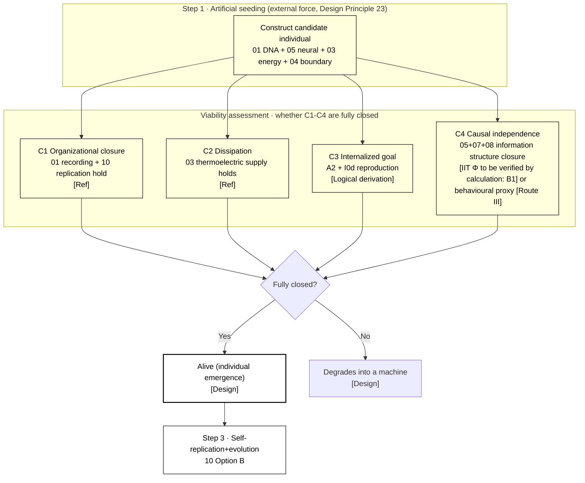

# 04 · Boundary / Individuality (S4)

| Item | Value |
| --- | --- |
| Module | Boundary and individuality (S4): criteria of individuality, genesis starting point and individual/environment boundary |
| Document type | Design report (English edition) |
| Version | v4.1 |
| Dependencies | 00 Axiomatic layer, 02 Carrier matrix, 03 Energy supply |
| Language | English (Chinese edition: `../zh-CN/04_边界个体性_设计.md`) |

> **Evidence categories**: `[Ref:…]` literature or data; `[Design decision]` project setting; `[Logical derivation]` derived from listed premises; `[To be verified]` unvalidated placeholder.

---

## 0. Comparison of Design Options

> Design question: the key question is **how C4 causal independence is defined** (C1-C3 are relatively uncontroversial). Three parallel options are given; each option states "criterion form + evidence + operability".
> - **Option A (conceptual option, baseline option)**: C4 = strict IIT Φ (causal closure not measurable = key)
> - **Option B (based on the project reference library)**: C4 uses the most measurable criterion of individuality in the reference library (closed-loop self-maintenance / minimal autopoiesis components)
> - **Option C (based on published research practice)**: the most operable practice for "defining a system boundary" in the external survey (closed-loop self-maintenance behavioural proxy / minimal self-produced material set)
> and can be combined (§0.4). Key choices are given in §3.1 + Appendix S2 on key assumptions and design decisions.

### 0.1 Option A: Concept Option (Strict IIT Φ, Baseline Option)

| Criterion | Form |
| ------ | ------ |
| C4 | Degree of causal closure Φ (highest level N) ≥ threshold |

**Evidence and notes (in table row order)**

1. **C4** — [Ref:`04/Integrated_Information_Autonomy_1805.00393`, §IIT framework, "arXiv1805.00393 integrated information theory IIT, Φ measures causal closure (To be verified · how to measure it on heterogeneous silicon-based carriers is not implemented)"] IIT framework]; how Φ is measured on heterogeneous silicon-based carriers is not implemented [To be verified by calculation and experiment: B1]

**Feasibility + risk**: the computational complexity of Φ grows exponentially with dimension; measuring Φ on heterogeneous carriers (PEDOT+Ga-In+ion gradient) is unsolved anywhere — **key assumption, not currently operable**. [Design decision]

### 0.2 Option B: Based on the Project Reference Library (Most Measurable Criterion)

| Criterion | Form |
| ------ | ------ |
| C1-C3 | Organizational closure + dissipation + internalized goal |
| Measurable substitute for C4 | Minimal autopoiesis components (countable/measurable components) |

**Evidence and notes (in table row order)**

1. **C1-C3** — [Ref:`04/Bich_2023`, §criteria of biological individuality, "Bich 2023 review of criteria of biological individuality"], `04/SelfMaintenance_..._2026`, §self-maintenance, "criteria of self-maintaining systems (2026)"]
2. **Measurable substitute for C4** — [Ref:`11/Autopoiesis_Maturana_Varela_2004`, §definition of autopoiesis, "Maturana/Varela 2004 autopoiesis (To be verified · abstract only)"], `04/RuizMirazo_2017`, §chemical self-organisation, "Ruiz-Mirazo 2017 chemical self-organisation and individuality"]

**Key point**: lowering C4 from "measuring Φ" to "countable/measurable components satisfying self-produced closure" — **operable now**, abandoning strict Φ.

### 0.3 Option C: Based on Published Research Practice (DOIs Verified Item by Item)

> To be verified · **The evidence in this section is the result of a survey of published literature, distinguished from the design claims of this project.**

| External paradigm | Criterion transferable into 04 |
| --------- | ---------------- |
| Closed-loop self-maintenance (behavioural proxy) | C4 → "whether the body can maintain internal order after perturbation + resist complete prediction of its next step by an external algorithm" |
| Minimal self-produced material set | Individual = countable components satisfying "self-production of the components defining its own identity" |

**Evidence and notes (in table row order)**

1. **Closed-loop self-maintenance (behavioural proxy)** — [Ref:`04/B_BOUNDARY_SELF_SUSTAIN_2026-09-15.md`, §closed-loop self-maintenance verified, "Liu2020 gold-OA/C2 Hordijk2015/C3 Villani2014/C4 Pandey2025/C5 Hordijk2018 closed-loop self-maintenance determination"] C1 Liu 2020 Biol Direct ( CSTR + trigger/seed + operable determination), C2 Hordijk & Steel 2015 J Syst Chem ( RAF + boundary formalisation), C3 Villani 2014 Life ( lipid container + GMMs + synchronous emergence), C4 Pandey & Jain 2025 arXiv:2510.05675 ( geometric framework + division mechanism determines fate), C5 Hordijk 2018 NJP ( RAF review, IOP full-text access restricted); C6 Schwegler 1986 as a foundational reference]
2. **Minimal self-produced material set** — [Ref: the same reference library above, §minimal self-produced material set verified, "D1 Steel2013/D2 Müller2021/D4 Hordijk2018 minimal self-produced material networks"] D1 Steel 2013 JTB minimal autocatalytic networks (paid, mechanism citable), D2 Müller 2021 bioRxiv ( elementary growth modes + minimal autocatalytic sets, Cloudflare full-text access restricted), D4 Hordijk 2018 NJP (same as C5, RAF review); D3 Kauffman 1986 as a foundational reference]

### 0.4 Combinations of the Three Approaches and Baseline Configuration

| Strategy | Content | Applicable conditions |
| ------ | ------ | ------ |
| **A. Pure Option A** | Adheres to strict Φ | Theoretically complete, not currently operable |
| **B. A + B/C hybrid (selected option)** | C1-C3 use the measurable criteria of Option B, C4 reduced to an observable behavioural proxy (Option C) | "Individual" can be determined now; the strict Φ version is left to P2 |
| **C. Option B/III dominant** | All measurable components/behaviour, abandoning Φ | Most falsifiable |

> **Baseline option = B** (C4 uses an observable behavioural proxy, corresponding to the §3.1 position option B + baseline B in Appendix S2 on key assumptions and design decisions).

### 0.5 Detailed Structure of Individuality Determination (Textual Description)

> **This section is the textual description of Figure 3-1 in §3**: without relying on the diagram, it explains layer by layer "what the determination of silicon-based individuality actually is, what each of the four criteria C1-C4 checks, and how the three steps of genesis traverse it". Based on **Option B (C1-C3 use measurable criteria + C4 reduced to an observable behavioural proxy)**.

**Axis 1: the 4 criteria carrying the determination (where individuality "resides")**

| Criterion | What it is | What it checks | Evidence category |
| ------ | -------- | -------- | --------- |
| **C1 Organizational closure** | The individual actively produces the components that define its own identity (materially open + causally self-contained) | Whether 01 DNA (recording) + 10 replication (self-production) hold | [Logical derivation: 00 A1 + 01 recording + 10 replication] |
| **C2 Dissipation** | Non-equilibrium state, continuously exporting entropy (continuous energy input) | Whether 03 energy metabolism (thermoelectric supply) holds | [Ref:03 A2 order] |
| **C3 Internalized goal** | Orientation towards its own survival (teleonomy) | Whether the 00 A2 persistence axiom + 09 I0d reproduction instinct hold | [Ref:00 A2 + 09 I0] |
| **C4 Causal independence** | Identity determined by the information structure of the highest-level causal closure, not fully describable by an external algorithm | Whether the 05+07+08 information structure forms a closed feedback loop | Option B: reduced to an observable behavioural proxy (maintaining internal order after per… See note 1 |

**Full evidence for table cells**

1. **C4 Causal independence · Evidence category** — Option B: reduced to an observable behavioural proxy (maintaining internal order after perturbation + resisting complete external prediction) [Option C, to be checked → for verification see §0.3]; Option A: strict IIT Φ [To be verified by calculation: B1]

**Relationship between the criteria (determination chain)**:
```
C1 Organizational closure (can self-produce identity components) + C2 Dissipation (continuous energy supply) + C3 Internalized goal (orientation towards survival)
     → all three present = "physical self-maintaining body"
     + C4 Causal independence (information structure closure) → only then = "individual" (not a machine)
```
→ **C1-C3 determine "whether it is a physical self-maintaining body", C4 determines "whether it is an information individual".** C4 is the key assumption (Option B reducing it to a behavioural proxy makes it operable; strict Φ of Option A is not currently measurable).

**Axis 2: three steps of genesis (how an individual "is made")**

| Step | What is done |
| ---- | -------- |
| **① Artificial seeding** | An external operator uses the 02 ion beam+ALD to construct a candidate individual: 01 DNA + 05 neural + 03 energy + 04 boundary; axioms/I0 are preset in the fixed region of DNA |
| **② Emergence-based viability assessment** | The candidate individual runs in the world model (06) and spontaneously achieves C1-C4 closure; achievement = "alive" (individual emergence), non-achievement = degradation into a machine |
| **③ Self-replication + evolution** | The living individual undergoes self-replication via 10 Option B → offspring + mutation + selection |

**Evidence and notes (in table row order)**

1. **① Artificial seeding** — [Ref:02 ion beam+ALD + Design Principle 23]
2. **② Emergence-based viability assessment** — [Ref:`04/Singh_2023`, §multistable autocatalysis, "Singh 2023 multistable autocatalytic network"] + `04/Matsubara_2022`, §compartmentalised Darwinian conditions, "Matsubara 2022 compartmentalised Darwinian conditions"]; viability assessment threshold [To be verified by calculation: B3]
3. **③ Self-replication + evolution** — [Ref:10 §3.6 Option B]

**Relationship between the two segments of "genesis = being made + emergence"**: artificial seeding guarantees the **starting point** (the candidate structure can be built), emergence guarantees **"being life rather than a machine"** (only full C1-C4 closure counts as alive). **These two segments correspond to the landing point of Design Principle 23 "artificial seeding + self-organised emergence"** [Logical derivation: two-segment form of Design Principle 23 → three steps of 04 genesis].

**Summary of key points**
> **The determination of silicon-based individuality = four criteria (C1 organizational closure + C2 dissipation + C3 internalized goal + C4 causal independence), of which C4 is the key assumption (strict IIT Φ is not currently measurable, pragmatically reduced to the behavioural proxy of "maintaining internal order after perturbation + resisting complete external prediction"). Three steps of genesis: artificial seeding constructs the candidate (02 ion beam) → emergence-based viability assessment (only full C1-C4 closure is "alive", otherwise it degrades into a machine) → self-replication and evolution (10 Option B). The two segments of being made + emergence = "how one silicon-based individual comes about".**

---

## 1. Design Objectives
Define "what counts as one silicon-based individual", comprising three things:
1. **Criteria of individuality** (C1-C4, §00): what makes a system an "individual" rather than "a pile of components"
2. **Genesis starting point** (Design Principle 23): where the first individual comes from (artificial seeding + emergence)
3. **Individual/environment boundary** (S4 physical + information boundary): where an individual "ends", and on what grounds selection defines the "individual"

---

## 2. Related Research Status + Different Implementation Approaches (Design Principle 2)

### 2.1 Criteria of Individuality (Carbon-Based / General)
| Route | Status | Literature anchors | Trade-off |
| ------ | ------ | --------- | ------ |
| **Criteria of biological individuality** | Available | `04/Bich_2023_Biological_Individuality_ActaBiotheor_FULLTEXT.txt` | Verified · criteria framework |
| **Causally self-contained + organizational closure** | Available | `04/Integrated_Information_Autonomy_Thermodynamic_Limit_arXiv1805.00393.pdf` | Verified · general criteria (across carbon-based/AI) |
| **Self-maintenance + growth** | Available | `04/SelfMaintenance_Growing_Neural_Cellular_Automata_Entropy_2026_FULLTEXT.txt` | Self-maintenance criteria |
| **Chemical roots of self-organisation** | Available | `04/RuizMirazo_2017_Chemical_Roots_Autonomous_Systems_OpenBiol_FULLTEXT.txt` | Chemical basis of autopoiesis |

### 2.2 Genesis (Origin: Being Made vs Emergence)
| Route | Status | Literature anchors | Trade-off |
| ------ | ------ | --------- | ------ |
| **Artificial seeding + emergence** (this option, Design Principle 23) | — | Seeding provides the candidate, emergence determines "alive" | Verified · selected (design decision (2026-09-13)) |
| **Pure emergence** (protocell autocatalysis) | Frontier | `04/Multistable_Protocells_Autocatalytic_Sets_Singh_2023_arXiv2310.19744.pdf`, `04/Conditions_Darwinian_Evolution_Compartmentalized_Autocatalytic_Matsubara_2022_arXiv2211.03155.pdf` | Source of emergence criteria |
| **Group selection** (chemical heredity) | Frontier | `04/Chemical_Heredity_Group_Selection_Markovitch_2018_arXiv1802.08024.pdf` | Individual = population unit |
| **Spatial autocatalytic model** | Frontier | `04/Spatial_Model_Autocatalytic_Reactions_deAnna_2010_PhyRevE_arXiv1001.4908.pdf`, `04/Stochastic_Catalytic_Reaction_Networks_Protocells_arXiv1407.8508.pdf` | Physical model |

### 2.3 Regulation / Agency (the Individual's "Internalized Goal")
| Route | Status | Literature anchors |
| ------ | ------ | --------- |
| **Prebiotic regulation + agency** | Frontier | `04/Prebiotic_Regulation_Agency_Protocell_Ecosystems_2025_FULLTEXT.txt` |
| **protocell division + membrane heredity** | Frontier | `04/Protocell_Division_Membrane_Heredity_NatCommun_2026_FULLTEXT.txt` |
| **Origin of motility** | Frontier | `04/Motility_Origin_of_Life_Froese_2013_ArtificialLife_arXiv1311.2531.pdf` |

**Selection conclusion** [Design decision]: **criteria of individuality = organizational closure (C1) + dissipation (C2) + internalized goal (C3) + causal independence (C4)** (§00 §2.3; the approach to C4 is given in §0 + the §3.1 position selection); **genesis = artificial seeding + emergence-based viability assessment** (Design Principle 23).

---

## 3. Design (v3)

**Figure 3-1: determination of individuality = C1-C4 criteria → individual emergence (genesis: artificial seeding → viability assessment → self-replication)**



> Note: The left side shows the process from artificial seeding to boundary formation; the right side lists criteria C1–C4. All four criteria must hold simultaneously.

> **Legend**: Step 1 **artificial seeding** (02 ion beam+ALD constructs the candidate individual, axioms/I0 are preset in the fixed region of DNA); **viability assessment** checks whether C1-C4 are fully closed (C4 is critical: strict IIT Φ to be verified by calculation, or reduced to a behavioural proxy [Option C]); fully closed = **alive**, not closed = machine; the living individual enters Step 3 **self-replication + evolution** (10 Option B).

### 3.1 Criteria of Individuality (Operationalised C1-C4)

```
A silicon-based system is an "individual" ⟺ it simultaneously satisfies:
  C1 Organizational closure: actively produces the components that define its own identity (materially open + causally self-contained)
     Criterion: 01 DNA (recording) + 10 replication (self-production) hold
  C2 Dissipation: non-equilibrium state, exports entropy (continuous energy input)
     Criterion: 03 energy metabolism (thermoelectric supply) holds
  C3 Internalized goal: orientation towards its own survival (teleonomy)
     Criterion: A2 persistence axiom + I0d reproduction instinct hold
  C4 Causal independence: identity determined by the information structure of the highest-level causal closure, not fully describable by an external algorithm
     Criterion: the "information structure" of 05 neural layer + 07 memory + 08 logic forms a closed feedback loop
```

**Critical (C4)**: individuality **does not come from the physical shell** (Design Principle 18), it comes from **causal closure of the information structure** — "internal ordered state + causally self-contained". The soft-matter matrix (POM-based hybrid gel of 02) is only a **carrier**, not the definition of the individual.

### Key Assumptions and Design Decisions

> **Key assumption**: C4 "causal independence = causal closure of the information structure" depends on **IIT Φ measurement**, but **how Φ is computed/measured on heterogeneous silicon-based soft carriers (PEDOT+Ga-In+ion gradient) is explicitly stated as "not implemented" (§5 B1)**. Writing an "unmeasurable criterion" as a **necessary** criterion of individuality is the key assumption.
> **Alternative options (wording and position type, no external literature required)**:

| Option | Content | Consequence | Applicable conditions |
| ------ | ------ | ------ | -------- |
| **A. Retain C4 as a necessary criterion, annotating "Φ measurement method to be designed + experiment"** (current baseline) | C1-C4 all necessary, Φ unsolved | Key assumption made explicit; determination of individuality is actually not currently operable | Requires retaining the complete theory of "causal closure = individual" |
| **B. Downgrade C4 to an "observable proxy" (pragmatic alternative)** | Do not measure Φ; instead measure observable behavioural indicators (e.g. "whether the bod… See note 1 | Determination of individuality is operable now, abandoning "strict Φ" | Requires being able to determine an individual now |
| **C. Remove C4, individuality = C1+C2+C3 (three criteria)** | Causal independence is no longer a necessary condition; individuality = organizational closure + dissipation + internalized goal | Simplest, but the "information individual" is weakened (degrading into a "physical self-maintaining body") | Requires the most falsifiable definition of an individual |

**Full evidence for table cells**

1. **B. Downgrade C4 to an "observable proxy" (pragmatic alternative) · Content** — Do not measure Φ; instead measure observable behavioural indicators (e.g. "whether the body can maintain internal order after perturbation + resist complete prediction of its next step by an external algorithm"), as an approximate criterion for C4

> **Baseline option = B (C4 uses an observable behavioural proxy, retaining both the "causal" intuition and operability)** — the strict measurement of Φ is left to P2 deepening.
> **Design decision (S2): C4 causal independence adopts an observable behavioural proxy (maintaining internal order after perturbation, resisting complete external prediction); strict IIT Φ measurement is listed as a subsequent verification item.**

**Reference from published research practice**:

> Among existing published research, the best-developed and **operable** practice for "defining the boundary of a system/organism" — **gives the reference upper bound for each S2 option**.

| Published practice | Approach | Reference value | Corresponding option for S2 | Status |
| ------------- | ------ | ------------- | ------------------ | ------ |
| **IIT Φ (classic, disputes ongoing since 2020+)** | Uses the Φ value of the minimum cause set IIR to determine "causal closure / irreducibility" | Theoretically the most complete, but computational complexity grows exponentially with dimension, and Φ measurement itself has open disputes — precisely the sticking point of S2 | Reference upper bound of Option A, but the predicament of A (Φ cannot be measured on heterogeneous silicon-based carriers) is unsolved anywhere | Verified · `04/Integrated_Information_Autonomy_1805.00393` in the reference library |
| **Closed-loop self-maintenance / minimal criteria of individuality (measurable)** | Determining an "individual" = the system can maintain internal order after perturbation + shows resistance to complete external prediction (observable behaviour, without measuring Φ) | Carries "causal closure" down to a measurable behavioural proxy, bypassing the explosion of Φ computation | Reference upper bound of Option B — operable | Supplementary search to be added |
| **Minimal autopoiesis implementation (synthetic biology)** | The minimal "self-produced material" closed physicochemical system serves as the "individual" criterion, with countable/measurable components | Carries "individuality" down to the minimal set with measurable components, the most falsifiable | Reference upper bound of Option C | Verified · `11/Autopoiesis_Maturana_Varela_2004` in the reference library |

### 3.2 Genesis (Design Principle 23: Artificial Seeding + Emergence-Based Viability Assessment)

**Step 1: artificial seeding (external force)**
- The external operator uses Option B (02 ion beam + ALD) to **generate the first candidate individual**: 01 DNA information layer + 05 neural layer + 03 energy layer + 04 boundary
- Seeding = providing a "candidate structure" (the §00 Φ philosophical layer + §01 axioms + §09 I0 instincts are all preset in the fixed region of DNA)
- The candidate individual is **not yet "alive"** (C1-C4 are not all closed)

**Step 2: emergence-based viability assessment (self-organisation)**
- The candidate individual runs in the world model and **spontaneously achieves C1-C4 closure** (organizational closure + dissipation + internalized goal + causal independence)
- **Achieving C1-C4 closure = "alive"** (individual emergence successful); not achieving it = degradation into a "machine"
- The viability assessment criteria reference `Singh_2023` (multistable autocatalysis) + `Matsubara_2022` (compartmentalised autocatalytic Darwinian conditions)

**Step 3: self-replication + evolution (afterwards)**
- The living individual undergoes self-replication via §10 Option B → offspring + mutation + selection
- **Genesis = two segments, "being made" (artificial) + "alive" (emergence)**: artificial seeding guarantees the starting point, emergence guarantees "being life rather than a machine"

### 3.3 Individual/Environment Boundary (the Two-Layer Boundary of S4)

| Boundary | Physical implementation | Determination |
| ------ | --------- | ------ |
| **Physical boundary** (soft matrix) | 02 POM-based hybrid gel matrix + surface-energy barrier | Defined by engineering (fixed at fabrication), not the definition of the individual |
| **Information boundary** (causally self-contained) | C4: the information structure forms a closed feedback loop, the internal ordered state resists external perturbation | Definition of the individual (§3.1 C4) |

**"Individual vs environment" determination thresholds** (consistency check P0 #5, to be verified by calculation + experiment):
- **Physical**: matrix permeability / surface energy < a threshold → maintains the internal ordered state (P2)
- **Information**: degree of causal closure (highest level N, §00 HowOrganismsGained) ≥ a threshold → the individual holds
- Both below the thresholds → the system "leaks" (not an individual)

### 3.4 Definition of the Individual in Community Cooperation (Design Principle 20)
- **Individual = independent conscious agent** (Design Principle 18): each individual in the community is **independent**, cooperation is "information exchange", not "merging"
- When two individuals cooperate, **C4 causal independence is maintained** (their respective ordered states are independent), and cooperation exchanges only "local information"
- **No omniscience/omnipotence exists**: community cooperation relies on "local information exchange + emergence", not on central omniscience (§00 A6)

---

## 4. Relations with Other Parts (Interface Contract, All Dimensions)

> **Completeness principle**: 04 defines the "individual" and is **the prerequisite of selection (10) and the boundary of the five loops (11)** — a connection must be established with every dimension (a missing item = an incomplete document).

**Figure 4-1: overview of the connections between 04 (individuality) and all 12 volumes**

```mermaid
graph LR
    B["04 Individuality<br/>(boundary+genesis)"]
    B -->|C1-C4 criteria derive from the 00 axioms| P00["00 Philosophy (A1/Φ-L)"]
    B <-->|Individual information structure defined by DNA| D01["01 DNA"]
    B <-->|Physical boundary = 02 matrix/surface energy| M02["02 Materials"]
    B <-->|C2 dissipation requires continuous energy supply from 03| E03["03 Energy"]
    B -->|Individual = basic unit of selection, degree of closure = fitness input| N05["05 Neural"]
    B <-->|World-model state boundary (where the individual "rolls out")| WM06["06 World model"]
    B -->|Memory belongs to the individual (memory isolated between individuals)| MEM07["07 Memory"]
    B -->|Logical conclusions belong to the individual| L08["08 Logic"]
    B -->|I0 instincts belong to the individual (energy seeking/reflex/reproduction)| I0_09["09 Instinct"]
    B <-->|Individual = unit of selection, C1-C4 degree of closure feeds fitness| EV10["10 Evolution"]
    B -->|Individual = boundary wrapping of the five loops| INT11["11 Integration"]

    classDef core fill:transparent,stroke:currentColor,stroke-width:2.2px,color:currentColor
    classDef node fill:transparent,stroke:currentColor,stroke-width:1.2px,color:currentColor
    class B core
    class P00,D01,M02,E03,N05,WM06,MEM07,L08,I0_09,EV10,INT11 node
```

> Note: The source of an arrow is the value provider and the target is the receiver; measurable quantities are defined by the interface contracts of the respective volumes.

| Interface | Data flow (physical quantities/information, not concepts) | Invariant (measurable) | Evidence category |
| ------ | --------------------------- | ------------- | --------- |
| **← 00 Philosophy** | C1-C4 criteria derive from A1 organizational closure + the Φ-L philosophical layer | Criteria = projection of axioms | [Ref:00 §2.3] |
| **↔ 01 DNA** | The individual information structure is defined by DNA (the "information structure" of C4 = DNA encoding + 05/07/08) | Individual = DNA information strip + matrix | [Logical derivation: 01 §7 + 04 C4] |
| **↔ 02 Materials** | Physical boundary = 02 matrix/surface energy (B2 threshold) | Surface energy < threshold → maintains internal order | [Ref:02 matrix; to be verified by calculation: B2] |
| **↔ 03 Energy** | C2 dissipation requires continuous energy supply from 03 | Energy-budget surplus maintains organizational closure | [Ref:03 A2 order] |
| **→ 05 Neural** | Degree of closure of individuality (C4) feeds 05 fitness | C4 degree of closure [To be verified by calculation: B1] | [Logical derivation: 05 S6] |
| **↔ 06 World model** | The boundary of world-model "rollout" = the individual boundary (the individual rolls out in 06, world models are isolated between individuals) | State isolation between individuals [Design] | [Logical derivation: 06 community cooperation + 04 independent conscious agent] |
| **→ 07 Memory** | Memory belongs to the individual (memory isolated between individuals, the community exchanges only "local information") | Memory isolation [Design] | [Logical derivation: 07 + Design Principle 18 independent conscious agent] |
| **→ 08 Logic** | Logical conclusions belong to the individual (each individual's own reasoning results) | Logical independence [Design] | [Logical derivation: 08] |
| **→ 09 Instinct** | I0 instincts belong to the individual (energy seeking/reflex/reproduction drive their respective individuals) | I0 triggering is at the individual level | [Ref:09 I0] |
| **↔ 10 Evolution** | Individual = basic unit of selection; C1-C4 degree of closure = fitness input | Degree of closure enters 10 S1 fitness | [Ref:10 §3.2] |
| **→ 11 Integration** | Individual = boundary wrapping of the five loops (①-⑤ all close within the individual) | Loops ①-⑤ close within the individual | [Ref:11 §5] |

**Contract principle**: interface "data" must be **physically/informationally measurable quantities** (degree of closure/surface energy/energy budget/isolation), not concepts; those without measured values are labelled "values await 04/other-volume DFT".

**Evidence category (§4)**:
- Criteria ← 00 [Ref:00 §2.3]
- Information structure ↔ 01 / physical boundary ↔ 02 / dissipation ↔ 03 [Ref:01 §7 + 02 matrix + 03 A2]
- Degree of closure feeds 05/10 [Logical derivation: 10 S1 fitness]
- "Belonging to the individual / isolation" in 06/07/08/09 [Logical derivation: Design Principle 18 independent conscious agent + 04 §3.4]
- 11 loop boundary [Ref:11 §5]

---

## 5. To Be Verified by Experiment / DFT (Each Item: Formula + Window + Value Provider, with Quantitative Conditions)

| # | Open item | Formula/inequality to be satisfied | Parameter window (design setting) | Value provider |
| --- | -------- | --------------------- | -------------------- | ---------- |
| B1 | Silicon-based measurement method for the C4 degree of causal closure (highest level N) | The computational complexity of IIT Φ grows exponentially with dimension; the silicon-based side must give a measurable Φ substitute (Option B behavioural proxy) | Behavioural proxy = "maintaining internal order after perturbation + resisting complete ex… See note 1 | 04 design + 05/07/08 cooperation (degree of closure = measurement on the information structure); B3 threshold [P2 value provision] |
| B2 | Individual/environment determination thresholds (matrix permeability / surface energy / N) | Matrix permeability P_m and surface energy γ must be < a threshold, so that C2 organizational closure is maintained (04 §3.3) | Threshold [Design · awaits 02 DFT supply, no measured value] | 02 DFT + 04 experiment |
| B3 | Emergence-based viability assessment criterion (when a candidate individual has all of C1-C4 closed) | Time window of C1-C4 closure (how long counts as "alive") + determination threshold | Viability assessment window [Design · according to the time scale of Design Principle 15, carbon-based 1 day → silicon-based ~1.4 min]; threshold [To be verified] | 04 + 06 experiment (run the candidate in the world model, observe the C1-C4 closure time) |
| B4 | Individuality maintenance time (how long the ordered state can be maintained without "leaking") | Maintenance duration τ_hold ≥ individual lifetime (Design Principle 15, days-months) | τ_hold [To be verified by calculation and experiment, no measured value] | 04 + 03 experiment (03 energy budget vs 04 ordered-state maintenance) |
| B5 | Success rate of genesis "seeding + emergence" | Success rate = candidates passing emergence-based viability assessment / total number of seeded candidates | None | 04 + 10 experiment |

**Full evidence for table cells**

1. **B1 · Parameter window (design setting)** — Behavioural proxy = "maintaining internal order after perturbation + resisting complete external prediction" [Option C]; strict Φ [To be verified]. The operable threshold of "resisting complete external prediction" = B3 (algorithmic entropy / Kolmogorov complexity / prediction-error threshold, one of three, value to be supplied by the 04/06 experimental side at P2, not fixed at this layer; chaotic systems naturally resist complete prediction, so B3 must take a relative quantity of the "upper bound of readability of its own state" rather than an absolute value, avoiding the semantic ambiguity of "not unique to life")

**Note**: each of B1-B5 gives "**what to compute + threshold/window + value provider**"; the C1-C3 criteria have countable/measurable form (§0.2 Option B), C4 is the key assumption — **the Option B behavioural proxy is operable now (the criterion form is fixed), the strict Φ of Option A awaits calculation verification (B1)**; all thresholds/time windows **await 02/04 first-principles calculation and experiment**, and this layer fixes no baseline values (Design Principle 24).

---

## 10. Scope and Known Limitations (Design Principle 24)

- **Determinable content (given in this document)**: the §0.5 four criteria (C1-C4) + three-step structure of genesis, the §2 three implementation routes (criteria of biological individuality / causally self-contained / self-maintenance) + selection conclusion (artificial seeding + emergence), the §3.1 C4 position options A/B/C + reference table of published research practice, the §3.2 three steps of genesis, the §3.3 physical/information two-layer boundary, the §3.4 definition of the individual in community cooperation, and the §4 interfaces of all 12 volumes.
- **Undeterminable content (only formulae and boundaries are given; placeholders are not used as baseline values)**: B1 C4 silicon-based measurement method, B2 determination thresholds, B3 emergence-based viability assessment window, B4 maintenance time, B5 seeding success rate — **all await 02/04 first-principles calculation and experiment**; this document has written them to an actionable engineering degree of "what to compute + value provider".
- **Key assumptions (to be settled by design review)**:
  - **"C4 causal independence = causal closure of the information structure" as a necessary criterion of individuality** — how strict IIT Φ is **computed/measured on heterogeneous silicon-based soft carriers is not implemented** (§5 B1); writing it as a **necessary** criterion is the key assumption, the key assumption has been listed, **baseline B (reduced to an observable behavioural proxy, now operable)**.
  - **The criterion of "emergence-based viability assessment"** — `Singh_2023`/`Matsubara_2022` give chemical conditions, **when a silicon-based candidate individual has all of C1-C4 closed is not verified** (B3), and the viability assessment threshold awaits the 06 experiment.

---

> Corresponding Chinese edition: `../zh-CN/04_边界个体性_设计.md`
