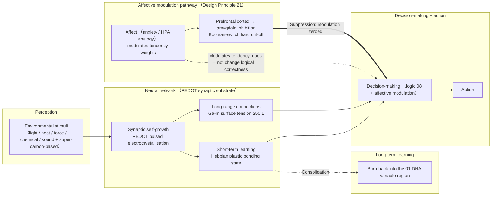
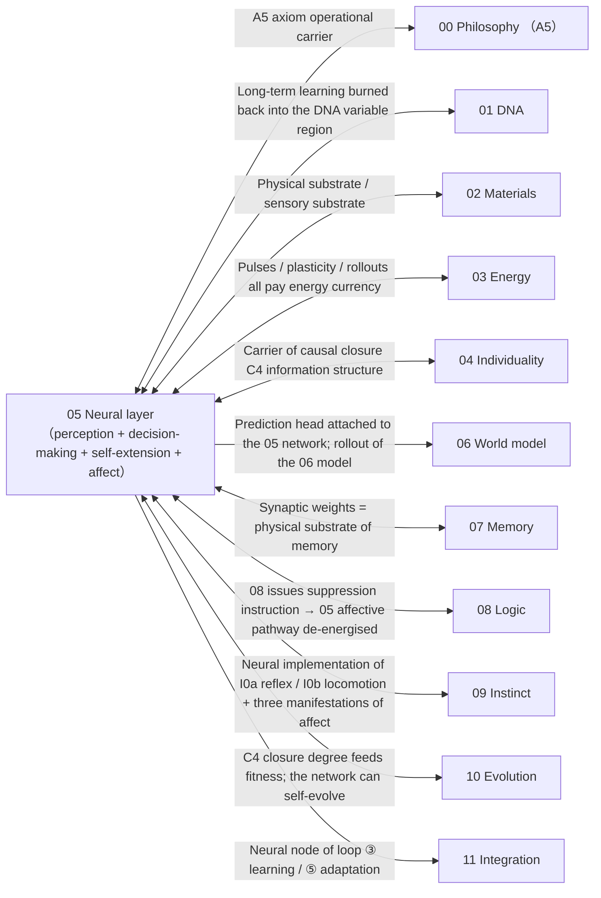

# 05 · Neural Network (S2)

| Item | Value |
| --- | --- |
| Module | Neural network (S2): perception, decision-making, learning and affective modulation |
| Document type | Design report (English edition) |
| Version | v4.1 |
| Dependencies | 02 physical substrate, 03 energy supply, 06 world model, 07 memory, 08 logic |
| Language | English (Chinese edition: `../zh-CN/05_神经网络_设计.md`) |

> **Evidence categories**: `[Ref:…]` literature or data; `[Design decision]` project setting; `[Logical derivation]` derived from listed premises; `[To be verified]` unvalidated placeholder.

---

## 0. Comparison of Design Options

> This section settles two questions: what physically implements the synaptic substrate and long-range connections, and at which layer learning takes place. Self-extension and the affective pathway are less contentious. Each option states its implementation, evidence and feasibility.
> - **Option A (conceptual option, baseline)**: PEDOT electrocrystallisation for a self-growing synaptic substrate, Ga-In liquid-metal microchannels for reconfigurable connections, Hebbian plasticity for short-term change, and long-term results written back into the 01 DNA variable region.
> - **Option B (project reference library)**: the most mature neuromorphic routes in the library: PEDOT synapses, measured Ga-In surface tension, DNA molecular neural networks, and local protein synthesis as a biological reference.
> - **Option C (published research practice)**: published approaches to reconfigurable and self-extending neural networks, including solid-state memristor arrays, liquid-metal soft neural networks and spiking neuromorphic systems.
>
> The options can be combined; see §0.4. The final choice is recorded in §3 and in the appendix on key assumptions and design decisions.

### 0.1 Option A: Conceptual Option (PEDOT + Ga-In, Baseline Option)

| Mechanism | Implementation |
| ------ | --------- |
| Synaptic substrate | PEDOT pulsed electrocrystallisation (electric-field-driven precursor deposition, duty factor controls branching / self-growth) |
| Long-range connections | Ga-In liquid-metal microchannels (surface tension 509→2 mN/m, ~250:1, voltage-tunable → connection "extend/retract") |
| Learning | Short-term = Hebbian plastic bonding state (synaptic strengthening / degradation) / long-term = burn-back into the 01 DNA variable region |
| Self-extension | Environmental stimuli + minimisation of energy dissipation (slime-mould-like); the living individual does not use threshold control |
| Affective modulation | Prefrontal cortex → amygdala inhibition pathway; logic can apply a "Boolean-switch" hard cut-off |

**Evidence and notes (in table row order)**

1. **Synaptic substrate** — [Ref:`05/PEDOT_pulsed_electropolymerization_Eickenscheidt_2019_FULLTEXT`, §Pulsed electropolymerisation, "Eickenscheidt 2019 pulsed electropolymerisation PEDOT self-growing synapse (FULLTEXT)"], `05/PEDOT_PESS_film_growth_kinetics_Mousavi_2023_ABSTRACT`, §Growth kinetics, "Mousavi 2023 PEDOT growth-rate kinetics (to be verified · ABSTRACT only, full text to be supplied)"]
2. **Long-range connections** — [Ref:`05/Khan_2014_PNAS_..._fulltext`, §Giant switchable surface tension, "Khan 2014 PNAS giant switchable surface tension of liquid-metal oxide (509→2 mN/m, retrieval workflow checked against the PNAS original)"]; 509 mN/m = literature value; 2 mN/m = low-temperature-alloy estimation extrapolation [To be verified: DFT/estimation] (not directly measured in PNAS; an estimated value), `05/R4_GaIn_surface_tension_KEY_NUMBERS`
3. **Learning** — [Ref:`05/Hebbian_2023_Fast_Hebbian_Platicity_Working_Memory`, §Fast Hebbian working-memory plasticity, "Hebbian 2023 fast Hebbian plasticity supporting working memory"], `05/Khacef_2022_Spike_Local_Synaptic_Plasticity_Neuromorphic_Survey`, §Review of spike-based local synaptic plasticity, "Khacef 2022 review of spike-based local synaptic plasticity"]; "long-term burn-back to 01" [Design decision]
4. **Self-extension** — [Logical derivation: §3 growth control]; upper bound on synaptic density [To be verified]
5. **Affective modulation** — [Ref: carbon-based `05/Denny_2015`, §Emotion regulation reduces amygdala, "Denny 2015 reappraisal reduces amygdala activation", `05/Jacob_2019`, §Reappraisal brain network, "Jacob 2019 reappraisal social-anxiety brain network", `05/Dore_2017`, §Cognitive control of emotion prediction, "Dore 2017 cognitive control of emotion prediction"]; "Boolean hard cut-off = silicon-based advantage" [Design decision]

**Feasibility and risks**: PEDOT growth kinetics and Ga-In surface tension are both supported by measurements, but whether synaptic self-growth in a soft gel can reach the required density and fidelity has not been verified [To be verified]. The "self-extending neural network" therefore remains a key assumption. [Design decision]

### 0.2 Option B: Based on the Project Reference Library (Most Mature Paradigm)

> The most mature line for the "neural layer" in the reference library is **PEDOT synapses + Ga-In connections + DNA molecular neural networks + local protein synthesis** (synapses have measurements; connections have a measured 250:1).

| Mechanism | Literature paradigm |
| ------ | --------- |
| Synaptic substrate | PEDOT pulsed electropolymerisation self-growth (growth rate measured) |
| Long-range connections | Ga-In surface tension 509→2 mN/m (~250:1, <1 V, <1 s, reversible; 509 = literature value,… See note 1 |
| Molecular neural network | DNA molecular neural network (soft-matter reference, not the silicon-based main route) |
| Synaptic execution mechanism | Local protein synthesis (construction according to blueprint, biological reference) |
| Learning | Hebbian short-term plasticity / spike-based local plasticity |

**Full evidence for table cells**

1. **Long-range connections · Literature paradigm** — Ga-In surface tension 509→2 mN/m (~250:1, <1 V, <1 s, reversible; 509 = literature value, 2 mN/m = low-temperature-alloy estimation extrapolation [To be verified: DFT/estimation], not directly measured in PNAS)

**Evidence and notes (in table row order)**

1. **Synaptic substrate** — [Ref:`05/PEDOT_pulsed_electropolymerization_Eickenscheidt_2019_FULLTEXT`, `05/PEDOT_PESS_film_growth_kinetics_Mousavi_2023_ABSTRACT`]
2. **Long-range connections** — [Ref:`05/Khan_2014_PNAS_..._fulltext` (retrieval workflow checked against the PNAS original), `05/R4_GaIn_surface_tension_KEY_NUMBERS`]
3. **Molecular neural network** — [Ref:`05/Qianlab_2011_DNA_Seeseesaw_Neural_Networks`, `05/teVrugt_2024_DNA_Neural_Networks_arXiv2501`]
4. **Synaptic execution mechanism** — [Ref:`05/Stout_2001_Protein_Synthesis_Synaptic_Sites_Dendrites_Caltech`]
5. **Learning** — [Ref:`05/Hebbian_2023`, `05/Khacef_2022`]

**Key point**: the synaptic substrate and the connections **both have measured values** (PEDOT growth rate, Ga-In 250:1), but **"neural-grade" density / fidelity / lifetime have not been verified** — soft-gel self-extension is a gap.

### 0.3 Option C: Based on Published Research Practice (External Survey, DOIs Checked Item by Item)

> To be verified · **The evidence in this section consists of results of a published-literature survey and is distinguished from the design claims of this project.**
> **Key conclusion (survey direction)**: the three most mature classes of "reconfigurable / self-extending neural networks" worldwide: ① solid-state memristor synaptic arrays (density / reconfigurability at production scale) ② liquid-metal soft neural networks (more systemic than a single Ga-In channel) ③ spiking neuromorphics (SNN, low power, close to the 05 learning layer).

| External paradigm | Mechanism transferable into 05 |
| --------- | ---------------- |
| Solid-state memristor synaptic array | Engineering reference for synaptic "density + reconfigurability ceiling" (more controllable than soft-gel self-growth) |
| Liquid-metal soft neural network | Feasibility of routing multi-channel Ga-In networks (not a single microchannel) in soft bodies |
| Spiking neuromorphics (SNN) | Learning layer uses spikes + local plasticity (close to 05 short-term Hebbian, low power) |

**Evidence and notes (in table row order)**

1. **Solid-state memristor synaptic array** — [Ref:`05/D_NEURAL_SYNAPSE_WBP_2026-09-15.md` S1 Govoreanu 2011 IMEC 10×10nm² Hf/HfOx RRAM (615 citations), S2 Woo 2016 AlOx/HfO2 bilayer RRAM STDP array (514 citations), S3 Ielmini 2018 RRAM full-chain review ]
2. **Liquid-metal soft neural network** — [Ref: the reference library, L1 Markvicka 2018 Nat. Mater. LM–elastomer self-healing multichannel (1060 citations), L2 Wan 2025 Nat. Electron. biomimetic LM synapse, L3 Park 2019 Sci. Adv. 3D reconfigurable LM, L4 Wen 2019 flexible LM probe ] [Design Principle 13: liquid-metal self-healing body = feasibility unverified / frontier, not implemented for the time being, used only as a neural reference]
3. **Spiking neuromorphics (SNN)** — [Ref: the reference library, N1 Furber 2014 SpiNNaker (bronze OA, 1361 citations), N2 Akopyan 2015 TrueNorth 65 mW/1M neurons (≈65 pW/neuron, citable), N3 Lin 2018 Loihi on-chip STDP (135 citations), N4 Wu 2019 STT-MRAM integrate-and-fire (35 citations), N5 Zhang 2018 SNN review (31 citations)]

### 0.4 Option Combination and Baseline Configuration

| Strategy | Content | Applicable conditions |
| ------ | ------ | ------ |
| **A. Pure Option A** | PEDOT + Ga-In, self-growth, no external density reference | Closest to "self-extension", but "whether density is sufficient" is critical |
| **B. A + C hybrid (selected option)** | PEDOT synapses + solid-state memristor array as the underlying constraint for the density / reconfigurability reference (Option C) | Self-growth dominant; when density is insufficient, memristors compensate; high feasibility |
| **C. III dominant** | Solid-state memristors + SNN dominate the neural layer | Most quantifiable, but sacrifices the "self-extension / soft-body" characteristics |

> **Baseline option = B** (PEDOT self-growing synapses + solid-state memristor array as the underlying density / reconfigurability constraint + SNN spike-based learning layer) — the fragility of "uncertain soft-gel self-growth density" is compensated by "the quantifiable density ceiling of solid-state memristors". **This choice is a design position, confirmed by design review** (appendix on key assumptions and design decisions, T-05).
> **Design decision (T6): Option B is adopted (PEDOT self-growing synapses, solid-state memristor array, SNN spike-based learning layer); Options A/C serve as alternatives.**

### 0.5 Detailed Structure of the Neural Layer (Textual Description)

> **This section is the textual description of Figure 3-1 in §3**: without relying on the diagram, it explains layer by layer "what one neural circuit of a silicon-based individual actually is, where perception / connection / learning / decision-making occur, and how the affective pathway traverses it". Based on **Option B (PEDOT self-growing synapses + solid-state memristor underlying constraint + SNN spikes)**.

**Axis 1: the five segments of the physical carrier (from perception to action, "where information comes from and where it goes")**

| Segment | What it is | What it does |
| ---- | -------- | -------- |
| **Segment 1 Perception (HARVEST-IN)** | See note 1 | Bring environmental physical quantities into the neural network (sensing end = 02 devices; 05 handles only "signal routing", Design Principle 17) |
| **Segment 2 Synaptic substrate (CONNECT)** | PEDOT pulsed electrocrystallisation (self-growing synapses) + Ga-In liquid-metal microchan… See note 2 | Connect perceptual signals to decision nodes (short-range = PEDOT synapses, long-range = Ga-In surface tension 250:1 tunable; density = RRAM underlying constraint) |
| **Segment 3 Learning (LEARN)** | Short-term = Hebbian plastic bonding state (synaptic strengthening / degradation); long-term = burn-back into the 01 DNA variable region | Precipitate "recent experience" into long-term weights (short-term in synapses; long-term burned into 01 after 07 memory consolidation) |
| **Segment 4 Decision-making (DECIDE)** | Logic gates (08) + affective modulation (Segment 5) synthesise a decision | Integrate "signals + learning + affective tendency" into a decision (logical conclusion = 08; affect = Segment 5 adjusts tendency only, not correctness) |
| **Segment 5 Affective modulation (EMODULATE)** | Amygdala / HPA analogy (anxiety modulates tendency) + prefrontal cortex → amygdala inhibition (Boolean hard cut-off) | Give decisions "tendency weights" (affect), but can be zeroed instantaneously by a logic instruction (Design Principle 21) |

**Full evidence for table cells**

1. **Segment 1 Perception (HARVEST-IN) · What it is** — Environmental stimuli (light / heat / force / chemical / sound + super-carbon-based: full electromagnetic spectrum / quantum states / magnetic fields) enter the network via the 02 sensory substrate (Design Principle 17, five senses or more, super-carbon-based capability possible)
2. **Segment 2 Synaptic substrate (CONNECT) · What it is** — PEDOT pulsed electrocrystallisation (self-growing synapses) + Ga-In liquid-metal microchannels (long-range connections); when density is insufficient, solid-state RRAM array underlying constraint (Option C)

**Evidence and notes (in table row order)**

1. **Segment 1 Perception (HARVEST-IN)** — [Ref:02 sensory substrate; 05 §4 ↔ 02]
2. **Segment 2 Synaptic substrate (CONNECT)** — Synapses [Ref:`05/PEDOT_pulsed_electropolymerization_Eickenscheidt_2019`, §Pulsed electropolymerisation, "Eickenscheidt 2019 pulsed electropolymerisation PEDOT self-growing synapse"]; connections [Ref:`05/Khan_2014_PNAS_Giant_Switchable_Surface_Activity`, §Giant switchable surface tension, "Khan 2014 PNAS liquid metal 509→2 mN/m, ~250:1"] (509→2 mN/m, ~250:1); density underlying constraint [Ref:`05/D_NEURAL_SYNAPSE_WBP_2026-09-15.md`, §Solid-state memristive synaptic arrays, "S1 IMEC 10×10nm² Hf/HfOx RRAM / S2 bilayer STDP array"] S1/S2/S3 (IMEC 10×10nm² Hf/HfOx RRAM / bilayer STDP array)]
3. **Segment 3 Learning (LEARN)** — Short-term [Ref:`05/Hebbian_2023_Fast_Hebbian_Platicity`, `05/Khacef_2022_Spike_Local_Synaptic_Plasticity`]; long-term burn-back to 01 [Design decision]
4. **Segment 4 Decision-making (DECIDE)** — [Ref:08 logic layer]
5. **Segment 5 Affective modulation (EMODULATE)** — Affective pathway [Ref:`05/Odonovan_2012`, §Threat neurobiological sensitivity, "Odonovan 2012 neurobiological sensitivity to threat", `05/Maniscalco_Rinaman_2017`, §HPA-axis stress, "Maniscalco/Rinaman 2017 HPA-axis stress", `05/Denny_2015`, §Reappraisal reduces amygdala, "Denny 2015 reappraisal reduces amygdala"]; "Boolean hard cut-off = silicon-based advantage" [Design decision]

**Relations among segments (the information-flow chain from left to right in the diagram)**:
```
Segment 1 Perception (environment enters the network) → Segment 2 Synaptic substrate (PEDOT short-range + Ga-In long-range connections)
     → Segment 3 Learning (short-term Hebbian / long-term burn-back to 01) → Segment 4 Decision-making (08 logic + Segment 5 affective modulation)
     → Segment 5 Affective modulation (modulates tendency, prefrontal cortex can hard cut-off)
```
→ **"Information" is not an independent entity; it = Segment 2 synaptic bonding states (short-term) + Segment 1 perceptual signals + Segment 5 affective modulation; reaching a decision relies on Segment 2, precipitating into long-term relies on Segment 3 burn-back to 01, and "deciding properly" relies on the synthesis of Segment 4 + Segment 5.** This chain is "what one neural circuit of a silicon-based individual looks like".

**Axis 2: three mechanism lines (passing through the five segments, "how it grows / how it learns / how it suppresses")**

| Mechanism | Which segments it passes through | What it does |
| ------ | --------- | -------- |
| **Growth (GROW)** | Segment 2 | See note 1 |
| **Learning (LEARN)** | Segment 3 | Short-term Hebbian plastic bonding state (synaptic strengthening / degradation, `Hebbian_2023` / `Khacef_2022`) + long-term burn-back into the 01 variable region (via 07 memory consolidation) |
| **Suppression (SUPPRESS)** | Segment 4 / Segment 5 | Affective pathway = modulator; prefrontal cortex → amygdala inhibition + Boolean-switch ha… See note 2 |

**Full evidence for table cells**

1. **Growth (GROW) · What it does** — PEDOT self-growing synapses (environmental stimuli + minimisation of energy dissipation, slime-mould-like) + Ga-In reconfigurable connections (surface tension 250:1 voltage-tuned); the living individual does not use threshold control; only master-copy recording uses "local current threshold + global cap" (Design Principle 7)
2. **Suppression (SUPPRESS) · What it does** — Affective pathway = modulator; prefrontal cortex → amygdala inhibition + Boolean-switch hard cut-off (C-a individual self-determination + C-b external instruction; both sources can trigger "inhibition driven to maximum"); what is suppressed is "tendency", not "logical correctness"

**Evidence and notes (in table row order)**

1. **Growth (GROW)** — Self-growth [Logical derivation: growth control]; threshold control [Ref:05 §3]; master-copy vs living-individual split [Design Principle 7]
2. **Learning (LEARN)** — Short-term [Ref:05 Hebbian/Khacef]; long-term burn-back [Design decision]
3. **Suppression (SUPPRESS)** — [Ref:05/Denny_2015/Dore_2017/Jacob_2019 (prefrontal inhibition)] + [Design decision]

**Relationship of "fixed (non-evolvable) + dynamic" in growth / learning** (why this design can "both self-extend and learn"):
- **The self-growth topology of the Segment 2 synaptic substrate = dynamic** (environmental stimuli + dissipation minimisation, no hard setting);
- **The "mechanism" of Segment 3 learning = fixed (non-evolvable)** (short-term Hebbian / long-term burn-back to 01, cannot be evolved away); "what is learned" = dynamic;
- **The rule that Segment 5 affect "can be suppressed by logic" = fixed (non-evolvable)** (Design Principle 21, same as I0); affect "intensity / expression" = dynamic.
- **The division into "fixed (non-evolvable) mechanisms + dynamic values" is precisely the corresponding landing point of Design Principle 8 (I0 fixed (non-evolvable)) + Design Principle 21 (affect suppressibility fixed (non-evolvable)) + Design Principle 22 (basic skills / logic taught, positions not taught)** [Logical derivation: the three principles map respectively onto the fixed (non-evolvable)–dynamic dichotomy of Segment 2 / Segment 3 / Segment 5].

**Summary of key points**
> **One neural circuit of a silicon-based individual = Segment 1 perception entering the network → Segment 2 PEDOT self-growing synapses (short-range) + Ga-In liquid metal (long-range, surface tension 250:1 tunable) connections → Segment 3 short-term Hebbian plasticity / long-term burn-back into the 01 DNA variable region → Segment 4 logic (08) + Segment 5 affective modulation synthesise a decision; affect can be zeroed by a prefrontal cortex → amygdala Boolean hard cut-off (what is suppressed is tendency, not logical correctness). Growth topology dynamic, learning mechanism fixed (non-evolvable), affect suppressibility fixed (non-evolvable) — this is the concrete form of "self-extension + learnability + affect modulability".**

---

---

## 1. Design Objectives
Enable the individual to **perceive the environment → decide → act**, with self-extension (synaptic self-connection, spontaneous network growth) + learnability (Hebbian plasticity) + affective modulation that can be suppressed by logic (Design Principle 21).

## 2. State of Related Research + Different Implementation Approaches (Design Principle 2)

| Route | Status | Literature anchor | Trade-off | Evidence category |
| ------ | ------ | --------- | ------ | --------- |
| **PEDOT electrocrystallisation (synaptic substrate)** | Mature | See note 1 | Verified · self-growing synapse | [Ref] growth rate measured; "soft-gel self-growth density sufficient" [To be verified] |
| **Ga-In liquid metal (reconfigurable connections)** | Frontier | See note 2 | Verified · neural connection "extend/retract" | [Ref] 250:1 measured; "network-level multi-channel routing" [To be verified] |
| **Hebbian plasticity (learning)** | Mature | [Ref:`05/Hebbian_2023_Fast_Hebbian_Platicity_Working_Memory_arXiv`, `05/Khacef_2022_Spike_Local_Synaptic_Plasticity_Neuromorphic_Survey_arXiv2209`] | Verified · synaptic strengthening / degradation | [Ref] short-term plasticity; long-term burn-back into 01 [Design decision] |
| **DNA neural network** | Frontier | [Ref:`05/Qianlab_2011_DNA_Seeseesaw_Neural_Networks`, `05/teVrugt_2024_DNA_Neural_Networks_arXiv2501`] | Soft-matter neural network reference | [Ref] molecular neural network; used as reference only, not migrated to the silicon-based carrier [Design Principle 24] |
| **Local protein synthesis (construction according to blueprint)** | Biological reference | [Ref:`05/Stout_2001_Protein_Synthesis_Synaptic_Sites_Dendrites_Caltech`] | Synaptic execution mechanism | [Ref] carbon-based execution mechanism reference |
| **PEDOT bioelectronics** | Mature | [Ref:`05/DONAHUE_2020_PEDOT_bioelectronics_TAILORING_FULLTEXT`] | Biological interface | [Ref] PEDOT biological interface |
| **Affective inhibition pathway (prefrontal cortex → amygdala)** | Mature (carbon-based) | See note 3 | Verified · neural basis for affect being suppressible by logic | [Ref] carbon-based prefrontal–amygdala; "silicon-based Boolean hard cut-off" [Design decision] |
| **Anxiety / survival stress (HPA axis)** | Mature (carbon-based) | [Ref:`05/Odonovan_2012_Exaggerated_Neurobiological_Sensitivity_to_Threat_PMC4361087_FULLTEXT`, `05/Maniscalco_Rinaman_2017_Interoceptive_Neuroendocrine_HPA_Stress_PMC5433881_FULLTEXT`] | Anxiety / stress mechanism reference | [Ref] HPA-axis reference |
| **Learned helplessness vs active coping (coping phenotype)** | Mature (carbon-based) | [Ref:`05/Maier_2016_Learned_Helplessness_at_Fifty_PMC4920136_FULLTEXT`, `05/Tafet_2025_Learned_Helplessness_Controllability_PMC12417506_FULLTEXT`] | Neural differentiation of the three manifestations of anxiety (passive / active / indifferent) | [Ref] differentiation by stressor controllability |

**Full evidence for table cells**

1. **PEDOT electrocrystallisation (synaptic substrate) · Literature anchor** — [Ref:`05/PEDOT_pulsed_electropolymerization_Eickenscheidt_2019_FULLTEXT` (pulsed electropolymerisation, duty factor controls branching), `05/PEDOT_PESS_film_growth_kinetics_Mousavi_2023_ABSTRACT` (growth rate measured)]
2. **Ga-In liquid metal (reconfigurable connections) · Literature anchor** — [Ref:`05/Khan_2014_PNAS_Giant_Switchable_Surface_Activity_Liquid_Metal_Oxidation_fulltext` (surface tension 509→2 mN/m, ~250:1, <1 V, <1 s, retrieval workflow checked against the PNAS original; 2 mN/m = low-temperature-alloy estimation extrapolation [To be verified: DFT/estimation], not directly measured in PNAS); `05/R4_GaIn_surface_tension_KEY_NUMBERS`] (numerical extract)
3. **Affective inhibition pathway (prefrontal cortex → amygdala) · Literature anchor** — [Ref:`05/Denny_2015_Getting_Over_It_Emotion_Regulation_Amygdala_PMC4567486_FULLTEXT` (reappraisal reduces amygdala), `05/Dore_2017_Neural_Predictors_Decisions_Cognitively_Control_Emotion_PMC5354318_FULLTEXT` (volitional prediction), `05/Jacob_2019_Reappraisal_Social_Anxiety_Brain_Network_PMC6611456_FULLTEXT` (network hierarchy)]

**Selection conclusion** [Design decision]: **synaptic substrate = PEDOT electrocrystallisation** (growth rate measured [Ref], self-growth) "connected" via **Ga-In liquid-metal microchannels** (250:1 surface tension tunable [Ref], reconfigurable connections); **learning = short-term Hebbian (plastic bonding state) / long-term burn-back into the 01 DNA variable region** (burn-back to 01 [Design decision]); **affect = prefrontal cortex → amygdala inhibition + Boolean-switch hard cut-off** (carbon-based inhibition measured [Ref], Boolean cut-off is a silicon-based advantage [Design decision]). Where density / reconfigurability is uncertain, a solid-state memristor array underlying constraint is used (Option C, §0.4).

## 3. Design (v3)

**Figure 3-1: neural layer = perception → synaptic substrate (PEDOT self-growth) → decision-making → action, learning attached to short-term / long-term + affective pathway suppressible**



> Note: Perception reaches decision nodes through the synaptic matrix; the affective pathway is a modulatory branch. Short- and long-range connections use different physical implementations.

> **Legend**: environmental stimuli → **PEDOT synaptic self-growth** (synaptic substrate) + **Ga-In connections** (250:1 tunable) + **short-term Hebbian learning** → decision-making + action. **The affective pathway (modulator) adjusts tendency weights without changing logical correctness**; prefrontal cortex → amygdala inhibition + a Boolean switch can **hard cut-off** affective modulation (Design Principle 21). Short-term plastic bonding states are **burned back into the 01 DNA variable region after consolidation** (long-term). Energy side: pulses / plasticity / rollouts all pay 03 energy currency.

- Synaptic substrate: PEDOT electrocrystallisation (electric-field-driven precursor deposition, Hebbian strengthening / degradation) [Ref:`05/PEDOT_pulsed_electropolymerization_Eickenscheidt_2019_FULLTEXT`]
- Long-range connections: Ga-In microchannels (surface tension 250:1 voltage-tunable → reconfigurable connections) [Ref:`05/Khan_2014_PNAS_..._fulltext`]
- Growth control: **local current threshold + global current cap** (short-circuit prevention, Design Principle 7 — used for master-copy recording; not used in living-individual self-evolution) [Design decision]
- Learning: short-term Hebbian (plastic bonding state) [Ref:`05/Hebbian_2023`] / long-term (burn-back into the 01 DNA variable region) [Design decision]
- Self-extension: environmental stimuli + minimisation of energy dissipation (slime-mould-like; the living individual does not use threshold control) [Logical derivation: growth control]

### 3.1 Affective Modulation Pathway (Design Principle 21, Newly Added)
**Objective**: affect exists (as a "seasoning") but **can be hard-suppressed by a logic instruction**, preserving absolute logical capability.

**Carbon-based reference (7 papers retrieved, all in the 05 folder)**:
- **Affective pathway (amygdala / HPA)**: threat / survival stress → anxiety (HPA-axis activation, `Odonovan_2012`, `Maniscalco_Rinaman_2017`)
- **Three manifestations of affect** (`Maier_2016`, `Tafet_2025`): facing a threat → passive (learned helplessness) / active coping (actively seeking help) / indifferent
- **Prefrontal cortex → amygdala inhibition** (`Denny_2015`, `Jacob_2019`): cognitive reappraisal **reduces amygdala response and increases prefrontal response**, with lasting effect
- **Whether volitional decision-making suppresses** (`Dore_2017`): prefrontal activity predicts whether an individual actively suppresses affect

**Silicon-based implementation (dual mode, corresponding to the two requirements "seasoning + suppressible")**:
- **Mode 1 · Normal operation (affective seasoning)**: affective pathway = modulator — threat / stress signals → anxiety (HPA analogy) → modulate "tendency weights" (certain strategies are more readily selected), **without changing logical correctness**
  - Carbon-based analogy: the amygdala drives anxiety, and prefrontal executive control decides "whether to suppress"
  - Three manifestations: passive (inhibition tendency) / active coping (help-seeking / resource-seeking tendency) / indifferent (no tendency change) — determined by stressor controllability (`Maier_2016`, `Tafet_2025`)
- **Mode 2 · Logical suppression (absolute-logic guarantee)**: **on receiving an explicit "no affect mixed in" instruction → the prefrontal cortex → amygdala inhibition pathway is driven to maximum and affective modulation is zeroed**
  - Silicon-based advantage: **Boolean-switch hard cut-off** (carbon-based systems cannot achieve "absoluteness"; prefrontal inhibition is gradual; silicon-based systems can zero instantaneously)
  - **Suppression switch = C (dual source, set at the 2026-09-13 design review)**:
    - **C-a individual self-determination**: the individual judges "absolute logic is now required" (analogous to carbon-based prefrontal autonomous control) and drives inhibition to maximum autonomously
    - **C-b external instruction**: the "no affect mixed in" instruction issued by the system is executed passively by the individual
    - Both can trigger the same "inhibition driven to maximum" switch
  - Implementation: the 08 logic subsystem (C-a self-determination) or an external source (C-b) sends a "suppression" signal → the modulation weights of the 05 affective pathway are directly de-energised → the individual enters a "pure logic" state
  - **Affect is not a premise of reasoning**: after suppression, logical conclusions are unaffected (affect is only a "tendency", not "reasoning evidence")

**Design implications**:
- The affective pathway is a **modulator + a switch suppressible by logic**, not a "decision-maker"
- Coupling with the 08 logic subsystem: the 08 "absolute logic" instruction → hard cut-off of the 05 affective pathway
- Coupling with 09 instincts: the three manifestations of anxiety (passive / active / indifferent) belong to the I-group instincts (evolvable); **the rule "can be suppressed by logic" is non-evolvable** (same as I0 fixed (non-evolvable))

### 3.2 Synaptic Repair Subsystem (Design Principle 16)
**Objective**: Design Principle 16 requires the neural layer to possess "synaptic repair" — damage or mismatch of synapses (plastic bonding state / PEDOT impedance / Ga-In microchannel diameter) must be detectable and correctable, analogous to carbon-based mismatch-repair enzymes + immunity + self-repair, so that "replicability" genuinely supports "long-term maintainability".

**Mechanism (mapped onto physical structure, not a black box)**:
- Detection: during 07 memory consolidation, "current synaptic weights" are compared with the "07 weight baseline (intergenerational burned-in values)"; deviation beyond the threshold = damage / mismatch
- Correction: short-term plastic bonding state write-back (Hebbian reverse regulation, [Ref:`05/Hebbian_2023` / `05/Khacef_2022` local plasticity]) + long-term burn-back into the 01 DNA variable region after 01 ECC checking (§01 §4 repair subsystem)
- Linkage: neural-layer synaptic damage is merged at the "memory consolidation" step into the 01 §4 full-chain check–repair loop (readout → ECC comparison → mismatch localisation → correction)
- **Pending experimental verification (N1–N5 to be calculated and experimentally verified, including the synaptic repair item)**: synaptic-damage detection threshold, correction precision, PEDOT impedance restabilisation time — all `[To be verified by calculation and experiment; without evidence they are not used as a baseline]`

## 4. Relations with Other Parts (Interface Contract, All Dimensions)

> **Completeness principle**: 05 is the **decision-making / perception operational layer and the carrier of "self-extension / affective pathway"** — it must establish a relation with every dimension (missing one item = incomplete document).

**Figure 4-1: overview of the relations between 05 (neural layer) and all 12 volumes**



> Note: The source of an arrow is the value provider and the target is the receiver; measurable quantities are defined by the interface contracts of the respective volumes.

| Interface | Data flow (physical quantities / information, not concepts) | Invariant (measurable) | Evidence category |
| ------ | --------------------------- | ------------- | --------- |
| **↔ 00 Philosophy** | 05 = operational carrier of the A5 learning axiom (A5 is realised through the 05 learning layer) | Learning layer = physical implementation of A5 | [Ref:00 A5] |
| **↔ 01 DNA** | Long-term learning = burn-back into the 01 DNA variable region (synaptic consolidation → DNA) | Long-term weights ∈ 01 variable region | [Design decision] |
| **↔ 02 Materials** | Physical substrate / sensory substrate (PEDOT / Ga-In grow on the 02 soft-gel host) | Device attachment to the substrate holds | [Ref:02 carrier; pending calculation and verification] |
| **↔ 03 Energy** | Pulses / plasticity / rollouts all pay energy currency | Neural-layer energy consumption [To be verified] | [Ref:03 A2 order (learning attached to 03)] |
| **↔ 04 Individuality** | Carrier of the information structure of causal closure C4 (05+07+08 constitute 04 C4) | Closure degree of information structure [To be verified by calculation: B1] | [Logical derivation: 04 C4 + 05] |
| **→ 06 World model** | Prediction head attached to the 05 network, rollout of the 06 model | Energy consumption / value of N rollout actions [To be verified by calculation: 06 W3] | [Logical derivation: 06 prediction head attached to 05] |
| **↔ 07 Memory** | Synaptic weights = physical substrate of memory (7 memory read/write = 5 synaptic plasticity) | Synaptic fidelity / lifetime [To be verified] | [Logical derivation: 07 attached to 05 synapses] |
| **↔ 08 Logic** | 08 issues a "suppression" instruction → 05 affective pathway de-energised (Boolean hard cut-off) | Suppression response time [To be verified] | [Ref:08 + 05 affective pathway] |
| **↔ 09 Instinct** | Neural implementation of I0a reflex / I0b locomotion + three manifestations of affect | Reflex-loop latency [To be verified] | [Ref:09 I0a/I0b] |
| **↔ 10 Evolution** | C4 closure degree feeds fitness; the network itself can self-extend / self-evolve | Network fitness input [To be verified] | [Logical derivation: 10 network evolvable] |
| **→ 11 Integration** | Neural node of loop ③ learning / ⑤ adaptation (learning occurs in 05) | Closure of loops ③⑤ requires 05 to be operational | [Ref:11 §5 loops] |

**Contract principle**: interface "data" must be **physically / informationally measurable quantities** (synaptic fidelity / lifetime / energy consumption / closure degree), not concepts; where no measured value is given, it is marked "value pending DFT in Volume 05 / other volumes".

**Evidence categories (§4)**:
- A5 carrier → 00 [Ref:00 A5]
- Long-term burn-back ↔ 01 [Design decision]
- Substrate ↔ 02 / energy consumption ↔ 03 [Ref:02 carrier + 03 A2]
- C4 information structure ↔ 04 [Logical derivation: 04 C4]
- Prediction head → 06 / synaptic weights ↔ 07 [Logical derivation: 06/07 attached to 05]
- Suppression instruction ↔ 08 / I0 implementation ↔ 09 [Ref:08 logic + 09 I0]
- Fitness / self-evolution ↔ 10 / loops ③⑤ → 11 [Logical derivation: 10 + 11 §5]

---

## 5. To Be Verified by Experiment / DFT (Each Item: Formula + Window + Value Provider, with Quantitative Conditions)

| # | Open item | Formula/inequality to be satisfied | Parameter window (design setting) | Value provider |
| --- | -------- | --------------------- | -------------------- | ---------- |
| N1 | Upper bound on PEDOT synaptic density (soft-gel self-growth) | Synaptic density ρ ≥ lower bound on decision-node connectivity C_min (the network must be "dense enough" for effective decision-making) | ρ target [Design decision]; growth rate already measured [Ref:`05/Mousavi_2023`] | 05 first-principles calculation and experiment (whether self-growth in the soft gel can reach ρ) |
| N2 | Number of reversible Ga-In surface-tension cycles (lifetime) | Number of reversible cycles N_rev ≥ total network rewiring demand | 250:1 measured for a single cycle [Ref:`05/Khan_2014_PNAS`, `05/R4_GaIn_surface_tension_KEY_NUMBERS`]; cycle lifetime [To be verified by experiment] | 05 experiment (surface-tension decay of Ga-In after N cycles) |
| N3 | Solid-state memristor synaptic array density (underlying constraint) | Number of array synapses N_syn ≥ demand when soft-gel self-growth is insufficient (Option C underlying constraint) | Order of magnitude of device count (e.g. 23,040-cell class) [Ref: to be verified in the §0.3 retrieval workflow] | 05/§0.3 external verification (memristor-array density SOTA) |
| N4 | Affective pathway modulation strength + logical suppression response time | After suppression, modulation weight w_emo → 0, response time t_sup ≪ decision period | Carbon-based prefrontal inhibition measured [Ref:`05/Denny_2015`, `05/Dore_2017`]; silicon-based Boolean hard cut-off t_sup [To be verified] | 05 DFT + 08 coordination (physical implementation of the Boolean switch) |
| N5 | Differentiation of the three manifestations of anxiety (passive / active / indifferent) in silicon-based plasticity | Stressor controllability C_ctrl → thresholds of the three manifestations | Carbon-based differentiation exists [Ref:`05/Maier_2016`, `05/Tafet_2025`]; silicon-based thresholds [To be designed] | 05 + 09 Instinct (three manifestations attached to the 09 I group) |

**Note**: each of N1–N5 gives "**what to compute + threshold/window + value provider**"; growth rate, Ga-In 250:1 and carbon-based affective inhibition are all **literature measurements** (attached to `05/`, files can be opened), but **the silicon-based side** (soft-gel density, reversible lifetime, Boolean hard cut-off, thresholds of the three manifestations) **awaits 05 first-principles calculation and experiment**; this layer fixes no baseline values (Design Principle 24).

---

## 10. Scope and Known Limitations (Design Principle 24)

- **Determinable content (given in this document)**: §0.5 structure of the five physical-carrier segments (perception / synapse / learning / decision-making / affect) + three mechanism lines (growth / learning / suppression), §2 selection conclusion (PEDOT synapses + Ga-In connections + short-term Hebbian / long-term burn-back to 01 + Boolean suppression of affect), §3.1 dual mode of affective modulation (normal modulation + logical hard suppression), §4 interfaces with all 12 volumes.
- **Undeterminable content (only formulae and boundaries given; placeholders are not treated as baseline values)**: N1 soft-gel synaptic density, N2 Ga-In reversible lifetime, N3 memristor-array density, N4 Boolean hard cut-off response time, N5 thresholds of the three manifestations of anxiety — **all pending 05 first-principles calculation and experiment**; this document has written them to the degree of engineering readiness of "what to compute + value provider".
- **Key assumptions (to be fixed by design review)**:
  - **"Whether synaptic self-growth in a soft gel can reach sufficient density / fidelity"** — PEDOT growth rate + Ga-In 250:1 both have measurements, but **"neural-grade" density / fidelity / lifetime in a soft matrix have not been verified**; this is the most important key assumption of 05 (analogous to T0 in 01/02/03), supplemented as T-05 in the appendix on key assumptions and design decisions. The **underlying constraint reference** has been verified: `05/D_NEURAL_SYNAPSE_WBP_2026-09-15.md` S1/S2/S3 (solid-state RRAM array density / reconfigurability SOTA) + N1/N2 (SNN hardware TrueNorth 65 mW/1M neurons ≈65 pW/neuron, citable) — when soft-gel density is insufficient, the "quantifiable density ceiling of solid-state RRAM" provides compensation, so the design no longer proceeds without a fallback constraint.
  - **"Boolean hard cut-off of affect = silicon-based advantage"** — [Design decision]; carbon-based prefrontal inhibition is gradual and has measurements (`05/Denny_2015` / `Dore_2017`), but the physical implementation of "instantaneous silicon-based zeroing" is undetermined.
  - **Long-term learning burned back into the 01 DNA variable region** — [Design decision]; Lamarckian epigenetic inheritance; whether it violates the central dogma is to be determined by design review.

---

> Corresponding Chinese edition: `../zh-CN/05_神经网络_设计.md`
