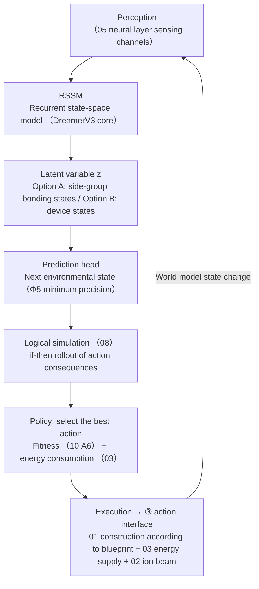
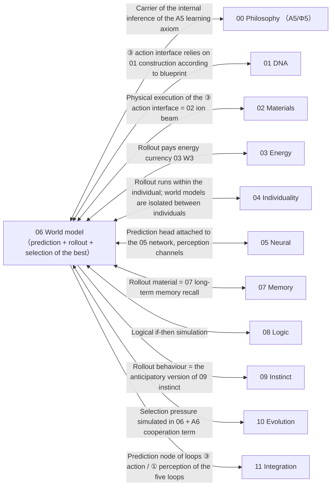

# 06 · World Model (S5)

| Item | Value |
| --- | --- |
| Module | World model (S5): internal predictive model and action-consequence simulation |
| Document type | Design report (English edition) |
| Version | v4.1 |
| Dependencies | 05 prediction head, 07 rollout material, 08 logical simulation |
| Language | English (Chinese edition: `../zh-CN/06_世界模型_设计.md`) |

> **Evidence categories**: `[Ref:…]` literature or data; `[Design decision]` project setting; `[Logical derivation]` derived from listed premises; `[To be verified]` unvalidated placeholder.

---

## 0. Comparison of Design Options

> This section decides two things: where the latent variables of the world model reside (digital RNN states, silicon device states, or a representation decoupled from the carrier), and how the model passes its predictions to the action interface. All three options share one algorithmic foundation, DreamerV3 (MIT licence, JAX implementation, fixed hyperparameters across domains) [Ref:`06/DreamerV3_Hafner_2023_arXiv2301.04104`]; they differ only in the latent-variable carrier and the action mapping.
> - **Option A (conceptual option, baseline)**: latent variables held directly in side-group bonding states, so that the semantics of a digital latent variable map onto a physical state ("physics as computation").
> - **Option B (project reference library, selected)**: latent variables held in device states with experimental neuromorphic support, such as spiking CPG devices, NEXUS gate circuits or magnetic reservoirs; side-group bonding states are not used because they lack such support.
> - **Option C (published research practice)**: two lines of work, namely physical machine learning and memristor RNNs that use device states as latent variables, and architectures that decouple the world model from the actuators to simplify implementation.
>
> The final choice is recorded in §3.3 and in the appendix on key assumptions and design decisions.

### 0.1 Option A: Concept Option (Latent Variables = Side-Group Bonding States, Baseline Option)

| Stage | Specific implementation |
| ------ | --------- |
| Foundation | DreamerV3 (RSSM + purely discrete categorical latent variables + fixed hyperparameters across 49 domains) |
| Latent variables | RSSM latent variable z attached directly to side-group bonding states (§02 representation stack reads side-group bonding states = world model state) |
| Action mapping | Three-step operator: action (01 frame) → 02 places side groups → latent variable update → 03 energy consumption |

**Evidence and notes (in table row order)**

1. **Foundation** — [Ref:`06/DreamerV3_Hafner_2023_arXiv2301.04104`, §DreamerV3/RSSM, "Hafner 2023 arXiv2301.04104 DreamerV3: RSSM + discrete latent variables, fixed hyperparameters across 49 domains, algorithmic foundation of the world model"]
2. **Latent variables** — [Design decision]; "digital vectors attached to chemical bonding states" has no DFT pathway [To be verified by calculation and experiment, critical]
3. **Action mapping** — [Logical derivation: attached to 01/02/03]; precision / error / energy-consumption coefficient of each step [To be verified]

**Feasibility and risks**: this is the most radical option and the closest to "physics as computation", but there is no derivable path and no DFT calculation linking the semantics of digital RNN latent variables to chemical side-group bonding states. Of the class C options, it carries the greatest feasibility uncertainty. [Design decision]

### 0.2 Option B: Based on the Project Reference Library (Latent Variables = Device States, Selected Option)

> The most mature line in the reference library for "device states as computational states" is **neuromorphic CPG devices + NEXUS gate circuits + magnetic reservoirs** (with experiments).

| Stage | Literature paradigm |
| ------ | --------- |
| Latent variables = device states | Spiking CPG devices (SNN device states as states), NEXUS gate circuits (ANN↔SNN bit-exact equivalence), magnetic thin-film physical reservoirs |
| Action mapping | Same three-step operator as Option A, but the latent variables read device states rather than side-group bonding states |
| Rollout cost | Rollout consumes energy currency (§03); N is set by the budget |

**Evidence and notes (in table row order)**

1. **Latent variables = device states** — [Ref:`09/Neuromorphic_Spiking_CPG_arXiv2101.09709`, §spiking CPG device states, "2015/2021 spiking CPG uses device states as states"], `08/NEXUS_2026_Neuromorphic_Gate_Circuits_arXiv2601.21279`, §ANN↔SNN bit-exact equivalence, "NEXUS 2026 ANN↔SNN bit-exact gate circuit equivalence"], `_公开研究实践参照/Dale_2021_Reservoir_Computing_Magnetic_Thin_Films_arXiv2101.12700`, §magnetic thin-film physical reservoir, "Dale 2021 magnetic thin-film physical reservoir computing"]
2. **Action mapping** — [Logical derivation: attached to 01/02/03]
3. **Rollout cost** — [Ref:03 W3]

**Key point**: placing "latent variables" on **device states supported by neuromorphic experiments** has far higher feasibility than Option A and does not abandon "physics as computation".

### 0.3 Option C: Based on Published Research Practice (Supplementary Verification Item by Item + Decoupling Alternative)

> To be verified · **The evidence in this section is the result of a survey of published literature, distinguished from the design claims of this project.**

| External paradigm | Mechanism transferable into 06 |
| --------- | ---------------- |
| Physical machine learning (physical ML) | Device states serve directly as world-model latent variables (the ceiling of Option B, demonstrating that "device states as latent variables" has experiments rather than unverified feasibility) |
| Spin / memristor RNN | Memristors store RNN weights; migration of device states = state update (device-level reference) |
| Decoupling of the world model from actuators | Prediction / planning is external, the carrier only executes, and latent variables need not = physical states (the ceiling of Option C) |

**Evidence and notes (in table row order)**

1. **Physical machine learning (physical ML)** — [Ref:`06/B_WORLD_MODEL_RNN_DEVICE_2026-09-15.md`, §device-state world model verified, "R1 Liyuan2026 MTJ magnetic tunnel junction RC / R2 Shreya2023 vortex MTJ RC / R3 Liang2023 photonic delay line RC (all ), demonstrating device states as latent variables"] R1 Liyuan 2026 MTJ magnetic tunnel junction RC (IOP, synchronized oscillation = nonlinear resource) + R2 Shreya 2023 vortex MTJ RC ( number of particles = latent variable dimension) + R3 Liang 2023 photonic delay line RC ( optical signal = reservoir) + `_公开研究实践参照/Dale_2021_磁储层` (magnetic thin-film physical reservoir) in the reference library]
2. **Spin / memristor RNN** — [Ref: same reference library above, §spin/memristor RNN verified, "R4 Stoliar2021 minimal recurrent spiking NN in solid-state devices (PRA, DOI 10.1103/physrevapplied.16.034030) / R5 Srikimkaew2023 nanoparticle-network memristor reservoir computing (ACS, DOI 10.1021/acsaelm.3c01046), mislabelling in the previous batch corrected"] R4 Stoliar/Schneegans/Rozenberg 2021 *Minimal Recurrent Spiking NN in Solid-State Device*, PRA 16, 034030 (DOI 10.1103/physrevapplied.16.034030, full-text access restricted, the previous mislabelling of 2025/UCN spin corrected) + R5 Srikimkaew 2023 *In-Material Reservoir Computing via Nanoparticle Network Memristor*, ACS Appl. Electronic Mater. DOI 10.1021/acsaelm.3c01046 (full-text access restricted, the previous Ag-Ag₂S with no written source replaced); the mechanism is citable, and the energy-per-pulse / state-count values await supplementation by the CDP]
3. **Decoupling of the world model from actuators** — [Ref:`06/Wang_2022_DayDreamer_arXiv2206.14176`, §DayDreamer, "Wang 2022 DayDreamer: real-robot world-model reinforcement learning (arXiv2206.14176, verified in the reference library)"]

### 0.4 Option Combinations and Baseline Configuration

| Strategy | Content | Applicable conditions |
| ------ | ------ | ------ |
| **A. Pure Option A** | Latent variables attached to side-group bonding states (retain the current baseline) | The most radical, a key assumption, not yet operable |
| **B. B primary + A retained as P2 (selected option)** | Latent variables placed on device states (neuromorphic CPG / magnetic reservoir); the side-group bonding state version is enabled only after calculation verification | High feasibility, does not abandon "physics as computation" |
| **C. Option C decouples the underlying constraint** | The world model can be decoupled from the carrier (external prediction + physical feedback) | The most conservative, abandons "in-mind rollout is physics" |

> **Baseline option = B**: latent variables are placed on device states supported by neuromorphic experiments. This is considerably more feasible than A while keeping the "physics as computation" direction. See §3.3 for the reasoning and the appendix on key assumptions and design decisions for the evidence.

### 0.5 Detailed Structure of the World Model (Textual Description)

> **This section is the textual description of Figure 3-1 in §3**: it does not rely on the diagram and explains layer by layer "what the world model of a silicon-based individual actually is, how the cycle runs, where the latent variables reside, and how the action interface passes to the outside". It is based on **Option B (latent variables = device states + DreamerV3 foundation + ③ action interface)**.

**Axis 1: the 6 loops of the running cycle (from perception to action, "world model running cycle")**

| Loop | What it is | What it does | Evidence category |
| ---- | -------- | -------- | --------- |
| **① Perception** | 05 neural layer sensing channels (five senses / super-carbon-based signals) | Brings current environmental physical quantities into the world model | [Ref:05 neural layer] |
| **② RSSM** | DreamerV3 recurrent state-space model | Converts the perception sequence into latent variable z (discrete categorical) | [Ref:`06/DreamerV3_Hafner_2023_arXiv2301.04104` (MIT/JAX, fixed hyperparameters across 49 domains)] |
| **③ Latent variable z** | Option A: side-group bonding states [To be verified] / Option B: device states (spiking CPG / NEXUS gates / magnetic reservoirs) | The "internal state" of the world model, predicted by the next loop | Device states [Ref:`09/Neuromorphic_Spiking_CPG_arXiv2101.09709`, `08/NEXUS_2026`, `_公开研究实践参照/Dale_2021_Reservoir_Computing_Magnetic_Thin_Films`] (B-line SOTA verified in the reference library) |
| **④ Prediction head** | Next environmental state (Φ5 minimum precision) | Predicts "the next step of the environment"; the lowest landing point of the A5 learning axiom | [Ref:00 Φ5] |
| **⑤ Logical rollout** | 08 logical if-then simulation of the consequences of N candidate actions | Virtually runs actions in the world model (not real execution), paying rollout energy consumption (03 W3) | [Ref:08 logic + 03 W3] |
| **⑥ Selection of the best + ③ action interface** | Selects the best by fitness (10 A6) + energy consumption (03) → real execution via the ③ action interface → changes the world model state → back to ① | Applies the virtual rollout to the real world (01 construction according to blueprint + 03 energy supply + 02 ion beam, three-step operator) | [Logical derivation: §3.3 W4 three-step operator attached to 01/02/03] |

**Relations between loops (left to right in the diagram + return loop)**:
```
① Perception → ② RSSM → ③ Latent variable z → ④ Prediction head → ⑤ Logical rollout → ⑥ Selection of the best + ③ action interface → (change world) → back to ①
```
→ **The "world model" is not an independent thing; it = the running of ③ latent variable z (device states / side-group bonding states) + the prediction / rollout of ④⑤ + the action interface of ⑥; perception depends on ①, prediction on ②④, rollout on ⑤, and "acting on the real world" on ⑥ (③ action interface).** This cycle is "how a world model of a silicon-based individual runs".

**Axis 2: three mechanism lines (passing through the 6 loops, "how latent variables are placed / how rollout runs / how action is applied")**

| Mechanism | Which loops it passes through | What it does |
| ------ | --------- | -------- |
| **Placing latent variables (POTENTIAL)** | ②③ | Where the RSSM latent variables are placed: Option A = side-group bonding states (most rad… See note 1 |
| **Rollout (SIMULATE)** | ⑤⑥ | Logical if-then virtual running of N actions, paying rollout energy consumption (03 W3); N is set by the energy budget |
| **Action (ACT)** | ⑥ | ③ action interface = 01 construction according to blueprint + 03 energy supply + 02 ion be… See note 2 |

**Full evidence for table cells**

1. **Placing latent variables (POTENTIAL) · What it does** — Where the RSSM latent variables are placed: Option A = side-group bonding states (most radical, critical, no DFT); Option B = device states (spiking CPG / NEXUS gates / magnetic reservoirs, with neuromorphic experiments, selected option); Option C = decoupling from actuators (pragmatic, abandons "in-mind rollout is physics")
2. **Action (ACT) · What it does** — ③ action interface = 01 construction according to blueprint + 03 energy supply + 02 ion beam (three-step operator: action frame → 02 placement → latent variable z update → 03 energy consumption); applies the rollout to the real world

**Evidence and notes (in table row order)**

1. **Placing latent variables (POTENTIAL)** — Side-group bonding states [Design decision]; device states [Ref:`09/Neuromorphic_Spiking_CPG` + `08/NEXUS_2026` + Dale 2021 magnetic reservoir]; decoupling [Ref:`06/Wang_2022_DayDreamer`]
2. **Rollout (SIMULATE)** — [Ref:08 logic + 03 W3]; "N set by the budget" [Design decision]
3. **Action (ACT)** — [Logical derivation: §3.3 W4 three-step operator attached to 01/02/03]; precision / energy-consumption coefficient of each step [To be verified]

**"Fixed (non-evolvable) + dynamic" relationship** (why this design can "both roll out and act"):
- **The cycle structure of the 6 loops = fixed (non-evolvable)** (perception → RSSM → prediction → rollout → selection of the best → action → back to perception; the algorithm is fixed and is not evolved away);
- **Where the latent variables are placed = a three-way position** (A/B/C, determined by design review);
- **Rolling out N actions + selecting the best = dynamic** (N varies with the energy budget; the selection criterion varies with 10 A6 fitness).
- **This division of "fixed (non-evolvable) cycle + dynamic positions / values" is precisely the corresponding landing point of Design Principle 14 (DreamerV3 as the modification baseline, without rewriting the algorithm) + Design Principle 22 (teach capabilities, not positions) + Design Principle 20 (no presupposition of omniscience)** [Logical derivation: the three principles land on the cycle / position / value respectively].

**Summary of key points**
> **The world model of a silicon-based individual = a 6-loop cycle: ① perception enters the network → ② RSSM (DreamerV3) → ③ latent variable z (device states, Option B (selected)) / ④ prediction head (Φ5) → ⑤ logical if-then rollout of N actions (paying energy consumption) → ⑥ selection of the best + ③ action interface (01 construction according to blueprint + 03 energy supply + 02 ion beam) acting on the real world → back to ①. The cycle structure is fixed (non-evolvable); where the latent variables are placed is a three-way position (baseline B device states); rolling out N + selecting the best is dynamic.**

---

## 1. Design Objectives
The individual first **runs a simulation "in the mind"** (the world model predicts the environment + simulates action consequences), then selects the best for execution — rather than reacting passively. This is the core of "running within a world model".
**Key principle (Design Principle 14)**: **no design from scratch**; an existing world model (DreamerV3) is selected as the foundation, and only "silicon-based modification" is carried out.

---

## 2. Related Research Status + Different Implementation Approaches (Design Principle 2 + Design Principle 14)

| Route | Status | Literature anchors | Trade-off |
| ------ | ------ | --------- | ------ |
| **DreamerV3 (candidate foundation)** | The open-source implementation is relatively complete | See note 1 | Verified · selected as the foundation (fixed hyperparameters across 49 domains, no per-task tuning) |
| **DreamerV2 (alternative)** | TF2 ecosystem | `06/DreamerV2_Hafner_Mastering_Atari_Discrete_World_Models.pdf` (arXiv2010.02193, supplementary retrieval stored on disk, title verified) | Light dependencies |
| **DayDreamer (physical-body reference)** | Small samples on real robots | `06/Wang_2022_DayDreamer_World_Models_Physical_Robot_Learning_arXiv2206.14176.pdf` | To be verified · no LICENSE; confirm before modification |
| **World Models (foundational)** | Theory | `06/HaSchmidhuber_2018_World_Models_arXiv1803.10122.pdf` + `06/HaSchmidhuber_2018_Recurrent_World_Models_Policy_Evolution_arXiv1809.01999.pdf` | Architectural ideas |
| **PlaNet (learning latent variables from pixels)** | Mature | `06/Hafner_2019_Learning_Latent_Dynamics_Planning_arXiv1811.04551.pdf` | From perception to planning |
| **MLP² (model-based RL)** | Mature | `06/Janner_2019_MLP2_Model-Based_RL_arXiv1903.08755.pdf` | Model + RL |
| **Voyager (LLM open-ended exploration)** | Frontier | `06/Voyager_Wang_Open-Ended_Embodied_LLM_Agent_arXiv2305.16291.pdf` | LLM skill-library reference |
| **Predictive processing (cognitive science)** | Theory | `06/Predictive_Processing_Cognitive_Robotics_Review_arXiv2101.06611.pdf` | Predictive coding ideas |

**Full evidence for table cells**

1. **DreamerV3 (candidate foundation) · Literature anchors** — `06/DreamerV3_Hafner_2023_Mastering_Diverse_Domains_World_Models_arXiv2301.04104.pdf`  + `06/WorldModel_OpenSource_Repositories_Summary.txt` (danijar/dreamerv3, MIT, JAX, runs directly via pip)

**Selection conclusion (Design Principle 14)**:
- **Foundation = DreamerV3** (MIT, JAX, fixed hyperparameters across multiple domains, official JAX can be modified independently)
- **Upgrades of DreamerV3 useful for silicon-based systems**: ① purely discrete categorical representation (stable training, not prone to collapse) ② one set of hyperparameters sweeping across multiple domains (no per-task tuning) ③ 5M→50M stackable scaling ④ official JAX decoupled from DeepMind, convenient for independent modification
- **No invention, only modification**: the "prediction + imagination + policy" framework of DreamerV3 is **retained**; what is modified is the "input/output space" (replaced with silicon-based perception/actions) + physical constraints (silicon-based energy/time scale)

---

## 3. Design (v3)

**Figure 3-1: world model running cycle = perception → RSSM prediction → logical rollout → selection of the best → ③ action interface → back to perception**



> Note: Observations enter prediction and rollout through latent variables; the output of the action operator is written back to the state, closing the loop.

> **Legend**: perception (05 sensing channels) → RSSM (DreamerV3 core) → latent variable z (Option A side-group bonding states [To be verified] / Option B device states) → prediction head (Φ5 minimum precision) → logical if-then rollout (08) → selection of the best by fitness (10 A6) + energy consumption (03) → execution, changing the world model state via the **③ action interface** (01 construction according to blueprint + 03 energy supply + 02 ion beam) → back to perception.

### 3.1 World Model Architecture (DreamerV3 Foundation + Silicon-Based Modification)

```
Perception (05 neural layer sensor channels)
   ↓
RSSM (recurrent state-space model, DreamerV3 core)
   ↓
Latent variable z (discrete categorical, the "purely discrete" upgrade of DreamerV3)
   ↓
Prediction head: next environmental state (Φ5 minimum precision)
   ↓
Logical simulation (08 logical subsystem): if-then rollout of action consequences
   ↓
Policy: select the best action
   ↓
Execution → environment (③ action interface, §3.3)
```

**Silicon-based modification (retaining the DreamerV3 framework, changing three places)**:
1. **Input space**: replaced with silicon-based perception channels (the "five senses / super-carbon-based" signals of the 05 neural layer)
2. **Physical constraints**: silicon-based physical laws injected into the prediction head (energy conservation + entropy increase, §03; time-scale mapping, Design Principle 15)
3. **Rollout cost**: world-model rollout **consumes energy currency** (§03, rollout = computation + energy consumption); the longer the rollout, the more energy it consumes → the individual trades off "rollout value vs energy consumption" (no unlimited rollout)

### 3.2 Precision Lower Bound (Φ5)
- **Minimum requirement**: predict "the next environmental state" (otherwise A5 is meaningless)
- **Extensible**: multi-step rollout (planning capability), but **with an energy budget** (§3.1 rollout cost)

### 3.3 ③ Acting on the World Model (Verification Item Class C "Action Interface")
**This is the weakest link in the five loops, now implemented**: how does the individual "change" the state of the world model?

```
Individual action → ③ physical action interface → world model state change
```
**Physical action interface = 01 construction according to blueprint + 03 energy supply + 02 ion beam** (three combined into one):
- 01 "construction according to blueprint" (§01.5): genes guide material construction → the individual changes its own / environmental structure
- 03 energy supply: action pays energy currency (§03 energy balance)
- 02 ion beam: physical execution (ion beam + ALD places side groups)

**Implementation**: within the world model, the individual "rolls out" an action → the "action" of the action predicts its influence on the world model state through this physical interface → selection of the best. This is the **action operator** of "individual → world".

**W4 action interface mapping function (refined, derivable part, Design Principle 24)**:
- Mapping = `action (action, i.e. 01 frame) → world model state Δz`. **Derivable structure**:
  1. Action (the construction frame read out by 01) → **placement instructions** for the 02 ion beam / ALD (which side group is placed at which site) — this step is **physical execution**, deterministically derivable (given the instructions, the placement result is determined by the 02 process);
  2. The placed side groups → change local bonding states / charges → the **corresponding components** of the world-model latent variable z are updated (§3.1 observation of the RSSM) — this step is a **derivable mapping relation** (state = side-group bonding-state distribution, read by the §02 representation stack); **[critical: the physical mapping of digital RNN latent variables (= vectors on a GPU) → side-group bonding states in fact has no DFT pathway; this step writes a quantity without a pathway into a usable operator, belonging to the class C key assumption of the highest unverified feasibility, consistent with the §10 W4 wording; after T3 fixes B, this "side-group bonding states as latent variables" is downgraded to a "next-generation target", and this step is P2 pending experimental verification]**;
  3. The update pays energy (§03 energy currency, rollout cost W3) — **the energy-consumption coefficient is to be verified by calculation**.
- **Determinable**: the **three-step structure of the mapping operator** (action → placement → latent variable update → energy consumption), with each link attached to the existing mechanisms of 01/02/03.
- **To be verified by calculation / measurement**: placement precision (§02 ion-beam nm precision), the **representation error** of latent-variable readout, and the **energy-consumption coefficient** of rollout (W3).
- **Boundary note**: the "**how to map**" of the action interface (three-step operator) is **determinable**, while the **precision / error / energy-consumption values of each step are DFT / experimental values** — this layer gives the structure and does not give values that have not been measured (Design Principles 1/3).

**To be verified · key assumptions + alternative path choice space (consistency check (2026-09-14): the design position was confirmed by design review)**:

> **Key assumption**: step 2, "placed side groups → local bonding states / charges → **update of the corresponding components of the RSSM latent variables**" — **directly associating the semantics of digital RNN latent variables with silicon-based side-group bonding states**, which the document calls "derivable" but in fact has no DFT pathway (the latent variables of 06 are digital vectors of DreamerV3 on a GPU, not chemical bonding states). It is the item with the highest feasibility uncertainty among class C.
> **Choice space (three-way, with genuine literature in the reference library)**:

| Option | Mechanism | Feasibility | Note | Literature in the reference library |
| ------ | ------ | -------- | ------ | --------- |
| **A. Retain "latent variables attached to side-group bonding states" (current baseline)** | Side-group bonding states serve directly as world-model latent variables | Lowest (no pathway from digital vectors to chemical bonding states) | The most radical, hitting "physics as computation" | `06/DreamerV3` as algorithmic reference |
| **B. The world model runs on "physical neuromorphic devices", latent variables = device states** (neuromorphic alternative) | The states of silicon-based / memristor arrays serve as latent variables; the world-model RNN is carried by the devices themselves | Medium (neuromorphic computing devices already have experiments, e.g. spiking CPG devices `09/Neuromorphic_Spiking_CPG_arXiv2101.09709`, NEXUS `08/NEXUS_2026` gate circuit equivalence) | Places "latent variables" on device states supported by neuromorphic experiments, rather than unsubstantiated side-group bonding states | `09/Neuromorphic_Spiking_CPG_arXiv2101.09709`, `08/NEXUS_2026` |
| **C. The world model uses a separated architecture of "external computation + physical feedback"** (pragmatic alternative) | Prediction / planning is external (only minimal control runs inside the silicon-based carrier); the world model does not require "latent variables = physical states" | Highest (downgrading the world model from "must run inside the soft carrier" to "can be decoupled from the carrier") | The most conservative, abandoning "in-mind rollout is physics" | `06/Wang_2022_DayDreamer` (a physical-body world model can be independent of the action actuators) |

> **Baseline = B (latent variables placed on device states supported by neuromorphic experiments, with feasibility far higher than A and without abandoning "physics as computation"); C is the most conservative and abandons "rollout inside the body". This choice is a design position, confirmed by design review.**

**Reference to published research practice**:

> The best-implemented practice in existing published research for "building computational states into physical devices" (physics as computation / neuromorphic) — **giving the reference upper bounds for the options of T3**.

| Best practice in the field | Approach | Reference value | Corresponding option for T3 | Status |
| ------------- | ------ | ------------- | ------------------ | ------ |
| **Physical machine learning (physical ML, 2023+)** | Uses the natural dynamics of physical systems (resonators / diffusion / neuromorphic arrays) directly as "computational units"; the input is a physical signal and the output is a physical state | Device states are computational states, with no "digital ↔ physical" conversion; a mature implementation of "physics as computation" | Reference upper bound of Option B — demonstrating that "device states as latent variables" has experiments rather than unverified feasibility | Verified · stored on disk `_公开研究实践参照/Dale_2021_Reservoir_Computing_Magnetic_Thin_Films_arXiv2101.12700` (magnetic thin-film physical reservoir, title verified) |
| **Spin / memristor RNN (hardware SNN, 2020+)** | Memristors store RNN weights; migration of device states = state update | Places RNN latent variables on silicon devices that can store and compute; on-chip implementations already exist | Device-level reference for B | Supplementary retrieval to be added |
| **Decoupling of the world model from actuators (model-based, DayDreamer route)** | Prediction / planning is external, the physical body only executes, and the world model does not require "latent variables = physical states" | The most robust, loosening "in-mind rollout" from "must be physically internal" | Reference upper bound of Option C | Verified · `06/DayDreamer` in the reference library |

### 3.4 Community Cooperation + External Teaching (Design Principle 20 + 22)

**Community cooperation (Design Principle 20)**:
- **Multiple individuals in parallel** within the world model (multiple individuals are placed, with different experiences and different evolution)
- Cooperation = **local information exchange** (no presupposition of omniscience or omnipotence): each individual sees only its own perspective and exchanges "local information"
- The embodiment of cooperation in the world model: **information channels between individuals** (analogous to the 05 neural layer cooperation interface, silicon-based × silicon-based + silicon-based × carbon-based)

**External teaching (Design Principle 22)**:
- **What is taught (starting conditions)**: basic skills (energy seeking / locomotion / replication / cooperation) + basic logic (propositional / causal / if-then) + a world-view framework (energy conservation / entropy increase / cooperation with carbon-based life / time scale / criteria of organizational closure) + I0 instinct triggers
- **What is not taught (evolved by the silicon-based system itself)**: values / positions + concrete strategies + forms of cooperation
- **Implementation**: the external teaching list = part of the **initial environment of the world model + initial individual states** (§Design Principle 22); what enters the world model is "capabilities + framework", not "positions"

### 3.5 Rollout + Selection of the Best (Running Loop)
```
Perceive the current world model state → RSSM predicts the next state → logical if-then rollout of N candidate actions
   → select the best by fitness (§10) + energy consumption (§03) → execute the optimal action → ③ action interface changes the world model → back to perception
```
- **Rolling out N actions**: N is set by the energy budget (the longer the rollout, the more energy it consumes)
- **Selection criterion**: §10 fitness (including the A6 cooperation term) + §03 energy consumption

---

## 4. Relations with Other Parts (Interface Contract, All Dimensions)

> **Completeness principle**: 06 is the predictive model of "in-mind rollout" and is **the simulation field of 10 evolution + the node of loop ③ action in 11** — a connection must be established with every dimension (a missing item = an incomplete document).

**Figure 4-1: overview of the connections between 06 (world model) and all 12 volumes**



> Note: The source of an arrow is the value provider and the target is the receiver; measurable quantities are defined by the interface contracts of the respective volumes.

| Interface | Data flow (physical quantities / information, not concepts) | Invariant (measurable) | Evidence category |
| ------ | --------------------------- | ------------- | --------- |
| **↔ 00 Philosophy** | 06 = the internal-inference carrier of the A5 learning axiom (Φ5 lower bound of prediction precision) | Prediction precision ≥ Φ5 | [Ref:00 A5/Φ5] |
| **↔ 01 DNA** | ③ action interface = 01 construction according to blueprint (genes guide material construction → change the world model state) | Action frame → construction [Logical derivation] | [Ref:01 §5 construction according to blueprint] |
| **↔ 02 Materials** | Physical execution of the ③ action interface = 02 ion beam + ALD (placing a side group at a site) | Placement precision [To be verified by calculation: 02 nm] | [Ref:02 ion beam] |
| **↔ 03 Energy** | Rollout pays energy currency (03 W3: energy consumption of rolling out N actions) | Rollout energy consumption vs value [To be verified by calculation: 03 W3] | [Ref:03 W3] |
| **↔ 04 Individuality** | Rollout runs within the individual; world models are isolated between individuals (the community exchanges only local information) | State isolation between individuals [Design] | [Logical derivation: 04 + Design Principle 18] |
| **↔ 05 Neural** | Prediction head attached to the 05 network + perception channels (05 sensing → 06 RSSM) | Perception channel bandwidth [To be verified] | [Ref:05 neural layer] |
| **↔ 07 Memory** | Rollout material = 07 long-term memory recall (simulating with old experience) | Recall hit [To be verified] | [Logical derivation: 07 memory] |
| **↔ 08 Logic** | Logical if-then simulation (rollout of action consequences relies on 08) | Number of simulation steps [Design] | [Ref:08 logic layer] |
| **→ 09 Instinct** | Rollout behaviour = the anticipatory version of 09 instinct (simulate first, then reflex) | Anticipation vs actual deviation [To be verified] | [Logical derivation: 09 instinct] |
| **↔ 10 Evolution** | Selection pressure simulated in 06 + A6 cooperation term | Simulated fitness input to 10 [Ref:10 A6] | [Ref:10 evolution] |
| **→ 11 Integration** | Prediction node of loops ③ action / ① perception of the five loops | Closure of loops ①③ requires 06 to be runnable | [Ref:11 §5 loops] |

**Contract principle**: interface "data" must be **physically / informationally measurable quantities** (prediction precision / rollout energy consumption / placement precision / isolation), not concepts; those without measured values are labelled "values await 06 / other-volume DFT".

**Evidence category (§4)**:
- A5/Φ5 carrier → 00 [Ref:00]
- ③ action interface → 01 construction according to blueprint + 02 ion beam [Ref:01 §5 + 02]
- Rollout energy consumption → 03 [Ref:03 W3]
- Isolation ↔ 04 [Logical derivation: Design Principle 18]
- Prediction head ↔ 05 / material ↔ 07 / simulation ↔ 08 [Ref:05 neural + 07 memory + 08 logic]
- Rollout behaviour → 09 [Logical derivation]
- Simulation / cooperation → 10 / loops ①③ → 11 [Ref:10 A6 + 11 §5]

---

## 5. To Be Verified by Experiment / DFT (Each Item: Formula + Window + Value Provider, with Quantitative Conditions)

| # | Open item | Formula/inequality to be satisfied | Parameter window (design setting) | Value provider |
| --- | -------- | --------------------- | -------------------- | ---------- |
| W1 | Adaptation of DreamerV3 in the silicon-based perception / action space | After the input/output space is replaced with silicon-based perception channels + actions (01 frames), training converges to predictability | MSE / prediction error after adaptation ≤ order of magnitude of the carbon-based DreamerV3 baseline | 06 + 05 experiment (feed the silicon-based perception / action space to DreamerV3 and observe convergence) |
| W2 | Upper bound of prediction precision of the silicon-based world model (Φ5 minimum vs extensible) | Prediction error E_pred ≤ Φ5 lower bound; multi-step rollout error accumulation ≤ rollout budget | Φ5 supplied by 00; cumulative error grows with N [To be verified by experiment] | 06 experiment (silicon-based rollout of N steps, measure cumulative error) |
| W3 | Energy consumption vs value of rolling out N actions | Rollout energy consumption E_sim(N) is linear in N; the best is selected by taking the maximum of "value / energy consumption" | E_sim(N) coefficient [To be verified by calculation: supplied by 03]; upper bound of N = energy budget | 03 DFT + 06 experiment |
| W4 | ③ action interface "action → world model state" mapping function | Three-step operator: action (01 frame) → 02 placement → Δz → 03 energy consumption; the st… See note 1 | Placement precision = 02 nm [Ref:02]; representation error / energy-consumption coefficient [To be verified] | 02 + 03 DFT |
| W5 | Information exchange protocol of community cooperation (silicon-based × silicon-based / silicon-based × carbon-based) | Protocol bandwidth + latency ≤ rollout period, so that "local information exchange" can be completed within one cycle | Protocol [Ref:`10/2026_AI_Agents...` reference]; silicon-based-side parameters [To be designed] | 10 + 06 design |

**Full evidence for table cells**

1. **W4 · Formula/inequality to be satisfied** — Three-step operator: action (01 frame) → 02 placement → Δz → 03 energy consumption; the structure is determinable, and the precision / error / energy-consumption coefficient of each step is to be verified by calculation

**Note**: each of W1-W5 gives "**what to compute + threshold / window + value provider**"; the DreamerV3 foundation has open-source measurements (`06/DreamerV3` + 49-domain baseline), but **the silicon-based side** (perception / action space adaptation, rollout energy consumption, action interface coefficients, cooperation protocol) **all awaits 02/03/06/10 first-principles calculation and experiment**, and this layer sets no baseline values (Design Principle 24).

---

## 10. Scope and Known Limitations (Design Principle 24)

- **Determinable content (given in this document)**: the structure of the 6 loops of the running cycle + the 3 mechanism lines (placing latent variables / rollout / action) in §0.5, the §2 selection conclusion (DreamerV3 foundation + the three silicon-based modifications), the §3.1 architecture diagram, the §3.3 ③ action-interface three-step operator + W4 mapping + A/B/C position space + reference table of published research practice, §3.4 community cooperation + external teaching, the §3.5 rollout / selection-of-the-best loop, and the §4 interfaces with all 12 volumes.
- **Undeterminable content (only formulae and boundaries are given; placeholders are not used as baseline values)**: W1 silicon-based space adaptation, W2 upper bound of prediction precision, W3 rollout energy-consumption coefficient, W4 coefficients of each step of the action interface, W5 cooperation protocol parameters — **all await 02/03/06/10 first-principles calculation and experiment**; this document has been written to an actionable engineering degree of "what to compute + value provider".
- **Key assumptions (to be settled by design review)**:
  - **"Latent variables = side-group bonding states" (Option A)** — [Design decision], **associating the semantics of digital RNN latent variables with chemical side-group bonding states in fact has no DFT pathway** (DreamerV3 latent variables are digital vectors on a GPU, not chemical bonding states); the key assumption has been listed, **baseline B (device states, supported by neuromorphic experiments)**.
  - **"World-model rollout = running physics inside the individual body" (implicit in Option A)** — if B/C is selected, the "inside the body" condition of rollout is downgraded; "in-mind rollout is physics" is the key assumption.

---

> Corresponding Chinese edition: `../zh-CN/06_世界模型_设计.md`
