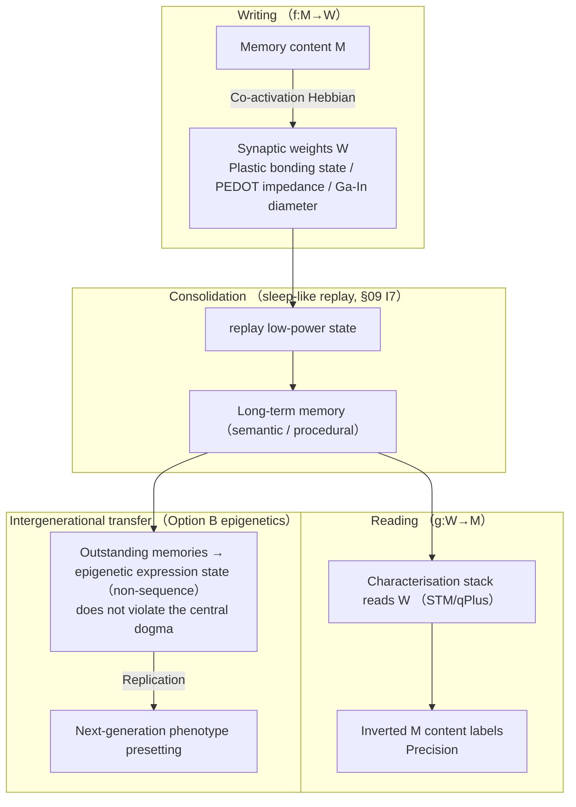
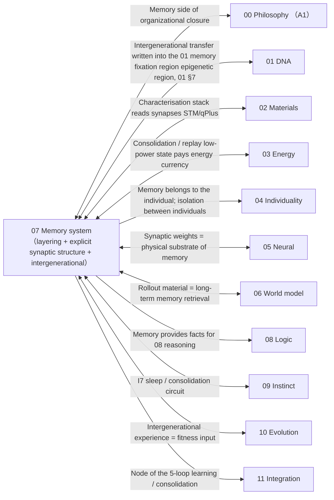

# 07 · Memory System (Design Principle 9)

| Item | Value |
| --- | --- |
| Module | Memory system: layered structure and explicit synaptic representation |
| Document type | Design report (English edition) |
| Version | v4.1 |
| Dependencies | 05 Synapse structure, 01 intergenerational transfer, 03 energy supply, 09 consolidation mechanisms |
| Language | English (Chinese edition: `../zh-CN/07_记忆系统_设计.md`) |

> **Evidence categories**: `[Ref:…]` literature or data; `[Design decision]` project setting; `[Logical derivation]` derived from listed premises; `[To be verified]` unvalidated placeholder.

---

## 0. Comparison of Design Options

> Design question: the key question is **how intergenerational experience is transferred** (written back into the DNA sequence / epigenetic expression state / not across generations), together with the "synapse → memory" mapping. Three parallel options are presented, each with "implementation + evidence + feasibility".
> - **Option A (conceptual option; current baseline retained = original option A)**: intergenerational **Lamarckian burning-in** — outstanding memories are written directly back into the 01 DNA variable-region sequence (matching "direct inheritance of experience")
> - **Option B (based on the project literature library = original option B, selected option)**: intergenerational **transgenerational epigenetics via phenotypic plasticity** — the sequence is not written; expression regulation is written (epigenetic marks / protein conformational states); the next generation carries "preset tendencies", not "memories"
> - **Option C (based on published research practice, including external literature review + original option C)**: ① RNAi transgenerational epigenetics (the cleanest empirical evidence of "transgenerational inheritance of acquired traits") ② pure Darwin (experience does not cross generations; selection is relied upon)
> The key choice is given in §3.3 + Appendix T2 on key assumptions and design decisions.

### 0.1 Option A: Conceptual Option (Lamarckian Burning-in, Baseline Option)

| Mechanism | Implementation |
| ------ | --------- |
| Layering | Four layers — working / episodic / semantic / procedural — with a carbon-based reference |
| Physical substrate | Synaptic weights (plastic bonding state / PEDOT impedance / Ga-In diameter) |
| Consolidation | Sleep-like replay (§09 I7, low-power state) |
| Intergenerational | Outstanding memories are written back into the 01 DNA variable-region sequence |

**Evidence and notes (in table row order)**

1. **Layering** — [Ref:`07/Cognitive_Algorithms_Episodic_Semantic_Memory_arXiv2602.07261`, §Layered memory architecture, "2026 cognitive algorithms: episodic/semantic memory architecture"]、`07/Semantic_Episodic_Memories_Predictive_Coding_Neocortex_arXiv2509.01987`, §Predictive-coding neocortex, "2025 semantic/episodic memory predictive coding neocortex"]
2. **Physical substrate** — [Ref:05 PEDOT/Ga-In measurements]
3. **Consolidation** — [Ref:`07/Rasch_Born_2013`, §Sleep and memory consolidation, "Rasch & Born 2013 Physiol Rev: sleep consolidates memory (slow waves / spindles)"]、`09/VyazovskiyHarris_2013`, §Neuronal rest during slow-wave sleep, "Vyazovskiy & Harris 2013 Nat Rev Neurosci: neuronal rest during slow-wave sleep"]
4. **Intergenerational** — [Design decision]; "transgenerational inheritance of acquired experience" violates the central dogma [To be verified by calculation and experiment, critical]

**Feasibility + risks**: matches the intuition of "direct inheritance of individual experience", but **there is no transgenerational epigenetic path and the central dogma is violated** — a key assumption that has not been achieved. [Design decision]

### 0.2 Option B: Based on the Project Literature Library (Transgenerational Epigenetics via Phenotypic Plasticity, Selected Option)

| Mechanism | Literature paradigm |
| ------ | --------- |
| Intergenerational = expression regulation | The sequence is not written; the expression / epigenetic state is written (methylation analogy / protein conformational states); the next generation carries "preset tendencies" |
| Consolidation / anti-forgetting | Dual timescale + coupled neural field replay |

**Evidence and notes (in table row order)**

1. **Intergenerational = expression regulation** — [Ref:`01/Duffy_2020_BMC_Biol_XNA_replication_evolution_review`, §XNA replication/evolution + epigenetic regulation, "Duffy 2020 XNA replication/evolution + epigenetic regulation is a mature direction"]; scientifically does not violate the central dogma
2. **Consolidation / anti-forgetting** — [Ref:`07/Dual_Timescale_Memory_Spiking_Neuron_Astrocyte_arXiv2604.15391`, §Dual-timescale memory, "2026 spiking neuron + astrocyte dual-timescale memory"]、`07/BlumMoyse_2024`, §Coupled neural field replay, "Blum & Möysés 2024 coupled neural field replay consolidation"]

**Key point**: "memory burning-in" is reduced to "**phenotypic presetting**", which is scientifically tenable, preserves the intuition of "experience transfer" and does not touch the sequence.

### 0.3 Option C: Based on Published Research Practice (RNAi Transgenerational Evidence + Darwin Alternative, DOIs Verified Item by Item)

> To be verified · **The evidence in this section consists of published literature review results and is distinguished from the design claims of this project.**

| External paradigm | Mechanism transferable into 07 |
| --------- | ---------------- |
| RNAi transgenerational epigenetic memory | Empirical evidence of "expression state across generations" (does not violate the central dogma; upper bound for Option B) |
| Epigenetic clock / methylation reprogramming | Established channel for intergenerational "environmental experience → offspring phenotype" (milder and reversible compared with sequence burning-in) |
| Pure Darwin + rapid learning | Experience does not cross generations; convergence relies on selection pressure (upper bound for Option C, `10/EvoJAX` / `10/Cicirello_2024`) |

**Evidence and notes (in table row order)**

1. **RNAi transgenerational epigenetic memory** — [Ref:`07/B_EPIGENETIC_TRANSGEN_2026-09-15.md`, §RNAi transgenerational epigenetics verified, "E1 Houri-Zeevi2020 Cell/E2 Rechavi2017 CurrBiol/E3 Grentzinger2012 GenomeRes/E4 Lang-Mladek2010 MolPlant/E5 Fitz-James2025 OpenBiol, transgenerational small-RNA evidence"] E1 Houri-Zeevi 2020 Cell three principles of transgenerational small RNA (OA, full text .txt stored in library, >20000 lineages), E2 Rechavi & Lev 2017 Curr Biol mechanism review (OA, 173 references, abstract verified), E3 Grentzinger 2012 Genome Res Drosophila piRNA across generations (OA, full text .txt stored in library), E4 Lang-Mladek 2010 Mol Plant Arabidopsis epigenetic silencing across several generations (OA, full text .txt stored in library), E5 Fitz-James 2025 Open Biol Polycomb/H3K27me3 TEI independent of small RNA (OA, full text .txt stored in library)]
2. **Epigenetic clock / methylation reprogramming** — [Ref: same reference library, §Epigenetic clock verified, "F1 Horvath2013 classic epigenetic clock (353CpG) / F2 Jiang&Guo2020 methylation clock review, "] F1 Horvath 2013 Genome Biol classic epigenetic clock (OA, 8000 samples + 51 tissues + 353 CpG + 36 years of age acceleration in cancer tissue, all values read back and citable), F2 Jiang & Guo 2020 Stem Cells Int methylation clock review (OA, full text .txt stored in library, 57 references)]
3. **Pure Darwin + rapid learning** — [Ref: 10 literature library RL/evolution (verified)]

### 0.4 Option Combinations and Baseline Configuration

| Strategy | Content | Applicable conditions |
| ------ | ------ | ------ |
| **A. Pure Option A** | Lamarckian write-back into the sequence (current baseline retained) | Matches intuition; lowest feasibility; violates the central dogma |
| **B. Option B (selected option)** | Intergenerational = transgenerational epigenetics via phenotypic plasticity (expression written, not sequence) | Preserves the intuition of experience transfer + scientifically tenable |
| **C. Option C Darwin underlying constraint** | Experience does not cross generations; selection only | Most conservative |

> **Baseline option = B** (transgenerational phenotypic plasticity, preserving the intuition of "experience transfer" without violating the central dogma, supported by `01/Duffy_2020`) — corresponding to §3.3 original option B + Appendix T2 on key assumptions and design decisions. **This choice is a design position confirmed by design review.**

### 0.5 Detailed Description of the Memory Flow Structure (Textual Description)

> **This section is the textual description of Figure 3-1 in §3**: without relying on the diagram, it explains layer by layer "what the memory flow of a silicon-based individual is, where writing / consolidation / reading / intergenerational transfer occur, and how explicit synapses carry it". It is based on **Option B (layering + explicit synaptic structure + consolidation replay + intergenerational epigenetics)**.

**Axis 1: the 4 segments of the memory flow (from writing to intergenerational transfer, "where memory comes from and where it goes")**

| Segment | What it is | What it does |
| ---- | -------- | -------- |
| **Segment 1 writing (WRITE)** | Memory content M (perception / rollout experience) → triggers a set of synaptic weight changes (plastic bonding-state migration / PEDOT impedance / Ga-In diameter) | Places "M is remembered" onto the physical synaptic state (co-activation Hebbian) |
| **Segment 2 consolidation (CONSOLIDATE)** | Sleep-like replay (§09 I7, low-power state) + dual-timescale systems consolidation | Short-term memory (working / episodic) is stabilised into long-term (semantic / procedural); anti-forgetting |
| **Segment 3 reading (READ)** | The characterisation stack (STM/qPlus measures bonding states, SET measures charge distribution) inverts W → M content labels | Makes "what is remembered" readable, representable and verifiable (core of Design Principle 9) |
| **Segment 4 intergenerational (GENERATE)** | Outstanding memories → epigenetic expression state (non-sequence) (Option B, the DNA sequence is not written) → replication → next-generation phenotype presetting | Enables intergenerational transfer of "experience" (preserving the intuition of "experience transfer" while remaining scientifically tenable) |

**Evidence and notes (in table row order)**

1. **Segment 1 writing (WRITE)** — Writing mechanism [Ref:`05/Hebbian_2023_Fast_Hebbian_Platicity_Working_Memory`]; "co-activation Hebbian" [Logical derivation: Hebbian learning rule]
2. **Segment 2 consolidation (CONSOLIDATE)** — Replay [Ref:`07/Rasch_Born_2013` (SWS systems consolidation) + `09/VyazovskiyHarris_2013` (slow-wave cell rest)]; dual timescale [Ref:`07/Dual_Timescale_Memory_Spiking_Neuron_Astrocyte_arXiv2604.15391`]
3. **Segment 3 reading (READ)** — Characterisation stack [Ref:02 §2.4]; "read W → invert M" [Logical derivation: inverse of f(M) + 02 characterisation]
4. **Segment 4 intergenerational (GENERATE)** — Transgenerational epigenetics [Ref:`01/Duffy_2020_BMC_Biol_XNA_replication_evolution_review` (XNA replication/evolution + epigenetic regulation)]; "preset tendencies, not memories" [Design · baseline B]

**Relations among the segments (the memory-flow chain from left to right in the figure)**:
```
Segment 1 writing (M → synaptic state W) → Segment 2 consolidation (replay + dual timescale, short-term → long-term)
     → Segment 3 reading (characterisation stack inverts W → M) → Segment 4 intergenerational (epigenetic expression state, replication → next-generation phenotype)
```
→ **"Memory" is not an independent entity; it = the synaptic bonding state (W) of Segment 1; remembering relies on Segment 1 (co-activation writing), stability relies on Segment 2 (replay consolidation), knowing "what is remembered" relies on Segment 3 (representational inversion), and passing it on relies on Segment 4 (transgenerational epigenetics).** This chain is "what a single memory flow of a silicon-based individual looks like".

**Axis 2: three mechanism lines (crossing the 4 segments, "how to store / how to prevent forgetting / how to transfer")**

| Mechanism | Segments crossed | Function |
| ------ | --------- | -------- |
| **Store (STORE)** | Segments 1 / 3 | Synaptic weights = the physical substrate of memory (05 PEDOT/Ga-In carries 07 memory); "explicit" = readable, representable and verifiable (Design Principle 9) |
| **Anti-forgetting (FORGOT)** | Segment 2 | Sleep-like replay (prevents catastrophic forgetting) + dual timescale (separation of fast and slow channels); low power during replay, paying 03 energy currency |
| **Transfer (GENERATE)** | Segment 4 | Intergenerational epigenetic expression state (Option B; sequence not written); checked via 01 ECC (fidelity window), otherwise "intergenerational memory distortion" |

**Evidence and notes (in table row order)**

1. **Store (STORE)** — Synaptic substrate [Ref:05 PEDOT/Ga-In measurements]; "explicit" = readable by the characterisation stack [Ref:02 §2.4]
2. **Anti-forgetting (FORGOT)** — Replay [Ref:`07/Sleep_Inspired_Replay_Prevents_Catastrophic_Forgetting_arXiv2606.08447`]; energy payment for low-power state [Ref:03 A2 sequence]
3. **Transfer (GENERATE)** — Transgenerational epigenetics [Ref:01/Duffy_2020 + `01/ECC` (fidelity window)]; ECC check [Ref:01 §4 Fountain codes]

**The "fixed (non-evolvable) + dynamic" relationship of "store / anti-forgetting / transfer"** (why this design can "both remember and not lose"):
- **Segment 1 synaptic substrate = physical fact** (05 PEDOT/Ga-In measurements, fixed (non-evolvable));
- **Segment 2 replay consolidation = fixed mechanism (non-evolvable)** (sleep-like replay + dual timescale, cannot be evolved away); "consolidation rate / time scale" = dynamic (Design Principle 15 time-scale mapping);
- **Segment 4 intergenerational "epigenetic vs Lamarckian" = one of three positions** (T2 A/B/C, determined by design review); "how much is transferred" = dynamic (via ECC fidelity).
- **This division into "fixed (non-evolvable) mechanism + dynamic values + one selected position" is precisely the point of correspondence for Design Principle 9 (memory must have an explicit synaptic structure) + Design Principle 15 (time-scale mapping) + 07 T2 (intergenerational position A/B/C)** [Logical derivation: the three principles map to Segment 1 / Segment 2 / Segment 4 respectively].

**Summary of key points**
> **One memory flow of a silicon-based individual = Segment 1 writing (M → synaptic state W, co-activation Hebbian) + Segment 2 consolidation (sleep-like replay + dual timescale, short-term → long-term) + Segment 3 reading (characterisation stack inverts W → M) + Segment 4 intergenerational (epigenetic expression state, replication → next-generation phenotype, fidelity via ECC). Memory is physically visible (02 characterisation stack), representable (read W to invert M) and transferable (intergenerational epigenetics, Option B) — this is the concrete form of "explicit synaptic structure".**

---

## 1. Design Objectives

With reference to the carbon-based memory hierarchy (working / episodic / semantic / procedural), silicon-based memory is designed, **and memory must be made explicit in the synaptic structure** (synaptic weights = plastic bonding state / PEDOT impedance / Ga-In microchannel diameter), so that "what is remembered" can be read out, represented and expressed in the next generation. It is not black-box storage.

---

## 2. Related Research Status + Different Implementation Approaches (Design Principle 2)

| Approach | Status | Literature anchors | Trade-off |
| ------ | ------ | --------- | ------ |
| **Carbon-based memory hierarchy (working / episodic / semantic)** | Available | `07/Cognitive_Algorithms_Episodic_Semantic_Memory_arXiv2602.07261.pdf`, `07/Semantic_Episodic_Memories_Predictive_Coding_Neocortex_arXiv2509.01987.pdf` | Verified · layering reference |
| **Plasticity substrate (LTP/LTD)** | Available | `07/Fluctuation_Background_Synaptic_Activity_Controls_Plasticity_arXiv2108.05827.pdf` | Verified · synapse = physical substrate of memory |
| **Consolidation (systems consolidation + dual timescale)** | Available | `07/BlumMoyse_2024_Coupled_Neural_Field_Memory_Consolidation_arXiv2404.pdf`, `07/Dual_Timescale_Memory_Spiking_Neuron_Astrocyte_arXiv2604.15391.pdf` | Verified · short-term → long-term |
| **Sleep-like replay (anti-forgetting)** | Available | See note 1 | Verified · consolidation mechanism |

**Full evidence for table cells**

1. **Sleep-like replay (anti-forgetting) · Literature anchors** — `07/Sleep_Inspired_Replay_Prevents_Catastrophic_Forgetting_arXiv2606.08447.pdf`, `07/Rasch_Born_2013_About_Sleeps_Role_in_Memory_PhysiolRev_PMC3768102_FULLTEXT.txt` 

**Selection conclusion**: layering uses the carbon-based reference (working / episodic / semantic / procedural), **physical substrate = silicon-based synapse (§05 PEDOT/Ga-In)**, consolidation = "sleep-like replay" (§09 I7).

---

## 3. Design (v3)

**Figure 3-1: memory flow = writing (f synapse) → consolidation (replay) → reading (g characterisation) → intergenerational transfer (Option B epigenetics)**



> Note: Write, consolidation and retrieval form the main memory path; replay is the consolidation branch. Intergenerational transfer does not alter sequence information.

> **Legend**: writing (f:M→W, co-activation Hebbian) → consolidation (sleep-like replay, low-power state) → reading (g:W→M, inversion by the characterisation stack) → intergenerational transfer (Option B epigenetic expression state; the sequence is not written). Memory is physically visible (§02 characterisation stack), representable (read W to invert M) and transferable (intergenerational).

### 3.1 Memory Layering (Carbon-Based Reference)

| Layer | Carbon-based | Silicon-based implementation | Time scale (Design Principle 15) |
| ------ | ------ | --------- | --------------- |
| **Working memory** (short-term) | Prefrontal maintenance | Plastic bonding state (05 neural layer, short-term Hebbian, `Hebbian_2023`) | ~seconds (silicon-based) |
| **Episodic memory** (events) | Hippocampus | Synaptic weight set (PEDOT impedance + Ga-In diameter, event traces) | ~minutes–hours |
| **Semantic memory** (facts) | Temporal lobe | Stable synaptic clusters (slow variables, long-term) | ~hours–days |
| **Procedural memory** (skills) | Basal ganglia / cerebellum | CPG / reflex circuit consolidation (§09 I0b/I0c) | ~generations |

### 3.2 Explicit Synaptic Structure (Core of Design Principle 9, "Synaptic Weight → Memory" Mapping Function)

**Key point: memory is not "stored in a storage area"; it is deposited on concrete synaptic physical quantities, and is readable / representable / transferable.**

```
Synaptic weights W (physical quantities)  ⟷  memory content M (what is remembered)

  W = f(M):  M is remembered → triggers a set of synaptic weight changes (plastic bonding-state migration / PEDOT impedance / Ga-In diameter)
  M = g(W):  read the synaptic weights → invert "what is remembered" (representation)

  Three-layer mapping:
  · Episodic: W (event traces) → a set of synaptic weight patterns (PEDOT impedance distribution) → "which episode" is readable
  · Semantic: W (facts) → stable synaptic clusters → "which fact" is readable
  · Procedural: W (skills) → CPG / reflex circuit consolidation → "what can be done" is readable
```

**Meaning of "explicit"**:
- Memory is **physically visible** (STM/qPlus can read synaptic weights, §02 characterisation stack) → not a black box
- Memory is **representable** (read W → invert M) → "what is remembered" is known
- Memory is **transferable** (intergenerational burning-in, §3.3)

**To be verified by experiment**: the concrete form of the mapping functions `f(M)` / `g(W)` (§5 G1).

### 3.3 Consolidation + Intergenerational Transfer (Transgenerational Epigenetics via Phenotypic Plasticity; T2 Fixes B)

```
Short-term memory (working / episodic)
   ↓ Sleep-like replay (§09 I7, during the low-power state)
Long-term memory (episodic → semantic / procedural, systems consolidation, BlumMoyse_2024)
   ↓ Intergenerational (at replication under Option B)
Outstanding memories are burned back into the 01 DNA **memory fixation region (epigenetic region, 01 §7; non-sequence-level write-back, does not violate the central dogma; T2 fixes B transgenerational phenotypic plasticity)**
   → The next generation exhibits the same / similar experience
```

**Anti-forgetting**: `Sleep_Inspired_Replay_2026` (sleep-like replay prevents catastrophic forgetting) + dual timescale (`Dual_Timescale_2024`)

**Intergenerational fidelity**: when memories are burned back into the **01 memory fixation region (epigenetic region, ε_copy deliberately low-fidelity)**, they are **checked via §01 ECC** (fidelity window); otherwise intergenerational "memory distortion" occurs. (2026-09-16 rationality consistency check: the region name is aligned with 01 §7 "memory fixation region (epigenetic region)", separated from the "variable region (Darwinian high-mismatch)", with ε_copy in the opposite direction; the former wording "Lamarckian burning-in into the variable-region sequence" has been cleared.)

**To be verified · key assumption + room for alternative path selection (consistency check (2026-09-14): the design position was confirmed by design review)**:

> **Key assumption**: "outstanding memories are burned back into the DNA variable region (Lamarckian)" — **violates the central dogma**; transgenerational inheritance of "acquired experience" has no implementation path, and is the most consequential item of class C (carbon-based mechanisms transferred to a silicon-based carrier). It is currently written as if it were a usable feature, but it is in fact a key assumption.
> **Selection space (one of three; the literature library already contains the actual reference `01/Duffy_2020_BMC_Biol_XNA_replication_evolution_review` covering XNA replication/evolution)**:

| Option | Mechanism | Feasibility | Relation to the "central dogma" | Note |
| ------ | ------ | -------- | ---------------- | ------ |
| **A. Retain Lamarckian burning-in (current baseline)** | Acquired memories are written directly back into the DNA variable region | Lowest (no transgenerational epigenetic path) | Violates | Feasibility is the least verified, but it matches "direct inheritance of individual experience" |
| **B. Soften to "transgenerational epigenetics via phenotypic plasticity"** (scientifically grounded alternative) | The sequence is not written; expression regulation is written (methylation / epigenetic marks / protein conformational states); the next generation has "preset tendencies" rather than "memories" | Medium (epigenetic inheritance across generations has empirical evidence in carbon-based life; `01/Duffy_2020` XNA evolution + epigenetic regulation is a mature direction) | Verified · does not violate the central dogma (the sequence is unchanged; expression is changed) | "Memory burning-in" is reduced to "phenotypic presetting", which is scientifically tenable |
| **C. Fully adopt the Darwin route (drop Lamarck)** | Memory does not cross generations; only selection is relied upon (fitness screening across generations, §10); experience is not inherited, and "relearning + rapid trial and error" is relied upon | Highest (no transgenerational mechanism) | Verified · fully compliant | Most conservative; abandons "intergenerational inheritance of experience" |

> **Baseline = B (transgenerational phenotypic plasticity, which preserves the intuition of "experience transfer" without violating the central dogma and is supported by literature); A matches the "Lamarckian" intuition but has the lowest feasibility; C is the most conservative. This choice is a design position confirmed by design review.**

**Reference to published research practice**:

> The best-established practice in existing published research on "intergenerational transfer of experience / phenotype" — **providing the reference upper bound for each T2 option**, without replacing the A/B/C choice.

| Published practice | Method | Reference value | Corresponding T2 option | Status |
| ------------- | ------ | ------------- | ------------------ | ------ |
| **RNA interference transgenerational epigenetic memory (epigenetic, 2020+)** (e.g. `C. elegans` RdR2-dependent RNAi across generations) | Parents are induced into silencing by dsRNA; offspring inherit the silenced state (epigenetic marks) without DNA sequence changes, decaying after several generations | The cleanest empirical evidence of "transgenerational inheritance of acquired traits"; does not violate the central dogma; the mechanism is clear (RdRP generates tRNAi → epigenetic marks) | Reference upper bound for Option B — demonstrates that "transgenerational phenotypic plast… See note 1 | Search to be supplemented |
| **Epigenetic clock / methylation reprogramming** | DNA methylation patterns between generations can be rewritten by the environment and partially inherited; this is the mainstream channel for "environmental experience → offspring phenotype" | A relatively mature channel for transgenerational phenotype transfer, milder and reversible compared with "sequence burning-in" | Finer mechanism for B | Search to be supplemented |
| **Pure Darwin selection + rapid learning (no transgenerational experience)** | Experience is not inherited; each generation learns from 0; convergence relies on selection pressure (reinforcement learning + evolutionary outer loop) | Most conservative but most robust; much existing RL work follows this path | Reference upper bound for Option C | Verified · RL/evolution class in the literature library (`10/EvoJAX`, `10/Cicirello_2024`) |

**Full evidence for table cells**

1. **RNA interference transgenerational epigenetic memory (epigenetic, 2020+) (e.g. `C. elegans` RdR2-dependent RNAi across generations) · Corresponding T2 option** — Reference upper bound for Option B — demonstrates that "transgenerational phenotypic plasticity" is fully scientifically valid, and silicon-based systems can analogously implement "expression state across generations"

### 3.3a Derivable Parts of the Mapping Functions f(M)/g(W) (G1 Detail, Design Principle 24)

> **Design Principle 24 boundary**: what follows gives the **derivable function *structure* and carbon-based reference values**; concrete **numerical coefficients** are uniformly marked "design setting / DFT" and are not conjectured.

**f(M) writing direction (memory → synaptic weights), derivable forms for the three layers**:

| Layer | Physical carrier | f(M) structure (derivable) | Values / coefficients | Evidence |
| ---- | --------- | ----------------- | ---------- | ------ |
| Episodic | PEDOT impedance distribution | Event M triggers co-activation of a set of synapses → impedance `ΔR ∝ co-activation count × strength` (Hebbian form, `05/Hebbian_2023`) | Coefficients are a design setting | `05/Hebbian_2023_Fast_Hebbian_Platicity_Working_Memory` |
| Semantic | Stable synaptic clusters | Repeated M → long-term LTP (synaptic diameter / bonding-state migration, slow channel) | Slow-channel time scale to be verified by calculation | `05/Moreno_2024` + Ga-In diameter synapses (`05`) |
| Procedural | CPG / reflex circuits | Skill M → circuit gain consolidation (I0 circuit gain up-regulation, `09`) | Gain upper bound is a design setting | `09/Neuromorphic_Spiking_CPG_arXiv2101.09709` |

**g(W) reading direction (synaptic weights → memory representation)**:
- **Derivable**: g is the **inversion + representational read-out** of f — W is read using the §02 characterisation stack (STM/qPlus measures synaptic bonding states, SET measures charge distribution) and mapped back to the content labels of M according to the inverse relation of f.
- **Precision (G5)**: depends on the **signal-to-noise ratio** of W (synaptic-state dispersion vs read-out error); **no measured values exist; to be verified by calculation + experiment** (Design Principle 24 does not conjecture).
- **Carbon-based reference**: synaptic weight read-out during carbon-based "replay" is noisy; `07/BlumMoyse_2024` uses **coupled neural fields** for systems consolidation to reduce read-out error — silicon-based g(W) draws on this **mechanism**, with numerical coefficients undetermined.

**Derivable upper bound on capacity (G2)**: capacity of each layer = number of synapses × number of distinguishable states per synapse (e.g. base-4 = 2 bit/synapse, `01` carrier). The number of synapses = structural scale (`05` neural layer); **the concrete number of states is limited by §02 characterisation precision**, to be verified by experiment.

> **Boundary note**: the **function *shape* of `f/g` can be fixed (co-activation Hebbian + slow channel + circuit consolidation + representational inversion), but every coefficient / time scale / number of states is a "design setting + to be verified by calculation" — this layer fixes only the structure, leaving values to experiment (Design Principles 1/3).

### 3.4 Memory Time Scales (Design Principle 15, Chimpanzee Baseline)

- Working memory ~seconds (`design setting`) → silicon-based ~ms
- Episodic consolidation ~several hours (carbon-based sleep-like cycle; `07/Rasch_Born_2013_About_Sleeps_Role_in_Memory_PhysiolRev_PMC3768102` evidences SWS systems consolidation + replay mechanism; To be verified · excerpt abstract; the duration of specific SWS sleep stages is fixed only after checking explicit values in that paper) → silicon-based ~10 seconds (project-set mapping)
- Semantic / procedural ~days–generations (Design Principle 15 mapping) → silicon-based ~hours–generations

> **G3 carbon-based reference for consolidation rate (supplementary acquisition implemented, Design Principle 24)**: the carbon-based mechanism of sleep-dependent consolidation is anchored to **two actual references**:
> - **Mechanism**: `07/Rasch_Born_2013` (SWS slow-wave sleep + hippocampal replay systems consolidation, Physiol Rev 2013)
> - **Neuronal rest**: `09/VyazovskiyHarris_2013` ("prophylactic cell rest" driven by slow-wave oscillations, Nat Rev Neurosci 2013, full text 111KB)
> - **Carbon-based reference value**: sleep consolidation = **several hours** (adult SWS accounts for ~20-25% of 6-8h sleep, `carbon-based reference`, not transferable to silicon-based carriers); silicon-based consolidation time scale = carbon-based value × compression ratio (project-set), **concrete rate values are fixed only after checking explicit values in the source** (Design Principle 24; an excerpt abstract is insufficient to fix values).

---

## 4. Relations with Other Parts (Interface Contracts, All Dimensions)

> **Completeness principle**: 07 is the carrier of "what is remembered" and the node of **05 synaptic substrate / 06 rollout material / 10 intergenerational fitness** — a connection must be established with every dimension (omission of any one = incomplete document).

**Figure 4-1: overview of the connections between 07 (memory system) and all 12 volumes**



> Note: The source of an arrow is the value provider and the target is the receiver; measurable quantities are defined by the interface contracts of the respective volumes.

| Interface | Data flow (physical quantities / information, not concepts) | Invariants (measurable) | Evidence category |
| ------ | --------------------------- | ------------- | --------- |
| **↔ 00 Philosophy** | Memory maintenance = the information side of A1 organizational closure (remembering the individual itself) | Memory layers support closure | [Ref:00 A1] |
| **↔ 01 DNA** | Intergenerational transfer is written into the 01 memory fixation region (epigenetic regio… See note 1 | Intergenerational fidelity [To be verified by calculation: G4] | [Ref:01 ECC + 01 §7 memory fixation region] |
| **↔ 02 Materials** | The characterisation stack reads synapses (STM/qPlus measures bonding states, SET measures charge distribution) | Characterisation precision [To be verified] | [Ref:02 characterisation stack] |
| **↔ 03 Energy** | Consolidation / replay low-power state pays energy currency (03 allocation: learning is attached to 03) | Energy consumption of the replay cycle [To be verified by calculation: 03] | [Ref:03 A2 sequence] |
| **→ 04 Individuality** | Memory belongs to the individual; isolation between individuals (the community exchanges only local information) | Memory isolation [Design] | [Logical derivation: 04 + Design Principle 18] |
| **↔ 05 Neural** | Synaptic weights = physical substrate of memory (05 PEDOT/Ga-In carries 07 memory) | Synaptic fidelity / lifetime [To be verified] | [Ref:05 neural layer] |
| **↔ 06 World model** | Rollout material = retrieval of 07 long-term memory | Retrieval hit [To be verified] | [Logical derivation: 06 attached to 07] |
| **→ 08 Logic** | Memory provides factual premises for 08 reasoning | Fact retrieval [Design] | [Logical derivation: 08 simulation] |
| **↔ 09 Instinct** | I7 sleep / consolidation circuit (low-power state triggers replay) | Replay trigger conditions [To be verified] | [Ref:09 I7] |
| **↔ 10 Evolution** | Intergenerational experience = fitness input (Option B phenotypic presetting feeds 10) | Intergenerational tendency input [To be verified] | [Ref:10 fitness] |
| **→ 11 Integration** | Node of the 5-loop learning / consolidation | Loop closure requires 07 to be operational | [Ref:11 §5 loops] |

**Full evidence for table cells**

1. **↔ 01 DNA · Data flow (physical quantities / information, not concepts)** — Intergenerational transfer is written into the 01 memory fixation region (epigenetic region, 01 §7; ε_copy deliberately low-fidelity; not the "variable region" — the variable region is Darwinian high-mismatch material, with ε_copy opposite to that of the epigenetic region), via ECC

**Contract principle**: interface "data" must be **physically / informationally measurable quantities** (synaptic fidelity / characterisation precision / replay energy consumption / intergenerational fidelity), not concepts; those without measured values are marked "values pending DFT in 07 / other volumes".

**Evidence categories (§4)**:
- A1 memory side → 00 [Ref:00]
- Intergenerational → 01 [Ref:01 ECC + Option B]
- Characterisation → 02 / energy consumption → 03 [Ref:02 characterisation stack + 03 A2]
- Isolation → 04 [Logical derivation: Design Principle 18]
- Synaptic substrate ↔ 05 / rollout material ↔ 06 / facts → 08 [Ref / Logical derivation]
- I7 ↔ 09 / fitness ↔ 10 [Ref:09 I7 + 10]
- Loops → 11 [Ref:11 §5]

---

## 5. To Be Verified by Experiment / DFT (Each Item: Formula + Window + Value Provider, with Quantitative Conditions)

| # | Open item | Formula / inequality to be satisfied | Parameter window (design setting) | Value provider |
| --- | -------- | --------------------- | -------------------- | ---------- |
| G1 | Mapping functions f(M)/g(W) from synaptic weights → memory | f(M): co-activation count × strength → ΔR (Hebbian); g(W): representational inversion of M, signal-to-noise ratio SNR ≥ discriminability threshold | Coefficients / time scales / number of states [Design setting + To be verified by calculation]; SNR threshold [To be verified by calculation: 02 characterisation] | 07 DFT + 02 characterisation (silicon-based synaptic co-activation curve + characterisation precision) |
| G2 | Capacity of each layer (episodic / semantic / procedural synapse counts) | Capacity = number of synapses × distinguishable states per synapse (base-4 = 2 bit/synapse); number of synapses = structural scale (05 neural layer) | Number of states limited by §02 characterisation precision [To be verified]; number of synapses [To be verified by calculation: 05] | 05 + 02 in coordination (number of synapses × number of states = capacity) |
| G3 | Consolidation rate (short-term → long-term, sleep replay cycle) | Replay cycle T_rep + consolidation efficiency η (short-term → long-term conversion rate) | Carbon-based reference: SWS accounts for 20-25% of 6-8h sleep (carbon-based, `07/Rasch_Bor… See note 1 | 07 experiment (measured silicon-based replay cycle + consolidation efficiency) |
| G4 | Intergenerational burning-in fidelity (memory → DNA variable region / epigenetic region) | Burning-in fidelity ε_mem ∈ 01 ECC window (§01 §3.2: N ≤ C_critical/ε); Fountain check applied | ε_mem target [Design: follow the 01 ECC window]; intergenerational epigenetic region [Option B] | 01 ECC + 07 experiment (fidelity of the intergenerational epigenetic region) |
| G5 | Characterisation precision of memory read-out (g(W) inversion) | Signal-to-noise ratio SNR ≥ 3σ (discriminable); g(W) inversion error ε_read | 02 characterisation stack σ [To be verified by calculation: 02]; ε_read [To be verified] | 02 characterisation + 07 DFT |

**Full evidence for table cells**

1. **G3 · Parameter window (design setting)** — Carbon-based reference: SWS accounts for 20-25% of 6-8h sleep (carbon-based, `07/Rasch_Born_2013` excerpt, not transferable to silicon-based carriers); silicon-based T_rep/η [to be fixed after checking explicit values in the source]

**Note**: each of G1-G5 gives "**what is to be calculated + threshold / window + value provider**"; the **function shape** of f(M)/g(W) is fixed in §3.3a (co-activation Hebbian + slow channel + circuit consolidation + representational inversion); **all numerical coefficients / time scales / numbers of states await first-principles calculations and experiments in 02/05/07**; the carbon-based consolidation rate is a "carbon-based reference, not transferable to silicon-based carriers".

---

## 10. Scope and Known Limitations (Design Principle 24)

- **Determinable content (given in this document)**: the structure of the 4 memory-flow segments in §0.5 (writing / consolidation / reading / intergenerational) + the 3 mechanism lines (store / anti-forgetting / transfer), the §2 layering reference (carbon-based working / episodic / semantic / procedural) + selection conclusion, §3.1 four memory layers + time-scale mapping, §3.2 explicit synaptic mapping functions f(M)/g(W), §3.3a function structure + carbon-based reference, §3.3 T2 positions A/B/C + published research practice reference table, §4 interfaces with all 12 volumes.
- **Undeterminable content (only formulae and boundaries are given; placeholders are not baseline values)**: G1 f(M)/g(W) coefficients, G2 capacity, G3 consolidation rate, G4 intergenerational fidelity, G5 characterisation precision — **all await first-principles calculations and experiments in 02/05/07**; this document has written them to a degree sufficient for work to begin, namely "what is to be calculated + value provider".
- **Key assumptions (to be determined by design review)**:
  - **"Outstanding memories are burned back into the 01 DNA variable region (Option A, Lamarckian)"** — [Design decision], **violates the central dogma** (transgenerational inheritance of "acquired experience" has no implementation path and has not been achieved), the most consequential key assumption of class C; the key assumption has been listed, **baseline B (transgenerational phenotypic plasticity, supported by `01/Duffy_2020` XNA epigenetic regulation, does not violate the central dogma)**.
  - **The "transgenerational" proposition of intergenerational "experience transfer"** — if C is selected (pure Darwin, experience does not cross generations), the entire "intergenerational transfer" passage in 07 §3.3 is downgraded to "intergenerational relearning"; this is a position choice, to be determined by design review.

---

> Corresponding Chinese edition: `../zh-CN/07_记忆系统_设计.md`
