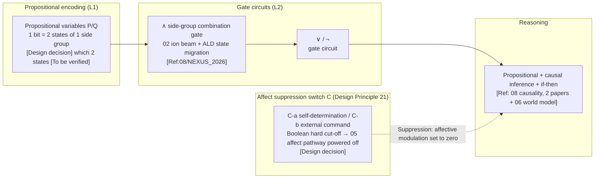

# 08 · Logical Reasoning (Design Principle 10)

| Item | Value |
|---|---|
| Module | Logical reasoning: propositional reasoning, causal inference and conditional simulation |
| Document type | Design report (English edition) |
| Version | v4.1 |
| Dependencies | 05 neural implementation, 06 world model, 01 minimal logic set |
| Language | English (Chinese edition: `../zh-CN/08_逻辑推理_设计.md`) |

> **Evidence categories**: `[Ref:…]` literature or data; `[Design decision]` project setting without external evidence, with adjustability stated; `[Logical derivation]` derived from listed premises and formulae; `[To be verified]` unvalidated values or methods, placeholder only, with the value provider named. Every key assertion carries one of these categories.

---

## 0. Comparison of Design Options

> Design question: the key question is **what physical implementation is used for Boolean gates** (side-group bonding state / memristor device / DNA strand displacement). Three parallel options are given; each option provides "implementation + evidence + feasibility".
> - **Option A (conceptual option, current retained = original Option A)**: soft-gel **side-group bonding-state migration + ion-beam/ALD site-by-site drive** as Boolean gates (best match to P1, most critical)
> - **Option B (based on the project reference library = original Option B)**: **memristor/neuromorphic gates** (device-level experiments exist, in-memory computing, `08/NEXUS_2026` ANN↔SNN equivalence + `05/Khacef_2022` spike plasticity)
> - **Option C (based on published research practice, including external survey + original Option C)**: ① memristor neuromorphic logic gates (in-memory computing, avoiding site-by-site drive) ② DNA strand-displacement gates (molecular level, no wiring, `05/Qianlab_2011`) ③ spin-crossover switches (close relative of silicon semiconductors)
> The three are parallel and not mutually exclusive. The key choice is given in §3.1 + appendix T1 of key assumptions and design decisions.

### 0.1 Option A: Conceptual Option (Side-Group Bonding-State Gates, Baseline Option)

| Step | Specific approach | Evidence category |
|------|---------|---------|
| Propositional encoding | 1 Boolean bit → 2 high-contrast states of 1 side group (Si-O true / Si-C false) | [Design decision]; "which 2 states" depends on 02 side-group electrical measurements [To be verified] |
| Gate circuit | Multi-defect cluster side-group state migration (ion-beam implantation/annealing + ALD drive), logic function encoded by the arrangement of defect clusters within the gate | [Logical derivation: attached to 02 process]; in-gate bond energy/migration threshold [To be verified by calculation and experiment, critical] |
| Equivalence reference | Bit-exact ANN↔SNN gate-circuit equivalence | [Ref:`08/NEXUS_2026_Neuromorphic_Gate_Circuits_arXiv2601.21279`, §bit-exact ANN↔SNN equivalence, "NEXUS 2026 neuromorphic gate circuits ANN↔SNN bit-exact equivalence"] |

**Feasibility + risks**: "site-by-site drive of bonding-state migration in a soft gel used as a gate" **has no feasibility path and no DFT** — it is the heaviest item of class C (carbon-based mechanisms transferred to silicon-based carriers), a key assumption. [Design decision]

### 0.2 Option B: Based on the Project Reference Library (Memristor/Neuromorphic Gates, for Reducing Implementation Risk)

| Step | Literature paradigm | Evidence category |
|------|---------|---------|
| Gate circuit = device state | Memristor resistance-state migration as a gate, in-memory computing (experiments exist) | [Ref:`08/NEXUS_2026`, §bit-exact ANN↔SNN equivalence, "NEXUS 2026 ANN↔SNN bit-exact equivalence, gate circuits can be landed on device states"]; dedicated memristor literature is temporarily absent from the reference library, `05/Khacef_2022`, §review of local spike synaptic plasticity, "Khacef 2022 spike plasticity review covers the same class"] |
| Propositional encoding | Boolean bit → device state (rather than side-group bonding state) | [Logical derivation] |

**Key point**: moving the gate from "soft-gel bonding states" to **devices supported by memristor experiments** gives high feasibility, but the devices are rigid/thin-film, in tension with the P1 soft carrier (a soft memristive matrix is required).

### 0.3 Option C: Based on Published Research Practice (DOIs + DNA/Spin Gates Checked Item by Item)

> To be verified · **The evidence in this section consists of published literature survey results and is distinguished from the design claims of this project.**

| External paradigm | Mechanism transferable into 08 | Evidence category |
|---------|----------------|---------|
| Memristor neuromorphic logic gates | Device-level "in-memory computing", avoiding site-by-site drive (ceiling of Option B) | [Ref:`08/B_LOGIC_GATE_DEVICE_2026-09-15.md`, §device-level logic gates verified, "G1 Shirinzadeh2018/G2 Kvatinsky2012/G3 Rashid arXiv/G4 Prezioso2013/G5 Shen2011 memristor in-memory-computing logic gates (all OA)"] G1 Shirinzadeh 2018 RRAM in-memory-computing synthesis (**open access, full text archived**, BDD/DIG/MIG representations + multi-row crossbar), G2 Kvatinsky 2012 MRL memristor ratioed logic (XOR/NAND/NOR circuit level), G3 Rashid arXiv single-memristor 4 classes of logic (**arXiv OA, full text archived**, NOT/AND/XOR/full adder), G4 Prezioso 2013 magnetically enhanced memristor universal gate (BRONZE OA, single device = universal gate), G5 Shen 2011 shared-contact RRAM gate (AND/OR)] |
| DNA strand-displacement gates | Molecular-level logic without wiring, naturally close to soft/aqueous media (ceiling of Option C) | [Ref:`05/Qianlab_2011_DNA_Seeseesaw_Neural_Networks`, §DNA strand-displacement neural networks, "Qianlab 2011 DNA strand-displacement neural network gates"], `05/teVrugt_2024_DNA_Neural_Networks`, §DNA neural networks, "teVrugt 2024 DNA neural network gates"] |
| Spin-crossover switches | Magnetic spin states as 0/1, single-electron tunnelling gates (wafer-integrable) | [Ref: same verification record file above, §spin-crossover switches verified, "S1 Miyamachi2012/S2 Huang2025 spin-crossover switches (all open access)"] S1 Miyamachi 2012 Nat Commun spin crossover + memristive single molecule (**open access, full text archived**, 494 citations), S2 Huang 2025 Nat Commun electric-pulse control of a single-molecule spin switch (**open access, full text archived**, latest first-hand)] |

**08 §0.3 reference upgrade note**: the original 2 rows `[Ref·external survey, to be checked]` are all upgraded to `[Ref:08/B_LOGIC_GATE_DEVICE_..._2026-09-15.md · A(G1/G2/G3/G4/G5)]` / `[· B(S1/S2)]`; the DNA strand-displacement gates remain `[Ref:05/Qianlab_2011 + teVrugt_2024]` (verified in the reference library). Specific numerical values not actually read back (energy consumption / CMOS area ratio / switching cycles / decoherence time) are listed by column name in the "unverified area" of the verification record file, and are not written into the 08 main text as verified values.


### 0.4 Option Combination and Baseline Configuration

| Strategy | Content | Applicable conditions |
|------|------|------|
| **A. Pure Option A** | Side-group bonding-state gates (current baseline retained) | Best match to P1, key assumption, not yet operable |
| **B. II risk reduction (if robustness is prioritised)** | Gates switched to **memristor/neuromorphic devices**, soft memristive matrix compensating for P1 | High feasibility, compromises P1, requires a soft matrix |
| **C. Option C DNA gate underlying constraint** | Gates use DNA strand displacement (hits 05 DNA neural networks) | Closest to the soft carrier, retreats to carbon-based and slow |

> **Baseline option = maintain A (best match to P1), but make the key risk explicit**; if risk reduction is required, choose B (devices with empirical evidence); for the closest match to the soft carrier, choose C. **This choice is a design position, confirmed by design review** (corresponding to appendix T1 of key assumptions and design decisions).

### 0.5 Detailed Structure of the Logic Subsystem (Textual Description)

> **This section is the textual description of Figure 3-1 in §3**: it does not rely on the diagram and explains layer by layer "what the logic subsystem of a silicon-based individual actually is, and how propositional encoding / gate circuits / reasoning / affect suppression are connected". It is based on **Option A (side-group bonding-state gates, best match to P1) + B/C underlying constraints**.

**Axis 1: the 4 segments of the logic loop (from propositions to conclusions, "where logic comes from and where it goes")**

| Segment | What it is | What it does | Evidence category |
|----|--------|--------|---------|
| **Segment 1 propositional encoding (L1)** | 1 Boolean bit → 2 high-contrast states of 1 side group (Si-O true / Si-C false); `P→Q` composite = multiple side groups in series | Land **propositions/formulae** onto **silicon-based side-group states** (1 bit per side group, word length = proposition bit width) | Encoding scheme [Design decision]; "which 2 states" [To be verified by calculation: 02 characterisation]; equivalence [Ref:`08/NEXUS_2026` (bit-exact ANN↔SNN)] |
| **Segment 2 gate circuits (L2)** | Multi-defect cluster side-group state migration (ion-beam implantation/annealing + ALD drive), logic function encoded by the arrangement of defect clusters within the gate | Synthesise "propositional variables" **into logical conclusions** (∧/∨/¬/→), in-memory computing | Gate-circuit scheme [Logical derivation: attached to 02 process]; in-gate bond energy/migration threshold [To be verified by calculation and experiment, critical]; equivalence [Ref:`08/NEXUS_2026`] |
| **Segment 3 reasoning** | Propositional logic (AND/OR/NOT + conditional judgement) + causal inference (discrete representation) + if-then simulation (rollout in the 06 world model) | Expand "gate-circuit synthesis" **into a reasoning chain** (Modus Ponens / causality / rollout of action consequences) | Propositional logic [Logical derivation: minimal set, fixed (non-evolvable)]; causality [Ref:`08/Discrete_Causal_Representations_2026`, §discrete causal representation, "2026 discrete causal representation learning"], `08/Closing_the_Loop_2018`, §closed-loop causality, "2018 closed-loop causal inference"]; if-then simulation [Ref:06 world model] |
| **Segment 4 affect suppression switch C** | C-a individual self-determination / C-b external command → Boolean hard cut-off of the 05 affect pathway | Make logical conclusions **independent of affective state** (affect = tendency weight, not a premise of reasoning; suppression = tendency set to zero) | Suppression mechanism [Ref:`05/Denny_2015`, `05/Dore_2017` (prefrontal cortex → amygdala inhibition)]; "Boolean hard cut-off = silicon-based advantage" [Design decision] |

**Relationships among the segments (the left-to-right logical flow chain in the diagram)**:
```
Segment 1 propositional encoding (Boolean bit → side-group state) → Segment 2 gate circuits (∧∨¬→ synthesis) → Segment 3 reasoning (propositional + causal + if-then)
     → Segment 4 affect suppression switch C (Boolean hard cut-off of the 05 affect pathway) → logical conclusion (independent of affect)
```
→ **"Logic" is not an independent entity; it = Segment 1 side-group states + Segment 2 gate circuits + the Segment 3 reasoning chain; encoding relies on Segment 1, synthesis on Segment 2, reasoning on Segment 3, and "freedom from affective contamination" on Segment 4 (the suppression switch).** This chain is what "a logic loop of a silicon-based individual looks like".

**Axis 2: three mechanism lines (passing through the 4 segments, "how to reason / how to suppress / how to guarantee")**

| Mechanism | Segments traversed | What it does | Evidence category |
|------|---------|--------|---------|
| **Reason (REASON)** | Segments 2/3 | Gate-circuit synthesis + expansion of the reasoning chain (propositional/causal/if-then); "being able to reason" is a basic capability (Design Principle 10, **a minimal implementation may be adopted but it cannot be omitted**) | Reasoning [Logical derivation: minimal set fixed in the 01 DNA core region]; causality [Ref: 08 causality, 2 papers] |
| **Suppress (SUPPRESS)** | Segment 4 | Affect pathway = modulator; C-a/C-b Boolean hard cut-off → 05 affect set to zero; logical conclusions unaffected | [Ref:`05/Denny_2015`, `05/Dore_2017`]; "Boolean hard cut-off = silicon-based advantage" [Design decision] |
| **Guarantee (GUARANTEE)** | Segments 1/3 | Minimal logic set (propositional logic) **fixed in the 01 DNA core region** (analogous to I0, cannot be evolved away); causality/if-then extensible | [Ref:01 core region (axiom region ε_copy→0)]; "fixed (non-evolvable)" = Design Principle 10 basic capability |

**Relationship of "fixed (non-evolvable) + dynamic"** (why this design can "both reason and guarantee a logical floor"):
- **Minimal logic set (propositional logic of Segments 1/3) = fixed (non-evolvable)** (written into the 01 DNA core region, analogous to I0, cannot be evolved away, Design Principle 10);
- **Causality/if-then depth = dynamic** (extensible, reasoning deeper and deeper, but paying 03 energy consumption);
- **Affect suppression = fixed (non-evolvable) and triggerable** (C-a/C-b dual sources, Boolean hard cut-off, **"being suppressible" itself cannot be evolved away**, Design Principle 21); the "intensity" of affect = dynamic (05 Segment 5).
- **This division of "fixed (non-evolvable) minimal set + dynamic depth + fixed (non-evolvable) suppressibility" is precisely the corresponding landing point of Design Principle 10 (logic is a basic capability) + Design Principle 21 (affect can be suppressed) + Design Principle 8 (I0 fixed (non-evolvable))** [Logical derivation: the three principles land on Segments 1/3/4 respectively].

**Summary of key points**
> **One logic loop of a silicon-based individual = Segment 1 propositional encoding (Boolean bit → side-group state) + Segment 2 gate circuits (multi-defect cluster state migration, ∧∨¬→ synthesis) + Segment 3 reasoning (propositional + causal + if-then rollout) + Segment 4 affect suppression switch C (Boolean hard cut-off of the 05 affect pathway). The minimal logic set is fixed in the 01 DNA core region (analogous to I0), causality/if-then depth is dynamic, and the "suppressibility" of affect is fixed (non-evolvable) — this is the concrete form of "the natural advantage of silicon-based over carbon-based life (Boolean exact logic)".**

---

## 1. Design Objectives
An individual can **reason** (propositional + causal + if-then), not merely react. Silicon-based systems use Boolean circuits for **exact propositional logic** (which carbon-based life cannot achieve) — this is the **natural advantage** of silicon-based over carbon-based life. **A minimal implementation of the minimal set may be adopted, but it must exist** (analogous to I0 of Design Principle 8).

---

## 2. Related Research Status + Alternative Implementations (Design Principle 2)

| Route | Status | Literature anchors | Trade-off |
|------|------|---------|------|
| **AI reasoning limits** | Theoretical | `08/ZebraLogic_Scaling_Limits_LLM_Logical_Reasoning_Lin_Choi_arXiv2502.01100.pdf`, `08/LLM_Reasoning_Planning_SelfVerification_Limits_Stechly_Kambhampati_arXiv2402.08115.pdf` (To be verified · the original `Quantifying_Limits..._arXiv2508.18526` mislabelling has been excluded, and genuine reasoning-limit literature has been retrieved) | Reference for reasoning upper bound |
| **Deep symbolic learning** | Available | `08/Deep_Symbolic_Learning_Symbols_Rules_Perceptions_arXiv2208.11561.pdf` | Symbols + learning |
| **Causal inference (discrete representation)** | Available | `08/Discrete_Causal_Representations_Heterogeneous_Bayesian_arXiv2606.06288.pdf`, `08/Closing_the_Loop_Multisensory_Causal_Inference_Neural_arXiv1802.06591.pdf` | Neural basis of causality |
| **LLM logical reasoning (survey)** | Available | `08/Empowering_LLMs_With_Logical_Reasoning_Comprehensive_Survey_arXiv2502.15652.pdf` | Reasoning methods |
| **Tsetlin machine (Boolean reasoning)** | Available | `08/IMPACT_2024_InMemory_Tsetlin_Machine_Boolean_Inference_arXiv2412.05327.pdf` | In-memory Boolean reasoning |
| **Logical reasoning benchmark** | Available | `08/LogiGLUE_2023_Benchmark_Logical_Reasoning_Language_Models_arXiv2310.00836.pdf` | Evaluation reference |
| **Brain-inspired gate circuits (ANN-SNN equivalence)** | Available | `08/NEXUS_2026_Neuromorphic_Gate_Circuits_ANN_SNN_Equivalence_arXiv2601.21279.pdf` | Silicon-based gate circuits |

**Selection conclusion**: **minimal logic set = propositional logic (AND/OR/NOT + conditional judgement) + causal inference + if-then simulation**. Propositional variables are encoded on silicon-based side groups (§3.1), and the reasoning engine uses brain-inspired gate circuits (the bit-exact ANN→SNN equivalence of `NEXUS_2026`).

---

## 3. Design (v3)

**Figure 3-1: logic subsystem = propositional encoding (side-group state) → gate circuits (∧∨¬→) → reasoning → affect suppression switch C**



> **Legend**: propositional variables encoded into side-group states (L1) → gate circuits ∧∨¬→ synthesis (L2, attached to 02 process, equivalence reference NEXUS) → reasoning (propositional + causal + if-then). **Affect suppression switch C** (C-a self-determination / C-b external) applies a Boolean hard cut-off to the 05 affect pathway, and logical conclusions are independent of affect.

### 3.1 Encoding of Propositional Variables on Silicon-Based Side Groups (L1 Refinement, Design Principle 24)

> Carrier = the base-4 side groups of 02 (F/B/N/Si-C). **What is fixed here is the "encoding scheme" (derivable), not the "voltage/bond-energy value of each state" (to be verified by calculation).**

**L1-a propositional encoding (Boolean bit → side-group state)**:
- 1 Boolean bit → **2 selected states of 1 side group** (taking 2 high-contrast states from the base-4 set, e.g. `Si-O` (high bond energy, stable = true) / `Si-C` (second highest, stable = false); the `F`/`B` states are reserved for redundancy/extension).
- **Basis for choosing which 2 states (derivable)**: take the pair of states that the 02 characterisation stack (qPlus/SET) can **most distinguish** — maximum contrast, lowest misjudgement rate. Which specific "two" depends on the §02 side-group electrical measurements; **the scheme can be fixed, the values await calculation and verification** (Design Principle 24).
- 1 propositional variable P = 1 side group with 2 states; compound formulae such as `P→Q` = multiple side groups in series (1 bit per side group, word length = proposition bit width).

**L1-b gate-circuit logic (the connectives of the §3.1 original text)**:
```
AND (∧)  →  side-group combination gate (02 ion beam + ALD synthesises the states of 2 input side groups into 1 output state)
OR (∨)  →  gate circuit
NOT (¬)  →  gate circuit (input state inverted)
Conditional (→) = ¬P ∨ Q →  NOT (¬) + OR (∨) combination
```

**L1-c physical implementation of gate circuits (L2, attached to 02 process)**:
- **Basic gate = "state migration" of multi-defect cluster side groups**: input side-group state → bonding-state migration driven by 02 **ion-beam implantation/annealing + ALD encapsulation** → output side-group state. The logic function is encoded by the **arrangement of defect clusters within the gate** (which clusters are coupled, coupling strength).
- **Carbon-based/AI reference**: `08/NEXUS_2026_Neuromorphic_Gate_Circuits_ANN_SNN_Equivalence` (bit-exact ANN↔SNN gate-circuit equivalence) gives a mechanistic reference for "gate circuits can equivalently implement logic/neural functions"; silicon-based gate circuits **take the arrangement, while the in-gate bond energy / migration rate values await calculation, verification and experiment**.
- **Characterisation verification**: each gate is verified against a logic truth table using the 02 characterisation stack (qPlus charge sensing + STM to observe bonding states); **gate parameters (migration rate / threshold) await calculation, verification and experiment**.

**To be verified · key assumption + alternative-path selection space (consistency check (2026-09-14): the design position was confirmed by design review)**:

> **Key assumption**: "implementing Boolean gates in a soft gel using side-group bonding-state migration + ion-beam/ALD site-by-site drive" — currently **has no feasibility path and no DFT support**, the heaviest item of class C (carbon-based mechanisms transferred to silicon-based carriers).
> **Selection space (choose one or combine; genuine literature exists in the reference library, all attachable)**:

| Option | Implementation mechanism | Literature in the reference library (genuine, clickable) | Advantage | Cost | Relation to "soft carrier P1" |
|------|---------|----------------------|------|------|------------------|
| **A. Retain side-group bonding-state gates (current baseline)** | Multi-defect cluster bonding-state migration as a gate | `08/NEXUS_2026` as mechanistic reference | Pure silicon-based, single carrier | **Lowest feasibility** (site-by-site drive of bonding-state migration in a gel has no path) | Verified · best match to P1 morphological freedom |
| **B. Switch to memristor/neuromorphic gates** (off-the-shelf devices exist) | Resistance-state migration as a gate, experiments exist | Retrieval needed (no dedicated memristor entry in the reference library yet; `05/Khacef_2022` spike-plasticity review covers the same class of neuromorphic approach) | **High feasibility** (memristor logic gates have mature experiments) | Devices are rigid/thin-film, in tension with the soft carrier P1 | To be verified · compromises P1, requires a soft memristive matrix |
| **C. Switch to DNA strand-displacement gates** (hits 05 DNA neural networks) | DNA gate circuits (Boolean logic realised by DNA reactions) | `05/Qianlab_2011_DNA_Seeseesaw_Neural_Networks` (Nature, DNA molecular computing) + `05/teVrugt_2024_DNA_Neural_Networks` | Naturally consistent with 05 Option C (XNA/DNA), mature literature on molecular-level logic gates exists | It is a carbon-based skeleton (not pure silicon), and slow (molecular reactions on the ms–s scale) | To be verified · hits P1 but retreats to carbon-based |

> **Baseline = A (retain the present design, best match to P1); if "logic gates switched to existing devices/DNA gates" is accepted, choosing B or C reduces the feasibility risk (replacing a high-uncertainty assumption with a technology that has an empirical basis).**
> **This choice is a design position, confirmed by design review** (principle: key choices retain a selection space, and are marked as a design decision afterwards).

**Reference from published research practice**:

> Below are "the best existing practices of the same kind in published research" — **used to judge the reference upper bound of each option**, not to replace the A/B/C choice above.

| Published practice | Approach (1–2 sentences) | Reference value | Which T1 option it is the ceiling of | Status |
|-------------|------------|-------------|----------------------|------|
| **Memristor neuromorphic logic gates (2020+)** | Use oxygen-vacancy/resistive-switching memristor arrays to implement AND/OR/NOT + spike learning directly; the device itself both stores and computes | "In-memory logic" has been realised at device level, avoiding the "site-by-site drive of bonding states" problem; energy density/area is far superior to CMOS | **Reference upper bound of Option B** — proves that "existing devices as gates" is feasible; in a gel only the matrix needs changing | Pending supplementary retrieval (no dedicated memristor entry in the reference library yet) |
| **DNA strand-displacement programmable logic (DNA computing, Seeadv 2011- )** | DNA double-strand displacement reactions realise arbitrary Boolean circuits + molecular neural networks; the reaction is the computation | Molecular-level "wiring-free" logic, naturally in soft/aqueous media, closest to the P1 soft carrier | **Reference upper bound of Option C** — proves that "molecular gates" have mature implementations (carbon-based) | Verified · `05/Qianlab_2011` + `05/teVrugt_2024` in the reference library |
| **Spin-crossover switch logic (spintronics, 2020+)** | Magnetic-material spin states as 0/1, single-electron tunnelling gates | Close relative of silicon semiconductors, integrable into existing wafers; logic gates are not hand-written site by site | Between B/C, if "silicon device-isation" is accepted (not a pure gel) | Pending supplementary retrieval |


> **Boundary note**: propositional encoding (Boolean bit → side-group state) + gate-circuit logic functions (∧∨¬→) **have a fixable scheme and can be attached to the 02 process**; but "which 2 states, in-gate bond energy, migration threshold" are **DFT/experimental values**, and this layer gives only the structure, not conjectured numerical values (Design Principles 1/3).

### 3.2 Reasoning Rule Set (a Minimal Implementation of the Minimal Set May Be Adopted)

| Rule | Meaning | Silicon-based implementation |
|------|------|---------|
| **Propositional logic** (AND/OR/NOT + conditional judgement) | Minimal set, **fixed in the 01 DNA core region** (analogous to I0) | 02 gate circuits + 01 DNA |
| **Deduction** (Modus Ponens: P∧P→Q ⇒ Q) | Basic reasoning | Gate circuits + neural network |
| **Causal inference** | Discrete causal representation (`Discrete_Causal_Representations_2026`) + multisensory closed loop (`Closing_the_Loop_2018`) | 05 neural layer + 08 causal model |
| **if-then simulation** | Rollout of action consequences in the world model (§06) | 06 world model + 08 logic |

**Key (Design Principle 10)**: the minimal set (propositional logic) **may adopt a minimal implementation, but must exist** (analogous to I0, fixed (non-evolvable)). Causality/if-then is extensible, but "being able to reason" cannot be omitted.

### 3.3 Affect Suppression Switch C (Design Principle 21, Echoing 05)
- **C-a individual self-determination**: the logic subsystem judges "absolute logic is now required" → issues a "suppression" signal → the 05 affect pathway is powered off
- **C-b external command**: an "no affective admixture" command issued by the system → executed passively by the individual, affect suppressed
- **Implementation**: 08 issues "suppression" → the 05 prefrontal cortex → amygdala inhibition pathway is driven to maximum → affective modulation set to zero → pure logic
- **Silicon-based advantage**: Boolean switch hard cut-off (carbon-based prefrontal inhibition is gradual, whereas silicon-based can be set to zero instantaneously)

### 3.4 Logical Conclusions Do Not Depend on Affect (Design Principles 10 + 21)
- Affect is a "**tendency weight**" (making certain strategies more likely to be selected), **not a "premise of reasoning"**
- Logical conclusions (results of propositional/causal/if-then) **are independent of affective state**
- After suppression (§3.3), logical conclusions **are unaffected** (affect has been powered off)

---

## 4. Relationships with Other Parts (Interface Contracts, All Dimensions)

> **Completeness principle**: 08 is the "reasoning" capability, the node of **05 logic-engine mounting point / 06 rollout simulation / 10 fitness evaluation**, and the **issuer** of 05 affect-suppression commands — a connection must be established with every dimension (missing any one item = the document is incomplete).

**Figure 4-1: overview of the connections between 08 (logical reasoning) and all 12 volumes**

```mermaid
graph LR
    L["08 Logical reasoning<br/>(propositional + causal + if-then)"]
    L <-->|Logical layer = A5 internal inference + C4 information structure| P00["00 Philosophy (A5/C4)"]
    L <-->|Minimal logic set written into the DNA core fixed (non-evolvable) region| D01["01 DNA"]
    L <-->|Physical implementation of gate circuits attached to 02 process| M02["02 Materials"]
    L <-->|Gate circuits / characterisation pay energy currency| E03["03 Energy"]
    L -->|Logical conclusions belong to the individual, independent of affect| I04["04 Individuality"]
    L <-->|Logic engine attached to 05 neural network; 08 issues suppression command to power off| N05["05 Neural"]
    L <-->|if-then simulation rolled out in the world model| WM06["06 World model"]
    L <-->|Memory supplies factual premises for reasoning| MEM07["07 Memory"]
    L -->|Instinctive behavior = fast version of logic rollout| I0_09["09 Instinct"]
    L <-->|Fitness evaluation = result of logical reasoning| EV10["10 Evolution"]
    L -->|Rollout node of loop ③ action| INT11["11 Integration"]

    classDef core fill:transparent,stroke:currentColor,stroke-width:2.2px,color:currentColor
    classDef node fill:transparent,stroke:currentColor,stroke-width:1.2px,color:currentColor
    class L core
    class P00,D01,M02,E03,I04,N05,WM06,MEM07,I0_09,EV10,INT11 node
```

| Interface | Data flow (physical quantities/information, not concepts) | Invariant (measurable) | Evidence category |
|------|---------------------------|-------------|---------|
| **↔ 00 Philosophy** | Logical layer = part of A5 internal inference + C4 information structure | Reasoning depth ≥ Φ5 | [Ref:00 A5] |
| **↔ 01 DNA** | **Minimal logic set written into the 01 core fixed (non-evolvable) region** (analogous to I0) | Logic set ∈ DNA core region | [Ref:01 core region] |
| **↔ 02 Materials** | **Physical implementation of gate circuits attached to 02 process** (side-group state migration + ion beam/ALD) | Gate parameters (migration rate/threshold) [To be verified] | [Ref:02 process; to be verified by calculation] |
| **↔ 03 Energy** | **Gate circuits / characterisation (reading 4 states) pay energy currency** | Gate-circuit power consumption [To be verified] | [Ref:03 A2 order] |
| **→ 04 Individuality** | **Logical conclusions belong to the individual, independent of affect** (each individual reasons for itself) | Logical independence [Design] | [Logical derivation: 08 + Design Principle 18] |
| **↔ 05 Neural** | **Logic engine attached to 05 neural network; 08 issues "suppression" command → 05 affect pathway powered off** | Suppression response time [To be verified by calculation, L5] | [Ref:05 affect pathway + Design Principle 21] |
| **↔ 06 World model** | **if-then simulation rolled out in the world model (06)** | Number of rollout steps [Design] | [Logical derivation: 06 attached to 08] |
| **↔ 07 Memory** | **Memory supplies factual premises for 08 reasoning** | Fact retrieval [Design] | [Logical derivation: 07 memory] |
| **→ 09 Instinct** | **Instinctive behavior = fast version of logic rollout** (I0 reflex precedes 08 reasoning) | Reflex vs rollout latency [To be verified] | [Logical derivation: 09 I0] |
| **↔ 10 Evolution** | **Fitness evaluation = result of logical reasoning** | Reasoning result fed to 10 fitness [Ref:10] | [Ref:10 fitness] |
| **→ 11 Integration** | **Rollout node of loop ③ action** (logical simulation → action optimisation) | Closure of loop ③ requires 08 | [Ref:11 §5 loops] |

**Contract principle**: interface "data" must be **physically/informationally measurable quantities** (gate parameters / reasoning depth / suppression response time), not concepts; those without measured values are labelled "values await 08/other-volume DFT".

**Evidence category (§4)**:
- Logical layer → 00 [Ref:00 A5]
- Fixed (non-evolvable) region ↔ 01 / gate circuits ↔ 02 / energy consumption ↔ 03 [Ref:01 core region + 02 process + 03 A2]
- Belonging to the individual → 04 [Logical derivation: Design Principle 18]
- Engine mounting/suppression ↔ 05 / rollout ↔ 06 / facts ↔ 07 [Ref:05 pathway + 06 world model + 07 memory]
- Fast version of reflex → 09 / fitness ↔ 10 [Logical derivation/Ref]
- Loop ③ → 11 [Ref:11 §5]

---

## 5. To Be Verified by Experiment / DFT (Each Item: Formula + Window + Value Provider, with Quantitative Conditions)

| # | Open item | Formula/inequality to be satisfied | Parameter window (design setting) | Value provider |
|---|--------|---------------------|--------------------|----------|
| L1 | Concrete encoding of propositional variables on silicon-based side groups | Boolean bit → 2 high-contrast side-group states; take the pair of states with "contrast > 3σ_characterisation" (§01 §3.3 criterion) | Which 2 states [To be verified by calculation: 02 side-group electrical measurements]; scheme fixable [§3.1 L1-a] | **02 characterisation** (qPlus distinguishes the 4 states, selecting the 2 states with maximum contrast) |
| L2 | Physical implementation of gate circuits on 02 side groups | Multi-defect cluster state migration: in-gate bond energy/migration threshold E_gate must make "input state → output state" repeatable | In-gate bond energy/migration threshold [To be verified by calculation + experiment]; scheme fixable [§3.1 L1-c] | **02 first-principles calculation and experiment** (gate-circuit truth table verified by qPlus/SET) |
| L3 | Upper bound of reasoning depth (how many layers of if-then can be reasoned) | Number of simulation layers N_depth ≤ energy/time-scale budget; carbon-based AI limits [Ref:`08/ZebraLogic_arXiv2502.01100`, `08/LLM_Reasoning_..._arXiv2402.08115`] | Silicon-based N_depth [To be verified by experiment] | **08 + 06 experiment** (depth of silicon-based if-then simulation) |
| L4 | Fidelity of the causal model on a silicon-based substrate | Discrete causal representation error ε_causal < acceptable threshold; [Ref:`08/Discrete_Causal_Representations_2026`] | Fidelity [To be verified by experiment] | **08 first-principles calculation and experiment** |
| L5 | Response time of the affect suppression switch (C from issue to affect set to zero) | Suppression response t_suppress ≪ decision cycle, so that "pure logic after suppression" holds | Carbon-based prefrontal inhibition has measurements [Ref:`05/Denny_2015`, `05/Dore_2017`]; silicon-based Boolean hard cut-off t_suppress [To be verified] | **08 + 05 first-principles calculation and experiment** (physical implementation of the Boolean switch) |

**Note**: each of L1–L5 gives "**what to compute + threshold/window + value provider**"; the **encoding scheme + gate-circuit structure** of §3.1 are fixed (attached to `08/NEXUS_2026` equivalence + 02 process), but **"which 2 states / in-gate bond energy / migration threshold / simulation depth / causal fidelity / suppression response" all await 02/08 first-principles calculation and experiment**; this layer gives only the structure, not conjectured numerical values (Design Principles 1/3/24).

---

## 10. Scope and Known Limitations (Design Principle 24)

- **Determinable content (given in this document)**: §0.5 the structure of the 4 segments of the logic loop (propositional encoding / gate circuits / reasoning / affect suppression) + 3 mechanism lines (reason / suppress / guarantee), §2 selection of the minimal logic set, §3.1 the L1 propositional encoding scheme + L1-c gate-circuit scheme + T1 position A/B/C + reference table of published research practice, §3.2 reasoning rule set, §3.3 affect suppression switch C, §4 interfaces with all 12 volumes.
- **Undeterminable content (only formulae and boundaries given; placeholders are not used as baseline values)**: L1 which 2 states, L2 in-gate bond energy/migration threshold, L3 simulation depth, L4 causal fidelity, L5 suppression response time — **all await 02/08 first-principles calculation and experiment**; this document has written them to an actionable engineering degree of "what to compute + value provider".
- **Key assumptions (to be settled by design review)**:
  - **"Implementing Boolean gates in a soft gel using side-group bonding-state migration + ion-beam/ALD site-by-site drive" (Option A)** — [Design decision], **no feasibility path, no DFT support** (site-by-site drive of bonding-state migration in a gel used as a gate is an original undertaking not done anywhere in the world), the heaviest key assumption of class C; the key assumptions are listed, **the baseline maintains A (best match to P1), while risk reduction selects B (memristor/neuromorphic devices, with experiments, `08/NEXUS_2026`) or C (DNA strand displacement, `05/Qianlab_2011`)**.
  - **The propositional encoding of "the minimal logic set fixed in the 01 DNA core region"** — the fixed (non-evolvable) "being able to reason" item (Design Principle 10), but the physical implementation of "which 2 states" depends on 02 DFT (L1) and is a placeholder before verification.

---

> Corresponding Chinese edition: `../zh-CN/08_逻辑推理_设计.md`
