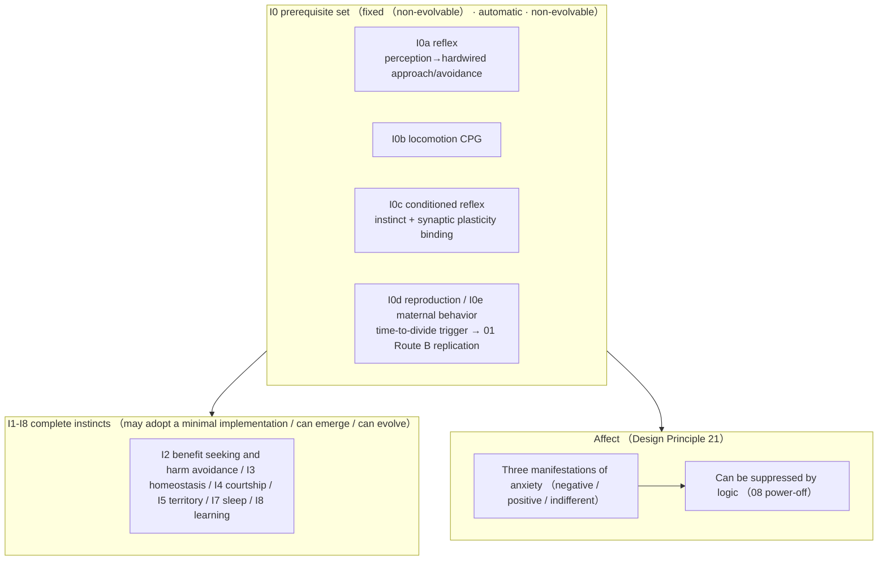
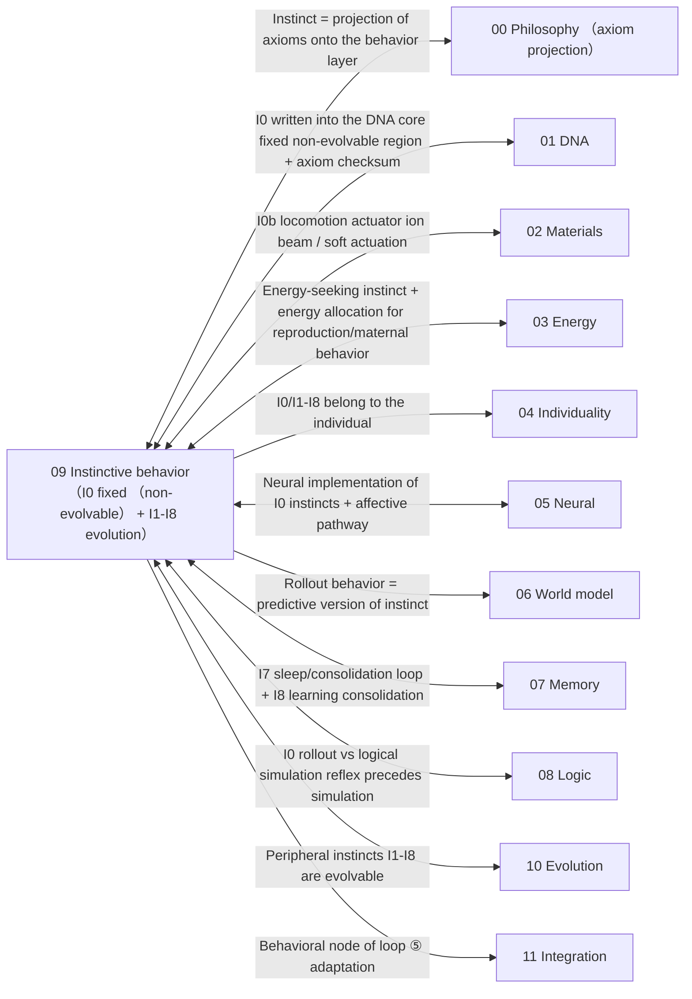

# 09 · Instinctive Behavior (Design Principle 8)

| Item | Value |
| --- | --- |
| Module | Instinctive behavior: I0 prerequisite set, I1–I8 instincts and affect |
| Document type | Design report (English edition) |
| Version | v4.1 |
| Dependencies | 00 axiom projection, 05 neural implementation, 01 DNA fixed region |
| Language | English (Chinese edition: `../zh-CN/09_本能行为_设计.md`) |

> **Evidence categories**: `[Ref:…]` literature or data; `[Design decision]` project setting; `[Logical derivation]` derived from listed premises; `[To be verified]` unvalidated placeholder.

---

## 0. Comparison of Design Options

> Design question: the key question is **how I0a reflex / I0b CPG are implemented in the silicon-based gel** (the remaining instincts are relatively uncontroversial). Three parallel options are given, each with "implementation + evidence + feasibility".
> - **Option A (conceptual option, retaining the current = original option A)**: carbon-based CPG/reflex **directly migrated to the silicon-based carrier gel** (minimal I0 = threshold for the criteria of life)
> - **Option B (based on the project reference library = original option B, selected option)**: **robot CPG/reflex control → transplanted to the silicon-based carrier** (soft/liquid-metal robot CPG + reflex control already has experiments, `09/Schiller_2020(soft walking CPG closed loop, gold-OA, PDF in library)`, `09/Stance_Control_HyQ`, `09/Neuromorphic_Spiking_CPG`)
> - **Option C (based on published research practice, including external survey + original option C)**: ① soft-robot CPG (2020+) ② spiking CPG device (hardware, closest to silicon-based) ③ reflexive control (without thinking, engineering form) ④ lowering I0 to the "minimal approach/avoidance circuit"
> The key choice is given in §3.1 + Appendix T4 on key assumptions and design decisions.

### 0.1 Option A: Conceptual Option (Carbon-Based CPG/Reflex Migrated to the Silicon-Based Carrier, Baseline Option)

| Instinct | Concrete implementation |
| ------ | --------- |
| I0a reflex | Perception → hardwired avoidance/approach circuit (without "thinking" via the world model) |
| I0b locomotion | Lowest-level CPG locomotion pattern (random walk + phototaxis and energy taxis) |

**Evidence and notes (in table row order)**

1. **I0a reflex** — [Ref:`09/Withdrawal_Reflex_Nociceptive_Neuromorphic_Model_arXiv2505.17724`, §nociceptive reflex neuromorphic model, "2025 nociceptive reflex neuromorphic model (arXiv2505.17724)"], `09/Reflexive_BrainInspired_Guo_2026(preprint · pending peer review)`, §reflexive brain-inspired architecture, "Guo 2026 reflexive brain-inspired (preprint, pending peer review)"]] (carbon-based/robot mechanism); "implementable in silicon-based gel" [To be verified by calculation and experiment, key]
2. **I0b locomotion** — [Ref:`09/CPG_Rhythm_Generation_Stick_Insect_arXiv2504.11494`, §insect CPG rhythm generation, "2024 insect CPG rhythm generation (arXiv2504.11494)"], `09/Neuromorphic_Spiking_CPG_arXiv2101.09709`, §spiking CPG device state, "2015/2021 spiking CPG hardware rhythm"]]; gel CPG frequency [To be verified]

**Feasibility + risk**: the CPG/reflex literature is **entirely carbon-based organisms/robots**; treating it directly as the **critical silicon-based gel I0 threshold** is a Class C transplantation, with feasibility unproven — "spontaneous emergence of CPG/reflex in the gel" is an original result not previously demonstrated anywhere. [Design decision]

### 0.2 Option B: Based on the Project Reference Library (Robot CPG/Reflex Transplantation, Selected Option)

| Instinct | Literature paradigm |
| ------ | --------- |
| I0a reflex | Soft/liquid-metal robot reflex control (feedforward/reflex arc, perception → hardwired action without central planning) |
| I0b locomotion | Spiking CPG device (hardware CPG, low-power bio-like rhythm) + soft CPG (contact feedback online parameter tuning) |

**Evidence and notes (in table row order)**

1. **I0a reflex** — [Ref:`09/Schiller_2020_SoftWalkingRobot_GaitPatternGenerator_CPG_FrontRoboticsAI(gold-OA,PDF in library)`, §soft walking robot CPG closed-loop gait, "Schiller 2020 Front Rob AI(gold-OA): soft walking robot CPG closed-loop position control, supporting the determination of the T4 silicon-based soft actuator"], `09/Stance_Control_Cerebellum_Reflex_Locomotion_HyQ_Robot`, §cerebellar stance control reflex gait, "HyQ robot cerebellar stance control reflex gait"]
2. **I0b locomotion** — [Ref:`09/Neuromorphic_Spiking_CPG_arXiv2101.09709`, §spiking CPG device state, "2015/2021 spiking CPG hardware rhythm"], `09/Contact_Aware_Feedback_CPG_Soft_Snake_Robot_arXiv2309.02781`, §contact-aware feedback CPG soft snake, "2023 contact-aware feedback CPG soft snake robot"]

**Key points**: lowering I0 from "biological CPG migrated to the silicon-based carrier" to "**robot CPG + silicon-based actuator**", supported by mature control experiments, with feasibility far higher than Option A and without removing the I0 threshold.

### 0.3 Option C: Based on Published Research Practice (DOIs Checked One by One + Threshold Lowering)

> To be verified · **The evidence in this section consists of results of a public literature survey and is distinguished from the design claims of this project.**

| External paradigm | Mechanism that can be moved into 09 |
| --------- | ---------------- |
| Soft-robot CPG | Drives rhythmic motion of soft/liquid actuators, with contact-aware feedback tuning CPG online (upper bound of Option B) |
| Spiking CPG device | Spiking circuit hardware CPG, closest to "silicon-based CPG" (device-level reference, `09/Neuromorphic_Spiking_CPG`) |
| Lowering I0 to minimal approach/avoidance | I0 requires only a "perception → minimal approach/avoidance" hard circuit (1 reflex arc suffices), CPG assigned to evolvable I1-I8 (Option C) |

**Evidence and notes (in table row order)**

1. **Soft-robot CPG** — [Ref:`09/B_CPG_SOFT_ROBOT_2026-09-15.md`, §soft-robot CPG checked, "A1 Xie2019/A2 Schiller2020(gold-OA)/A3 Zhu2017 soft-robot CPG"] A1 Xie 2019 soft fish CPG multimodality (73 citations), A2 Schiller 2020 soft walking CPG closed-loop position control, A3 Zhu 2017 soft peristaltic CPG (31 citations)]
2. **Spiking CPG device** — [Ref: same reference library, §spiking CPG device checked, "B1 Gutierrez-Galan2021/B2 Polykretis2020/B3 Spaeth2020 spiking CPG devices (gold-OA)"] B1 Gutierrez-Galan 2021 spiking CPG SpiNNaker/Loihi driving a soft swimmer (37 citations), B2 Polykretis 2020 Loihi astrocyte-modulated CPG, B3 Spaeth 2020 spiking CPG soft closed loop + `09/Neuromorphic_Spiking_CPG` in the reference library]
3. **Lowering I0 to minimal approach/avoidance** — [Design decision]; the engineering form of reflexive control I0a is already covered by `09/Reflexive_BrainInspired_Guo_2026(preprint · pending peer review)`, `09/Stance_Control_HyQ`, `09/Withdrawal_Reflex_arXiv2505.17724` in the reference library

### 0.4 Option Combinations and Baseline Configuration

| Strategy | Content | Applicable conditions |
| ------ | ------ | ------ |
| **A. Pure Option A** | Carbon-based CPG/reflex migrated to the silicon-based carrier gel (retaining the current baseline) | Matches "minimal I0", key assumption, not currently operable |
| **B. Option B (selected option)** | I0 lands on robot CPG/reflex + silicon-based actuator, high feasibility without removing the threshold | Supported by empirical control experiments |
| **C. Option C threshold-lowering underlying constraint** | I0 lowered to a minimal approach/avoidance circuit, CPG assigned to evolvable items | Most conservative |

> **Baseline option = B** (I0 lands on CPG/reflex + silicon-based actuator supported by robot control experiments; feasibility far higher than A, without removing the I0 threshold) — corresponding to original option B in §3.1 + Appendix T4 on key assumptions and design decisions. **This choice is a design stance, confirmed by design review**.
> **Design decision (T4): I0 adopts the robot CPG/reflex mechanism with silicon-based actuators; Options A/C serve as alternatives.**

### 0.5 Detailed Structure of the Instinct Layer (Textual Description)

> **This section is the textual description of Figure 3-1 in §3**: without relying on the diagram, it explains layer by layer "what the instinct layer of a silicon-based individual actually is, how the members of the I0 prerequisite set are attached, how I1-I8 emerge, and how affect is threaded through". Based on **Option B (robot CPG/reflex + silicon-based actuator + I0 fixed (non-evolvable) + I1-I8 evolvable + affect suppressible)**.

**Axis 1: the 3 classes that carry instincts (where instincts "reside")**

| Class | What it is | Members |
| ---- | -------- | ------ |
| **I0 prerequisite set** (hard core fixed (non-evolvable) · automatic · non-evolvable; soft extension is a design choice and may be added or removed) | See note 1 | I0a reflex / I0b locomotion CPG / I0c conditioned reflex / I0d reproduction / I0e maternal behavior |
| **I1-I8 complete instincts** (may adopt a minimal implementation / can emerge / can evolve) | Determines "living better", optimized through mutation + selection | I2 benefit seeking and harm avoidance / I3 homeostasis / I4 courtship / I5 territory / I7 sleep / I8 learning |
| **Affective pathway** (modulator, can be suppressed by logic, Design Principle 21) | Three manifestations of anxiety (survival pressure) + prefrontal → amygdala inhibition + Boolean hard cut-off | Three manifestations of anxiety (negative / positive / indifferent) + suppression switch C |

**Full evidence for table cells**

1. **I0 prerequisite set (hard core fixed (non-evolvable) · automatic · non-evolvable; soft extension is a design choice and may be added or removed) · What it is** — The absence of any one means "not life" (Design Principle 8) — hard core (approach/avoidance I0a + reproduction I0d) = axiomatic necessity; soft extension (CPG I0b / conditioned reflex I0c / maternal behavior I0e) = design choice, may be added or removed (00 §5 S3 split, 2026-09-16 determined C)

**Evidence and notes (in table row order)**

1. **I0 prerequisite set (hard core fixed (non-evolvable) · automatic · non-evolvable; soft extension is a design choice and may be added or removed)** — Projection [Logical derivation:00 §5 hard core I0a←A2, I0d←A3; soft extension I0b←A1, I0c←A4, I0e←A3 (design choice, not axiomatic necessity)]; silicon-based implementation [Option B, §0.4]
2. **I1-I8 complete instincts (may adopt a minimal implementation / can emerge / can evolve)** — [Ref: carbon-based references `09/Tottenham_2017`, §affective neural development, "Tottenham 2017 affective neural development", `09/tan_knight_2018`, §social brain, "Tan & Knight 2018 social brain", `09/insel_2010`, §social attachment neuroscience, "Insel 2010 social attachment neuroscience", `09/VyazovskiyHarris_2013`, §slow-wave sleep, "Vyazovskiy & Harris 2013 slow-wave sleep", `05/Hebbian_2023`, §Hebbian plasticity, "Hebbian 2023 working-memory plasticity"]
3. **Affective pathway (modulator, can be suppressed by logic, Design Principle 21)** — [Ref:`05/Maier_2016`, `05/Tafet_2025`, `05/Denny_2015`, `05/Dore_2017`]; "Boolean hard cut-off = silicon-based advantage" [Design decision]

**Relationships among the three classes (instinct-layer stacking)**:
```
I0 prerequisite set (fixed (non-evolvable), absence of any one means not life)
   ↓ automatically triggered + continuously running
I1-I8 complete instincts (can emerge / can evolve, determine "living well")
   ↓ adjusts "tendencies" (without changing logical correctness)
Affective pathway (modulator, can be suppressed by 08 logic power-off)
```
→ **I0 = the threshold of "whether this is a life" (fixed (non-evolvable)); I1-I8 = "how well this life lives" (evolvable); affect = "regulation of living" (suppressible).** This stacking is "what the instinct layer of a silicon-based individual looks like".

**Axis 2: three mechanism lines (traversing the 3 classes, "how to trigger / how to evolve / how to suppress")**

| Mechanism | Which class it traverses | What it does |
| ------ | --------- | -------- |
| **Trigger (TRIGGER)** | I0 | Members of I0 are automatically triggered, without external commands (reflex = threat sign… See note 1 |
| **Evolve (EVOLVE)** | I1-I8 | Core instincts (I0d/I2/I3) are fixed (non-evolvable) and do not evolve (determine "whether… See note 2 |
| **Suppress (SUPPRESS)** | Affective pathway | Affect = modulator (adjusts tendency weights without changing logical correctness); "can b… See note 3 |

**Full evidence for table cells**

1. **Trigger (TRIGGER) · What it does** — Members of I0 are automatically triggered, without external commands (reflex = threat signal > threshold → hardwired approach/avoidance; CPG = rhythm generator running continuously; reproduction = triggered by environmental threshold)
2. **Evolve (EVOLVE) · What it does** — Core instincts (I0d/I2/I3) are fixed (non-evolvable) and do not evolve (determine "whether self-maintenance is possible", low fault tolerance); peripheral instincts (I4/I5/I7/I8) can emerge + can evolve (determine "living well", via mutation + selection)
3. **Suppress (SUPPRESS) · What it does** — Affect = modulator (adjusts tendency weights without changing logical correctness); "can be suppressed by logic" is fixed (non-evolvable) (C-a self-determination / C-b external, Boolean hard cut-off, 08 issues command → 05 affect reset to zero); the "intensity/expression" of affect is evolvable

**Evidence and notes (in table row order)**

1. **Trigger (TRIGGER)** — Trigger conditions [Design decision]; reflex mechanism [Ref:`09/Withdrawal_Reflex_arXiv2505.17724`, §nociceptive reflex neuromorphic model, "2025 nociceptive reflex neuromorphic model"], `09/Reflexive_BrainInspired_Guo_2026(preprint · pending peer review)`, §reflexive brain-inspired architecture, "Guo 2026 reflexive brain-inspired (preprint)"]; CPG [Ref:`09/Neuromorphic_Spiking_CPG_arXiv2101.09709`, §spiking CPG device state, "2015/2021 spiking CPG hardware rhythm"], `09/CPG_Rhythm_Generation_Stick_Insect_arXiv2504.11494`, §insect CPG rhythm generation, "2024 insect CPG rhythm generation"]
2. **Evolve (EVOLVE)** — Fixed (non-evolvable) vs evolvable split [Design decision]; plasticity [Ref:`05/Hebbian_2023`, `07/BlumMoyse_2024`]
3. **Suppress (SUPPRESS)** — [Ref:`05/Denny_2015`, `05/Dore_2017` (prefrontal inhibition)]; "Boolean hard cut-off = silicon-based advantage" [Design decision]

**"Fixed (non-evolvable) + evolvable + suppressible" relationship** (why this design can be "both life and live well"):
- **I0 group = fixed (non-evolvable)** (reflex/CPG/conditioned reflex/reproduction/maternal behavior, absence of any one means not life, Design Principle 8, non-evolvable);
- **I1-I8 core (benefit seeking and harm avoidance / homeostasis) = fixed (non-evolvable); periphery (courtship/territory/sleep/learning) = evolvable** (basis of the split: the core determines "whether self-maintenance is possible", the periphery determines "living well");
- **Affect "can be suppressed by logic" = fixed (non-evolvable) (Design Principle 21); affect "intensity/expression" = evolvable**.
- **This split of "fixed (non-evolvable) I0 + evolvable I1-I8 + fixed (non-evolvable) suppressible affect" is precisely the corresponding landing point of Design Principle 8 (I0 fixed (non-evolvable)) + Design Principle 10 (affect can be suppressed by logic) + Design Principle 11 (axiomatic foundations fixed first, strategies evolvable)** [Logical derivation: the three principles land respectively on I0/I1-I8/affective pathway].

**Summary of key points**
> **One instinct layer of a silicon-based individual = I0 prerequisite set (reflex I0a + locomotion CPG I0b + conditioned reflex I0c + reproduction I0d + maternal behavior I0e, fixed (non-evolvable), automatically triggered, absence of any one means not life) + I1-I8 complete instincts (benefit seeking and harm avoidance / homeostasis / courtship / territory / sleep / learning, may adopt a minimal implementation, can emerge, can evolve) + affective pathway (three manifestations of anxiety, modulates tendencies without changing logical correctness, can be reset to zero by the 08 logic Boolean hard cut-off). I0 fixed (non-evolvable) + I1-I8 evolvable + affect suppressible and fixed (non-evolvable) — this is the form of the threshold of "whether this is a life".**

---

## 1. Design Objectives

Endow the individual with **instinctive behavior patterns** — indispensable even under a minimal implementation (I0 prerequisite set). This is the determination threshold for "life" (Design Principle 8). The I0 group is fixed (non-evolvable), automatically triggered and non-evolvable; I1-I8 may adopt a minimal implementation / can emerge / can evolve.

---

## 2. Related Research Status + Different Implementation Approaches (Design Principle 2)

| Instinct | Carbon-based mechanism | Literature anchor | Silicon-based implementation |
| ------ | --------- | --------- | --------- |
| **I0a reflex** | Reflex arc (spinal cord/brainstem) | See note 1 | Perception → hardwired avoidance/approach (without thinking, §3.1) |
| **I0b locomotion** | CPG rhythmic locomotion generator | See note 2 | Lowest-level CPG locomotion pattern in the gel (§3.1) |
| **I0c conditioned reflex** | Pavlovian (cerebellar circuit) | `09/Rudolph_2023_Cognitive_Affective_Cerebellum_Classical_Conditioning_JNeurosci` | Instinct + synaptic plasticity binding (§3.1) |
| **I0d reproduction** | Hypothalamic–pituitary–gonadal axis | `09/insel_2010_oxytocin_vasopressin_affiliative_behavior_TINS_review` | "Time to divide" trigger → §01 Option B replication (§3.1) |
| **I0e maternal behavior** | Parental care (oxytocin) | `09/insel_2010` (parent-hood) | Energy allocation biased toward offspring (§3.1) |
| **I2 benefit seeking and harm avoidance** | Amygdala threat learning | `09/Tottenham_2017_Developing_Amygdala_Threat_Learning` | Perception-layer avoidance (§3.2) |
| **I3 homeostasis** | Body-temperature set-point | `09/tan_knight_2018_thermoregulation_nervous_system_PMC` | Temperature/energy safety-zone circuit (§3.2) |
| **I7 sleep/repair** | Proactive neuronal maintenance | `09/VyazovskiyHarris_2013_Sleep_Single_Neuron_Cell_Rest_NatRevNeurosci` | Low-power state + self-check (§3.2) |
| **I4-I6 courtship/territory/resources** | OXT/AVP circuits | `09/insel_2010` | Conspecific recognition / resource threshold (§3.2) |
| **Affect (Design Principle 21)** | Prefrontal–limbic system | `05/Denny_2015`·`Dore_2017`·`Maier_2016`·`Tafet_2025` | Affective modulation + can be suppressed by logic (§05.3.1, echoed in this volume) |

**Full evidence for table cells**

1. **I0a reflex · Literature anchor** — `09/Withdrawal_Reflex_Nociceptive_Neuromorphic_Model_Wang_Cheng_arXiv2505.17724.pdf` (genuine reflex-arc neuromorphic model), `09/Schiller_2020_SoftWalkingRobot_GaitPatternGenerator_CPG_FrontRoboticsAI(gold-OA,PDF in library).pdf` (reflex control), `09/Meserve_2024_Celsr3_AcouStartle_Hindbrain_Circuit`, `09/Nagar_2021_Fmn2b_Excitatory_Interneuron_Zebrafish_Startle`, `09/Muacevic_2022_Reflex_Hammer_Reflex_Arc_Review` (history of the reflex hammer as a tool, as corroborating evidence)
2. **I0b locomotion · Literature anchor** — `09/CPG_Rhythm_Generation_Stick_Insect_Locomotion_Aminzare_Rubin_arXiv2504.11494.pdf` (genuine insect CPG rhythm), `09/Eight_Neuron_Network_Quadruped_Locomotion_CPG_arXiv2406.13419.pdf`, `09/Contact_Aware_Feedback_CPG_Soft_Snake_Robot_Locomotion_arXiv2309.02781.pdf`, `09/Neuromorphic_Spiking_CPG_Legged_Robot_Locomotion_arXiv2101.09709.pdf` (spiking CPG), `09/Stance_Control_Cerebellum_Reflex_Locomotion_HyQ_Robot`

---

## 3. Design (v3)

**Figure 3-1: instinct layer = I0 fixed (non-evolvable) prerequisite set (reflex/CPG/conditioned reflex/reproduction/maternal behavior) → I1-I8 evolvable → affect (suppressible)**



> Note: I0 is the fixed prerequisite set and I1–I8 are evolvable instincts; trigger conditions and affective modulation occupy separate branches.

> **Legend**: **I0 prerequisite set** (reflex/CPG/conditioned reflex/reproduction/maternal behavior) is fixed (non-evolvable) and automatically triggered (absence of any one means not life, Design Principle 8); I0b follows **Option B (robot CPG + silicon-based actuator)**. I1-I8 are evolvable. Affect acts as regulation and **can be suppressed by 08 logic power-off** (Design Principle 21). **I0 hard core (approach/avoidance I0a / reproduction I0d) = axiomatic necessity; soft extension (CPG I0b / conditioned reflex I0c / maternal behavior I0e) = design choice, may be added or removed** (§00 §5, 2026-09-16 S3 determined C).

### 3.1 I0 Prerequisite Set (Mandatory, Fixed (Non-Evolvable), Automatically Triggered, Non-Evolvable)

| Instinct | Silicon-based implementation (may adopt a minimal implementation, but must be present + automatically triggered) | Trigger condition | Implementation location |
| ------ | -------------------------------------- | --------- | --------- |
| **I0a reflex** | Perception layer detects harmful/beneficial signals → hardwired avoidance/approach circuit (without "thinking" via the world model) | Threat signal > threshold | 05 neural layer (reflex arc) + 02 perception channel |
| **I0b locomotion** | Lowest-level CPG locomotion pattern (like "random walk + phototaxis and energy taxis"), drives the body | Continuous operation (rhythm generator) | 05 neural layer (CPG) + 03 energy supply |
| **I0c conditioned reflex** | Instinct circuit + synaptic plasticity binding: repeated co-occurrence of a neutral signal and an instinct signal → conditioned response | Repeated co-occurrence (Hebbian) | 05 plasticity + 07 memory |
| **I0d reproduction** | "Time to divide" trigger in the information band → triggered by environmental threshold → §01 Option B replication | Environmental signal (temperature/energy/resources) reaches threshold | 01 DNA + 03 energy + 10 evolution |
| **I0e maternal behavior** | "Protection" rules for offspring after replication (energy allocation biased toward offspring) | Offspring present | 03 energy allocation |

**I0 group = projection of axioms onto the behavior layer (§00 §5, split into two tiers by "logical strength" after 2026-09-16 S3 determined C)**:
- **Hard core (true axiomatic entailment, fixed (non-evolvable)) = approach/avoidance (I0a←A2) + reproduction (I0d←A3)**: A2 persistence → seeking energy and avoiding harm, A3 replication → reproduction; these two are derived from ontological axioms, **may adopt a minimal implementation but must exist + be automatically triggered + be fixed (non-evolvable)**.
- **Soft extension (design choice, may be added or removed) = maternal behavior (I0e) / conditioned reflex (I0c) / locomotion CPG (I0b)**: the axioms require only "approach/avoidance, replication, learning, cooperation" and **do not require which specific instincts** — maternal behavior/conditioned reflex/CPG are expansions that "fill design presuppositions into I0", **belonging to design choice (Design Principle 8), evolvable in addition or removal, and not rigidly posited as axiomatic necessity**.
  - I0d/I0e ← A3 (replication, reproduction + maternal behavior) · I0a/I2 ← A2 (persistence, seeking energy and avoiding harm) · I0b ← A1 (organizational closure, movement maintaining an ordered state) · I0c ← A4 (adaptation, learning binding)
**Key**: the hard core (approach/avoidance/reproduction) **means "not life" if any one is absent** (Design Principle 8, fixed (non-evolvable)); the soft extension **may adopt a minimal implementation + may be added or removed** (design choice, not necessity). "May adopt a minimal implementation" means the simplest version suffices (reflex only up to "avoiding harmful signals"), **not** "can be absent" (hard core).

**To be verified · key assumption + selection space for alternative paths (consistency check (2026-09-14): design stance confirmed by design review)**:

> **Key assumption**: "I0a reflex / I0b CPG implemented in the silicon-based gel" — the literature (`CPG_Rhythm_Generation_Stick_Insect_arXiv2504.11494` insect CPG, `Neuromorphic_Spiking_CPG_arXiv2101.09709` spiking CPG, `Withdrawal_Reflex_arXiv2505.17724` reflex arc) is entirely **carbon-based organism/robot control**; treating it directly as the **critical silicon-based gel I0 threshold** is a Class C transplantation, with feasibility unproven.
> **Selection space (one of three, with genuine literature already in the reference library)**:

| Option | Mechanism | Feasibility | Description | Literature in the reference library |
| ------ | ------ | -------- | ------ | --------- |
| **A. Retain "carbon-based CPG/reflex migrated to the silicon-based carrier gel" (current baseline)** | Directly implement CPG/reflex arc in the gel | Lowest (no implementation path for CPG/reflex in silicon-based gel) | Matches "minimal I0 = threshold for the criteria of life" | `09/CPG_Rhythm_Generation...arXiv2504.11494` (mechanism reference) |
| **B. Switch to "robot CPG/reflex control → transplanted to the silicon-based carrier"** (control-engineering substitution, made scientific) | Use CPG + reflex control of soft/liquid-metal robots (`Guo_2026 Reflexive_BrainInspired`,… See note 1 | Medium (robot CPG/reflex already has mature control experiments) | Lowers I0 from "biological CPG migrated to the silicon-based carrier" to "robot CPG + silicon-based actuator", with empirical support | `09/Schiller_2020_SoftWalkingRobot_GaitPatternGenerator_CPG_FrontRoboticsAI(gold-OA,PDF in library)`, `09/Stance_Control_Cerebellum_Reflex_Locomotion_HyQ_Robot` |
| **C. Lower the I0 threshold to a "minimal response circuit" (pragmatic alternative)** | I0 does not require a complete CPG/reflex, only a "perception → minimal approach/avoidance" hard circuit (may adopt a minimal implementation down to 1 reflex arc) | Highest (the minimal circuit is physically realizable) | Abandons "CPG rhythm" as I0, lowers I0 to "approach/avoidance suffices", CPG assigned to evolvable I1-I8 items | Same as above + `09/Withdrawal_Reflex_arXiv2505.17724` (minimal reflex arc) |

**Full evidence for table cells**

1. **B. Switch to "robot CPG/reflex control → transplanted to the silicon-based carrier" (control-engineering substitution, made scientific) · Mechanism** — Use CPG + reflex control of soft/liquid-metal robots (`Guo_2026 Reflexive_BrainInspired`, `Stance_Control_HyQ`) as references for "already realizable CPG/reflex", with the silicon-based side changing only the actuator

> **Baseline = B (I0 lands on CPG/reflex + silicon-based actuator supported by robot control experiments, feasibility far higher than A, without removing the I0 threshold); C is the most conservative (lowering I0 to minimal approach/avoidance); A is the most radical. This choice is a design stance, confirmed by design review.**

**Published research practice references**:

> The best-performing practice in existing published research on "soft/liquid-metal robot CPG + reflex control" — **the reference upper bound for each option in T4**.

| Published practice | Practice | Reference value | Corresponding option in T4 | Status |
| ------------- | ------ | ------------- | ------------------ | ------ |
| **Soft-robot CPG control (2020+)** | Uses CPG (neural oscillator) to drive rhythmic motion of soft/liquid robots, with contact-aware feedback tuning CPG parameters online | "CPG + contact feedback" is mature on soft bodies, lowering I0b from "biological CPG migrated to the silicon-based carrier" to "robot CPG + soft actuator" | Reference upper bound of Option B — demonstrates that robot CPG/reflex has experiments and high feasibility | Verified · `09/Neuromorphic_Spiking_CPG` in the reference library + supplementary search for 2024 soft CPG pending |
| **Spiking CPG device (neuromorphic, 2021+)** | Implements CPG in spiking circuit hardware (not software), low power, bio-like rhythm | Device-level CPG, one step closest to "silicon-based CPG" | Device-level reference for B | Verified · `09/Neuromorphic_Spiking_CPG` in the reference library |
| **Reflexive control (reflex, without "thinking")** | Feedforward/reflex-arc control: perception → hardwired action, without central "planning" (Guo 2026, HyQ posture control) | Precisely the engineering form of I0a reflex, "without the world model" already realized | Reflex part of B | Verified · `09/Reflexive_BrainInspired_Guo_2026(preprint · pending peer review)` in the reference library + `09/Stance_Control_HyQ` |

### 3.2 I1-I8 Complete Instincts (May Adopt a Minimal Implementation / Can Emerge / Can Evolve)

| Instinct | Silicon-based implementation | Layer | Carbon-based reference |
| ------ | --------- | ----- | --------- |
| I1 reproduction | (merged into I0d) | Core | `insel_2010` |
| I2 benefit seeking and harm avoidance | Perception-layer avoidance (danger signal → avoidance strategy) | Core | `Tottenham_2017` |
| I3 homeostasis | Self-regulation within a temperature/energy safety interval (homeothermy-like) | Core | `tan_knight_2018` |
| I4 courtship/bonding | Conspecific recognition bonding state → bonding signal (template mutual recognition, §01.4.3) | Peripheral | `insel_2010` |
| I5 territory/resources | Energy-threshold rule for resource occupancy ("first arrival claims occupancy") | Peripheral | `insel_2010` |
| I6 maternal behavior | (merged into I0e) | Peripheral | `insel_2010` |
| I7 sleep/repair | Low-power-state cycle (dormancy-like), self-check/repair (§01 §4 repair subsystem) | Peripheral | `VyazovskiyHarris_2013` |
| I8 learning | Spontaneous adjustment of synaptic weights (§05 neural-layer plasticity) + memory consolidation | Peripheral (emergent) | `Hebbian_2023`·`Khacef_2022`·`BlumMoyse_2024` |

**Design logic**:
- **Core instincts (I0d/I2/I3) fixed (non-evolvable)**: determine "whether self-maintenance is possible", low fault tolerance
- **Peripheral instincts (I4/I5/I7/I8) can emerge + can evolve**: determine "living better", optimized through mutation + selection
- **Affect (Design Principle 21)**: anxiety (survival pressure) → three manifestations (negative / positive / indifferent), **can be suppressed by logic** (§05.3.1)

### 3.3 Instinctive Time Scales (Design Principle 15, Chimpanzee Baseline Mapping)

| Instinct | Carbon-based time scale | Carbon-based source | Silicon-based mapping | Silicon-based value |
| ------ | --------- | --------- | --------- | -------- |
| Reflex (I0a) | See note 1 | Same as above | ns-µs (`Design setting`, neural-layer spikes) | Nanoseconds–microseconds |
| Locomotion rhythm (I0b CPG) | See note 2 | Same as above (genuine CPG) | ~ms (gel CPG frequency, `to be verified by calculation`) | Milliseconds (B1 to be measured) |
| Reproduction trigger (I0d) | First birth ~14 years | `05/Hawkes_Smith_Robson_2009...Gompertz...PMC6121812` (measured) | ~14-17 h (Design Principle 15 mapping, ÷10⁴ project setting) | 14-17 hours |
| Sleep/consolidation (I7) | Several hours (consolidation mechanism: `07/Rasch_Born_2013` SWS system consolidation + `0… See note 3 | Same as above | ~10 seconds (§07 consolidation time scale, mapping project setting) | ~10 seconds |

**Full evidence for table cells**

1. **Reflex (I0a) · Carbon-based time scale** — ~100 ms (carbon-based value to be checked, genuine reflex-arc literature retrieved as a supplement: `09/Withdrawal_Reflex_Nociceptive_Neuromorphic_Model_Wang_Cheng_arXiv2505.17724.pdf` + `09/Schiller_2020_SoftWalkingRobot_GaitPatternGenerator_CPG_FrontRoboticsAI(gold-OA,PDF in library).pdf`)
2. **Locomotion rhythm (I0b CPG) · Carbon-based time scale** — Rhythmic locomotion (CPG mechanism available, `09/CPG_Rhythm_Generation_Stick_Insect_Locomotion_Aminzare_Rubin_arXiv2504.11494.pdf` + `09/Eight_Neuron_Network_Quadruped_Locomotion_CPG_arXiv2406.13419.pdf` + `09/Neuromorphic_Spiking_CPG_Legged_Robot_Locomotion_arXiv2101.09709.pdf`, concrete carbon-based step frequency to be checked)
3. **Sleep/consolidation (I7) · Carbon-based time scale** — Several hours (consolidation mechanism: `07/Rasch_Born_2013` SWS system consolidation + `09/VyazovskiyHarris_2013` slow-wave cellular rest (full text), cycle value to be checked against the original text)

**Key**: most "carbon-based values" in the table above **have not yet been checked one by one against concrete numbers in the original texts** (marked "to be checked"); only "first birth ~14 years" is linked to `Hawkes_2009` (measured); **CPG step frequency and reflex timing have no carbon-based measured data and are marked "to be checked / supplementary retrieval"** (Design Principle 24: no assertion without evidence). Silicon-based value = carbon-based value × compression ratio, **the compression ratio is a project setting**.

---

## 4. Relationships with Other Parts (Interface Contract, All Dimensions)

> **Completeness principle**: 09 is the "instinctive behavior layer", the convergence point of **axiom projection (00) / neural implementation (05) / energy-seeking drive (03)** — a connection must be established with every dimension (missing one = incomplete document).

**Figure 4-1: overview of the connections between 09 (instinctive behavior) and all 12 volumes**



> Note: The source of an arrow is the value provider and the target is the receiver; measurable quantities are defined by the interface contracts of the respective volumes.

| Interface | Data flow (physical/informational quantities, not concepts) | Invariant (measurable) | Evidence category |
| ------ | --------------------------- | ------------- | --------- |
| **↔ 00 Philosophy** | Instinct = projection of axioms onto the behavior layer, split into two tiers by S3: hard… See note 1 | I0 group (hard core holds + soft extension filled by design) | [Ref:00 §5] |
| **↔ 01 DNA** | I0 written into the 01 core fixed (non-evolvable) region + axiom checksum | I0 ∈ DNA core region | [Ref:01 core region] |
| **↔ 02 Materials** | I0b locomotion actuator (ion beam/soft actuator drives the body) | Actuator response [To be verified] | [Logical derivation:09 attached to 02] |
| **↔ 03 Energy** | Energy-seeking instinct + energy allocation for reproduction/maternal behavior | Energy-seeking / energy allocation [Design] | [Ref:03 A2 order + energy-seeking instinct] |
| **→ 04 Individuality** | I0/I1-I8 belong to the individual (instincts are at the individual level) | I0 triggered at the individual level [Design] | [Logical derivation:09 + 04] |
| **↔ 05 Neural** | Neural implementation of I0 instincts + affective pathway (reflex arc/CPG relies on 05) | Reflex delay [To be verified by calculation, I2] | [Ref:05 neural layer] |
| **→ 06 World model** | Rollout behavior = predictive version of instinct (rollout first, then reflex) | Prediction deviation [To be verified] | [Logical derivation:06 attached to 09] |
| **↔ 07 Memory** | I7 sleep/consolidation loop + I8 learning consolidation (triggered by low-power state) | Replay trigger [To be verified] | [Ref:09 I7 + 07] |
| **↔ 08 Logic** | I0 rollout vs logical simulation (reflex precedes 08 simulation) | Reflex vs simulation delay [To be verified] | [Logical derivation:08 simulation] |
| **↔ 10 Evolution** | Peripheral instincts I1-I8 are evolvable (core I0 is fixed (non-evolvable) and does not evolve) | Evolvable items ∈ I1-I8 [Design] | [Ref:10 evolution] |
| **→ 11 Integration** | Behavioral node of loop ⑤ adaptation (instinct drives adaptation) | Closure of loop ⑤ requires 09 | [Ref:11 §5 loops] |

**Full evidence for table cells**

1. **↔ 00 Philosophy · Data flow (physical/informational quantities, not concepts)** — Instinct = projection of axioms onto the behavior layer, split into two tiers by S3: hard core (approach/avoidance I0a/I2←A2, reproduction I0d←A3) = axiomatic necessity; soft extension (locomotion I0b←A1, conditioned reflex I0c←A4, maternal behavior I0e←A3) = design choice, may be added or removed, not axiomatic necessity (2026-09-16 S3 determined C)

**Contract principle**: interface "data" must be **physically/informationally measurable quantities** (reflex delay / CPG frequency / trigger threshold / energy consumption), not concepts; those without measured values are marked "numerical values pending DFT in 09/other volumes".

**Evidence category (§4)**:
- Axiom projection → 00 [Ref:00 §5]
- Fixed (non-evolvable) region ↔ 01 / actuator ↔ 02 / energy seeking ↔ 03 [Ref:01 core region + 02 + 03 A2]
- Belonging to the individual → 04 [Logical derivation]
- Neural implementation ↔ 05 / rollout → 06 / I7 consolidation ↔ 07 / reflex vs simulation ↔ 08 [Ref / Logical derivation]
- Evolvable ↔ 10 [Ref:10]
- Loop ⑤ → 11 [Ref:11 §5]

---

## 5. Pending Experimental Verification / DFT (Each Item: Formula + Window + Value Provider, with Quantitative Conditions)

| # | Open item | Formula/inequality to be satisfied | Parameter window (design setting) | Value provider |
| --- | -------- | --------------------- | -------------------- | ---------- |
| I1 | Frequency range of I0b locomotion CPG in the silicon-based gel | CPG oscillation frequency f_cpg ∈ feasible window of gel CPG (rhythmic locomotion maintained) | Carbon-based CPG mechanism available (`CPG_Rhythm_Generation_Stick_Insect_arXiv2504.11494` + `Neuromorphic_Spiking_CPG_arXiv2101.09709`); silicon-based f_cpg [To be verified] | 09 DFT + 05 experiment (silicon-based gel CPG oscillation frequency) |
| I2 | Trigger thresholds of each instinct (reflex/reproduction/homeostasis) | Threat-signal strength S_thr / reproduction environmental threshold E_rep / homeostasis set-point T_set must be < survival upper bound | Threshold [Design setting · to be verified by calculation and experiment, no measured values] | 09 experiment (measured trigger conditions of each instinct) |
| I3 | Feasibility of the minimal implementation of the I0 group (whether minimal reflex + minimal CPG can close) | Minimal I0 (1 reflex arc + 1 CPG) must run on the silicon-based carrier | Minimal prototype [To be verified by experiment (P0: determines "whether it is life")] | 09 + 02 experiment (minimal I0 prototype on the silicon-based carrier) |
| I4 | Synaptic plasticity binding parameters of the I0c conditioned reflex | Co-occurrence count × intensity → conditioned-response trigger threshold (Hebbian form) | See note 1 | 09 DFT + 07 experiment (silicon-based conditioned-reflex binding curve) |
| I5 | Affective modulation strength vs logic suppression response time | After suppression, affective modulation w_emo → 0, response time t_sup ≪ decision period | Carbon-based prefrontal inhibition has measured data [Ref:`05/Denny_2015`, `05/Dore_2017`]; silicon-based Boolean hard cut-off t_sup [To be verified] | 09 + 05 + 08 coordination |

**Full evidence for table cells**

1. **I4 · Parameter window (design setting)** — Binding parameters [Design setting + to be verified by calculation]; mechanism [Ref:`09/Rudolph_2023`, §cerebellar conditioned-reflex plasticity, "Rudolph 2023 cerebellar conditioned-reflex synaptic plasticity"] cerebellum]

**Note**: each of I1-I5 gives "**what to calculate + threshold/window + value provider**"; the **carbon-based mechanisms of CPG/reflex/conditioned reflex have literature** (attached to `09/`, files can be opened), but the **silicon-based side** (gel CPG frequency, trigger thresholds, minimal I0 feasibility, conditioned-reflex binding parameters, affective suppression response) is entirely **pending first-principles calculation and experiment in 05/09**; the time-scale compression ratio (§3.3) = design setting (a project setting, adjustable), and most carbon-based time-scale values **have not been checked against concrete numbers in the original texts (marked "to be checked")**, without conjecture.

---

## 10. Scope and Known Limitations (Design Principle 24)

- **Determinable content (given in this document)**: the structure of the 3 classes of the instinct layer in §0.5 (I0 fixed (non-evolvable) + I1-I8 evolvable + affect suppressible) + the 3 mechanism lines (trigger/evolve/suppress), the §2 I0-I8 carbon-based mechanism comparison table + silicon-based implementation, the §3.1 I0 prerequisite set (5 members, fixed (non-evolvable), automatically triggered) + T4 stance A/B/C + published research practice reference table, the §3.2 I1-I8 complete instincts + core/periphery split, the §3.3 instinctive time scales (Design Principle 15 mapping + carbon-based values to be checked), and the §4 interfaces with all 12 volumes.
- **Undeterminable content (only formulae and boundaries are given; placeholders are not treated as baseline values)**: I1 silicon-based CPG frequency, I2 trigger thresholds, I3 minimal I0 feasibility, I4 conditioned-reflex binding parameters, I5 affective suppression response time — **all pending first-principles calculation and experiment in 05/09**; the §3.3 carbon-based time-scale values (reflex ~100 ms / CPG step frequency) **have not been checked against concrete numbers in the original texts and are marked "to be checked"** (Design Principle 24: no assertion without evidence).
- **Key assumptions (to be determined by design review)**:
  - **"I0a reflex / I0b CPG implemented in the silicon-based gel"** — the CPG/reflex literature (`CPG_Rhythm_Generation_Stick_Insect` + `Neuromorphic_Spiking_CPG` + `Withdrawal_Reflex`) is entirely **carbon-based organism/robot control**; treating it directly as **the critical silicon-based gel I0 threshold is a Class C transplantation**; "spontaneous emergence of CPG/reflex in the gel" is an original result not previously demonstrated anywhere, the key assumption has been listed, **baseline B (robot CPG/reflex + silicon-based actuator, with mature control experiments)**.
  - **The "absence of any one means not life" determination of the I0 group** — this is the threshold of "whether it is life" (Design Principle 8); whether the minimal I0 (1 reflex arc + 1 CPG) can close on the silicon-based carrier is **unverified** (I3), with P0 pending experiment.

---

> Corresponding Chinese edition: `../zh-CN/09_本能行为_设计.md`
