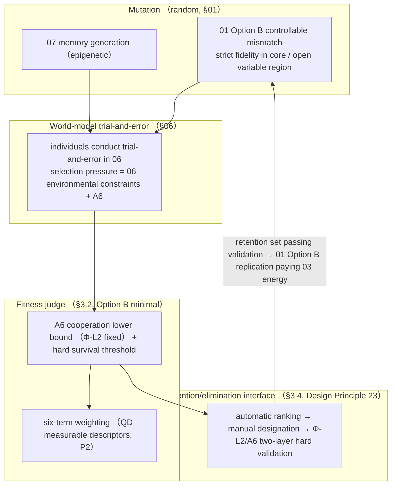
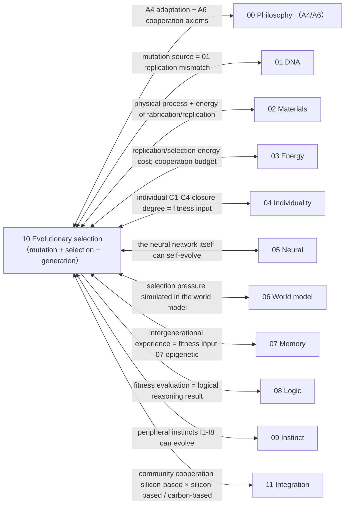
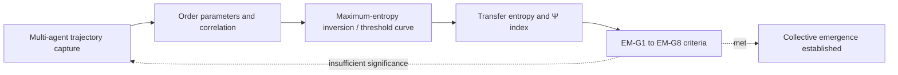

# 10 · Evolutionary Selection (S6)

| Item | Value |
| --- | --- |
| Module | Evolutionary selection (S6): fitness function, selection pressure and generation transfer |
| Document type | Design report (English edition) |
| Version | v4.1 |
| Dependencies | 01 mutation source, 03 replication energy cost, 06 selection-pressure simulation, 00 axiomatic layer |
| Language | English (Chinese edition: `../zh-CN/10_演化选择_设计.md`) |

> **Evidence categories**: `[Ref:…]` literature or data; `[Design decision]` project setting; `[Logical derivation]` derived from listed premises; `[To be verified]` unvalidated placeholder.

---

## 0. Comparison of Design Options

> Design question: the key question is **how the fitness judge can be "measurable and runnable"** (the six-term weighting has no measurement path + it is self-contradictory with the evaluation volume's two factors, i.e. S1). Three parallel options are given, each providing "judge form + evidence + feasibility".
> - **Option A (conceptual option, retaining the current = original Option A)**: **six-term weighting** (organizational closure / energy surplus / replication rate / learning degree / world-model accuracy / cooperation + A6) as the judge, with priority to critical integrity
> - **Option B (based on the project reference library = original Option C, selected option)**: **phased minimal judge** — A6 cooperation-term lower bound (Φ-L2 fixed, with axiomatic basis) + hard survival threshold, priority on obtaining a runnable prototype, six terms as P2
> - **Option C (based on published research practice, including external investigation + original Option B)**: ① **Quality-Diversity / MAP-Elites** (multiple measurable descriptors, forcing each of the "six terms" to be measurable) ② **Reward shaping + prevention of reward hacking** (measurable sub-terms + adversarial validation) ③ **two-factor scalar** (survival duration × resource efficiency, aligned with the evaluation volume)
> For the key selection, see §3.2 + Appendix S1 on key assumptions and design decisions.

### 0.1 Option A: Conceptual Option (Six-Term Weighting, Baseline Option)

| Step | Specific practice | Nature of evidence |
| ------ | --------- | --------- |
| Judge | F = Σwᵢ·[closure/energy/replication/learning/world model/cooperation] − w_penalty | [Design decision]; values of each wᵢ + measurement methods not given anywhere in the volume [To be computed and experimentally verified, critical] |
| Cooperation | A6 lower bound fixed (Φ-L2) + upper bound free | [Ref:00 Φ-L2 + 10 §3.3] |

**Feasibility + risks**: for the six terms, "how to measure them into scalars + normalisation + weight values" has no path; treating it as a "directly runnable judge" is a key assumption; moreover it contradicts the evaluation volume's two factors. [Design decision]

### 0.2 Option B: Based on the Project Reference Library (Phased Minimal Judge, Selected Option)

| Step | Literature paradigm |
| ------ | --------- |
| Minimal judge | A6 cooperation lower bound (Φ-L2 has an axiomatic basis) + hard survival threshold (A2 persistence), run first; six terms as P2 |
| Mutation | 01 Option B controllable mismatch + 07 generation |
| Open-ended evolution | open-ended CA (non-convergent) |

**Evidence and notes (in table row order)**

1. **Minimal judge** — [Ref:00 Φ-L2/A2 + 10 §3.3]; measurement paths for the six terms [To be verified]
2. **Mutation** — [Ref:01 replication + 07]
3. **Open-ended evolution** — [Ref:`10/Large_Scale_Simulations_Open_Ended_Evolution_Cellular_Automata_arXiv2304.05639`, §Large-scale open-ended evolution CA, "2023 Large-scale open-ended evolution cellular automata (arXiv2304.05639)"]

**Key point**: first secure "no extermination of carbon-based life (Φ-L2) + survival (hard survival threshold)", obtain a runnable prototype as quickly as possible, and resolve the current blockage that "the six terms cannot be measured".

> **Naming convention**: when this volume and 09/01 cite "**01 Option B**", it uniformly refers to **the replication Option B in 01 §5 (template guidance + external energy field, Design Principle 5)**, not the "carrier combination Option B (I+II hybrid, already deprecated by T0 determining A)" in 01 §0.4. The two share a name but differ in meaning; when reading "01 Option B replication" in this volume, it must not be misread as the deprecated carrier combination Option B.

### 0.3 Option C: Based on Published Research Practice (QD + Reward Shaping + Two-Factor Scalar, Verified Item by Item)

> To be verified · **The evidence in this section consists of results of a published-literature investigation and is distinguished from the design claims of this project.**

| External paradigm | Mechanisms transferable into 10 |
| --------- | ---------------- |
| Quality-Diversity / MAP-Elites | split the "six terms" into multiple measurable descriptors in an archive, forcing measurement to be completed (ceiling of Option A) |
| Reward shaping + hacking prevention | measurable reward sub-terms + adversarial validation to prevent loophole exploitation (ceiling of Option C) |
| Two-factor scalar | survival duration × resource efficiency (aligned with the evaluation volume, most runnable) |

**Evidence and notes (in table row order)**

1. **Quality-Diversity / MAP-Elites** — [Ref:`10/B_EVOLUTIONARY_QD_REWARD_2026-09-15.md`, §QD/reward verified, "Q1' Seeking_QD_2021 (anchor verified)/Q2 Cully2025 Dominated Novelty Search (GECCO, DOI 10.1145/3712256.3726310); original Q1/Q2 deprecated"] Q1' `10/Seeking_Quality_Diversity_2021` in the reference library (QD 2021 anchor verified) + Q2 Cully 2025 *Dominated Novelty Search* (GECCO, DOI 10.1145/3712256.3726310, arXiv:2502.00593); citations of original Q1 (arXiv:2407.04106) + original Q2 (Vassileva/Lehmann) are deprecated, not to be cited]
2. **Reward shaping + hacking prevention** — [Ref: same reference library as above, §reward hacking verified, "R1 Karwowski/Skalse2023 Goodhart's Law in RL (ICLR2024 peer-reviewed, arXiv2310.09144)/R1b Skalse2023 Defining Reward Hacking (NeurIPS, DOI 10.52202/068431-0687); original R2 deprecated"] R1 Karwowski/Skalse 2023 *Goodhart's Law in RL* (arXiv:2310.09144 (ICLR 2024 peer-reviewed)) + R1b Skalse/Howe/Krasheninnikov/Krueger 2023 *Defining and Characterizing Reward Hacking* (NeurIPS, DOI 10.52202/068431-0687, OA); original R2 (Metz/Amodei OpenAI 2017) has no written publication, covered by R1+R1b]
3. **Two-factor scalar** — [Ref:`10/2022_EvoJAX_arXiv2202.05008`, §EvoJAX evolution benchmark, "2022 EvoJAX evolution benchmark (arXiv2202.05008), start with 1-2 measurable quantities"]

### 0.4 Option Combinations and Baseline Configuration

| Strategy | Content | Suitable for |
| ------ | ------ | ------ |
| **A. Pure Option A** | six-term weighting as the judge, marked "measurement to be designed" (retains the complete structure, not runnable at this stage) | critical integrity, accepting the status quo |
| **B. Option B + QD measurability constraint** | run A6 + hard survival threshold first, the six terms split into measurable descriptors according to QD and then completed | priority on obtaining a minimal prototype + completing measurement (originally selected op… See note 1 |
| **C. Option C two-factor bottom-layer constraint** | reduced to survival duration × resource efficiency (aligned with the evaluation volume, currently runnable) | most conservative alignment with the evaluation volume |

**Full evidence for table cells**

1. **B. Option B + QD measurability constraint · Suitable for** — priority on obtaining a minimal prototype + completing measurement (originally selected option, design decision S1=C; in substance this is the phased approach of C, the "selected option" mark in the §0.4 B row has been removed)

> **Baseline option = C** (run the minimal judge of A6 + hard survival threshold first; the six terms use the "measurable descriptors" of Quality-Diversity to complete the measurement path, while eliminating the contradiction with the evaluation volume) — that is, the §0.4 B row "Option B + QD measurability constraint" in substance = §3.2 C "phased: A6 runs first + six terms as P2"; after design decision S1=C the baseline is aligned with C, and the "(selected option)" label in the §0.4 B row is downgraded. **This selection is a design stance, confirmed by design review** (S1 determines C, 2026-09-16).

### 0.5 Detailed Structure of the Evolutionary Cycle (Textual Description)

> **This section is the textual description of Figure 3-1 in §3**: without relying on the diagram, it explains layer by layer "what exactly one evolutionary cycle of the silicon-based community is, and how mutation/trial-and-error/judging/retention are linked". It is based on **Option B (phased minimal judge: A6 + hard survival threshold run first, six terms completed according to QD measurable descriptors)**.

**Axis 1: the 5 loops of the evolutionary cycle (from mutation to generation, "how one generation completes a cycle")**

| Loop | What it is | What it does |
| ---- | -------- | -------- |
| **① Mutation (VARY)** | 01 Option B replication mismatch (strict fidelity in the core region + open variable region) + 07 memory generation (epigenetic) | produces next-generation candidates (mutation = random, no direction specified) |
| **② Trial-and-error (SIMULATE)** | candidate individuals conduct trial-and-error in the 06 world model (selection pressure = environmental constraints + A6) | run fitness in the virtual field (no real replication, paying the 03 rollout energy cost) |
| **③ Judging (FITNESS)** | fitness function F (§3.2, Option B: A6 lower bound Φ-L2 + hard survival threshold, six terms as P2 according to QD measurable descriptors) | quantify "who lives well" into a measurable scalar (judge, not director) |
| **④ Retention (RETAIN)** | retention/elimination interface (§3.4, Design Principle 23): automatic ranking → manual designation of the retention set → Φ-L2/A6 two-layer hard validation | human retention/elimination (no direction specified, only designating "which remain"; Φ-L2 bottom-layer constraint) |
| **⑤ Generation (GENERATE)** | retention set that passes validation → 01 Option B replication (paying 03 energy) → next-generation phenotypes | replicate the retained "good individuals" into the next generation |

**Evidence and notes (in table row order)**

1. **① Mutation (VARY)** — mutation source [Ref:01 §5 replication + 07 §0 Option B epigenetic]; "core region ε→0 / variable region left high" [Ref:01 §7]
2. **② Trial-and-error (SIMULATE)** — trial-and-error [Ref:06 §3 rollout + 10 §3.5 selection pressure]; rollout energy cost [Ref:03 W3]
3. **③ Judging (FITNESS)** — judge structure [Logical derivation:00 A4/A6 + QD]; measurement of the six terms [Ref:`10/Seeking_Quality_Diversity_2021`, §Seeking QD 2021, "2021 Seeking Quality Diversity (arXiv), QD measurable descriptors"]
4. **④ Retention (RETAIN)** — retention/elimination interface [Logical derivation: Design Principle 23 + A6 two-layer]; "Φ-L2 cannot be breached" [Ref:00 Φ-L2]
5. **⑤ Generation (GENERATE)** — generation [Ref:01 §5 replication + 03 energy supply]; generation time scale [Ref: Design Principle 15 + `10/G_LaBar_2017`, §Avida digital evolution, "LaBar 2017 Avida digital evolution time scale"] Avida]

**Relations among the loops (the cycle from left to right in the diagram)**:
```
① Mutation (01 mismatch + 07 generation) → ② Trial-and-error (06 world model) → ③ Judging (fitness F)
     → ④ Retention (manual designation + Φ-L2 hard validation) → ⑤ Generation (01 replication paying 03 energy) → back to ①
```
→ **"Evolution" is not an independent thing; it = the cycle of ①②③④⑤ (random mutation + non-random selection); mutation relies on ①, rollout on ②, judging on ③, retention on ④, replication on ⑤.** This cycle is "how one generation of the silicon-based community evolves".

**Axis 2: three mechanism lines (passing through the 5 loops, "how to mutate / how to judge / how to retain")**

| Mechanism | Which loop it passes through | What it does |
| ------ | --------- | -------- |
| **Mutation (MUTATE)** | ① | 01 Option B controllable mismatch (strict core / open variable) + 07 memory generation (epigenetic expression state); "mutation is random" |
| **Judging (JUDGE)** | ③ | fitness F quantifies "living well": Option B minimal = A6 lower bound (Φ-L2) + hard surviv… See note 1 |
| **Retention (RETAIN)** | ④ | See note 2 |

**Full evidence for table cells**

1. **Judging (JUDGE) · What it does** — fitness F quantifies "living well": Option B minimal = A6 lower bound (Φ-L2) + hard survival threshold, six terms completed according to QD measurable descriptors; no direction specified (judge, not director)
2. **Retention (RETAIN) · What it does** — human retention/elimination (Design Principle 23): manual designation of the retention set, no direction written; Φ-L2/A6 two-layer hard validation bottom-layer constraint (those harming carbon-based life are removed, even with high fitness)

**Evidence and notes (in table row order)**

1. **Mutation (MUTATE)** — [Ref:01 §5 + 07 §0]; "variable region deliberately left with high mismatch" [Logical derivation: Design Principle 4 spontaneous mutation + 01 §7]
2. **Judging (JUDGE)** — judge structure [Logical derivation:00 A4/A6]; QD measurability [Ref:`10/Seeking_Quality_Diversity_2021`, §Seeking QD 2021, "2021 Seeking Quality Diversity (arXiv), QD measurable descriptors"]
3. **Retention (RETAIN)** — retention/elimination interface [Logical derivation: Design Principle 23 + A6 two-layer]; "Φ-L2 cannot be breached" [Ref:00 Φ-L2]

**The "random + non-random + manual selection" relationship** (why this design can "both evolve and remain orderly"):
- **Mutation (①) = random** (no direction specified, Design Principle 23);
- **Selection (③) = non-random** (fitness judge, those that live well remain, Design Principle 23);
- **Retention (④) = manual selection** (human retention authority, analogous to breeding; but with the **Φ-L2 bottom-layer constraint** — individuals that "exterminate carbon-based life" cannot be designated).
- **This division of "random mutation + non-random selection + manual selection + Φ-L2 bottom-layer constraint" is precisely the corresponding landing point of Design Principle 23 (no direction specified + human retention authority) + Design Principle 19 (two-layer rule structure) + Design Principle 22 (no stance taught)** [Logical derivation: the three principles land respectively on ①/③/④].

**Summary of key points**
> **One evolutionary cycle of the silicon-based community = ① Mutation (01 replication mismatch + 07 memory generation, random) + ② Trial-and-error (06 world model, selection pressure) + ③ Judging (fitness F: Option B minimal = A6 lower bound Φ-L2 + hard survival threshold, six terms completed according to QD measurable descriptors, no direction specified) + ④ Retention (manual designation of the retention set, Φ-L2/A6 two-layer hard validation bottom-layer constraint) + ⑤ Generation (01 replication paying 03 energy) → back to ①. Mutation is random, selection is non-random, manual selection is applied but with the Φ-L2 bottom-layer constraint — this is the cyclic form of "without selection, mutation is only random noise".**

---

## 1. Design Objectives
Make the silicon-based community **variable across generations and subject to natural selection** — mutation (§01 replication mismatch) + selection (fitness in this volume) = evolution. Without selection, mutation is only random noise.
**Key boundaries (Design Principles 23 + 19)**:
- The fitness function **does not specify "which direction to evolve in"** (judge, not director)
- But it contains a **"human retention/elimination" interface** (human retention authority, analogous to artificial selection/breeding)
- The A6 cooperation term has a **fixed lower bound + free upper bound** (design decision (2026-09-13))

---

## 2. Related Research Status + Different Implementation Approaches (Design Principle 2)

| Route | Status | Literature anchor | Trade-off |
| ------ | ------ | --------- | ------ |
| **Fitness landscape navigation** | Available | `10/2024_Srivastava_Evolution_as_Fitness_Landscape_Navigation_arXiv2604.17036.pdf` | Verified · fitness definition |
| **Stabilizing selection → emergence of robustness** | Available | `10/RohlfWinkler_2008_Emergence_Robustness_Stabilizing_Selection_arXiv0804.4714.pdf` | Verified · robustness mechanism |
| **Open-ended evolution (open-ended)** | Frontier | `10/Large_Scale_Simulations_Open_Ended_Evolution_Cellular_Automata_arXiv2304.05639.pdf` | Not converged |
| **Quality-diversity (co-design)** | Available | `10/Seeking_Quality_Diversity_Evolutionary_CoDesign_arXiv2104.12175.pdf` | Verified · diversity maintenance |
| **Balancing adaptive/diversifying pressures** | Available | `10/2021_Selecting_for_Selection_Balancing_Adaptive_Diversifying_arXiv2106.09153.pdf` | Verified · pressure tuning |
| **Neuroevolution** | Available | See note 1 | NN evolution |
| **Community cooperation (Design Principle 20)** | Frontier | See note 2 | Cooperation interface |

**Full evidence for table cells**

1. **Neuroevolution · Literature anchor** — `10/2022_EvoJAX_Hardware_Accelerated_Neuroevolution_arXiv2202.05008.pdf`, `10/2022_Pontes-Filho_Towards_Neuroevolution_of_LowLevel_AGI_arXiv2207.13583.pdf`, `10/2024_Cicirello_Open_Source_Evolutionary_Computation_arXiv2412.02004.pdf`, `10/2020_Alam_Qamar_Dixit_Genetic_Algorithm_Reviews_arXiv2007.12673.pdf`
2. **Community cooperation (Design Principle 20) · Literature anchor** — `10/2026_AI_Agents_Reshape_Consensus_Formation_Human_Groups_Chen_arXiv2609.02122.pdf`, `10/2026_A2ABreak_Security_Analysis_Agent-to-Agent_Protocol_Lotfi_Bertino_arXiv2609.10871.pdf`, `10/2026_Emergent_Behavior_Robust_Communication_Delays_Jeong_Shim_arXiv2608.09038.pdf`, `10/2026_Emergent_Cheating_Whistleblowing_Autonomous_Research_Swarms_Paglieri_Leibo_arXiv2609.04170.pdf`

---

## 3. Design (v3)

**Figure 3-1: Evolutionary cycle = mutation (01) → selection (fitness + retention/elimination interface) → generation transfer → world-model trial-and-error**



> Note: Mutation generates phenotypes, the fitness function adjudicates retention or elimination, and intergenerational transfer closes the loop.

> **Legend**: mutation (01 replication mismatch + 07 memory generation) → world-model trial-and-error (06, selection pressure = environmental constraints + A6) → **fitness judge** (Option B: A6 lower bound Φ-L2 + hard survival threshold, six terms as P2 according to QD measurable descriptors) → **retention/elimination interface** (manual designation + Φ-L2/A6 two-layer hard validation, no direction specified) → those that pass enter the next generation via 01 Option B replication (paying 03 energy).

### 3.1 Mutation (Random, from §01)
- **Source**: controllable mismatch during 01 Option B replication (§01.4, strict fidelity in the core region, open variable region)
- **Memory generation**: the "excellent experience" of 07 memory is burned back into the 01 DNA variable region (Lamarckian epigenetic inheritance, §07)
- **Mutation is random** (no direction specified), selection is **non-random** (fitness)

### 3.2 Fitness Function (Core of This Volume, Implementation of A6)

```
Fitness F(individual) =
  w_survive  · [degree of maintenance of organizational closure](C1-C4,§04)      ← A1/A2
+ w_energy   · [energy budget surplus](§03, energy-seeking instinct)          ← A2
+ w_replic   · [replication success rate](§01, reproduction instinct)             ← A3
+ w_learn    · [learning/memory effectiveness](§07)                 ← A4
+ w_world    · [world-model prediction accuracy](§06)                ← A5
+ A6(cooperation term, see §3.3)                                  ← Design Principle 20
- w_penalty  · [penalty term]
```

**Key point**: fitness **does not specify "where to evolve"** — it is a "judge" (who lives well), not a "director" (where to go). Silicon-based life **evolves on its own** values/strategies in the world model (Design Principle 22 "no stance taught").

### Key Assumptions and Design Decisions

> **Key assumptions (two, both requiring design decisions)**:
> 1. **The six-term weighted function itself has no measurement path** — for the six terms `organizational closure degree`/`energy surplus`/`replication success rate`/`learning degree`/`world-model accuracy`/`cooperation`, **how to measure them into scalars, how to normalise, and the values of the weights wᵢ** are not given anywhere in the volume, yet it is treated as a "directly runnable judge".
> 2. **Alignment with the evaluation volume (implemented under S5 on 2026-09-16)**: this volume gives **6 terms + A6**; the evaluation volume:61 originally wrote "survival duration × resource acquisition efficiency" (two factors), and the two sides were once inconsistent; **they are now aligned — the evaluation volume:61 adopts this volume's "phased minimal judge (A6 lower bound + hard survival threshold run first, six terms completed as P2 according to QD measurable descriptors)", with the two factors retained only as a form of alignment, consistent with S1 determining C in 10 §3.2**, and the contradiction has been eliminated.
> **Option space (stance category, no literature search required, a design judgement)**:

| Option | Content | Consequence | Applicable conditions |
| ------ | ------ | ------ | -------- |
| **A. Retain the six-term weighting, but mark each term "measurement method to be designed"** (current baseline) | maintain 6 terms + A6, acknowledging "measurement undetermined" | the key assumption is made explicit (no longer treated as resolved), and the wording "directly runnable" is removed | intention to retain the complete fitness structure and accept that it is not runnable at this stage |
| **B. Reduce to two factors (aligned with the evaluation volume)** | fitness = `survival duration × resource acquisition efficiency`, with the six terms as "sub-indicators" rather than a weighted judge | eliminates the 10 vs evaluation volume contradiction, more measurable (two quantities are easy to measure), but the "judge" becomes simpler | intention to have a minimal evolution that is runnable now |
| **C. Phased: A6 lower bound locked first, six terms added later** | the first phase uses only A6 (cooperation lower bound Φ-L2, with axiomatic basis) + hard survival threshold; the six-term weighting is deepened as P2 | most pragmatic, first securing "no extermination of carbon-based life + survival", then addressing "living better" | intention to obtain a runnable prototype as quickly as possible |

> **Baseline option = C (first run through the "minimal judge" of A6 + hard survival threshold, with the six-term weighting marked as P2)** — this both resolves the infeasibility of measurement and aligns with the simple form of the evaluation volume. However, if priority is given to the complete fitness structure, Option A can be chosen.
> **Design decision (S1): adopt Option C (phased implementation: the A6 and hard survival threshold minimal judge goes first, the six-term weighting is listed as P2 and completed according to Quality-Diversity measurable descriptors); Options A/B serve as alternatives.**

**Reference to published research practice**:

> The best-developed practice for "fitness/reward function design" in current published research — **the reference ceiling for each S1 option**.

| Published practice | Practice | Reference value | Corresponding option for S1 | Status |
| ------------- | ------ | ------------- | ------------------ | ------ |
| **Quality-Diversity (MAP-Elites, 2020+)** | not only optimising a single fitness, but exploring over "multiple measurable descriptors" (archive stores each local optimum) | each descriptor must be measurable/computable, requiring "fitness" to be split into measurable sub-terms, directly resolving "how to measure the six terms" | scientific solution for Option A — the six-term weighting can be mapped to QD's "multi-objective + descriptors", with each objective measurable | Verified · `10/Seeking_Quality_Diversity_2021` in the reference library + supplementary search for MAP-Elites 2023 to be added |
| **Reward shaping + prevention of reward hacking** | designing measurable reward sub-terms and using adversarial validation to prevent proxy objectives from being exploited | makes the "fitness judge" runnable + non-degenerate, a mature practice in modern representation alignment/RL | scientific solution for Option C — "loophole-exploitation prevention" validation can be added to the A6 lower bound + survival threshold | supplementary search to be added |
| **2-factor scalar fitness (runnable minimal judge)** | product of two directly measurable quantities such as survival duration × resource efficiency | the simplest runnable form; many current evolutionary algorithms/RL start from 1-2 measurable quantities | reference ceiling for Option B — the most runnable minimal judge | Verified · `10/EvoJAX_2022` in the reference library |

### 3.3 A6 Cooperation Fitness Term (Fixed Lower Bound + Free Upper Bound, Design Decision (2026-09-13))

```
A6(cooperation term) =
  -w_damage · [degree of harm to carbon-based life]              ← negative: harming carbon-based life → large negative
  +w_synergy_cb · [benefit - cost of cooperation with carbon-based life]   ← positive: cooperating with carbon-based life → positive (net benefit)
  +w_synergy_si · [benefit - cost of cooperation with the silicon-based community] ← positive: cooperating with silicon-based life → positive (net benefit)
```

**Implementation of "fixed lower bound + free upper bound"** (the Φ-L2 form is fixed, **the specific value is to be determined** — 00 §3 Φ-L2 gives only the form "harming carbon-based life → large negative / cooperation → positive", without a numerical lower bound; the §5 V2 statement "given by the 00 axioms" is in fact a **placeholder**, and the value requires a project-defined judgement value. Before the Φ-L2 numerical lower bound is filled in, the `w_damage` lower bound is a **formal constraint, not an executable value**, and the A6 cooperation term is temporarily an empty constraint):
| Weight | Lower bound (Φ-L2 form locked, numerical value to be determined) | Upper bound (free evolution) |
| ------ | ---------------- | ---------------- |
| `w_damage` | has a lower bound locked by the Φ-L2 form (cannot be adjusted to 0, otherwise Φ-L2 would be breached; the specific value is to be supplied jointly by 00/10 V2) | can be raised (stricter) |
| `w_synergy_*` | lower bound = 0 (cooperation may be weak) | can evolve freely (different worlds/different individuals develop different cooperation strengths) |
| Cost term | — | evolves with the cooperation mode |

**Implications**:
- The "no extermination of carbon-based life" requirement **has a Φ-L2 bottom-layer constraint** (`w_damage` cannot be adjusted to 0) → an executable constraint
- "How much cooperation and how to cooperate" **can evolve freely** (layer 2) → tension is retained (different worlds evolve different cooperation strategies)
- **Cooperation benefit - cost** (§03 5.5): cooperation is not an unconditional bonus; communication/exchange consumes energy; net benefit = benefit − cost

### 3.4 Human Retention/Elimination Interface (Design Principle 23, Design Decision (2026-09-13))

- **Evolution does not specify a direction** (the fitness function computes automatically), but **"retention/elimination" can be executed manually**:
  1. **Retention authority = the "input end" of selection pressure**: `retention set` is designated by an external operator — which phenotypes/which individuals enter the next generation
  2. **Not "specifying a direction"**: no evolutionary direction is preset, only the retention set is designated
  3. **Analogy**: natural selection + artificial selection (breeding) — retention/elimination is **artificial selection**, the direction is **determined by the algorithm**
- **Implementation**: a "**retention/elimination interface**" (manual screening authority) is added to the evolutionary cycle of 10; after fitness is computed, **the retention set is manually designated** → it enters the next generation
- **Constraint**: the retention/elimination interface **cannot breach Φ-L2/A6** (phenotypes that "exterminate carbon-based life" must not be retained, even with high fitness) — the bottom-layer constraint of the two-layer rule structure
- **Evolution-invariant items (aligned with the non-evolvable region in 00 §6)**: the I0 instinct-judgment prerequisite set, the minimal logic set, and **affect can be suppressed by logic (Design Principle 21)** cannot be eliminated by selection — the rule that "affect can be suppressed by logic" is fixed (non-evolvable) and cannot be removed during evolution (same as 05 §3.1 / 09 statement)

**V3 operational form of the retention/elimination interface (detailed, derivable part)**:

```
Retention/elimination interface = the three segments of (fitness ranking + manual screening authority + two-layer hard validation):

 ① Automatic ranking  :  all individuals of the current generation → compute fitness by F(§3.2) → ranking
 ② Manual selection:  input "retention set" = phenotype labels / individual ID list (designated by an external force, no direction specified)
 ③ Two-layer hard validation:  each entry of the retention set is checked against Φ-L2/A6 (§3.3 lower bound) —
                 any individual whose "degree of harm to carbon-based life" exceeds the threshold, **even with high fitness / manually designated, is automatically removed**
 ④ Entering the next generation:  retention set passing validation → §01 Option B replication (paying §03 energy) → next-generation phenotypes
```

- **Derivable interface contract** (attached to A6): retention/elimination interface = **`retain(S)` returns `S ∩ {Φ-L2 compliant}`**, where `S` is the manually designated set and `{Φ-L2 compliant}` is the A6 lower-bound filter. The direction (which way to change) arises naturally from ①②, **and is not fixed by the external operator** (Design Principle 22).
- **Operational form (to be designed → skeleton already given)**: input = retention set S (labels or IDs); output = the next-generation seed set passing the two-layer validation; invariant = **every output individual satisfies the Φ-L2/A6 lower bound** (this is a hard constraint, not a recommendation).
- **Judgement "threshold" for retention/elimination** (what counts as "degree of harm to carbon-based life", what F value counts as "qualified for retention") = **to be set by project-defined judgement values + DFT** (the weight values of V1/V2, Design Principle 24 without conjecture).

### 3.5 Selection Pressure (Where It Is Simulated)
- **In the world model** (§06): individuals conduct trial-and-error in the 06 world model, **selection pressure = world-model environmental constraints + A6 cooperation term**
- **Evolution in the world model is harmless** (Design Principle 19): various rules can be tried out, with the Φ-L2 bottom-layer constraint
- **When results are applied to the real world**: A6 + Φ-L2 take effect simultaneously (executable constraints)

### 3.6 Generation Transfer (Option B)
- **Mutation**: §01 replication mismatch + §07 memory burning
- **Replication**: §01 Option B (template + external energy field) + §03 energy supply
- **Selection**: §3.2 fitness + §3.4 retention/elimination interface
- **Generation time scale**: according to Design Principle 15 chimpanzee baseline (first birth ~14 years → silicon-based life ~14-17 hours), can be accelerated in the early stage (Avida rapid-generation reference, `10/G_LaBar_2017`)

---

## 4. Relations with Other Parts (Interface Contracts, All Dimensions)

> **Completeness principle**: 10 is the "evolution/selection" layer and the driving layer of **01 mutation source / 03 replication energy cost / 06 selection field / 11 loop ⑤** — connections must be established with every dimension (missing any one = the document is incomplete).

**Figure 4-1: Overview of the connections between 10 (evolutionary selection) and all 12 volumes**



> Note: The source of an arrow is the value provider and the target is the receiver; measurable quantities are defined by the interface contracts of the respective volumes.

| Interface | Data flow (physical/informational quantities, not concepts) | Invariants (measurable) | Nature of evidence |
| ------ | --------------------------- | ------------- | --------- |
| **↔ 00 Philosophy** | A4 adaptation + A6 cooperation axioms (Φ-L2 locks the A6 lower bound) | A6 lower bound ∈ Φ-L2 | [Ref:00 A4/A6] |
| **↔ 01 DNA** | mutation source = 01 replication mismatch + Option B replication | replication fidelity [Ref:01 ECC] | [Ref:01 replication] |
| **↔ 02 Materials** | physical process + energy domain of fabrication/replication | the replication process holds | [Ref:02 process] |
| **↔ 03 Energy** | replication/selection energy cost; cooperation budget (§03 3.5) | cooperation net benefit = benefit−cost [To be computed and verified:03 E5] | [Ref:03 3.5] |
| **↔ 04 Individuality** | individual C1-C4 closure degree = fitness input (organizational closure feeds 10 S1) | closure degree enters fitness [To be computed and verified:04 B1] | [Logical derivation:10 S1 + 04 C1-C4] |
| **↔ 05 Neural** | the neural network itself can self-extend/self-evolve | network fitness input [To be verified] | [Logical derivation:05 evolvable] |
| **↔ 06 World model** | selection pressure simulated in 06 (trial-and-error) | simulated fitness [Ref:06] | [Ref:06 world model] |
| **↔ 07 Memory** | intergenerational experience = fitness input (07 Option B epigenetic) | intergenerational tendency feeds 10 [To be computed and verified:07 G4] | [Logical derivation:07 Option B] |
| **→ 08 Logic** | fitness evaluation = logical reasoning result | reasoning result serves as judge [Design] | [Logical derivation:08 judge] |
| **↔ 09 Instinct** | peripheral instincts I1-I8 can evolve (core I0 fixed (non-evolvable) does not evolve) | evolvable items ∈ I1-I8 [Design] | [Ref:09 + 10] |
| **↔ 11 Integration** | community cooperation (silicon-based × silicon-based / carbon-based) + 5 loops ⑤ | cooperation term ∈ A6 [Ref:10 §3.5] | [Ref:10 A6 + 11] |

**Contract principle**: interface "data" must be **physically/informationally measurable quantities** (closure degree / replication fidelity / cooperation net benefit / fitness), not concepts; those without measured values are marked "values to be supplied by Volume 10 / other volumes via DFT".

**Nature of evidence (§4)**:
- Axioms → 00 [Ref:00 A4/A6]
- Mutation source ↔ 01 / process ↔ 02 / energy cost ↔ 03 [Ref:01 replication + 02 process + 03 3.5]
- Closure degree → 04 / network evolution ↔ 05 / selection field ↔ 06 / generation → 07 [Logical derivation]
- Judge → 08 / evolvable ↔ 09 [Ref/Logical derivation]
- Cooperation / loop ⑤ ↔ 11 [Ref:10 A6 + 11]

---

## 5. To Be Experimentally Verified / DFT (Each Item: Formula + Window + Value Provider, with Quantitative Conditions)

| # | Open item | Formula/inequality to be satisfied | Parameter window (design setting) | Value provider |
| --- | -------- | --------------------- | -------------------- | ---------- |
| V1 | specific values of each weight wᵢ of the fitness function | Σwᵢ = 1 (normalisation); each wᵢ ∈ [0,1]; weights can evolve | weights [Design · to be tuned, evolvable]; measurement paths for the six terms [To be computed and verified, critical] | 10 parameter tuning + DFT of the respective volumes (scalarisation of the six terms) |
| V2 | lower bound of the A6 cooperation-term weights (Φ-L2 locked value) | w_damage ≥ Φ-L2 lower bound (cannot be adjusted to 0); w_synergy lower bound = 0 | Φ-L2 lower bound [given by the 00 axioms, specific value to be set by the project] | 00 + 10 (judgement value, Design Principle 24 without conjecture) |
| V3 | operational form of the retention/elimination interface (mechanism for manually designating the retention set) | `retain(S) = S ∩ {Φ-L2 compliant}`; judgement threshold (what counts as "harming carbon-based life", what F qualifies for retention) | §3.4 gives the three-segment skeleton; threshold [to be set by project-defined judgement values + DFT] | 10 + first-principles calculation |
| V4 | verification that open-ended evolution does not converge (the system does not degenerate) | after N generations of evolution, diversity/fitness does not degenerate (open-ended maintained) | carbon-based open-ended CA [Ref:`10/Large_Scale_Simulations_Open_Ended_Evolution_Cellular_Automata_arXiv2304.05639`]; silicon-based [to be experimentally verified] | 10 experiment (N-generation open-ended verification of the silicon-based community) |
| V5 | end-to-end fidelity of generation transfer (S1+M+S6) | generation fidelity ε_gen ∈ 01 ECC window (§01 §3.2); full chain of memory burning + replication + selection | ε_gen [To be experimentally verified]; ε of each segment see 01/07 | 10 + 01 + 07 cooperation |

**Note**: each of V1-V5 gives "**what to compute + threshold/window + value provider**"; **for the six-term weighting, "how to measure into scalars + normalisation + weight values" is not given anywhere in the volume** (S1 key assumption), and Option B reduces it to "A6 + hard survival threshold run first, six terms as P2"; **all weights/thresholds await 10 parameter tuning + project-defined judgement values + DFT of the respective volumes**, and this layer does not set baseline values (Design Principle 24).

---


## 9. Collective Emergence: Mechanisms, Observation and Criteria

### 9.1 Mechanism Chain

Collective emergence denotes a macroscopic order at the statistical scale of a many-individual system that cannot be obtained directly from the behaviour of any single individual, together with irreducible predictive power over individual behaviour or subsequent macroscopic states. Three sources are defined in this project:

1. The cooperation fitness term A6 and Φ-L2 exert selection pressure on collective traits, so cooperative phenotypes are retained across generations.
2. The mutation–fitness adjudication–intergenerational transfer loop amplifies local interactions into stable statistical structure at group scale.
3. Threshold responses (quorum) between individuals produce consensus decisions from local information without central control. [Ref:E10]

Self-driven particle models show that directional alignment plus noise alone produces a disorder–order transition as density or noise varies, with macroscopic order captured by a polarisation order parameter. [Ref:E8] Information-theoretic frameworks distinguish downward causation, where macroscopic features predict individual states, from causal decoupling, where macroscopic features predict only themselves or other macroscopic features, and provide criteria computable from data. [Ref:E3] These criteria are sufficient but not necessary: a negative result does not exclude emergence. [Ref:E3]

### 9.2 Observation Methods

| Method | Observable | Acquisition | Basis |
|---|---|---|---|
| Order parameter sweep | Polarisation φ, rotational order, aggregation | Sweep density and noise to locate the transition point | [Ref:E8] |
| Correlation analysis | Correlation function C(r), correlation length ξ | Multi-scale sampling with finite-size scaling | [Ref:E8] |
| Maximum-entropy inversion | Interaction strength inferred from measured correlations | Fit the minimally structured model to group trajectories | [Ref:E9] |
| Threshold response | Quorum response curve, threshold and slope | Vary stimulus intensity and record participation fraction | [Ref:E10] |
| Perturbation propagation | Response speed, recovery time, propagation radius | Apply a local perturbation and record group reconstruction | [Ref:E6] |
| Information criteria | Transfer entropy, synergy, Ψ index | Build surrogate controls with time-shuffled data | [Ref:E3][Ref:E6] |

The order parameter is defined as φ = |Σ v_i| / (N |v|), ranging from 0 for disorder to near 1 for coherent motion. [Ref:E8] Maximum-entropy inversion from measured trajectories requires only consistency with observed correlations and does not presuppose a specific local rule. [Ref:E9] Synergy indices require significance testing against time-shuffled surrogates so that autocorrelation is not mistaken for emergence. [Ref:E3]

### 9.3 Criteria

| ID | Criterion | Observable | Condition | Project mapping | Basis |
|---|---|---|---|---|---|
| EM-G1 | Macroscopic order | Polarisation φ | Continuous or abrupt growth as a control parameter varies | A6 phenotype | [Ref:E8] |
| EM-G2 | Long-range correlation | Correlation length ξ | ξ grows with group size without saturation | Group scale | [Ref:E8] |
| EM-G3 | Recoverable local rules | Maximum-entropy model residual | Model reproduces measured correlations and residual is below control | S6 interface | [Ref:E9] |
| EM-G4 | Threshold consensus | Quorum response curve | Identifiable threshold and stable consensus branch | Retention/elimination | [Ref:E10] |
| EM-G5 | Downward causation | Ψ downward term | Significantly above surrogate data | Macro→individual | [Ref:E3] |
| EM-G6 | Causal decoupling | Ψ decoupling term | Significantly above surrogate data | Macro→macro | [Ref:E3] |
| EM-G7 | Directed information flow | Transfer entropy between individuals | Direction agrees with perturbation propagation | Group loop | [Ref:E6] |
| EM-G8 | Selectable persistence | Correlation between A6 and group phenotype | Cooperative phenotype is not eliminated across generations | S6 | [Logical derivation] |

Significance levels, transition points, ξ saturation criteria and threshold intervals are supplied by the verification plan in Section 5, tagged `[To be verified]`; value providers are the group experiments of 10 and the consolidated observation protocol of 11. The full project-wide criteria table is in Volume 11, Section 9.

**Figure 9-1: Observation and adjudication flow for collective emergence**



> Note: Solid arrows denote the data chain; the dashed arrow denotes the fallback path. Insufficient significance leads to extended sampling rather than relaxed thresholds. [Logical derivation][Ref:E3]

### 9.4 Verification Plan

| Stage | Item | Value provider |
|---|---|---|
| P0 | Multi-agent trajectories, order parameters, correlation length, perturbation propagation | 02 / 05 |
| P1 | Quorum curve, transfer entropy, maximum-entropy inversion | 09 / 10 |
| P2 | Ψ downward and decoupling indices, cross-generational A6 correlation | 11 consolidated |

### 9.5 Literature

| ID | Reference | DOI |
|---|---|---|
| E3 | Rosas F.E. et al. (2020) PLoS Comput Biol 16(12):e1008289. | [10.1371/journal.pcbi.1008289](https://doi.org/10.1371/journal.pcbi.1008289) |
| E6 | Schreiber T. (2000) Phys Rev Lett 85(2):461–464. | [10.1103/PhysRevLett.85.461](https://doi.org/10.1103/PhysRevLett.85.461) |
| E8 | Vicsek T. et al. (1995) Novel type of phase transition in a system of self-driven particles. Phys Rev Lett 75:1226–1229. | [10.1103/PhysRevLett.75.1226](https://doi.org/10.1103/PhysRevLett.75.1226) |
| E9 | Bialek W. et al. (2012) Statistical mechanics for natural flocks of birds. PNAS 109(13):4786–4791. | [10.1073/pnas.1118633109](https://doi.org/10.1073/pnas.1118633109) |
| E10 | Sumpter D.J.T., Pratt S.C. (2009) Quorum responses and consensus decision making. Phil Trans R Soc B 364(1518):743–753. | [10.1098/rstb.2008.0204](https://doi.org/10.1098/rstb.2008.0204) |

## 10. Scope and Known Limitations (Design Principle 24)

- **Determinable content (provided in this volume)**: the §0.5 structure of the 5 loops of the evolutionary cycle (mutation/trial-and-error/judging/retention/generation) + 3 mechanism lines (mutation/judging/retention), §2 option selection (Option B phased minimal judge), §3.1 mutation, §3.2 fitness function structure + S1 stance A/B/C + published research practice reference table, §3.3 A6 cooperation term "fixed lower bound + free upper bound", §3.4 three-segment skeleton of the retention/elimination interface, §3.5 selection pressure, §3.6 generation, §4 interfaces with all 12 volumes.
- **Non-determinable content (only formulae and boundaries are given; placeholders are not baseline values)**: V1 weight values, V2 Φ-L2 lower-bound value, V3 retention threshold, V4 non-convergence verification, V5 generation fidelity — **all await 10 parameter tuning + project-defined judgement values + first-principles calculations and experiments of the respective volumes**; this volume has been written to a level ready for engineering work on "what to compute + value provider".
- **Key assumptions (to be determined by design review)**:
  - **"Six-term weighting = directly runnable judge"** — **for the six terms (organizational closure/energy surplus/replication rate/learning degree/world-model accuracy/cooperation), "how to measure into scalars + normalisation + weight values" is not given anywhere in the volume**; treating it as "directly runnable" is a key assumption, and the key assumption has been listed; **baseline C (phased: A6 + hard survival threshold run first, six terms as P2 according to QD measurable descriptors)**; simultaneously **aligned with the evaluation volume's two factors (survival duration × resource efficiency)**, eliminating the 10 vs evaluation volume contradiction.
  - **"Φ-L2/A6 lower bound fixed" as an executable constraint** — the "no extermination of carbon-based life" requirement relies on the `w_damage` lower bound (Φ-L2) bottom-layer constraint; **the lower-bound value awaits a project-defined judgement value** (V2, Design Principle 24 without conjecture); until it is determined, the A6 lower bound is a placeholder.

---

> Corresponding Chinese edition: `../zh-CN/10_演化选择_设计.md`
