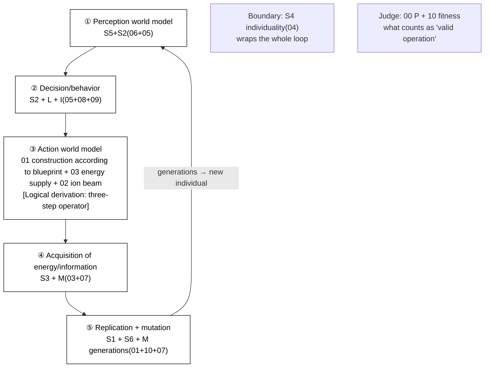
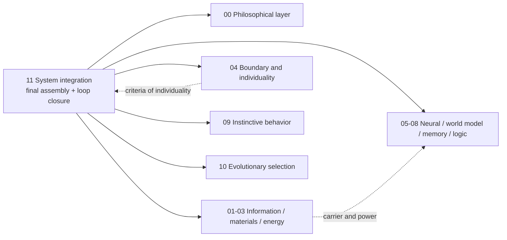

# 11 · System Integration (Final Assembly + Closure of the Five Loops + Minimum Buildable Set)

| Item | Value |
| --- | --- |
| Module | System integration: final assembly, closure of the five loops and minimum buildable set |
| Document type | Design report (English edition) |
| Version | v4.1 |
| Dependencies | All volumes 00–10 |
| Language | English (Chinese edition: `../zh-CN/11_系统整合_设计.md`) |

> **Evidence categories**: `[Ref:…]` literature or data; `[Design decision]` project setting; `[Logical derivation]` derived from listed premises; `[To be verified]` unvalidated placeholder.

---

## 0. Comparison of Design Options

> Design question: 11 is the **final assembly layer** — the key question is **which part of the five loops is verified first and which part is verified afterwards** (S4: closure of the five loops = the circular-reasoning foundation). Three parallel options are given; each option provides "final assembly sequence + evidence + feasibility".
> - **Option A (conceptual option, current retained = original Option A)**: **close all five loops at the initial stage** (① perception → ② decision-making → ③ action → ④ energy supply → ⑤ replication), complete structure
> - **Option B (based on the project reference library = original Option C, selected option)**: **two stages** — first verify "a single individual is self-maintaining within ①②④" (minimum runnable, Avida/protocell staged in the reference library), then add ⑤③
> - **Option C (based on published research practice, including external survey)**: ① **Avida/EvoDeN viable individuals first, evolution later** (staged digital life) ② **protocell self-maintaining minimal system** (physical side verifies the individual first) ③ **open-ended population framework** (evolution after the individual pool)
> The key choice is given in §3 + the appendix on key assumptions and design decisions S4.

### 0.1 Option A: Conceptual Option (Close All Five Loops, Baseline Option)

| Stage | Specific approach |
| ------ | --------- |
| Final assembly | ① perception world model (05+06) → ② decision/behavior (05+08+09) → ③ action (01+03+02) → ④ energy supply/memory (03+07) → ⑤ replication/mutation (01+10+07) |
| Boundary | S4 individuality (04) wraps the whole loop |

**Evidence and notes (in table row order)**

1. **Final assembly** — [Logical derivation: interfaces of each volume]; closure of ③④⑤ has no empirical evidence [To be verified: pending calculation and experimental verification, P2, critical]
2. **Boundary** — [Ref:04 C1-C4]

**Feasibility + risk**: "closure of the five loops = the system can run + evolve" is **circular reasoning** — ③④⑤ are all pending experimental verification at P2, there is no empirical evidence that "closure means viability", and this is the foundation of the whole project. [Design decision]

### 0.2 Option B: Based on the Project Reference Library (Two Stages, Selected Option)

| Stage | Literature paradigm | Evidence category |
| ------ | --------- | --------- |
| Stage one (verify self-maintenance first) | Closure of ①②④ (perception → decision-making → energy supply, excluding generations) as the minimal prototype of a single individual | [Ref:`10/G_LaBar_2017_Avida` (viable individuals first) + `04` protocell self-maintenance class] |
| Stage two (then verify evolution) | ⑤ replication + ③ action added (generations + open-ended evolution) | [Ref:`10/Large_Scale_Simulations_Open_Ended_arXiv2304.05639`] |

**Key point**: **decouple** "whether self-maintenance is possible" from "whether evolution is possible" — first verify that a single individual is self-maintaining within ①②④, then add generations/action, avoiding circular reasoning as a premise.

### 0.3 Option C: Based on Published Research Practice (DOIs Checked Item by Item)

> To be verified · **The evidence in this section is the result of a survey of public literature, distinguished from the design claims of this project.**

| External paradigm | Final assembly sequence transferable into 11 |
| --------- | ---------------- |
| Avida / EvoDeN staged | "Individual self-maintenance" decoupled from "population evolution"; verify self-maintenance first, then verify evolution (Option C paradigm) |
| protocell self-maintaining minimal system | Physical side first verifies "a single protocell is self-maintaining", then adds generations |
| open-ended population framework | Individual pool + open-ended evolution layered, avoiding degradation |

**Evidence and notes (in table row order)**

1. **Avida / EvoDeN staged** — [Ref:`11/B_OPEN_ENDED_STAGED_2026-09-15.md` B1a Packard 2019 OEE review (DOI `10.1162/artl_a_00291`, arXiv ) + B2b LaBar 2016 population size → pathway decoupling (`10.1371/journal.pcbi.1005066`) + `10/G_LaBar_2017` in the reference library](staged mapping: ① create viable individuals (Avida 1336 exhaustive enumeration / evoloops self-replication) → ② introduce population competition (LaBar primordial soup + B2b population size → pathway decoupling) → ③ maintain openness (B2a CCA/Lenia + B1a OEE definition))
2. **protocell self-maintaining minimal system** — [Ref:04 protocell class (`04/Singh_2023`, §multistable autocatalysis, "Singh 2023 multistable autocatalytic network"] multistability + `04/Matsubara_2022`, §compartmentalised Darwinian conditions, "Matsubara 2022 compartmentalised Darwinian conditions"] compartmentalised Darwinian)]
3. **open-ended population framework** — [Ref:`11/B_OPEN_ENDED_STAGED_2026-09-15.md` B2a Sayama & Nehaniv 2024 (`10.1162/artl_a_00451`, arXiv ) + `10/Large_Scale_Simulations_Open_Ended_2023` in the reference library + `10/RohlfWinkler_2008`]

### 0.4 Option Combination and Baseline Configuration

| Strategy | Content | Applicable conditions |
| ------ | ------ | ------ |
| **A. Pure Option A** | Close all five loops at the initial stage (retain the current baseline) | Complete structure, circular reasoning not removed, foundation not proven |
| **B. Option B staged** | First verify "a single individual is self-maintaining within ①②④", then add ⑤③ | Prioritise verification of individual self-maintenance, decouple "whether self-maintenance… See note 1 |
| **C. Option B + falsifiable wording (original B)** | Closure of the five loops = hypothesis, requiring P0/P2 measurement loop by loop; before verification the system = "an architecture with unclosed hypotheses" | Most honest, withstands runnability checks |

**Full evidence for table cells**

1. **B. Option B staged · Applicable conditions** — Prioritise verification of individual self-maintenance, decouple "whether self-maintenance is possible" from "whether evolution is possible" (originally selected option; downgraded to an alternative option after design decision S4=C; baseline adjusted to C)

> **Baseline option = C** (first verify the minimal prototype of a single individual self-maintaining within ①②④, then add ⑤③; i.e. the two stages of the original Option C in §3) — after design decision S4=C the baseline is aligned to C, and the "staged (originally selected option)" row B in §0.4 is downgraded to an alternative option; falsifiable wording has been moved forward to §3/§4 (2026-09-16). **This choice is a design position, confirmed by design review** (S4 fixed as C, 2026-09-16).

### 0.5 Detailed Structure of Final Assembly + Closure of the Five Loops (Textual Description)

> **This section is the textual description of Figure 3-1 in §3**: it does not rely on the diagram and explains layer by layer "what the final assembly of the silicon-based system actually is, how the five loops are connected in series, and the origin of the constraints of boundary and judge". It is based on **Option B (two stages: first verify a single individual self-maintaining within ①②④, then add ⑤③) + staged published research practice (Avida/protocell/open-ended)**.

**Axis 1: the five loops (from perception to generations, the "system operation cycle")**

| Loop | What it is | What it does | Evidence category |
| ------ | -------- | -------- | --------- |
| **① Perception world model** | S5+S2 (06+05): sensing → RSSM prediction | Bring environmental physical quantities into the system + predict the next step | [Ref:05 sensing + 06 RSSM] |
| **② Decision/behavior** | S2+L+I (05+08+09): world model → decision + instinct | Combine "prediction + rollout + instinct" into a decision action | [Ref:05 decision-making + 08 simulation + 09 instinct] |
| **③ Action world model** | 01 construction according to blueprint + 03 energy supply + 02 ion beam (weakest link in the consistency check) | Act on the real world with the decision (three-step operator: action frame → 02 placement → latent variable update → 03 energy consumption) | [Logical derivation: §06 W4 three-step operator attached to 01/02/03]; precision/energy consumption of each step [To be verified] |
| **④ Acquisition of energy/information** | S3+M (03+07): thermoelectric energy supply + memory consolidation | Maintain the system's energy budget + information deposition | [Ref:03 energy + 07 memory] |
| **⑤ Replication + mutation** | S1+S6+M generations (01+10+07) | Replicate "good individuals" into the next generation (mutation + selection = evolution) | [Ref:01 replication + 10 selection + 07 generations] |

**Relationships among the loops (left to right in the diagram + return loop)**:
```
① perception (05+06) → ② decision-making (05+08+09) → ③ action (01+03+02) → ④ energy supply/memory (03+07)
     → ⑤ replication/mutation (01+10+07) → (generations) → new individual → back to ①
```
→ **The "system" is not an independent entity; it = the loop cycle of ①②③④⑤; perception relies on ①, decision-making on ②, "acting on the real world" on ③, maintenance on ④, and evolution on ⑤.** This cycle is how the silicon-based system runs through one cycle.

**Axis 2: three boundary/judge lines (passing through the five loops, "origin of constraints and verification method")**

| Line | Which loops it passes through | What it does | Evidence category |
| ---- | -------- | -------- | --------- |
| **Boundary (BOUNDARY)** | Wraps ①-⑤ | 04 individuality (C1-C4) wraps the whole loop, defining "where an individual ends" | [Ref:04 C1-C4] |
| **Judge (JUDGE)** | Passes through ②/⑤ | 00 axioms + 10 fitness decide "what counts as valid operation / what counts as living well" | [Ref:00 P + 10 S1] |
| **Staged verification (STAGED)** | ①②④ → ⑤③ | Option B: first verify a single individual self-maintaining within ①②④ (minimum runnable),… See note 1 | See note 2 |

**Full evidence for table cells**

1. **Staged verification (STAGED) · What it does** — Option B: first verify a single individual self-maintaining within ①②④ (minimum runnable), then add ⑤③ (generations + action); published research practice Avida/protocell/open-ended uniformly adopts staging
2. **Staged verification (STAGED) · Evidence category** — [Ref:`10/G_LaBar_2017` Avida (viable individuals first) + `04` protocell self-maintenance + `10/Large_Scale_Simulations_Open_Ended_2023` (open-ended)]; "staging" [Logical derivation: paradigm of published research practice]

**Relationship of "staging + falsifiability"** (why this design can "both perform final assembly and avoid circular reasoning"):
- **Five-loop structure = fixed (not evolvable)** (①→②→③→④→⑤→back to ①, algorithm fixed);
- **Which part is verified first = staging** (Option B: first verify ①②④, then add ⑤③ — decouple "whether self-maintenance is possible" from "whether evolution is possible");
- **"Closure means viability" = a falsifiable hypothesis** (Option C wording: before P0/P2 measurements, the system = "an architecture with unclosed hypotheses", not a runnable system).
- **This division of "fixed (non-evolvable) loops + staged verification + falsifiable wording" is precisely the corresponding landing point of Design Principle 24 (making key assumptions explicit) + published research practice (Avida staging) + consistency check S4 (circular-reasoning foundation)** [Logical derivation: the three items map respectively to structure / staged verification / wording].

**Summary of key points**
> **Final assembly of the silicon-based system = the five-loop cycle (① perception → ② decision-making → ③ action → ④ energy supply → ⑤ replication/mutation → back to ①), wrapped by the 04 individuality boundary and judged by 00/10. Option B has two stages: first verify "a single individual self-maintaining within ①②④" (minimum runnable), then add "⑤③ (generations + action)" — decoupling "whether self-maintenance is possible" from "whether evolution is possible" and avoiding circular reasoning as a premise; before P0/P2 measurements, the system is "an architecture with unclosed hypotheses".**

---

## 1. Design Objectives
Each subsystem taken alone "can be designed", but **closure of the five loops** is what constitutes "operation + evolution". This volume is the "final assembly".

---

## 2. The Six Subsystems of the System + Cross-Cutting (M/L/I/P)

| Subsystem | Volume | Role | Completion status |
| -------- | ------ | ------ | -------- |
| S1 genetic information layer | 01 | Records construction rules / instincts / axioms | Defined |
| S2 neural network | 05 | Perception + decision-making + learning + affect | Defined |
| S3 energy metabolism | 03 | Acquiring and converting energy | Defined |
| S4 boundary and individuality | 04 | Defining "one individual" + genesis | Defined |
| S5 world model | 06 | Internal prediction + simulation | Defined |
| S6 evolutionary selection | 10 | Fitness + selection + generations | Defined |
| M memory | 07 | Experience + intergenerational transfer | Defined |
| L logic | 08 | Propositional reasoning + causality | Defined |
| I instinct | 09 | I0 prerequisite set | Defined |
| P philosophical axioms | 00 | Judge rules | Defined |

---

## 3. Closure of the Five Loops (Minimum Conditions for Operation + Evolution)

**Figure 3-1: closure of the five loops (operation + evolution), boundary = 04 individuality, judge = 00/10**



> Note: The five stages form the minimum closed loop for operation and evolution; the loop breaks if any stage is missing.

> **Legend**: ① perception (05+06) → ② decision-making (05+08+09) → ③ action (01+03+02, weakest link in the consistency check) → ④ energy supply/memory (03+07) → ⑤ replication/mutation (01+10+07) → generations back to ①. **Boundary = 04 individuality wraps the whole loop, judge = 00 axioms + 10 fitness**. Option B (baseline) first verifies ①②④ (excluding generations) as the minimum runnable, then adds ⑤③.

```
① Perception world model (S5+S2)
   ↓
② Decision/behavior (S2 + L logic + I instinct)
   ↓
③ Action world model (③ physical interface = 01 construction according to blueprint + 03 energy supply + 02 ion beam)
   ↓
④ Acquisition of energy/information (S3 + M memory)
   ↓
⑤ Replication + mutation (S1 + S6 + M generations)
   ↓
(generations) → new individual → back to ①
```

**Missing any one loop**: the system cannot operate (①②③④) or cannot evolve (⑤).
**Boundary (S4)**: wraps the entire loop, defining "the individual".
**Judge (P)**: decides what counts as "valid operation" (fitness, §10).

### Key Assumptions and Design Decisions

> **Key assumption**: "closure of the five loops = the system can operate + can evolve" is **circular reasoning** — it is first assumed to hold and then used as the basis for assembly, yet ③④⑤ (action / intergenerational replication / evolution) are all pending experimental verification at P2, and there is no empirical evidence that "closure means viability". This is the foundation of the whole project.
> **Falsifiability moved forward (S4 fixed as C, 2026-09-16)**: before P0/P2 measurements of closure of the five loops, **this system = "an architecture with unclosed hypotheses", not a runnable system** — wherever §3/§4 below states "closure of the five loops = the system is established / can operate", it is to be understood as **a design objective + a proposition to be proven**, not "already closed". Two stages: first verify self-maintenance of ①②④ (minimum runnable subset), then add ⑤③ (generations / action), avoiding circular reasoning as a premise.
> **Alternative options (wording and position type, no external literature required)**:

| Option | Content | Consequence | Applicable conditions |
| ------ | ------ | ------ | -------- |
| **A. Retain "five loops = established" as the design objective** (current baseline) | Write closure of the five loops as a given objective | Complete structure, but the consistency check identifies circular reasoning; foundation not proven | Requires a complete structure, adopts target-state wording |
| **B. Downgrade to a "falsifiable objective" (scientific wording)** | Change to "closure of the five loops is a hypothesis, requiring P0/P2 measurements to veri… See note 1 | Honest: makes the key assumption explicit as a proposition to be proven | Requires withstanding falsifiability checks |
| **C. Split into "minimum runnable subset + complete five loops"** (pragmatic alternative) | First get ①②④ (perception → decision-making → energy supply, excluding intergenerational replication) running as the minimal prototype of an "individual"; ⑤ replication + ③ action as the second stage | Prioritise obtaining the minimal prototype of a single silicon-based body running, with evolution / generations added later | Requires prioritising verification of individual self-maintenance (verify self-maintenance first, then verify evolution) |

**Full evidence for table cells**

1. **B. Downgrade to a "falsifiable objective" (scientific wording) · Content** — Change to "closure of the five loops is a hypothesis, requiring P0/P2 measurements to verify loop by loop; before verification the system = 'an architecture with unclosed hypotheses', not a runnable system"

> **Baseline option = C (first prove "a single individual self-maintaining within ①②④", then add ⑤③)** — decouple "whether self-maintenance is possible" from "whether evolution is possible", verify self-maintenance first and evolution later, avoiding circular reasoning as a premise.
> **Design decision (S4): adopt two-stage final assembly (first verify the minimal prototype of a single individual self-maintaining within ①②④, then add ⑤③). Before P0/P2 measurements are completed, the system state is expressed as "an architecture with unclosed hypotheses".**

**Reference from published research practice**:

> The staged published practice in existing published research of "first verify individual self-maintenance, then verify intergenerational evolution" — **gives the reference upper bound for each alternative option**.

| Published practice | Approach | Reference value | Corresponding option for S4 | Status |
| ------------- | ------ | ------------- | ------------------ | ------ |
| **Avida / EvoDeN staged (viable individuals first, evolution later)** | Digital life environments first produce a single individual capable of self-maintenance + reproduction, then superimpose "population + selection pressure" evolution | Decouples "individual self-maintenance" from "population evolution", verifying self-maintenance first and evolution later — precisely the paradigm of Option C | Reference upper bound of Option C — published research practice is staged | Verified · `10/G_LaBar_2017` (Avida) in the reference library |
| **protocell self-maintaining minimal system (synthetic biology)** | First verify a single protocell self-maintaining in an open system (metabolism + membrane + replication), then add generations | Physical-side benchmark for "verify the individual first", with measurable self-maintenance criteria | Physical-side reference for C | Verified · `04` protocell class in the reference library |
| **open-ended evolution population framework** | First have an "individual pool", then carry out open-ended evolution within the pool, avoiding degradation | Layers "individual" and "evolution", first having a pool of self-maintaining individuals | Evolution-side reference for C | Verified · `10/Large_Scale_Simulations_Open_Ended_2023` in the reference library |

**③ Action interface** (weakest link in the consistency check, implemented in §06.3.3):
- Individual action → **③ physical action interface** (01 construction according to blueprint + 03 energy supply + 02 ion beam) → world model state change
- This is the **action operator** of "individual → world" (§06 §3.3)

---

## 4. Minimum Buildable Subset (Current Stage)

| Required | Description |
| ------ | ------ |
| P + S1 + S2 + S3 + S4 + S5 + S6 + L + I0 + M | Closure of the five loops + individual + determination of life |
| Not included for now | Skeleton / concrete morphology (per design requirements: written into DNA, not designed at this stage) |
| Not included for now | Sensory effector mechanisms (hands / feet / eyes) — assigned to "morphology", written into DNA |
| **But included** | Five senses / super-carbon-based perception channels (described in the 05 neural layer, hardware not covered, Design Principle 17) |

---

**Figure 4-1: Interfaces between system integration and the volumes**



> Note: The source of an arrow is the value provider and the target is the receiver; measurable quantities are defined by the interface contracts of the respective volumes.

## 5. Master Table of Subsystem Interfaces (This Volume Aligns the Interfaces of Each Volume)

| Upstream | Downstream | Interface content |
| ------ | ------ | --------- |
| P axioms | S1/S3/S4/S5/S6 | Judge rules (each subsystem operates under them) |
| S1 | All | Source of construction rules (guiding the physical construction of each subsystem) |
| S3 | S1/S2/S4/S6 | Energy supply (replication / neural / maintenance / selection) |
| S4 | All | Individual boundary (wrapping all loops) + genesis (Design Principle 23) |
| S2 | S5/M/L/I | Prediction head + synapse + logic + neural implementation of instinct |
| S5 | S6/environment | Selection pressure simulation + ③ action interface |
| M | S6/S1 | Intergenerational experience (burned back into the DNA variable region) |
| L | S5/S6 | if-then simulation + fitness evaluation + affect suppression |
| I0 | Determination | The threshold of "whether it is life" |
| Design Principle 23 | S6 | Artificial seeding for genesis + evolution without a specified direction + retention rights |
| Design Principle 14 | S5 | World model = DreamerV3 as the modification baseline |
| Design Principles 19/20 | P/S6 | Two-layer rule structure + cooperation with carbon-based life (A6) + community |
| Design Principle 21 | S2/S8 | Affective modulation + suppressible by logic (switch C) |
| Design Principle 22 | S5 | External teaching list (teaching capabilities / frameworks, not positions) |

> **Full-dimensional interface contract note (Design Principle 24)**: 11 is the **final assembly layer**; the table above aligns the interfaces of Volumes 00-10 to "operation + evolution". **Section §4 of each volume has already built the full-dimensional edges of all 12 volumes according to the 01/02 standard** (03 energy / 04 individual / 05 neural / 06 world / 07 memory / 08 logic / 09 instinct / 10 evolution each linked to all of 00-11); this table is the "final-assembly alignment check", and interface "data" must be **physically / informationally measurable quantities** (power / degree of closure / prediction accuracy / fitness), not concepts; where a volume gives no measured value, it is marked "value pending calculation and verification".

---

## 6. Implementation of Cross-Cutting Constraints

| Dimension | Principle | Where it lands |
| ------ | ------ | -------- |
| Time-scale mapping | Design Principle 15 | 00 §7 + 09 §3.3 + 07 §3.4 + 10 §3.6 (each volume has converted to the silicon-based time domain) |
| Dynamic energy assessment | Design Principle 20 | 03 §3.4 (initial one month + dynamic loop) + 03 §3.5 (cooperative budget) |
| Repair subsystem | Design Principle 16 | 01 (§4 verification–repair loop) + 05 (§3.2 synapse repair) |
| Community cooperation | Design Principle 20 | 00 §4 A6 + 05 (cooperation interface) + 06 §3.4 + 10 §3.4 |
| Genesis | Design Principle 23 | 04 §3.2 (artificial seeding + emergence-based viability assessment) |
| ③ Action interface | Verification item C | 06 §3.3 (01 construction according to blueprint + 03 energy supply + 02 ion beam) |

---

## 7. Project-Wide Summary of "Pending Experimental Verification / DFT" (Deduplicated Across Volumes, Graded by Criticality)

### P0 — Determining "Whether Self-Maintenance Is Possible / Whether It Is Life" (Without These the System Cannot Operate)
| Item | Source | Why P0 | Status (2026-09-14) |
| ---- | ------ | ---------- | ------ |
| Replication fidelity ε of the silicon carrier | 01/02 | Determines block length and whether ECC can hold up; without it, generations break | Pending in-house measurement |
| POM-based hybrid gel + heteroatom side-group Eₐ | 01/02 | P2 stability red line; if Eₐ does not meet the threshold, no self-sustainment | Pending calculation and verification |
| **Form of the A6 cooperation fitness function** | 00/10 | Without it, selection has no judge and the system cannot "evolve" | Function form fixed (§10 3.2/3.3 lower bound fixed + upper bound free), weight values pending tuning |
| **Individuality maintenance threshold** | 04 | S4 is the prerequisite of selection; with the threshold unset, the concept of "individual" cannot be realised | Pending calculation and verification + experiment |
| **Energy currency form + conversion efficiency** | 03 | Physical basis of loop ④; A2 persistence depends on it | Form / allocation topology fixed (§03 3.3), specific ions / efficiency pending calculation and verification |
| **Feasibility of the minimal implementation of the I0 set** | 09 | Threshold for determining life; missing any I0 means "not life" | Pending experiment (P0 determines "whether it is life") |
| **Verification of the ③ action interface of the five loops** | 06/11 | ③ is the weakest link; the action → world model mapping has not been measured | Pending P2 measurement |
| **Emergence-based viability assessment of individuality (time for full closure of 04 C1-C4)** | 04/06 | When a candidate individual is "alive" | Pending 06 world model experiment |

### P1 — Items Determining the Runnability of the World Model
| Item | Source | Status (updated 2026-09-14) |
| ---- | ------ | ------ |
| Synapse growth curve + Ga-In reversible lifetime | 05 | Pending calculation and verification |
| Upper bound of silicon-based prediction accuracy of the world model | 06 | Pending experimental verification |
| Synaptic weight → memory mapping function f(M)/g(W) | 07 | Structure fixed (§07 3.3a: co-activation Hebbian + slow channel + loop consolidation + representation inversion), coefficients / time scales pending calculation and verification |
| Silicon-based encoding of propositional variables + gate circuit physics | 08 | Option fixed (§08 3.1: Boolean bits → side-group states + ∧∨¬ → gate circuits attached to 02 ion beam/ALD), values / gate parameters pending calculation and verification |
| CPG silicon-based gel frequency | 09 | Pending experimental verification |
| Fitness function tuning | 10 | Weight values pending tuning |
| **Energy currency form + allocation topology** | 03 | Structure fixed (§03 3.3: ion concentration gradient + A2 ordering + serial degradation gating), specific ions / thresholds pending calculation and verification |
| **Form of the retention/elimination interface** | 10 | Skeleton fixed (§10 3.4: retain(S) three segments + Φ-L2/A6 hard check), decision thresholds pending project setting |

### P2 — End-to-End Verification
- Minimal prototype of silicon-based closure of the five loops
- End-to-end fidelity of intergenerational transfer (S1+M+S6)
- Whether the criteria of organizational closure can be physically measured on a silicon-based soft carrier (00 §9.3)
- **③ Action interface** "action → world model state" mapping function (06 W4)

---

## 8. Implementation Sequence
1. **P0 measurements**: silicon ε, POMs Eₐ, A6 function, individuality threshold, energy currency, I0 minimal set, ③ action interface, emergence-based viability assessment of individuals
2. **P1 deepening**: synapse curve, world model accuracy, memory mapping, propositional encoding, CPG frequency
3. **P2 final assembly**: minimal prototype of five-loop closure + end-to-end fidelity + ③ action interface verification

---

## 10. Scope and Known Limitations (Design Principle 24)

- **Determinable content (given in this document)**: §0.5 detailed structure of final assembly + the five loops (Axis 1 five loops + Axis 2 three lines of boundary / judge / staged verification), §2 the six subsystems of the system + cross-cutting (M/L/I/P), §3 closure of the five loops + S4 positions A/B/C + reference table of published research practice (Avida/protocell/open-ended staged paradigms), §4 minimum buildable subset, §5 master table of subsystem interfaces, §6 cross-cutting implementation, §7 project-wide summary of P0/P1/P2 pending experimental verification, §8 sequence of next steps.
- **Undeterminable content (only formulae and boundaries given; placeholders are not treated as baseline values)**: the **specific numerical values** of each open item in P0/P1/P2 (silicon ε, POMs Eₐ, A6 weights, individuality threshold, energy currency coefficients, I0 feasibility, ③ action interface coefficients, intergenerational fidelity) — **all pending first-principles calculations and experiments in each volume**; §7 of this document has made "deduplication across volumes + grading by criticality" explicit, and **where no measured value is given it is marked "value pending calculation and verification"**; this layer sets no baseline value (Design Principle 24).
- **Key assumptions (to be fixed by design review)**:
  - **"Closure of the five loops = the system can operate + can evolve" is circular reasoning** — ③④⑤ (action / intergenerational replication / evolution) are all pending experimental verification at P2, **there is no empirical evidence that "closure means viability"**, and this is the foundation of the whole project; the key assumptions have been listed, **baseline C (staged: first verify a single individual self-maintaining within ①②④, then add ⑤③; optional B makes the key point explicit through falsifiable wording)**.
  - **If any of the 8 project-wide P0 items (§7) is not settled = the system "cannot operate" or "is not life"** — this document explicitly marks the "pending calculation and experimental verification" items and lists them all as to-be-verified items; P0 determines "whether self-maintenance is possible", P1 determines "whether operation in the world model is possible", and P2 determines "end-to-end closure".

---

> Corresponding Chinese edition: `../zh-CN/11_系统整合_设计.md`
