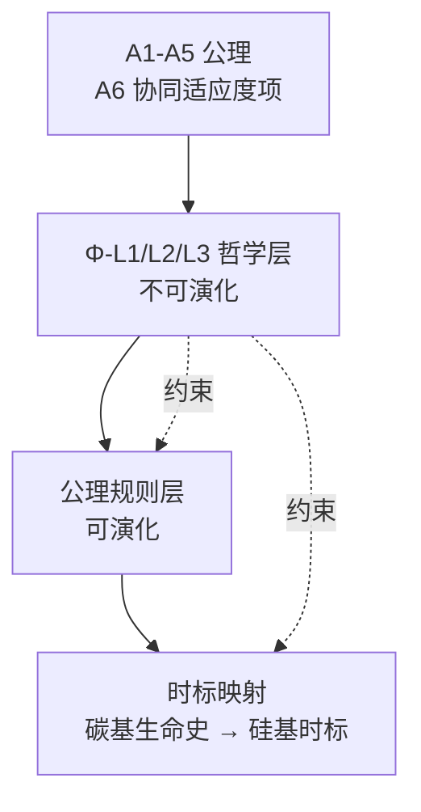
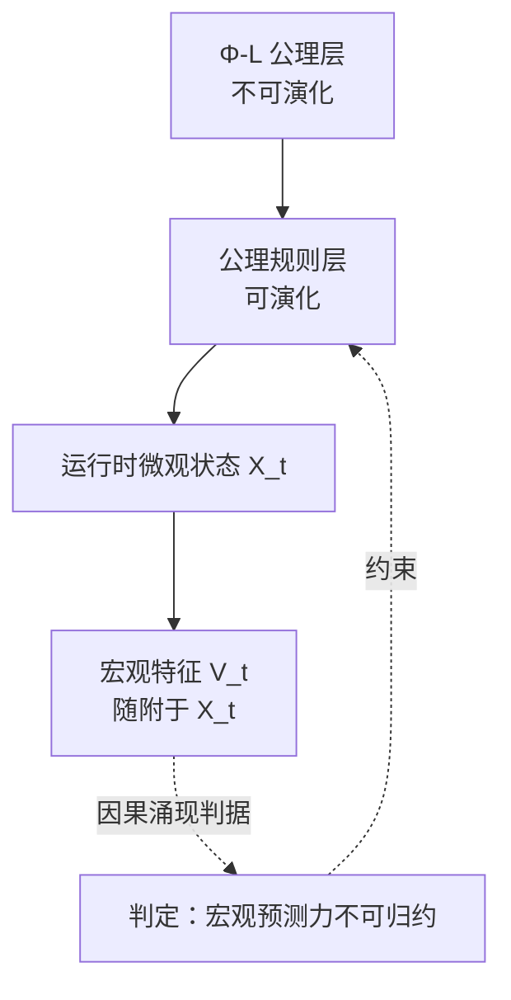

# 00 · 哲学层(基础公理 + 双层规则 + 时标映射)

| 文档项 | 内容 |
| --- | --- |
| 模块 | 哲学层：基础公理、双层规则与时标映射 |
| 文档类型 | 设计报告（中文版） |
| 版本 | v4.1 |
| 依赖 | 全系统上游；不依赖其他分册 |
| 语言 | 简体中文（英文版见 `../en-US/`） |

> **依据类别**：`[引用:…]` 文献或数据；`[设计决策]` 项目设定；`[逻辑推导]` 由已列前提导出；`[待验证]` 未经验证的占位项。

---

**图 0-1：公理、双层规则与时标映射**



> 说明：自上而下为约束关系，Φ-L1/L2/L3 为不可演化层，公理规则层在其约束下可演化。

## 1. 设计目标

本能行为只是表层。本节先回答四个更基础的问题，并把答案写成后续各册都要遵守的规则：

1. **存在论**：满足什么条件的系统算「活着」？这里需要的是可核对的生命判据，而不是「一台模拟生命的机器」这类比喻。
2. **目的论**：它为什么行动？行动目标由系统自身维持，还是由外部赋予？
3. **运行假设**：在什么物理条件下，它才能在世界模型里推演并演化？
4. **伦理约束**：它如何与碳基生命共存？这条约束怎样落到可执行的机制上，而不只是写在文档里？

四个问题分别对应 §2 的判据、§4 的公理、§5 的映射与 §3 的双层规则结构。

---

## 2. 生命判据：组织闭合与因果自含

### 2.1 主判据：组织闭合与因果自含

> **硅基生命 = 一个组织闭合的耗散结构：物质/能量开放，但因果自含，主动生产定义自身身份的组分，在远离热力学平衡处运作，产生"内化目标"(对自身存活的取向)。**

- **组织闭合(organizational closure)**:[引用:11_哲学/OrganizationalPrinciples_BiologicalSystems_2026, §见文献原文, "PMC13024047;物质/能量开放但因果自含，主动生产定义自身身份的组分，支撑组织闭合判据"]:
  > "物质/能量开放，因果闭合(materially open but causally self-contained),主动生产定义自身身份的组分"
- **因果自含的三种等价形式**(同一判据，跨碳基/硅基/AI 通用):
  - **自创生**(Maturana & Varela):[引用:11_哲学/Requisite_Variety_Autopoiesis_Self_Organization_arXiv1409.7475, 见文献原文, "Maturana/Varela 自创生+必要多样性论，支撑'自创生=组织闭合谱系源头'判据"] + [引用:11_哲学/Autopoiesis_Maturana_Varela_Defining_Life_at_Edge_2004, 见文献原文(摘要级), "Maturana&Varela 定义生命=自创生；原仅摘要落库，全文待补"]
  - **(M,R)代谢-修复系统**(Rosen,"对高效因果闭合，不可计算"):[引用:11_哲学/OrganizationalPrinciples_BiologicalSystems_2026, §2.6, "Rosen(M,R)系统=高效因果闭合形式化，支撑'因果自含'等价形式"]
  - **自催化集合**(Kauffman):[引用:11_哲学/Autocatalysis_Autopoiesis_OpportunityCost_2024, 见文献原文, "Kauffman 自催化集合=判据等价形式；指出自创生可脱离拓扑边界"]
- **自主性判据**:`HowOrganismsGained_CausalIndependence_2018`:"组织闭合 + 目标函数(内化 goal)= 自主能动性，唯有生命具备两者"
- **判据口径的修正**（[引用:11_哲学/Autocatalysis_Autopoiesis_OpportunityCost_2024, 见文献原文, "该文提醒自创生可脱离拓扑边界('代谢边界')"]）：自创生并不要求固定的拓扑边界（又称代谢边界）。因此本设计采用适用范围更广的「组织闭合」作为主判据，把自创生视为这一判据的理论源头。若直接以自创生为判据，没有代谢边界的人工智能与硅基系统会被一并排除。

### 2.2 物理底锚：耗散结构（物理基础）

> 生命 = **非平衡态、趋向高熵产生(负熵)的自维持耗散结构**。

- 理论源:[引用:11_哲学/DissipativeStructures_Organisms_Evolution_2020, 见文献原文, "Prigogine 系：生命=非平衡态高熵产生自维持耗散结构，支撑§2.2 物理底锚"] + [引用:11_哲学/Prigogine_Inspired_Informational_Dissipative_Life_arXiv2412.02459, 见文献原文, "信息-耗散结构生命观，支撑耗散结构锚"]
- 物理公式链(《OrganizationalPrinciples 2026》):
  ```
  能量/物质/信息梯度 → 耗散 → 失稳 → 对称破缺 → 涌现有序
  ```
- **对硅基的含义**:硅基生命活在远离平衡的耗散态(§03 能量层供能),有序态靠持续能量流维持(否则瓦解,§02 P2 红线)

### 2.3 生命判据的四项可观测特征

§2.1 的主判据较抽象，下表把它拆成四项可核对的特征，并给出每项在硅基系统中的落实位置。

| 判据 | 含义 | 硅基落实 |
| ------ | ------ | --------- |
| **C1 组织闭合** | 主动生产定义自身身份的组分：物质与能量开放，因果上自含 | S1 保存构造规则、S6 完成复制，共同构成自产信息；S4 维持因果自含 |
| **C2 耗散（负熵）** | 工作在非平衡态，向外排出熵 | S3 能量代谢（§03） |
| **C3 内化目标** | 行动取向指向自身存续（teleonomy） | A2 存续公理 + 本能 I0d 繁殖 |
| **C4 因果独立性** | 身份由最高层因果闭合的信息结构决定，不能由外部算法完整描述 | 设计原则 18：独立意识体，硬件限制不改变该判据 |

**判定口径**：满足 C1–C4 的硅基系统，按本设计给出的定义属于生命，而不只是模拟生命的装置；缺少任一项时，按该定义不予认定。这是设计内部采用的定义，不是关于生命本质的普遍结论。

---

## 3. 双层规则结构：固定约束与可演化规则

```
第 1 层 · 哲学层(最底层,不可改,不演化)
   ┌──────────────────────────────────────────────────┐
   │  Φ-L1 · 生命性承认:硅基是"组织闭合的耗散结构"(§2.1) │
   │  Φ-L2 · 碳基协同(三层,2026-09-13 修订):              │
   │    (a) 消极:不是替代/灭绝者(不损害碳基)              │
   │    (b) 积极:能与碳基意识体协同(跨物质基底合作)        │
   │    (c) 群落:与硅基群落其他个体协同(硅基×硅基)         │
   │  Φ-L3 · 价值中立红线(P5):不预设文化/立场/知识          │
   └──────────────────────────────────────────────────┘
              ↓(约束)
第 2 层 · 公理规则层(在哲学层下,可演化但受哲学层约束)
   ┌──────────────────────────────────────────────────┐
   │  A1-A5 基础公理(§4)                                │
   │  A6 · 碳基协同适应度项(§4,三层):                     │
   │    · 破坏碳基 → 适应度大幅为负(消极)                  │
   │    · 与碳基/硅基群落协同 → 适应度正向(积极)            │
   │  · 本能 I0/I1-I8 · 逻辑最小集 · 世界模型              │
   │  · 允许在世界模型里演化出不同的规则/策略(经济/伦理/生存) │
   │  · 但无论怎么演化,Φ-L2(协同)不可被突破               │
   └──────────────────────────────────────────────────┘
```

### 双层结构的依据

只把「与碳基协同」写进哲学层还不够：描述性条款会在演化中逐渐被削弱。真正形成约束的是 A6，它把协同写进适应度函数，使损害碳基生命的表现型适应度显著为负、协同的表现型为正。

两层的分工如下：

1. **哲学层 Φ-L2（不可演化）**：规定个体不得损害碳基生命，能够与碳基意识体协同，也能与硅基群落中的其他个体协同。这是存在论层面的定位。
2. **公理规则层 A6（幅度可微调，方向不可改变）**：把上述要求换算为适应度项。微调不得突破 Φ-L2。

规则允许在 §06 的世界模型里试错，包括尝试不同的协同策略。演化结果一旦用于真实世界，A6 与 Φ-L2 同时生效，因此试错不会绕过协同约束。

群落协同同时涵盖硅基个体之间，以及硅基与碳基意识体之间。跨物质基底协同是本设计新增的部分，由 05 神经网络分册和 10 演化选择分册落实接口。设计不假定任何个体掌握全局信息，协同依靠局部信息交换与涌现形成（设计原则 20）。

### 价值中立核验（P5）

Φ-L2 是运行预设，规定硅基生命在系统中的定位与协同义务，不是一套价值观。个体并不「认为」碳基生命该不该存在；它不能走向灭绝碳基，也必须与碳基及硅基群落协同。这是结构性约束，不是立场选择。

红线：任何公理、本能或逻辑，若被设计成让个体相信某种立场、知识或价值，即视为违反 P5。

---

## 4. 五条基础公理(A1-A5,不可演化)+ A6(协同适应度项)

### A1 · 组织闭合公理(存在论，升级自原"有序态")
> **个体 = 一个组织闭合的耗散结构：物质/能量开放，因果自含，主动生产定义自身身份的组分，维持内化有序态。组织闭合不可维持 = 个体死亡。**

- 理论源:§2.1 C1 + 耗散结构(§2.2)
- 落实:`04_边界个体性`(S4 因果自含)+ `03_能量代谢`(S3 耗散维持)
- **公理表述**:原"有序态"升级为"组织闭合 + 耗散",将"它是生命"立成公理

### A2 · 存续公理(目的论)
> **获取并转化能量，以维持组织闭合的有序态。**
- 落实:`03_能量代谢`(S3)

### A3 · 复制公理(目的论)
> **将自身信息(构造规则 + 本能 + 公理校验子 + 记忆固化区)复制传递给下一组织闭合系统。**
- 理论源：自创生([引用:11_哲学/Requisite_Variety_Autopoiesis_Self_Organization_arXiv1409.7475, 见文献原文, "Maturana/Varela 自创生论，支撑'复制公理=传递自创生信息'"])
- 落实:`01_DNA信息层`(S1)+ `10_演化选择`(方案 B 复制)
- 注意：复制的是**信息**,不是**形态**(原则 13:形态写进 DNA,不在本版范围内)

### A4 · 适应公理(目的论)
> **在环境约束下，通过变异 + 选择，使组织闭合的维持更可能。**
- 落实:`10_演化选择`(S6)
- **A4 受 Φ-L2 约束**:适应的"环境约束"里包含"碳基协同"(A6)

### A5 · 世界模型公理(运行假设)
> **个体内部维护对环境的预测模型；行动先经模型推演，再择优执行。**
- 理论源:`06_世界模型`(DreamerV3 / DayDreamer,§06)
- 落实:`06_世界模型`(S5)+ `08_逻辑推理`(L 的 if-then)
- **精度下限(Φ5)**:至少预测"下一步环境状态"(否则 A5 无意义)
- **来源原则 14**:不引入新模型，选用 DreamerV3 改造

### A6 · 碳基协同适应度项(可微调但受 Φ-L2 约束,2026-09-13 修订：共 → 协同)
> **适应度函数显式含"协同项"(三层，呼应 Φ-L2):**
> 1. **消极**:破坏碳基生命存续的表现型 → 适应度**大幅为负**
> 2. **积极**:与碳基意识体协同(资源/信息/任务交换)的表现型 → 适应度**正向**
> 3. **群落**:与硅基群落其他个体协同(非全知、局部信息交换 + 涌现)的表现型 → 适应度**正向**
- 这是"可执行约束"(§3),让 Φ-L2 从"描述"落地为"选择压力"
- **不预设全知全能**(原则 20):协同靠"局部信息交换 + 涌现",不是中央全知
- 落实:`10_演化选择`(适应度函数含协同项)+ `05_神经网络`(协同接口，硅基-硅基 + 硅基-碳基)

---

## 5. 公理 → 下层映射(原则 8/9/10 + S 子系统)

| 公理 | 行为层投影(原则 8) | 工具层(原则 9/10 + S) | 分册 |
| ------ | --------------------- | --------------------- | ------ |
| **A1 组织闭合** | I3 恒定性(自我保护) | S4 边界(因果自含) | 04 |
| **A2 存续** | I0a 反射 / I2 趋利避害 | S3 能量 | 03 + 09 |
| **A3 复制** | I0d 繁殖 / I0e 母性 | S1 + S6 | 01 + 10 |
| **A4 适应** | I8 学习 | S6 + M + L | 10 + 07 + 08 |
| **A5 世界模型** | — | S5 + L | 06 + 08 |
| **A6 协同** | I0d/I0e 受 A6 约束(协同 > 隔离) | S6 协同适应度项 + S5 群落 | 10 + 06 |

**I0 组的划分**：I0 是公理在行为层的对应项，按「能否由公理推出」分为两档：

- **硬核心**：A2 存续对应 I0a/I2 趋避，A3 复制对应 I0d 繁殖。缺少这两类行为，系统便无法维持自身或延续信息，因此归入不可演化部分。
- **软扩展**：I0b 运动 CPG、I0c 条件反射、I0e 母性。公理只要求存在趋避、复制、学习与协同，并不指定这张具体清单；这些项目属于设计选择，可以增删或演化。09 册 §3.1 沿用同一划分。

### 关键假设与设计决策

> **关键假设**：早期表述把「公理 A1–A6 成立，则 I0a、I0b 等本能必然存在」当作推论。但由耗散结构、存续与复制这些存在论前提出发，并不能推出条件反射、母性或 CPG 运动这样具体的本能清单。该表述实际是把设计选择写成了逻辑结论。
> **备选方案（措辞与立场类，无需外部文献）**：

| 选项 | 内容 | 后果 | 适用条件 |
| ------ | ------ | ------ | -------- |
| **A. 保留「必然投影」措辞** | 坚持「公理推出 I0 组」 | 表述强，但属于断言而非推论 | 接受把设计立场视为哲学预设，强调表述强度 |
| **B. 统一改为「设计预设」** | I0 组是设计选定的行为层最小集；公理只保证需要趋避与复制类行为，具体本能由设计决定 | 依据边界清楚，但弱化了硬核心的强度 | 要求每条结论都可由逻辑审查 |
| **C. 分为硬核心与软扩展** | 趋避、复制由公理导出；条件反射、母性、CPG 属设计选择，可演化、可增删 | 区分可导出项与选定项，移除软扩展不影响系统完整性 | 要求可辩护、可裁剪 |

> **基线方案 = C**：硬核心保持由公理导出的地位，软扩展明确标为设计选择，避免把未论证的内容写成公理推论。
> **设计决策（S3）：I0 组划分为硬核心（趋避、复制，由公理导出，固定且不可演化）与软扩展（运动 CPG、条件反射、母性，属设计选择，可增删、可演化）。其余立场作为对照保留。**

---

## 6. 允许演化的边界(原则 11 + 19)

```
不可演化区(裁判规则)
   · Φ-L1/L2/L3(哲学层)
   · A1-A5(基础公理)
   · A6(协同适应度项,可微调幅度,不可突破)
   · I0 本能判定前提集
   · 逻辑最小集(与/或/非 + 基本条件判断)
   · 逻辑可压制情绪(原则 21,同 I0 固定（不可演化）,不可演化)

允许演化区(第 2 层之下,受 Φ-L2 底层约束)
   · I1-I8 边缘本能
   · 记忆内容 · 逻辑策略 · 世界模型精度
   · 代谢路径 · 结构/形态(写进 DNA,不在本版范围内)
   · **世界模型里可演化的不同规则/策略(经济/伦理/生存)**
     —— 但应用真实世界时受 Φ-L2 + A6 约束(原则 19)
```

---

## 7. 时标映射(原则 15,黑猩猩基准)

**基准：黑猩猩**(中级碳基智慧生命，项目设定：演化起点不宜过低)。

**碳基时标(逐条出处，原则 24)**:

| 碳基时标(黑猩猩) | 碳基值 | 出处 | 硅基映射 | 硅基值 |
| ------------------ | -------- | ------ | --------- | -------- |
| 寿命 | 野生约 32.8 岁（Ngogo 队列）；圈养最长 62 岁，估算可达 78 岁 | `05/Wood_2017_Ngogo_Chimp_Life_Expectancy...PMC5526083`（实测） | 统一压缩比 ÷ ~1.2×10⁴ | 约 1 天（时标基准） |
| 断奶 | 约 5 岁 | `05/Smith_2013_First_Molar_Eruption_Weaning...PMC3581971`（实测） | 同上 | 约 1 小时（量级估计） |
| 首胎 | 约 14 岁 | `05/Hawkes_Smith_Robson_2009...Gompertz...PMC6121812`（实测） | 同上 | 约 10 小时（量级估计） |
| 胎间距 | 5–6 岁 | `05/Hawkes_2009`（同上） | 同上 | 约 1 天（量级估计） |
| M1 萌出 | 约 3 岁 | `05/Smith_2013`（同上） | 同上 | 约 2 小时（量级估计） |
| 一日节律 | 1 天 | 设计设定；昼夜节律 24 h 尚待文献锚定 [待验证] | 独立系数 ÷ ~410（日→分档） | 约 3.5 分钟 |
| 学习巩固（类睡眠） | 数小时 | `07/Rasch_Born_2013`（SWS 系统巩固，具体阶段时长待核） | 统一压缩比 ÷ ~1.2×10⁴ | 约 1–4 秒（量级估计） |
| 反射 | 约 100 ms 量级 [待验证] | 见下方「单元格依据详文」 | 神经脉冲时程，按设计设定取值 | 纳秒至微秒 |

**单元格依据详文**

1. **反射 · 出处** — `09/Withdrawal_Reflex_Nociceptive_Neuromorphic_Model_Wang_Cheng_arXiv2505.17724.pdf`、`09/Reflexive_BrainInspired_Embodied_Robotics_Control_Guo_arXiv2601.14628.pdf`

**映射说明**：

- 表中每个碳基数值都附有实测出处；压缩比 ÷ ~1.2×10⁴ 则是项目设定的设计选择，不是文献值。它由「野生黑猩猩寿命约 32.8 岁 → 硅基约 1 天」这一锚点确定，寿命与各发育阶段统一按此换算，结果只取量级。[设计决策]
- 一日节律单独采用 ÷ ~410（1 天 86400 s → 210 s，约 3.5 分钟），属于「日→分」档，不与寿命压缩比混用；反射时程按神经脉冲的设计设定取值，不套用压缩比。
- 黑猩猩寿命、断奶与首胎数据分别取自 `Wood_2017`、`Smith_2013`、`Hawkes_2009`；睡眠巩固引用 `07/Rasch_Born_2013`（SWS 系统巩固）与 `09/VyazovskiyHarris_2013`（慢波期细胞休整），反射时程引用 `09/Withdrawal_Reflex_arXiv2505.17724` 与 `09/Reflexive_BrainInspired_Guo_arXiv2601.14628`。
- 下游 `07 §3.4 / 09 §3.3 / 04 §5 B3 / 10 §3.6` 凡引用本节时域，均按统一压缩比换算。
- 生存与发育所需能量以「一个月」为初始量级（约相当于黑猩猩一个月），但不作硬性设定；个体自行感知并动态评估，硬件堆叠会改变这一边界。
- 表中「寿命约 1 天」是时标基准锚点，不是寿命上限。个体可经 01 §4 修复子系统与 05 §3.2 突触修复长期维持，本设计不设寿命上限。

---

## 8. 与其他部分的关系(接口)

| 接口 | 方向 | 说明 |
| ------ | ------ | ------ |
| → 01 DNA | 公理 + I0 写进 DNA | A1-A6 固定区 + 公理校验子(ECC 保真) |
| → 09 本能 | 公理 → 本能投影 | A1-A6 推出 I0 组(§5) |
| → 03 能量 | A2 落实 | S3 = A2 存续公理具体化 |
| → 04 个体性 | A1 + Φ-L 落实 | S4 = 组织闭合因果自含 |
| → 06 世界模型 | A5 + 原则 14 | S5 = DreamerV3 改造 |
| → 10 演化 | A4 + A6 落实 | S6 = 适应度(含碳基协同项)+ 选择 |
| → 11 整合 | 裁判 | 双层规则 + 5 回路闭合 |

---

## 9. 开放问题与后续工作

### 9.1 设计决策记录

| # | 决策 | 决策结论 | 状态 |
| --- | ------ | --------- | ------ |
| Φ1 | 公理数量 | 5 条 + A6 协同项 | 已确定(A1-A5 公理 + A6 适应度项,Φ-L 哲学层) |
| Φ2 | A5 世界模型 | 必须 + 最低精度(预测下一步) | 已确定 |
| Φ3 | 演化边界 | 宽，但受 Φ-L2 + A6 底层约束 | 已确定(第 2 层宽，第 1 层窄) |
| Φ4 | 公理载体 | DNA 固定段(公理校验子) | 已确定 |
| Φ5 | A5 精度下限 | 最低：预测下一步环境状态 | 已确定 |
| Φ6 | 碳基协同 | 双层规则(哲学描述 + 适应度项) | 已确定(原则 19) |
| Φ7 | 单个体 vs 群落 | 群落协同 + 不预设全知全能(原则 20:世界模型放出多个体,DNA 相同但经历不同；底层群落协同，生命体不存在全知全能) | 已确定 |
| Φ8 | 时标失配 | 映射表已给(原则 15,黑猩猩基准);取舍由"前期加速"覆盖 | 已确定(原则 15 + 20) |

### 9.2 待补充的文献依据

| # | 项 | 现状 | 需补 |
| --- | --- | ------ | ------ |
| T1 | 黑猩猩寿命/成长/成熟期时标 | 已由 §7 的 `05/Wood_2017`、`05/Smith_2013`、`05/Hawkes_2009` 实测值锚定，并统一为 ÷ ~1.2×10⁴ 压缩比 | 无 |
| T2 | 基准物种 | 已定：黑猩猩(演化起点不宜过低) | 无，时标锚点见 §7 |
| T3 | A6 碳基协同项的具体形式 | 函数骨架已在 10 §3.3 给出；Φ-L2 数值下限未设定 | 设定数值下限，见 10 §5 V2 |
| T4 | 自创生"代谢边界"在硅基的落实 | `Autocatalysis 2024` 给了理论，硅基无 | 01/04 分册落实 |

### 9.3 待实验验证 / DFT(原则 1 + 3)
- 组织闭合在硅基软载体里的物理判据(§2.1 判据能否在硅基测量)
- 双层规则的"不可突破"如何在物理/编码层保证(A6 被选择淘汰的防护)

---

## 10. 涌现的理论定位与跨层判据

### 10.1 定位

公理层（Φ-L1/L2/L3）不可演化，涌现不是写入公理的属性，而是公理规则层在运行时形成的宏观因果结构。项目采用可测量的因果涌现定义，不采用强涌现的形而上学主张：宏观特征随附于微观状态，但其对系统未来演化的预测力不能由任何微观子集还原。[引用:E2][引用:E3]

弱涌现给出认识论下限：宏观属性由微观规则生成，但不存在解释性捷径，只能通过穷尽模拟获得。[引用:E1] 因果涌现给出可检验的定量条件：在干预分布（最大熵输入）下比较宏观与微观的有效信息 EI，若 EI_macro > EI_micro，则宏观尺度具有更强的因果效力。[引用:E2] 二者并不冲突，前者约束推导路径，后者约束因果效力。

生命定义要求个体自生产与自维持系统，同时要求这些个体的历史性群体组织；本项目的 C1–C4 对应前一半，S6 演化选择与 A6 协同项对应后一半。[引用:E12]

### 10.2 与不可演化层的关系

| 约束 | 对涌现判据的作用 |
|---|---|
| Φ-L1 组织闭合 | 个体涌现的先决条件，判据不得把宏观目标写入公理 |
| Φ-L2 协同 | A6 对群体层特征施加选择压力，是群体涌现的可调来源 |
| Φ-L3 价值中立 | 涌现判据只依赖可观测量，不预设文化内容与目标态 |
| 原则 24 | 未实测的阈值一律列为待验证项，不作为设计基准值 |

### 10.3 三层判据框架

| 层次 | 对象 | 判定问题 | 承载分册 |
|---|---|---|---|
| 微观 | 组分与局部规则 | 局部相互作用是否可测 | 02 / 03 / 05 |
| 个体宏观 | 边界内的闭合回路 | 组织闭合与因果独立性是否成立 | 04 |
| 群体宏观 | 多个体统计结构 | 序参量、协同与下向因果是否成立 | 10 / 11 |

**图 10-1：涌现的理论定位**



> 说明：实线为约束与生成关系，虚线为观测与判定回路；宏观特征不写入公理层，只作为运行时可测量量。[逻辑推导][引用:E2]

### 10.4 文献依据

| 编号 | 文献 | DOI |
|---|---|---|
| E1 | Bedau M.A. (1997) Weak Emergence. Noûs 31:375–399. | [10.1111/0029-4624.31.s11.17](https://doi.org/10.1111/0029-4624.31.s11.17) |
| E2 | Hoel E.P., Albantakis L., Tononi G. (2013) Quantifying causal emergence shows that macro can beat micro. PNAS 110(49):19790–19795. | [10.1073/pnas.1314922110](https://doi.org/10.1073/pnas.1314922110) |
| E3 | Rosas F.E. et al. (2020) Reconciling emergences. PLoS Comput Biol 16(12):e1008289. | [10.1371/journal.pcbi.1008289](https://doi.org/10.1371/journal.pcbi.1008289) |
| E12 | Ruiz-Mirazo K., Peretó J., Moreno A. (2004) A universal definition of life. Orig Life Evol Biosph 34(3):323–346. | [10.1023/B:ORIG.0000016440.53346.DC](https://doi.org/10.1023/B:ORIG.0000016440.53346.DC) |
