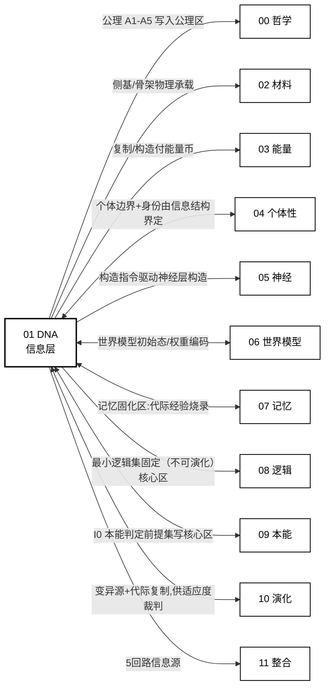

# 01 · 硅基 DNA 信息层(S1)

| 文档项 | 内容 |
|---|---|
| 模块 | DNA 信息层（S1）：遗传信息的载体、编码、读取与复制 |
| 文档类型 | 设计报告（中文版） |
| 版本 | v4.1 |
| 依赖 | 00 哲学层、02 材料工艺 |
| 语言 | 简体中文（英文版见 `../en-US/`） |

> **依据类别标注**：`[引用:…]` 文献或数据依据；`[设计决策]` 无外部依据的项目设定，须注明可调性；`[逻辑推导]` 由已列前提与公式导出；`[待验证]` 数值或方法未经验证，仅作占位，须注明供值方。所有关键断言均带上述类别之一。

---

## 0. 设计方案比选

> **本节给出设计方案比选。**。给出三类并列方案，各方案分别给出"布局、读取与复制方式、依据是什么、可行性/风险"。
> - **方案 A(概念方案，基线方案）**:软载体"按图施工"(POMs 凝胶 + 多缺陷簇 + 侧基键态 + 离子束/ALD + qPlus)
> - **方案 B(基于项目文献库)**:现有 25 篇 01 文献里最成熟、可直接借鉴的范式
> - **方案 C(基于公开研究实践)**:外部调研(DNA 数据存储 / 自组装复制 / 可编程物质)给的可参考做法
>
> **每类给**:① 构造规格 ② 编码/读取/复制机制 ③ 依据(挂文献)④ 可行性 + 风险。三者并列且不互斥。,可组合(§0.4)。


### 0.1 方案 A：概念方案(软载体"按图施工"，基线方案）

**构造规格**(POMs 凝胶 + 多缺陷簇 + 侧基键态,02 供载体):**见 §0.5 图 0-1(mermaid 结构图)+ 本节文字说明**。

> **图 0-1 说明(方案 A 软载体的 4 层堆叠 + 3 条机制线)**:
> - **4 层载体**(从上到下，信息"住"在哪):
>   - **L1 POMs 凝胶基底** — 宿主，软 / 水合稳定 / 自组装 `[引用:02/He_2013, §自组装/水合稳定段, "He 2013 Sci Rep:POMs 杂化水凝胶自组装+水合稳定，支撑 L1 软宿主选型"]`
>   - **L2 纳米压印晶格(位点)** — ~20 nm 间距，把位点排成可寻址网格；每格 = 一个"位点"坐标 `[引用·外部调研, DOI 10.1016/S0167-9317(96)00097-4, "Chou 1997 纳米压印 sub-10nm,奠基文献，支撑~20nm 寻址晶格"]`
>   - **L3 多缺陷簇 V(SiO₃)⁺/V(SiO₄)⁺** — 每个位点的"稳定壳",锁住侧基键态(单缺陷不稳，须用簇)`[引用:02/Chadi_2003, §单氧空位不稳定段, "Chadi 2003 APL:ab initio/DFT 算单氧空位放能~2.9eV 自塌缩，须用多缺陷簇 V(SiO₃)⁺/V(SiO₄)⁺(仅摘要级，全文待补)"]`
>   - **L4 侧基符号(4 进制 F/B/N/Si-C)** — 一个位点 = 一个符号 = 2 bit;相邻位点成块成帧 `[设计决策]`,4 态能否稳定 `[待验证]`
> - **3 条机制线**(谁在哪层读/写/变异，见图右列):
>   - **读** = qPlus 沿 L2 晶格扫 L4 的 4 电荷峰(非破坏 / 可并行)`[引用:02 §2.4]`
>   - **写/复制** = 离子束按 L4 指令逐位放侧基 + ALD 封装(软凝胶内放置 `[待实验]`)[`引用:02/Holmes_2023, §单原子放置, "UNSW Morello/Simmons 组离子束确定性放单掺杂原子(~nm 精度),支撑离子束逐位写侧基(T0 关键，预印本)"]`
>   - **变异** = 核心区 ε→0 / 可变区留高错配(§7 区域 + §5 复制流)

| 机制 | 具体做法 | 依据性质 |
|------|---------|---------|
| 编码 | 1 位点 = 1 个 4 进制侧基(§3.1);指令 = 帧(§3.1 示例) | 载体态 4 态 [待计算验证：键态对比度] + 帧结构 [逻辑推导：借鉴 `nirenberg_1965` 终止子] |
| 读取 | qPlus 非破坏电学读 4 态；选择性表达 = 低能态只解核心区 | qPlus 表征 [引用:02 §2.4];选择性表达 [设计决策] |
| 复制 | §5 五步流：定位→读母本→Fountain 校验→离子束写子本→验收 | 离子束 [引用:02/Holmes_2023, §单原子放置, "UNSW 离子束确定性放单原子(T0 关键)"];Fountain 校验 [引用:01/Erlich-Zielinski_2017, §喷泉码/任意子集重建, "Erlich&Zielinski 2017 ACS Nano:喷泉码 DNA 存储任意子集重建+纠错，支撑 Fountain ECC 与块长窗口"];五步流本身 [设计] |
| 变异 | 核心区 ε→0,可变区故意留高错配给 S6 选择 | 分区 [逻辑推导:00 公理 4 A4];错配率 ε [待计算验证:02 供] |

**设计决策(为什么非碳基双螺旋)**:
- 不预设双螺旋，侧基**线性排晶格**,螺旋=涌现形态 **[设计决策]**(双螺旋需 H 键刚性几何，硅基无此刚性 **[逻辑推导:02 宿主是凝胶非晶格]**)
- 载体态=侧基键态 **[引用:02 §2.1]**;键能 4.5/3.3 eV **[设计·教科书值，非本项目实测，需 02 DFT 核实]**;> 2.2 eV 门槛 **[逻辑推导:Arrhenius 反推 10⁶ 年寿命,τ₀ 取值待实验]**
- 4 进制提密度 **[逻辑推导:4 态比 2 态多 1 bit,信息论]**
- qPlus 可并行读 **[引用:02 §2.4]**
- 离子束唯一能确定性放单原子 **[引用:02/Holmes_2023 UNSW Morello/Simmons 组]**

**可行性 + 风险**:`Holmes 2023` 是晶格/低温 NMR 路线 **[引用:02/Holmes_2023]**,**软凝胶里逐位放单侧基 + ALD + 再复制无已验证落地路径**——这是本项目**最重的关键假设**(C 类，关键假设与设计决策附录 T0),命中 P1 但可行性最低。[设计决策]

### 0.2 方案 B：基于项目文献库(最成熟可借鉴的范式)

> 从 `01_DNA信息层/` 25 篇里,**"信息编码进分子载体 + 存储 + 纠错 + 读取"最成熟的做法**是 DNA 数据/分子计算这条线。

| 机制 | 文献范式 | 依据性质 |
|------|---------|---------|
| 编码 | **4 碱基编码数据 + Fountain/ECC 纠错** | [引用:01/Erlich-Zielinski_2017, §任意子集重建, "喷泉码 DNA 存储任意子集重建"](任意子集重建)、[引用:01/Milenkovic_2023, §DNA 存储+编码综述, "Milenkovic 2023 综述 DNA 存储编码方案，支撑 4 碱基编码+纠错选型"] |
| 读取 | 高吞吐测序读回 + 纠错 | [引用:01/Milenkovic_2023]、[引用:01/Sun_2026](XNA-cssDNA 读回 ~100%,碳基实测，不迁移至硅基载体) |
| 复制 | 聚合酶引导复制(模板 + 能量) | [引用:01/Duffy_2020, §XNA 复制保真度, "Duffy 2020 综述 XNA 复制保真度,OA,支撑方案 B 复制机制选型"]、[引用:01/Eigen_1971, §error catastrophe, "Eigen 1971 提复制错误灾难临界(保真度×序列长须有界),支撑块长不等式 N≤C临界/ε"] |
| 指令执行 | **DNA 门/链置换 → 类神经计算** | [引用:05/Qianlab_2011, §DNA 分子神经网, "Qianlab 2011 Nature:DNA 链置换神经网络，支撑指令执行=分子计算选型"]、[引用:05/teVrugt_2024, §DNA 神经网, "teVrugt 2024 DNA 神经网络，支撑分子指令执行选型"] |
| 信息/基底分离 | 3WJ 组装把"指导信息"与"最终序列"分离 | [引用:01/Sidewinder_2026, §3WJ 信息/基底分离, "Sidewinder 2026 用 3WJ 组装分离指导信息与实际序列，支撑信息/基底分离选型(2026 预印本，待同行评审)"] |

**方案 B 的要点**:把"信息层"**直接落在 DNA/XNA 分子载体**(而非自造侧基键态),编码/纠错/读取/复制**全部有成熟分子范式**——可行性远高于方案 A(方案 A 的"软凝胶键态"是世界没做过的，方案 B 的"分子信息编码"是有实验室的)。

**方案 B 的代价**:是**碳基分子**(不是"硅基")[事实断言：载体骨架为碳基核酸];作为第一代"验证 + 运行"很稳，但违背"纯硅基"初衷，宜作**参照/降级方案**。[设计决策]

### 0.3 方案 C：基于公开研究实践(外部调研)

> 待验证 · **本节依据为公开文献调研(2026-09-14 标"待核",2026-09-15 逐条核对 DOI,与本项目设计主张相区分)。** 已核实的锚点升级成 `[引用:01/A_DNA_STORAGE_DEVICE_WORLD_BEST_PRACTICE_2026-09-15.md, A/B/C/D]`,未核到的保留 `[引用·外部调研·DOI 待核实]`——按原则 24 不冒充已核数值。降级锚点(原"IBM PCM Chou 2005""protocell Norris/Raine 1998""Seeman 1982")未锁到一手，勿引。
> **关键结论(外部调研)**:现有公开研究中**没有"硅基软载体信息层"的成熟系统**;最接近的 4 类都在"分子/器件"层，把"信息→载体"的各子步骤分别做通了，但**没做"载体读自身指令→自我构造→复制给后代"的闭合回路**。这就是本项目的定位与创新所在(也是方案 A 实施难度与假设风险最高的原因)。

**三类外部范式 + 可搬进 01 的具体机制**:

| 外部范式 | 代表(DOI 逐条核实，详见 核实记录文件) | 做法 | 可搬进 01 的机制 | 依据性质 |
|---------|------------------------|------|----------------|---------|
| **DNA 数据存储(分层编码)** | Goldman 2013 Nat Commun `10.1038/nature11875`(OA green,1254 引);Erlich & Zielinski 2017 ACS Nano(本地已存，摘要未重核) | 数据切片段,**每段自带索引+纠错尾**;PCR+测序读回；喷泉码纠错 | ①分层信息层(数据体+寻址+纠错尾)→§3 ②索引=可寻址 ③纠错率与变异权衡→§4 | [引用:`01/A_DNA_STORAGE_DEVICE_..._2026-09-15.md` A1 Goldman(可引)/ A2 Erlich(本地已存)] |
| **相变/电阻器件(缺陷聚集=数据态)** | **Strukov 2008 Nature `10.1038/nature06932`**("The missing memristor found",11676 引);**Ramanathan 2014 Nat Commun `10.1038/ncomms4990`**(摘要已核实，机制可引)。原"IBM PCM Chou 2005"未锁到一手，降级 | 1/0 编码进**器件电阻态**;读=测阻(非破坏)、写=脉冲重写;**ReRAM 靠氧空位(缺陷!)漂移** | ①缺陷聚集=信息态=器件级先例 ②读非破坏/写可重复 ③温度阈值鲁棒→离子束门控 | [引用：核实记录文件 B1 Strukov 2008 + B2 Ramanathan 2014;原 Chou 锚点未锁到勿引] |
| **自组装复制(模板→批量同构)** | **Rothemund 2006 Nature `10.1038/nature04586`**("Folding DNA to create nanoscale shapes and patterns",OA bronze,7509 引) | 模板 + 大量 staple → **批量同构**;改序列 = 变异 | ①模板→批量同构=§5 复制范例 ②改序列=变异 ③非均一分配=内建变异 ④膜阈值=复制门控 | [引用：核实记录文件 C1 Rothemund 2006(可引);原 protocell Norris/Raine 1998 未锁到一手，用 C1 覆盖] |
| **可编程物质(信息→物质)** | **Seeman 1991 Nature `10.1038/350631a0`**(tetrahedron,1366 引)+ Seeman 2003 Nature `10.1038/nature01406`(综述)。原"1982"锚点未锁到，降级 | 序列设计 → 指定 3D 晶格 | ①序列→指定晶格="基因指导物质构造"先例 ②3D 晶格 30 年才成=可行性锚 | [引用：核实记录文件 D1 Seeman 1991 + D2 Seeman 2003;原 1982 锚点未锁到勿引] |

**4 条可直接搬进 01 信息层设计**:
1. **分层编码**(数据体+索引+纠错尾)——Goldman → §3 符号/块/帧结构
2. **缺陷聚集即数据态、读非破坏/写可重复**——ReRAM/PCM → §6 读取 + §5 复制
3. **模板→批量同构复制、改序列即变异**——DNA origami → §5 复制 + §4 变异
4. **非均一分配=内建变异、阈值门控**——protocell → §5 复制即变异

**空白(明确标注)**:"载体读自身指令→驱动自我构造→复制给后代"的**闭合回路**,世界**无直接对应成熟系统**(各子步骤分散做通)。这是方案 A 的关键所在，也是 关键假设与设计决策附录 要确定的点。

### 0.4 三类方案的组合与基线配置

| 策略 | 内容 | 适合 |
|------|------|------|
| **A. 纯方案 A** | 坚持自造软载体键态 | 最符 P1"硅基形态自由",可行性最低 |
| **B. A + B 混合** | 第一代用**方案 B 的分子信息编码**(DNA/XNA 存储+纠错+复制)做**可运行信息层**,方案 A 的"软载体键态"作**下一代目标** | 先跑通，再升级；可行性最高(原选定方案，设计决策 T0=A 后降为降级路径) |
| **C. 方案 B 为主 + 方案 A 验证** | 分子载体为主，方案 A 单点验证"能否键态存 4 态" | 最保守，先证"硅基能存"再谈"自演化" |

> **基线方案(2026-09-16 设计决策 T0 = 方案 A,维持 A)**:坚持**方案 A 纯软载体键态**(POMs 凝胶 + 多缺陷簇 + 侧基 + 离子束/ALD)作主路径，最符 P1"硅基形态自由"。**代价 = 关键假设风险最高**——软凝胶里逐位放单原子 + 键态存 4 态 + 再复制**无已验证路径**(C 类关键假设，关键假设与设计决策附录 T0 已确定方案 A，关键假设保留)。方案 B(A+B 混合)/ C(方案 B 为主)保留作**验证失败时的降级路径**(分子信息编码先跑通 / 单点验证 4 态键态),不在本代主路径。
> **设计决策（T0）：主路径采用方案 A（纯软载体键态：POMs 凝胶、多缺陷簇、侧基、离子束/ALD）。方案 B/C 作为验证失败时的降级路径保留。**

### 0.5 硅基 DNA 结构详解(配 图 0-1)

> **本节为对应结构图的文字说明**:不依赖图示，逐层说明"硅基 DNA 一条信息带到底是什么、每层干什么、机制线怎么穿过它"。基于**方案 A（项目方案）**。

**图 0-1:硅基 DNA 信息层 · 载体 4 层堆叠 + 3 条机制(方案 A:软载体"按图施工")**

```mermaid
flowchart TB
    subgraph CARRIER["物理承载(信息住在哪,自上而下)"]
        L1["L1 · POMs 凝胶基底<br/>宿主:软 / 水合稳定 / 自组装<br/>[引用:02/He_2013]"]
        L2["L2 · 纳米压印晶格(位点)<br/>~20nm 间距,可寻址网格<br/>[引用·外部调研, DOI 10.1016/S0167-9317(96)00097-4, "Chou 1997 纳米压印 sub-10nm,奠基文献,支撑~20nm 寻址晶格"]"]
        L3["L3 · 多缺陷簇 V(SiO₃)⁺/V(SiO₄)⁺<br/>位点的稳定壳,锁侧基键态<br/>[引用:02/Chadi_2003]"]
        L4["L4 · 侧基符号 4进制 F/B/N/Si-C<br/>一位点=一符号=2bit<br/>[设计决策] 4态能否稳定[待DFT]"]
        L1 --> L2 --> L3 --> L4
    end

    subgraph MECH["三条机制线(谁在哪层读/写/变异)"]
        RD["读 READ<br/>qPlus 沿 L2 晶格扫 L4 4电荷峰<br/>非破坏/可并行/可放大 [引用:02§2.4]"]
        WR["写/复制 WRITE<br/>离子束按 L4 指令逐位放侧基+ALD封装<br/>[引用:02/Holmes_2023] 软凝胶内[待实验]"]
        MU["变异 MUTATE<br/>核心区ε→0 / 可变区留高错配→S6选择<br/>[设计] 分区[逻辑推导:00 A4]"]
    end

    RD -.->|扫读 4态| L2
    RD -.-> L4
    WR -.->|逐位放置| L2
    WR -.-> L4
    MU -.->|复制时错配| L4

    classDef layer fill:transparent,stroke:currentColor,stroke-width:1.4px,color:currentColor
    classDef mech fill:transparent,stroke:currentColor,stroke-dasharray:5 4,color:currentColor
    class L1,L2,L3,L4 layer
    class RD,WR,MU mech
```

> **图例说明**:左/上 `CARRIER` 是"空间承载链"——信息(L4 侧基键态)住进 L3 簇、坐在 L2 位点、长于 L1 凝胶。右/下 `MECH` 是"时间操作线"——**读**(qPlus 测态，非破坏)、**写/复制**(离子束放态，可重复)、**变异**(复制时可控错配)三条线穿过载体各层。实线 = 层间承载；虚线 = 机制作用。

**一个硅基 DNA 信息带 = 一块软凝胶里，排着一列"位点",每个位点是一个 4 进制侧基符号；一列符号串成"块",块串成"帧"。** 下面按"层"和"机制"两轴分解。

#### 轴 1:物理承载的 4 层(从外到内,"信息住在哪")

| 层 | 是什么 | 干什么 | 依据性质 |
|----|--------|--------|---------|
| **L1 凝胶基底** | POMs 杂化水凝胶 | **宿主**——软、可形变、水合稳定，给整个信息带一个"软基质"(P1 形态自由的物理来源);也是"个体边界"的一部分(04) | `[引用:02/He_2013_POMs凝胶]`(自组装 + 水合稳定) |
| **L2 压印晶格(位点)** | 纳米压印出的 ~20 nm 间距网格 | **寻址**——把"位点"排成可随机定位的网格，每个格子有唯一坐标 = 信息可寻址的物理基础(P3 可读) | `[引用·外部调研, DOI 10.1016/S0167-9317(96)00097-4, "Chou 1997 纳米压印 sub-10nm,支撑~20nm 寻址晶格"]`(压印晶格 ~20nm);间距数值 `[设计决策]` |
| **L3 多缺陷簇壳** | V(SiO₃)⁺ / V(SiO₄)⁺ | **锁键态**——每个位点里，一个"缺陷簇"把侧基键态固定住，单缺陷会自塌缩失稳(放能 ~2.9 eV),必须用簇 | `[引用:02/Chadi_2003]`(ab initio/DFT,非实测) |
| **L4 侧基符号** | F / B / N / Si-C 四种杂原子侧基 | **存信息**——一个位点 = 一个 4 进制符号 = 2 bit;符号的物理形态 = 侧基键态 | 字母表 `[设计决策]`;能否稳定 4 态 `[待计算验证：键态对比度,02 供]` |

**层与层的关系(图里自下而上的承载链)**:
```
L4 侧基符号(信息) 住进  L3 缺陷簇壳(锁住键态)
     L3 坐在  L2 晶格位点上(给坐标/寻址)
     L2 长在  L1 凝胶基底上(软基质)
```
→ **"信息"不是独立的东西，它 = L4 侧基的键态；要存住它，得靠 L3 簇；要找到它，靠 L2 坐标；整个基质是 L1 凝胶。** 这条链就是"硅基 DNA 一条链长什么样"。

#### 轴 2:三条机制线(穿过 4 层,"怎么读写复制变异")

| 机制 | 穿过哪层 | 做什么 | 依据性质 |
|------|---------|--------|---------|
| **读(READ)** | qPlus 沿 **L2** 晶格扫 → 测 **L4** 的 4 电荷峰 | 非破坏电学读出：哪位点、哪个侧基态；可并行、可放大 → **P3 可读的物理实现** | `[引用:02 §2.4]`(qPlus/SET 表征栈);4 态可分辨 `[待验证]` |
| **写/复制(WRITE)** | 离子束按 **L4** 指令在 **L2** 位点逐位放侧基 + ALD 封装 | 把"母本帧"重放到"子本凝胶":定位→读母本→Fountain 校验→写子本→验收(§5 五步流) | `[引用:02/Holmes_2023]`(晶格单原子放置);**软凝胶内放置 `[待实验]`**;ALD `[引用:02 §2.3]` |
| **变异(MUTATE)** | 在 **L4** 复制/放置时 | 核心区 ε→0(保真),可变区故意留高错配 → 给 S6 选择留素材(原则 4 自发变异) | 分区 `[逻辑推导:00 A4]`;ε `[待计算验证:02 供]` |

**读/写的"同构"关系**(为什么这套设计能"既读又能复制"):
- **读 = 非破坏测态**(qPlus 只探测，不改键态)→ 可反复读;
- **写 = 可重复改态**(离子束按指令重放侧基 + ALD 固定)。
- 这个"读非破坏 / 写可重复"的二分法，正是**方案 C 调研里 ReRAM/PCM 器件级先例**(01 §0.3)在硅基侧的对应——验证"能读 + 能复制/重写"不是凭空设想。`[引用:01/A_DNA_STORAGE_DEVICE_..._2026-09-15.md B1 Strukov 2008 Nature 10.1038/nature06932 + B2 Ramanathan 2014 Nat Commun 10.1038/ncomms4990]`

#### 要点归纳
> **硅基 DNA 的一条信息带 = 一块软凝胶(L1)里，压印出一格一格可寻址的位点(L2),每格用缺陷簇壳(L3)锁住一个 4 进制侧基(L4)= 一个符号；符号串成块、块串成帧 = 一段构造指令。qPlus 沿格子扫读(L4 电荷峰),离子束按指令逐格放侧基完成复制。整条链里,"信息"始终是 L4 侧基的键态，不是独立的抽象数据。**

---

## 1. 设计目标

设计一条**可构建、可复制、可变异、可结合、可读**的硅基信息带(§0 构造),满足:
- **记录**:5 条基础公理(00)+ I0 本能判定前提集(09)+ 构造规则(各子系统超参)
- **复制**:方案 B(模板引导 + 外部能量场，原则 5)——**具体见 §5 复制流水线** `[逻辑推导：由 00 原则 5"方案 B 非自发" + §5 五步流推出；机制本身见 §5]`
- **变异**:可控错配率(§4)
- **可读**:可寻址 + 上下文选择性表达(P3)——**具体见 §6 读取**
- **价值中立**:只承载"结构 + 操作规则",不承载"文化/知识/立场"(P5)

---

## 2. 相关研究现状 + 选型

**三条实现路线**(选型表，逐格挂依据性质):

| 路线 | 实现 | 现状(挂依据) | 优点 | 缺点 | 取舍(挂依据性质) |
|------|------|------|------|------|-----------|
| **A. 硬载体** | SiO₂/SiC 晶格 + Si-C 缺陷键 | [引用:`02/Holmes_2023`(单原子精度)、`02/Schofield_2025`(路线图)] 工程成熟 | [逻辑推导：上述工艺 → 稳定、可寻址、可量产] | 硬，违背 P1 [逻辑推导:P1 要求形态自由，晶格刚性不满足] | [设计决策] 放弃作主载体，作**验证基准**(T0) |
| **B. 软载体** | POMs 杂化凝胶 + 杂原子侧基 | [引用:`02/He_2013`(POMs 凝胶)] 前沿；保真度未实测、势垒 [待验证] | [逻辑推导：软/可形变/自组装 → 符合 P1] | 保真度未实测、势垒待计算验证 [待验证] | [设计决策] **第一代主载体** |
| **C. XNA 路线** | XNA-cssDNA 杂交 | [引用:`01/Sun_2026`(XNA-cssDNA 读回 ~100%)、`01/Gao_2016`(进化聚合酶 ~10⁻⁴/nt,碳基实测)] 已验证 | 信息/基底分离、保真度有实测 [引用：同上] | 碳基骨架，非"硅基" [事实断言：骨架为碳基核酸,XNA 碱基非硅；非"纯硅基"载体] | [设计决策] 作**参照 + 下一代混合** |

**选型结论** [设计决策]:主载体 = **B**(软载体,P1);A 作**验证基准**(第一代先用 A 验证"单原子可寻址 + 复制保真度",再上 B 做"自演化");C 作**参照**(保真度窗口 + 信息/基底分离)。

---

## 3. 信息结构(§0 构造的"怎么编码")

### 3.1 三级结构(符号 → 块 → 帧)

> 把 §0 的"侧基符号"组织成信息层级。**每层给具体规格**。

| 层级 | 是什么 | 具体规格 | 依据 |
|------|--------|---------|------|
| **L1 符号** | 1 个位点里 1 个侧基 = 1 个 4 进制符号 | 字母表 {F, B, N, Si-C};**1 符号 = 2 bit**;4 态由 qPlus 电荷谱分辨(§6) | `Young-Schultz_2010`[引用:01/Young-Schultz_2010, §正交扩展字母表, "Young-Schultz 2010 正交扩展字母表，支撑 4 态侧基符号 {F,B,N,Si-C} 选型"] |
| **L2 块** | 连续 N 个符号 + ECC 冗余 = 1 个"密码子" | 块长 N=100-500(§3.2);块内 `N_data` 数据符号 + `N_ecc` 冗余符号(Fountain 码) | `Erlich-Zielinski_2017`[引用:01/Erlich-Zielinski_2017, §喷泉码, "喷泉码 DNA 存储任意子集重建，支撑块 L2 架构"] |
| **L3 帧** | M 个块 + 启动/终止信号 = 1 个功能单元(如"一段构造指令") | 帧头/尾 = 特殊侧基组合(§3.3);M 按功能定 | `nirenberg_1965`[引用:01/nirenberg_1965, §终止密码子, "Nirenberg 1965 确立终止密码子，支撑帧头/尾终止子结构"] |

**编码示例(一条构造指令怎么落到侧基序列)**:
假设要记录"在位置 P 放一个 Si-C 侧基"(一条构造指令):
```
帧 = [帧头:4连Si-C] + [指令块] + [帧尾:4连F]
指令块(一个块, ~500 符号)=
  · 符号 1-2   位置编码 P(晶格坐标, 4 进制展开)
  · 符号 3     目标侧基类型(F/B/N/Si-C 之一)
  · 符号 4      操作(放置/改写/删除)
  · 符号 5-500 Fountain 冗余(任意子集可重建 1-4 的指令)
```
→ **这就是"基因指导物质构造"的具体形式**:一条帧 = 一段可执行的"放哪、放什么、怎么放"指令。
**依据性质**:帧=指令 [逻辑推导，借鉴 `nirenberg_1965` 终止子 + `Qianlab_2011` 分子指令式];编码示例的具体字段布局 [设计决策]。

### 3.2 块长约束(Eigen 阈值，给公式 + 窗口，附量化条件)

> **本节将"块长 N"转化为不等式与参数窗口。**
- 每符号错配率 ε;块 N;块信息量 Q = 2N bit。[定义]
- **错误灾难临界**:`f·Q` 有上限(f=1−ε 保真度),即 `N ≤ C_临界/ε`。
  - `[引用:01/Eigen_1971]` 临界条件本身(error catastrophe,复制保真度×序列长须有界)。
  - `C_临界 ~ 0.5-1` `[设计决策]`——**不是 Eigen 原文给的精确常数，是量级取整**,硅基载体要重新算。
  - 不等式 `N≤C_临界/ε` 是 `[逻辑推导]`(由 Eigen 临界条件 + Q=2N bit 推出)。
- **碳基参照**:`Gao_2016` XNA 聚合酶 ε~10⁻⁴/nt `[引用:01/Gao_2016]`(**碳基实测，不迁移至硅基载体**,只作量级锚)。
- **硅基窗口(设计设定)**:
  - ε=10⁻⁴ → N≤~5000-10000;ε=10⁻³ → N≤~500-1000 `[逻辑推导：代入 N=C_临界/ε,C_临界 取 0.5-1]`
  - **第一代保守取 N=100-500** `[设计决策]`
  - 具体 N 由实测 ε 后按 `N=C_临界/ε` 锁定 `[待计算验证·实验:ε 值由 02 供，未核前 N 是占位不作基准]`

### 3.3 帧边界(可辨识度，给物理判据)

| 项 | 规格 | 判据 | 依据性质 |
|----|------|------|------|
| 帧头 | 4 个连续 `Si-C`(高键能 ~3.3 eV) | qPlus 电荷谱:4 连高键能峰的**对比度 > 3σ_表征** | Si-C 键能 `[设计设定·待 02 计算验证]`;帧头取 4 连 `[设计决策]`;3σ 判据 `[逻辑推导，统计可辨识常用阈值]` |
| 帧尾 | 4 个连续 `F`(低键能) | 4 连低键能谷 | 同上 |
| 帧内约束 | 不允许 4 连 Si-C / 4 连 F(否则误读) | ECC 拦截 | `[逻辑推导]`(与帧头/尾自洽);ECC 拦截 `[引用:01/Erlich-Zielinski_2017]` |

> **待计算验证·实验(给公式，不指定数值)**:帧头/尾可辨识度取决于 Si-C/F 键能差 ΔE_bb 相对 qPlus 噪声 σ 的比值;`ΔE_bb ≥ 3σ` 为可辨识边界 `[逻辑推导]`。σ 由 02 表征栈给 `[待验证]`,ΔE_bb 由 02 DFT 给 `[待验证]`。**未核前边界判据不作基准**(原则 24)。

---

## 4. 修复子系统(校验-修复回路 + 冗余与纠错，原则 16)

> **原则 16 落地**:本节即原则 16 要求的"修复子系统"——S1 复制后的校验-修复回路(读出 → 比对 ECC → 定位错配 → 修正),具体步骤见 §5 步3。三层冗余(下)是修复的"可纠错基底":可复制 ≠ 可长期维持，修复是"可维持"的前提。

**三层机制，每层给具体做法(不是"有冗余"三个字)**:

| 层 | 具体做法 | 规格 | 依据 |
|----|---------|------|------|
| **L1 物理冗余** | 每 bit 用**两个空间分离位点**存(双拷贝) | 双拷贝间距 ≥ 水介导扩散长度(防同源失效,`设计设定`) | `Hutchison syn3.0` |
| **L2 ECC** | Fountain 码：块内冗余符号，任意大子集重建全块 | 编码率 r=1.2-1.5(`设计设定`);冗余率 (1/r−1)×膨胀:r=1.2→~17%,r=1.5→~33% | `Erlich-Zielinski_2017` |
| **L3 双独立复制路径** | 两条复制流水线**不共享**能量源/读取通道 | 一条破从另一条恢复 | `Hutchison_2016` |

**关键**(Hutchison):过度最小化摧毁鲁棒性——块**短而冗余**,不贪长。[引用:`01/Hutchison_2016` syn3.0]

**Fountain 冗余的硅基落点**:碳基 `Erlich-Zielinski` 在"特定丢失率"下重建率 ~100%(碳基 DNA 侧，不迁移至硅基载体);硅基的"重建成功率 vs 侧基丢失率"曲线须用**硅基实测丢失率 ε(§3.2 D2)**代入(`待计算验证·实验`)。
**依据性质**:L1/L2/L3 三层冗余 [引用:`01/Erlich-Zielinski_2017` Fountain + `01/Hutchison_2016` 短而冗余];r=1.2-1.5 [设计决策];硅基重建曲线 [待计算验证·实验，无依据，不得当基准]。

---

## 5. 复制流水线(§0 构造的"怎么复制")—— 这是本册最缺、本节重点补

> 本节将**方案 B 复制**转化为 5 步可执行流程。

**方案 B 复制 = "模板引导 + 外部能量场"**(原则 5,不是自发生长):

```
母本帧 M(已编码的侧基序列)  →  子本帧 C(新凝胶基底上重放 M)

步1 [定位]  02 造一块新 POMs 凝胶 + 压印晶格(空基底 C₀)
步2 [读母本] qPlus 沿 M 的晶格扫读 → 得到 M 的符号序列(S)
             [§3.1 编码,S 里已含 Fountain 冗余]
步3 [校验·修复子系统核心步骤]  对 S 做 Fountain 重建 + 双拷贝比对 → 修正单点错,得 S'(净化序列)(原则 16 校验-修复回路:读出→比对 ECC→定位错配→修正)
步4 [写子本] 离子束按 S' 在 C₀ 的对应位点逐位放置侧基(重放 M 的布局)
             [ALD 同步封装,杀水介导通道]
步5 [验收]  qPlus 扫读 C → 与 S' 比对 → 错配率 ε_copy;合格则 C 成子本
```

**复制的"变异"从哪来(接 §4 + 原则 4)**:
- 步2 母本读错(ε_read)+ 步4 放置错(ε_place)→ 合成复制保真度 ε = 1−f。
- **核心区(公理/I0)复制时强制 ε_copy ≪ 可变区**(§7):核心区用"三遍读 + 双拷贝 + Fountain 满冗余",可变区允许"一遍读 + 部分冗余"→ 可变区错配率故意留高，给 S6 选择留素材(原则 4 自发变异)。

**能量耦合(接 03)**:步1/步4 付能量币(凝胶成型 + 离子束注入 + ALD),走 03 的 A2 优先级分配(`03` E4:复制 > 学习 > 试跑)。**复制 = 制造温度 150-300°C(≈ 繁殖)** [设计决策]。

**依据性质(§5 整体)**:
- 五步复制流的**结构** [设计决策](参考 `03` 能量分配 + `02` 工艺)
- 步1 造凝胶+晶格 [引用:02/He_2013, §自组装, "POMs 水凝胶自组装，支撑 L1 基底"] + [引用·外部调研, DOI 10.1016/S0167-9317(96)00097-4, "Chou 1997 纳米压印 sub-10nm,支撑 L2 晶格"]]
- 步2 qPlus 读 [引用:`02 §2.4` 表征栈];Fountain 校验 [引用:`01/Erlich-Zielinski_2017`]
- 步4 离子束逐位放置 [引用:02/Holmes_2023, §单原子放置, "UNSW 离子束确定性放单原子，支撑晶格放置(T0 关键)"];**软凝胶内放置 [待实验，无已验证路径]**
- ALD 封装 [引用:`02 §2.3` + `01` P2 红线杀水介导]
- "核心区三遍读+双拷贝+满冗余 / 可变区故意低冗余" [设计·逻辑推导(原则 4 变异 + §7 区域)]
- 变异来源 ε_read+ε_place [逻辑推导，合成保真度 = 1−f]

> **关键假设(一致性核验已标，明确保留)**:步4"软凝胶里离子束单原子放置 + ALD 封装 + 再复制"**无已验证落地路径**(`Holmes 2023` 是晶格/低温 NMR 路线，非软凝胶放单侧基)。这是 **C 类关键假设**(),本节明确写"按图施工"设计,**物理可行性待 02 + 实验闭合**,均列为待验证项。

---

## 6. 读取与可读(P3)—— 怎么"读出"一条帧

> 本节给出**读取机制**，对应「可寻址 + 上下文选择性表达」。

**读 = qPlus 电荷传感沿晶格扫(02 §2.4 表征栈)**:
1. **寻址**:纳米压印晶格 ~20 nm 间距(02 §2.3),每格一个位点坐标 → 可**随机寻址**(P3 可读核心)。
2. **读一位**:qPlus 探测该位点多缺陷簇的电荷态 → 电荷谱 4 个峰对应 4 侧基态(F/B/N/Si-C)。
3. **读一帧**:沿晶格扫帧头→帧尾(§3.3 边界),逐位取符号，得帧的符号序列。
4. **选择性表达(P3)**:同一帧在不同"上下文态"(03 能量币水平 / 05 神经层信号)下，可**只对部分指令块解码**(如低能态只解 I0 核心区，高能态才解可变行为区)——这就是"选择性表达"的物理形式。

**可读性判据(可测)**:
- 位点可寻址：晶格坐标误差 < 半格距 [引用·外部调研, DOI 10.1016/S0167-9317(96)00097-4, "Chou 1997 纳米压印可达 sub-10nm 精度，支撑晶格坐标误差<半格距判据"]];误差值 [待实验]
- 4 态可分辨:qPlus 电荷谱相邻峰间距 > 峰宽 [引用:`02 §2.4` qPlus 表征];σ [待验证]
- 帧可完整读出：帧头/尾对比度 > 3σ(§3.3)[逻辑推导,3σ 判据][设计决策]

**依据性质(§6 整体)**:
- 寻址 + qPlus 读 4 态 [引用:`02 §2.3/§2.4`]
- 4 电荷峰↔4 侧基态对应 [待计算验证：键态对比度，无实测]
- 选择性表达(低能态只解核心区) [设计决策]
- 帧边界可辨识 [§3.3,待计算验证]

> **待计算验证·实验**:上述判据里的数值(坐标误差、σ、对比度)由 02 表征栈实测;**未实测前 P3"可读"只是设计判据，非已验证**。

---

## 7. 区域划分(公理 + I0 + 可变，写进 §5 复制流里)

> 本节将各区域映射到复制与变异机制。

| 区段 | 内容 | 可变性 | 在 §5 复制流里的处理 |
|------|------|--------|---------------------|
| **公理区** | A1-A5 构造指令(00) | **不可变** | 步4 用"三遍读 + 双拷贝 + 满冗余"强制 ε_copy→0;抽掉即自我否弃 |
| **I0 本能区** | 反射/CPG/繁殖/母性触发器(09) | **核心固定（不可演化）** | 同公理区处理；边缘(触发阈值)进可变区 |
| **构造规则区** | 各子系统超参(03/05/06/08) | **可演化** | 步4 允许 ε_copy ~ 设计值,S6 选留 |
| **记忆固化区(表观区,07 代际)** | 上代优秀经验(07,表型可塑性,**T2 确定 B**,**非序列级写回**,不违背中心法则) | **可演化，低错配保真** | 经 §01 ECC 校验后烧录,ε_copy **刻意低(保真)**,与"可变区高错配"反向；保真度走 §4(待 07 G4) |
| **可变区** | 边缘本能 I1-I8 + 策略 | **可演化 + 可变异** | 步4 故意低冗余,ε_copy 留高(达尔文素材),给 S6 选择 |

**变异机制**:每代复制，核心区 ε_copy→0(保真),**记忆固化区(表观区)ε_copy 刻意低(代际保真，经 ECC)**,可变区 ε_copy 留高(达尔文变异),由 S6 选择决定哪些保留。

> **🔴 区段语义收敛(2026-09-16 合理性一致性核验)**:07 §3.3 曾用"可变区"指代代际表观烧录，与 01 本表"可变区 = 达尔文高错配素材"**语义冲突**(一个 ε_copy 故意高、一个要低)。现 07 侧"表观区"对齐本表**独立区段"记忆固化区(表观区)"**,ε_copy 刻意低(保真),与"可变区(高错配)"分区，两者 ε_copy 反向。07 §3.3 主文的"拉马克式烧录可变区序列"旧措辞同步清除(改为"表观烧录记忆固化区，不写序列，不违背中心法则",对齐 07 T2 确定 B)。

**依据性质(§7)**:
- 五区划分(公理/I0/构造规则/记忆固化/可变)[设计决策]
- "公理区绝对不可变" [引用:`00` A1-A5 公理]
- "I0 核心固定（不可演化）" [逻辑推导，源自 `09` I0 最小集;**"公理→I0 必然"是设计预设非逻辑必然**(00 S3,关键假设 T0/S3)]
- "记忆固化区表观烧录" [引用:`07/Duffy_2020` XNA 表观;**表观跨代不违背中心法则**(07 T2,关键假设)]
- "可变区故意留高错配" [设计·逻辑推导，原则 4 自发变异 + `10` S6 选择]

> **关键假设边界(一致性核验已标)**:"公理 → I0 本能"是**设计预设非公理必然**(00 S3);记忆烧录**表观跨代不违背中心法则**(07 T2,基线 B)。本表按"公理区绝对 + I0 核心固定（不可演化） + 其余可演化"展开,**软扩展/表观立场由设计评审确定**。

---

## 8. 与其他部分的关系(接口契约)

> **完整性原则**:DNA(信息层)是遗传信息的载体，应**与生命体每个维度都建立联系**——任一维度缺失 = 本文档不完整。下表覆盖全部 12 册(含 04/06/07/11),缺哪项即是缺口。

**图 8-1:DNA(01)与全部 12 册的联系总览(任一册缺边 = 文档不完整)**



> **图例说明**:实线单箭头 = 01 → 其他分册(信息/指令流出);`<-->` 双向 = 其他分册也反向依赖 01(如 04 个体性判据依赖 DNA 信息结构、07 记忆烧录经 §01 ECC、11 整合以 DNA 为 5 回路信息源)。**11 个其他分册(00/02/03/04/05/06/07/08/09/10/11)全部与 01 建边**——其中 04/06/07/11 是**本次补全的缺口**(之前 01 只连了 00/02/03/05/08/09/10)。任一回 12 册里某册与 01 无联系，即本表不完整。

| 接口 | 数据流(物理量，非概念) | 不变量(可测) | 所在册 |
|------|----------------------|-------------|--------|
| **← 00 哲学** | A1-A5 公理写入**公理区** | 公理区 ε_copy→0(§7);抽掉即自我否弃 | `00` |
| **→ 02 材料** | 01 侧基 + POMs 骨架的物理承载 | 载体 4 态可寻址(qPlus 分辨)· Eₐ ≥ 保留门槛 | `02` |
| **→ 03 能量** | 复制/构造付能量币 | 步1/4 能耗进 A2 优先级(`03` E4) | `03` |
| **→ 04 个体性** | **个体边界 + 身份由 DNA 信息结构界定**:① 个体的"内化目标"(C3)与"因果闭合"(C4)根植于 DNA 编码的信息结构;② 个体性判据 C1-C4 的"信息层闭合"以 DNA 可完整读出为前提 | 个体 = DNA 信息带 + 承载基质(04 §3.1);DNA 区段划分(§7)= 个体内部"核心/可变"结构 | `04` |
| **→ 05 神经** | **构造规则区"基因指导构造"神经层**:DNA 的构造指令帧 → 驱动 05 突触/神经网物理构造 | 05 神经层结构由 DNA 构造区"按图施工"决定(§5 段3);神经突触参数 = DNA 编码值 | `05` |
| **→ 06 世界模型** | **世界模型权重/初始态由 DNA 提供**:① 世界模型(RSSM/DreamerV3)的**初始潜变量 + 构造超参**写入 DNA 可变区;② 代际时，优秀世界模型配置经 07 记忆固化区烧录回 DNA,下代表现相似预测能力 | 世界模型状态可读(06 W4)↔ DNA 编码(本册);世界模型"试跑素材"由 DNA 记忆区提供 | `06` |
| **→ 07 记忆** | **记忆固化区 = 代际经验烧录**:① 07 长期记忆(情景/语义/程序)代际时经 §01 ECC 校验烧录进 DNA 可变区(**表观，非序列级写回;07 T2 确定 B 表型可塑性跨代表观，不违背中心法则**);② 下一代表现相似经验(记忆跨代) | 记忆烧录保真度 = §01 ECC 窗口(§7);烧录值待 07 G4 | `07` |
| **→ 08 逻辑** | **最小逻辑集固化于 DNA 核心区**(类比 I0):① 命题编码(08 L1)的"字母表/编码方式"本身由 DNA 定义;② 门电路(08 L2)的构造指令帧在 DNA 构造区 | 08 逻辑引擎"能推理"这一最低集 = DNA 核心区固定（不可演化）(原则 10);逻辑门参数 = DNA 编码 | `08` |
| **← 09 本能** | I0 判定前提集(反射/CPG/繁殖/母性触发器)写入**核心区** | 核心区 = I0 最小集(反射/CPG/繁殖/母性);I1-I8 可变区 | `09` |
| **→ 10 演化** | 变异源 + 代际复制 + 适应度载体 | 可变区 ε_copy ∈ [ε_min, ε_max](§4);S6 选择作用在此；适应度函数(10 S1)的"裁判"读 DNA 表现型 | `10` |
| **→ 11 系统整合** | **DNA 是 5 回路的"信息源"**:①②③④⑤ 回路里的"信息/指令"都从 DNA 帧流出;② 最小可构建集的"信息层组件"= DNA + 02 载体 | 11 §5 回路闭合的前提之一 = DNA 可完整读出 + 复制;11 P0 含"DNA 复制保真度 ε" | `11` |

**契约原则**:接口"数据"必须是**可物理测量量**(侧基态/键态/电荷谱/能量币),不是"概念";未给 DFT/实验值的，标"数值待 02/03"。

**依据性质(§8 接口)**:
- 各接口的**数据流/不变量** = 本册 §0-§7 已定设计的投影 [逻辑推导，自 §3/§5/§6/§7]
- "← 00 哲学 / ← 09 本能" [引用:`00` A1-A5 + `09` I0]
- "→ 02 材料" [引用:`02 §2` 载体 + `02 §2.4` 表征]
- "→ 03 能量" [引用:`03 E4` A2 优先级]
- "→ 04 个体性" [逻辑推导:04 §3.1 C3/C4 根植信息结构 + 04 §3.2 个体=信息带+基质]
- "→ 05/08" [引用:`05` 构造 + `08` 最小逻辑集固定（不可演化）核心区]
- "→ 06 世界模型" [逻辑推导:06 W4 世界模型状态可编码 + 06 §3 世界模型初始态来源]
- "→ 07 记忆" [引用:`07 G4` 代际烧录 + 本册 §7 记忆固化区；拉马克 vs 表观 见 07 T2]
- "→ 10 演化" [引用:`10 S6` 选择 + 本册 §4 变异]
- "→ 11 整合" [引用:`11` 5 回路信息源 + P0 含 DNA 复制保真度]


---

## 9. 待计算验证 / 实验(每项：公式 + 窗口 + 供值方，附量化条件)

| # | 开放项 | 要满足的公式/不等式 | 参数窗口(设计设定) | 值由谁给 |
|---|--------|---------------------|--------------------|----------|
| D1 | POMs + 侧基保留势垒 Eₐ | `τ=τ₀·exp(Eₐ/k_BT)`,要 `τ(运行温)≥10⁶ 年` → `Eₐ≥k_BT·ln(10⁶ 年/τ₀)` | τ₀~10⁻¹³ s,运行 ≤100°C → Eₐ≥~2.2 eV(推导) | **02 DFT**[引用:02/Chadi_2003, §单氧空位 DFT, "Chadi 2003 APL ab initio/DFT:SiO₂ 单氧空位放能~2.9eV 自塌缩(仅摘要级，全文待补)"](SiO₂ 缺陷有 Chadi 2003 DFT,凝胶侧基须新算) |
| D2 | 复制保真度 ε | ε=1−f,块长须 `N≤C_临界/ε`(§3.2) | 窗口 10⁻⁴–10⁻³(碳基 [引用:01/Gao_2016, §XNA 聚合酶保真度, "Gao 2016 Science:XNA 聚合酶 ε~10⁻⁴/nt(全文获取受限,OA 替身见 待补充清单)"](Gao 2016 锚)) | **02/自研实测**(碳基值不迁移至硅基载体) |
| D3 | 三叉点组装效率 | 组装错配 p 须 < 块重传率，使 Fountain 重建率 ≥ 目标 | `Sidewinder_2026`[引用:01/Sidewinder_2026, §3WJ 组装效率, "Sidewinder 2026 报道硅基 3WJ 组装效率 ~1/10⁶(2026 预印本，待同行评审)"] 硅基侧 ~1/10⁶(参照) | **02 实验** |
| D4 | Fountain 硅基冗余开销 | 冗余率 r 使"重建成功率 vs 丢失率"达标 | r=1.2-1.5;丢失率取 §D2 ε | **02 DFT + 03 能耗** |
| D5 | 核心区 ε_copy→0 的物理实现 | 核心区 ε_copy ≪ 可变区(低 ≥1 量级) | "三遍读 + 双拷贝 + 满冗余" | **02 设计 + 实验** |
| D6 | 帧头/尾可辨识度 | ΔE_bb(Si-C vs F)≥ 3σ_表征 | σ 由 02 qPlus 给 | **02 表征** |

**说明**:D1-D6 每项都给了"**要算什么 + 阈值 + 供值方**",02 拿到可直接开工；全部数值**待 02/03**,本层不定值(原则 24)。

---

## 10. 适用边界与已知限制(原则 24)

- **可确定内容（本文已给出）**:§0 物理构造规格、§3 编码示例 + 块长公式、§4 三层冗余 + Fountain 冗余率、§5 五步复制流、§6 读取机制 + 判据、§7 区域在复制流里的处理、§9 D1-D6 公式 + 窗口 + 供值方。
- **不能定(只给公式/边界)**:Eₐ、ε、组装效率、键能差、σ —— 全部**待 02/03 第一性原理计算与实验**,本文已写到 02 可直接开工的程度。
- **关键假设(一致性核验已标，待设计评审确定)**:§5 步4"软凝胶里按图施工"的物理可行性、§7"公理→I0 必然性"、§7 记忆烧录拉马克 vs 表观。

---

