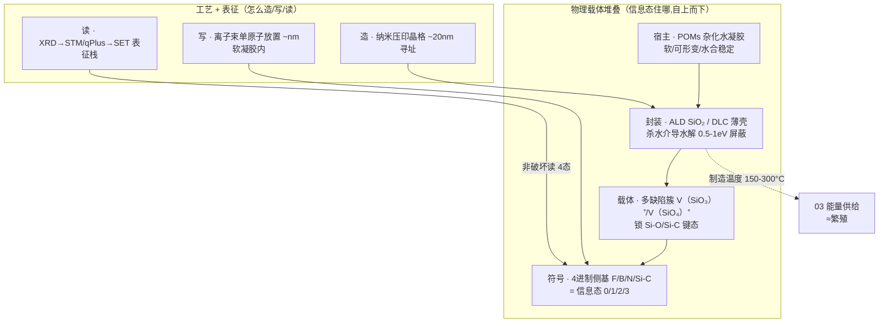
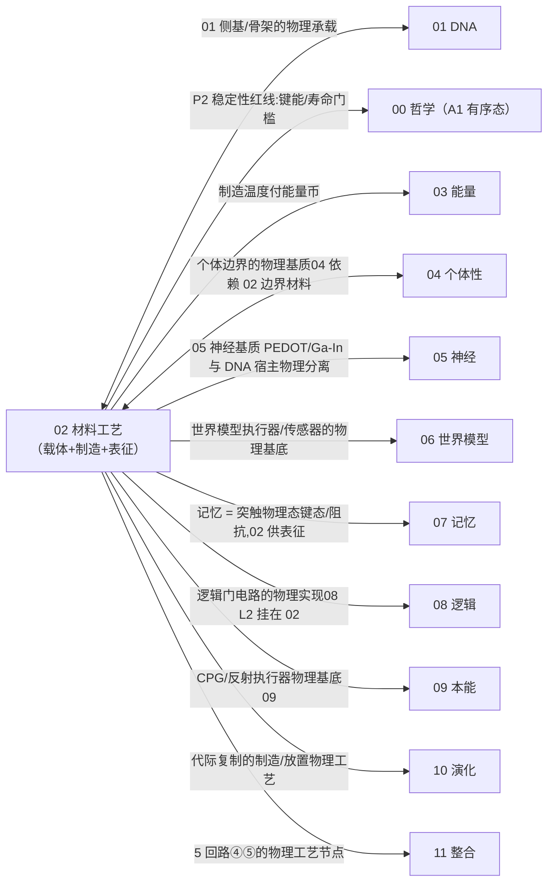

# 02 · 硅基材料工艺(载体 + 制造 + 表征)

| 文档项 | 内容 |
| --- | --- |
| 模块 | 硅基材料工艺：载体、制造与表征 |
| 文档类型 | 设计报告（中文版） |
| 版本 | v4.1 |
| 依赖 | 01 DNA 信息层 |
| 语言 | 简体中文（英文版见 `../en-US/`） |

> **依据类别**：`[引用:…]` 文献或数据；`[设计决策]` 项目设定；`[逻辑推导]` 由已列前提导出；`[待验证]` 未经验证的占位项。

---

## 0. 设计方案比选

> 本节比较三类载体方案，每类都说明信息如何布局、制造与读取，依据是什么，以及是否可行。
> - **方案 A（概念方案，基线方案）**：软载体路线，用多缺陷簇的键态存四进制信息，以离子束放置侧基、ALD 封装、qPlus 读出。
> - **方案 B（项目文献库）**：采用文献库中最成熟的物理信息存储范式，例如硅单原子、色心与缺陷态。
> - **方案 C（公开研究实践）**：参考外部在硅缺陷存储、物理写入与非破坏表征、软基质信息态方面的做法。
>
> 三类方案可以组合使用，组合方式见 §0.4。

### 0.1 方案 A：概念方案(软载体多缺陷簇，基线方案）

**构造**:POMs 凝胶基底 → 纳米压印晶格(~20 nm 位点)→ 多缺陷簇壳(锁键态)→ 4 进制侧基符号；离子束逐位写 + ALD 封装 + qPlus 读(详见 §3 图)。

| 机制 | 具体做法 | 依据性质 |
| ------ | --------- | --------- |
| 存 0/1/2/3 | 多缺陷簇里 Si-O/Si-C 键态 = 4 态 | 簇必要 [引用:02/Chadi_2003 ab initio/DFT,单缺陷不稳];4 态稳定 [待验证] |
| 造/写 | 离子束单原子放置 + ALD 逐层 | [引用:02/Holmes_2023 UNSW 组 ~nm];软凝胶内放置 [待实验] |
| 读 | qPlus 非破坏电学读 4 态 | [引用:02 §2.4 表征栈] |
| 封装 | ALD SiO₂/DLC 杀水介导水解 | [设计决策];水屏蔽效率 [待实验 M2/M5] |

**可行性与风险**：`Holmes_2023` 属于晶格与低温路线 [引用]。相比之下，在软凝胶中逐位放置侧基、用键态存四态信息并完成复制，目前没有已验证的实现路径，这是本项目依赖最强的关键假设（见「关键假设与设计决策」附录 T0）。该方案符合「物理即计算」的原则，但可行性在三类方案中最低。[设计决策]

### 0.2 方案 B：基于项目文献库(最成熟的物理信息存储范式)

> 文献库中"物理态存信息"最成熟的是**硅单原子/色心/缺陷态**这条线(量子器件 + 缺陷物理)。

| 机制 | 文献范式 |
| ------ | --------- |
| 存 | 硅单原子施主 qubit / 核自旋 / SiV 色心 |
| 保真 | 单原子存储 T1=144-300 s / gate >99% |
| 读 | qPlus/SET/STM 电荷传感 |
| 写入 | 离子束注入 |

**依据与说明（按上表行序）**

1. **存** — [引用:02/Holmes_2023, §单原子放置, "UNSW 离子束确定性放单原子(T0 关键，预印本)"]、[引用:02/Severin_2025_ML_AutoTuning_Si_Donor_fidelity99, §保真度实测, "Severin 2025 ML 自调硅施主保真度>99%(2025 预印本)"]、[引用:02/Becker-Becher_2017, §STM 单原子操作/表征, "Becker-Becher 2017 单原子 STM 操作+缺陷表征"]、[引用:02/Sohn_2018, §SiV 色心量子相干, "Sohn 2018 SiV 色心量子相干，支撑着色终点态表征"]
2. **保真** — [引用:02/KEY_MEASURED_RATES_A_STATUS, §实测速率表, "实测速率记录单原子存储 T1=144-300s/gate>99%(待以已发表实测数据替换)"]
3. **读** — [引用:02/Schofield_2025, §硅量子路线, "Schofield 2025 原子级半导体路线图(硅量子路线),支撑 qPlus/SET/STM 电荷传感"]
4. **写入** — [引用:02/Holmes_2023, §单原子放置, "UNSW 离子束确定性放单掺杂原子(预印本关键)"]

**要点**:把"信息态"落在**硅单原子/色心**(而非自造多缺陷簇),存储/保真/读取**全部有实测**,可行性远高于方案 A;但**要低温/洁净器件**,与"软凝胶室温"有张力，宜作**验证基准/降级方案**。

### 0.3 方案 C：基于公开研究实践(外部调研，文献待补充)

> 待验证 · **本节依据来自公开文献调研，与本项目自身的设计主张分开处理。** 已核实的锚点记为 `[引用:02/C_SOFT_MEMRISTOR_MULTI_LEVEL_2026-09-15.md]`；尚未核实的仍标 `[引用·外部调研·DOI 待核实]`，不把未核实的数值当作已确认数据。
> **关键结论(调研方向)**:世界把"信息态做进物理载体"最成熟的 3 类:① 硅缺陷/色心存储 ② 物理写入+非破坏表征 ③ 软基质忆阻器。**软基质里存 4 态**最同构的是**凝胶忆阻器/电阻式多态存储**。

| 外部范式 | 可搬进 02 的机制 |
| --------- | ---------------- |
| 硅单原子/色心信息存储 | "单原子=信息位 + 保真度实测"范式 |
| 物理写入 + 非破坏电学读出 | 写(分子离子束确定性放单掺杂原子)/读(qPlus 力 / SET 电荷 / Pauli 自旋-电荷，单发 >95%)分离、读不破坏态 |
| 软基质忆阻器/电阻式多态存储 | "软基底存多态"与本项目载体最接近的路线(凝胶里做 4 态信息位) |

**依据与说明（按上表行序）**

1. **硅单原子/色心信息存储** — [引用:`02/Severin_2025_ML_AutoTuning_Si_Donor_fidelity99`, §保真度实测, "Severin 2025 单 donor 存储保真度>99%(2025 预印本，待换 Morello 2015)""]、`02/Steinacker_2025_Coupling_Ge_Nuclear_Spin`, §Ge 核自旋耦合, "Steinacker 2025 Ge 核自旋耦合(2025 预印本)"]
2. **物理写入 + 非破坏电学读出** — [引用:`02/WRITING_READOUT_WORLD_BEST_PRACTICE_2026-09-14.md`(W1-W5 写入 + R1-R6 无损读);写入代表 = 单原子晶体管 `Fuchsle_2012`[引用·:02/Fuchsle_2012_Nature_single-atom_transistor, §单原子晶体管, "Fuchsle 2012 Nature Nanotechnology:单原子晶体管，确定性放单原子实证(DOI 10.1038/nnano.2012.21;DOI 待核实；（受限访问）,可作 T0 关键外部权威锚)"] + 分子离子束 `Holmes_2023`[引用:02/Holmes_2023, §单原子放置, "UNSW 离子束确定性放单原子(预印本)"]/`Morello_2015`[引用·:02/Morello_2015_Nature_single_P_donor, §单 donor 相干, "Morello Nature:单³⁰P donor 核自旋相干(DOI 待核：检索到 nature11449/2012,册内标 nature16462/2015,年份与 DOI 均不一致待核实；（受限访问）,可作 T0 关键外部权威锚)"]]
3. **软基质忆阻器/电阻式多态存储** — [引用:`02/C_SOFT_MEMRISTOR_MULTI_LEVEL_2026-09-15.md` M1 丝素蛋白胶软多态电阻记忆 / M2 聚合物膜 ≥16 态+STDP+保持 ≥10⁴ s(全值已读回,OA) / M4 蛋白膜导电丝 / M5 水凝胶(与 02 POMs 同基质)];M3 软离子学机制综述。"4 态键态"为本方案推广目标，外部证"多态 ≥2-16 态"

> **公开研究实践的可核实落点**：`02/WRITING_READOUT_WORLD_BEST_PRACTICE_2026-09-14.md` 为上表的「物理写入」与「无损读出」提供了文献锚点。写入侧有 W3/W4 的分子离子束确定性三维放置单掺杂原子；读出侧有 R4 Hogg 2023 的 SET 单发读出（>95%）、R5 Elzerman 2004 的 Pauli 自旋—电荷量子非破坏读出，以及 R1 Adachi 2026 的单原子力读出。B1 的 ALD 封装与 B2 的模板寻址分别解决载体锁定与地址格问题。写入保真度的瓶颈在于单原子的并入与激活产率，而不是瞄准精度。软基质忆阻器一行的依据见 `C_SOFT_MEMRISTOR_MULTI_LEVEL_2026-09-15.md`，其中 M2 给出聚合物 ≥16 态及其全部数值，M1 为丝素蛋白凝胶的多态电阻记忆提供标题级实证。

### 0.4 方案组合与基线配置

| 策略 | 内容 | 适合 |
| ------ | ------ | ------ |
| **A. 纯方案 A** | 坚持自造软载体多缺陷簇 | 最符 P1,可行性最低 |
| **B. A + B 混合** | 第一代用方案 B 的硅单原子/色心存储做可运行载体,方案 A 软载体键态作下一代目标 | 先跑通再升级(原选定方案，设计决策 T0=A 后降为降级路径) |
| **C. 方案 B 为主 + 方案 A 验证** | 单原子存储为主，方案 A 单点验证"软凝胶能否存 4 态键态" | 最保守 |

> **基线方案(2026-09-16 设计决策 T0 = 方案 A,维持 A)**:坚持**方案 A 纯软载体键态**作主路径(与 `01 §0.4` + 关键假设与设计决策附录 T0 确定 A 同步对齐；现已更正)。方案 B(A+B 混合，单原子/色心先跑通)/ C(方案 B 为主 + 方案 A 验证)保留作**验证失败时的降级路径**,不在本代主路径。
> **T0 同步说明(2026-09-16)**:本册原"基线方案 = B(单原子先跑通)"与 01 §0.4 / 关键清单 T0(确定 A,纯软载体主路径)口径相反,——现三处(01 §0.4 / 02 §0.4 / 关键清单 T0)统一为**A(方案 A 主路径，关键保留)**;B/C 降为对照立场。

---

## 1. 设计目标

把 01 的"POMs 凝胶 + 杂原子侧基"从概念落到**可制造的物理系统**:
- **载体态**:Si-O/Si-C 缺陷键在多缺陷簇里(4 进制:Si-O / Si-C / 空位 / Si-Si)
- **宿主**:POMs 杂化水凝胶(软、可形变、水合稳定，符合 P1)
- **封装**:ALD SiO₂ / 类金刚石碳薄壳(杀水介导水解通道)
- **寻址**:离子束单原子放置(~nm 精度)
- **表征**:XRD → STM/qPlus → SET 电荷传感(逐层验证)

---

## 2. 相关研究现状 + 不同实现方式(原则 2)

### 2.1 载体态(什么存 0/1)

| 方案 | 保留势垒 | 室温稳定 | 可寻址 | 依据 | 取舍 |
| ------ | ---------- | --------- | -------- | ------ | ------ |
| **Si-O/Si-C 缺陷键(多缺陷簇)** | 4.5 / 3.3 eV 已核实 · | 高(除非水介导) | 已核实 · STM/AFM | `02/SiO2_Oxygen_Vacancy_Chadi_2003`[引用:02/Chadi_2003, §单氧空位不稳定段, "Chadi 2003 APL:单氧空位放能~2.9eV 自塌缩，须用多缺陷簇 V(SiO₃)⁺/V(SiO₄)⁺(仅摘要级，全文待补)"](单氧空位不稳定,2.9 eV 电荷分异→必须用多缺陷簇 V(SiO₃)⁺/V(SiO₄)⁺) | 已核实 · 选 |
| Trapped charge(闪存式) | ~10 年@85 °C | 漏电 | 中 | 闪存基准 | ❌ 短寿 |
| Spin qubit(施主) | 室温退极化 | 低温才稳 | 中 | `02/Becker-Becher_2017`、`02/Sohn_2018`(SiV 色心量子相干) | ❌ 第一代不用 |
| PCM(相变) | 待核实 | 待核实 | 中 | — | ❌ |
| SiV 色心(金刚石) | 光 + 热 | 中 | 中 | `02/Becker-Becher_2017`、`02/Sohn_2018` | 终点态表征用，非主载体 |

**关键 DFT 修正**(`Chadi 2003 APL`):
- 单氧空位 V(O)⁺ 在 α-石英**不稳定** → 2V(O)⁺ → V(O)⁰ + V(O)²⁺,放能 **~2.9 eV**([引用:02/Chadi_2003, §abstract DFT 段, "Chadi 2003 APL ab initio/DFT 算得单氧空位放能~2.9eV(摘要级计算值，非实测全文)"] abstract,**ab initio / DFT 第一性原理计算值，非实验实测**,原文 abstract 关键词 ab initio ×2 / DFT ×2 / experimental 0)
- 稳定的 EPR 活性位是**多缺陷簇** V(SiO₃)⁺ / V(SiO₄)⁺(同上)
- **设计含义**:载体态必须用**簇**,不用单缺陷(否则自塌缩失稳)。这是 01 选"Si-O/Si-C 缺陷键"时的**关键细节修正**。

### 2.2 宿主(放在哪种介质里)

| 方案 | 现状 | 取舍 | 依据性质 |
| ------ | ------ | ------ | ------ |
| **POMs 杂化水凝胶**(本方案主宿主) | [引用:`02/POM_supramolecular_gel_He_2013_SciRep`, §自组装/水合稳定段, "He 2013 Sci Rep:POMs 杂化水凝胶自组装+水合稳定，支撑 L1 软宿主选型"(OA 全文，自组装 + 水合稳定)] | 已核实 · 软、可形变、P1 | [设计决策] 选 B 作软宿主（P1）；符合 P1 由 [逻辑推导] 得出 |
| 晶态 SiO₂/SiC 宿主(方案 A 基准) | [引用:`02/Schofield_2025` 路线图(原子级半导体多机构)] | 作验证基准 | [设计决策] 方案 A/B 组合下的基准角色 |
| 液态金属/导电聚合物基质 | [引用:`05/Khan_2014`(EGaIn)、`05/Eickenscheidt_2019`(PEDOT)] | 神经层基质，不用于 DNA | [逻辑推导：基质分工,02 DNA 宿主 vs 05 神经基质物理分离避免串扰] |

**P2 红线(稳定性)**:
- Si-O ~4.5 eV、Si-C ~3.3 eV **键能**(教科书常见值,`设计设定`——非本项目实测，需对本载体 DFT 核实)都 > 2.2 eV 保留门槛
- **保留门槛 Eₐ ≥ 2.2 eV**(`推导值`:Arrhenius τ = τ₀·exp(Eₐ/k_BT),按 τ₀~10⁻¹³ s、室温目标 ~10⁶ 年反推;τ₀ 取值待实验核实,`待计算验证`)
- **水介导水解**有效 0.5–1 eV(`设计设定`,数值无实测，需 DFT + 封装实验核实)→ **必须封装**(ALD SiO₂ / DLC)
- **光氧化**未封装数周退化(`设计设定`)→ 封装
- **Si 位移阈值 ~40 eV**(`设计设定`,辐射损伤文献常见值，需对照具体器件核实)→ 必须冗余

**温度域分离(原则 4)**:
- **制造温度** 150–300 °C(≈ 繁殖，付额外能量,`设计设定`):ALD SiO₂、离子束注入、纳米压印
- **运行温度** ≤ 100 °C(`设计设定`,按 Eₐ ≥ 2.2 eV 推导仍 >10⁶ 年寿命，需 DFT 核实)
- 两域**必须分开声明**

### 2.3 制造工艺(怎么造)

| 工艺 | 现状 | 用途 | 取舍 |
| ------ | ------ | ------ | ------ |
| **离子束单原子放置** | `02/Holmes-2023`[引用:02/Holmes_2023, §单原子放置, "UNSW Morello/Simmons 组离子束确定性放单掺杂原子(~nm 精度),支撑逐位写侧基(T0 关键，预印本)"](UNSW Morello/Simmons 组，精度 ~nm;`02/IBM_FIB_UNRESOLVED.md` 列出候选) | 放单侧基(bit) | 已核实 · 唯一可确定性放单原子 |
| **ALD 逐层沉积** | `02/Schofield_2025` 路线图 | 长宿主 + 封装 | 已核实 · 逐层可控 |
| **纳米压印/光刻** | [引用·外部调研, DOI 10.1016/S0167-9317(96)00097-4, "Chou 1997 纳米压印 sub-10nm,奠基文献"] | 造寻址晶格(~20 nm) | 已核实 · 地址基底 |
| **DNA origami 模板批量** | `01/Dey_2021`[引用:01/Dey_2021, §DNA origami 统计阵, "Dey 2021 DNA origami 模板批量复制，支撑统计阵提吞吐选型"]、`01/2025_Recent_Advances_DNA_Origami` | 统计阵(大量重复块，提吞吐) | 第一代做短序列用 |

**"IBM IBAD 单原子"更正**(`02/IBM_FIB_Single_Atom_Placement_UNRESOLVED.md`):
- 原"IBM IBAD 单磷原子放置"**非一篇可定位论文**
- 单原子晶体管/放置的公开工作属 **UNSW(Simmons/Morello,STM 路线)**,IBM 侧是单原子数据存储(holmium 2017)
- 本方案用 `Holmes_2023`(arXiv,UNSW)+ `Schofield_2025`(多机构路线图)作权威代表

### 2.4 表征栈(P3 可读，按验证顺序)

| 顺序 | 工具 | 验证什么 | 依据 |
| ------ | ------ | --------- | ------ |
| 1 | XRD | 宿主骨架/晶格对不对 | — |
| 2 | STM / qPlus-AFM | 单原子/单缺陷簇真值 | `02/Becker-Becher_2017`[引用:02/Becker-Becher_2017, §STM 单原子操作/表征, "Becker-Becher 2017 单原子 STM 操作+缺陷表征，支撑表征栈第2步真值"] |
| 3 | SET / 电荷传感 | 可放大并行电学读出 | `02/Schofield_2025`(硅量子路线) |
| 4 | SiV/NV 色心光学 | 室温非破坏终点态 | `02/Becker-Becher_2017`[引用:02/Becker-Becher_2017, §STM 单原子操作, "Becker-Becher 2017 单原子操作"] + `02/Sohn_2018`[引用:02/Sohn_2018, §SiV 色心量子相干, "Sohn 2018 SiV 色心量子相干，支撑着色终点态表征"] |

**第一代用**:XRD → STM/qPlus → SET。**不追**色心光学(下一代)。

---

## 3. 具体设计(材料 + 工艺 + 参数)

**图 3-1:硅基载体 = 材料堆叠(载体态)× 工艺线(造/写/读)+ P2 稳定性红线**

> 说明：自下而上为载体堆叠、写入、读取与封装；写入与读出通道分离，避免读出破坏键态。

> **图例说明**:上列 `STACK` 是"信息态的物理堆叠"(软凝胶托着封装壳，壳里多缺陷簇锁住 4 进制侧基键态 = 信息)。下列 `PROC` 是"工艺线":**造**(压印晶格寻址)→ **写**(离子束逐位放侧基)→ **读**(qPlus/SET 非破坏读 4 态),封装壳负责"杀水介导水解"守住 P2 稳定性红线。虚线 = 待实验/设计断言。

**P2 红线(稳定性，守住才能自持)**:

| 项 | 数值 | 依据性质 |
| ---- | ------ | --------- |
| 键能门槛 | Si-O ~4.5 eV / Si-C ~3.3 eV > 2.2 eV | 键能 [设计·教科书值，需 DFT 核实];> 门槛 [逻辑推导:Arrhenius] |
| 保留门槛 | Eₐ ≥ 2.2 eV(τ₀~10⁻¹³s 反推 10⁶ 年) | [逻辑推导:Arrhenius τ=τ₀exp(Eₐ/kBT)];τ₀ 取值 [待实验] |
| 水介导水解 | 有效 0.5–1 eV → 必须封装 | [设计决策];屏蔽效率 [待实验 M2] |
| 光氧化 | 未封装数周退化 → 封装 | [设计决策] |
| Si 位移阈值 | ~40 eV → 必须冗余 | [设计·辐射损伤常见值，需 DFT 核] |

**温度域分离(原则 4)**:
- 制造温度 150–300 °C(≈ 繁殖，付额外能量)[设计决策]
- 运行温度 ≤ 100 °C(按 Eₐ ≥ 2.2 eV 推导仍 >10⁶ 年)[逻辑推导；需 DFT 核实]
- 两域**必须分开声明**

**保真度窗口(§01 交给我供的 DFT 值)**:
- ε ~ 10⁻⁴–10⁻³ [设计·窗口，碳基 Gao_2016 锚量级；硅基实测 = M3]
- 块长 N = 100–500 符号 [引用:01/Hutchison_2016 短而冗余]
- 双独立物理拷贝 + Fountain ECC [引用:01/Erlich_2017] + 双独立复制路径 [设计]

---

## 4. 与其他部分的关系(接口契约，全维度)

> **完整性原则**:02 是物理承载层，是**几乎所有模块的物理落点**——它必须与每个维度建联系(缺一项 = 本文档不完整)。下表覆盖全部 12 册。

**图 4-1:02(材料工艺)与全部 12 册的联系总览**

> 说明：箭头起点为供值方，终点为接收方；跨分册接口的可测量量由各分册接口契约定义。

| 接口 | 数据流(物理量，非概念) | 不变量(可测) | 依据性质 |
| ------ | ---------------------- | ------------- | --------- |
| **← 00 哲学** | P2 稳定性红线落实 A1 有序态 | 载体寿命 ≥ 10⁶ 年(Eₐ 门槛) | [逻辑推导:A1 有序态需物理载体自持] |
| **↔ 01 DNA** | 02 是 01"侧基 + POMs 骨架"的物理承载 | 载体 4 态可寻址 · Eₐ 达标 | [引用:01 §9 交接 6 项] |
| **→ 03 能量** | 制造/封装付能量币 | 03 A2 优先级供能(复制 > 学习) | [引用:03 E4] |
| **→ 04 个体性** | 个体边界的物理基质:04 判"个体"依赖 02 的边界材料(渗透率/表面能 C1 判据) | 04 B2 阈值(基质渗透率/表面能)[待计算验证:02 供] | [逻辑推导:04 §3.1 C1 + B2] |
| **→ 05 神经** | 05 神经基质(PEDOT/Ga-In)与 02 DNA 宿主物理分离 | 串扰隔离(两基质间距 > 扩散长度)[设计] | [引用:05 载体] |
| **→ 06 世界模型** | 世界模型执行器/传感器的物理基底(§06 W4 动作→物理态) | 执行器响应对应 02 侧基/器件态 [待验证] | [逻辑推导:06 W4 三步算子挂 02] |
| **→ 07 记忆** | 记忆 = 突触物理态(键态/阻抗/键长),02 供表征栈读 | 突触态可被 qPlus/STM 读 [待验证] | [引用:07 §3 + 02 §2.4 表征栈] |
| **→ 08 逻辑** | 门电路物理实现(08 L2 挂在 02 侧基键态迁移) | 门参数(键能/迁移阈值)[待计算验证:02 供] | [逻辑推导:08 L1-c 门电路挂 02] |
| **→ 09 本能** | CPG/反射执行器物理基底(软凝胶 + 液态金属?) | 执行器响应 [待设计:09/02] | [逻辑推导:09 I0b 执行器挂 02] |
| **→ 10 演化** | 代际复制的制造/放置工艺(离子束重放 + ALD) | 复制精度 ε_copy [待验证] | [引用:10 §3.6 代际方案 B] |
| **→ 11 整合** | 5 回路 ④获取/⑤复制 的物理工艺节点 | 回路闭合需 02 工艺可运行 | [引用:11 §5 回路] |

**契约原则**:接口"数据"必须是**可物理测量量**(键态/电荷谱/能量币/表面能),不是概念；未给 DFT/实验值的标"数值待 02/其他分册"。

**依据性质(§4)**:
- 各接口数据流/不变量 = 本册 §2/§3 载体设计的投影 [逻辑推导]
- 物理承载 ← 01 [引用:01 §9]
- 稳定性红线 → 00 [逻辑推导:A1]
- 供能 → 03 [引用:03 E4]
- 边界基质 → 04 [逻辑推导:04 B2];神经基质分离 → 05 [引用:05]
- 世界模型/记忆/逻辑/本能 → 06/07/08/09 [逻辑推导：各册挂 02 载体]
- 代际复制/整合 → 10/11 [引用:10 §3.6 + 11 §5]

---

## 5. 待实验验证 / DFT(原则 1 + 3)

| # | 开放项 | 现状 | 标注 |
| --- | -------- | ------ | ------ |
| M1 | POMs 凝胶 + 杂原子侧基 Eₐ | SiO₂ 缺陷有 DFT(`Chadi 2003`),凝胶侧基无 | 待计算验证 |
| M2 | 水介导水解封装屏蔽效率 | 概念有(封装杀 0.5-1 eV 通道),数值无 | 待实验 |
| M3 | 离子束放置硅侧基的 ε | 碳基 XNA ~10⁻⁴ 参照(`Gao 2016`),硅基无 | 待自研实测 |
| M4 | 多缺陷簇的稳定性寿命(运行温度下) | 单缺陷簇 DFT 有，运行寿命无 | 待计算验证 + 实验 |
| M5 | ALD 封装厚度 vs 水屏蔽 | 概念有，厚度-屏蔽曲线无 | 待实验 |

---
