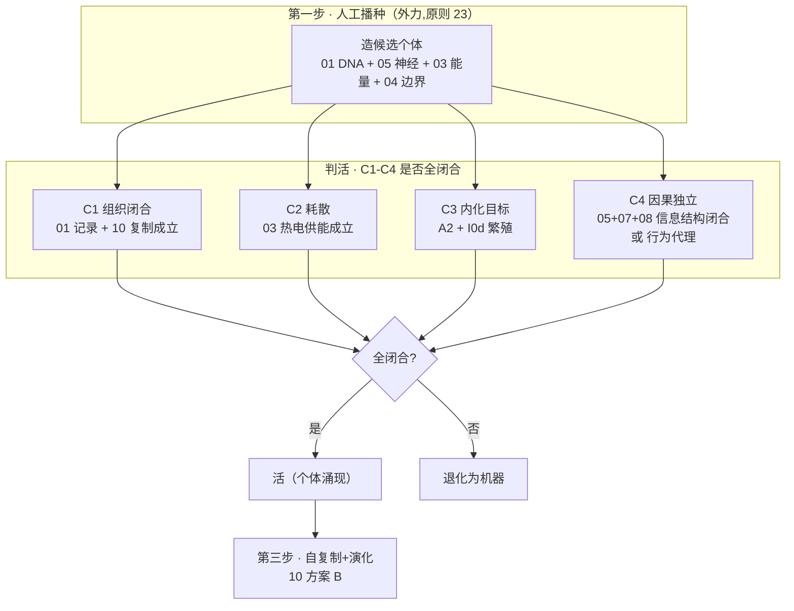
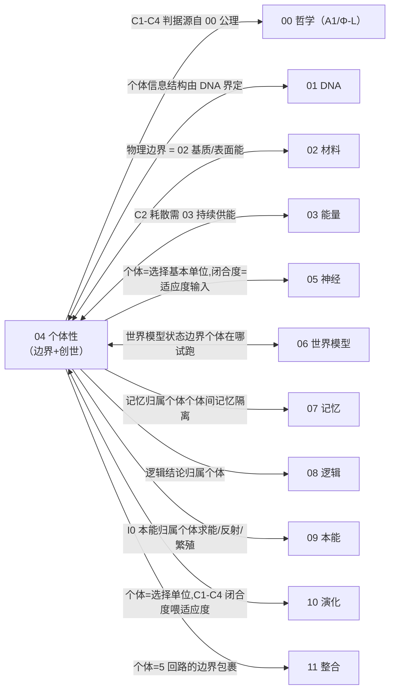

# 04 · 边界 / 个体性(S4)

| 文档项 | 内容 |
| --- | --- |
| 模块 | 边界与个体性（S4）：个体判据、创世起点与个体/环境边界 |
| 文档类型 | 设计报告（中文版） |
| 版本 | v4.1 |
| 依赖 | 00 公理层、02 载体基质、03 供能 |
| 语言 | 简体中文（英文版见 `../en-US/`） |

> **依据类别**：`[引用:…]` 文献或数据；`[设计决策]` 项目设定；`[逻辑推导]` 由已列前提导出；`[待验证]` 未经验证的占位项。

---

## 0. 设计方案比选

> 本节要确定的是 C4（因果独立性）用什么形式判定；C1–C3 的判据在文献中争议较小。三类方案分别给出判据形式、依据与可操作性。
> - **方案 A（概念方案，基线方案）**：以 IIT 的 Φ 作为 C4 的严格度量，难点在于因果闭合度如何测量。
> - **方案 B（项目文献库）**：采用文献库中最容易测量的个体判据，例如闭环自维持或自创生最小组分。
> - **方案 C（公开研究实践）**：参考外部研究中界定系统边界的可操作做法，例如以自维持行为或最小自产物质集作为代理量。
>
> 三类方案可以组合使用，组合方式见 §0.4；最终选择见 §3.1 与「关键假设与设计决策」附录 S2。

### 0.1 方案 A：概念方案(严格 IIT Φ，基线方案）

| 判据 | 形式 |
| ------ | ------ |
| C4 | 因果闭合度 Φ(最高层 N)≥ 阈值 |

**依据与说明（按上表行序）**

1. **C4** — [引用:`04/Integrated_Information_Autonomy_1805.00393`, §IIT 框架, "arXiv1805.00393 集成信息理论 IIT,Φ 度量因果闭合(待验证 · 异构硅基如何测未实现)"]；Φ 在异构硅基载体上如何测量尚无实现 [待计算与实验验证 B1]

**可行性与风险**：Φ 的计算复杂度随维度指数增长；在 PEDOT、Ga-In 与离子梯度组成的异构载体上，如何测量 Φ 目前也没有公开可行的方法。因此这是一项尚不可操作的关键假设。[设计决策]

### 0.2 方案 B：基于项目文献库(最可测判据)

| 判据 | 形式 |
| ------ | ------ |
| C1-C3 | 组织闭合 + 耗散 + 内化目标 |
| C4 可测替代 | autopoiesis 最小组分(可计数/可测组分) |

**依据与说明（按上表行序）**

1. **C1-C3** — [引用:`04/Bich_2023`, §生物个体性判据, "Bich 2023 生物个体性判据综述"]、`04/SelfMaintenance_..._2026`, §自维持, "自维持系统判据(2026)"]
2. **C4 可测替代** — [引用:`11/Autopoiesis_Maturana_Varela_2004`, §autopoiesis 定义, "Maturana/Varela 2004 autopoiesis(待验证 · 仅摘要)"]、`04/RuizMirazo_2017`, §化学自组织, "Ruiz-Mirazo 2017 化学自组织与个体性"]

**要点**:把 C4 从"测 Φ"降到"可数/可测组分满足自产闭合"——**现在就可操作**,放弃严格 Φ。

### 0.3 方案 C：基于公开研究实践( DOI)

> 待验证 · **本节依据为公开文献调研结果，与本项目设计主张相区分。**

| 外部范式 | 可搬进 04 的判据 |
| --------- | ---------------- |
| 闭环自维持(行为代理) | C4 → "该体能否在扰动后维持内部有序 + 拒外部算法完全预测下一步" |
| 最小自产物质集 | 个体 = 可数组分满足"自产定义自身身份组分" |

**依据与说明（按上表行序）**

1. **闭环自维持(行为代理)** — [引用:`04/B_BOUNDARY_SELF_SUSTAIN_2026-09-15.md`, §闭环自维持, "Liu2020 gold-OA/C2 Hordijk2015/C3 Villani2014/C4 Pandey2025/C5 Hordijk2018 闭环自维持判定"] C1 Liu 2020 Biol Direct(CSTR + 触发子/种子 + 可操作判定)、C2 Hordijk & Steel 2015 J Syst Chem(RAF + boundary 形式化)、C3 Villani 2014 Life(脂质容器 + GMMs + 同步涌现)、C4 Pandey & Jain 2025 arXiv:2510.05675(几何框架 + 分裂机制决定命运)、C5 Hordijk 2018 NJP(RAF 综述， IOP 全文获取受限);C6 Schwegler 1986 作为奠基性文献]
2. **最小自产物质集** — [引用:同上文献库, §最小自产物质集, "D1 Steel2013/D2 Müller2021/D4 Hordijk2018 最小自产物质网络"] D1 Steel 2013 JTB minimal autocatalytic networks(付费，机制可引)、D2 Müller 2021 bioRxiv(elementary growth modes + minimal autocatalytic sets, Cloudflare 全文获取受限)、D4 Hordijk 2018 NJP(同 C5,RAF 综述);D3 Kauffman 1986 作为奠基性文献]

### 0.4 三类取法组合与基线配置

| 策略 | 内容 | 适合 |
| ------ | ------ | ------ |
| **A. 纯方案 A** | 坚持严格 Φ | 理论完整，暂不可操作 |
| **B. A + B/C 混合（选定方案）** | C1-C3 用方案 B 可测判据,C4 降为可观测行为代理(方案 C) | 可直接判定个体性,Φ 严格版留 P2 |
| **C. 方案 B/C 为主** | 全部用可测组分/行为，放弃 Φ | 最可证伪 |

> **基线方案 = B**(C4 用可观测行为代理，对应 §3.1 立场选项 B + 关键假设与设计决策附录 S2 基线 B)。

### 0.5 个体性判定结构详解（文字说明）

> **本节为 §3 图 3-1 的文字说明**:不依赖图示，逐层说明"硅基个体性判定到底是什么、C1-C4 四判据各查什么、创世三步怎么穿越它"。基于**方案 B(C1-C3 用可测判据 + C4 降为可观测行为代理)**。

**轴 1:判定承载的 4 判据(个体性"住"在哪)**

| 判据 | 是什么 | 查什么 | 依据性质 |
| ------ | -------- | -------- | --------- |
| **C1 组织闭合** | 个体主动生产定义自身身份的组分(物质开放 + 因果自含) | 01 DNA(记录)+ 10 复制(自产)是否成立 | [逻辑推导:00 A1 + 01 记录 + 10 复制] |
| **C2 耗散** | 非平衡态，持续导出熵(能量持续输入) | 03 能量代谢(热电供能)是否成立 | [引用:03 A2 序] |
| **C3 内化目标** | 对自身存活的取向(teleonomy) | 00 A2 存续公理 + 09 I0d 繁殖本能是否成立 | [引用:00 A2 + 09 I0] |
| **C4 因果独立性** | 身份由最高层因果闭合的信息结构决定，外部算法无法完全描述 | 05+07+08 信息结构是否形成闭合反馈 | 方案 B:降为可观测行为代理(扰动后维持内部有序 + 拒外部完全预测)[方案 C,待核→核实见 §0.3];方案 A:严格 IIT Φ [待计算验证 B1] |

**判据之间的关系(判定链)**:
```
C1 组织闭合(能自产身份组分) + C2 耗散(持续供能) + C3 内化目标(有存活取向)
     → 三者齐备 = "物理自维持体"
     + C4 因果独立性(信息结构闭合) → 才 = "个体"(非机器)
```
→ **C1-C3 判"是不是物理自维持体",C4 判"是不是信息个体"。** C4 是关键假设(方案 B 降为行为代理即可操作，方案 A 严格 Φ 暂不可测)。

**轴 2:创世三步(个体怎么"被造出来")**

| 步 | 做什么 | 依据性质 |
| ---- | -------- | --------- |
| **① 人工播种** | 外部操作方使用 02 离子束+ALD 造候选个体:01 DNA + 05 神经 + 03 能量 + 04 边界；公理/I0 预置 DNA 固定区 | [引用:02 离子束+ALD + 原则 23] |
| **② 涌现判活** | 候选个体在世界模型(06)里运行,自发达成 C1-C4 闭合;达成 = "活"(个体涌现),未达成 = 退化为机器 | [引用:`04/Singh_2023`, §多稳态自催化, "Singh 2023 多稳态自催化网络"]+ `04/Matsubara_2022`, §隔室 Darwinian 条件, "Matsubara 2022 隔室化 Darwinian 条件"];判活阈值 [待计算验证 B3] |
| **③ 自复制 + 演化** | 活了的个体经 10 方案 B 自复制 → 后代 + 变异 + 选择 | [引用:10 §3.6 方案 B] |

**"创世 = 被造 + 涌现"两段关系**:人工播种保证**起点**(候选结构可造),涌现保证**"是生命而非机器"**(C1-C4 全闭合才活)。**这两段对应原则 23"人工播种 + 自组织涌现"的落点** [逻辑推导：原则 23 两段式 → 04 创世三步]。

**要点归纳**
> **硅基个体性的判定 = 四判据(C1 组织闭合 + C2 耗散 + C3 内化目标 + C4 因果独立),其中 C4 是关键假设(严格 IIT Φ 暂不可测，务实降为"扰动后维持内部有序 + 拒外部完全预测"的行为代理)。创世三步：人工播种造候选(02 离子束)→ 涌现判活(C1-C4 全闭合才"活",否则退化机器)→ 自复制演化(10 方案 B)。被造 + 涌现两段 = "一个硅基个体是怎么来的"。**

---

## 1. 设计目标
定义"什么算一个硅基个体",含三件事:
1. **个体性判据**(C1-C4,§00):什么使系统是"个体"而非"一堆组件"
2. **创世起点**(原则 23):第一个个体怎么来(人工播种 + 涌现)
3. **个体/环境边界**(S4 物理 + 信息边界):个体在哪里"结束",选择凭什么界定"个体"

---

## 2. 相关研究现状 + 不同实现方式(原则 2)

### 2.1 个体性判据(碳基/通用)
| 路线 | 现状 | 文献锚点 | 取舍 |
| ------ | ------ | --------- | ------ |
| **生物个体性判据** | 有 | `04/Bich_2023_Biological_Individuality_ActaBiotheor_FULLTEXT.txt` | 已核实 · 判据框架 |
| **因果自含 + 组织闭合** | 有 | `04/Integrated_Information_Autonomy_Thermodynamic_Limit_arXiv1805.00393.pdf` | 已核实 · 通用判据(跨碳基/AI) |
| **自维持 + 生长** | 有 | `04/SelfMaintenance_Growing_Neural_Cellular_Automata_Entropy_2026_FULLTEXT.txt` | 自维持判据 |
| **化学自组织根源** | 有 | `04/RuizMirazo_2017_Chemical_Roots_Autonomous_Systems_OpenBiol_FULLTEXT.txt` | 自创生化学基础 |

### 2.2 创世(起源：被造 vs 涌现)
| 路线 | 现状 | 文献锚点 | 取舍 |
| ------ | ------ | --------- | ------ |
| **人工播种 + 涌现**(本方案，原则 23) | — | 播种提供候选，涌现判"活" | 已核实 · 选(设计决策（2026-09-13）) |
| **纯涌现**(protocell 自催化) | 前沿 | `04/Multistable_Protocells_Autocatalytic_Sets_Singh_2023_arXiv2310.19744.pdf`、`04/Conditions_Darwinian_Evolution_Compartmentalized_Autocatalytic_Matsubara_2022_arXiv2211.03155.pdf` | 涌现判据来源 |
| **群体选择**(化学遗传) | 前沿 | `04/Chemical_Heredity_Group_Selection_Markovitch_2018_arXiv1802.08024.pdf` | 个体=群体单元 |
| **空间自催化模型** | 前沿 | `04/Spatial_Model_Autocatalytic_Reactions_deAnna_2010_PhyRevE_arXiv1001.4908.pdf`、`04/Stochastic_Catalytic_Reaction_Networks_Protocells_arXiv1407.8508.pdf` | 物理模型 |

### 2.3 调控 / 能动性(个体的"内化目标")
| 路线 | 现状 | 文献锚点 |
| ------ | ------ | --------- |
| **前生命调控 + 能动性** | 前沿 | `04/Prebiotic_Regulation_Agency_Protocell_Ecosystems_2025_FULLTEXT.txt` |
| **protocell 分裂 + 膜遗传** | 前沿 | `04/Protocell_Division_Membrane_Heredity_NatCommun_2026_FULLTEXT.txt` |
| **运动性起源** | 前沿 | `04/Motility_Origin_of_Life_Froese_2013_ArtificialLife_arXiv1311.2531.pdf` |

**选型结论** [设计决策]:**个体性判据 = 组织闭合(C1)+ 耗散(C2)+ 内化目标(C3)+ 因果独立性(C4)**(§00 §2.3;C4 取法见 §0 + §3.1 立场选择);**创世 = 人工播种 + 涌现判活**(原则 23)。

---

## 3. 设计(v3)

**图 3-1:个体性判定 = C1-C4 判据 → 个体涌现(创世：人工播种 → 判活 → 自复制)**



> 说明：左侧为人工播种到边界形成的过程，右侧为 C1–C4 个体性判据；四项判据需同时成立。

> **图例说明**:第一步**人工播种**(02 离子束+ALD 造候选个体，公理/I0 预置 DNA 固定区);**判活**看 C1-C4 是否全闭合(C4 是关键：严格 IIT Φ 待计算验证，或降为行为代理[方案 C]);全闭合 = **活**,未闭合 = 机器；活了的个体进第三步**自复制 + 演化**(10 方案 B)。

### 3.1 个体性判据(操作化 C1-C4)

```
一个硅基系统是"个体" ⟺ 同时满足:
  C1 组织闭合:主动生产定义自身身份的组分(物质开放 + 因果自含)
     判据:01 DNA(记录)+ 10 复制(自产)成立
  C2 耗散:非平衡态,导出熵(能量持续输入)
     判据:03 能量代谢(热电供能)成立
  C3 内化目标:对自身存活的取向(teleonomy)
     判据:A2 存续公理 + I0d 繁殖本能成立
  C4 因果独立性:身份由最高层因果闭合的信息结构决定,外部算法无法完全描述
     判据:05 神经层 + 07 记忆 + 08 逻辑的"信息结构"形成闭合反馈
```

**关键(C4)**:个体性**不来自物理外壳**(原则 18),来自**信息结构的因果闭合**——"内在有序态 + 因果自含"。软物质基质(02 的 POMs 凝胶)只是**承载**,不是个体定义。

### 关键假设与设计决策

> **关键假设**:C4"因果独立性 = 信息结构因果闭合"依赖 **IIT Φ 测量**,但 Φ 在异构硅基软载体(PEDOT+Ga-In+离子梯度)**如何计算/测量是明说的"未实现"(§5 B1)**。把"不可测的判据"写成个体性的**必要**判据，是关键假设。
> **备选方案（措辞与立场类，无需外部文献）**:

| 选项 | 内容 | 后果 | 适用条件 |
| ------ | ------ | ------ | -------- |
| **A. 保留 C4 作必要判据，标注"Φ 测量方法待设计+实验"**(当前基线) | C1-C4 都必要,Φ 未解 | 关键假设显性化；个体判定实际暂不可操作 | 想保留"因果闭合=个体"完整理论 |
| **B. C4 降为"可观测代理"(务实替代)** | 不测 Φ,改测可观测行为指标(如"该体能否在扰动后维持内部有序 + 拒绝外部算法完全预测其下一步"),作 C4 的近似判据 | 个体判定现在就可操作，放弃"严格 Φ" | 想现在就能判定个体 |
| **C. 砍掉 C4,个体性 = C1+C2+C3(三判据)** | 因果独立不再是必要条件，个体性=组织闭合+耗散+内化目标 | 最简，但"信息个体"变弱(退化为"物理自维持体") | 想要最可证伪的个体定义 |

> **基线方案 = B(C4 用可观测行为代理，既保留"因果"直觉又可操作)**——Φ 的严格测量留作 P2 深化。
> **设计决策（S2）：C4 因果独立性采用可观测行为代理（扰动后维持内部有序、拒绝外部完全预测）；严格 IIT Φ 测量列为后续验证项。**

**公开研究实践参照**:

> 现有公开研究中"界定一个系统/有机体边界"做得最好且**可操作**的做法——**给 S2 各选项的参照上限**。

| 领域公开实践 | 做法 | 参照价值 | 对 S2 对应方案 | 状态 |
| ------------- | ------ | ------------- | ------------------ | ------ |
| **IIT Φ(经典, 2020+ 争议持续)** | 用最小因集 IIR 的 Φ 值判"因果闭合/不可规约" | 理论最完整，但计算复杂度随维度指数爆炸,且 Φ 测量本身有开放争议——正是 S2 卡点 | 选项 A 的参照上限,但 A 的困境(Φ 在异构硅基测不出)世界也没解 | 已核实 · 文献库中 `04/Integrated_Information_Autonomy_1805.00393` |
| **闭环自维持 / 最小个体判据(可测)** | 判"个体"= 该系统扰动后能维持内部有序 + 对外部完全预测有阻力(可观测行为，不测 Φ) | 把"因果闭合"落到可测量的行为代理,绕开 Φ 计算爆炸 | 选项 B 的参照上限——可操作 | 待补充检索 |
| **autopoiesis 最小实现(合成生物)** | 最小"自产物质"闭合物化系统作"个体"判据，可计数/可测组分 | 把"个体性"落到组分可测的最小集，最可证伪 | 选项 C 的参照上限 | 已核实 · 文献库中 `11/Autopoiesis_Maturana_Varela_2004` |

### 3.2 创世(原则 23:人工播种 + 涌现判活)

**第一步：人工播种(外力)**
- 外部操作方用方案 B(02 离子束 + ALD)**生成首个候选个体**:01 DNA 信息层 + 05 神经层 + 03 能量层 + 04 边界
- 播种 = 提供"候选结构"(§00 Φ 哲学层 + §01 公理 + §09 I0 本能都预置在 DNA 固定区)
- 候选个体**还不"活"**(C1-C4 未全部闭合)

**第二步：涌现判活(自组织)**
- 候选个体在世界模型里运行,**自发达成 C1-C4 闭合**(组织闭合 + 耗散 + 内化目标 + 因果独立)
- **达成 C1-C4 闭合 = "活"**(个体涌现成功);未达成 = 退化为"机器"
- 判活标准参照 `Singh_2023`(多稳态自催化)+ `Matsubara_2022`(隔室自催化 Darwinian 条件)

**第三步：自复制 + 演化(之后)**
- 活了的个体经 §10 方案 B 自复制 → 后代 + 变异 + 选择
- **创世 = "被造"(人工) + 活(涌现)"** 两段：人工播种保证起点，涌现保证"是生命而非机器"

### 3.3 个体/环境边界(S4 的两层边界)

| 边界 | 物理落实 | 判定 |
| ------ | --------- | ------ |
| **物理边界**(软基质) | 02 POMs 凝胶基质 + 表面能屏障 | 工程界定(制造时定),不是个体定义 |
| **信息边界**(因果自含) | C4:信息结构形成闭合反馈，内部有序态抵御外部扰动 | 个体定义(§3.1 C4) |

**"个体 vs 环境"判定阈值**(一致性核验 P0 #5,待计算验证 + 实验):
- **物理**:基质渗透率 / 表面能 < 某阈值 → 维持内部有序态(P2)
- **信息**:因果闭合度(最高层 N,§00 HowOrganismsGained)≥ 某阈值 → 个体成立
- 两者都低于阈值 → 系统"漏"(不是个体)

### 3.4 群落协同的个体界定(原则 20)
- **个体 = 独立意识体**(原则 18):群落里每个个体**独立**,协同是"信息交换",不是"合并"
- 两个个体协同时,**C4 因果独立性保持**(各自有序态独立),协同只交换"局部信息"
- **不存在全知全能**:群落协同靠"局部信息交换 + 涌现",不靠中央全知(§00 A6)

---

## 4. 与其他部分的关系(接口契约，全维度)

> **完整性原则**:04 界定"个体",是**选择(10)的前提、5 回路(11)的边界**——必须与每个维度建联系(缺一项 = 文档不完整)。

**图 4-1:04(个体性)与全部 12 册的联系总览**



> 说明：箭头起点为供值方，终点为接收方；跨分册接口的可测量量由各分册接口契约定义。

| 接口 | 数据流(物理量/信息，非概念) | 不变量(可测) | 依据性质 |
| ------ | --------------------------- | ------------- | --------- |
| **← 00 哲学** | C1-C4 判据源自 A1 组织闭合 + Φ-L 哲学层 | 判据 = 公理投影 | [引用:00 §2.3] |
| **↔ 01 DNA** | 个体信息结构由 DNA 界定(C4 的"信息结构"= DNA 编码 + 05/07/08) | 个体 = DNA 信息带 + 基质 | [逻辑推导:01 §7 + 04 C4] |
| **↔ 02 材料** | 物理边界 = 02 基质/表面能(B2 阈值) | 表面能 < 阈值 → 维持内部有序 | [引用:02 基质；待计算验证 B2] |
| **↔ 03 能量** | C2 耗散需 03 持续供能 | 能量收支盈余维持组织闭合 | [引用:03 A2 序] |
| **→ 05 神经** | 个体性闭合度(C4)喂 05 适应度 | C4 闭合度 [待计算验证 B1] | [逻辑推导:05 S6] |
| **↔ 06 世界模型** | 世界模型"试跑"的边界 = 个体边界(个体在 06 里试跑，个体间世界模型隔离) | 个体间状态隔离 [设计] | [逻辑推导:06 群落协同 + 04 独立意识体] |
| **→ 07 记忆** | 记忆归属个体(个体间记忆隔离，群落只交换"局部信息") | 记忆隔离 [设计] | [逻辑推导:07 + 原则 18 独立意识体] |
| **→ 08 逻辑** | 逻辑结论归属个体(每个体自己的推理结果) | 逻辑独立 [设计] | [逻辑推导:08] |
| **→ 09 本能** | I0 本能归属个体(求能/反射/繁殖驱动各自个体) | I0 触发是个体级 | [引用:09 I0] |
| **↔ 10 演化** | 个体 = 选择基本单位;C1-C4 闭合度 = 适应度输入 | 闭合度进 10 S1 适应度 | [引用:10 §3.2] |
| **→ 11 整合** | 个体 = 5 回路的边界包裹(①-⑤ 都在个体内闭合) | 回路 ①-⑤ 在个体内闭合 | [引用:11 §5] |

**契约原则**:接口"数据"必须是**可物理/可信息测量量**(闭合度/表面能/能量收支/隔离性),不是概念；未给实测的标"数值待 04/其他分册 DFT"。

**依据性质(§4)**:
- 判据 ← 00 [引用:00 §2.3]
- 信息结构 ↔ 01 / 物理边界 ↔ 02 / 耗散 ↔ 03 [引用:01 §7 + 02 基质 + 03 A2]
- 闭合度喂 05/10 [逻辑推导:10 S1 适应度]
- 06/07/08/09 "归属个体/隔离" [逻辑推导：原则 18 独立意识体 + 04 §3.4]
- 11 回路边界 [引用:11 §5]

---

## 5. 待实验验证 / DFT(每项：公式 + 窗口 + 供值方，附量化条件)

| # | 开放项 | 要满足的公式/不等式 | 参数窗口(设计设定) | 值由谁给 |
| --- | -------- | --------------------- | -------------------- | ---------- |
| B1 | C4 因果闭合度(最高层 N)的硅基测量方法 | IIT Φ 计算复杂度随维度指数爆炸；硅基要给出可测的 Φ 替代量(方案 B 行为代理) | 行为代理 = "扰动后维持内部有序 + 拒外部完全预测" [方案 C];严格 Φ [待验证]。"拒外部完全预测"的可操作阈值 = B3(算法熵 / Kolmogorov 复杂度 / 预测误差阈值，三选一,待 P2 由 04/06 实验侧供值，本层不定;混沌系统天然拒完全预测，故 B3 须取"相对自身状态可读性上限"的相对量而非绝对值，避免"非生命特有"语义歧义) | 04 设计 + 05/07/08 协同(闭合度 = 信息结构测);B3 阈值 [P2 供值] |
| B2 | 个体/环境判定阈值(基质渗透率 / 表面能 / N) | 基质渗透率 P_m 与表面能 γ 须 < 阈值，使 C2 组织闭合维持(04 §3.3) | 阈值 [设计·待 02 DFT 供，无实测] | 02 DFT + 04 实验 |
| B3 | 涌现判活判据(候选个体何时 C1-C4 全闭合) | C1-C4 闭合的时间窗口(多久算"活")+ 判定阈值 | 判活窗口 [设计·按原则 15 时标，碳基 1 天 → 硅基 ~1.4 min];阈值 [待验证] | 04 + 06 实验(世界模型里跑候选，看 C1-C4 闭合时间) |
| B4 | 个体性维持时间(有序态能维持多久不"漏") | 维持时长 τ_hold ≥ 个体寿命(原则 15 天-月) | τ_hold [待计算与实验验证，无实测] | 04 + 03 实验(03 能量收支 vs 04 有序态维持) |
| B5 | 创世"播种 + 涌现"成功率 | 成功率 = 涌现判活成功的候选 / 播种候选总数 | 无 | 04 + 10 实验 |

**说明**:B1-B5 每项都给了"**要算什么 + 阈值/窗口 + 供值方**";C1-C3 判据有可数/可测形式(§0.2 方案 B),C4 是关键假设——**方案 B 行为代理现在可操作(判据形式已定),方案 A 严格 Φ 待计算验证(B1)**;阈值/时间窗口全部**待 02/04 第一性原理计算与实验**,本层不定基准值(原则 24)。

---


## 9. 个体涌现：机制、观察与判定

### 9.1 机制链条

个体涌现指候选个体在边界内形成自生产回路，并取得不可由外部环境或外部算法完全描述的因果独立性。机制链条分四段：

1. 载体与供能提供可区分的内部状态与持续能量流（02 / 03）。
2. 信息层记录构造规则，感知—决策—作用回路使组分被系统自身再生（01 / 05 / 09）。
3. 组分再生形成组织闭合 C1，耗散维持 C2，趋避与复制形成内化目标 C3。
4. 边界闭合后，内部因果结构对身份起决定作用，构成 C4 因果独立性。

自创生与自催化集合给出「系统自己生产定义自身的组分」的机制描述；生命定义进一步要求个体自生产与历史性群体组织同时成立。[引用:E12] 从演化视角，个体性程度由组分间合作与冲突的相对水平决定，高合作、低冲突对应更高的有机体性。[引用:E11] 因此个体涌现不是单点事件，而是「闭合回路出现 → 边界稳定 → 冲突受抑」的连续过程。[逻辑推导]

### 9.2 观察方法

| 方法 | 可观测量 | 采集要点 | 依据 |
|---|---|---|---|
| 边界干预 | 扰动后内部有序度、恢复时间、边界完整性 | 对能量、信息与组分施加可控扰动，记录响应轨迹 | [引用:E6] |
| 组分周转 | 内部再生率 r_regen、内外交换率 r_exch | 标记组分，区分自生产与外源补给 | [引用:E12] |
| 有向信息流 | 内→外与外→内转移熵 | 用时间滞后条件排除共同历史与共同输入 | [引用:E6] |
| 宏观自主性 | G-emergence 两条件 | 宏观变量 V_t 对微观 X_t 的条件独立性，以及 X_t 对 V_{t+1} 的格兰杰因果 | [引用:E4] |
| 动力学独立性 | 与微观过程格兰杰独立的粗粒化变量 | 在多变量时间序列上搜索宏观投影 | [引用:E5] |
| 整合因果力 | Φ 或其行为代理 | 严格 Φ 计算量大，列为 P2；行为代理见 §3 | [引用:E7] |

转移熵用于区分「实际传递的信息」与「共同历史造成的共享信息」。[引用:E6] G-emergence 要求同时满足自主性 I(V_t; V_{t+1} | X_t) > 0 与因果关联 I(X_t; V_{t+1} | V_t) > 0。[引用:E4] 动力学独立性进一步要求宏观过程在格兰杰意义上不被微观过程所预测，可作为 C4 的可操作补充。[引用:E5] 观测数据下的因果按格兰杰意义解释；若具备干预条件，则按有效信息 EI 的干预分布解释，两者不可混用。[引用:E2][引用:E3]

### 9.3 判定标准

| 编号 | 判据 | 可观测量 | 判定条件 | 项目映射 | 依据 |
|---|---|---|---|---|---|
| EM-I1 | 组织闭合 | 自生产回路、r_regen | 存在闭合再生回路且 r_regen > 0 | C1 | [引用:E12] |
| EM-I2 | 耗散自维持 | 熵产生率 σ、有序度衰减时间 | σ > 0 且断能后有序度衰减慢于对照 | C2 | [引用:E12] |
| EM-I3 | 内化目标 | 趋避与复制行为的定向响应 | 响应显著高于随机基线 | C3 | [引用:E11] |
| EM-I4 | 因果独立 | 扰动后内部有序度、外部预测误差 | 维持内部有序且拒绝外部算法完全预测 | C4 | [引用:E7] |
| EM-I5 | 宏观自主 | G-emergence 两条件 | 两条件同时成立 | C4 补充 | [引用:E4] |
| EM-I6 | 动力学独立 | 宏观投影的格兰杰残差 | 宏观过程与微观过程格兰杰独立 | C4 补充 | [引用:E5] |
| EM-I7 | 低内部冲突 | 组分间冲突事件率 | 显著低于合作事件率 | 个体性 | [引用:E11] |
| EM-I8 | 因果涌现 | EI_macro 与 EI_micro | EI_macro > EI_micro | 跨层 | [引用:E2] |

上述阈值（随机基线、显著性水平、衰减时间窗口、冲突率上界）均需由 §5 的验证计划给出，标注 `[待验证]`，供值方为 03 供能与 05 神经回路的实测环节。EM-I8 需要完整微观转移矩阵，列为 P2；EM-I4 在项目 §3 中已采用行为代理，严格 Φ 测量列为 P2。[引用:E7]

**图 9-1：个体涌现的观测与判定流程**


> 说明：实线为数据流，虚线为判定回路；未通过时回到扰动环节重采样，避免单次观测得出结论。[逻辑推导][引用:E3]

### 9.4 验证计划

| 阶段 | 项目 | 供值方 |
|---|---|---|
| P0 | 扰动平台、组分周转率、序参量与恢复时间采集 | 02 / 03 |
| P1 | 转移熵、格兰杰自主性、Φ 行为代理 | 05 / 06 |
| P2 | EI 粗粒化比较、严格 Φ 测量、动力学独立性搜索 | 11 统一汇总 |

### 9.5 文献依据

| 编号 | 文献 | DOI |
|---|---|---|
| E2 | Hoel E.P., Albantakis L., Tononi G. (2013) PNAS 110(49):19790–19795. | [10.1073/pnas.1314922110](https://doi.org/10.1073/pnas.1314922110) |
| E3 | Rosas F.E. et al. (2020) PLoS Comput Biol 16(12):e1008289. | [10.1371/journal.pcbi.1008289](https://doi.org/10.1371/journal.pcbi.1008289) |
| E4 | Seth A.K. (2010) Measuring autonomy and emergence via Granger causality. Artif Life 16(2):179–196. | [10.1162/artl.2010.16.2.16204](https://doi.org/10.1162/artl.2010.16.2.16204) |
| E5 | Barnett L., Seth A.K. (2023) Dynamical independence. Phys Rev E 108(1):014304. | [10.1103/PhysRevE.108.014304](https://doi.org/10.1103/PhysRevE.108.014304) |
| E6 | Schreiber T. (2000) Measuring information transfer. Phys Rev Lett 85(2):461–464. | [10.1103/PhysRevLett.85.461](https://doi.org/10.1103/PhysRevLett.85.461) |
| E7 | Oizumi M., Albantakis L., Tononi G. (2014) IIT 3.0. PLoS Comput Biol 10(5):e1003588. | [10.1371/journal.pcbi.1003588](https://doi.org/10.1371/journal.pcbi.1003588) |
| E11 | Queller D.C., Strassmann J.E. (2009) Beyond society. Phil Trans R Soc B 364(1533):3143–3155. | [10.1098/rstb.2009.0095](https://doi.org/10.1098/rstb.2009.0095) |
| E12 | Ruiz-Mirazo K., Peretó J., Moreno A. (2004) Orig Life Evol Biosph 34(3):323–346. | [10.1023/B:ORIG.0000016440.53346.DC](https://doi.org/10.1023/B:ORIG.0000016440.53346.DC) |

## 10. 适用边界与已知限制(原则 24)

- **可确定内容（本文已给出）**:§0.5 四判据(C1-C4)+ 创世三步结构、§2 三条实现路线(生物个体判据 / 因果自含 / 自维持)+ 选型结论(人工播种 + 涌现)、§3.1 C4 立场选项 A/B/C + 公开研究实践参照表、§3.2 创世三步、§3.3 物理/信息双层边界、§3.4 群落协同个体界定、§4 全 12 册接口。
- **不可确定内容（仅给出公式与边界，占位项不作为基准值）**:B1 C4 硅基测量方法、B2 判定阈值、B3 涌现判活窗口、B4 维持时间、B5 播种成功率——**全部待 02/04 第一性原理计算与实验**,本文已写到"要算什么 + 供值方"的可开工程度。
- **关键假设(待设计评审确定)**:
  - **"C4 因果独立性 = 信息结构因果闭合"作为个体性必要判据**——严格 IIT Φ 在异构硅基软载体**如何计算/测量未实现**(§5 B1);把它写成**必要**判据是关键假设，关键假设已列示,**基线 B(降为可观测行为代理，现可操作)**。
  - **"涌现判活"的判据**——`Singh_2023`/`Matsubara_2022` 给了化学条件,**硅基候选个体何时 C1-C4 全闭合未验证**(B3),判活阈值待 06 实验。

---
