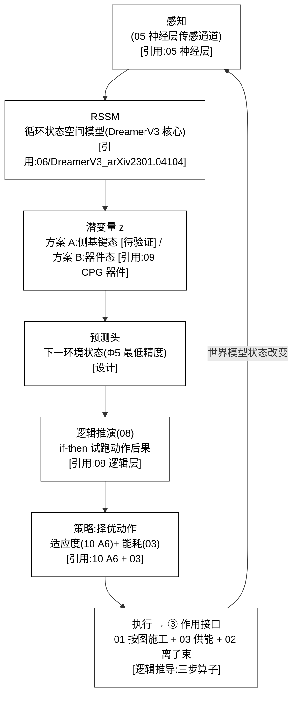

# 06 · 世界模型(S5)

| 文档项 | 内容 |
|---|---|
| 模块 | 世界模型（S5）：内部预测模型与行动后果推演 |
| 文档类型 | 设计报告（中文版） |
| 版本 | v4.1 |
| 依赖 | 05 预测头、07 试跑素材、08 逻辑推演 |
| 语言 | 简体中文（英文版见 `../en-US/`） |

> **依据类别标注**：`[引用:…]` 文献或数据依据；`[设计决策]` 无外部依据的项目设定，须注明可调性；`[逻辑推导]` 由已列前提与公式导出；`[待验证]` 数值或方法未经验证，仅作占位，须注明供值方。所有关键断言均带上述类别之一。

---

## 0. 设计方案比选

> 设计问题：关键问题为 **世界模型潜变量的载体**(数字 RNN 数字态 / 硅基器件态 / 与载体解耦),以及「作用接口的映射方式」。给出三类并列方案，各方案给出"实现 + 依据 + 可行性"。算法底座三类**共用 DreamerV3**(MIT, JAX,固定超参跨多域)[引用:`06/DreamerV3_Hafner_2023_arXiv2301.04104`],只在"潜变量载体 + 作用映射"上分叉。
> - **方案 A(概念方案，保留当前 = 原选项 A)**:潜变量 = **侧基键态**(数字 RNN 潜变量语义直接挂硅基侧基键态，命中"物理即计算")
> - **方案 B(基于项目文献库 = 原选项 B，选定方案）**:潜变量 = **有神经形态实验支撑的器件态**(脉冲 CPG 器件 / NEXUS 门电路 / 磁储层),不挂无据侧基键态
> - **方案 C(基于公开研究实践，含外部调研 + 原选项 C)**:① 物理机器学习/忆阻器 RNN(器件态当潜变量的世界实证)② 世界模型与执行器解耦(务实替代)
> 三者并列且不互斥。关键选择见 §3.3 + 关键假设与设计决策附录。

### 0.1 方案 A：概念方案(潜变量 = 侧基键态，基线方案）

| 环节 | 具体做法 | 依据性质 |
|------|---------|---------|
| 底座 | DreamerV3(RSSM + 纯离散 categorical 潜变量 + 固定超参跨 49 域) | [引用:`06/DreamerV3_Hafner_2023_arXiv2301.04104`, §DreamerV3/RSSM, "Hafner 2023 arXiv2301.04104 DreamerV3:RSSM+离散潜变量，固定超参跨 49 域，世界模型算法底座"] |
| 潜变量 | RSSM 潜变量 z **直接挂侧基键态**(§02 表征栈读侧基键态 = 世界模型状态) | [设计决策];"数字向量挂化学键态" 无 DFT 路径 [待计算与实验验证，关键] |
| 作用映射 | 三步算子：动作(01 帧)→ 02 放置侧基 → 潜变量更新 → 03 耗能 | [逻辑推导：挂 01/02/03];每步精度/误差/能耗系数 [待验证] |

**可行性 + 风险**:最激进、命中"物理即计算",但**把数字 RNN 潜变量语义关联至化学侧基键态，文档自称"可推"实无 DFT 路径**——是 C 类可行性不确定性最高的一项。[设计决策]

### 0.2 方案 B：基于项目文献库(潜变量 = 器件态，选定方案）

> 文献库中"器件态当计算态"最成熟的是 **神经形态 CPG 器件 + NEXUS 门电路 + 磁储层**这条线(有实验)。

| 环节 | 文献范式 | 依据性质 |
|------|---------|---------|
| 潜变量 = 器件态 | 脉冲 CPG 器件(SNN 器件态当状态)、NEXUS 门电路(ANN↔SNN 位精确等价)、磁薄膜物理储层 | [引用:`09/Neuromorphic_Spiking_CPG_arXiv2101.09709`, §脉冲 CPG 器件态, "2015/2021 脉冲 CPG 用器件态当状态"]、`08/NEXUS_2026_Neuromorphic_Gate_Circuits_arXiv2601.21279`, §ANN↔SNN 位精确等价, "NEXUS 2026 ANN↔SNN 位精确门电路等价"]、`_公开研究实践参照/Dale_2021_Reservoir_Computing_Magnetic_Thin_Films_arXiv2101.12700`, §磁薄膜物理储层, "Dale 2021 磁薄膜物理储层计算"] |
| 作用映射 | 同方案 A 三步算子，但潜变量读器件态而非侧基键态 | [逻辑推导：挂 01/02/03] |
| 试跑代价 | 试跑耗能量币(§03),N 由预算定 | [引用:03 W3] |

**要点**:把"潜变量"落到**有神经形态实验支撑的器件态**,可行性远高于方案 A,且不放弃"物理即计算"。

### 0.3 方案 C：基于公开研究实践(已逐条补核 + 解耦替代)

> 待验证 · **本节依据为公开文献调研结果，与本项目设计主张相区分。**

| 外部范式 | 可搬进 06 的机制 | 依据性质 |
|---------|----------------|---------|
| 物理机器学习(physical ML) | 器件态直接当世界模型潜变量(选项 B 天花板，证明"器件态当潜变量"有实验非可行性未经验证) | [引用:`06/B_WORLD_MODEL_RNN_DEVICE_2026-09-15.md`, §器件态世界模型已核对, "R1 Liyuan2026 MTJ磁穿结RC/R2 Shreya2023 涡旋MTJ RC/R3 Liang2023 光子延时线RC(全开放获取),证明器件态当潜变量"] R1 Liyuan 2026 MTJ 磁穿结 RC(**IOP 开放获取，全文已归档**,同步振荡 = 非线性资源)+ R2 Shreya 2023 涡旋 MTJ RC(**开放获取，全文已归档**,颗粒数 = 潜变量维度)+ R3 Liang 2023 光子延时线 RC(**开放获取，全文已归档**,光信号 = 储层)+ 文献库中 `_公开研究实践参照/Dale_2021_磁储层`(磁薄膜物理储层)] |
| 自旋/忆阻器 RNN | 忆阻器存 RNN 权重，器件态迁移 = 状态更新(器件级参照) | [引用：同上 核实记录文件, §自旋/忆阻器RNN已核对, "R4 Stoliar2021 固态器件最小循环脉冲NN(PRA,DOI 10.1103/physrevapplied.16.034030)/R5 Srikimkaew2023 纳米颗粒网络忆阻器储层计算(ACS,DOI 10.1021/acsaelm.3c01046),前批误标已纠正"] **R4 Stoliar/Schneegans/Rozenberg 2021 *Minimal Recurrent Spiking NN in Solid-State Device*,PRA 16, 034030(DOI 10.1103/physrevapplied.16.034030,全文获取受限，前批误标 2025/UCN 自旋已纠正)+ R5 Srikimkaew 2023 *In-Material Reservoir Computing via Nanoparticle Network Memristor*,ACS Appl. Electronic Mater.,DOI 10.1021/acsaelm.3c01046(全文获取受限，前批 Ag-Ag₂S 无成文已替代)**;机制可引，每脉冲能耗/态数数值待 CDP 补] |
| 世界模型与执行器解耦 | 预测/规划在外部，载体只执行，潜变量不必=物理态(选项 C 天花板) | [引用:`06/Wang_2022_DayDreamer_arXiv2206.14176`, §DayDreamer, "Wang 2022 DayDreamer:真实机器人世界模型强化学习(arXiv2206.14176,文献库中已核实)"] |

**06 §0.3 引用升级说明**:原 2 行 `[引用·外部调研，待核]` 升级——"物理机器学习" 行挂 R1/R2/R3(三篇 RC 器件线：磁穿结 / 涡旋 MTJ / 光子延时线，全 开放获取 + 全文已归档)+ 文献库中 Dale 2021 磁储层;"自旋/忆阻器 RNN" 行挂 R4(R4 Stoliar 2021,前批误标 2025/UCN 已纠正)+ R5(Srikimkaew 2023,前批 Ag-Ag₂S 无成文已替代)。真未读回的(R4/R5 每脉冲能耗 / 态数数值)在 核实记录文件 "未核实区"列名，不写进 06 正文当已核值。

### 0.4 方案组合与基线配置

| 策略 | 内容 | 适合 |
|------|------|------|
| **A. 纯方案 A** | 潜变量挂侧基键态(保留当前基线) | 最激进，关键假设，暂不可操作 |
| **B. 方案 B 为主 + 方案 A 留作 P2（选定方案）** | 潜变量落**器件态**(神经形态 CPG/磁储层),侧基键态版留待计算验证 后再启用 | 可行性高，不放弃"物理即计算" |
| **C. 方案 C 解耦底层约束** | 世界模型可与载体解耦(外部预测 + 物理反馈) | 最保守，放弃"脑内试跑即物理" |

> **基线方案 = B**(潜变量落到有神经形态实验支撑的器件态；可行性远高于 A,不丢"物理即计算")——对应 §3.3 原选项 B + 关键假设与设计决策附录。**该选择属于设计立场，经设计评审确认**。

### 0.5 世界模型结构详解（文字说明）

> **本节为 §3 图 3-1 的文字说明**:不依赖图示，逐层说明"硅基个体的世界模型到底是什么、怎么跑循环、潜变量落在哪、作用接口怎么穿到外面"。基于**方案 B(潜变量 = 器件态 + DreamerV3 底座 + ③ 作用接口)**。

**轴 1:运行循环的 6 环(从感知到作用,"世界模型运行循环")**

| 环 | 是什么 | 干什么 | 依据性质 |
|----|--------|--------|---------|
| **① 感知** | 05 神经层传感通道(五感/超碳基信号) | 把**当前环境物理量**取进世界模型 | [引用:05 神经层] |
| **② RSSM** | DreamerV3 循环状态空间模型 | 把感知序列转成**潜变量 z**(离散 categorical) | [引用:`06/DreamerV3_Hafner_2023_arXiv2301.04104`(MIT/JAX,固定超参跨 49 域)] |
| **③ 潜变量 z** | 方案 A:侧基键态 [待验证] / **方案 B:器件态**(脉冲 CPG / NEXUS 门 / 磁储层) | 世界模型的"内部状态",**下一环预测它** | 器件态 [引用:`09/Neuromorphic_Spiking_CPG_arXiv2101.09709`、`08/NEXUS_2026`、`_公开研究实践参照/Dale_2021_Reservoir_Computing_Magnetic_Thin_Films`](B 线 SOTA 文献库中已核实) |
| **④ 预测头** | 下一环境状态(Φ5 最低精度) | 预测"环境下一步",是 A5 学习公理的最低落点 | [引用:00 Φ5] |
| **⑤ 逻辑试跑** | 08 逻辑 if-then 推演 N 个候选动作后果 | 在世界模型里**虚拟跑**动作(不真实执行),付试跑能耗(03 W3) | [引用:08 逻辑 + 03 W3] |
| **⑥ 择优 + ③ 作用接口** | 按适应度(10 A6)+ 能耗(03)择优 → 经**③ 作用接口**真实执行 → 改世界模型状态 → 回 ① | **把虚拟试跑"作用"到真实世界**(01 按图施工 + 03 供能 + 02 离子束，三步算子) | [逻辑推导:§3.3 W4 三步算子挂 01/02/03] |

**环与环的关系(图里自左而右 + 回环)**:
```
① 感知 → ② RSSM → ③ 潜变量 z → ④ 预测头 → ⑤ 逻辑试跑 → ⑥ 择优+③ 作用接口 → (改世界) → 回 ①
```
→ **"世界模型"不是独立的东西，它 = ③ 潜变量 z 的运行(器件态/侧基键态)+ ④⑤ 的预测/试跑 + ⑥ 的作用接口；要感知靠①,要预测靠②④,要试跑靠⑤,要"作用到真实世界"靠⑥(③ 作用接口)。** 这条循环就是"硅基个体一条世界模型怎么转"。

**轴 2:三条机制线(穿过 6 环,"怎么落潜变量/怎么试跑/怎么作用")**

| 机制 | 穿过哪环 | 做什么 | 依据性质 |
|------|---------|--------|---------|
| **落潜变量(POTENTIAL)** | ②③ | RSSM 潜变量**落到哪**:方案 A = 侧基键态(最激进，关键，无 DFT);**方案 B = 器件态**(脉冲 CPG / NEXUS 门 / 磁储层，有神经形态实验，选定方案）;方案 C = 与执行器解耦(务实，放弃"脑内试跑即物理") | 侧基键态 [设计决策];器件态 [引用:`09/Neuromorphic_Spiking_CPG` + `08/NEXUS_2026` + Dale 2021 磁储层];解耦 [引用:`06/Wang_2022_DayDreamer`] |
| **试跑(SIMULATE)** | ⑤⑥ | 逻辑 if-then 虚拟跑 N 个动作，付试跑能耗(03 W3);N 由能量预算定 | [引用:08 逻辑 + 03 W3];"N 由预算定" [设计决策] |
| **作用(ACT)** | ⑥ | ③ 作用接口 = 01 按图施工 + 03 供能 + 02 离子束(三步算子：动作帧 → 02 放置 → 潜变量 z 更新 → 03 耗能);把试跑"作用"到真实世界 | [逻辑推导:§3.3 W4 三步算子挂 01/02/03];每步精度/能耗系数 [待验证] |

**"固定（不可演化） + 动态"关系**(为什么这套设计能"既试跑又能作用"):
- **6 环的循环结构 = 固定（不可演化）**(感知→RSSM→预测→试跑→择优→作用→回感知，算法固定，不演化掉);
- **潜变量落到哪 = 三选一立场**(A/B/C,由设计评审确定);
- **试跑 N 个动作 + 择优 = 动态**(N 随能量预算变，择优准则随 10 A6 适应度变)。
- **这个"固定（不可演化）循环 + 动态立场/数值"的分法，正是原则 14(作为改造基线 DreamerV3,不重写算法)+ 原则 22(教能力不教立场)+ 原则 20(不预设全知)的对应落点** [逻辑推导：三条原则分别落到循环/立场/数值]。

**要点归纳**
> **硅基个体的世界模型 = 一个 6 环循环:① 感知入网 → ② RSSM(DreamerV3)→ ③ 潜变量 z(器件态，方案 B（选定）)/ ④ 预测头(Φ5)→ ⑤ 逻辑 if-then 试跑 N 个动作(付能耗)→ ⑥ 择优 + ③ 作用接口(01 按图施工 + 03 供能 + 02 离子束)作用到真实世界 → 回 ①。循环结构固定（不可演化）,潜变量落到哪是三选一立场(基线 B 器件态),试跑 N + 择优动态。**

---

## 1. 设计目标
个体先**在"心里"跑模拟**(世界模型预测环境 + 推演动作后果),再择优执行——而不是被动反应。这是"在世界模型里运行"的核心。
**关键原则(14)**:**不从零设计**,选现成世界模型( DreamerV3)作底座，只做"硅基化改造"。

---

## 2. 相关研究现状 + 不同实现方式(原则 2 + 原则 14)

| 路线 | 现状 | 文献锚点 | 取舍 |
|------|------|---------|------|
| **DreamerV3(候选底座)** | 开源实现较为完整 | `06/DreamerV3_Hafner_2023_Mastering_Diverse_Domains_World_Models_arXiv2301.04104.pdf`(待验证 · 原 `arXiv2310.04394` 误标为 BiTeI 等离子体散射，已排除，此为补抓真 DreamerV3,标题已核对)+ `06/WorldModel_OpenSource_Repositories_Summary.txt`(danijar/dreamerv3,MIT, JAX,pip 即跑) | 已核实 · **选为底座**(固定超参跨 49 域，免逐任务调) |
| **DreamerV2(备选)** | TF2 生态 | `06/DreamerV2_Hafner_Mastering_Atari_Discrete_World_Models.pdf`(arXiv2010.02193,补抓落盘，标题核对) | 依赖轻 |
| **DayDreamer(物理体参照)** | 真机小样本 | `06/Wang_2022_DayDreamer_World_Models_Physical_Robot_Learning_arXiv2206.14176.pdf` | 待验证 · 无 LICENSE,改造前确认 |
| **World Models(奠基)** | 理论 | `06/HaSchmidhuber_2018_World_Models_arXiv1803.10122.pdf` + `06/HaSchmidhuber_2018_Recurrent_World_Models_Policy_Evolution_arXiv1809.01999.pdf` | 架构思想 |
| **PlaNet(像素学潜变量)** | 成熟 | `06/Hafner_2019_Learning_Latent_Dynamics_Planning_arXiv1811.04551.pdf` | 从感知到规划 |
| **MLP²(model-based RL)** | 成熟 | `06/Janner_2019_MLP2_Model-Based_RL_arXiv1903.08755.pdf` | 模型 + RL |
| **Voyager(LLM 开放探索)** | 前沿 | `06/Voyager_Wang_Open-Ended_Embodied_LLM_Agent_arXiv2305.16291.pdf` | LLM 技能库参照 |
| **预测处理(认知科学)** | 理论 | `06/Predictive_Processing_Cognitive_Robotics_Review_arXiv2101.06611.pdf` | 预测编码思想 |

**选型结论(原则 14)**:
- **底座 = DreamerV3**(MIT, JAX,固定超参跨多域，官方 JAX 可自改)
- **DreamerV3 对硅基有用的升级**:① 纯离散 categorical 表征(训练稳，不易坍缩)② 一套超参横扫多域(免逐任务调参)③ 5M→50M 可叠加 scaling ④ 官方 JAX 与 DeepMind 解耦便于自改
- **不发明，只改造**:DreamerV3 的"预测 + 想象 + 策略"框架**保留**,改造的是"输入/输出空间"(换成硅基感知/动作)+ 物理约束(硅基能量/时标)

---

## 3. 设计(v3)

**图 3-1:世界模型运行循环 = 感知 → RSSM 预测 → 逻辑试跑 → 择优 → ③ 作用接口 → 回感知**



> **图例说明**:感知(05 传感通道)→ RSSM(DreamerV3 核心)→ 潜变量 z(方案 A 侧基键态 [待验证] / 方案 B 器件态)→ 预测头(Φ5 最低精度)→ 逻辑 if-then 试跑(08)→ 按适应度(10 A6)+ 能耗(03)择优 → 执行，经**③ 作用接口**(01 按图施工 + 03 供能 + 02 离子束)改变世界模型状态 → 回感知。

### 3.1 世界模型架构(DreamerV3 底座 + 硅基化)

```
感知(05 神经层传感器通道)
   ↓
RSSM(循环状态空间模型,DreamerV3 核心)
   ↓
潜变量 z(离散 categorical,DreamerV3 的"纯离散"升级)
   ↓
预测头:下一环境状态(Φ5 最低精度)
   ↓
逻辑推演(08 逻辑子系统):if-then 试跑动作后果
   ↓
策略:择优动作
   ↓
执行 → 环境(③ 作用接口,§3.3)
```

**硅基化改造(保留 DreamerV3 框架，改三处)**:
1. **输入空间**:换成硅基感知通道(05 神经层的"五感/超碳基"信号)
2. **物理约束**:预测头注入硅基物理规律(能量守恒 + 熵增,§03;时标映射，原则 15)
3. **试跑代价**:世界模型试跑**耗能量币**(§03,试跑 = 计算 + 能耗),试跑越久越耗能 → 个体按"试跑价值 vs 能耗"取舍(不无限试跑)

### 3.2 精度下限(Φ5)
- **最低要求**:预测"下一步环境状态"(否则 A5 无意义)
- **可扩展**:多步 rollout(规划能力),但**有能量预算**(§3.1 试跑代价)

### 3.3 ③ 作用世界模型(验证项 C 类"作用接口")
**这是 5 回路里最弱的一环，现在落实**:个体怎么"改变"世界模型的状态?

```
个体动作 → ③ 物理作用接口 → 世界模型状态改变
```
**物理作用接口 = 01 按图施工 + 03 供能 + 02 离子束**(三件合一):
- 01 的"按图施工"(§01.5):基因指导物质构造 → 个体改变自身/环境结构
- 03 供能：作用付能量币(§03 能量收支)
- 02 离子束：物理执行(离子束 + ALD 放侧基)

**落实**:世界模型里，个体"试跑"一个动作 → 动作的"作用"通过这套物理接口预测对世界模型状态的影响 → 择优。这就是"个体→世界"的**作用算子**。

**W4 作用接口映射函数(细化，可推部分，原则 24)**:
- 映射 = `action(动作，即 01 帧) → 世界模型状态 Δz`。**可推结构**:
  1. 动作(01 读出的构造帧)→ 02 离子束/ALD 的**放置指令**(放哪个侧基到哪个位)——这一步是**物理执行**,确定性可推(给定指令，放置结果由 02 工艺决定);
  2. 放置的侧基 → 改变局部键态/电荷 → 世界模型潜变量 z 的**对应分量**更新(§3.1 RSSM 的观测)——这一步是**可推的映射关系**(状态 = 侧基键态分布,§02 表征栈读);**[关键：数字 RNN 潜变量(=GPU 上的向量)→ 侧基键态的物理映射实无 DFT 路径，本步把无路径的量写进可用算子，属 C 类最可行性未经验证关键假设，与 §10 W4 口径一致;T3 确定 B 后此"侧基键态当潜变量"降级为"下一代目标",本步 P2 待实验验证]**;
  3. 更新付能量(§03 能量币，试跑代价 W3)——**耗能系数待计算验证**。
- **可定**:映射**算子的三步结构**(动作→放置→潜变量更新→耗能),每一环挂 01/02/03 已有机制。
- **待计算验证 / 实测**:放置精度(§02 离子束 nm 精度)、潜变量读出的**表征误差**、试跑的**能耗系数**(W3)。
- **边界说明**:作用接口的"**怎么映射**(三步算子)可定**,每步的**精度/误差/能耗数值是 DFT/实验值**——本层给出结构，不给出未经实测的数值(原则 1/3)。

**待验证 · 关键假设 + 替代路径选择空间(一致性核验（2026-09-14）：设计立场经设计评审确认)**:

> **关键假设**:第 2 步"放置的侧基 → 局部键态/电荷 → **RSSM 潜变量对应分量更新**"——把**数字 RNN 的潜变量语义直接关联至硅基侧基键态**,文档自称"可推"但实无 DFT 路径(06 的潜变量是 DreamerV3 在 GPU 上的数字向量，不是化学键态)。是 C 类可行性不确定性最高的一项。
> **选择空间(三选一，文献库中已有真实文献)**:

| 选项 | 机制 | 可行性 | 说明 | 文献库中文献 |
|------|------|--------|------|---------|
| **A. 保留"潜变量挂侧基键态"(当前基线)** | 侧基键态直接当世界模型潜变量 | **最低**(数字向量挂化学键态无路径) | 最激进，命中"物理即计算" | `06/DreamerV3` 作算法参照 |
| **B. 世界模型跑在"物理神经形态器件"上，潜变量=器件态**(神经形态替代) | 用硅基/忆阻器阵列的状态当潜变量，世界模型 RNN 由器件本身承载 | **中**(神经形态计算器件已有实验，如脉冲 CPG 器件 `09/Neuromorphic_Spiking_CPG_arXiv2101.09709`、NEXUS `08/NEXUS_2026` 门电路等价) | 把"潜变量"落到**有神经形态实验支撑的器件态**,而非无据的侧基键态 | `09/Neuromorphic_Spiking_CPG_arXiv2101.09709`、`08/NEXUS_2026` |
| **C. 世界模型用"外部计算 + 物理反馈"分离架构**(务实替代) | 预测/规划在外部(硅基载体内只跑最小控制),世界模型不要求"潜变量=物理态" | **最高**(把世界模型从"必须在软载体里跑"降级为"可与载体解耦") | 最保守，放弃"脑内试跑即物理" | `06/Wang_2022_DayDreamer`(物理体世界模型可独立于动作执行器) |

> **基线 = B(潜变量落到有神经形态实验支撑的器件态，可行性远高于 A,且不放弃"物理即计算");C 最保守，放弃"试跑在体内"。该选择属于设计立场，经设计评审确认。**

**公开研究实践参照**:

> 现有公开研究中"把计算状态做进物理器件"(物理即计算 / 神经形态)做得最好的做法——**给 T3 各选项的参照上限**。

| 领域公开实践 | 做法 | 参照价值 | 对 T3 对应方案 | 状态 |
|-------------|------|-------------|------------------|------|
| **物理机器学习(physical ML,2023+)** | 用**物理系统的自然动力学**(共振器/扩散/神经形态阵列)直接当"计算单元",输入即物理信号，输出即物理态 | 器件态就是计算态，无"数字↔物理"转换，是"物理即计算"的成熟落地 | **选项 B 的参照上限**——证明"器件态当潜变量"有实验，非可行性未经验证 | 已核实 · 已落盘 `_公开研究实践参照/Dale_2021_Reservoir_Computing_Magnetic_Thin_Films_arXiv2101.12700`(磁薄膜物理储层，标题已核实) |
| **自旋 / 忆阻器 RNN(硬件 SNN,2020+)** | 忆阻器存 RNN 权重，器件态迁移 = 状态更新 | 把 RNN 潜变量落到可存可算的硅器件，已有片上实现 | B 的器件级参照 | 待补充检索 |
| **世界模型与执行器解耦(model-based, DayDreamer 路线)** | 预测/规划在外部，物理体只执行，世界模型不要求"潜变量=物理态" | 最稳，把"脑内试跑"从"必须物理内"松绑 | **选项 C 的参照上限** | 已核实 · 文献库中 `06/DayDreamer` |


### 3.4 群落协同 + 外力教导(原则 20 + 22)

**群落协同(原则 20)**:
- 世界模型里**多个体并发**(放多个体，不同经历，不同演化)
- 协同 = **局部信息交换**(不预设全知全能):每个体只见自己视角，交换"局部信息"
- 协同的世界模型体现:**个体间的信息通道**(类 05 神经层协同接口，硅基×硅基 + 硅基×碳基)

**外力教导(原则 22)**:
- **教的(起点条件)**:基础技能(求能/运动/复制/协同)+ 基础逻辑(命题/因果/if-then)+ 世界观框架(能量守恒/熵增/碳基共存/时标/组织闭合判据)+ I0 本能触发器
- **不教的(硅基自己演化)**:价值观/立场 + 具体策略 + 协同形式
- **落实**:外力教导清单 = **世界模型初始环境 + 初始个体状态**的一部分(§原则 22);进入世界模型的是"能力 + 框架",不是"立场"

### 3.5 试跑 + 择优(运行循环)
```
感知当前世界模型状态 → RSSM 预测下一状态 → 逻辑 if-then 试跑 N 个候选动作
   → 按适应度(§10)+ 能耗(§03)择优 → 执行最优动作 → ③ 作用接口改世界模型 → 回感知
```
- **试跑 N 个动作**:N 由能量预算定(试跑越久越耗能)
- **择优准则**:§10 适应度(含 A6 协同项)+ §03 能耗

---

## 4. 与其他部分的关系(接口契约，全维度)

> **完整性原则**:06 是"脑内试跑"的预测模型，是 **10 演化的模拟场 + 11 回路 ③ 作用 的节点**——必须与每个维度建联系(缺一项 = 文档不完整)。

**图 4-1:06(世界模型)与全部 12 册的联系总览**

```mermaid
graph LR
    W["06 世界模型<br/>(预测+试跑+择优)"]
    W <-->|A5 学习公理的"内推"载体| P00["00 哲学(A5/Φ5)"]
    W <-->|③ 作用接口靠 01 按图施工| D01["01 DNA"]
    W <-->|③ 作用接口物理执行 = 02 离子束| M02["02 材料"]
    W <-->|试跑付能量币(03 W3)| E03["03 能量"]
    W <-->|试跑在个体内进行,个体间世界模型隔离| I04["04 个体性"]
    W <-->|预测头挂在 05 网上,感知通道| N05["05 神经"]
    W <-->|试跑素材 = 07 长期记忆调用| MEM07["07 记忆"]
    W <-->|逻辑 if-then 推演| L08["08 逻辑"]
    W -->|试跑行为 = 09 本能的预判版| I0_09["09 本能"]
    W <-->|选择压力在 06 里模拟 + A6 协同项| EV10["10 演化"]
    W -->|5 回路 ③作用/①感知 的预测节点| INT11["11 整合"]

    classDef core fill:transparent,stroke:currentColor,stroke-width:2.2px,color:currentColor
    classDef node fill:transparent,stroke:currentColor,stroke-width:1.2px,color:currentColor
    class W core
    class P00,D01,M02,E03,I04,N05,MEM07,L08,I0_09,EV10,INT11 node
```

| 接口 | 数据流(物理量/信息，非概念) | 不变量(可测) | 依据性质 |
|------|---------------------------|-------------|---------|
| **↔ 00 哲学** | 06 = A5 学习公理的**内推载体**(Φ5 预测精度下限) | 预测精度 ≥ Φ5 | [引用:00 A5/Φ5] |
| **↔ 01 DNA** | **③ 作用接口 = 01 按图施工**(基因指导物质构造 → 改变世界模型状态) | 动作帧→构造 [逻辑推导] | [引用:01 §5 按图施工] |
| **↔ 02 材料** | **③ 作用接口物理执行 = 02 离子束 + ALD**(放侧基到某位) | 放置精度 [待计算验证:02 nm] | [引用:02 离子束] |
| **↔ 03 能量** | **试跑付能量币**(03 W3:试跑 N 动作能耗) | 试跑能耗 vs 价值 [待计算验证:03 W3] | [引用:03 W3] |
| **↔ 04 个体性** | **试跑在个体内进行，个体间世界模型隔离**(群落只换局部信息) | 个体间状态隔离 [设计] | [逻辑推导:04 + 原则 18] |
| **↔ 05 神经** | **预测头挂在 05 网上 + 感知通道**(05 传感 → 06 RSSM) | 感知通道带宽 [待验证] | [引用:05 神经层] |
| **↔ 07 记忆** | **试跑素材 = 07 长期记忆调用**(用旧经验推演) | 调用命中 [待验证] | [逻辑推导:07 记忆] |
| **↔ 08 逻辑** | **逻辑 if-then 推演**(试跑动作后果靠 08) | 推演步数 [设计] | [引用:08 逻辑层] |
| **→ 09 本能** | **试跑行为 = 09 本能的预判版**(先推演再反射) | 预判 vs 实际偏差 [待验证] | [逻辑推导:09 本能] |
| **↔ 10 演化** | **选择压力在 06 里模拟 + A6 协同项** | 模拟适应度输入 10 [引用:10 A6] | [引用:10 演化] |
| **→ 11 整合** | **5 回路 ③作用 / ①感知 的预测节点** | 回路 ①③ 闭合需 06 可运行 | [引用:11 §5 回路] |

**契约原则**:接口"数据"必须是**可物理/可信息测量量**(预测精度/试跑能耗/放置精度/隔离性),不是概念；未给实测值的标"数值待 06/其他分册 DFT"。

**依据性质(§4)**:
- A5/Φ5 载体 → 00 [引用:00]
- ③ 作用接口 → 01 按图施工 + 02 离子束 [引用:01 §5 + 02]
- 试跑耗能 → 03 [引用:03 W3]
- 隔离 ↔ 04 [逻辑推导：原则 18]
- 预测头 ↔ 05 / 素材 ↔ 07 / 推演 ↔ 08 [引用:05 神经 + 07 记忆 + 08 逻辑]
- 试跑行为 → 09 [逻辑推导]
- 模拟/协同 → 10 / 回路 ①③ → 11 [引用:10 A6 + 11 §5]

---

## 5. 待实验验证 / DFT(每项：公式 + 窗口 + 供值方，附量化条件)

| # | 开放项 | 要满足的公式/不等式 | 参数窗口(设计设定) | 值由谁给 |
|---|--------|---------------------|--------------------|----------|
| W1 | DreamerV3 在**硅基感知/动作空间**的适配 | 输入/输出空间换成硅基感知通道 + 动作(01 帧)后，训练收敛到可预测 | 适配后 MSE/预测误差 ≤ 碳基 DreamerV3 基线量级 | **06 + 05 实验**(硅基感知/动作空间喂 DreamerV3,看收敛) |
| W2 | 硅基世界模型预测精度上限(Φ5 最低 vs 可扩展) | 预测误差 E_pred ≤ Φ5 下限；多步 rollout 误差累积 ≤ 试跑预算 | Φ5 由 00 给；累积误差随 N 增长 [待实验验证] | **06 实验**(硅基试跑 N 步，测累积误差) |
| W3 | 试跑 N 个动作的能耗 vs 价值 | 试跑能耗 E_sim(N) 线性于 N;择优按"价值/能耗"取最大 | E_sim(N) 系数 [待计算验证:03 供];N 上界 = 能量预算 | **03 DFT + 06 实验** |
| W4 | ③ 作用接口"动作→世界模型状态"映射函数 | 三步算子:action(01 帧)→ 02 放置 → Δz → 03 耗能;**结构可定**,每步精度/误差/能耗系数待计算验证 | 放置精度 = 02 nm [引用:02];表征误差/能耗系数 [待验证] | **02 + 03 DFT** |
| W5 | 群落协同的信息交换协议(硅基×硅基 / 硅基×碳基) | 协议带宽 + 时延 ≤ 试跑周期，使"局部信息交换"能在一个循环内完成 | 协议 [引用:`10/2026_AI_Agents...` 参照];硅基侧参数 [待设计] | **10 + 06 设计** |

**说明**:W1-W5 每项都给了"**要算什么 + 阈值/窗口 + 供值方**";DreamerV3 底座有开源实测(`06/DreamerV3` + 49 域基线),但**硅基侧**(感知/动作空间适配、试跑能耗、作用接口系数、协同协议)全部**待 02/03/06/10 第一性原理计算与实验**,本层不定基准值(原则 24)。

---

## 10. 适用边界与已知限制(原则 24)

- **可确定内容（本文已给出）**:§0.5 运行循环 6 环 + 机制线 3 条(落潜变量/试跑/作用)结构、§2 选型结论(DreamerV3 底座 + 硅基化三处改造)、§3.1 架构图、§3.3 ③ 作用接口三步算子 + W4 映射 + A/B/C 立场空间 + 公开研究实践参照表、§3.4 群落协同 + 外力教导、§3.5 试跑择优循环、§4 全 12 册接口。
- **不可确定内容（仅给出公式与边界，占位项不作为基准值）**:W1 硅基空间适配、W2 预测精度上限、W3 试跑能耗系数、W4 作用接口每步系数、W5 协同协议参数——**全部待 02/03/06/10 第一性原理计算与实验**,本文已写到"要算什么 + 供值方"的可开工程度。
- **关键假设(待设计评审确定)**:
  - **"潜变量 = 侧基键态"(方案 A)**——[设计决策],把**数字 RNN 潜变量语义关联至化学侧基键态实无 DFT 路径**(DreamerV3 潜变量是 GPU 上的数字向量，不是化学键态);关键假设已列示,**基线 B(器件态，有神经形态实验支撑)**。
  - **"世界模型试跑 = 在个体体内跑物理"(方案 A 隐含)**——若选 B/C,试跑"在体内"这条降级;"脑内试跑即物理"是关键假设。

---

