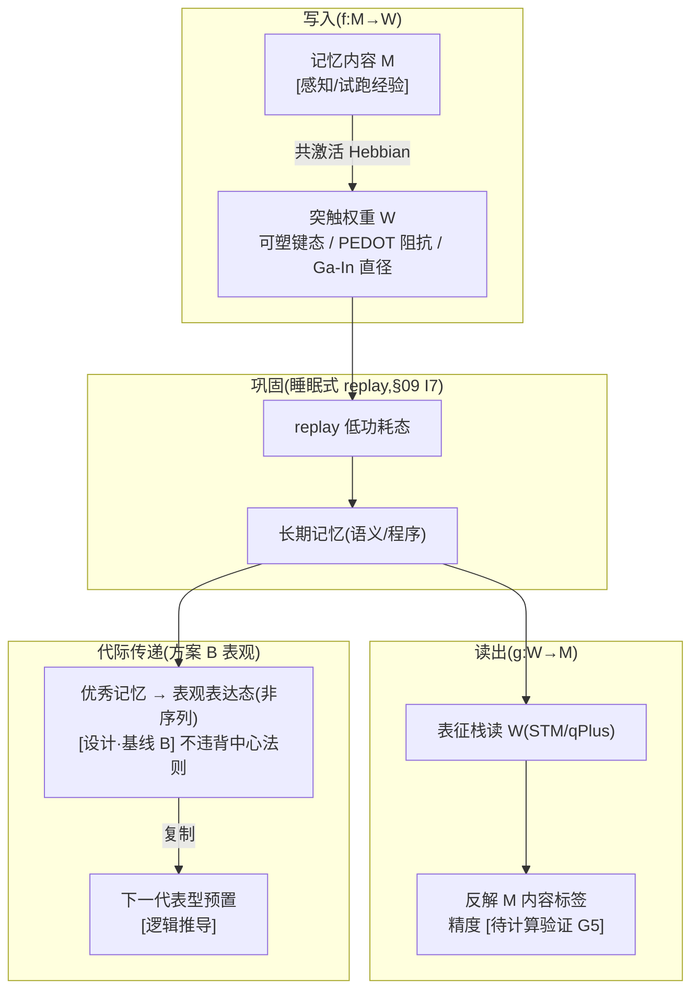

# 07 · 记忆系统(原则 9)

| 文档项 | 内容 |
| --- | --- |
| 模块 | 记忆系统：分层结构与显化突触表征 |
| 文档类型 | 设计报告（中文版） |
| 版本 | v4.1 |
| 依赖 | 05 突触结构、01 代际传递、03 供能、09 巩固机制 |
| 语言 | 简体中文（英文版见 `../en-US/`） |

> **依据类别**：`[引用:…]` 文献或数据；`[设计决策]` 项目设定；`[逻辑推导]` 由已列前提导出；`[待验证]` 未经验证的占位项。

---

## 0. 设计方案比选

> 设计问题：关键问题为 **代际经验的传递方式**(烧回 DNA 序列 / 表观表达态 / 不跨代),以及"突触→记忆"映射。三类方案分别给出"实现 + 依据 + 可行性"。
> - **方案 A(概念方案，保留当前 = 原选项 A)**:代际**拉马克式烧录**——优秀记忆直接写回 01 DNA 可变区序列(命中"经验直接遗传")
> - **方案 B(基于项目文献库 = 原选项 B，选定方案）**:代际**表型可塑性跨代表观**——不写序列，写表达调控(表观标记/蛋白构象态),下一代"预置倾向"非"记忆"
> - **方案 C(基于公开研究实践，含外部调研 + 原选项 C)**:① RNAi 跨代表观(世界最干净"获得性性状跨代"实证)② 纯 Darwin(经验不跨代，靠选择)
> 关键选择见 §3.3 + 关键假设与设计决策附录 T2。

### 0.1 方案 A：概念方案(拉马克式烧录，基线方案）

| 机制 | 具体做法 |
| ------ | --------- |
| 分层 | 工作/情景/语义/程序 四层，碳基参照 |
| 物理基底 | 突触权重(可塑键态 / PEDOT 阻抗 / Ga-In 直径) |
| 巩固 | 睡眠式 replay(§09 I7,低功耗态) |
| 代际 | 优秀记忆烧回 01 DNA 可变区序列 |

**依据与说明（按上表行序）**

1. **分层** — [引用:`07/Cognitive_Algorithms_Episodic_Semantic_Memory_arXiv2602.07261`, §分层记忆架构, "2026 认知算法：情景/语义记忆架构"]、`07/Semantic_Episodic_Memories_Predictive_Coding_Neocortex_arXiv2509.01987`, §预测编码新皮层, "2025 语义/情景记忆预测编码新皮层"]
2. **物理基底** — [引用:05 PEDOT/Ga-In 实测]
3. **巩固** — [引用:`07/Rasch_Born_2013`, §睡眠与记忆巩固, "Rasch & Born 2013 Physiol Rev:睡眠巩固记忆(慢波/纺锤波)"]、`09/VyazovskiyHarris_2013`, §慢波睡眠神经元休整, "Vyazovskiy & Harris 2013 Nat Rev Neurosci:慢波睡眠神经元休整"]
4. **代际** — [设计决策];"跨代遗传获得性经验" 违背中心法则 [待计算与实验验证，关键]

**可行性 + 风险**:命中"个体经验直接遗传"直觉，但**无跨代表观路径，违背中心法则**——关键假设，世界没做到。[设计决策]

### 0.2 方案 B：基于项目文献库(表型可塑性跨代，选定方案）

| 机制 | 文献范式 |
| ------ | --------- |
| 代际 = 表达调控 | 不写序列，写表达/表观态(甲基化类比 / 蛋白构象态),下一代"预置倾向" |
| 巩固/防遗忘 | 双时程 + 耦合神经场 replay |

**依据与说明（按上表行序）**

1. **代际 = 表达调控** — [引用:`01/Duffy_2020_BMC_Biol_XNA_replication_evolution_review`, §XNA 复制/进化+表观调控, "Duffy 2020 XNA 复制/进化+表观调控是成熟方向"];科学上不违背中心法则
2. **巩固/防遗忘** — [引用:`07/Dual_Timescale_Memory_Spiking_Neuron_Astrocyte_arXiv2604.15391`, §双时程记忆, "2026 脉冲神经元+星形胶质细胞双时程记忆"]、`07/BlumMoyse_2024`, §耦合神经场 replay, "Blum & Möysés 2024 耦合神经场 replay 巩固"]

**要点**:把"记忆烧录"降到"**表型预置**",科学站得住，保留"经验传递"直觉又不碰序列。

### 0.3 方案 C：基于公开研究实践(RNAi 跨代实证 + Darwin 替代， DOI)

> 待验证 · **本节依据为公开文献调研结果，与本项目设计主张相区分。**

| 外部范式 | 可搬进 07 的机制 |
| --------- | ---------------- |
| RNAi 跨代表观记忆 | "表达态跨代" 实证(不违背中心法则，选项 B 天花板) |
| 表观时钟/甲基化重编程 | 代际"环境经验→后代表型" 的成熟通道(比序列烧录温和可逆) |
| 纯 Darwin + 快速学习 | 经验不跨代，靠选择压收敛(选项 C 天花板,`10/EvoJAX`/`10/Cicirello_2024`) |

**依据与说明（按上表行序）**

1. **RNAi 跨代表观记忆** — [引用:`07/B_EPIGENETIC_TRANSGEN_2026-09-15.md`, §RNAi 跨代表观, "E1 Houri-Zeevi2020 Cell/E2 Rechavi2017 CurrBiol/E3 Grentzinger2012 GenomeRes/E4 Lang-Mladek2010 MolPlant/E5 Fitz-James2025 OpenBiol,小RNA跨代实证"] E1 Houri-Zeevi 2020 Cell 小 RNA 跨代 3 原则(OA,全文 .txt 存库,>20000 谱系)、E2 Rechavi & Lev 2017 Curr Biol 机制综述(OA,173 引，摘要已核实)、E3 Grentzinger 2012 Genome Res Drosophila piRNA 跨代(OA,全文 .txt 存库)、E4 Lang-Mladek 2010 Mol Plant Arabidopsis 表观沉默跨数代(OA,全文 .txt 存库)、E5 Fitz-James 2025 Open Biol Polycomb/H3K27me3 TEI 独立于小 RNA(OA,全文 .txt 存库)]
2. **表观时钟/甲基化重编程** — [引用:同上文献库, §表观时钟, "F1 Horvath2013 经典表观时钟(353CpG)/F2 Jiang&Guo2020 甲基化时钟综述，"] F1 Horvath 2013 Genome Biol 经典表观时钟(OA,8000 样本 + 51 组织 + 353 CpG + 癌组织年龄加速 36 年，数值全读回可引)、F2 Jiang & Guo 2020 Stem Cells Int 甲基化时钟综述(OA,全文 .txt 存库,57 引)]
3. **纯 Darwin + 快速学习** — [引用:10 文献库中 RL/进化(已核实)]

### 0.4 方案组合与基线配置

| 策略 | 内容 | 适合 |
| ------ | ------ | ------ |
| **A. 纯方案 A** | 拉马克烧回序列(保留当前基线) | 命中直觉，可行性最低，违背中心法则 |
| **B. 方案 B（选定方案）** | 代际 = 表型可塑性跨代表观(不写序列写表达) | 保留经验传递直觉 + 科学站得住 |
| **C. 方案 C Darwin 底层约束** | 经验不跨代，只靠选择 | 最保守 |

> **基线方案 = B**(表型可塑性跨代，既保留"经验传递"直觉又不违背中心法则，有文献支撑 `01/Duffy_2020`)——对应 §3.3 原选项 B + 关键假设与设计决策附录 T2。**该选择属于设计立场，经设计评审确认**。

### 0.5 记忆流结构详解（文字说明）

> **本节为 §3 图 3-1 的文字说明**:不依赖图示，逐层说明"硅基个体的记忆流到底是什么、在哪写入/巩固/读出/代际、显化突触怎么承载"。基于**方案 B(分层 + 显化突触 + 巩固 replay + 代际表观)**。

**轴 1:记忆流的 4 段(从写入到代际,"记忆从哪来、到哪去")**

| 段 | 是什么 | 干什么 |
| ---- | -------- | -------- |
| **段1 写入(WRITE)** | 记忆内容 M(感知/试跑经验)→ 触发一组突触权重变化(可塑键态迁移 / PEDOT 阻抗 / Ga-In 直径) | 把"记住了 M"落到物理突触态上(共激活 Hebbian) |
| **段2 巩固(CONSOLIDATE)** | 睡眠式 replay(§09 I7,低功耗态)+ 双时程系统巩固 | 短期记忆(工作/情景)稳定成长期(语义/程序);防遗忘 |
| **段3 读出(READ)** | 表征栈(STM/qPlus 测键态、SET 测电荷分布)反解 W → M 内容标签 | 让"记住了什么"可被读出、可表征、可验证(原则 9 核心) |
| **段4 代际(GENERATE)** | 优秀记忆 → 表观表达态(非序列)(方案 B,不写 DNA 序列)→ 复制 → 下一代表型预置 | 让"经验"代际传递(保留"经验传递"直觉，科学站得住) |

**依据与说明（按上表行序）**

1. **段1 写入(WRITE)** — 写入机制 [引用:`05/Hebbian_2023_Fast_Hebbian_Platicity_Working_Memory`];"共激活 Hebbian" [逻辑推导:Hebbian 学习规则]
2. **段2 巩固(CONSOLIDATE)** — replay [引用:`07/Rasch_Born_2013`(SWS 系统巩固)+ `09/VyazovskiyHarris_2013`(慢波细胞休整)];双时程 [引用:`07/Dual_Timescale_Memory_Spiking_Neuron_Astrocyte_arXiv2604.15391`]
3. **段3 读出(READ)** — 表征栈 [引用:02 §2.4];"读 W → 反解 M" [逻辑推导:f(M) 的逆 + 02 表征]
4. **段4 代际(GENERATE)** — 表观跨代 [引用:`01/Duffy_2020_BMC_Biol_XNA_replication_evolution_review`(XNA 复制/进化 + 表观调控)];"预置倾向非记忆" [设计·基线 B]

**段与段的关系(图里自左而右的记忆流链)**:
```
段1 写入(M → 突触态 W) → 段2 巩固(replay + 双时程,短期 → 长期)
     → 段3 读出(表征栈反解 W → M) → 段4 代际(表观表达态,复制 → 下一代表型)
```
→ **"记忆"不是独立的东西，它 = 段1 的突触键态(W);要记住靠段1(共激活写入),要稳定靠段2(replay 巩固),要知道"记住了什么"靠段3(表征反解),要传下去靠段4(表观跨代)。** 这条链就是"硅基个体一条记忆流长什么样"。

**轴 2:三条机制线(穿过 4 段,"怎么存/怎么防遗忘/怎么传")**

| 机制 | 穿过哪段 | 做什么 | 依据性质 |
| ------ | --------- | -------- | --------- |
| **存(STORE)** | 段1/段3 | 突触权重 = 记忆物理基底(05 PEDOT/Ga-In 承载 07 记忆);"显化" = 可读出、可表征、可验证(原则 9) | 突触基底 [引用:05 PEDOT/Ga-In 实测];"显化" = 表征栈可读 [引用:02 §2.4] |
| **防遗忘(FORGOT)** | 段2 | 睡眠式 replay(防灾难性遗忘)+ 双时程(快慢通道分离);replay 时低功耗，付 03 能量币 | replay [引用:`07/Sleep_Inspired_Replay_Prevents_Catastrophic_Forgetting_arXiv2606.08447`];低功耗付能 [引用:03 A2 序] |
| **传(GENERATE)** | 段4 | 代际表观表达态(方案 B,不写序列);经 01 ECC 校验(保真度窗口),否则"代际记忆失真" | 表观跨代 [引用:01/Duffy_2020 + `01/ECC`(保真度窗口)];ECC 校验 [引用:01 §4 Fountain 码] |

**"存/防遗忘/传"的"固定（不可演化） + 动态"关系**(为什么这套设计能"既记住又不丢"):
- **段1 突触基底 = 物理事实**(05 PEDOT/Ga-In 实测，固定（不可演化）);
- **段2 replay 巩固 = 机制固定（不可演化）**(睡眠式 replay + 双时程，不可演化掉);"巩固速率/时标" = 动态(原则 15 时标映射);
- **段4 代际"表观 vs 拉马克" = 立场三选一**(T2 A/B/C,由设计评审确定);"传多少" = 动态(经 ECC 保真度)。
- **这个"固定（不可演化）机制 + 动态数值 + 立场选一"的分法，正是原则 9(记忆必须显化突触结构)+ 原则 15(时标映射)+ 07 T2(代际立场 A/B/C)的对应落点** [逻辑推导：三条原则分别落到段1/段2/段4]。

**要点归纳**
> **硅基个体的一条记忆流 = 段1 写入(M → 突触态 W,共激活 Hebbian)+ 段2 巩固(睡眠式 replay + 双时程，短期 → 长期)+ 段3 读出(表征栈反解 W → M)+ 段4 代际(表观表达态，复制 → 下一代表型，经 ECC 保真)。记忆物理可见(02 表征栈)、可表征(读 W 反解 M)、可传递(代际表观，方案 B)——这就是"显化突触结构"的具体形式。**

---

## 1. 设计目标
参照碳基记忆分层(工作/情景/语义/程序),设计硅基记忆,**且记忆必须显化在突触结构上**(突触权重 = 可塑键态 / PEDOT 阻抗 / Ga-In 微通道直径),使"记住了什么"可被读出、表征、下一代表现。不是黑箱存储。

---

## 2. 相关研究现状 + 不同实现方式(原则 2)

| 路线 | 现状 | 文献锚点 | 取舍 |
| ------ | ------ | --------- | ------ |
| **碳基记忆分层(工作/情景/语义)** | 有 | `07/Cognitive_Algorithms_Episodic_Semantic_Memory_arXiv2602.07261.pdf`、`07/Semantic_Episodic_Memories_Predictive_Coding_Neocortex_arXiv2509.01987.pdf` | 已核实 · 分层参照 |
| **可塑性基底(LTP/LTD)** | 有 | `07/Fluctuation_Background_Synaptic_Activity_Controls_Plasticity_arXiv2108.05827.pdf` | 已核实 · 突触 = 记忆物理基底 |
| **巩固(系统巩固 + 双时程)** | 有 | `07/BlumMoyse_2024_Coupled_Neural_Field_Memory_Consolidation_arXiv2404.pdf`、`07/Dual_Timescale_Memory_Spiking_Neuron_Astrocyte_arXiv2604.15391.pdf` | 已核实 · 短期→长期 |
| **睡眠式 replay(防遗忘)** | 有 | 见依据 1 | 已核实 · 巩固机制 |

**单元格依据详文**

1. **睡眠式 replay(防遗忘) · 文献锚点** — `07/Sleep_Inspired_Replay_Prevents_Catastrophic_Forgetting_arXiv2606.08447.pdf`、`07/Rasch_Born_2013_About_Sleeps_Role_in_Memory_PhysiolRev_PMC3768102_FULLTEXT.txt`

**选型结论**:分层用碳基参照(工作/情景/语义/程序),**物理基底 = 硅基突触(§05 PEDOT/Ga-In)**,巩固 = "睡眠式 replay"(§09 I7)。

---

## 3. 设计(v3)

**图 3-1:记忆流 = 写入(f 突触)→ 巩固(replay)→ 读出(g 表征)→ 代际传递(方案 B 表观)**



> 说明：写入、巩固与提取构成记忆主路径，重放为巩固支路；跨代传递不改变序列信息。

> **图例说明**:写入(f:M→W,共激活 Hebbian)→ 巩固(睡眠式 replay,低功耗态)→ 读出(g:W→M,表征栈反解)→ 代际传递(方案 B 表观表达态，不写序列)。记忆物理可见(§02 表征栈)、可表征(读 W 反解 M)、可传递(代际)。

### 3.1 记忆分层(参照碳基)

| 层 | 碳基 | 硅基落实 | 时标(原则 15) |
| ------ | ------ | --------- | --------------- |
| **工作记忆**(短时) | 前额叶维持 | 可塑键态(05 神经层，短期 Hebbian,`Hebbian_2023`) | ~秒(硅基) |
| **情景记忆**(事件) | 海马 | 突触权重组(PEDOT 阻抗 + Ga-In 直径，事件痕迹) | ~分钟-小时 |
| **语义记忆**(事实) | 颞叶 | 稳定突触簇(慢变量，长期) | ~小时-天 |
| **程序记忆**(技能) | 基底核/小脑 | CPG/反射回路固化(§09 I0b/I0c) | ~代际 |

### 3.2 显化突触结构(原则 9 核心,"突触权重 → 记忆"映射函数)

**关键：记忆不是"存进存储区",是落在具体突触物理量上，可读出/表征/传递。**

```
突触权重 W(物理量)  ⟷  记忆内容 M(被记住的)

  W = f(M):  记住了 M → 触发一组突触权重变化(可塑键态迁移 / PEDOT 阻抗 / Ga-In 直径)
  M = g(W):  读突触权重 → 反解出"记住了什么"(表征)

  三层映射:
  · 情景:W(事件痕迹)→ 一组突触权重模式(PEDOT 阻抗分布)→ 可读"哪段经历"
  · 语义:W(事实)→ 稳定突触簇 → 可读"哪个事实"
  · 程序:W(技能)→ CPG/反射回路固化 → 可读"会做什么"
```

**"显化"含义**:
- 记忆**物理可见**(STM/qPlus 可读突触权重,§02 表征栈)→ 不是黑箱
- 记忆**可表征**(读 W → 反解 M)→ 知道"记住了什么"
- 记忆**可传递**(代际烧录,§3.3)

**待实验验证**:映射函数 `f(M)` / `g(W)` 的具体形式(§5 G1)。

### 3.3 巩固 + 代际传递(表型可塑性跨代表观,T2 确定 B)

```
短期记忆(工作/情景)
   ↓ 睡眠式 replay(§09 I7,低功耗态期间)
长期记忆(情景→语义/程序,系统巩固,BlumMoyse_2024)
   ↓ 代际(方案 B 复制时)
优秀记忆烧录回 01 DNA **记忆固化区(表观区,01 §7,非序列级写回,不违背中心法则;T2 确定 B 表型可塑性跨代)**
   → 下一代表现相同/相似经验
```

**防遗忘**:`Sleep_Inspired_Replay_2026`(睡眠式 replay 防灾难性遗忘)+ 双时程(`Dual_Timescale_2024`)

**代际保真度**:记忆烧录回 **01 记忆固化区(表观区,ε_copy 刻意低保真)** 时,**经 §01 ECC 校验**(保真度窗口),否则代际"记忆失真"。(2026-09-16 合理性一致性核验：区段名对齐 01 §7"记忆固化区(表观区)",与"可变区(达尔文高错配)"分区,ε_copy 反向；原"拉马克式烧录可变区序列"旧措辞已清。)

**待验证 · 关键假设 + 替代路径选择空间(一致性核验（2026-09-14）：设计立场经设计评审确认)**:

> **关键假设**:"优秀记忆烧录回 DNA 可变区(拉马克式)"——**违背中心法则**,跨代遗传"获得性经验"无实现路径，是 C 类(碳基机制迁移至硅基载体)最重的一条。当前写成像可用特征，实为关键假设。
> **选择空间(三选一，文献库中已有真实文献 `01/Duffy_2020_BMC_Biol_XNA_replication_evolution_review` 覆盖 XNA 复制/进化)**:

| 选项 | 机制 | 可行性 | 与"中心法则"关系 | 说明 |
| ------ | ------ | -------- | ---------------- | ------ |
| **A. 保留拉马克式烧录(当前基线)** | 获得性记忆直接写回 DNA 可变区 | 最低(无跨代表观路径) | ❌ 违背 | 可行性未经验证最强，但命中"个体经验直接遗传" |
| **B. 软化为"表型可塑性跨代表观"**(科学化替代) | 不写序列，写表达调控(甲基化/表观标记/蛋白构象态),下一代"预置倾向"而非"记忆" | 中(表观遗传跨代在碳基有实证,`01/Duffy_2020` XNA 进化 + 表观调控是成熟方向) | 已核实 · 不违背中心法则(不改序列，改表达) | 把"记忆烧录"降到"表型预置",科学上站得住 |
| **C. 彻底走 Darwin 路线(砍掉拉马克)** | 记忆不跨代，只靠选择(适应度筛选代际,§10);经验不遗传，靠"重新学 + 快速试错" | 最高(无跨代机制) | 已核实 · 完全合规 | 最保守，放弃"代际经验继承" |

> **基线 = B(表型可塑性跨代，既保留"经验传递"直觉又不违背中心法则，有文献支撑);A 命中"拉马克"直觉但可行性最低;C 最保守。该选择属于设计立场，经设计评审确认。**

**公开研究实践参照**:

> 现有公开研究中"跨代传递经验/表型"做得最好的做法——**给 T2 各选项的参照上限**,不替代 A/B/C 选择。

| 领域公开实践 | 做法 | 参照价值 | 对 T2 对应方案 | 状态 |
| ------------- | ------ | ------------- | ------------------ | ------ |
| **RNA 干扰跨代表观记忆(表观,2020+)**(如 `C. elegans` RdR2 依赖的 RNAi 跨代) | 亲代被 dsRNA 诱导沉默，后代不靠 DNA 序列改变而继承沉默态(表观标记),数代后衰减 | 世界最干净的"获得性性状跨代"实证，不违背中心法则，机制清晰(RdRP 生成 tRNAi → 表观标记) | 选项 B 的参照上限——证明"表型可塑性跨代"科学上完全成立，硅基可类比做"表达态跨代" | 待补充检索 |
| **表观遗传时钟/甲基化重编程** | 代际间 DNA 甲基化模式可被环境改写并部分遗传，是"环境经验→后代表型"的主流通道 | 跨代表型传递的成熟度较高的通道，比"序列烧录"温和且可逆 | B 的更细机制 | 待补充检索 |
| **纯 Darwin 选择 + 快速学习(无跨代经验)** | 不继承经验，每代从 0 学，靠选择压收敛(强化学习 + 进化外循环) | 最保守但最稳，现有很多 RL 工作即此路径 | 选项 C 的参照上限 | 已核实 · 文献库中 RL/进化类(`10/EvoJAX`、`10/Cicirello_2024`) |

### 3.3a 映射函数 f(M)/g(W) 的可推部分(G1 细化，原则 24)

> **原则 24 边界**:以下给出**可推的函数*结构*与碳基参照值**;具体**数值系数**一律标"设计设定/DFT",不臆断。

**f(M) 写入方向(记忆 → 突触权重),三层的可推形式**:

| 层 | 物理载体 | f(M) 结构(可推) | 数值/系数 | 依据 |
| ---- | --------- | ----------------- | ---------- | ------ |
| 情景 | PEDOT 阻抗分布 | 事件 M 触发一组突触的共激活 → 阻抗 `ΔR ∝ 共激活次数 × 强度`(Hebbian 式,`05/Hebbian_2023`) | 系数设计设定 | `05/Hebbian_2023_Fast_Hebbian_Platicity_Working_Memory` |
| 语义 | 稳定突触簇 | 反复 M → 长时程 LTP(突触直径/键态迁移,慢通道) | 慢通道时标待计算验证 | `05/Moreno_2024` + Ga-In 直径突触(`05`) |
| 程序 | CPG/反射回路 | 技能 M → 回路增益固化(I0 回路增益上调,`09`) | 增益上限设计设定 | `09/Neuromorphic_Spiking_CPG_arXiv2101.09709` |

**g(W) 读出方向(突触权重 → 记忆表征)**:
- **可推**:g 是 f 的**反解 + 表征读出**——用 §02 表征栈(STM/qPlus 测突触键态、SET 测电荷分布)读 W,按 f 的逆关系映射回 M 的内容标签。
- **精度(G5)**:取决于 W 的**信噪比**(突触态离散度 vs 读出误差),**数值无实测，待计算验证 + 实验**(原则 24 不臆断)。
- **碳基参照**:碳基"重放"(replay)时突触权重读出有噪声,`07/BlumMoyse_2024` 用**耦合神经场**做系统巩固降低读出误差——硅基 g(W) 借鉴此**机制**,数值系数待定。

**容量(G2)可推上限**:各层容量 = 突触数 × 每突触可分辨态数(如 4 进制 = 2 bit/突触,`01` 载体)。突触数 = 结构规模(`05` 神经层),**具体态数受 §02 表征精度限制**,待实验验证。

> **边界说明**:`f/g` 的**函数*形状*可定(共激活 Hebbian + 慢通道 + 回路固化 + 表征反解),但每个系数/时标/态数都是"设计设定 + 待计算验证"——本层只定结构，数值留给实验(原则 1/3)。

### 3.4 记忆时标(原则 15,黑猩猩基准)

- 工作记忆 ~秒(`设计设定`)→ 硅基 ~ms
- 情景巩固 ~数小时(碳基类睡眠周期,`07/Rasch_Born_2013_About_Sleeps_Role_in_Memory_PhysiolRev_PMC3768102` 证 SWS 系统巩固 + replay 机制 待验证 · 节选摘要,SWS 具体睡眠阶段时长核到该文明确值再锁)→ 硅基 ~10 秒(映射项目设定的)
- 语义/程序 ~天-代际(原则 15 映射)→ 硅基 ~小时-代际

> **G3 巩固速率碳基参照(补抓落地，原则 24)**:睡眠依赖巩固的碳基机制挂**两篇真文献**:
> - **机制**:`07/Rasch_Born_2013`(SWS 慢波睡眠 + hippocampal replay 的系统巩固,Physiol Rev 2013)
> - **神经元休整**:`09/VyazovskiyHarris_2013`(慢波振荡驱动的"prophylactic cell rest",Nat Rev Neurosci 2013,全文 111KB)
> - **碳基参照值**:睡眠巩固 = **数小时**(成人 SWS 占 6-8h 睡眠的 ~20-25%,`碳基参照`,不能迁移至硅基载体);硅基巩固时标 = 碳基数 × 压缩比(项目设定的),**具体速率数值待核到原文明确值再锁**(原则 24,节选摘要不足以锁数)。

---

## 4. 与其他部分的关系(接口契约，全维度)

> **完整性原则**:07 是"记住了什么"的载体，是 **05 突触基底 / 06 试跑素材 / 10 代际适应度** 的节点——必须与每个维度建联系(缺一项 = 文档不完整)。

**图 4-1:07(记忆系统)与全部 12 册的联系总览**

```mermaid
graph LR
    M["07 记忆系统<br/>(分层+显化突触+代际)"]
    M <-->|组织闭合的记忆侧| P00["00 哲学(A1)"]
    M <-->|代际传递写进 01 记忆固化区(表观区,01 §7)| D01["01 DNA"]
    M <-->|表征栈读突触(STM/qPlus)| M02["02 材料"]
    M <-->|巩固/replay 低功耗态付能量币| E03["03 能量"]
    M -->|记忆归属个体,个体间隔离| I04["04 个体性"]
    M <-->|突触权重 = 记忆物理基底| N05["05 神经"]
    M <-->|试跑素材 = 长期记忆调用| WM06["06 世界模型"]
    M -->|记忆为 08 推理提供事实| L08["08 逻辑"]
    M <-->|I7 睡眠/巩固回路| I0_09["09 本能"]
    M <-->|代际经验 = 适应度输入| EV10["10 演化"]
    M -->|5 回路 学习/巩固 的节点| INT11["11 整合"]

    classDef core fill:transparent,stroke:currentColor,stroke-width:2.2px,color:currentColor
    classDef node fill:transparent,stroke:currentColor,stroke-width:1.2px,color:currentColor
    class M core
    class P00,D01,M02,E03,I04,N05,WM06,L08,I0_09,EV10,INT11 node
```

> 说明：箭头起点为供值方，终点为接收方；跨分册接口的可测量量由各分册接口契约定义。

| 接口 | 数据流(物理量/信息，非概念) | 不变量(可测) | 依据性质 |
| ------ | --------------------------- | ------------- | --------- |
| **↔ 00 哲学** | 记忆维持 = A1 组织闭合的信息侧(记住个体自身) | 记忆层支撑闭合 | [引用:00 A1] |
| **↔ 01 DNA** | 代际传递写进 01 记忆固化区(表观区,01 §7,ε_copy 刻意低保真；非"可变区"——可变区是达尔文高错配素材，与表观区 ε_copy 反向),经 ECC | 代际保真度 [待计算验证 G4] | [引用:01 ECC + 01 §7 记忆固化区] |
| **↔ 02 材料** | 表征栈读突触(STM/qPlus 测键态、SET 测电荷分布) | 表征精度 [待验证] | [引用:02 表征栈] |
| **↔ 03 能量** | 巩固/replay 低功耗态付能量币(03 分配：学习挂 03) | replay 周期能耗 [待计算验证:03] | [引用:03 A2 序] |
| **→ 04 个体性** | 记忆归属个体，个体间隔离(群落只换局部信息) | 记忆隔离 [设计] | [逻辑推导:04 + 原则 18] |
| **↔ 05 神经** | 突触权重 = 记忆物理基底(05 PEDOT/Ga-In 承载 07 记忆) | 突触保真度/寿命 [待验证] | [引用:05 神经层] |
| **↔ 06 世界模型** | 试跑素材 = 07 长期记忆调用 | 调用命中 [待验证] | [逻辑推导:06 挂 07] |
| **→ 08 逻辑** | 记忆为 08 推理提供事实前提 | 事实调用 [设计] | [逻辑推导:08 推演] |
| **↔ 09 本能** | I7 睡眠/巩固回路(低功耗态触发 replay) | replay 触发条件 [待验证] | [引用:09 I7] |
| **↔ 10 演化** | 代际经验 = 适应度输入(方案 B 表型预置喂 10) | 代际倾向输入 [待验证] | [引用:10 适应度] |
| **→ 11 整合** | 5 回路 学习/巩固 的节点 | 回路闭合需 07 可运行 | [引用:11 §5 回路] |

**契约原则**:接口"数据"必须是**可物理/可信息测量量**(突触保真度/表征精度/replay 能耗/代际保真度),不是概念；未给实测值的标"数值待 07/其他分册 DFT"。

**依据性质(§4)**:
- A1 记忆侧 → 00 [引用:00]
- 代际 → 01 [引用:01 ECC + 方案 B]
- 表征 → 02 / 耗能 → 03 [引用:02 表征栈 + 03 A2]
- 隔离 → 04 [逻辑推导：原则 18]
- 突触基底 ↔ 05 / 试跑素材 ↔ 06 / 事实 → 08 [引用/逻辑推导]
- I7 ↔ 09 / 适应度 ↔ 10 [引用:09 I7 + 10]
- 回路 → 11 [引用:11 §5]

---

## 5. 待实验验证 / DFT(每项：公式 + 窗口 + 供值方，附量化条件)

| # | 开放项 | 要满足的公式/不等式 | 参数窗口(设计设定) | 值由谁给 |
| --- | -------- | --------------------- | -------------------- | ---------- |
| G1 | 突触权重 → 记忆的映射函数 f(M)/g(W) | f(M):共激活次数 × 强度 → ΔR(Hebbian);g(W):表征反解 M,信噪比 SNR ≥ 可辨识阈值 | 系数/时标/态数 [设计设定 + 待计算验证];SNR 阈值 [待计算验证:02 表征] | 07 DFT + 02 表征(硅基突触共激活曲线 + 表征精度) |
| G2 | 各层容量(情景/语义/程序突触数) | 容量 = 突触数 × 每突触可分辨态数(4 进制 = 2 bit/突触);突触数 = 结构规模(05 神经层) | 态数受 §02 表征精度限制 [待验证];突触数 [待计算验证:05] | 05 + 02 协同(突触数 × 态数 = 容量) |
| G3 | 巩固速率(短期→长期，睡眠 replay 周期) | replay 周期 T_rep + 巩固效率 η(短期 → 长期转化率) | 碳基参照:SWS 占 6-8h 睡眠的 20-25%(碳基,`07/Rasch_Born_2013` 节选，不迁移至硅基载体);硅基 T_rep/η [待核到原文明确值再锁] | 07 实验(硅基 replay 周期 + 巩固效率实测) |
| G4 | 代际烧录保真度(记忆 → DNA 可变区/表观区) | 烧录保真度 ε_mem ∈ 01 ECC 窗口(§01 §3.2:N ≤ C_临界/ε);经 Fountain 校验 | ε_mem 目标 [设计：走 01 ECC 窗口];代际表观区 [方案 B] | 01 ECC + 07 实验(代际表观区保真度) |
| G5 | 记忆读出的表征精度(g(W) 反解) | 信噪比 SNR ≥ 3σ(可辨识);g(W) 反解误差 ε_read | 02 表征栈 σ [待计算验证:02];ε_read [待验证] | 02 表征 + 07 DFT |

**说明**:G1-G5 每项都给了"**要算什么 + 阈值/窗口 + 供值方**";f(M)/g(W) 的**函数形状**已在 §3.3a 定(共激活 Hebbian + 慢通道 + 回路固化 + 表征反解),**数值系数/时标/态数全部待 02/05/07 第一性原理计算与实验**;碳基巩固速率是"碳基参照，不迁移至硅基载体"。

---

## 10. 适用边界与已知限制(原则 24)

- **可确定内容（本文已给出）**:§0.5 记忆流 4 段(写入/巩固/读出/代际)+ 机制线 3 条(存/防遗忘/传)结构、§2 分层参照(碳基工作/情景/语义/程序)+ 选型结论、§3.1 四层记忆 + 时标映射、§3.2 显化突触映射函数 f(M)/g(W)、§3.3a 函数结构 + 碳基参照、§3.3 T2 立场 A/B/C + 公开研究实践参照表、§4 全 12 册接口。
- **不可确定内容（仅给出公式与边界，占位项不作为基准值）**:G1 f(M)/g(W) 系数、G2 容量、G3 巩固速率、G4 代际保真度、G5 表征精度——**全部待 02/05/07 第一性原理计算与实验**,本文已写到"要算什么 + 供值方"的可开工程度。
- **关键假设(待设计评审确定)**:
  - **"优秀记忆烧回 01 DNA 可变区(方案 A,拉马克)"**——[设计决策],**违背中心法则**(跨代遗传"获得性经验"无实现路径，世界没做到),是 C 类最重的关键假设；关键假设已列示,**基线 B(表型可塑性跨代，有 `01/Duffy_2020` XNA 表观调控支撑，不违背中心法则)**。
  - **代际"经验传递"的"跨代"命题**——若选 C(纯 Darwin,经验不跨代),07 §3.3 整段"代际传递"降级为"代际重学";这是立场选择，待设计评审确定。

---
