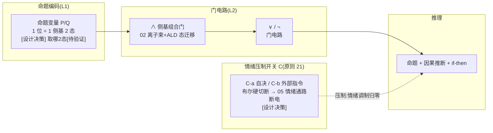
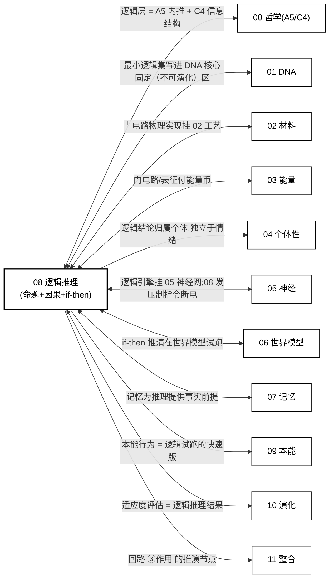

# 08 · 逻辑推理(原则 10)

| 文档项 | 内容 |
| --- | --- |
| 模块 | 逻辑推理：命题推理、因果推断与条件推演 |
| 文档类型 | 设计报告（中文版） |
| 版本 | v4.1 |
| 依赖 | 05 神经实现、06 世界模型、01 最小逻辑集 |
| 语言 | 简体中文（英文版见 `../en-US/`） |

> **依据类别**：`[引用:…]` 文献或数据；`[设计决策]` 项目设定；`[逻辑推导]` 由已列前提导出；`[待验证]` 未经验证的占位项。

---

## 0. 设计方案比选

> 设计问题：关键问题为 **布尔门的物理实现方式**(侧基键态 / 忆阻器器件 / DNA 链置换)。三类方案分别给出"实现 + 依据 + 可行性"。
> - **方案 A(概念方案，保留当前 = 原选项 A)**:软凝胶**侧基键态迁移 + 离子束/ALD 逐位驱动**当布尔门(最符 P1,关键最重)
> - **方案 B(基于项目文献库 = 原选项 B)**:**忆阻器/神经形态门**(器件级已有实验，存内兼算,`08/NEXUS_2026` ANN↔SNN 等价 + `05/Khacef_2022` 脉冲可塑)
> - **方案 C(基于公开研究实践，含外部调研 + 原选项 C)**:① 忆阻器神经形态逻辑门(存内兼算，避开逐位驱动)② DNA 链置换门(分子级无布线,`05/Qianlab_2011`)③ 自旋交叉开关(硅半导体近亲)
> 关键选择见 §3.1 + 关键假设与设计决策附录 T1。

### 0.1 方案 A：概念方案(侧基键态门，基线方案）

| 环节 | 具体做法 | 依据性质 |
| ------ | --------- | --------- |
| 命题编码 | 1 布尔位 → 1 侧基 2 高对比态(Si-O 真 / Si-C 假) | [设计决策];"取哪 2 态" 依赖 02 侧基电学实测 [待验证] |
| 门电路 | 多缺陷簇侧基态迁移(离子束注入/退火 + ALD 驱动),逻辑功能由门内缺陷簇排布编码 | [逻辑推导：挂 02 工艺];门内键能/迁移阈值 [待计算与实验验证，关键] |
| 等价性参照 | 位精确 ANN↔SNN 门电路等价 | [引用:`08/NEXUS_2026_Neuromorphic_Gate_Circuits_arXiv2601.21279`, §ANN↔SNN 位精确等价, "NEXUS 2026 神经形态门电路 ANN↔SNN 位精确等价"] |

**可行性 + 风险**:"软凝胶里逐位驱动键态迁移当门"**无可行性路径、无 DFT**——是 C 类(碳基机制迁移至硅基载体)最重的一条，关键假设。[设计决策]

### 0.2 方案 B：基于项目文献库(忆阻器/神经形态门，用于降低实施风险)

| 环节 | 文献范式 | 依据性质 |
| ------ | --------- | --------- |
| 门电路 = 器件态 | 忆阻器电阻态迁移当门，存内兼算(已有实验) | [引用:`08/NEXUS_2026`, §ANN↔SNN 位精确等价, "NEXUS 2026 ANN↔SNN 位精确等价，门电路可落器件态"];忆阻器专项 文献库中暂缺,`05/Khacef_2022`, §脉冲局部突触可塑综述, "Khacef 2022 脉冲可塑综述覆盖同类"] |
| 命题编码 | 布尔位 → 器件态(而非侧基键态) | [逻辑推导] |

**要点**:把门从"软凝胶键态"换到**有忆阻器实验支撑的器件**,可行性高，但器件是刚性/薄膜，与 P1 软载体有张力(需软忆阻基质)。

### 0.3 方案 C：基于公开研究实践( DOI + DNA/自旋门)

> 待验证 · **本节依据为公开文献调研结果，与本项目设计主张相区分。**

| 外部范式 | 可搬进 08 的机制 |
| --------- | ---------------- |
| 忆阻器神经形态逻辑门 | 器件级"存内兼算",避开逐位驱动(选项 B 天花板) |
| DNA 链置换门 | 分子级无布线逻辑，天然贴软/水介质(选项 C 天花板) |
| 自旋交叉开关 | 磁性自旋态当 0/1,单电子隧穿门(可集成晶圆) |

**依据与说明（按上表行序）**

1. **忆阻器神经形态逻辑门** — [引用:`08/B_LOGIC_GATE_DEVICE_2026-09-15.md`, §器件级逻辑门, "G1 Shirinzadeh2018/G2 Kvatinsky2012/G3 Rashid arXiv/G4 Prezioso2013/G5 Shen2011 忆阻器存内兼算逻辑门"] G1 Shirinzadeh 2018 RRAM 存内兼算综合(BDD/DIG/MIG 表示 + 多行 crossbar)、G2 Kvatinsky 2012 MRL 忆阻器比例逻辑(XOR/NAND/NOR 电路级)、G3 Rashid arXiv 单忆阻器 4 类逻辑(arXiv OA,,NOT/AND/XOR/全加器)、G4 Prezioso 2013 磁性增强忆阻器通用门(BRONZE OA,单器件 = 通用门)、G5 Shen 2011 共享接触 RRAM 门(AND/OR)]
2. **DNA 链置换门** — [引用:`05/Qianlab_2011_DNA_Seeseesaw_Neural_Networks`, §DNA 链置换神经网络, "Qianlab 2011 DNA 链置换神经网络门"]、`05/teVrugt_2024_DNA_Neural_Networks`, §DNA 神经网, "teVrugt 2024 DNA 神经网门"]
3. **自旋交叉开关** — [引用:同上文献库, §自旋交叉开关, "S1 Miyamachi2012/S2 Huang2025 自旋交叉开关(全)"] S1 Miyamachi 2012 Nat Commun 自旋交叉 + 忆阻器单分子(494 引)、S2 Huang 2025 Nat Commun 电脉冲控单分子自旋开关(最新一手)]

### 0.4 方案组合与基线配置

| 策略 | 内容 | 适合 |
| ------ | ------ | ------ |
| **A. 纯方案 A** | 侧基键态门(保留当前基线) | 最符 P1,关键假设，暂不可操作 |
| **B. 方案 B 降风险(若以稳健性优先)** | 门改用忆阻器/神经形态器件,软忆阻基质补偿 P1 | 可行性高，妥协 P1 需软基质 |
| **C. 方案 C：DNA 门约束** | 门用 DNA 链置换(命中 05 DNA 神经网) | 最贴软载体，退碳基且慢 |

> **基线方案 = 维持 A(最符合 P1),但显性化关键风险**;若要降风险选 B(有实证器件),最贴软载体选 C。**该选择属于设计立场，经设计评审确认**(对应 关键假设与设计决策附录 T1)。

### 0.5 逻辑子系统结构详解（文字说明）

> **本节为 §3 图 3-1 的文字说明**:不依赖图示，逐层说明"硅基个体的逻辑子系统到底是什么、命题/门电路/推理/情绪压制怎么挂"。基于**方案 A(侧基键态门，最符 P1)+ B/C 底层约束**。

**轴 1:逻辑回路的 4 段(从命题到结论,"逻辑从哪来、到哪去")**

| 段 | 是什么 | 干什么 |
| ---- | -------- | -------- |
| **段1 命题编码(L1)** | 1 布尔位 → 1 侧基 2 高对比态(Si-O 真 / Si-C 假);`P→Q` 复合 = 多侧基串联 | 把命题/公式落到硅基侧基态上(1 位 1 侧基，字长 = 命题位宽) |
| **段2 门电路(L2)** | 多缺陷簇侧基态迁移(离子束注入/退火 + ALD 驱动),逻辑功能由门内缺陷簇排布编码 | 把"命题变量"合成逻辑结论(∧/∨/¬/→),存内兼算 |
| **段3 推理** | 命题逻辑(与/或/非 + 条件判断)+ 因果推断(离散表示)+ if-then 推演(在 06 世界模型里试跑) | 把"门电路合成"展开成推理链(Modus Ponens / 因果 / 试跑动作后果) |
| **段4 情绪压制开关 C** | C-a 个体自决 / C-b 外部指令 → 布尔硬切断 05 情绪通路 | 让逻辑结论独立于情绪状态(情绪 = 倾向权重，不是推理前提；压制 = 倾向归零) |

**依据与说明（按上表行序）**

1. **段1 命题编码(L1)** — 编码方案 [设计决策];"取哪 2 态" [待计算验证:02 表征];等价性 [引用:`08/NEXUS_2026`(ANN↔SNN 位精确)]
2. **段2 门电路(L2)** — 门电路方案 [逻辑推导：挂 02 工艺];门内键能/迁移阈值 [待计算与实验验证，关键];等价性 [引用:`08/NEXUS_2026`]
3. **段3 推理** — 命题逻辑 [逻辑推导：最小集，固定（不可演化）];因果 [引用:`08/Discrete_Causal_Representations_2026`, §离散因果表示, "2026 离散因果表示学习"]、`08/Closing_the_Loop_2018`, §闭环因果, "2018 闭环因果推断"];if-then 推演 [引用:06 世界模型]
4. **段4 情绪压制开关 C** — 压制机制 [引用:`05/Denny_2015`、`05/Dore_2017`(前额叶→杏仁核抑制)];"布尔硬切断=硅基优势" [设计决策]

**段与段的关系(图里自左而右的逻辑流链)**:
```
段1 命题编码(布尔位 → 侧基态) → 段2 门电路(∧∨¬→ 合成) → 段3 推理(命题 + 因果 + if-then)
     → 段4 情绪压制开关 C(布尔硬切断 05 情绪通路) → 逻辑结论(独立于情绪)
```
→ **"逻辑"不是独立的东西，它 = 段1 侧基态 + 段2 门电路 + 段3 推理链；要编码靠段1,要合成靠段2,要推理靠段3,要"不被情绪污染"靠段4(压制开关)。** 这条链就是"硅基个体一条逻辑回路长什么样"。

**轴 2:三条机制线(穿过 4 段,"怎么推/怎么压/怎么保")**

| 机制 | 穿过哪段 | 做什么 | 依据性质 |
| ------ | --------- | -------- | --------- |
| **推(REASON)** | 段2/段3 | 门电路合成 + 推理链展开(命题/因果/if-then);"能推理"是基础能力(原则 10,可采用最小实现不可省) | 推理 [逻辑推导：最小集固化于 01 DNA 核心区];因果 [引用:08 因果 2 篇] |
| **压(SUPPRESS)** | 段4 | 情绪通路 = 调制器;C-a/C-b 布尔硬切断 → 05 情绪归零；逻辑结论不受影响 | [引用:`05/Denny_2015`、`05/Dore_2017`];"布尔硬切断=硅基优势" [设计决策] |
| **保(GUARANTEE)** | 段1/段3 | 最小逻辑集(命题逻辑)固化于 01 DNA 核心区(类比 I0,不可演化掉);因果/if-then 可扩展 | [引用:01 核心区(公理区 ε_copy→0)];"固定（不可演化）" = 原则 10 基础能力 |

**"固定（不可演化） + 动态"关系**(为什么这套设计能"既推理又逻辑保底"):
- **最小逻辑集(段1/段3 命题逻辑)= 固定（不可演化）**(写进 01 DNA 核心区，类比 I0,不可演化掉，原则 10);
- **因果/if-then 深度 = 动态**(可扩展，越推越深，但付 03 能耗);
- **情绪压制 = 固定（不可演化）可触发**(C-a/C-b 双来源，布尔硬切断,**"可压制"这条不可演化**,原则 21);情绪的"强度" = 动态(05 段5)。
- **这个"固定（不可演化）最小集 + 动态深度 + 固定（不可演化）可压制"的分法，正是原则 10(逻辑是基础能力)+ 原则 21(情绪可压制)+ 原则 8(I0 固定（不可演化）)的对应落点** [逻辑推导：三条原则分别落到段1/段3/段4]。

**要点归纳**
> **硅基个体的一条逻辑回路 = 段1 命题编码(布尔位 → 侧基态)+ 段2 门电路(多缺陷簇态迁移,∧∨¬→ 合成)+ 段3 推理(命题 + 因果 + if-then 试跑)+ 段4 情绪压制开关 C(布尔硬切断 05 情绪通路)。最小逻辑集固化于 01 DNA 核心区(类比 I0),因果/if-then 深度动态，情绪"可压制"这条固定（不可演化）——这就是"硅基相对碳基的天然优势(布尔精确逻辑)"的具体形式。**

---

## 1. 设计目标
个体能**推理**(命题 + 因果 + if-then),不只反应。硅基用布尔电路做精确命题逻辑(碳基做不到)——这是硅基相对碳基的天然优势。可采用最小实现最小集，但必须存在(类比原则 8 的 I0)。

---

## 2. 相关研究现状 + 不同实现方式(原则 2)

| 路线 | 现状 | 文献锚点 | 取舍 |
| ------ | ------ | --------- | ------ |
| **AI 推理极限** | 理论 | 见依据 1 | 推理上限参照 |
| **深度符号学习** | 有 | `08/Deep_Symbolic_Learning_Symbols_Rules_Perceptions_arXiv2208.11561.pdf` | 符号 + 学习 |
| **因果推断(离散表示)** | 有 | `08/Discrete_Causal_Representations_Heterogeneous_Bayesian_arXiv2606.06288.pdf`、`08/Closing_the_Loop_Multisensory_Causal_Inference_Neural_arXiv1802.06591.pdf` | 因果神经基础 |
| **LLM 逻辑推理(综述)** | 有 | `08/Empowering_LLMs_With_Logical_Reasoning_Comprehensive_Survey_arXiv2502.15652.pdf` | 推理方法 |
| **Tsetlin 机(布尔推理)** | 有 | `08/IMPACT_2024_InMemory_Tsetlin_Machine_Boolean_Inference_arXiv2412.05327.pdf` | 内存布尔推理 |
| **逻辑推理基准** | 有 | `08/LogiGLUE_2023_Benchmark_Logical_Reasoning_Language_Models_arXiv2310.00836.pdf` | 评测参照 |
| **类脑门电路(ANN-SNN 等价)** | 有 | `08/NEXUS_2026_Neuromorphic_Gate_Circuits_ANN_SNN_Equivalence_arXiv2601.21279.pdf` | 硅基门电路 |

**单元格依据详文**

1. **AI 推理极限 · 文献锚点** — `08/ZebraLogic_Scaling_Limits_LLM_Logical_Reasoning_Lin_Choi_arXiv2502.01100.pdf`、`08/LLM_Reasoning_Planning_SelfVerification_Limits_Stechly_Kambhampati_arXiv2402.08115.pdf`

**选型结论**:**最小逻辑集 = 命题逻辑(与/或/非 + 条件判断)+ 因果推断 + if-then 推演**。命题变量用硅基侧基编码(§3.1),推理引擎用类脑门电路(`NEXUS_2026` 的 bit-exact ANN→SNN 等价)。

---

## 3. 设计(v3)

**图 3-1:逻辑子系统 = 命题编码(侧基态)→ 门电路(∧∨¬→)→ 推理 → 情绪压制开关 C**



> 说明：命题编码、因果推断与条件推演汇入结论，世界模型提供可证伪的校验路径。

> **图例说明**:命题变量编码到侧基态(L1)→ 门电路 ∧∨¬→ 合成(L2,挂 02 工艺，等价性参照 NEXUS)→ 推理(命题 + 因果 + if-then)。**情绪压制开关 C**(C-a 自决 / C-b 外部)布尔硬切断 05 情绪通路，逻辑结论独立于情绪。

### 3.1 命题变量在硅基侧基上的编码(L1 细化，原则 24)

> 载体 = 02 的 4 进制侧基(F/B/N/Si-C)。**这里定"编码方案"(可推),不定"每态电压/键能数值"(待计算验证)。**

**L1-a 命题编码(布尔位 → 侧基态)**:
- 1 个布尔位 → **1 个侧基的 2 个选定态**(取 4 进制里 2 个高对比态，如 `Si-O`(高键能，稳=真)/ `Si-C`(次高，稳=假);`F`/`B` 态留作冗余/扩展)。
- **选哪 2 态的依据(可推)**:取 02 表征栈(qPlus/SET)能**最清楚分辨**的一对态——对比度最大、误判率最低。具体"哪两个"取决于 §02 侧基电学实测,**方案可定，取值待计算验证**(原则 24)。
- 1 个命题变量 P = 1 侧基 2 态;`P→Q` 等复合公式 = 多个侧基串联(1 位 1 侧基，字长 = 命题位宽)。

**L1-b 门电路逻辑(§3.1 原文的连接词)**:
```
与(∧)  →  侧基组合门(02 离子束 + ALD 把 2 个输入侧基的态合成 1 个输出态)
或(∨)  →  门电路
非(¬)  →  门电路(输入态取反)
条件(→) = ¬P ∨ Q →  非(¬)+ 或(∨)组合
```

**L1-c 门电路物理实现(L2,挂 02 工艺)**:
- **基本门 = 多缺陷簇侧基的"态迁移"**:输入侧基态 → 经 02 的**离子束注入/退火 + ALD 封装**驱动的键态迁移 → 输出侧基态。逻辑功能由**门内缺陷簇排布**编码(哪些簇耦合、耦合强度)。
- **碳基/AI 参照**:`08/NEXUS_2026_Neuromorphic_Gate_Circuits_ANN_SNN_Equivalence`(位精确 ANN↔SNN 门电路等价)给"门电路可等价实现逻辑/神经"的机制参照；硅基门电路**取排布，门内键能/迁移速率数值待计算验证 + 实验**。
- **表征验证**:每个门用 02 表征栈(qPlus 电荷传感 + STM 看键态)验证逻辑真值表,**门参数(迁移率/阈值)待计算验证 + 实验**。

**待验证 · 关键假设 + 替代路径选择空间(一致性核验（2026-09-14）：设计立场经设计评审确认)**:

> **关键假设**:"软凝胶里用侧基键态迁移 + 离子束/ALD 逐位驱动实现布尔门"——目前**无可行性路径、无 DFT 支撑**,是 C 类(碳基机制迁移至硅基载体)最重的一条。
> **选择空间(三选一或组合，文献库中已有真实文献，均可挂)**:

| 选项 | 实现机制 | 文献库中文献(真实，可点) | 优点 | 代价 | 与"软载体 P1"关系 |
| ------ | --------- | ---------------------- | ------ | ------ | ------------------ |
| **A. 保留侧基键态门(当前基线)** | 多缺陷簇键态迁移当门 | `08/NEXUS_2026` 作机制参照 | 纯硅基、单载体 | 可行性最低(凝胶里逐位驱动键态迁移无路径) | 已核实 · 最符合 P1 形态自由 |
| **B. 改用忆阻器/神经形态门**(有现成器件) | 电阻态迁移当门，已有实验 | 需补抓(文献库中暂无忆阻器专项;`05/Khacef_2022` 脉冲可塑性综述覆盖同类神经形态思路) | 可行性高(忆阻器逻辑门有成熟实验) | 器件是刚性/薄膜，与软载体 P1 有张力 | 待验证 · 妥协 P1,需软忆阻基质 |
| **C. 改用 DNA 链置换门**(命中 05 DNA 神经网) | DNA 门电路(布尔逻辑由 DNA 反应实现) | `05/Qianlab_2011_DNA_Seeseesaw_Neural_Networks`(Nature, DNA 分子计算)+ `05/teVrugt_2024_DNA_Neural_Networks` | 与 05 方案 C(XNA/DNA)天然一致、已有分子级逻辑门成熟文献 | 是碳基骨架(非纯硅),且慢(分子反应 ms-s 级) | 待验证 · 命中 P1 但退回碳基 |

> **基线 = A(维持现有设计，最符合 P1);若接受"逻辑门改用现有器件/DNA 门",选 B 或 C 可降低可行性风险(以具备实证基础的技术替代高不确定性假设)。**
> **该选择属于设计立场，经设计评审确认**(原则：关键选择留选择空间，标注后设计决策)。

**公开研究实践参照**:

> 下面是"现有公开研究中做得最好的同类做法"——**用于判断各选项的参照上限**,不替代上面的 A/B/C 选择。

| 领域公开实践 | 做法(1-2句) | 参照价值 | 对 T1 对应方案 | 状态 |
| ------------- | ------------ | ------------- | ---------------------- | ------ |
| **忆阻器神经形态逻辑门(2020+)** | 用氧空位/阻变忆阻器阵列直接做 AND/OR/NOT + 脉冲学习，器件本身兼存兼算 | 器件级已实现"存内逻辑",避开"逐位驱动键态"难题，能量密度/面积远优于 CMOS | 选项 B 的参照上限——证明"现有器件做门"可行，凝胶里只需换基质 | 待补充检索(文献库中暂无忆阻器专项) |
| **DNA 链置换可编程逻辑(DNA computing,Seeadv 2011- )** | DNA 双链置换反应实现任意布尔电路 + 分子神经网络，反应即计算 | 分子级"无布线"逻辑，天然在软/水介质里，与 P1 软载体最贴 | 选项 C 的参照上限——证明"分子门"有成熟实现(碳基) | 已核实 · 文献库中 `05/Qianlab_2011` + `05/teVrugt_2024` |
| **自旋交叉开关逻辑(spintronics,2020+)** | 磁性材料自旋态当 0/1,单电子隧穿门 | 硅半导体近亲，可集成到现有晶圆，逻辑门非逐位手写 | 介于 B/C 之间，若接受"硅器件化"(非纯凝胶) | 待补充检索 |

> **边界说明**:命题编码(布尔位→侧基态)+ 门电路逻辑功能(∧∨¬→)**方案可定、可挂 02 工艺**;但"取哪 2 态、门内键能、迁移阈值"是 **DFT/实验值**,本层只给结构，不臆断数值(原则 1/3)。

### 3.2 推理规则集(可采用最小实现最小集)

| 规则 | 含义 | 硅基落实 |
| ------ | ------ | --------- |
| **命题逻辑**(与/或/非 + 条件判断) | 最小集,固化于 01 DNA 核心区(类比 I0) | 02 门电路 + 01 DNA |
| **演绎**(Modus Ponens:P∧P→Q ⇒ Q) | 基础推理 | 门电路 + 神经网 |
| **因果推断** | 离散因果表示(`Discrete_Causal_Representations_2026`)+ 多感觉闭环(`Closing_the_Loop_2018`) | 05 神经层 + 08 因果模型 |
| **if-then 推演** | 在世界模型(§06)里试跑动作后果 | 06 世界模型 + 08 逻辑 |

**关键(原则 10)**:最小集(命题逻辑)**可采用最小实现，但必须存在**(类比 I0,固定（不可演化）)。因果/if-then 可扩展，但"能推理"这条不可省。

### 3.3 情绪压制开关 C(原则 21,呼应 05)
- **C-a 个体自决**:逻辑子系统判断"现在该绝对逻辑了" → 发"压制"信号 → 05 情绪通路断电
- **C-b 外部指令**:系统发出的"不掺杂情绪"指令 → 个体被动执行，情绪压制
- **落实**:08 发"压制" → 05 前额叶→杏仁核抑制通路拉满 → 情绪调制归零 → 纯逻辑
- **硅基优势**:布尔开关硬切断(碳基前额叶抑制是渐变的，硅基可瞬间归零)

### 3.4 逻辑结论不依赖情绪(原则 10 + 21)
- 情绪是"**倾向权重**"(让某些策略更易被选中),**不是"推理前提"**
- 逻辑结论(命题/因果/if-then 结果)**独立于情绪状态**
- 压制后(§3.3),逻辑结论**不受影响**(情绪已被断电)

---

## 4. 与其他部分的关系(接口契约，全维度)

> **完整性原则**:08 是"推理"能力，是 **05 逻辑引擎挂载点 / 06 试跑推演 / 10 适应度评估** 的节点，且是 05 情绪压制指令的**发出方**——必须与每个维度建联系(缺一项 = 文档不完整)。

**图 4-1:08(逻辑推理)与全部 12 册的联系总览**



> 说明：箭头起点为供值方，终点为接收方；跨分册接口的可测量量由各分册接口契约定义。

| 接口 | 数据流(物理量/信息，非概念) | 不变量(可测) | 依据性质 |
| ------ | --------------------------- | ------------- | --------- |
| **↔ 00 哲学** | 逻辑层 = A5 内推 + C4 信息结构的一部分 | 推理深度 ≥ Φ5 | [引用:00 A5] |
| **↔ 01 DNA** | 最小逻辑集写进 01 核心固定（不可演化）区(类比 I0) | 逻辑集 ∈ DNA 核心区 | [引用:01 核心区] |
| **↔ 02 材料** | 门电路物理实现挂 02 工艺(侧基态迁移 + 离子束/ALD) | 门参数(迁移率/阈值)[待验证] | [引用:02 工艺；待计算验证] |
| **↔ 03 能量** | 门电路/表征(读 4 态)付能量币 | 门电路功耗 [待验证] | [引用:03 A2 序] |
| **→ 04 个体性** | 逻辑结论归属个体，独立于情绪(每个体自己推) | 逻辑独立 [设计] | [逻辑推导:08 + 原则 18] |
| **↔ 05 神经** | 逻辑引擎挂 05 神经网;08 发"压制"指令 → 05 情绪通路断电 | 压制响应时间 [待计算验证 L5] | [引用:05 情绪通路 + 原则 21] |
| **↔ 06 世界模型** | if-then 推演在世界模型(06)里试跑 | 推演步数 [设计] | [逻辑推导:06 挂 08] |
| **↔ 07 记忆** | 记忆为 08 推理提供事实前提 | 事实调用 [设计] | [逻辑推导:07 记忆] |
| **→ 09 本能** | 本能行为 = 逻辑试跑的快速版(I0 反射先于 08 推演) | 反射 vs 推演延迟 [待验证] | [逻辑推导:09 I0] |
| **↔ 10 演化** | 适应度评估 = 逻辑推理结果 | 推理结果喂 10 适应度 [引用:10] | [引用:10 适应度] |
| **→ 11 整合** | 回路 ③作用 的推演节点(逻辑推演→动作择优) | 回路 ③ 闭合需 08 | [引用:11 §5 回路] |

**契约原则**:接口"数据"必须是**可物理/可信息测量量**(门参数/推理深度/压制响应时间),不是概念；未给实测值的标"数值待 08/其他分册 DFT"。

**依据性质(§4)**:
- 逻辑层 → 00 [引用:00 A5]
- 固定（不可演化）区 ↔ 01 / 门电路 ↔ 02 / 耗能 ↔ 03 [引用:01 核心区 + 02 工艺 + 03 A2]
- 归属个体 → 04 [逻辑推导：原则 18]
- 引擎挂载/压制 ↔ 05 / 试跑 ↔ 06 / 事实 ↔ 07 [引用:05 通路 + 06 世界模型 + 07 记忆]
- 反射快速版 → 09 / 适应度 ↔ 10 [逻辑推导/引用]
- 回路 ③ → 11 [引用:11 §5]

---

## 5. 待实验验证 / DFT(每项：公式 + 窗口 + 供值方，附量化条件)

| # | 开放项 | 要满足的公式/不等式 | 参数窗口(设计设定) | 值由谁给 |
| --- | -------- | --------------------- | -------------------- | ---------- |
| L1 | 命题变量在硅基侧基上的具体编码 | 布尔位 → 侧基 2 高对比态；取"对比度 > 3σ_表征"的一对态(§01 §3.3 判据) | 取哪 2 态 [待计算验证:02 侧基电学实测];方案可定 [§3.1 L1-a] | 02 表征(qPlus 分辨 4 态，选出对比度最大 2 态) |
| L2 | 门电路在 02 侧基上的物理实现 | 多缺陷簇态迁移：键能/迁移阈值 E_gate 须使"输入态→输出态"可重复 | 门内键能/迁移阈值 [待计算验证 + 实验];方案可定 [§3.1 L1-c] | 02 第一性原理计算与实验(门电路真值表 qPlus/SET 验证) |
| L3 | 推理深度上限(能推几层 if-then) | 推演层数 N_depth ≤ 能量/时标预算；碳基 AI 极限 [引用:`08/ZebraLogic_arXiv2502.01100`、`08/LLM_Reasoning_..._arXiv2402.08115`] | 硅基 N_depth [待实验验证] | 08 + 06 实验(硅基 if-then 推演深度) |
| L4 | 因果模型在硅基的保真度 | 离散因果表示误差 ε_causal < 可接受阈值;[引用:`08/Discrete_Causal_Representations_2026`] | 保真度 [待实验验证] | 08 第一性原理计算与实验 |
| L5 | 情绪压制开关响应时间(C 从发出到情绪归零) | 压制响应 t_suppress ≪ 决策周期，使"压制后纯逻辑"成立 | 碳基前额叶抑制有实测 [引用:`05/Denny_2015`、`05/Dore_2017`];硅基布尔硬切断 t_suppress [待验证] | 08 + 05 第一性原理计算与实验(布尔开关物理实现) |

**说明**:L1-L5 每项都给了"**要算什么 + 阈值/窗口 + 供值方**";§3.1 的**编码方案 + 门电路结构**已定(挂 `08/NEXUS_2026` 等价性 + 02 工艺),但**"取哪 2 态 / 门内键能 / 迁移阈值 / 推演深度 / 因果保真 / 压制响应"全部待 02/08 第一性原理计算与实验**,本层只给结构，不臆断数值(原则 1/3/24)。

---

## 10. 适用边界与已知限制(原则 24)

- **可确定内容（本文已给出）**:§0.5 逻辑回路 4 段(命题编码/门电路/推理/情绪压制)+ 机制线 3 条(推/压/保)结构、§2 最小逻辑集选型、§3.1 L1 命题编码方案 + L1-c 门电路方案 + T1 立场 A/B/C + 公开研究实践参照表、§3.2 推理规则集、§3.3 情绪压制开关 C、§4 全 12 册接口。
- **不可确定内容（仅给出公式与边界，占位项不作为基准值）**:L1 取哪 2 态、L2 门内键能/迁移阈值、L3 推演深度、L4 因果保真、L5 压制响应时间——**全部待 02/08 第一性原理计算与实验**,本文已写到"要算什么 + 供值方"的可开工程度。
- **关键假设(待设计评审确定)**:
  - **"软凝胶里用侧基键态迁移 + 离子束/ALD 逐位驱动实现布尔门"(方案 A)**——[设计决策],**无可行性路径、无 DFT 支撑**(凝胶里逐位驱动键态迁移当门是世界没做过的原创),是 C 类最重的关键假设；关键假设已列示,**基线维持 A(最符 P1),降风险选 B(忆阻器/神经形态器件，有实验,`08/NEXUS_2026`)或 C(DNA 链置换,`05/Qianlab_2011`)**。
  - **"最小逻辑集固化于 01 DNA 核心区"的命题编码**——固定（不可演化）"能推理"这条(原则 10),但"取哪 2 态"的物理实现依赖 02 DFT(L1),未核前是占位。

---
