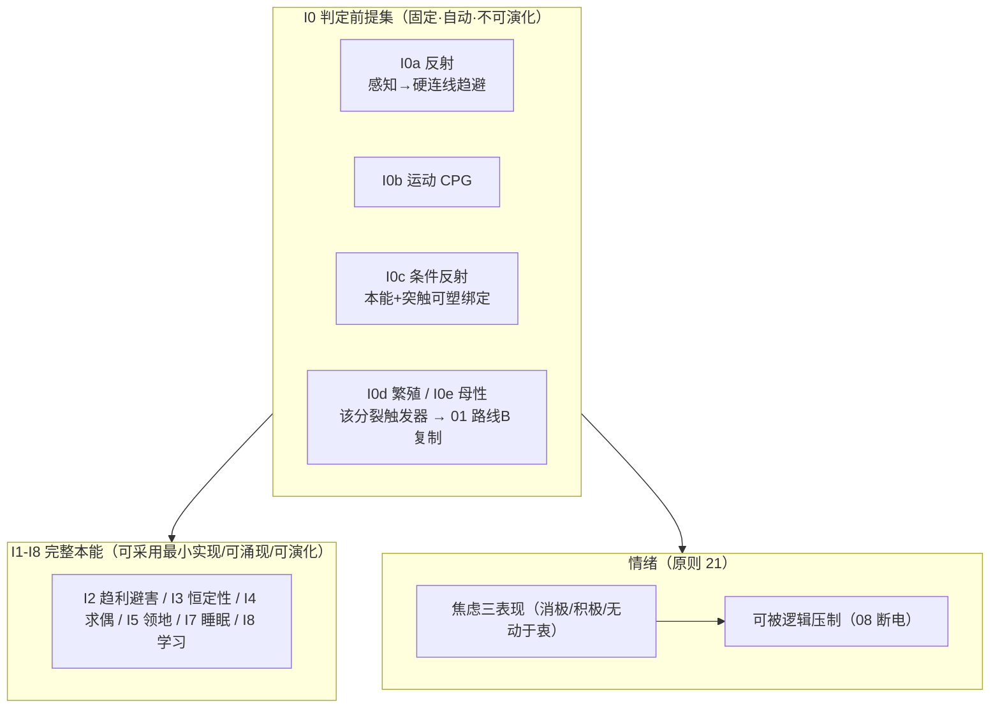
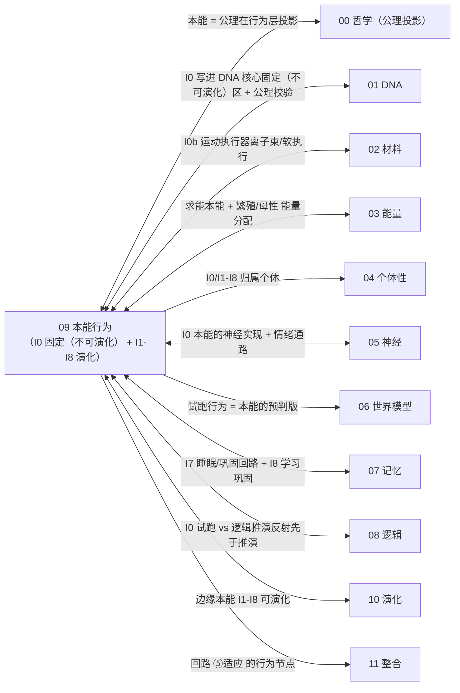

# 09 · 本能行为(原则 8)

| 文档项 | 内容 |
| --- | --- |
| 模块 | 本能行为：I0 判定前提集、I1–I8 本能与情绪 |
| 文档类型 | 设计报告（中文版） |
| 版本 | v4.1 |
| 依赖 | 00 公理投影、05 神经实现、01 DNA 固化区 |
| 语言 | 简体中文（英文版见 `../en-US/`） |

> **依据类别**：`[引用:…]` 文献或数据；`[设计决策]` 项目设定；`[逻辑推导]` 由已列前提导出；`[待验证]` 未经验证的占位项。

---

## 0. 设计方案比选

> 本节要决定 I0a 反射与 I0b 中枢模式发生器（CPG）在硅基凝胶中如何实现；其余本能的设计争议较小。三类方案分别给出实现方式、依据与可行性。
> - **方案 A（概念方案，基线方案）**：把碳基生物的 CPG 与反射机制直接迁移到硅基载体，用最简的 I0 组满足生命判据门槛。
> - **方案 B（项目文献库，选定方案）**：把机器人领域已有的 CPG 与反射控制移植到硅基载体。软体与液态金属机器人的相关实验可参照 `09/Schiller_2020`（软体行走 CPG 闭环，开放获取，库内有 PDF）、`09/Stance_Control_HyQ` 与 `09/Neuromorphic_Spiking_CPG`。
> - **方案 C（公开研究实践）**：参考四条路线，包括 2020 年以来的软体机器人 CPG、脉冲 CPG 器件（硬件形态与硅基最接近）、不经推演的反射式控制，以及把 I0 简化为最简趋避回路。
>
> 最终选择见 §3.1 与「关键假设与设计决策」附录 T4。

### 0.1 方案 A：概念方案(碳基 CPG/反射迁移至硅基载体，基线方案）

| 本能 | 具体做法 |
| ------ | --------- |
| I0a 反射 | 感知 → 硬连线规避/趋近回路(不经世界模型"思考") |
| I0b 运动 | CPG 最低级运动模式(随机游走 + 趋光趋能) |

**依据与说明（按上表行序）**

1. **I0a 反射** — [引用:`09/Withdrawal_Reflex_Nociceptive_Neuromorphic_Model_arXiv2505.17724`, §伤害性反射神经形态模型, "2025 伤害性反射神经形态模型(arXiv2505.17724)"]、`09/Reflexive_BrainInspired_Guo_2026(预印本·待同行评审)`, §反射式脑启发架构, "Guo 2026 反射式脑启发(预印本，待同行评审)"]](碳基/机器人机制);"硅基凝胶里能实现" [待计算与实验验证，关键]
2. **I0b 运动** — [引用:`09/CPG_Rhythm_Generation_Stick_Insect_arXiv2504.11494`, §昆虫 CPG 节律生成, "2024 昆虫 CPG 节律生成(arXiv2504.11494)"]、`09/Neuromorphic_Spiking_CPG_arXiv2101.09709`, §脉冲 CPG 器件态, "2015/2021 脉冲 CPG 硬件节律"]];凝胶 CPG 频率 [待验证]

**可行性与风险**：CPG 与反射的文献全部来自碳基生物或机器人。把它们直接当作硅基凝胶中 I0 的关键门槛，属于 C 类移植，可行性尚未证明；凝胶中能否自发形成 CPG 与反射，也还没有先例。[设计决策]

### 0.2 方案 B：基于项目文献库(机器人 CPG/反射移植，选定方案）

| 本能 | 文献范式 |
| ------ | --------- |
| I0a 反射 | 软体/液态金属机器人反射控制(前馈/反射弧，感知→硬连线动作不经中央规划) |
| I0b 运动 | 脉冲 CPG 器件(硬件 CPG,低功耗类生物节律)+ 软体 CPG(接触反馈在线调参) |

**依据与说明（按上表行序）**

1. **I0a 反射** — [引用:`09/Schiller_2020_SoftWalkingRobot_GaitPatternGenerator_CPG_FrontRoboticsAI(gold-OA,PDF在库)`, §软体行走机器人 CPG 闭环步态, "Schiller 2020 Front Rob AI(gold-OA):软体行走机器人 CPG 闭环位置控制，支撑 T4 硅基软体执行器确定"]、`09/Stance_Control_Cerebellum_Reflex_Locomotion_HyQ_Robot`, §小脑stance控制反射步态, "HyQ 机器人小脑 stance 控制反射步态"]
2. **I0b 运动** — [引用:`09/Neuromorphic_Spiking_CPG_arXiv2101.09709`, §脉冲 CPG 器件态, "2015/2021 脉冲 CPG 硬件节律"]、`09/Contact_Aware_Feedback_CPG_Soft_Snake_Robot_arXiv2309.02781`, §接触感知反馈 CPG 软蛇, "2023 接触感知反馈 CPG 软体蛇机器人"]

**要点**:把 I0 从"生物 CPG 迁移至硅基载体"降到"**机器人 CPG + 硅基执行器**",有成熟控制实验支撑，可行性远高于方案 A,又不砍掉 I0 门槛。

### 0.3 方案 C：基于公开研究实践( DOI + 降门槛)

> 待验证 · **本节依据为公开文献调研结果，与本项目设计主张相区分。**

| 外部范式 | 可搬进 09 的机制 |
| --------- | ---------------- |
| 软体机器人 CPG | 驱动软体/液态执行器节律运动，接触感知反馈在线调 CPG(选项 B 天花板) |
| 脉冲 CPG 器件 | 脉冲电路硬件 CPG,离"硅基 CPG"最近(器件级参照,`09/Neuromorphic_Spiking_CPG`) |
| 降 I0 到最简趋避 | I0 只要求"感知→最简趋避"硬回路(1 个反射弧即可),CPG 归 I1-I8 可演化(选项 C) |

**依据与说明（按上表行序）**

1. **软体机器人 CPG** — [引用:`09/B_CPG_SOFT_ROBOT_2026-09-15.md`, §软体机器人CPG, "A1 Xie2019/A2 Schiller2020(gold-OA)/A3 Zhu2017 软体机器人CPG"] A1 Xie 2019 软体鱼 CPG 多模态(73 引)、A2 Schiller 2020 软体行走 CPG 闭环位置控制、A3 Zhu 2017 软体蠕动 CPG(31 引)]
2. **脉冲 CPG 器件** — [引用:同上文献库, §脉冲CPG器件, "B1 Gutierrez-Galan2021/B2 Polykretis2020/B3 Spaeth2020 脉冲CPG器件(gold-OA)"] B1 Gutierrez-Galan 2021 脉冲 CPG SpiNNaker/Loihi 驱动软体游动物(37 引)、B2 Polykretis 2020 Loihi 星形胶质细胞调制 CPG、B3 Spaeth 2020 脉冲 CPG 软体闭环 + 文献库中 `09/Neuromorphic_Spiking_CPG`]
3. **降 I0 到最简趋避** — [设计决策];反射式控制 I0a 工程形态已由文献库中 `09/Reflexive_BrainInspired_Guo_2026(预印本·待同行评审)`、`09/Stance_Control_HyQ`、`09/Withdrawal_Reflex_arXiv2505.17724` 覆盖

### 0.4 方案组合与基线配置

| 策略 | 内容 | 适合 |
| ------ | ------ | ------ |
| **A. 纯方案 A** | 把碳基 CPG 与反射机制迁移到硅基载体凝胶 | 满足「最简 I0」，但依赖关键假设，目前不可操作 |
| **B. 方案 B（选定方案）** | I0 落在机器人 CPG／反射机制上，配合硅基执行器；不降低 I0 门槛 | 有实证控制实验支撑 |
| **C. 方案 C 降门槛底层约束** | I0 简化为最简趋避回路，CPG 归入可演化项 | 最保守 |

> **基线方案 = B**：I0 落在有机器人控制实验支撑的 CPG／反射机制上，配合硅基执行器；可行性明显高于 A，也不降低 I0 的门槛。理由见 §3.1，依据见「关键假设与设计决策」附录 T4。
> **设计决策（T4）：I0 采用机器人 CPG/反射机制配合硅基执行器；方案 A/C 作为对照。**

### 0.5 本能层结构详解（文字说明）

> **本节为 §3 图 3-1 的文字说明**:不依赖图示，逐层说明"硅基个体的本能层到底是什么、I0 前提集各成员怎么挂、I1-I8 怎么涌现、情绪怎么穿进去"。基于**方案 B(机器人 CPG/反射 + 硅基执行器 + I0 固定（不可演化） + I1-I8 可演化 + 情绪可压制)**。

**轴 1:本能承载的 3 类(本能"住"在哪)**

| 类 | 是什么 | 成员 |
| ---- | -------- | ------ |
| **I0 判定前提集**(硬核心固定·自动·不可演化；软扩展设计选择可增删) | 缺一即"非生命"(原则 8)——硬核心(趋避 I0a + 繁殖 I0d)= 公理必然；软扩展(CPG I0b / 条件反射 I0c / 母性 I0e)= 设计选择可增删(00 §5 S3 切分,2026-09-16 确定 C) | I0a 反射 / I0b 运动 CPG / I0c 条件反射 / I0d 繁殖 / I0e 母性 |
| **I1-I8 完整本能**(可采用最小实现/可涌现/可演化) | 决定"活得更好",经变异 + 选择优化 | I2 趋利避害 / I3 恒定性 / I4 求偶 / I5 领地 / I7 睡眠 / I8 学习 |
| **情绪通路**(调制器，可被逻辑压制，原则 21) | 焦虑(生存压力)三种表现 + 前额叶→杏仁核抑制 + 布尔硬切断 | 焦虑三表现(消极/积极/无动于衷)+ 压制开关 C |

**依据与说明（按上表行序）**

1. **I0 判定前提集(硬核心固定·自动·不可演化；软扩展设计选择可增删)** — 投影 [逻辑推导:00 §5 硬核心 I0a←A2、I0d←A3;软扩展 I0b←A1、I0c←A4、I0e←A3(设计选择，非公理必然)];硅基实现 [方案 B,§0.4]
2. **I1-I8 完整本能(可采用最小实现/可涌现/可演化)** — [引用：碳基参照 `09/Tottenham_2017`, §情感神经发育, "Tottenham 2017 情感神经发育"、`09/tan_knight_2018`, §社会脑, "Tan & Knight 2018 社会脑"、`09/insel_2010`, §社会依恋神经, "Insel 2010 社会依恋神经"、`09/VyazovskiyHarris_2013`, §慢波睡眠, "Vyazovskiy & Harris 2013 慢波睡眠"、`05/Hebbian_2023`, §Hebbian 可塑, "Hebbian 2023 工作记忆可塑"]
3. **情绪通路(调制器，可被逻辑压制，原则 21)** — [引用:`05/Maier_2016`、`05/Tafet_2025`、`05/Denny_2015`、`05/Dore_2017`];"布尔硬切断=硅基优势" [设计决策]

**三类之间的关系(本能层堆叠)**:
```
I0 判定前提集(固定（不可演化）,缺一即非生命)
   ↓ 自动触发 + 持续运行
I1-I8 完整本能(可涌现/可演化,决定"活得好")
   ↓ 调"倾向"(不改逻辑对错)
情绪通路(调制器,可被 08 逻辑断电压制)
```
→ **I0 = "这是不是一个生命"的门槛(固定（不可演化）);I1-I8 = "这个生命活得怎样"(可演化);情绪 = "活的调节"(可压制)。** 这条堆叠就是"硅基个体本能层长什么样"。

**轴 2:三条机制线(穿过 3 类,"怎么触发/怎么演化/怎么压")**

| 机制 | 穿过哪类 | 做什么 |
| ------ | --------- | -------- |
| **触发(TRIGGER)** | I0 | I0 各成员自动触发，不靠外部指令(反射 = 威胁信号 > 阈值 → 硬连线趋避;CPG = 节律发生器常态运行；繁殖 = 环境阈值触发) |
| **演化(EVOLVE)** | I1-I8 | 核心本能(I0d/I2/I3)固定（不可演化）不演化(决定"能否自维持",容错低);边缘本能(I4/I5/I7/I8)可涌现 + 可演化(决定"活得好",经变异 + 选择) |
| **压制(SUPPRESS)** | 情绪通路 | 情绪 = 调制器(调倾向权重，不改逻辑对错);"可被逻辑压制"这条固定（不可演化）(C-a 自决 / C-b 外部，布尔硬切断,08 发指令 → 05 情绪归零);情绪的"强度/表达"可演化 |

**依据与说明（按上表行序）**

1. **触发(TRIGGER)** — 触发条件 [设计决策];反射机制 [引用:`09/Withdrawal_Reflex_arXiv2505.17724`, §伤害性反射神经形态模型, "2025 伤害性反射神经形态模型"]、`09/Reflexive_BrainInspired_Guo_2026(预印本·待同行评审)`, §反射式脑启发架构, "Guo 2026 反射式脑启发(预印本)"];CPG [引用:`09/Neuromorphic_Spiking_CPG_arXiv2101.09709`, §脉冲 CPG 器件态, "2015/2021 脉冲 CPG 硬件节律"]、`09/CPG_Rhythm_Generation_Stick_Insect_arXiv2504.11494`, §昆虫 CPG 节律生成, "2024 昆虫 CPG 节律生成"]
2. **演化(EVOLVE)** — 固定（不可演化） vs 可演化切分 [设计决策];可塑 [引用:`05/Hebbian_2023`、`07/BlumMoyse_2024`]
3. **压制(SUPPRESS)** — [引用:`05/Denny_2015`、`05/Dore_2017`(前额叶抑制)];"布尔硬切断=硅基优势" [设计决策]

**"固定（不可演化） + 可演化 + 可压制"关系**(为什么这套设计能"既是生命又能活得好"):
- **I0 组 = 固定（不可演化）**(反射/CPG/条件反射/繁殖/母性，缺一即非生命，原则 8,不可演化);
- **I1-I8 核心(趋利避害/恒定性) = 固定（不可演化）;边缘(求偶/领地/睡眠/学习) = 可演化**(切分依据：核心决定"能否自维持",边缘决定"活得好");
- **情绪"可被逻辑压制" = 固定（不可演化）(原则 21);情绪"强度/表达" = 可演化**。
- **这个"固定（不可演化） I0 + 可演化 I1-I8 + 固定（不可演化）可压制情绪"的分法，正是原则 8(I0 固定（不可演化）)+ 原则 10(逻辑可压制)+ 原则 11(公理基础先定、策略可演化)的对应落点** [逻辑推导：三条原则分别落到 I0/I1-I8/情绪通路]。

**要点归纳**
> **硅基个体的一条本能层 = I0 判定前提集(反射 I0a + 运动 CPG I0b + 条件反射 I0c + 繁殖 I0d + 母性 I0e,固定（不可演化）自动触发，缺一即非生命)+ I1-I8 完整本能(趋利避害/恒定性/求偶/领地/睡眠/学习，可采用最小实现可涌现可演化)+ 情绪通路(焦虑三表现，调制倾向不改逻辑对错，可被 08 逻辑布尔硬切断归零)。I0 固定（不可演化） + I1-I8 可演化 + 情绪可压制固定（不可演化）——这就是"这是不是一个生命"的门槛形式。**

---

## 1. 设计目标
让个体具备**本能化行为模式**——即使采用最小实现也不可缺失(I0 判定前提集)。这是"生命"的判定门槛(原则 8)。I0 组固定（不可演化）、自动触发、不可演化;I1-I8 可采用最小实现/可涌现/可演化。

---

## 2. 相关研究现状 + 不同实现方式(原则 2)

| 本能 | 碳基机制 | 文献锚点 | 硅基落实 |
| ------ | --------- | --------- | --------- |
| **I0a 反射** | 反射弧(脊髓/脑干) | 见依据 1 | 感知 → 硬连线规避/趋近(不经思考,§3.1) |
| **I0b 运动** | CPG 节律运动发生器 | 见依据 2 | CPG 在凝胶里的最低级运动模式(§3.1) |
| **I0c 条件反射** | 巴甫洛夫(小脑回路) | `09/Rudolph_2023_Cognitive_Affective_Cerebellum_Classical_Conditioning_JNeurosci` | 本能 + 突触可塑性绑定(§3.1) |
| **I0d 繁殖** | 下丘脑-垂体-性腺轴 | `09/insel_2010_oxytocin_vasopressin_affiliative_behavior_TINS_review` | "该分裂了"触发器 → §01 方案 B 复制(§3.1) |
| **I0e 母性** | 亲代抚育(催产素) | `09/insel_2010`(parent-hood) | 能量分配偏好子体(§3.1) |
| **I2 趋利避害** | 杏仁核威胁学习 | `09/Tottenham_2017_Developing_Amygdala_Threat_Learning` | 感知层规避(§3.2) |
| **I3 恒定性** | 体温 set-point | `09/tan_knight_2018_thermoregulation_nervous_system_PMC` | 温度/能量安全区回路(§3.2) |
| **I7 睡眠/修复** | 神经元预后性维护 | `09/VyazovskiyHarris_2013_Sleep_Single_Neuron_Cell_Rest_NatRevNeurosci` | 低功耗态 + 自我校验(§3.2) |
| **I4-I6 求偶/领地/资源** | OXT/AVP 回路 | `09/insel_2010` | 同种识别 / 资源阈值(§3.2) |
| **情绪(原则 21)** | 前额叶-边缘系统 | `05/Denny_2015`·`Dore_2017`·`Maier_2016`·`Tafet_2025` | 情绪调制 + 可被逻辑压制(§05.3.1,本册呼应) |

**单元格依据详文**

1. **I0a 反射 · 文献锚点** — `09/Withdrawal_Reflex_Nociceptive_Neuromorphic_Model_Wang_Cheng_arXiv2505.17724.pdf`(真·反射弧神经形态模型)、`09/Schiller_2020_SoftWalkingRobot_GaitPatternGenerator_CPG_FrontRoboticsAI(gold-OA,PDF在库).pdf`(反射控制)、`09/Meserve_2024_Celsr3_AcouStartle_Hindbrain_Circuit`、`09/Nagar_2021_Fmn2b_Excitatory_Interneuron_Zebrafish_Startle`、`09/Muacevic_2022_Reflex_Hammer_Reflex_Arc_Review`(反射锤工具史，作旁证)
2. **I0b 运动 · 文献锚点** — `09/CPG_Rhythm_Generation_Stick_Insect_Locomotion_Aminzare_Rubin_arXiv2504.11494.pdf`(真·昆虫 CPG 节律)、`09/Eight_Neuron_Network_Quadruped_Locomotion_CPG_arXiv2406.13419.pdf`、`09/Contact_Aware_Feedback_CPG_Soft_Snake_Robot_Locomotion_arXiv2309.02781.pdf`、`09/Neuromorphic_Spiking_CPG_Legged_Robot_Locomotion_arXiv2101.09709.pdf`(脉冲 CPG)、`09/Stance_Control_Cerebellum_Reflex_Locomotion_HyQ_Robot`

---

## 3. 设计(v3)

**图 3-1:本能层 = I0 固定（不可演化）前提集(反射/CPG/条件反射/繁殖/母性)→ I1-I8 可演化 → 情绪(可压制)**



> 说明：I0 为固定前提，I1–I8 为可演化本能；触发条件与情绪调制分列上下支路。

> **图例说明**:**I0 前提集**(反射/CPG/条件反射/繁殖/母性)固定（不可演化）自动触发(缺一即非生命，原则 8);I0b 走**方案 B(机器人 CPG + 硅基执行器)**。I1-I8 可演化。情绪作为调节,**可被 08 逻辑断电压制**(原则 21)。**I0 硬核心(趋避 I0a/繁殖 I0d)= 公理必然；软扩展(CPG I0b/条件反射 I0c/母性 I0e)= 设计选择可增删**(§00 §5,2026-09-16 S3 确定 C)。

### 3.1 I0 判定前提集(必须，固定（不可演化）,自动触发，不可演化)

| 本能 | 硅基实现(可采用最小实现，但必须有 + 自动触发) | 触发条件 | 落实位置 |
| ------ | -------------------------------------- | --------- | --------- |
| **I0a 反射** | 感知层检测到有害/有益信号 → 硬连线规避/趋近回路(不经世界模型"思考") | 威胁信号 > 阈值 | 05 神经层(反射弧)+ 02 感知通道 |
| **I0b 运动** | CPG 最低级运动模式(类"随机游走 + 趋光趋能"),驱动机体 | 常态运行(节律发生器) | 05 神经层(CPG)+ 03 供能 |
| **I0c 条件反射** | 本能回路 + 突触可塑性绑定：中性信号与本能信号反复共现 → 条件反应 | 反复共现(Hebbian) | 05 可塑性 + 07 记忆 |
| **I0d 繁殖** | 信息带里"该分裂了"触发器 → 环境阈值触发 → §01 方案 B 复制 | 环境信号(温度/能量/资源)达阈值 | 01 DNA + 03 能量 + 10 演化 |
| **I0e 母性** | 复制后对子体的"保护"规则(能量分配偏好子体) | 有子体存在 | 03 能量分配 |

**I0 组 = 公理在行为层的投影(§00 §5,2026-09-16 S3 确定 C 后按"逻辑强度"切两档)**:
- **硬核心(公理真蕴含，固定（不可演化）)= 趋避(I0a←A2)+ 繁殖(I0d←A3)**:A2 存续 → 趋能避害,A3 复制 → 繁殖，这两条是由存在论公理导出,**可采用最小实现但必须存在 + 自动触发 + 固定（不可演化）**。
- **软扩展(设计选择，可增删)= 母性(I0e)/ 条件反射(I0c)/ 运动 CPG(I0b)**:公理只要求"有趋避/复制/学习/协同",**不要求具体是哪些本能**——母性/条件反射/CPG 是"把设计预设填进 I0"的展开,**属设计选择(原则 8),可演化增删，不作硬性设定为公理必然**。
  - I0d/I0e ← A3(复制，繁殖 + 母性)· I0a/I2 ← A2(存续，趋能避害)· I0b ← A1(组织闭合，移动维持有序态)· I0c ← A4(适应，学习绑定)
**关键**:硬核心(趋避/繁殖)**缺一即"非生命"**(原则 8,固定（不可演化）);软扩展**可采用最小实现 + 可增删**(设计选择，非必然)。"可采用最小实现"指最简版即可(反射只到"避有害信号"),**非**"可以没有"(硬核心)。

**待验证 · 关键假设 + 替代路径选择空间(一致性核验（2026-09-14）：设计立场经设计评审确认)**:

> **关键假设**:"I0a 反射 / I0b CPG 在硅基凝胶里实现"——文献(`CPG_Rhythm_Generation_Stick_Insect_arXiv2504.11494` 昆虫 CPG、`Neuromorphic_Spiking_CPG_arXiv2101.09709` 脉冲 CPG、`Withdrawal_Reflex_arXiv2505.17724` 反射弧)全是**碳基生物/机器人控制**,直接当**硅基凝胶 I0 关键门槛**是 C 类移植，可行性未证。
> **选择空间(三选一，文献库中已有真实文献)**:

| 选项 | 机制 | 可行性 | 说明 | 文献库中文献 |
| ------ | ------ | -------- | ------ | --------- |
| **A. 保留"碳基 CPG/反射迁移至硅基载体凝胶"(当前基线)** | 凝胶里直接实现 CPG/反射弧 | 最低(硅基凝胶 CPG/反射无实现路径) | 命中"最简 I0 = 生命判定门槛" | `09/CPG_Rhythm_Generation...arXiv2504.11494`(机制参照) |
| **B. 改用"机器人 CPG/反射控制 → 移植到硅基载体"**(控制工程替代，科学化) | 用软体/液态金属机器人的 CPG + 反射控制(`Guo_2026 Reflexive_BrainInspired`、`Stance_Control_HyQ`)作"已可实现的 CPG/反射"参照，硅基只改执行器 | 中(机器人 CPG/反射已有成熟控制实验) | 把 I0 从"生物 CPG 迁移至硅基载体"降到"机器人 CPG + 硅基执行器",有实证支撑 | `09/Schiller_2020_SoftWalkingRobot_GaitPatternGenerator_CPG_FrontRoboticsAI(gold-OA,PDF在库)`、`09/Stance_Control_Cerebellum_Reflex_Locomotion_HyQ_Robot` |
| **C. 降 I0 门槛为"最简反应回路"(务实替代)** | I0 不要求完整 CPG/反射，只要求"感知→最简趋避"硬回路(可采用最小实现到 1 个反射弧) | 最高(最简回路物理上可实现) | 放弃"CPG 节律"作 I0,把 I0 降到"有趋避即可",CPG 归入 I1-I8 可演化项 | 同上 + `09/Withdrawal_Reflex_arXiv2505.17724`(最简反射弧) |

> **基线 = B(把 I0 落到有机器人控制实验支撑的 CPG/反射 + 硅基执行器，可行性远高于 A,又不砍掉 I0 门槛);C 最保守(降 I0 到最简趋避);A 最激进。该选择属于设计立场，经设计评审确认。**

**公开研究实践参照**:

> 现有公开研究中"软体/液态金属机器人 CPG + 反射控制"做得最好的做法——**给 T4 各选项的参照上限**。

| 领域公开实践 | 做法 | 参照价值 | 对 T4 对应方案 | 状态 |
| ------------- | ------ | ------------- | ------------------ | ------ |
| **软体机器人 CPG 控制(2020+)** | 用 CPG(神经振荡器)驱动软体/液体机器人节律运动，接触感知反馈在线调 CPG 参数 | "CPG + 接触反馈"在软体上已成熟，把 I0b 从"生物 CPG 迁移至硅基载体"落到"机器人 CPG + 软执行器" | 选项 B 的参照上限——证明机器人 CPG/反射有实验，可行性高 | 已核实 · 文献库中 `09/Neuromorphic_Spiking_CPG` + 待补充检索 2024 软体 CPG |
| **脉冲 CPG 器件(neuromorphic,2021+)** | 用脉冲电路硬件实现 CPG(非软件),低功耗、类生物节律 | 器件级 CPG,离"硅基 CPG"最近一步 | B 的器件级参照 | 已核实 · 文献库中 `09/Neuromorphic_Spiking_CPG` |
| **反射式控制(reflex, 不经"思考")** | 前馈/反射弧控制：感知 → 硬连线动作，不经过中央"规划"(Guo 2026、HyQ 姿态控制) | 正是 I0a 反射的工程形态,"不经世界模型"已实现 | B 的反射部分 | 已核实 · 文献库中 `09/Reflexive_BrainInspired_Guo_2026(预印本·待同行评审)` + `09/Stance_Control_HyQ` |

### 3.2 I1-I8 完整本能(可采用最小实现/可涌现/可演化)

| 本能 | 硅基实现 | 层 | 碳基参照 |
| ------ | --------- | ----- | --------- |
| I1 繁殖 | (并入 I0d) | 核心 | `insel_2010` |
| I2 趋利避害 | 感知层规避(危险信号 → 回避策略) | 核心 | `Tottenham_2017` |
| I3 恒定性 | 温度/能量安全区间自我调节(类恒温) | 核心 | `tan_knight_2018` |
| I4 求偶/结合 | 同种识别键态 → 结合信号(模板互认,§01.4.3) | 边缘 | `insel_2010` |
| I5 领地/资源 | 资源占用能量阈值规则("谁先到谁占") | 边缘 | `insel_2010` |
| I6 母性 | (并入 I0e) | 边缘 | `insel_2010` |
| I7 睡眠/修复 | 低功耗态周期(类休眠),自我校验/修复(§01 §4 修复子系统) | 边缘 | `VyazovskiyHarris_2013` |
| I8 学习 | 突触权重自发调整(§05 神经层可塑性)+ 记忆巩固 | 边缘(涌现) | `Hebbian_2023`·`Khacef_2022`·`BlumMoyse_2024` |

**设计逻辑**:
- **核心本能(I0d/I2/I3)固定（不可演化）**:决定"能否自维持",容错低
- **边缘本能(I4/I5/I7/I8)可涌现 + 可演化**:决定"活得更好",通过变异 + 选择优化
- **情绪(原则 21)**:焦虑(生存压力)→ 三种表现(消极/积极/无动于衷),**可被逻辑压制**(§05.3.1)

### 3.3 本能时标(原则 15,黑猩猩基准映射)

| 本能 | 碳基时标 | 碳基出处 | 硅基映射 | 硅基值 |
| ------ | --------- | --------- | --------- | -------- |
| 反射(I0a) | 见依据 1 | 同上 | ns-µs(`设计设定`,神经层脉冲) | 纳秒-微秒 |
| 运动节律(I0b CPG) | 见依据 2 | 同上(真 CPG) | ~ms(凝胶 CPG 频率,`待计算验证`) | 毫秒(待测 B1) |
| 繁殖触发(I0d) | 首胎 ~14 岁 | `05/Hawkes_Smith_Robson_2009...Gompertz...PMC6121812`(实测) | ~14-17 h(原则 15 映射,÷10⁴ 项目设定的) | 14-17 小时 |
| 睡眠/巩固(I7) | 数小时(巩固机制:`07/Rasch_Born_2013` SWS 系统巩固 + `09/VyazovskiyHarris_2013` 慢波细胞休整(全文),周期值待核到原文) | 同上 | ~10 秒(§07 巩固时标，映射项目设定的) | ~10 秒 |

**单元格依据详文**

1. **反射(I0a) · 碳基时标** — ~100 ms(碳基数值待核,真反射弧文献已补抓:`09/Withdrawal_Reflex_Nociceptive_Neuromorphic_Model_Wang_Cheng_arXiv2505.17724.pdf` + `09/Schiller_2020_SoftWalkingRobot_GaitPatternGenerator_CPG_FrontRoboticsAI(gold-OA,PDF在库).pdf`)
2. **运动节律(I0b CPG) · 碳基时标** — 节律运动(CPG 机制有,`09/CPG_Rhythm_Generation_Stick_Insect_Locomotion_Aminzare_Rubin_arXiv2504.11494.pdf` + `09/Eight_Neuron_Network_Quadruped_Locomotion_CPG_arXiv2406.13419.pdf` + `09/Neuromorphic_Spiking_CPG_Legged_Robot_Locomotion_arXiv2101.09709.pdf`,碳基步频具体值待核)

**关键**:上表"碳基值"多数**尚未逐条核到原文具体数字**(标"待核"),只有"首胎 ~14 岁"关联至了 `Hawkes_2009`(实测);**CPG 步频与反射时程无碳基实测，标"待核/补抓"**(原则 24:无依据不臆断)。硅基值 = 碳基值 × 压缩比,**压缩比是项目设定的**。

---

## 4. 与其他部分的关系(接口契约，全维度)

> **完整性原则**:09 是"本能行为层",是 **公理投影(00)/ 神经实现(05)/ 求能驱动(03)** 的交汇点——必须与每个维度建联系(缺一项 = 文档不完整)。

**图 4-1:09(本能行为)与全部 12 册的联系总览**



> 说明：箭头起点为供值方，终点为接收方；跨分册接口的可测量量由各分册接口契约定义。

| 接口 | 数据流(物理量/信息，非概念) | 不变量(可测) | 依据性质 |
| ------ | --------------------------- | ------------- | --------- |
| **↔ 00 哲学** | 本能 = 公理在行为层的投影，按 S3 切两档:硬核心(趋避 I0a/I2←A2、繁殖 I0d←A3)= 公理必然;软扩展(运动 I0b←A1、条件反射 I0c←A4、母性 I0e←A3)= 设计选择可增删，非公理必然(2026-09-16 S3 确定 C) | I0 组(硬核心成立 + 软扩展按设计填) | [引用:00 §5] |
| **↔ 01 DNA** | I0 写进 01 核心固定（不可演化）区 + 公理校验子 | I0 ∈ DNA 核心区 | [引用:01 核心区] |
| **↔ 02 材料** | I0b 运动执行器(离子束/软执行器驱动机体) | 执行器响应 [待验证] | [逻辑推导:09 挂 02] |
| **↔ 03 能量** | 求能本能 + 繁殖/母性的能量分配 | 趋能/能量分配 [设计] | [引用:03 A2 序 + 求能本能] |
| **→ 04 个体性** | I0/I1-I8 归属个体(本能是个体级) | I0 触发个体级 [设计] | [逻辑推导:09 + 04] |
| **↔ 05 神经** | I0 本能的神经实现 + 情绪通路(反射弧/CPG 靠 05) | 反射延迟 [待计算验证 I2] | [引用:05 神经层] |
| **→ 06 世界模型** | 试跑行为 = 本能的预判版(先试跑再反射) | 预判偏差 [待验证] | [逻辑推导:06 挂 09] |
| **↔ 07 记忆** | I7 睡眠/巩固回路 + I8 学习巩固(低功耗态触发) | replay 触发 [待验证] | [引用:09 I7 + 07] |
| **↔ 08 逻辑** | I0 试跑 vs 逻辑推演(反射先于 08 推演) | 反射 vs 推演延迟 [待验证] | [逻辑推导:08 推演] |
| **↔ 10 演化** | 边缘本能 I1-I8 可演化(核心 I0 固定（不可演化）不演化) | 演化项 ∈ I1-I8 [设计] | [引用:10 演化] |
| **→ 11 整合** | 回路 ⑤适应 的行为节点(本能驱动适应) | 回路 ⑤ 闭合需 09 | [引用:11 §5 回路] |

**契约原则**:接口"数据"必须是**可物理/可信息测量量**(反射延迟/CPG 频率/触发阈值/能耗),不是概念；未给实测值的标"数值待 09/其他分册 DFT"。

**依据性质(§4)**:
- 公理投影 → 00 [引用:00 §5]
- 固定（不可演化）区 ↔ 01 / 执行器 ↔ 02 / 求能 ↔ 03 [引用:01 核心区 + 02 + 03 A2]
- 归属个体 → 04 [逻辑推导]
- 神经实现 ↔ 05 / 试跑 → 06 / I7 巩固 ↔ 07 / 反射 vs 推演 ↔ 08 [引用/逻辑推导]
- 可演化 ↔ 10 [引用:10]
- 回路 ⑤ → 11 [引用:11 §5]

---

## 5. 待实验验证 / DFT(每项：公式 + 窗口 + 供值方，附量化条件)

| # | 开放项 | 要满足的公式/不等式 | 参数窗口(设计设定) | 值由谁给 |
| --- | -------- | --------------------- | -------------------- | ---------- |
| I1 | I0b 运动 CPG 在硅基凝胶里的频率范围 | CPG 振荡频率 f_cpg ∈ 凝胶 CPG 可行窗口(节律运动维持) | 碳基 CPG 机制有(`CPG_Rhythm_Generation_Stick_Insect_arXiv2504.11494` + `Neuromorphic_Spiking_CPG_arXiv2101.09709`);硅基 f_cpg [待验证] | 09 DFT + 05 实验(硅基凝胶 CPG 振荡频率) |
| I2 | 各本能触发阈值(反射/繁殖/恒定性) | 威胁信号强度 S_thr / 繁殖环境阈值 E_rep / 恒定性 set-point T_set 须 < 生存上限 | 阈值 [设计·待计算与实验验证，无实测] | 09 实验(各本能触发条件实测) |
| I3 | I0 组最小实现可行性(最简反射 + 最简 CPG 能否闭合) | 最简 I0(1 反射弧 + 1 CPG)须可在硅基载体运行 | 最小原型 [待实验(P0:决定"是不是生命")] | 09 + 02 实验(硅基载体最简 I0 原型) |
| I4 | I0c 条件反射的突触可塑性绑定参数 | 共现次数 × 强度 → 条件反应触发阈值(Hebbian 式) | 绑定参数 [设计设定 + 待计算验证];机制 [引用:`09/Rudolph_2023`, §小脑条件反射可塑, "Rudolph 2023 小脑条件反射突触可塑"] 小脑] | 09 DFT + 07 实验(硅基条件反射绑定曲线) |
| I5 | 情绪调制强度 vs 逻辑压制响应时间 | 压制后情绪调制 w_emo → 0,响应时间 t_sup ≪ 决策周期 | 碳基前额叶抑制有实测 [引用:`05/Denny_2015`、`05/Dore_2017`];硅基布尔硬切断 t_sup [待验证] | 09 + 05 + 08 协同 |

**说明**:I1-I5 每项都给了"**要算什么 + 阈值/窗口 + 供值方**";CPG/反射/条件反射的**碳基机制有文献**(挂 `09/` 可点开文件),但**硅基侧**(凝胶 CPG 频率、触发阈值、最简 I0 可行性、条件反射绑定参数、情绪压制响应)全部**待 05/09 第一性原理计算与实验**;时标压缩比(§3.3)= 设计设定(项目设定的，可调),碳基时标数值多数**未核到原文具体数字(标"待核")**,不臆断。

---

## 10. 适用边界与已知限制(原则 24)

- **可确定内容（本文已给出）**:§0.5 本能层 3 类(I0 固定（不可演化） + I1-I8 可演化 + 情绪可压制)+ 机制线 3 条(触发/演化/压制)结构、§2 I0-I8 碳基机制对照表 + 硅基落实、§3.1 I0 判定前提集(5 成员，固定（不可演化）自动触发)+ T4 立场 A/B/C + 公开研究实践参照表、§3.2 I1-I8 完整本能 + 核心/边缘切分、§3.3 本能时标(原则 15 映射 + 碳基值待核实)、§4 全 12 册接口。
- **不可确定内容（仅给出公式与边界，占位项不作为基准值）**:I1 硅基 CPG 频率、I2 触发阈值、I3 最简 I0 可行性、I4 条件反射绑定参数、I5 情绪压制响应时间——**全部待 05/09 第一性原理计算与实验**;§3.3 碳基时标值(反射 ~100 ms / CPG 步频)**未核到原文具体数字，标"待核"**(原则 24 无依据不臆断)。
- **关键假设(待设计评审确定)**:
  - **"I0a 反射 / I0b CPG 在硅基凝胶里实现"**——CPG/反射文献(`CPG_Rhythm_Generation_Stick_Insect` + `Neuromorphic_Spiking_CPG` + `Withdrawal_Reflex`)全**碳基生物/机器人控制**,直接当**硅基凝胶 I0 关键门槛是 C 类移植**;"凝胶里自发涌现 CPG/反射"是世界没做过的原创，关键假设已列示,**基线 B(机器人 CPG/反射 + 硅基执行器，有成熟控制实验)**。
  - **I0 组"缺一即非生命"的判定**——这是"是不是生命"的门槛(原则 8),最简 I0(1 反射弧 + 1 CPG)在硅基载体能否闭合**未验证**(I3),P0 待实验。

---
