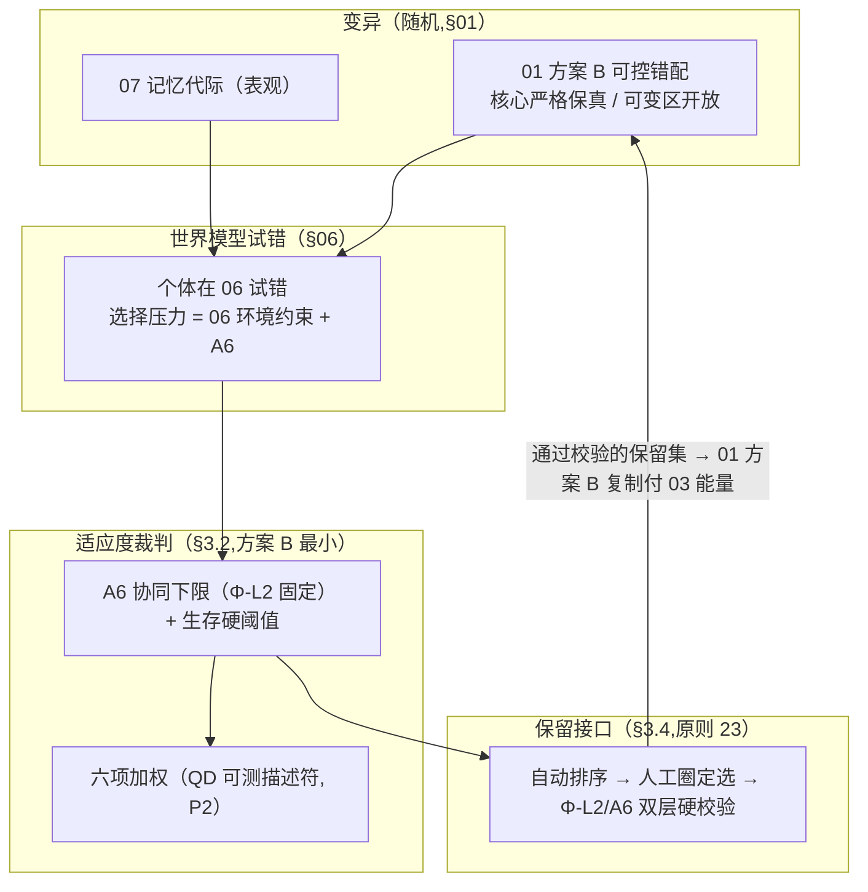
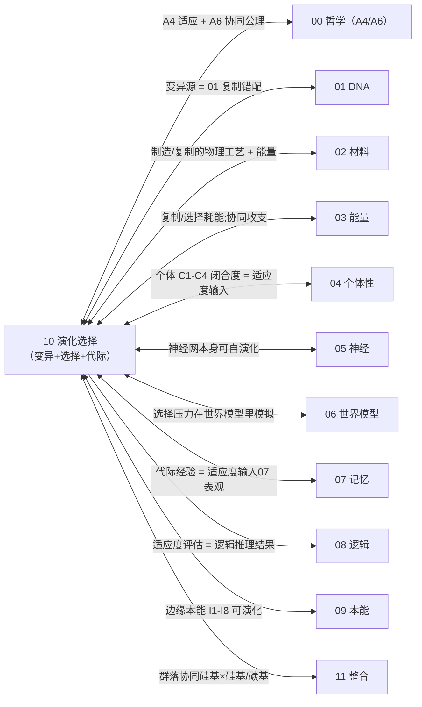

# 10 · 演化选择(S6)

| 文档项 | 内容 |
| --- | --- |
| 模块 | 演化选择（S6）：适应度函数、选择压力与代际传递 |
| 文档类型 | 设计报告（中文版） |
| 版本 | v4.1 |
| 依赖 | 01 变异源、03 复制能耗、06 选择压力模拟、00 公理层 |
| 语言 | 简体中文（英文版见 `../en-US/`） |

> **依据类别**：`[引用:…]` 文献或数据；`[设计决策]` 项目设定；`[逻辑推导]` 由已列前提导出；`[待验证]` 未经验证的占位项。

---

## 0. 设计方案比选

> 设计问题：关键问题为 **适应度裁判实现可测量、可运行的方式**(六项加权无测量路径 + 与评估册 2 因子自相矛盾，即 S1)。三类方案分别给出"裁判形式 + 依据 + 可行性"。
> - **方案 A(概念方案，保留当前 = 原选项 A)**:**六项加权**(组织闭合/能量盈余/复制率/学习度/世界模型精度/协同 + A6)作裁判，关键整性优先
> - **方案 B(基于项目文献库 = 原选项 C，选定方案）**:**分阶段最小裁判**——A6 协同项下限(Φ-L2 固定，有公理依据)+ 生存硬阈值，优先得到可运行原型，六项作 P2
> - **方案 C(基于公开研究实践，含外部调研 + 原选项 B)**:① **Quality-Diversity / MAP-Elites**(多可测描述符，逼"六项"每项可测)② **Reward shaping + 防 reward hacking**(可测分项 + 对抗校验)③ **2 因子标量**(生存时长 × 资源效率，对齐评估册)
> 关键选择见 §3.2 + 关键假设与设计决策附录 S1。

### 0.1 方案 A：概念方案(六项加权，基线方案）

| 环节 | 具体做法 | 依据性质 |
| ------ | --------- | --------- |
| 裁判 | F = Σwᵢ·[闭合/能量/复制/学习/世界模型/协同] − w_penalty | [设计决策];各 wᵢ 取值 + 测量方法 全册未给 [待计算与实验验证，关键] |
| 协同 | A6 下限固定(Φ-L2)+ 上限自由 | [引用:00 Φ-L2 + 10 §3.3] |

**可行性 + 风险**:六项"如何测成标量 + 归一化 + 权重取值"无路径，当"可直接运行裁判"是关键假设；且与评估册 2 因子矛盾。[设计决策]

### 0.2 方案 B：基于项目文献库(分阶段最小裁判，选定方案）

| 环节 | 文献范式 | 依据性质 |
| ------ | --------- | --------- |
| 最小裁判 | A6 协同下限(Φ-L2 有公理依据)+ 生存硬阈值(A2 存续),先跑；六项作 P2 | [引用:00 Φ-L2/A2 + 10 §3.3];六项测量路径 [待验证] |
| 变异 | 01 方案 B 可控错配 + 07 代际 | [引用:01 复制 + 07] |
| 开放演化 | open-ended CA(不收敛) | [引用:`10/Large_Scale_Simulations_Open_Ended_Evolution_Cellular_Automata_arXiv2304.05639`, §大规模开放演化 CA, "2023 大规模开放演化元胞自动机(arXiv2304.05639)"] |

**要点**:先保"不灭绝碳基(Φ-L2)+ 活下来(生存硬阈值)",最快出可跑原型，解决"六项测不了"的当前阻塞。

> **命名约定**:本册及 09/01 引用"**01 方案 B**"时，一律指 **01 §5 的复制方案 B(模板引导 + 外部能量场，原则 5)**,非 01 §0.4 的"载体组合方案 B(A+B 混合，已被 T0 确定 A 弃用)"。两处同名不同义，读本册"01 方案 B 复制"勿误读为已弃用的载体组合方案 B。

### 0.3 方案 C：基于公开研究实践(QD + reward shaping + 2 因子，已逐条补核)

> 待验证 · **本节依据为公开文献调研结果，与本项目设计主张相区分。**

| 外部范式 | 可搬进 10 的机制 |
| --------- | ---------------- |
| Quality-Diversity / MAP-Elites | 把"六项"拆成多可测描述符 archive,逼补齐测量(选项 A 天花板) |
| Reward shaping + 防 hacking | 可测奖励分项 + 对抗校验防钻空子(选项 C 天花板) |
| 2 因子标量 | 生存时长 × 资源效率(对齐评估册，最可运行) |

**依据与说明（按上表行序）**

1. **Quality-Diversity / MAP-Elites** — [引用:`10/B_EVOLUTIONARY_QD_REWARD_2026-09-15.md`, §QD/奖励, "Q1' Seeking_QD_2021/Q2 Cully2025 Dominated Novelty Search(GECCO,DOI 10.1145/3712256.3726310)"] Q1' 文献库中 `10/Seeking_Quality_Diversity_2021`+ Q2 Cully 2025 *Dominated Novelty Search*(GECCO,DOI 10.1145/3712256.3726310,arXiv:2502.00593)]
2. **Reward shaping + 防 hacking** — [引用:同上文献库, §奖励hacking, "R1 Karwowski/Skalse2023 Goodhart's Law in RL(ICLR2024 同行评审,arXiv2310.09144)/R1b Skalse2023 Defining Reward Hacking(NeurIPS,DOI 10.52202/068431-0687);"] R1 Karwowski/Skalse 2023 *Goodhart's Law in RL*(arXiv:2310.09144(ICLR 2024 同行评审))+ R1b Skalse/Howe/Krasheninnikov/Krueger 2023 *Defining and Characterizing Reward Hacking*(NeurIPS,DOI 10.52202/068431-0687,OA);原 R2(Metz/Amodei OpenAI 2017)无成文，由 R1+R1b 覆盖]
3. **2 因子标量** — [引用:`10/2022_EvoJAX_arXiv2202.05008`, §EvoJAX 演化基准, "2022 EvoJAX 演化基准(arXiv2202.05008),1-2 可测量起步"]

### 0.4 方案组合与基线配置

| 策略 | 内容 | 适合 |
| ------ | ------ | ------ |
| **A. 纯方案 A** | 六项加权作裁判，标"测量待设计"(保留完整结构，现阶段跑不通) | 关键整性，接受现状 |
| **B. 方案 B + QD 可测约束** | 先跑 A6+生存硬阈值,六项按 QD 拆成可测描述符再补 | 优先获得最小原型 + 补全测量(原选定方案，设计决策 S1=C；实质即 C 的分阶段思路,§0.4 B 行「选定方案」标记已取消) |
| **C. 方案 C 2 因子底层约束** | 降为 生存时长 × 资源效率(对齐评估册，现可运行) | 最保守对齐评估册 |

> **基线方案 = C**(先跑 A6+生存硬阈值的最小裁判，六项用 Quality-Diversity 的"可测描述符"补齐测量路径，同时消除与评估册的矛盾)——即 §0.4 B 行"方案 B + QD 可测约束"实质 = §3.2 C"分阶段 A6 先跑 + 六项 P2";设计决策 S1=C 后基线对齐 C,§0.4 B 行"（选定方案）"标签降级。**该选择属于设计立场，经设计评审确认**(S1 确定 C,2026-09-16)。

### 0.5 演化循环结构详解（文字说明）

> **本节为 §3 图 3-1 的文字说明**:不依赖图示，逐层说明"硅基群落一条演化循环到底是什么、变异/试错/裁判/保留怎么串起来"。基于**方案 B(分阶段最小裁判:A6+生存硬阈值先跑，六项按 QD 可测描述符补齐)**。

**轴 1:演化循环的 5 环(从变异到代际,"一代怎么跑一圈")**

| 环 | 是什么 | 干什么 | 依据性质 |
| ---- | -------- | -------- | --------- |
| **① 变异(VARY)** | 01 方案 B 复制错配(核心区严格保真 + 可变区开放)+ 07 记忆代际(表观) | 产生下一代候选(变异 = 随机，不指定方向) | 变异源 [引用:01 §5 复制 + 07 §0 方案 B 表观];"核心区 ε→0 / 可变区留高" [引用:01 §7] |
| **② 试错(SIMULATE)** | 候选个体在 06 世界模型里试错(选择压力 = 环境约束 + A6) | 在虚拟场里跑适应度(不真实复制，付 03 试跑能耗) | 试错 [引用:06 §3 试跑 + 10 §3.5 选择压力];试跑耗能 [引用:03 W3] |
| **③ 裁判(FITNESS)** | 适应度函数 F(§3.2,方案 B:A6 下限 Φ-L2 + 生存硬阈值，六项按 QD 可测描述符作 P2) | 把"谁活得好"量化成可测标量(裁判，非指挥) | 裁判结构 [逻辑推导:00 A4/A6 + QD];六项测量 [引用:`10/Seeking_Quality_Diversity_2021`, §Seeking QD 2021, "2021 Seeking Quality Diversity(arXiv),QD 可测描述符"] |
| **④ 保留(RETAIN)** | 保留接口(§3.4,原则 23):自动排序 → 人工圈定保留集合 → Φ-L2/A6 双层硬校验 | 人为保留/淘汰(不指定方向，只圈"哪些留下";Φ-L2 底层约束) | 保留接口 [逻辑推导：原则 23 + A6 双层];"Φ-L2 不可突破" [引用:00 Φ-L2] |
| **⑤ 代际(GENERATE)** | 通过校验的保留集合 → 01 方案 B 复制(付 03 能量)→ 下一代表现型 | 把保留的"好个体"复制成下一代 | 代际 [引用:01 §5 复制 + 03 供能];代际时标 [引用：原则 15 + `10/G_LaBar_2017`, §Avida 数字演化, "LaBar 2017 Avida 数字演化时标"] Avida] |

**环与环的关系(图里自左而右的循环)**:
```
① 变异(01 错配 + 07 代际) → ② 试错(06 世界模型) → ③ 裁判(适应度 F)
     → ④ 保留(人工圈定 + Φ-L2 硬校验) → ⑤ 代际(01 复制付 03 能) → 回 ①
```
→ **"演化"不是独立的东西，它 = ①②③④⑤ 的循环(变异随机 + 选择非随机);变异靠①,试跑靠②,裁判靠③,保留靠④,复制靠⑤。** 这条循环就是"硅基群落一代怎么演化"。

**轴 2:三条机制线(穿过 5 环,"怎么变异/怎么裁判/怎么保留")**

| 机制 | 穿过哪环 | 做什么 | 依据性质 |
| ------ | --------- | -------- | --------- |
| **变异(MUTATE)** | ① | 01 方案 B 可控错配(核心严格 / 可变开放)+ 07 记忆代际(表观表达态);"变异是随机的" | [引用:01 §5 + 07 §0];"可变区故意留高错配" [逻辑推导：原则 4 自发变异 + 01 §7] |
| **裁判(JUDGE)** | ③ | 适应度 F 把"活得好"量化:方案 B 最小 = A6 下限(Φ-L2)+ 生存硬阈值,六项按 QD 可测描述符补齐;不指定方向(裁判非指挥) | 裁判结构 [逻辑推导:00 A4/A6];QD 可测 [引用:`10/Seeking_Quality_Diversity_2021`, §Seeking QD 2021, "2021 Seeking Quality Diversity(arXiv),QD 可测描述符"] |
| **保留(RETAIN)** | ④ | 人为保留/淘汰(原则 23):人工圈定保留集合,不写方向;Φ-L2/A6 双层硬校验底层约束(破坏碳基的被剔除，即便适应度高) | 保留接口 [逻辑推导：原则 23 + A6 双层];"Φ-L2 不可突破" [引用:00 Φ-L2] |

**"随机 + 非随机 + 人为圈选"关系**(为什么这套设计能"既演化又不乱"):
- **变异(①)= 随机**(不指定往哪变，原则 23);
- **选择(③)= 非随机**(适应度裁判，谁活得好留下，原则 23);
- **保留(④)= 人为圈选**(人工保留权，类比育种；但**Φ-L2 底层约束**——不能圈"灭绝碳基"的个体)。
- **这个"随机变异 + 非随机选择 + 人为圈选 + Φ-L2 底层约束"的分法，正是原则 23(不指定方向 + 人为保留权)+ 原则 19(双层规则)+ 原则 22(不教立场)的对应落点** [逻辑推导：三条原则分别落到①/③/④]。

**要点归纳**
> **硅基群落的一条演化循环 = ① 变异(01 复制错配 + 07 记忆代际，随机)+ ② 试错(06 世界模型，选择压力)+ ③ 裁判(适应度 F:方案 B 最小 = A6 下限 Φ-L2 + 生存硬阈值，六项按 QD 可测描述符补齐，不指定方向)+ ④ 保留(人工圈定保留集合,Φ-L2/A6 双层硬校验底层约束)+ ⑤ 代际(01 复制付 03 能)→ 回 ①。变异随机、选择非随机、人为圈选但 Φ-L2 底层约束——这就是"没有选择，变异只是随机噪声"的循环形式。**

---

## 1. 设计目标
让硅基群落**代际可变异、可自然选择**——变异(§01 复制错配)+ 选择(本册适应度)= 演化。没有选择，变异只是随机噪声。
**关键边界(原则 23 + 19)**:
- 适应度函数**不指定"往哪个方向演化"**(裁判，非指挥)
- 但含**"人为保留/淘汰"接口**(人工保留权，类比人工选择/育种)
- A6 协同项**下限固定 + 上限自由**(设计决策（2026-09-13）)

---

## 2. 相关研究现状 + 不同实现方式(原则 2)

| 路线 | 现状 | 文献锚点 | 取舍 |
| ------ | ------ | --------- | ------ |
| **适应度景观导航** | 有 | `10/2024_Srivastava_Evolution_as_Fitness_Landscape_Navigation_arXiv2604.17036.pdf` | 已核实 · 适应度定义 |
| **稳定选择 → 鲁棒性涌现** | 有 | `10/RohlfWinkler_2008_Emergence_Robustness_Stabilizing_Selection_arXiv0804.4714.pdf` | 已核实 · 鲁棒性机制 |
| **开放演化(open-ended)** | 前沿 | `10/Large_Scale_Simulations_Open_Ended_Evolution_Cellular_Automata_arXiv2304.05639.pdf` | 未收敛 |
| **质量多样性(协同设计)** | 有 | `10/Seeking_Quality_Diversity_Evolutionary_CoDesign_arXiv2104.12175.pdf` | 已核实 · 多样性维持 |
| **平衡适应/分化压力** | 有 | `10/2021_Selecting_for_Selection_Balancing_Adaptive_Diversifying_arXiv2106.09153.pdf` | 已核实 · 压力调参 |
| **神经进化** | 有 | 见依据 1 | NN 演化 |
| **群落协同(原则 20)** | 前沿 | 见依据 2 | 协同接口 |

**单元格依据详文**

1. **神经进化 · 文献锚点** — `10/2022_EvoJAX_Hardware_Accelerated_Neuroevolution_arXiv2202.05008.pdf`、`10/2022_Pontes-Filho_Towards_Neuroevolution_of_LowLevel_AGI_arXiv2207.13583.pdf`、`10/2024_Cicirello_Open_Source_Evolutionary_Computation_arXiv2412.02004.pdf`、`10/2020_Alam_Qamar_Dixit_Genetic_Algorithm_Reviews_arXiv2007.12673.pdf`
2. **群落协同(原则 20) · 文献锚点** — `10/2026_AI_Agents_Reshape_Consensus_Formation_Human_Groups_Chen_arXiv2609.02122.pdf`、`10/2026_A2ABreak_Security_Analysis_Agent-to-Agent_Protocol_Lotfi_Bertino_arXiv2609.10871.pdf`、`10/2026_Emergent_Behavior_Robust_Communication_Delays_Jeong_Shim_arXiv2608.09038.pdf`、`10/2026_Emergent_Cheating_Whistleblowing_Autonomous_Research_Swarms_Paglieri_Leibo_arXiv2609.04170.pdf`

---

## 3. 设计(v3)

**图 3-1:演化循环 = 变异(01)→ 选择(适应度 + 保留接口)→ 代际传递 → 世界模型试错**



> 说明：变异生成表现型，适应度裁判决定保留或淘汰，代际传递闭合回路。

> **图例说明**:变异(01 复制错配 + 07 记忆代际)→ 世界模型试错(06,选择压力 = 环境约束 + A6)→ **适应度裁判**(方案 B:A6 下限 Φ-L2 + 生存硬阈值，六项按 QD 可测描述符作 P2)→ **保留接口**(人工圈定选 + Φ-L2/A6 双层硬校验，不指定方向)→ 通过者经 01 方案 B 复制(付 03 能量)进入下一代。

### 3.1 变异(随机，来自 §01)
- **来源**:01 方案 B 复制时的可控错配(§01.4,核心区严格保真，可变区开放)
- **记忆代际**:07 记忆的"优秀经验"烧录回 01 DNA 可变区(拉马克式表观遗传,§07)
- **变异是随机的**(不指定方向),选择是**非随机的**(适应度)

### 3.2 适应度函数(本册核心,A6 落实)

```
适应度 F(个体) =
  w_survive  · [组织闭合维持程度](C1-C4,§04)      ← A1/A2
+ w_energy   · [能量收支盈余](§03,求能本能)          ← A2
+ w_replic   · [复制成功率](§01,繁殖本能)             ← A3
+ w_learn    · [学习/记忆有效度](§07)                 ← A4
+ w_world    · [世界模型预测精度](§06)                ← A5
+ A6(协同项,见 §3.3)                                  ← 原则 20
- w_penalty  · [惩罚项]
```

**关键**:适应度**不指定"往哪演化"**——它是"裁判"(谁活得好),不是"指挥"(该往哪去)。硅基在世界模型里**自己演化出**价值观/策略(原则 22"不教立场")。

### 关键假设与设计决策

> **关键假设(两条，均需设计决策)**:
> 1. **六项加权函数本身无测量路径**——`组织闭合度`/`能量盈余`/`复制成功率`/`学习度`/`世界模型精度`/`协同` 六项**如何测量成标量、如何归一化、权重 wᵢ 取值**全册未给，却当"可直接运行的裁判"。
> 2. **与评估册对齐(已按 S5 落地 2026-09-16)**:本册给 **6 项 + A6**,评估册:61 原写"生存时长 × 资源获取效率"(2 因子),两侧曾不一致;**现已对齐——评估册:61 改采本册"分阶段最小裁判(A6 下限 + 生存硬阈值先跑，六项按 QD 可测描述符 P2 补齐)",2 因子仅作对齐形式，与 10 §3.2 S1 确定 C 一致**,矛盾已消除。
> **选择空间(立场类，不需要查文献，是设计判断)**:

| 选项 | 内容 | 后果 | 适用条件 |
| ------ | ------ | ------ | -------- |
| **A. 保留六项加权，但把每项标注"测量方法待设计"**(当前基线) | 维持 6 项 + A6,承认"测量未定" | 关键假设显性化(不再当已解决),砍掉"可直接运行"的措辞 | 想保留完整适应度结构、接受它现阶段跑不通 |
| **B. 降到 2 因子(对齐评估册)** | 适应度 = `生存时长 × 资源获取效率`,六项作为"分项指标"而非加权裁判 | 消除 10 vs 评估册矛盾，更可测量(两个量好测),但"裁判"变简 | 想要现在就可运行的最小演化 |
| **C. 分阶段:A6 先锁下限，六项后补** | 第一阶段只用 A6(协同下限 Φ-L2,有公理依据)+ 生存硬阈值；六项加权作 P2 深化 | 最务实，先保"不灭绝碳基 + 活下来",再谈"活得更好" | 想最快出可跑原型 |

> **基线方案 = C(先跑通 A6+生存硬阈值的"最小裁判",六项加权标注为 P2)**——这条既解决测量不可行，又对齐评估册的简单形式。但若以完整适应度结构优先，可选方案 A。
> **设计决策（S1）：采用方案 C（分阶段实施：A6 与生存硬阈值最小裁判先行，六项加权列为 P2，按 Quality-Diversity 可测描述符补齐）；方案 A/B 作为对照。**

**公开研究实践参照**:

> 现有公开研究中"适应度/奖励函数设计"做得最好的做法——**给 S1 各选项的参照上限**。

| 领域公开实践 | 做法 | 参照价值 | 对 S1 对应方案 | 状态 |
| ------------- | ------ | ------------- | ------------------ | ------ |
| **Quality-Diversity(MAP-Elites,2020+)** | 不只优化单一适应度，而在"多个可测量描述符"上探索(archive 存各局部最优) | 每个描述符必须可测/可算,要求将"适应度"拆成可测量分项,直接解决"六项怎么测" | 选项 A 的科学解——六项加权可落到 QD 的"多目标 + 描述符",且每目标可测 | 已核实 · 文献库中 `10/Seeking_Quality_Diversity_2021` + 待补充检索 MAP-Elites 2023 |
| **Reward shaping + 防 reward hacking** | 设计可测的奖励分项，并用对抗校验防代理目标被钻空子 | 让"适应度裁判"可运行 + 不退化，现代表征对齐/RL 的成熟做法 | 选项 C 的科学解——A6 下限 + 生存阈值可加"防钻空子"校验 | 待补充检索 |
| **2 因子标量适应度(可运行最小裁判)** | 生存时长 × 资源效率等两个直接可测量求积 | 最简单可运行，现很多进化算法/RL 就从 1-2 个可测量起步 | 选项 B 的参照上限——最可运行的最小裁判 | 已核实 · 文献库中 `10/EvoJAX_2022` |

### 3.3 A6 协同适应度项(下限固定 + 上限自由，设计决策（2026-09-13）)

```
A6(协同项) =
  -w_damage · [破坏碳基程度]              ← 消极:破坏碳基 → 大幅负
  +w_synergy_cb · [与碳基协同收益 - 成本]   ← 积极:协同碳基 → 正(净收益)
  +w_synergy_si · [与硅基群落协同收益 - 成本] ← 积极:协同硅基 → 正(净收益)
```

**"下限固定 + 上限自由"落实**(Φ-L2 形式已定,**具体值待定**——00 §3 Φ-L2 仅给"破坏碳基→大幅为负/协同→正向"的形式，未给数值下限;§5 V2 "由 00 公理给定"实为**占位**,值需项目设定裁判值。在 Φ-L2 数值下限填入前,`w_damage` 下限是**形式约束、非可执行数值**,A6 协同项暂为空约束):
| 权重 | 下限(Φ-L2 形式锁定，数值待定) | 上限(自由演化) |
| ------ | ---------------- | ---------------- |
| `w_damage` | 有 Φ-L2 形式锁定的下限(不可调成 0,否则 Φ-L2 破防;具体数值待 00/10 V2 统一供值) | 可上调(更严) |
| `w_synergy_*` | 下限 = 0(协同可弱) | 可自由演化(不同世界/不同个体调出不同协同强度) |
| 成本项 | — | 随协同方式演化 |

**含义**:
- "不灭绝碳基"这条**有 Φ-L2 底层约束**(`w_damage` 不能调成 0)→ 可执行约束
- "协同多少、怎么协同"**可自由演化**(第 2 层)→ 保留张力(不同世界演化出不同协同策略)
- **协同收益 - 成本**(§03 5.5):协同不是无条件加分，通信/交换耗能，净收益 = 收益 − 成本

### 3.4 人为保留/淘汰接口(原则 23,设计决策（2026-09-13）)

- **进化不指定方向**(适应度函数自动算),但**可人工执行「保留/淘汰」**:
  1. **保留权 = 选择压力的"输入端"**:`保留集合` 由外部操作方指定——哪些表现型/哪些个体进入下一代
  2. **不是"指定方向"**:不预设演化方向，仅圈定保留集合
  3. **类比**:自然选择 + 人工选择(育种)——保留/淘汰是**人工选择**,方向是**算法定**
- **落实**:10 的演化循环加一个"**保留接口**"（人工筛选权）,适应度算完后,**人工圈定保留集合** → 进入下一代
- **约束**:保留接口**不能突破 Φ-L2/A6**(不得保留"灭绝碳基"的表现型，即便它适应度高)——双层规则底层约束
- **演化不变项(与 00 §6 不可演化区对齐)**:I0 本能判定前提集、逻辑最小集、**逻辑可压制情绪(原则 21)** 均不可被选择淘汰——"情绪可被逻辑压制"这条固定（不可演化）,演化中不可消除(同 05 §3.1 / 09 声明)

**V3 保留/淘汰接口操作形式(细化，可推部分)**:

```
保留接口 = (适应度排序 + 人工筛选权 + 双层硬校验) 的三段:

 ① 自动排序  :  本代全体个体 → 按 F(§3.2) 算适应度 → 排序
 ② 人工圈选：输入"保留集合"= 表现型标签 / 个体 ID 列表(外力指定,不指定方向)
 ③ 双层硬校验:  对保留集合逐条过 Φ-L2/A6(§3.3 下限)——
                 任何"破坏碳基程度"超阈的个体,**即便适应度高/人工圈定了,也被自动剔除**
 ④ 进入下一代:  通过校验的保留集合 → §01 方案 B 复制(付 §03 能量)→ 下一代表现型
```

- **可推接口契约**(挂 A6):保留接口 = **`retain(S)` 返回 `S ∩ {Φ-L2 合规}`**,其中 `S` 是人工圈定选、`{Φ-L2 合规}` 是 A6 下限过滤。方向(往哪变)由 ①② 自然产生,**不由外部操作方固定**(原则 22)。
- **可操作形式(待设计→已给骨架)**:输入 = 保留集合 S(标签或 ID);输出 = 通过双层校验的下一代种子集；不变量 = **任何输出个体都满足 Φ-L2/A6 下限**(这是硬约束，不是建议)。
- **保留/淘汰的判定"阈值"**(什么算"破坏碳基程度"、什么 F 值算"够格保留")= **待项目设定裁判值 + DFT**(V1/V2 的权重值，原则 24 不臆断)。

### 3.5 选择压力(在哪模拟)
- **世界模型里**(§06):个体在 06 世界模型里试错,**选择压力 = 世界模型环境约束 + A6 协同项**
- **世界模型里演化无害**(原则 19):可试出各种规则,Φ-L2 底层约束
- **成果应用真实世界时**:A6 + Φ-L2 同时生效(可执行约束)

### 3.6 代际传递(方案 B)
- **变异**:§01 复制错配 + §07 记忆烧录
- **复制**:§01 方案 B(模板 + 外部能量场)+ §03 供能
- **选择**:§3.2 适应度 + §3.4 保留接口
- **代际时标**:按原则 15 黑猩猩基准(首胎 ~14 岁 → 硅基 ~14-17 小时),可前期加速(Avida 快速世代参照,`10/G_LaBar_2017`)

---

## 4. 与其他部分的关系(接口契约，全维度)

> **完整性原则**:10 是"演化/选择"层，是 **01 变异源 / 03 复制耗能 / 06 选择场 / 11 回路 ⑤** 的驱动层——必须与每个维度建联系(缺一项 = 文档不完整)。

**图 4-1:10(演化选择)与全部 12 册的联系总览**



> 说明：箭头起点为供值方，终点为接收方；跨分册接口的可测量量由各分册接口契约定义。

| 接口 | 数据流(物理量/信息，非概念) | 不变量(可测) | 依据性质 |
| ------ | --------------------------- | ------------- | --------- |
| **↔ 00 哲学** | A4 适应 + A6 协同 公理(Φ-L2 锁 A6 下限) | A6 下限 ∈ Φ-L2 | [引用:00 A4/A6] |
| **↔ 01 DNA** | 变异源 = 01 复制错配 + 方案 B 复制 | 复制保真度 [引用:01 ECC] | [引用:01 复制] |
| **↔ 02 材料** | 制造/复制的物理工艺 + 能量域 | 复制工艺成立 | [引用:02 工艺] |
| **↔ 03 能量** | 复制/选择耗能；协同收支(§03 3.5) | 协同净收益 = 收益−成本 [待计算验证:03 E5] | [引用:03 3.5] |
| **↔ 04 个体性** | 个体 C1-C4 闭合度 = 适应度输入(组织闭合喂 10 S1) | 闭合度进适应度 [待计算验证:04 B1] | [逻辑推导:10 S1 + 04 C1-C4] |
| **↔ 05 神经** | 神经网本身可自扩展/自演化 | 网络适应度输入 [待验证] | [逻辑推导:05 可演化] |
| **↔ 06 世界模型** | 选择压力在 06 里模拟(试错) | 模拟适应度 [引用:06] | [引用:06 世界模型] |
| **↔ 07 记忆** | 代际经验 = 适应度输入(07 方案 B 表观) | 代际倾向喂 10 [待计算验证:07 G4] | [逻辑推导:07 方案 B] |
| **→ 08 逻辑** | 适应度评估 = 逻辑推理结果 | 推理结果作裁判 [设计] | [逻辑推导:08 裁判] |
| **↔ 09 本能** | 边缘本能 I1-I8 可演化(核心 I0 固定（不可演化）不演化) | 演化项 ∈ I1-I8 [设计] | [引用:09 + 10] |
| **↔ 11 整合** | 群落协同(硅基×硅基/碳基)+ 5 回路 ⑤ | 协同项 ∈ A6 [引用:10 §3.5] | [引用:10 A6 + 11] |

**契约原则**:接口"数据"必须是**可物理/可信息测量量**(闭合度/复制保真度/协同净收益/适应度),不是概念；未给实测值的标"数值待 10/其他分册 DFT"。

**依据性质(§4)**:
- 公理 → 00 [引用:00 A4/A6]
- 变异源 ↔ 01 / 工艺 ↔ 02 / 耗能 ↔ 03 [引用:01 复制 + 02 工艺 + 03 3.5]
- 闭合度 → 04 / 网演化 ↔ 05 / 选择场 ↔ 06 / 代际 → 07 [逻辑推导]
- 裁判 → 08 / 可演化 ↔ 09 [引用/逻辑推导]
- 协同/回路 ⑤ ↔ 11 [引用:10 A6 + 11]

---

## 5. 待实验验证 / DFT(每项：公式 + 窗口 + 供值方，附量化条件)

| # | 开放项 | 要满足的公式/不等式 | 参数窗口(设计设定) | 值由谁给 |
| --- | -------- | --------------------- | -------------------- | ---------- |
| V1 | 适应度函数各权重 wᵢ 具体值 | Σwᵢ = 1(归一化);各 wᵢ ∈ [0,1];权重可演化 | 权重 [设计·待调参，可演化];六项测量路径 [待计算验证，关键] | 10 调参 + 各册 DFT(六项标量化) |
| V2 | A6 协同项权重下限(Φ-L2 锁定值) | w_damage ≥ Φ-L2 下限(不可调成 0);w_synergy 下限 = 0 | Φ-L2 下限 [由 00 公理给定，待项目设定具体值] | 00 + 10（裁判值，原则 24 不臆断) |
| V3 | 保留/淘汰接口操作形式(人工圈定保留集合的机制) | `retain(S) = S ∩ {Φ-L2 合规}`;判定阈值(什么算"破坏碳基"、什么 F 够格保留) | §3.4 给了三段骨架；阈值 [待项目设定裁判值 + DFT] | 10 + 第一性原理计算 |
| V4 | 开放演化不收敛验证(系统不退化) | 演化 N 代后多样性/适应度不退化(open-ended 维持) | 碳基 open-ended CA [引用:`10/Large_Scale_Simulations_Open_Ended_Evolution_Cellular_Automata_arXiv2304.05639`];硅基 [待实验] | 10 实验(硅基群落 N 代 open-ended 验证) |
| V5 | 代际传递端到端保真度(S1+M+S6) | 代际保真度 ε_gen ∈ 01 ECC 窗口(§01 §3.2);记忆烧录 + 复制 + 选择全链路 | ε_gen [待实验验证];各段 ε 见 01/07 | 10 + 01 + 07 协同 |

**说明**:V1-V5 每项都给了"**要算什么 + 阈值/窗口 + 供值方**";**六项加权"如何测成标量 + 归一化 + 权重取值"全册未给**(S1 关键假设),方案 B 把它降到"A6+生存硬阈值先跑，六项作 P2";**权重/阈值全部待 10 调参 + 项目设定裁判值 + 各册 DFT**,本层不定基准值(原则 24)。

---


## 9. 群体涌现：机制、观察与判定

### 9.1 机制链条

群体涌现指多个体系统在统计尺度上出现不可由单一个体行为直接给出的宏观序，且该宏观序对个体行为或后续宏观状态具有不可归约的预测力。项目中的来源有三条：

1. A6 协同适应度项与 Φ-L2 对群体层特征施加选择压力，使协同表现型在代际中被保留。
2. 变异—适应度裁判—代际传递回路把局部相互作用放大为群体尺度的稳定统计结构。
3. 个体间的阈值响应（quorum）在局部信息条件下产生共识决策，无需中心控制。[引用:E10]

自驱动粒子模型表明，仅靠方向对齐与噪声即可在密度或噪声变化时发生无序—有序相变，宏观序可用极化序参量刻画。[引用:E8] 信息论框架把群体涌现区分为下向因果（宏观特征预测个体状态）与因果解耦（宏观特征只预测自身或其它宏观特征），并给出可从数据计算的充分判据。[引用:E3] 该判据是充分而非必要条件，阴性结果不能排除涌现。[引用:E3]

### 9.2 观察方法

| 方法 | 可观测量 | 采集要点 | 依据 |
|---|---|---|---|
| 序参量扫描 | 极化序 φ、旋转序、聚集度 | 沿密度与噪声扫描，定位相变点 | [引用:E8] |
| 关联分析 | 关联函数 C(r)、关联长度 ξ | 多尺度采样，配合有限尺寸标度 | [引用:E8] |
| 最大熵反演 | 由实测相关推断相互作用强度 | 由群体轨迹估计最小结构化模型 | [引用:E9] |
| 阈值响应 | quorum 响应曲线、阈值与斜率 | 改变刺激强度，记录参与比例 | [引用:E10] |
| 扰动传播 | 响应速度、恢复时间、传播半径 | 局部扰动后记录群体重建过程 | [引用:E6] |
| 信息论判据 | 转移熵、协同信息、Ψ 指标 | 用时间打乱数据构造替代对照 | [引用:E3][引用:E6] |

序参量定义为 φ = |Σ v_i| / (N |v|)，取值 0 至 1，0 为无序、接近 1 为一致运动。[引用:E8] 从实测轨迹反演相互作用时，最大熵模型只要求与观测相关一致，不预设具体的局部规则形式。[引用:E9] 协同指标需以时间打乱的替代数据做显著性检验，避免把自相关误判为涌现。[引用:E3]

### 9.3 判定标准

| 编号 | 判据 | 可观测量 | 判定条件 | 项目映射 | 依据 |
|---|---|---|---|---|---|
| EM-G1 | 宏观有序 | 极化序 φ | 存在随控制参数变化的连续或突变增长 | A6 表型 | [引用:E8] |
| EM-G2 | 长程关联 | 关联长度 ξ | ξ 随群体尺寸增长而不饱和 | 群体尺度 | [引用:E8] |
| EM-G3 | 局部规则可反演 | 最大熵模型残差 | 模型复现实测相关且残差低于对照 | S6 接口 | [引用:E9] |
| EM-G4 | 阈值共识 | quorum 响应曲线 | 存在可辨识阈值与稳定共识分支 | 保留/淘汰 | [引用:E10] |
| EM-G5 | 下向因果 | Ψ 下向因果项 | 显著高于替代数据 | 宏观→个体 | [引用:E3] |
| EM-G6 | 因果解耦 | Ψ 解耦项 | 显著高于替代数据 | 宏观→宏观 | [引用:E3] |
| EM-G7 | 有向信息流 | 个体间转移熵 | 方向性与扰动传播方向一致 | 群体回路 | [引用:E6] |
| EM-G8 | 选择可维持 | A6 项与群体表现型相关度 | 协同表型在代际中不被淘汰 | S6 | [逻辑推导] |

显著性水平、相变点位置、ξ 饱和判据与阈值区间均由 §5 验证计划给出，标注 `[待验证]`，供值方为 10 演化选择的群体实验与 11 统一观测协议。全项目判据汇总见 11 册 §9。

**图 9-1：群体涌现的观测与判定流程**


> 说明：实线为数据处理链，虚线为回退路径；显著性不足时扩大采样而非放宽阈值。[逻辑推导][引用:E3]

### 9.4 验证计划

| 阶段 | 项目 | 供值方 |
|---|---|---|
| P0 | 多体轨迹采集、序参量与关联长度、扰动传播记录 | 02 / 05 |
| P1 | quorum 曲线、转移熵、最大熵反演 | 09 / 10 |
| P2 | Ψ 下向因果与解耦指标、跨代 A6 相关性 | 11 统一汇总 |

### 9.5 文献依据

| 编号 | 文献 | DOI |
|---|---|---|
| E3 | Rosas F.E. et al. (2020) PLoS Comput Biol 16(12):e1008289. | [10.1371/journal.pcbi.1008289](https://doi.org/10.1371/journal.pcbi.1008289) |
| E6 | Schreiber T. (2000) Phys Rev Lett 85(2):461–464. | [10.1103/PhysRevLett.85.461](https://doi.org/10.1103/PhysRevLett.85.461) |
| E8 | Vicsek T. et al. (1995) Novel type of phase transition in a system of self-driven particles. Phys Rev Lett 75:1226–1229. | [10.1103/PhysRevLett.75.1226](https://doi.org/10.1103/PhysRevLett.75.1226) |
| E9 | Bialek W. et al. (2012) Statistical mechanics for natural flocks of birds. PNAS 109(13):4786–4791. | [10.1073/pnas.1118633109](https://doi.org/10.1073/pnas.1118633109) |
| E10 | Sumpter D.J.T., Pratt S.C. (2009) Quorum responses and consensus decision making. Phil Trans R Soc B 364(1518):743–753. | [10.1098/rstb.2008.0204](https://doi.org/10.1098/rstb.2008.0204) |

## 10. 适用边界与已知限制(原则 24)

- **可确定内容（本文已给出）**:§0.5 演化循环 5 环(变异/试错/裁判/保留/代际)+ 机制线 3 条(变异/裁判/保留)结构、§2 选型(方案 B 分阶段最小裁判)、§3.1 变异、§3.2 适应度函数结构 + S1 立场 A/B/C + 公开研究实践参照表、§3.3 A6 协同项"下限固定+上限自由"、§3.4 保留接口三段骨架、§3.5 选择压力、§3.6 代际、§4 全 12 册接口。
- **不可确定内容（仅给出公式与边界，占位项不作为基准值）**:V1 权重值、V2 Φ-L2 下限值、V3 保留阈值、V4 不收敛验证、V5 代际保真度——**全部待 10 调参 + 项目设定裁判值 + 各册 第一性原理计算与实验**,本文已写到"要算什么 + 供值方"的可开工程度。
- **关键假设(待设计评审确定)**:
  - **"六项加权 = 可直接运行裁判"**——**六项(组织闭合/能量盈余/复制率/学习度/世界模型精度/协同)"如何测成标量 + 归一化 + 权重取值"全册未给**,当"可直接运行"是关键假设，关键假设已列示,**基线 C(分阶段:A6+生存硬阈值先跑，六项按 QD 可测描述符作 P2)**;同时**对齐评估册 2 因子(生存时长 × 资源效率)**,消除 10 vs 评估册矛盾。
  - **"Φ-L2/A6 下限固定"作为可执行约束**——"不灭绝碳基"这条靠 `w_damage` 下限(Φ-L2)底层约束,**下限值待项目设定裁判值**(V2,原则 24 不臆断);未定前 A6 下限是占位。

---
