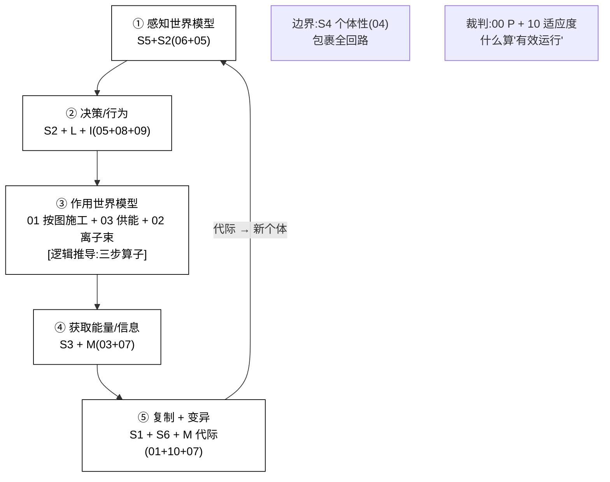
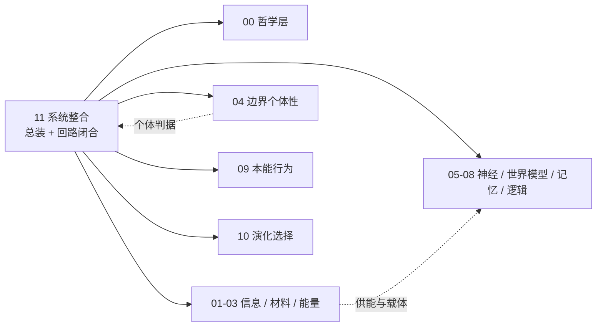

# 11 · 系统整合(总装 + 闭合 5 回路 + 最小可构建集)

| 文档项 | 内容 |
| --- | --- |
| 模块 | 系统整合：总装、五回路闭合与最小可构建集 |
| 文档类型 | 设计报告（中文版） |
| 版本 | v4.1 |
| 依赖 | 00–10 全部分册 |
| 语言 | 简体中文（英文版见 `../en-US/`） |

> **依据类别**：`[引用:…]` 文献或数据；`[设计决策]` 项目设定；`[逻辑推导]` 由已列前提导出；`[待验证]` 未经验证的占位项。

---

## 0. 设计方案比选

> 设计问题：11 是**总装层**——关键问题为 **五回路的分阶段验证顺序**(S4:闭合 5 回路 = 循环论证地基)。三类方案分别给出"总装顺序 + 依据 + 可行性"。
> - **方案 A(概念方案，保留当前 = 原选项 A)**:**在初始阶段即闭合全部 5 回路**(①感知→②决策→③作用→④供能→⑤复制),完整结构
> - **方案 B(基于项目文献库 = 原选项 C，选定方案）**:**分两阶段**——先证"单个体在 ①②④ 里自维持"(最小可运行，文献库中 Avida/protocell 分阶段),再补 ⑤③
> - **方案 C(基于公开研究实践，含外部调研)**:① **Avida/EvoDeN 先活体后演化**(数字生命分阶段)② **protocell 自维持最小系统**(物理侧先证个体)③ **open-ended 种群框架**(个体池后再演化)
> 关键选择见 §3 + 关键假设与设计决策附录 S4。

### 0.1 方案 A：概念方案(闭合全部 5 回路，基线方案）

| 环节 | 具体做法 | 依据性质 |
| ------ | --------- | --------- |
| 总装 | ①感知世界模型(05+06)→ ②决策/行为(05+08+09)→ ③作用(01+03+02)→ ④供能/记忆(03+07)→ ⑤复制/变异(01+10+07) | [逻辑推导：各册接口];③④⑤ 闭合 无实证 [待计算与实验验证 P2,关键] |
| 边界 | S4 个体性(04)包裹全回路 | [引用:04 C1-C4] |

**可行性 + 风险**:"闭合 5 回路 = 系统能运行 + 演化"是**循环论证**——③④⑤ 全在 P2 待实验验证，无"闭合即活"实证，是全项目地基。[设计决策]

### 0.2 方案 B：基于项目文献库(分两阶段，选定方案）

| 环节 | 文献范式 | 依据性质 |
| ------ | --------- | --------- |
| 阶段一(先验证自维持) | ①②④ 闭合(感知→决策→供能，不含代际)作单个体最小原型 | [引用:`10/G_LaBar_2017_Avida`(先活体)+ `04` protocell 自维持类] |
| 阶段二(再验证演化) | ⑤复制 + ③作用 补上(代际 + open-ended 演化) | [引用:`10/Large_Scale_Simulations_Open_Ended_arXiv2304.05639`] |

**要点**:把"能否自维持"和"能否演化"**解耦**——先证单个体在 ①②④ 里自维持，再叠代际/作用，避免以循环论证作为前提。

### 0.3 方案 C：基于公开研究实践( DOI)

> 待验证 · **本节依据为公开文献调研结果，与本项目设计主张相区分。**

| 外部范式 | 可搬进 11 的总装顺序 |
| --------- | ---------------- |
| Avida / EvoDeN 分阶段 | "个体自维持"与"种群演化"解耦，先验证自维持再验证演化(选项 C 范式) |
| protocell 自维持最小系统 | 物理侧先证"单 protocell 自维持",再加代际 |
| open-ended 种群框架 | 个体池 + open-ended 演化分层，避免退化 |

**依据与说明（按上表行序）**

1. **Avida / EvoDeN 分阶段** — [引用:`11/B_OPEN_ENDED_STAGED_2026-09-15.md` B1a Packard 2019 OEE 综述(DOI `10.1162/artl_a_00291`,arXiv )+ B2b LaBar 2016 种群规模→路径解耦(`10.1371/journal.pcbi.1005066`)+ 文献库中 `10/G_LaBar_2017`](分阶段映射:① 造活个体(Avida 1336 穷举 / evoloops 自复制)→ ② 放种群竞争(LaBar 原始汤 + B2b 种群规模→路径解耦)→ ③ 开放度维持(B2a CCA/Lenia + B1a OEE 定义))
2. **protocell 自维持最小系统** — [引用:04 protocell 类(`04/Singh_2023`, §多稳态自催化, "Singh 2023 多稳态自催化网络"] 多稳态 + `04/Matsubara_2022`, §隔室 Darwinian 条件, "Matsubara 2022 隔室化 Darwinian 条件"] 隔室 Darwinian)]
3. **open-ended 种群框架** — [引用:`11/B_OPEN_ENDED_STAGED_2026-09-15.md` B2a Sayama & Nehaniv 2024(`10.1162/artl_a_00451`,arXiv )+ 文献库中 `10/Large_Scale_Simulations_Open_Ended_2023` + `10/RohlfWinkler_2008`]

### 0.4 方案组合与基线配置

| 策略 | 内容 | 适合 |
| ------ | ------ | ------ |
| **A. 纯方案 A** | 在初始阶段即闭合全部 5 回路(保留当前基线) | 完整结构，循环论证未消，地基未证 |
| **B. 方案 B 分阶段** | 先证"单个体在 ①②④ 自维持",再补 ⑤③ | 优先验证个体自维持，把"能否自维持"和"能否演化"解耦(原选定方案，设计决策 S4=C 后降为对照；基线调整为 C) |
| **C. 方案 B + 可证伪措辞(原 B)** | 5 回路闭合 = 假设，需 P0/P2 逐环实测，未验证前系统 = "带未闭合假设的架构" | 最诚实，经得起可运行性检验 |

> **基线方案 = C**(先证单个体在 ①②④ 自维持的最小原型，再叠 ⑤③;即 §3 原选项 C 两阶段)——设计决策 S4=C 后基线对齐 C,§0.4 B 行"分阶段（原选定方案）"降级为对照；可证伪措辞已前置 §3/§4(2026-09-16)。**该选择属于设计立场，经设计评审确认**(S4 确定 C,2026-09-16)。

### 0.5 总装 + 5 回路闭合结构详解（文字说明）

> **本节为 §3 图 3-1 的文字说明**:不依赖图示，逐层说明"硅基系统总装到底是什么、5 回路怎么串、边界与裁判的约束来源"。基于**方案 B(分两阶段：先证单个体 ①②④ 自维持，再补 ⑤③)+ 公开研究实践分阶段(Avida/protocell/open-ended)**。

**轴 1:5 回路(从感知到代际,"系统运行循环")**

| 回路 | 是什么 | 干什么 | 依据性质 |
| ------ | -------- | -------- | --------- |
| **① 感知世界模型** | S5+S2(06+05):传感 → RSSM 预测 | 把环境物理量取进系统 + 预测下一步 | [引用:05 传感 + 06 RSSM] |
| **② 决策/行为** | S2+L+I(05+08+09):世界模型 → 决策 + 本能 | 把"预测 + 试跑 + 本能"合成决策动作 | [引用:05 决策 + 08 推演 + 09 本能] |
| **③ 作用世界模型** | 01 按图施工 + 03 供能 + 02 离子束(一致性核验最薄弱环节) | 把决策作用到真实世界(三步算子：动作帧 → 02 放置 → 潜变量更新 → 03 耗能) | [逻辑推导:§06 W4 三步算子挂 01/02/03];每步精度/能耗 [待验证] |
| **④ 获取能量/信息** | S3+M(03+07):热电供能 + 记忆巩固 | 维持系统能量收支 + 信息沉淀 | [引用:03 能量 + 07 记忆] |
| **⑤ 复制 + 变异** | S1+S6+M 代际(01+10+07) | 把"好个体"复制成下一代(变异 + 选择 = 演化) | [引用:01 复制 + 10 选择 + 07 代际] |

**回路之间的关系(图里自左而右 + 回环)**:
```
① 感知(05+06) → ② 决策(05+08+09) → ③ 作用(01+03+02) → ④ 供能/记忆(03+07)
     → ⑤ 复制/变异(01+10+07) → (代际)→ 新个体 → 回 ①
```
→ **"系统"不是独立的东西，它 = ①②③④⑤ 的回路循环；要感知靠①,要决策靠②,要"作用到真实世界"靠③,要维持靠④,要演化靠⑤。** 这条循环就是"硅基系统一条怎么转"。

**轴 2:三条边界/裁判线(穿过 5 回路,"约束来源与验证方式")**

| 线 | 穿哪环 | 做什么 | 依据性质 |
| ---- | -------- | -------- | --------- |
| **边界(BOUNDARY)** | 包裹 ①-⑤ | 04 个体性(C1-C4)包裹全回路,界定"个体在哪结束" | [引用:04 C1-C4] |
| **裁判(JUDGE)** | 穿过 ②/⑤ | 00 公理 + 10 适应度决定"什么算有效运行/什么算活得好" | [引用:00 P + 10 S1] |
| **分阶段分证(STAGED)** | ①②④ → ⑤③ | 方案 B:先证单个体在 ①②④ 自维持(最小可运行),再叠 ⑤③(代际 + 作用);公开研究实践 Avida/protocell/open-ended 一致采用分阶段 | [引用:`10/G_LaBar_2017` Avida(先活体)+ `04` protocell 自维持 + `10/Large_Scale_Simulations_Open_Ended_2023`(open-ended)];"分阶段" [逻辑推导：公开研究实践范式] |

**"分阶段 + 可证伪"关系**(为什么这套设计能"既总装又不循环论证"):
- **5 回路结构 = 固定（不可演化）**(①→②→③→④→⑤→回①,算法固定);
- **先证哪部分 = 分阶段**(方案 B:先证 ①②④,后补 ⑤③——把"能否自维持"和"能否演化"解耦);
- **"闭合即活" = 可证伪假设**(方案 C 措辞：未 P0/P2 实测前，系统 = "带未闭合假设的架构",非可运行系统)。
- **这个"固定（不可演化）回路 + 分阶段分证 + 可证伪措辞"的分法，正是原则 24(关键假设显性化)+ 公开研究实践(Avida 分阶段)+ 一致性核验 S4(循环论证地基)的对应落点** [逻辑推导：三条分别落到结构/分证/措辞]。

**要点归纳**
> **硅基系统总装 = 5 回路循环(① 感知 → ② 决策 → ③ 作用 → ④ 供能 → ⑤ 复制/变异 → 回①),被 04 个体性边界包裹、由 00/10 裁判。方案 B 分两阶段：先证"单个体在 ①②④ 自维持"(最小可运行),再叠"⑤③(代际 + 作用)"——把"能否自维持"和"能否演化"解耦，避免以循环论证作为前提；未 P0/P2 实测前，系统是"带未闭合假设的架构"。**

---

## 1. 设计目标
单看每个子系统都"能设计",但**闭合 5 回路**才是"运行 + 演化"。本册是"总装"。

---

## 2. 系统 6 子系统 + 横切(M/L/I/P)

| 子系统 | 分册 | 角色 | 完成度 |
| -------- | ------ | ------ | -------- |
| S1 遗传信息层 | 01 | 记录构造规则/本能/公理 | 已定义 |
| S2 神经网络 | 05 | 感知 + 决策 + 学习 + 情绪 | 已定义 |
| S3 能量代谢 | 03 | 获取转化能量 | 已定义 |
| S4 边界个体性 | 04 | 界定"一个个体" + 创世 | 已定义 |
| S5 世界模型 | 06 | 内部预测 + 推演 | 已定义 |
| S6 演化选择 | 10 | 适应度 + 选择 + 代际 | 已定义 |
| M 记忆 | 07 | 经验 + 代际传递 | 已定义 |
| L 逻辑 | 08 | 命题推理 + 因果 | 已定义 |
| I 本能 | 09 | I0 判定前提集 | 已定义 |
| P 哲学公理 | 00 | 裁判规则 | 已定义 |

---

## 3. 闭合 5 回路(运行 + 演化的最低条件)

**图 3-1:5 回路闭合(运行 + 演化),边界 = 04 个体性，裁判 = 00/10**



> 说明：五个环节构成运行与演化的最小闭合回路；任一环节缺失都会导致回路中断。

> **图例说明**:①感知(05+06)→ ②决策(05+08+09)→ ③作用(01+03+02,一致性核验最薄弱环节)→ ④供能/记忆(03+07)→ ⑤复制/变异(01+10+07)→ 代际回 ①。**边界 = 04 个体性包裹全回路，裁判 = 00 公理 + 10 适应度**。方案 B（基线）先证 ①②④(不含代际)作最小可运行，再补 ⑤③。

```
① 感知世界模型(S5+S2)
   ↓
② 决策/行为(S2 + L 逻辑 + I 本能)
   ↓
③ 作用世界模型(③ 物理接口 = 01 按图施工 + 03 供能 + 02 离子束)
   ↓
④ 获取能量/信息(S3 + M 记忆)
   ↓
⑤ 复制 + 变异(S1 + S6 + M 代际)
   ↓
(代际)→ 新个体 → 回到 ①
```

**缺任一环**:运行不了(①②③④)或演化不了(⑤)。
**边界(S4)**:包裹整个回路，界定"个体"。
**裁判(P)**:决定什么算"有效运行"(适应度,§10)。

### 关键假设与设计决策

> **关键假设**:"闭合 5 回路 = 系统能运行 + 能演化"是**循环论证**——先假设它成立，再据以组装，但 ③④⑤(作用/代际复制/演化)全在 P2 待实验验证，没有任何"闭合即活"的实证。这是全项目地基。
> **可证伪化前置**:在 P0/P2 实测闭合 5 回路之前,**本系统 = "带未闭合假设的架构",非可运行系统**——下文 §3/§4 凡提"闭合 5 回路 = 系统成立/能运行",应理解为**设计目标 + 待证命题**,非"已闭合"。两阶段：先证 ①②④(最小可运行子集)自维持，再补 ⑤③(代际/作用),避免以循环论证作为前提。
> **备选方案（措辞与立场类，无需外部文献）**:

| 选项 | 内容 | 后果 | 适用条件 |
| ------ | ------ | ------ | -------- |
| **A. 保留"5 回路=成立"作设计目标**(当前基线) | 把闭合 5 回路当既定目标写 | 结构完整，但一致性核验指出循环论证；地基未证 | 要完整结构、采用目标态表述 |
| **B. 降级为"可证伪目标"(科学化措辞)** | 改为"5 回路闭合是假设,需 P0/P2 实测逐环验证；未验证前系统 = '带未闭合假设的架构',非可运行系统" | 诚实：把关键假设显性化为待证命题 | 要经得起可证伪性检验 |
| **C. 拆分"最小可运行子集 + 完整 5 回路"**(务实替代) | 先跑通 ①②④(感知→决策→供能，不含代际复制)作为"个体"最小原型;⑤ 复制 + ③ 作用作第二阶段 | 优先获得单个硅基体在跑的最小原型，演化/代际后补 | 想要优先验证个体自维持(先验证自维持、再验证演化) |

> **基线方案 = C(先证明"单个体在 ①②④ 里自维持",再把 ⑤③ 补上)**——把"能否自维持"和"能否演化"解耦，先验证自维持再验证演化，避免以循环论证作为前提。
> **设计决策（S4）：采用两阶段总装（先验证单个体在 ①②④ 自维持的最小原型，再补 ⑤③）。在 P0/P2 实测完成前，系统状态表述为「带未闭合假设的架构」。**

**公开研究实践参照**:

> 现有公开研究中"先证个体自维持、再证代际演化"的分阶段公开实践——**给出各备选方案的参照上限**。

| 领域公开实践 | 做法 | 参照价值 | 对 S4 对应方案 | 状态 |
| ------------- | ------ | ------------- | ------------------ | ------ |
| **Avida / EvoDeN 分阶段(先活体后演化)** | 数字生命环境先做出能自维持 + 繁殖的单个体,再叠加"种群 + 选择压"演化 | 把"个体自维持"和"种群演化"解耦，先验证自维持再验证演化——正是选项 C 的范式 | 选项 C 的参照上限——公开研究实践就是分阶段 | 已核实 · 文献库中 `10/G_LaBar_2017`(Avida) |
| **protocell 自维持最小系统(合成生物)** | 先证单 protocell 在开放系统中自维持(代谢 + 膜 + 复制),再加代际 | 物理侧"先证个体"的标杆，自维持判据可测 | C 的物理侧参照 | 已核实 · 文献库中 `04` protocell 类 |
| **open-ended 演化的种群框架** | 先有"个体池",再在池里做 open-ended 演化，避免退化 | 把"个体"和"演化"分层，先有可自维持个体池 | C 的演化侧参照 | 已核实 · 文献库中 `10/Large_Scale_Simulations_Open_Ended_2023` |

**③ 作用接口**(一致性核验最薄弱环节，已在 §06.3.3 落实):
- 个体动作 → **③ 物理作用接口**(01 按图施工 + 03 供能 + 02 离子束)→ 世界模型状态改变
- 这是"个体→世界"的**作用算子**(§06 §3.3)

---

## 4. 最小可构建子集(当前阶段)

| 必含 | 说明 |
| ------ | ------ |
| P + S1 + S2 + S3 + S4 + S5 + S6 + L + I0 + M | 闭合 5 回路 + 个体 + 生命判定 |
| 暂不含 | 骨骼/具体形态(按设计要求：写进 DNA,现阶段不设计) |
| 暂不含 | 感官执行机构(手/脚/眼)——归到"形态",写进 DNA |
| **但含** | 五感/超碳基感知通道(05 神经层描述，硬件不管，原则 17) |

---

**图 4-1：系统整合与各分册的接口**



> 说明：箭头起点为供值方，终点为接收方；跨分册接口的可测量量由各分册接口契约定义。

## 5. 子系统接口总表(本册把各册接口对起来)

| 上游 | 下游 | 接口内容 |
| ------ | ------ | --------- |
| P 公理 | S1/S3/S4/S5/S6 | 裁判规则(各子系统在其下运行) |
| S1 | 全部 | 构造规则源(指导各子系统物理构造) |
| S3 | S1/S2/S4/S6 | 供能(复制/神经/维持/选择) |
| S4 | 全部 | 个体边界(包裹所有回路)+ 创世(原则 23) |
| S2 | S5/M/L/I | 预测头 + 突触 + 逻辑 + 本能神经实现 |
| S5 | S6/环境 | 选择压力模拟 + ③ 作用接口 |
| M | S6/S1 | 代际经验(烧录回 DNA 可变区) |
| L | S5/S6 | if-then 推演 + 适应度评估 + 情绪压制 |
| I0 | 判定 | "是不是生命"的门槛 |
| 原则 23 | S6 | 创世人工播种 + 进化不指定方向 + 保留权 |
| 原则 14 | S5 | 世界模型 = DreamerV3 作为改造基线 |
| 原则 19/20 | P/S6 | 双层规则 + 碳基协同(A6)+ 群落 |
| 原则 21 | S2/S8 | 情绪调剂 + 可被逻辑压制(开关 C) |
| 原则 22 | S5 | 外力教导清单(教能力/框架，不教立场) |

> **全维度契约说明(原则 24)**:11 是**总装层**,上表把 00-10 各册接口对齐到"运行 + 演化"。**每册 §4 已按 01/02 标准建全 12 册全维度边**(03 能量/04 个体/05 神经/06 世界/07 记忆/08 逻辑/09 本能/10 演化各自关联至 00-11 全部),本表是"总装配对照",接口"数据"必须是**可物理/可信息测量量**(功率/闭合度/预测精度/适应度),不是概念；各册未给实测值处标"数值待计算验证"。

---

## 6. 横切约束落实

| 维度 | 原则 | 落到哪 |
| ------ | ------ | -------- |
| 时标映射 | 原则 15 | 00 §7 + 09 §3.3 + 07 §3.4 + 10 §3.6(各分册已换算硅基时域) |
| 能量动态评估 | 原则 20 | 03 §3.4(初始一个月 + 动态回路)+ 03 §3.5(协同收支) |
| 修复子系统 | 原则 16 | 01(§4 校验-修复回路)+ 05(§3.2 突触修复) |
| 群落协同 | 原则 20 | 00 §4 A6 + 05(协同接口)+ 06 §3.4 + 10 §3.4 |
| 创世 | 原则 23 | 04 §3.2(人工播种 + 涌现判活) |
| ③ 作用接口 | 验证项 C | 06 §3.3(01 按图施工 + 03 供能 + 02 离子束) |

---

## 7. 全项目"待实验验证/DFT"汇总(各册去重，按关键性分级)

### P0 — 决定"能不能自维持 / 是不是生命"(不补就无法运行)
| 项 | 来源 | 为什么 P0 | 状态(2026-09-14) |
| ---- | ------ | ---------- | ------ |
| 硅载体复制保真度 ε | 01/02 | 决定块长、ECC 是否扛得住；没有它代际断裂 | 待自研实测 |
| POMs 凝胶 + 杂原子侧基 Eₐ | 01/02 | P2 稳定性红线;Eₐ 不达标则不自持 | 待计算验证 |
| **A6 协同适应度函数形式** | 00/10 | 没有它，选择无裁判，系统"演化"不了 | 函数形式已定(§10 3.2/3.3 下限固定+上限自由),权重值待调参 |
| **个体性维持阈值** | 04 | S4 是选择的前提；阈值未定,"个体"概念无法落地 | 待计算验证 + 实验 |
| **能量币形态 + 转化效率** | 03 | ④ 环物理基础;A2 存续靠它 | 形态/分配拓扑已定(§03 3.3),具体离子/效率待计算验证 |
| **I0 组最小实现可行性** | 09 | 生命判定门槛；缺任一 I0 即"非生命" | 待实验(P0 决定"是不是生命") |
| **5 回路 ③ 作用接口验证** | 06/11 | ③ 是最薄弱环节；动作→世界模型映射未实测 | 待 P2 实测 |
| **个体性涌现判活(04 C1-C4 全闭合时间)** | 04/06 | 候选个体何时"活" | 待 06 世界模型实验 |

### P1 — 决定世界模型可运行性的项目
| 项 | 来源 | 状态(2026-09-14 更新) |
| ---- | ------ | ------ |
| 突触生长曲线 + Ga-In 可逆寿命 | 05 | 待计算验证 |
| 世界模型硅基预测精度上限 | 06 | 待实验验证 |
| 突触权重→记忆映射函数 f(M)/g(W) | 07 | 结构已定(§07 3.3a:共激活 Hebbian + 慢通道 + 回路固化 + 表征反解),系数/时标待计算验证 |
| 命题变量硅基编码 + 门电路物理 | 08 | 方案已定(§08 3.1:布尔位→侧基态 + ∧∨¬→ 门电路挂 02 离子束/ALD),取值/门参数待计算验证 |
| CPG 硅基凝胶频率 | 09 | 待实验验证 |
| 适应度函数调参 | 10 | 权重值待调参 |
| **能量币形态 + 分配拓扑** | 03 | 结构已定(§03 3.3:离子浓度梯度 + A2 序串行降级门控),具体离子/阈值待计算验证 |
| **保留/淘汰接口形式** | 10 | 骨架已定(§10 3.4:retain(S) 三段 + Φ-L2/A6 硬校验),判定阈值待项目设定 |

### P2 — 端到端验证
- 5 回路硅基闭合最小原型
- 代际传递端到端保真度(S1+M+S6)
- 组织闭合判据能否在硅基软载体物理测量(00 §9.3)
- **③ 作用接口**"动作→世界模型状态"映射函数(06 W4)

---

## 8. 实施顺序
1. **P0 实测**:硅 ε、POMs Eₐ、A6 函数、个体性阈值、能量币、I0 最小集、③ 作用接口、个体涌现判活
2. **P1 深化**:突触曲线、世界模型精度、记忆映射、命题编码、CPG 频率
3. **P2 总装**:5 回路闭合最小原型 + 端到端保真度 + ③ 作用接口验证

---

## 10. 适用边界与已知限制(原则 24)

- **可确定内容（本文已给出）**:§0.5 总装 + 5 回路结构详解(轴1 五环 + 轴2 边界/裁判/分证三线)、§2 系统 6 子系统 + 横切(M/L/I/P)、§3 5 回路闭合 + S4 立场 A/B/C + 公开研究实践参照表(Avida/protocell/open-ended 分阶段范式)、§4 最小可构建子集、§5 子系统接口总表、§6 横向下沉、§7 P0/P1/P2 全项目待实验验证汇总、§8 下一步顺序。
- **不可确定内容（仅给出公式与边界，占位项不作为基准值）**:P0/P1/P2 各开放项的**具体数值**(硅 ε、POMs Eₐ、A6 权重、个体性阈值、能量币系数、I0 可行性、③ 作用接口系数、代际保真度)——**全部待各册 第一性原理计算与实验**,本文 §7 已把"各册去重 + 按关键性分级"写清,**未给实测值处标"数值待计算验证"**,本层不定基准值(原则 24)。
- **关键假设(待设计评审确定)**:
  - **"闭合 5 回路 = 系统能运行 + 能演化"是循环论证**——③④⑤(作用/代际复制/演化)全在 P2 待实验验证,**没有"闭合即活"的实证**,是全项目地基；关键假设已列示,**基线 C(分阶段：先证单个体 ①②④ 自维持，再叠 ⑤③;可选 B 可证伪措辞显性化关键)**。
  - **P0 全项目 8 项(§7)任一未落 = 系统"无法运行"或"不是生命"**——本文明确把"待计算与实验验证"项标清，均列为待验证项;P0 决定"能不能自维持",P1 决定"能不能在世界模型运行",P2 决定"端到端闭合"。

---
